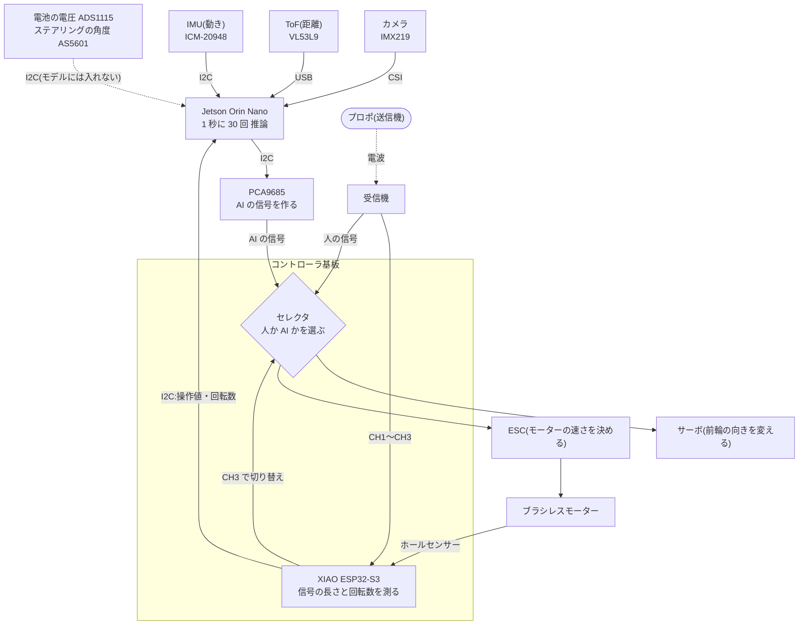
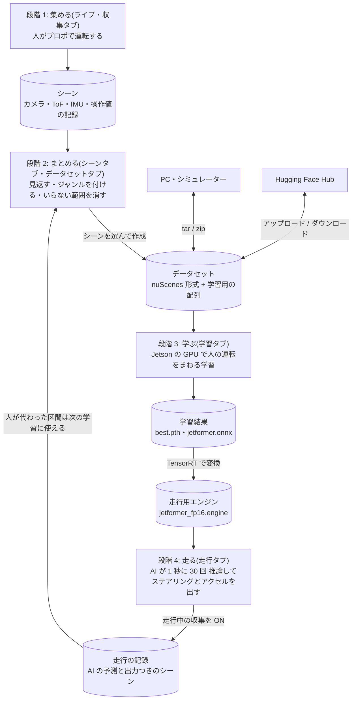
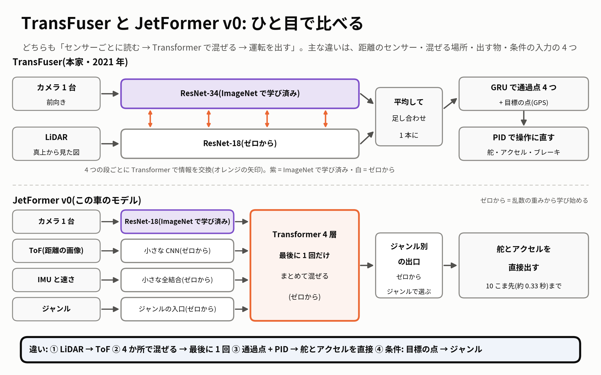
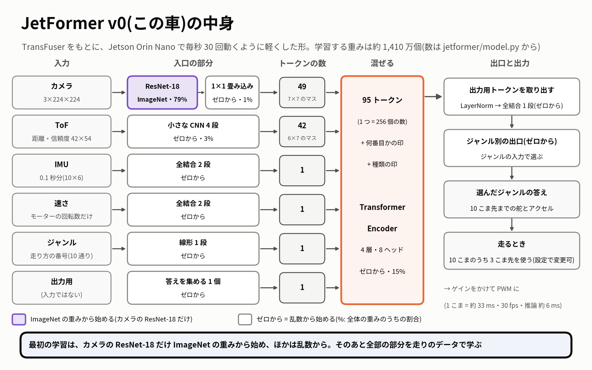

# JetFormer

JetFormer は、1/10 サイズのラジコンカーに小型コンピューター Jetson Orin Nano を載せ、人の運転をまねて自分で走る車を作るプロジェクトです。大会に向けて開発していて、2026 年 11 月 8 日の予選(3 周のタイムを競います)は 3 位でした。決勝は 12 月 13 日です。

車のカメラ・ToF(前方の距離を面で測るセンサー)・IMU(加速度と回転の速さを測るセンサー)と、人が送信機で入れた操作を同時に記録し、Transformer(たくさんの情報の関係をまとめて見て判断する AI の仕組み)のモデルに学習させます。学習したモデルは車の上で 1 秒に 30 回動き、ステアリング(前輪の向き)とアクセルを決めます。

収集・学習・AI 走行は、ブラウザの管理画面からひととおり操作できます。集めたデータは nuScenes(自動運転の研究で広く使われるデータの形)にならったデータセットにして、Hugging Face(AI のモデルやデータを共有するサイト)へ上げたり、そこから取り込んだりできます。

**目次**: [予選ダイジェスト](#予選ダイジェスト) / [アップデートの流れ](#ここまでのアップデートの流れ) / [インストール](#パッケージのインストール方法) / [車体とセンサー](#現在の車体の構成とセンサー) / [収集・学習・走行の流れ](#データ収集と学習走行の流れの図) / [データセット](#データセットのフォーマットとアップロードダウンロード) / [Hugging Face](#hugging-face-へのアップとダウンロード) / [モデル設計](#モデル設計) / [その他](#その他)

## 予選ダイジェスト

https://github.com/user-attachments/assets/5d1389c7-c64e-464f-a93f-08728610435c

2026 年 11 月 8 日の予選を 1 分にまとめた動画です。1 回目の走りを外から撮った映像に同じ瞬間の走行ログ(ステアリング・アクセル・速さ・コース上の位置)を重ねたものと、4 回目の 2 周目を車のカメラから見た映像が入っています。

予選は同じモデルで 8 回走り、アクセルとステアリングのゲイン(AI の出力にかける倍率)だけを変えて調整しました。公式タイムは **3 周 24.43 秒**で、**予選 3 位**でした。このタイムが出たのはゲインを上げていった途中の走りで、外から撮った 1 回目はこれより遅い走りです(車のカメラの記録で 3 周 約 27.8 秒)。

## ここまでのアップデートの流れ

開発の様子は、YouTube の再生リスト「JetFormer開発記」に動画でまとめています(リンクを開くと「[JetFormer開発記] 予選ダイジェスト」から再生が始まります)。

https://www.youtube.com/watch?v=JuqWEVjruw8&list=PLFgozuuippLQ

| 日付(2026 年) | 動画 | できごと |
|---|---|---|
| 10/10 | [Day1](https://www.youtube.com/watch?v=7RWuXv4PR0A&list=PLFgozuuippLQ) | 試作機が完成。センサーの同時記録、管理画面、モデル、学習、AI 走行を作り、その日のうちに実車で AI が走りました(ぶつからなかった周のベストは 1 周 9.68 秒) |
| 10/11〜12 | [Day2](https://www.youtube.com/watch?v=nSEM7uXz-vs&list=PLFgozuuippLQ)・[3](https://www.youtube.com/watch?v=L24v1x3QB8A&list=PLFgozuuippLQ) | 学び方の比較。オフライン強化学習(集めた記録だけで試行錯誤して学ぶ方法)と形の違う 4 種類のモデルを試しましたが、机の上の評価では、最初の軽い形(自動運転の研究 TransFuser を参考にした形)を超えるものはありませんでした |
| 10/13〜15 | [Day4](https://www.youtube.com/watch?v=fFJYCx2tlTc&list=PLFgozuuippLQ)・[5](https://www.youtube.com/watch?v=A8FN_mXttqo&list=PLFgozuuippLQ)・[6](https://www.youtube.com/watch?v=_83c_EB7Jxs&list=PLFgozuuippLQ) | シミュレーター(コースを再現して車を走らせる別のプログラム)を管理画面から使えるようにして、実車のデータと混ぜた学習を試しました。いろいろな走りのデータを強化学習で作るモードも 5 種類足しましたが、実車のデータでの精度はあまり上がりませんでした |
| 10/16〜22 | [Day7](https://www.youtube.com/watch?v=GJ3_yoXS-qE&list=PLFgozuuippLQ)・[8](https://www.youtube.com/watch?v=U2h7PSTsXRE&list=PLFgozuuippLQ)・[9](https://www.youtube.com/watch?v=svIVeQgghnw&list=PLFgozuuippLQ)・[10](https://www.youtube.com/watch?v=IdbAieqeHD4&list=PLFgozuuippLQ)・[11](https://www.youtube.com/watch?v=Cs4XBvQWock&list=PLFgozuuippLQ) | 実車を走らせずに、データの選び直し、シミュレーターを実車に近づける調整、区間ごとの速度の上限を進め、実車で比べる候補のモデルと成績表の道具を用意しました(車体の解説は Day8) |
| 10/23〜24 | [Day12](https://www.youtube.com/watch?v=Yxb5nqfPVlQ&list=PLFgozuuippLQ)・[13](https://www.youtube.com/watch?v=cUnFv2Bi5Vo&list=PLFgozuuippLQ) | 実車のベンチマーク(候補のモデルを実際に走らせて比べるテスト)を 2 日間行いました。いちばん良い 1 周は 8.25 秒、続けて走った 3 周は 25.29 秒でした |
| 10/25〜28 | [Day14](https://www.youtube.com/watch?v=HG3MYDe9SG0&list=PLFgozuuippLQ)・[15](https://www.youtube.com/watch?v=i_M75alLYPc&list=PLFgozuuippLQ) | データを増やしてモデルを 22 個学習し、発進の補助、速さの上限、ぶつかったあとの自動の立て直し(リカバリー)の安全を見直しました |
| 10/29〜30 | [Day16](https://www.youtube.com/watch?v=2_sBIs8DQic&list=PLFgozuuippLQ)・[17](https://www.youtube.com/watch?v=ZN3Hc-_f8VI&list=PLFgozuuippLQ) | 増やしたデータで学び直したモデルが 1 周 7.81 秒を記録。翌日は止まった状態から 3 周 23.62 秒を出し、24 秒を切りました(途中で 1 回、軽くぶつかっています) |
| 10/31〜11/2 | [Day18](https://www.youtube.com/watch?v=1BdzUNMSfuY&list=PLFgozuuippLQ) | USB を外しても走り続けられるようにしました。電池の電圧とステアリングの角度のセンサーも足して、全部つないだ状態を確かめました |
| 11/3 | [Day19](https://www.youtube.com/watch?v=fEupKwtfUBI&list=PLFgozuuippLQ) | 練習コースでの最後の試験走行で 23 回走りました。止まった状態からの 3 周の最速は 25.27 秒、走りながら測った 3 周の最速は 23.80 秒で、続けて 7 周を強くぶつからずに 56.52 秒で走った回もありました |
| 11/4〜5 | [Day20](https://www.youtube.com/watch?v=yjJ0sWlHeHY&list=PLFgozuuippLQ) | 予選は別の会場なので、背景が変わっても走りがくずれにくいように学び直したモデルを作りました(コースの板の奥の背景だけを入れ替えて学習) |
| 11/6〜7 | [Day21](https://www.youtube.com/watch?v=V54WQOEg2ZU&list=PLFgozuuippLQ) | 予選と同じコースで試走して人の運転のデータを集め、そのデータで追加学習して、予選で使うモデルを机の上の評価で選びました |
| 11/8 | [Day22](https://www.youtube.com/watch?v=CVgQ-j-1zC4&list=PLFgozuuippLQ) | 予選。8 回走り、公式タイムは 3 周 24.43 秒で 3 位でした。次は **12 月 13 日の決勝**です |

## パッケージのインストール方法

新しい Jetson に JetFormer を入れて、ブラウザで管理画面を開くまでの手順です。車が無くても、この手順で管理画面までは開けます。データ収集と AI 走行には、[次の章](#現在の車体の構成とセンサー)の車体一式が要ります。

専用のインストーラーはなく、[FaBoAI/JetsonSkills](https://github.com/FaBoAI/JetsonSkills) の `jetracer-installer`(PyTorch・OpenCV などをまとめて入れるスクリプト)で土台を作り、足りない分を足します。

| 必要なもの | 内容 |
|---|---|
| 本体 | Jetson Orin Nano 8GB Developer Kit(Super モード)。`ls -l /etc/nvpmodel.conf` のリンク先が `..._super.conf` なら Super モードの構成です。そうでないと手順 3 の電力モードを選べません |
| OS | **JetPack 7.2**(NVIDIA の Jetson 用 OS)。`cat /etc/nv_tegra_release` の 1 行目が `# R39 (release), REVISION: 2.0, ...` なら 7.2 です。ほかの版ではインストーラーが止まります |
| ユーザー名 | **`jetson`** にします(起動スクリプトが `/home/jetson/...` を直接指しています) |
| ネットワークと空き容量 | インターネットへの接続が要ります。空き容量は、Python の環境で約 10 GB に加えて、ビルド中の一時ファイルの分が要ります(余裕を持たせてください) |
| 基板のファームウェア | ファームウェアは基板の上のプログラムです。ToF の基板(ESP32-P4)は `csi_ranging`、コントローラ基板(XIAO ESP32-S3)は `leracer_ctrl` v2 が前提です。ソースも書き込みの手順も**このリポジトリには入っていません**。Jetson との通信の中身は [docs/firmware_protocol.md](docs/firmware_protocol.md) にあります |

作者の車で動いている版は、Python 3.13(conda 環境 `jetracer`。conda = Python と部品をほかと混ざらないようにまとめる道具)・CUDA Toolkit 13.2(NVIDIA の GPU を使うための部品)・PyTorch 2.10.0+cu130・OpenCV 4.13.0(専用ビルド)・TensorRT 10.16.1.11(NVIDIA の道具。推論 = 学習したモデルで答えを出す処理を GPU で速くします)です。

### 1. 土台の環境を入れる

先にスワップ(メモリが足りないときにストレージを代わりに使う場所)を 4 GB 作ります。Orin Nano 8GB はメモリが尽きると本体ごと止まることがあるためです(`swapon --show` に何か出るなら 1〜2 行目は不要です)。インストーラーは `tmux`(SSH の接続が切れてもプログラムを動かし続ける道具)の中で動かします。`<自分で決めたパスワード>` は書き換えてください。

```bash
sudo fallocate -l 4G /var/swap-jrbuild && sudo chmod 600 /var/swap-jrbuild && sudo mkswap /var/swap-jrbuild && sudo swapon /var/swap-jrbuild
echo '/var/swap-jrbuild none swap sw 0 0' | sudo tee -a /etc/fstab
sudo apt-get update && sudo apt-get install -y git tmux
git clone https://github.com/FaBoAI/JetsonSkills.git ~/JetsonSkills
tmux new -s jetracer-install "cd ~/JetsonSkills/jetracer-installer && python3 script/install_jetracer.py --jobs 1 --camera-overlay tegra234-p3767-camera-p3768-imx219-A.dtbo --jupyter-password '<自分で決めたパスワード>'; bash"
```

- **指定の意味**: `--jobs 1` はビルドを 1 つずつ進める指定(Orin Nano の推奨)です。`--camera-overlay` は CSI カメラ(Jetson のカメラ用コネクタにつなぐカメラ)を 1 台、ポート A につなぐ設定で、もう一方のポートなら末尾を `imx219-C.dtbo` にします。省略すると 2 台用になります。`--jupyter-password` は JupyterLab のパスワードです。指定しないと、公開のスクリプトに書かれた既定のパスワードになります
- **待ち時間と再起動**: 最初に `sudo` のパスワードを聞かれます。OpenCV をソースからビルドするので時間がかかります。SSH が切れたときは `tmux attach -t jetracer-install` で戻れます。終わったら `sudo reboot` で再起動します
- **一緒に入る物**: Python の環境、カメラの起動設定、40 ピンヘッダ(Jetson の拡張用のピン列)の I2C(少ない本数の線で複数の機器をつなぐ通信)を 100 kHz にする設定のほかに、FaBo JetRacer 一式(`~/jetracer`。同じ Jetson に入る別のプロジェクト)、JupyterLab(ブラウザで Python を動かす開発環境。8888 番)、Node.js、Claude Code も入ります

### 2. JetFormer を入れて、自動で起動するようにする

足りない Python の部品(管理画面のサーバー、ToF との USB 通信、モデルの書き出し、Hugging Face、テスト)、音声案内の読み上げ(Open JTalk)、機器を使う権限、スピーカーの有効化(40 ピンヘッダの I2S = 音のデータを送る信号。標準では音が出ません)、サービス(OS が自動で動かすプログラム)の登録をまとめて行います。`--constraint` のファイルは手順 1 のスクリプトが作ったもので、PyTorch や OpenCV の版が変わるのを防ぎます。

```bash
git clone https://github.com/FaBoAI/JetFormer.git ~/jetformer
~/miniconda/envs/jetracer/bin/python -m pip install \
  --constraint ~/wheels/opencv-jp72-py313-v2/constraints-jetson-cu130.txt \
  "fastapi==0.143.0" "starlette==1.7.0" "uvicorn==0.54.0" "pyserial==3.5" \
  "onnx==1.23.2" "datasets==5.1.0" "huggingface_hub==2.2.0" "pytest==9.1.1"
sudo apt-get install -y open-jtalk open-jtalk-mecab-naist-jdic hts-voice-nitech-jp-atr503-m001 alsa-utils
sudo usermod -aG i2c,gpio,video,dialout,audio jetson
sudo ~/jetformer/scripts/i2s_mic/enable.sh   # スピーカーを使わないなら不要。元に戻すのは disable.sh
sudo cp ~/jetformer/scripts/jetformer-web.service /etc/systemd/system/
sudo systemctl daemon-reload && sudo systemctl enable jetformer-web
sudo reboot
```

ステアリングの角度と Jetson の電源の記録は、管理画面とは別のサービスです。起動のたびに記録したいときは、`tools/systemd/` の `jetformer-as5601.service` と `jetformer-power.service` を同じように登録します(読むだけの記録係なので、無くても収集・学習・走行はできます)。

### 3. 開いて確かめる

ブラウザで `http://<Jetson の IP アドレス>:8080/` を開きます(IP アドレスは `hostname -I` で分かります。USB ケーブルでつないだ PC からは `http://192.168.55.1:8080/`)。画面が出たら、次のコマンドで確かめます。

```bash
~/miniconda/envs/jetracer/bin/python -c "import cv2, torch, tensorrt, onnx, fastapi, uvicorn, serial, smbus2, datasets, huggingface_hub, jetcam; print(torch.__version__, torch.cuda.is_available())"
cd ~/jetformer && ~/miniconda/envs/jetracer/bin/python -m pytest -q tests/test_drive.py tests/test_session.py tests/test_sound.py tests/test_hf.py tests/test_model_export.py
```

- 1 つ目は `2.10.0+cu130 True` と出れば大丈夫です
- 2 つ目は車もセンサーも使わないテスト(1 分ほど)で、`failed` が出なければ大丈夫です(データが無いので `skipped` は正常です)
- **車がつながっているとき**: 「ライブ・収集」タブの「センサー」の「開始」で、各センサーの Hz(1 秒あたりの回数)が出ます
- **AI で走らせる前に**: 電力モードを最大の `MAXN_SUPER` にします(`sudo nvpmodel -m 2`。今のモードは `sudo nvpmodel -q` で確かめられます)
- **コードの更新とログ**: コードを更新したときは `sudo systemctl restart jetformer-web`、ログは `journalctl -u jetformer-web -f` で見ます

うまくいかないときは、次を確かめます。

| 症状 | 見る所 |
|---|---|
| カメラが映らない | 再起動、ケーブル、`--camera-overlay` のポート(A / C)。JupyterLab などほかのプログラムがカメラを使っていないか(同時に使えるのは 1 つだけです) |
| ToF が動かない | `/dev/ttyACM0` があるか。`id` の出力に `dialout` があるか |
| IMU やコントローラ基板の値が出ない | `/dev/i2c-7` があるか。`id` の出力に `i2c` があるか |
| 音が出ない | `enable.sh` のあとに再起動したか |

> **注意**: 管理画面にパスワードはありません。JupyterLab(8888 番)も含めて、知らない人が入れるネットワークにはつながないでください。

入ったら、[データ収集と学習、走行の流れ](#データ収集と学習走行の流れの図)に進みます。

## 現在の車体の構成とセンサー


市販の 1/10 ラジコンカーに、Jetson とセンサーを載せた車です。ここに書いたのは、2026 年 11 月 8 日の予選を走ったときの構成です。

プロポ(ラジコンの送信機)の信号は受信機で受け、CH1(ステアリング)、CH2(スロットル = アクセル)、CH3(人と AI の切り替え)の 3 本で基板に届きます。どれもパルスの長さ(単位は µs = マイクロ秒)で値を伝えます。このステアリングとスロットルの値を**操作値**と呼びます。

図の点線は、電波と、モデルの入力に使わないセンサーです。I2C の機器は、すべて Jetson の 40 ピンヘッダの 3・5 番ピン(I2C バス 7)を共有しています。



| 部品 | 使っている物 | 役目 |
|---|---|---|
| 車体 | タミヤ TT-02 SRX(1/10 ツーリングカー、4WD) | 土台のラジコンカーです。カーボンの柱(マスト)の上にカメラ、その下に ToF を付けています |
| 頭脳 | Jetson Orin Nano 8GB Developer Kit(Super モード。JetPack 7.2、電力モード MAXN_SUPER) | データ収集、学習、AI 走行を、この 1 台で行います |
| コントローラ基板 | FaBo JetFormer Controller(マイコン XIAO ESP32-S3) | 受信機の信号とモーターの回転数を読んで Jetson に渡します。人と AI の切り替えもこの基板で行います |
| AI の信号を作る IC | PCA9685(I2C アドレス 0x40) | Jetson の指令から、サーボと ESC が受け取る PWM 信号(パルスの幅で値を伝える信号)を 60 Hz で作ります |
| 電池 | 走行用は LiPo(リチウムポリマー電池)2 セル(満充電で約 8.5 V)、Jetson 用は別の電池 | 走行用は 1 本で約 20 分、Jetson 用は約 3 時間もちます。走行用を替えても Jetson は止まりません |
| スピーカー | コントローラ基板の I2S アンプとスピーカー | 収集や走行の開始、CH3 の切り替えなどを声で知らせます |

| 何を測るか | 機器 | つなぎ方 | 毎秒 | 使い道 |
|---|---|---|---|---|
| 前方の映像 | カメラ Sony IMX219 | CSI(V4L2 = Linux の標準の方法で直接読む) | 30 回 | モデルの入力(224×224 のカラー画像) |
| 前方の距離 | ToF ST VL53L9(評価基板 STEVAL-VL53L9 を ESP32-P4 の基板で受ける) | USB(`/dev/ttyACM0`) | 30 回 | モデルの入力(54×42 マスの距離と信頼度) |
| 車の動き | IMU TDK ICM-20948 | I2C(0x68) | 100 回 | モデルの入力(直前 0.1 秒の加速度と回転の速さ) |
| モーターの回転数・プロポの操作値 | コントローラ基板。回転数はホールセンサー(モーターの回転を測るセンサー)から計算(eRPM = モーターの電気角の回転数)、操作値は受信機の信号の長さを測る | I2C(0x28) | 100 回 | 回転数はモデルの入力、操作値は学習の正解(人が運転している間だけ) |
| 走行用の電池の電圧 | TI ADS1115(電圧の基板 BatteryTapADC v1.0) | I2C(0x48) | 50 回 | 記録と画面の表示(モデルには入れません) |
| ステアリングの角度 | AS5601(磁石の向きで角度を測るセンサー) | I2C(0x36) | 約 50 回 | 記録だけ(`tools/as5601_logger.py`) |
| Jetson の電源と温度 | Jetson に付いている INA3221 と温度センサー | Linux の `/sys` | 10 回(温度は 1 回) | 記録だけ(`tools/power_logger.py`) |

センサーのほかに、走り方を表す**ジャンル**の番号もモデルに入れます。11 月 8 日の予選のモデルには、今の操作値は入れていません(モーターの回転数は入れています)。マイク、IMU の地磁気センサー、OLED の小さな表示器は載っていますが、今の JetFormer では使っていません。

**人と AI の切り替え**: CH3 の信号の長さをコントローラ基板が測り、1500〜2499 µs のとき(AI 側。基板の LED が紫)だけ AI の信号を、それ以外(人側。LED が緑か青)は人の信号をサーボと ESC に届けます。切り替えは基板の上で行うので、Jetson のプログラムが止まっても、CH3 を人側にすれば人の操縦に戻せます。

> **注意**
>
> - Jetson のプログラムが強制終了すると(停電のときも同じ)、PCA9685 は最後の信号を出し続けるので、車は動いたままになることがあります。すぐに CH3 を人側にしてください
> - 受信機の信号が止まると、基板は最後に測った CH3 の値を保つので、AI 側のままになります。このとき Jetson は CH3 が届いていないことを見つけて中立(アクセルを離してステアリングをまっすぐにした信号)を出します。**この中立は一時的で、走行は終わっていません。** 信号が戻ると、CH3 が AI 側なら声の案内なしに AI がまた走らせます。送信機の電源を入れる前に CH3 を人側にし、走行は停止ボタンで終えてください
> - 受信機のフェイルセーフ(電波が切れたときの動作)は、CH3 が 1500 µs 未満になるか、パルスが止まるように設定してください。CH3 の最後の値を保つ設定では、基板も Jetson も電波が切れたことに気づけません

## データ収集と学習、走行の流れの図

人がラジコンを運転した記録から「運転をまねる AI」を作り、その AI で車を走らせます。次の 4 つの段階を、管理画面(`http://<Jetson の IP アドレス>:8080/`)のタブで順に進めます。



図の「シミュレーター」の本体は、このリポジトリには入っていません。

| 段階 | タブ | すること | できるもの |
|---|---|---|---|
| 1 集める | ライブ・収集 | **ジャンル**(走り方の種類)を選んで「収集開始」を押し、プロポで運転します。センサーと操作値を同じ時計で記録します | **シーン**(1 回の走行、または 20 秒ごとの記録。`data/raw/`) |
| 2 まとめる | シーン・データセット | 記録を映像とグラフで見返し、ジャンルを付け、いらない範囲を消して、学習に使うシーンから作成します。カメラのフレーム(1 枚の画像)ごとに、その時刻のセンサーの値と、そのあと約 0.33 秒の人の操作(学習の正解)を並べます。CH3 が AI 側のときの記録は正解に使いません | **データセット**(既定は学習用 8:検証用 2。`data/datasets/`) |
| 3 学ぶ | 学習 | データセットとモデルの種類を選び、Jetson の GPU で学習します。既定は 30 エポック(データを 30 周学ぶ)で、よく似た連続のフレームは 3 つに 1 つに間引きます。ぶつかった前後(水平の加速度 4 G 以上の 1 秒前〜2 秒後)のフレームは、既定では学習のときに外します(学習タブのチェックで切り替えます)。学習のあと自動で **エンジン**(Jetson の GPU 向けに変換した、速く動く形)を作ります。学習中は収集も AI 走行もできません(逆も同じ)。始めるには空きメモリが 3.5 GB 以上要ります。足りないと学習は始まらないので、JupyterLab のノートブックなど大きなプログラムを止めるか、管理画面のサービスを再起動してください | `best.pth`(学んだ重み)・`jetformer.onnx`(ONNX = 別の道具でもモデルを動かせる共通の形式)・`jetformer_fp16.engine`(`data/runs/`) |
| 4 走る | 走行 | モデルとジャンルを選びます。最初は「モーターに出力しない」を入れて「走行開始」を押し、予測を確かめます(車は動きません)。予測がおかしくなければ一度停止し、「モーターに出力しない」を外して、速度ゲイン(AI のアクセルを何倍にして出すか。1 で学習どおり)を小さめ(新しく入れたときの既定は 0.5。最初は 0.3〜0.5)にします。周りに人や物がないことを確かめてから「走行開始」を押し、プロポの CH3 を AI 側にすると車が動きます。「走行中のデータを収集する」を入れると、AI の予測と出力の付いたシーンも残ります | AI の走り・シーン |

**ジャンル**は、モデルにも入れて走り方を切り替える番号です。新しく入れたときの表は 0 未設定・1〜3 駐車・4 高速走行・5 低速走行で、0 のフレームは学習に使いません。「ジャンル」タブで追加や名前の変更ができます。「ジャンル」タブの説明文にある番号は作者の車で振り直したあとの番号で、その環境の実際の番号はタブの表のとおりです。走行タブでは、4 高速走行は「予選コース AI」、5 低速走行は「練習コース AI」の名前で出ます。

### AI 走行を止めるとき

はじめて AI で走らせる前に、ここと [AI走行](docs/guide.md#ai走行管理画面の走行タブ) の説明を読んでください。

- **まずプロポの CH3 を人側に戻します。** これがいちばん優先です。操縦は人に戻りますが、AI の走行は続いていて、CH3 を AI 側にするとまた動きます
- **走行を終えるボタンとキー**: 走行タブの停止ボタン、どのタブでも画面下に出る赤いボタン、Esc キー、スペースキー(文字の入力中は効きません)
- **画面を閉じても、スマホがスリープしても、USB を抜いても AI は止まりません**(走行を始めた画面からの通信が 30 分途絶えたときだけ止まります)。USB を抜いている間は画面から止められないので、先に CH3 を人側にしてから、USB をつなぎ直して停止ボタンを押します

## データセットのフォーマットとアップロード、ダウンロード

記録は、収集したままの **シーン** と、学習用にまとめた **データセット** の 2 段階で保存します。データセットの形は nuScenes にならっています。どちらも Jetson の `data/` の下にあり、`data/` は git に入りません。時刻はどれも UNIX 時間のマイクロ秒です。

```text
data/raw/<ログ>/<ログ>-0001/              シーン(<ログ> は 1 回の収集につく名前。シーンは 0001 から順に番号が付く)
    scene.json                            長さ・ジャンル・説明・タグ・統計
    CAM_FRONT/<時刻>.jpg  CAM_FRONT.npz   カメラの画像(224×224、30 Hz)と、時刻の一覧
    TOF_FRONT.npz  IMU.npz  VEHICLE.npz   ToF(30 Hz)・IMU(100 Hz)・操作値と回転数と電圧(100 Hz)
    AI_CMD.npz                            AI 走行のときだけ。予測・出力・ゲインなど
data/datasets/<名前>/                     データセット(例: 3 シーン・1,788 フレーム・約 1 分で、ファイルの合計 約 32 MB)
    v1.0-<名前>/*.json  samples/  can_bus/  nuScenes 形式の表(13 個)と、画像・ToF・操作値・IMU の元データ
    aligned/<シーン>.npz                  学習用の配列(下の表)
    splits.json  dataset_card.json        学習用と検証用のシーン名 / 説明・配列の説明(aligned_npz)・作ったときのジャンルの表(modes)
```

**学習で読むのは `aligned/<シーン>.npz` とカメラの画像です。** npz は NumPy の配列をまとめたファイルで、N はそのシーンのカメラのフレーム数(20 秒で約 600)です。配列の µs はプロポの信号の長さそのままです。モデルの出力は (µs − 1500) ÷ 500 に正規化した値で、走行のときに µs へ戻します。

| 主な配列 | 形 | 内容 |
|---|---|---|
| `timestamps_us` ・ `cam_files` | `[N]` | カメラの撮像時刻と画像の相対パス |
| `tof` | `[N,42,54]` | 直前の ToF の生の値(uint16)。下位 13 bit が距離 mm(`0x1FFF` は無効)、上位 3 bit が信頼度 0〜7 |
| `imu` | `[N,10,6]` | 直前 10 サンプル(100 ms)の加速度 xyz [m/s²] と角速度 xyz [rad/s] |
| `vehicle` | `[N,4]` | その時刻の `[ステアリング µs, スロットル µs, CH3 µs, eRPM]` |
| `future_actions` | `[N,10,2]` | 1〜10 フレーム先(約 0.33 秒先まで)の `[ステアリング µs, スロットル µs]`。**学習の正解** |
| `vehicle_valid` ・ `future_valid` | `[N]` | 人が操作した有効な操作値があるか・未来の操作値がすべて有効か |
| `mode` | `[N]` | フレームごとのジャンルの番号(0 = 未設定)。`future_valid` と `vehicle_valid` が真で `mode` が 0 でないフレームが学習に使えます |

### PC へダウンロード、PC からアップロード

データセットタブの各データセットのボタンから、tar(ファイルを 1 つにまとめた形式。圧縮はしていません)で取れます。tar の先頭のフォルダはデータセットの名前で、別の Jetson の `data/datasets/` に展開すれば、そのまま学習に使えます。

| 操作 | 動き | API |
|---|---|---|
| 「PCにダウンロード」 | ブラウザに `<名前>.tar` を保存します。Jetson がその場で tar にしながら送るので、空き容量を使いません | `GET /api/datasets/<名前>/download` |
| 「エクスポート(tar作成)」 | `data/exports/` に tar と `.sha256`(中身が壊れていないか確かめるハッシュ値)を作ります | `POST /api/datasets/<名前>/export` → `GET /api/exports/<名前>.tar` |
| 「PC から取り込む」にドロップ | `.tar`・`.tar.gz`・`.tgz`・`.zip`(1 ファイルが 1 データセット)を取り込みます。**既定ではシミュレーターのデータ**として扱うので、実機のデータは「シミュレーターのデータとして取り込む」のチェックを外します | `PUT /api/datasets/import?filename=<名前>.tar&simulator=0` |

別の PC からコマンドで送るときは `python3 upload_datasets.py --host http://<Jetson の IP アドレス>:8080 <フォルダか tar>` です。スクリプトはリポジトリの `tools/upload_datasets.py` で、`http://<Jetson の IP アドレス>:8080/api/tools/upload_datasets.py` からも取れます(Python の標準ライブラリだけで動きます。`--real` で実機のデータとして、`--check` で送らずに中身だけ確かめます)。取り込む前に、学習用の配列と画像がそろっているか、学習に使えるフレームが 1 つ以上あるかを確かめ、足りないときと同じ名前のデータセットがあるときは取り込みません。取り込んだシーンは `data/raw/ds-<名前>/` にも展開され、シーンタブで見たり、ほかのシーンと混ぜたりできます。

## Hugging Face へのアップとダウンロード

JetFormer のデータセットは、管理画面のデータセットタブから [Hugging Face Hub](https://huggingface.co/) へ上げたり、そこから下ろしたりできます。

上げるときは、最初に 1 回だけ準備をします。Hugging Face のアカウントを作り、https://huggingface.co/settings/tokens で書き込み(Write)権限のアクセストークンを作って、Jetson でログインします(公開のデータセットをダウンロードするだけなら不要です)。

```bash
~/miniconda/envs/jetracer/bin/hf auth login
```

| したいこと | 操作 |
|---|---|
| アップロード | 上げるデータセットの「Hugging Face へ」を押し、リポジトリ名(既定は `<ユーザー名>/jetformer-<データセット名>`)、「公開する」、「学習用のnuScenes形式(tar)も上げる」、「ライセンス」(既定は `other`)を選んで「アップロード」を押します。進み具合は「処理状況」に出ます |
| Jetson に取り込む | 「Hugging Face からダウンロード」の「探す」で `jetformer` タグの付いたデータセットを一覧し、「選ぶ」か `ユーザー名/名前` を入れて「確認」で tar の名前と大きさを見て、「ダウンロード」で `data/datasets/<名前>/` に展開します(学習タブとシーンタブでも使えます) |
| Jetson の外で読む | `datasets` のパッケージで `load_dataset("<ユーザー名>/jetformer-<データセット名>", split="train")`(分割は `train` と `validation`)。学習用の tar は `hf download <ユーザー名>/jetformer-<データセット名> --repo-type dataset --include "nuscenes/*" --local-dir .` |

- **上がる物**: ブラウザの Dataset Viewer で見られる Parquet(表のデータのファイル形式。1 行がカメラの 1 フレーム)の `data/*.parquet`、学習用の tar の `nuscenes/<名前>.tar`(省略もできます)、データセットカードの `README.md` です。大きさの例は 2,114 フレーム(約 70 秒)で Parquet が 33 MB、tar が 43 MB です
- **既定は非公開**です。公開すると誰でも見られます。カメラの画像が入っているので、公開する前に写っているものを確かめてください。非公開のデータセットは Hugging Face の PRO / Enterprise でないと Dataset Viewer に出ません
- **上げ直すとき**: 同じリポジトリに上げ直すと、前の Parquet は置き換わります
- **Jetson に取り込むとき**: 取り込めるのは `nuscenes/<名前>.tar` が入っているリポジトリだけです(非公開のリポジトリは `hf auth login` が必要です)。同じ名前のデータセットがあるときは取り込みません。ハッシュ(SHA-256)を確かめてから置き換えるので、止まっても半端なデータセットは残りません。空き容量は tar の 2.2 倍が要ります

## モデル設計

JetFormer のモデルは、自動運転の研究 [TransFuser](https://arxiv.org/abs/2104.09224)(2021 年。カメラと LiDAR を Transformer で混ぜて運転を学ぶモデル)をもとに、ラジコンカーの Jetson Orin Nano で毎秒 30 回動くように作り変えたものです。

「センサーごとに読む → Transformer で混ぜる → 運転を出す」という考え方は同じで、主に次の 4 点を変えています。



| | TransFuser(2021 年) | JetFormer v0 | 理由 |
|---|---|---|---|
| 距離のセンサー | LiDAR を真上から見た図 | ToF の距離の画像(前向き) | この車の距離センサーが ToF だから |
| 混ぜる場所 | 4 つの段ごと | 最後に 1 回だけ | Orin Nano で確実に 30fps で動かすため |
| 出力 | 通過点 4 つ → PID 制御で操作に直す | 約 0.33 秒先(10 フレーム)までのステアリングとアクセルを直接 | 車の自己位置が無いため(設計の時点の判断) |
| 条件の入力 | 目標の点(GPS) | 走行ジャンル(走り方の番号) | ジャンルで走り方を選ぶため(同じ場面でも求める走り方が違う。条件付き模倣学習) |

モデルの中身は次のとおりです。カメラと ToF はマス目ごとに、IMU・速さ・ジャンルは 1 つずつ、Transformer に入れる情報の単位(トークン)に変えます。これに答えを集める出力用のトークンを 1 つ足した全部で 95 個を Transformer で混ぜて、選んだジャンルの出口からステアリングとアクセルを出します。図の「舵」はステアリング、「こま」はカメラのフレームのことです。推論の約 6 ms は走行中の時間です(TensorRT のエンジンだけなら約 2 ms)。

図の数は 11 月 8 日の予選のモデルのものです。「3 こま先」は作者の車の設定で、新しく入れたときの既定は 1 こま先です。ジャンルの数はデータセットのジャンルの表で決まり、学習タブで「今の操作値を入力に使わない」を入れないと、速さの入口には今のステアリングとアクセルも入ります。



設計の詳しい記録は [docs/model_design.md](docs/model_design.md)(開発の初期に書いたもの。ToF の信頼度や回転数の正規化など、今のコードと違う所があります)にあります。

## その他

このページを作り直す前の説明を [docs/guide.md](docs/guide.md) に残しています。開発の途中の記録なので、今のコードと違う所もあります(たとえば、スワップは今は手順 1 で 4 GB 作ります)。主な違いはそのページの冒頭に書いています。食い違うときは、このページとコードを優先してください。docs/guide.md や docs/firmware_protocol.md に出てくる報告やファームウェアのソースの場所の一部は作者の Jetson の中の物で、このリポジトリには入っていません。

| 知りたいこと | 読む場所 |
|---|---|
| 管理画面の各タブでできること | [管理画面](docs/guide.md#管理画面) |
| 学習のやり方、かかる時間、メモリの注意、別の PC での学習、学習したモデルを Jetson の外(Mac など)で動かす | [学習](docs/guide.md#学習管理画面の学習タブ)・[学習済みモデルを Jetson の外で使う](docs/guide.md#学習済みモデルを-jetson-の外で使うエミュレーター用の書き出し) |
| 選べるモデルの種類(DINOv2 の重みの取り方も)、モデルの中身、予測の誤差の確かめ方 | [モデルの種類(方策)](docs/guide.md#モデルの種類方策)・[モデル](docs/guide.md#モデルtransfuser風センサーフュージョン)・[docs/model_design.md](docs/model_design.md)・[評価](docs/guide.md#評価) |
| データの形とやり取りのくわしい説明 | [データ](docs/guide.md#データ)・[PC にダウンロード](docs/guide.md#データセットを-pc-にダウンロードデータセットタブ)・[別の環境で作ったデータセットを取り込む](docs/guide.md#別の環境シミュレーターなどで作ったデータセットを取り込むデータセットタブ)・[Hugging Face へ](docs/guide.md#hugging-face-へのアップロードデータセットタブ)・[Hugging Face から](docs/guide.md#hugging-face-からのダウンロードデータセットタブ) |
| AI 走行の手順と安全の仕組み(止め方、通信や電波が切れたとき)、走り方の切り替え、タイムを縮める調整 | [AI走行](docs/guide.md#ai走行管理画面の走行タブ)・[走行ジャンル](docs/guide.md#走行ジャンルモデルの走り方の切り替え)・[docs/ai_drive_best_practices.md](docs/ai_drive_best_practices.md) |
| センサーの時刻のそろえ方、基板との通信の決まり | [センサー](docs/guide.md#センサー)・[docs/firmware_protocol.md](docs/firmware_protocol.md) |
| スピーカーの音声案内とマイク、環境変数での設定 | [スピーカーとマイク](docs/guide.md#スピーカー音声で知らせるとマイク40ピンのi2s)・[設定](docs/guide.md#設定) |
| シミュレーターの使い方、強化学習でいろいろな走りのデータを作る(シミュレーター本体はこのリポジトリには入っていません) | [シミュレーター](docs/guide.md#シミュレーター管理画面のシミュレータータブ)・[強化学習モード](docs/guide.md#強化学習モードデータセットのばらつき) |
| 検証の記録、当時の未解決の一覧 | [検証中のトライアル](docs/guide.md#検証中のトライアル)・[experiments/](experiments/README.md)・[未解決・要確認](docs/guide.md#未解決要確認) |
| 自動テスト(センサー・PCA9685・TensorRT を偽物に置き換えて確かめます) | 入れたばかりの環境で動く分は、インストールの手順 3 のコマンドです。`tests/` 全体(約 4,000 件。Jetson で約 1 時間)には作者の車のデータや環境を前提にした試験も入っていて、入れたばかりの環境では読み込みの途中で止まります |

**ライセンス**: [Apache License 2.0](LICENSE)
