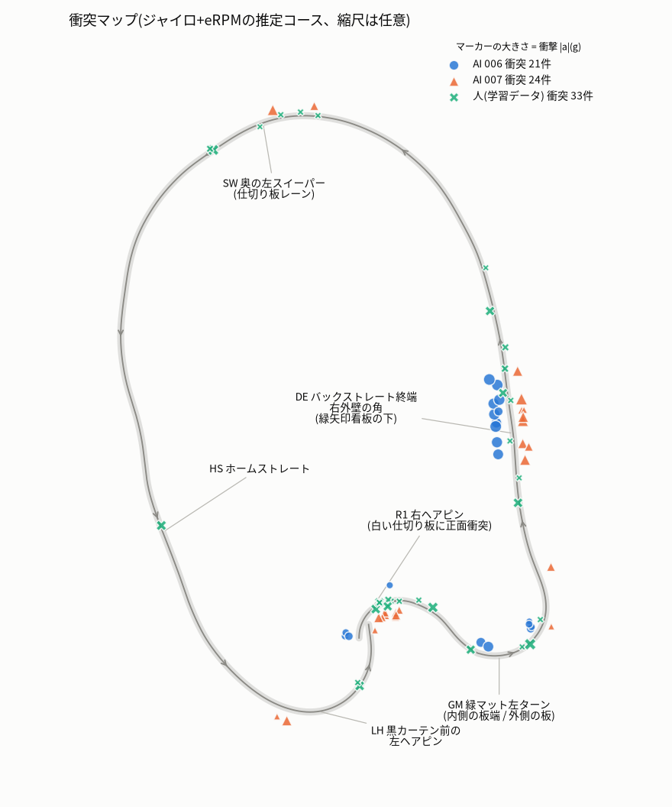
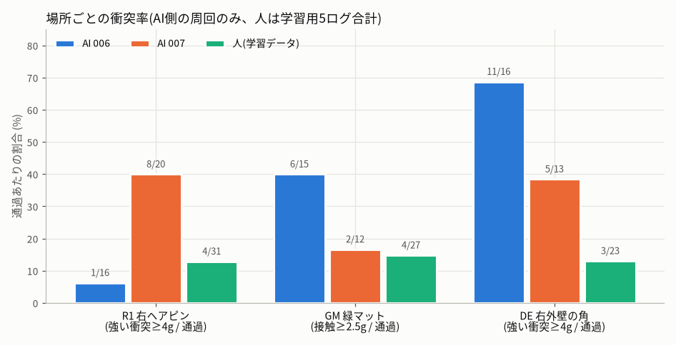

# AI走行の衝突マップ: ai_run_006(172910)/ ai_run_007(173445)

JetFormer 2026-10-10 セッション。モデルは両ランとも `first_trial_20261010-s3-20261010-153629`(ジャンル 5「低速走行」のみ学習)。
解析はすべてオフラインで行い、実車では何も検証していない。図とコンタクトシートはこのフォルダの `cmap_*.png` にある。

---

## 0. 結論

**衝突はコースの3か所に集中している。** AI側で起きた衝突は 006 が 21 件、007 が 27 件だった(しきい値は |a| > 2.5 g)。
そのうち 007 の回復中の 3 件を除いた 45 件のうち、41 件(91%)が次の3か所で起きた。

| 地点 | 場所と相手 | 006 | 007 | 人(学習データ5本) | 主な原因 |
|---|---|---|---|---|---|
| **R1** | 黒カーテン前の左ヘアピンを抜けた直後の右ヘアピン。白い仕切り板(端に支柱)に正面から突っ込む | 強い衝突 1/16 通過(軽い接触 3) | **強い衝突 8/20 通過**、テイクオーバー 11 回のうち 10 回はここが発端 | 4/31 | **進入が速すぎる。** ステアはすでに右いっぱい(1000 µs で頭打ち)なので、曲がり切れるかは速度だけで決まる |
| **DE** | バックストレート終端。右側の外壁(上が赤の白板)が左へ曲がり始める角。緑の矢印看板の下 | **11/16 通過** | 5/13 通過(このほか途中から再開した周回で 4 件) | 3/23 | 緑マットを抜けたとき、**人より右(外壁側)を向いている**。006 の後半はさらに速度が高い |
| **GM** | 緑マット(白パネル)の左ターン。入口では内側の板の端、出口では外側の板 | 6/15 | 2/12 | 4/27 | 入口では切り込みが早い(ステアゲイン 1.8 の2周だけ)。出口では左いっぱいでも膨らむ |

主な所見は次のとおり。

1. **007 で止まった原因の大半は R1。** 11 回のテイクオーバーのうち 7 回は R1 衝突の 0.4〜2.4 s 後だった。3 回は 92.99 s の R1 衝突から続いた一連の回復の中、残る 1 回(284 s)は衝突なしの終了操作だった。
   - R1 で強い衝突になるかは進入速度(右ヘアピン開始の直前 0.4 s の最大 eRPM)でほぼ分かれる。

     | 進入速度 (eRPM) | AI | 人 |
     |---|---|---|
     | 5500 未満 | 1/21(5%) | 0/13 |
     | 5500〜6200 | 2/7 | 0/9 |
     | 6200 以上 | **6/8(75%)** | 4/9 |

   - 衝突した周回と通過した周回で、R1 開始時の向き(差 +2°、通過周回のばらつきは ±7°)と旋回の速さに差はなかった。差は速度だけだった。
   - 衝突後、AIは強い後退(1566〜2000 µs)を出し続ける。しかし 150 ms 以上の中立を一度も挟まないので、ESCは後退せず止まったままになる。
2. **006 の衝突の半分は DE。** DE を通過した 16 回のうち 11 回、すべて 5 g 以上だった。
   - 同じ速度帯(5000〜6000 eRPM)で比べると、AIの衝突率は 9/12、人は 1/12 だった。速度だけでは説明できない。
   - 緑マット出口 +0.6 s の向きは、AIが中央値 −4°(IQR −10〜+2)、人が +15°(−6〜+35)だった(R1 開始時の向きが基準、+ が左)。人が衝突したときの向きも −10° で、AIの典型と同じだった。
   - つまりAIは、外壁の角を向いた状態でバックストレートに出ている。
3. **AIは衝突の多い人の運転をまねている。** 学習データ 22 シーン(約 414 s)の中に、人の衝突が 33 件(強い衝突 15 件)含まれている。
   - そのうち R1 の板への正面衝突が 4 件、DE が 3 件ある(`cmap_cs_human_same_spots.png`)。
   - 人も R1 の手前では減速せず加速していた(スロットルは −135 → −251 µs)。モデルの予測も同じく加速だった(raw −73 → −108 µs)。
   - 高速走行のログ(152405 / 152707、eRPM p90 7700〜8700)も、ジャンルは全シーン「低速走行」(id 5)になっている。
4. **ゲインは走行中に何度も変更されていた。** log.json には開始時の値しか残らないので、この変更は見落としやすい。両ランともほぼ毎周回ちがう設定で走っている(§1.2)。
   - ゲイン・速度・時間(バッテリー)の効果は分離できない。
   - スロットルゲインを上げても、モデルが自分で raw スロットルを下げて打ち消していた。ゲイン 1.2 → 2.0 で raw の中央値は −118 → −53 µs、出力後は −142 → −106 µs、速度の中央値は約 5000〜5800 eRPM のままだった。
   - スロットルゲインで速度は決められない。
5. **IMU の軸の読み方を訂正する。** accel x が**左右**(+ = 右)、accel y が**前後**(+ = 前)だった。
   - 根拠: x と「ヨー × 速度」の相関は −0.98、y と速度の時間微分の相関は +0.83〜0.88。
   - 「ay が −6〜−8 g で横からの衝突」とした事前の解釈は誤りで、実際は**前後方向の急減速(正面寄りの衝突)**だった。
   - 左右成分で当たった側が分かる。DE は x が −3〜−7.7 g で、左へ押されているので**右前**が当たっている。R1 はほぼ真正面だった。
   - 隣のレポート(params.json の `imu_axes_check`)も同じ結論になっている。

---

## 1. データと方法

### 1.1 ログと時刻

- 対象:
  - AI走行 2 本。172910(ai_run_006、AI側 13.9〜172.2 s、158 s)と 173445(ai_run_007、AI側 約 230 s)。
  - 比較対象として、人のみの学習ログ 5 本(135449 / 144028 / 150424 / 152405 / 152707)。
- 時刻は drive report(`drive_*/report.json`)と同じ基準で、元のシーン 0001 の最初の AI_CMD を 0 s としている。
- **解析中の 17:46:18 に 172910 のシーン 0001 が削除された**(163247 / 171639 / 172505 の一部も同時)。
  - 解析は削除前後に取ったスナップショットで行った。
  - 172910 の時刻は、衝突時刻の照合から +20.022 s ずらして元の基準に戻した。誤差は ±10 ms 程度。
  - 173445 は 15 シーン(0〜300 s)しか残っていない。report.json は 17 シーン・328 s と記録しているので、AI走行が終わった 284 s 以降の 2 シーンが無い。
- 衝突の検出は共通ローダーと同じ方法にした。
  - ||a| − 1 g| が 2.5 g を超えたら衝突とする。
  - 0.6 s 以内の連続は 1 件にまとめる。
  - 前後 50 ms で 1 サンプルだけのものはセンサーの異常として除く。
  - 「強い衝突」は 4 g 以上とした。

### 1.2 走行中に変わっていたゲイン(AI_CMD の `gains` / `lookahead` を1フレームずつ確認)

| ラン | 時刻 (s) | steer_gain / throttle_gain | lookahead |
|---|---|---|---|
| 006 | 13.9〜48.6 | 1.80 / 1.20 | 5 |
| | 48.6〜50.7 | steer 1.8 → 1.45 に段階的に変更 | 5 |
| | 52.3〜67.5 | 1.45 / 1.4 | 5 |
| | 67.5〜79.8 | 1.45 / 1.6 | 5 |
| | 79.8〜95.0 | 1.45 / 1.8 | 5 |
| | 95.0〜102.9 | 1.25 / 1.8 | 5 |
| | 102.9〜112.8 | 1.25 / 2.0 | 5 |
| | 113.0〜172 | 1.45 / 2.0 | 5 |
| 007 | 22.5〜78.4 | 1.40 / 2.0 | 3 |
| | 79.1〜229.2 | 1.60 / 2.0 | 3 |
| | 229〜236.6 | 下げていく途中(thr 1.7 → 1.5、steer 1.2 → 0.95 → 1.0) | 3 |
| | 236.6〜284 | 1.00 / 1.00 | 3 |

ゲインによってモデルの出方が変わる(ゲインを掛ける前の raw 出力で比べた)。

| 区間 | raw ステア \|中央値\| | raw スロットル中央値 | 出力スロットル中央値 | eRPM 中央値 / p90 |
|---|---|---|---|---|
| 006 1.8/1.2 | 64 | −118 | −142 | 4970 / 5986 |
| 006 1.45/1.6 | 78 | −81 | −130 | 4868 / 5808 |
| 006 1.45/2.0 | 73 | **−53** | −106 | 5765 / 6694 |
| 007 1.6/2.0 | 78 | −63 | −125 | 4967 / 6189 |
| 007 1.0/1.0 | 72 | **−142** | −142 | 4814 / 5523 |
| 人 152405 / 152707 | 150 / 163 | −215 / −255 | — | 5301 / 7771、5983 / 8746 |

- **スロットル:** モデルは操作値と eRPM を入力に持つので、ゲインを上げると raw を下げて打ち消す。変わるのはピーク(p90)のほうだった。
- **ステア:** モデルの raw ステアは、中くらいの修正舵が人の半分程度しかない。いっぽう p95 は 384〜453 µs で、人(451)とほぼ同じだった。そのため、ステアゲインで中くらいの舵を補うと大きな舵が頭打ちになりやすい。頭打ちの割合は、ゲイン 1.6 で 23%、ゲイン 1.0 で 4%、人は 14〜17% だった。

### 1.3 周回の区切りと場所の決め方

1. ジャイロ z(バイアス −0.091 °/s)を積分して向きを求めた。
2. 毎周 1 回だけ現れる大きな右旋回 **R1** の開始を周回の起点にした。条件は次のとおり。
   - ヨーが −170 °/s 以下で、深さ −90° 以上か衝突あり
   - 直前 3 s に右旋回がない
3. 起点の向きで、ジャイロのドリフトを周回ごとに補正した(コース座標の向き ψ)。
4. R1 のあと ψ が −25° まで戻った時刻を「緑マット出口(GM 出口)」とした。
5. 衝突の地点は次のルールで決めた。
   - R1 開始から 1.0 s 以内なら R1
   - GM 出口より前なら GM 入口
   - GM 出口 ±0.3 s なら GM 出口
   - GM 出口から 2.0 s 以内なら DE
   - どれにも当たらなければ、基準周回(006 の 63.6〜73.4 s、衝突なし、9.78 s)と直前 1.5 s の ψ の形を照合した(SW / HS / LH)。
6. **AIの衝突は全件、カメラのコンタクトシートで目視確認した。** 確認したのは −1.0 / −0.5 / 0 / +0.5 s の4コマと、主な例の 0.1 s 刻み。
7. マップ(`cmap_fig_course_map.png`)は、基準周回をジャイロと eRPM で推測航法したものなので、縮尺は任意。

基準周回の流れ(R1 開始を位相 0 とし、ψ は R1 開始時の向きを基準にした)。

| 位相 | 区間 | ψ | eRPM | ステア出力 | 見え方 |
|---|---|---|---|---|---|
| 0.00〜0.11 | **R1** 右ヘアピン | 0 → −140 | 2700〜3900 | 右いっぱい(−443) | 白い仕切り板の端(支柱)と床の暗い板 |
| 0.11〜0.24 | **GM** 緑マット左ターン | −140 → +17 | 3100〜4400 | +184〜+557 | 緑マットと白パネル |
| 0.24〜0.41 | **DE** バックストレート | +3〜+23 | 4500〜6000(加速) | 約 +50 | 右に外壁、正面に緑矢印看板。終端で外壁が左へ曲がる |
| 0.41〜0.70 | **SW** 奥の左スイーパー | +23 → +195 | 約 5700 | +60〜+160 | 左に白い仕切り板があるレーン |
| 0.70〜0.85 | **HS** ホームストレート | 約 +195 | 5200 → 4200(減速) | 約 0 | 床の白線、正面に黒カーテン |
| 0.85〜1.00 | **LH** 黒カーテン前の左ヘアピン | +200 → +360 | 4400〜5000 | +190〜+350 | 黒カーテン |

---

## 2. 衝突マップ

場所ごとの件数(AI側のみ。「回復」は人が置き直した直後の乱れた区間)。

| 地点 | 006(21件) | 007(27件) |
|---|---|---|
| R1 右ヘアピン | 4(すべて手前の軽い接触 2.8〜4.7 g) | **9**(板への正面衝突 8、手前の軽い接触 1) |
| GM 入口(内側の板の端) | 2(6.9 / 8.3 g、ゲイン 1.8) | 1(2.8 g) |
| GM 出口(外側の板) | 4(2.5〜4.7 g、左いっぱい) | 1(5.4 g、ステアゲインを 1.6 → 1.0 に下げた1秒後) |
| **DE** 右外壁の角 | **11**(5.3〜10.1 g) | **9**(2.9〜10.6 g) |
| SW 仕切り板レーン | 0 | 2(9.2 / 5.4 g) |
| LH 黒カーテン | 0 | 2(2.7 / 7.6 g) |
| 回復中 | 0 | 3(92.99 s の R1 衝突から続く一連の中) |

---

## 3. 地点ごとの詳細

### 3.1 R1: 黒カーテン前の左ヘアピンを抜けた直後の右ヘアピン(007 で止まる主因)

図: `cmap_cs_R1_007_a.png` / `_b.png`(8件)、`cmap_seq_R1_007_143s.png`(0.1 s 刻み)、`cmap_cmp_R1_007_clean_vs_hit.png`(通過3周と衝突3周の比較)、`cmap_fig_r1_entry_speed.png`。

**何が起きているか**

- 衝突の流れ(143.17 s、0.1 s 刻み):
  1. −0.6 s: 左ヘアピンを出る。
  2. −0.5 s: ステアが右いっぱい(出力 1000 µs で頭打ち)になる。ヨーは −220 °/s。
  3. −0.3〜−0.1 s: 白い仕切り板が右から正面に入ってくる。
  4. 0 s: 板の側面に正面から当たる(前後 −4.4〜−7.2 g、左右 −0.1〜−3.4 g)。
  5. +0.1 s 以降: eRPM はほぼ 0 になり、車は板に鼻先を押し付けた形で止まる。
- 衝突後に AI が出すスロットル(衝突から 0.4〜2.5 s、8件):

  | 項目 | 値 |
  |---|---|
  | 出力の中央値 | 1557〜2000 µs |
  | raw の p90 | 1551〜1769 µs |
  | 中立が続いた最長時間 | 33〜231 ms(150 ms 以上は 92.99 s の 1 件だけ) |
  | \|eRPM\| < 300 の割合 | 8 件中 6 件で 77〜100% |

  - ESC の「R → 中立 → R」の条件を満たさないので、後退しない。条件の詳細は隣の `human_recovery.md` にある。
  - 92.99 s だけは中立が 231 ms あり、\|eRPM\| < 300 の割合も 33% だった。それでもテイクオーバーは 4.1 s 後になり、そのあと 100〜106 s の「回復」3件につながった。

**なぜか**

- **速度。** R1 の強い衝突は、進入速度でほぼ決まる。

  | | 衝突 | 通過 |
  |---|---|---|
  | 進入速度の中央値(007) | 6517 eRPM | 5211 eRPM |
  | 開始時の向き(ドリフト補正後) | +2° | 0°(ばらつき 7°) |
  | −60° まで曲がる時間 | 0.34 s | 0.33 s |

  - ステアはすでに頭打ちなので、ゲインや先読みで旋回を強くすることはできない。
  - 人も 6200 eRPM 以上では 4/9 回当たっていた。
- **加速の仕方まで人をまねている。** R1 の 0.6 s 前に、モデルは 0.3 s 先までの予測でスロットルを強めている(006: raw −37 → −93、007: −73 → −108 µs)。人も同じ場面で −135 → −251 µs と加速していた。学習データには「R1 の手前で減速する」手本がない。
- 左ヘアピン出口(R1 開始前 0.5 s)の出力スロットルの最小値は、ゲイン 2.0 の期間に衝突した 6 周で −295〜−384 µs(中央値 −341)、通過した 9 周で −226〜−341 µs(中央値 −277)だった。範囲は重なるが、衝突した周回のほうが瞬間的に強く加速している。スロットルゲイン 2.0 はこの瞬間的な加速を 2 倍にする。
- ゲインを 1.0 / 1.0 にした後も 3 回中 2 回当たっている(244.30 s / 271.11 s)。モデルが raw スロットルを上げて打ち消したためで、ゲインを下げても速度の上限にはならない。
- 006 で R1 の強い衝突が 1/16 と少なかった理由は、この1セッションでは切り分けられない。進入速度の中央値は 5230 eRPM で、6200 以上は 2 回だけだった。lookahead 5(先の舵を早めに使う)が効いた可能性もある。

### 3.2 DE: バックストレート終端の右外壁の角(006 の主因)

図: `cmap_cs_DE_006_a.png` / `_b.png`(11件)、`cmap_cs_DE_007_a.png` / `_b.png`(9件)、`cmap_seq_DE_006_106s.png` / `cmap_seq_DE_006_039s.png`、`cmap_cmp_DE_006_clean_vs_hit.png`、`cmap_fig_de_heading.png`。

**何が起きているか**

- 衝突の流れ(106.00 s、0.1 s 刻み):
  1. −0.6〜−0.1 s: 右に外壁を見ながら直進している。出力ステアは −45〜−60 µs(右)、ヨーは −40〜−68 °/s(右)、eRPM は 4800 → 6900 と加速中。
  2. 0 s: 外壁が左へ曲がる角に、右前から当たる(左右 −2.1 g = 左へ押された、前後 −3.3 g)。
  3. 当たった後は外壁に向いて止まるか(106.00 s)、跳ね返って左の仕切り板レーンへ入っていく(39.35 s)。
- 衝突は、いずれも GM 出口から 1.0〜1.5 s 後に起きている。
- 衝撃は前後 −5〜−8 g(多くは振り切れ)、左右 −3〜−7.7 g(右前が当たっている)。
- 多くはかすり当たりで、eRPM は 5000〜6700 のまま走り続けた。

**なぜか**

- **向きが外壁側に寄っている。** 速度だけでは説明できない。
  - 同じ速度帯(5000〜6000 eRPM)の衝突率は、AI 9/12、人 1/12 だった。
  - 緑マット出口 +0.6 s の向きは、AI −4°(IQR −10〜+2)、人 +15°(−6〜+35)。人が当たったときも −10° だった。
  - ヨーは、AI −35 °/s、人 −13 °/s(中央値)。
  - AIは緑マットを抜けた後の右への戻し舵が強すぎ、外壁の角を向いたままバックストレートに出ている。
  - モデル自身は 0.33 s 先に左へ戻す予測を出していた(raw +16〜+19 µs)が、その時点ではもう遅かった。
- **ステアゲインで戻し舵が大きくなる。** GM 出口直後の右の戻し舵(R2)は、raw が人とほぼ同じ(007: −54 µs、人: −50 µs)。しかしゲイン 1.6 を掛けると −86 µs になり、人より約 7 割強くなる。これは仮説で、ゲインを固定した比較はしていない。
- **006 の後半は速度も高い。** 衝突した周回の DE での速度は 5504 eRPM、通過した周回は 4268 eRPM だった。throttle_gain 1.8 以上では 8/10 周で当たり、1.67 以下では 3/6 周だった(件数が少ない)。
- **GM 出口で外側の板に触ったあとに DE で当たる流れがある。** GM 出口の接触(006 では 4 回、左いっぱいのまま)は、どれも約 1.4 s 後の DE 衝突につながっていた。緑マット出口で右(外側)に膨らみ、そのまま外壁沿いに進んで角に当たる流れになっている。

### 3.3 GM: 緑マットの左ターン

図: `cmap_cs_GM_006_007.png`、`cmap_seq_GMin_006_047s.png`、`cmap_seq_GMout_006_123s.png`。

**入口(36.48 s / 46.87 s、006 の最初の2周)**

- R1 の右いっぱいから、0.3 s で左いっぱいへ切り替えている。
- そのとき左前が内側の白い板の端に当たる(前後 −8 g、左右 +0.7 / +4.3 g = 右へ押された)。
- 切り込みが早く、コーナーの内側を削っている。
- このときの設定は steer_gain 1.8、lookahead 5(約 167 ms 先の舵を今出す)だった。006 では、ゲインを 1.45 に下げた後に入口での衝突は起きていない。

**出口(122.73 / 131.90 / 160.25 / 169.50 s、007 の 235.25 s)**

- 左いっぱい(+557 µs)のまま、右前が外側の赤白の板に触る(左右 −3〜−4.8 g)。限界での曲がり不足で、速度は約 4900 eRPM だった。
- 007 の 235.25 s は、ステアゲインを 1.6 → 1.0 に下げた約 1 s 後に起きた。曲がる途中でゲインを下げると、その場で膨らむ。

### 3.4 その他(007 の後半、ゲイン 1.0 / 1.0)

- **SW の仕切り板レーン:** 252.96 s(9.2 g、右の板)、265.36 s(5.4 g)。
- **LH の黒カーテン:** 259.03 s(7.6 g、6219 eRPM で左ヘアピンへ進入)、121.30 s(2.7 g)。
- 人の学習データにも、LH やホームストレートの終わりでカーテン側に強く当たった例がある(152405 の 42.55 / 52.40 s、7000〜8700 eRPM)。

---

## 4. 学習データ(人)との比較

図: `cmap_cs_human_same_spots.png`。

| | 人(学習5ログ、記録 417 s) | AI 006(AI側 158 s) | AI 007(AI側 230 s) |
|---|---|---|---|
| 衝突(≥2.5 g)/分 | 4.7 | 8.0 | 7.0 |
| 強い衝突(≥4 g) | 15 件 | 15 件 | 19 件 |
| R1 強い衝突 / 通過 | 4/31 | 1/16 | 8/20 |
| DE 強い衝突 / 通過 | 3/23 | 11/16 | 5/13 |
| 衝突後 | 人が後退して回復 | 走り続ける(DE) | 止まったまま(R1)→テイクオーバー |

- AIが当たる場所は、人が当たっていた場所と同じだった。R1 の板、DE の外壁の角、GM の板の端を、人も同じ見え方で当てている。
- 学習データの約 414 s(22 シーン)は全フレームが学習対象で、衝突の前後もそのまま目標値に入っている。
- 22 シーンはすべてジャンル id 5「低速走行」だった。ログ単位では「高速走行」だった 152405 / 152707(eRPM p90 7700〜8700)も含まれている。そのため、低速走行のヘッドは遅い周回と速い周回の平均を覚えている。

---

## 5. パラメーター調整のベストプラクティス(このデータから言えること)

1. **評価中はゲインを途中で変えない。** 1 ランを 1 つの設定にし、AI側で 5 周以上走らせる。
   - 今回は 006 で 9 回、007 で 4 回以上、走行中に変えていた。log.json の `drive.params` には開始時の値しか残らない。
   - 比較には AI_CMD の `gains` を使うか、変えるたびにランを分ける。
   - 曲がる途中でステアゲインを下げると、その場で膨らむ(235.25 s)。
2. **throttle_gain は 1.0 に戻し、速度は別の方法で制限する。**
   - ゲインを上げても、モデルは raw を下げて打ち消す(§1.2)。変わるのは瞬間的な加速だけで、それが R1 の進入速度を上げていた。
   - 速度の上限には次のどちらかが効くはず。どちらも未実装・未検証。
     - 前進側スロットルの上限をクリップする。
     - eRPM の上限で頭打ちにする(目安: R1 進入 5500 eRPM 以下。人の接触なし周回の中央値は 5310、AI(007)の通過周回は 5211)。
3. **steer_gain は 1.0〜1.3 にとどめる。**
   - R1 ではステアがすでに頭打ちなので、ゲインを上げても効かない。
   - 1.8 では GM 入口で内側を削り(2 周中 2 周)、1.6 では DE 前の戻し舵が人より強くなる。
   - 中くらいの舵が弱いことの根本的な対策は、ゲインではなくデータだと考える(§6)。
4. **lookahead は 3(約 100 ms 先)から始める。**
   - 撮像から出力までの遅れは p50 で 27 ms。
   - 5 は旋回の開始を早める方向に働く。GM 入口で内側を削ったのはこの設定のときだった。
   - 今回は lookahead とゲインが同時に変わっているので、lookahead だけを変えた A/B を別のランで取る。
5. **後退の段取りはモデルに任せず、ルールで行う。**
   - R1 の衝突後、モデルは強い後退を出し続け、中立を挟まない。
   - スタックを検出したら(例: AI側で \|eRPM\| < 300 が 0.5 s 続き、直前に衝突がある)、決まった手順(R → 中立 0.2 s → R → 一定時間後退)を実行する安全層を推奨する。条件と数値は `human_recovery.md` を参照。

---

## 6. 追加で集めるべきデータ(具体的に)

時間配分の目安は 1 セット 20 s × 5〜8 シーン。どれもカメラ・ToF の状態は今回と同じにする。

| 優先 | 場所 | 量 | 手本の内容 | ジャンル・ラベル |
|---|---|---|---|---|
| 1 | **R1**(LH → R1) | 30 周 | ホームストレート終わりで減速し、LH と R1 は **5000 eRPM 以下**で進入する。LH 出口では加速せず、R1 で右いっぱいに切ってから加速する。接触ゼロの周回だけを使う | 低速走行(id 5) |
| 1 | **DE**(緑マット出口からバックストレート) | 上と同じ周回で 30 回 | 緑マットを抜けたら車体を左寄りに置き、右外壁から車幅 1 台以上空ける。外壁の角の手前で早めに左へ向け始める。速度は 5500 eRPM 以下 | 低速走行(id 5) |
| 2 | **修正の手本**(DAgger 型) | 各地点 10〜15 回 | AIが実際に陥る姿勢に車を置いてから、接触せずに戻す操作を録る。 • DE: 右寄りで外壁を向いた姿勢(ψ が −10° 前後) • R1: 板に近く、速すぎる姿勢 • GM 出口: 外側に膨らんだ姿勢 可能なら、AI走行中に危なくなった瞬間だけ人が介入した区間を切り出す | 低速走行(id 5)。後退を含まない区間だけ |
| 2 | **後退して回復する手本** | 10〜15 回 | R1 の板に鼻先を付けた状態から「ブレーキ → 中立 0.2 s → 後退 → 20〜30 cm 下がって再開」 | 新ジャンル(例: id 6「回復」)に分けるか、学習から除外する。走行中のモデルには混ぜない |
| 3 | GM 入口・出口 | 20 回 | 右から左への切り返しを 0.5 s 以上かけてなめらかに行う。出口では外側の板から車幅 1 台空ける | 低速走行(id 5) |

あわせて、学習データ側で次の作業を推奨する。

- **人の衝突区間を目標値から外す。** 33 件(強い衝突 15 件)それぞれについて、衝突の前 1 s から後 2 s まで。少なくとも 152405 / 152707 の R1・DE・LH の強い衝突 12 件は外す。
- **ジャンルを付け直す。** 152405 / 152707 のような速いシーンは「高速走行」(id 4)にし、「低速走行」(id 5)は今回の手本のように速度を抑えた周回だけにする。AI走行の評価は id 5 で行う。
- **地点ごとの量をそろえる。** 現在の学習データはおよそ 40 周分しかない。R1 と DE の通過は 1 周に 1 回ずつなので、上の 30 周を足しても全体のごく一部にとどまる。必要なら地点の前後を多めにサンプリングする。

---

## 7. 注意(交絡と限界)

- **条件が混ざっている。** 1 セッション、同じモデル、走行順にバッテリーが減っている。そこにゲインの途中変更が重なり、lookahead もランで違う(5 と 3)。006 と 007 の差を 1 つの要因のせいにはできない。
- **件数が少ない。**
  - R1 の強い衝突は AI 9 件、人 4 件。
  - DE の強い衝突は AI 16 件、人 3 件。
  - R1 の速度の境目(5500〜6200 eRPM)は目安にとどまる。
- **向き ψ は相対値。** 周回ごとの R1 開始時の向きを基準にしているので、±8° 程度の誤差がある。人のログ(特に 150424)は周回の区切りが不安定で、外れ値がある。
- **マップの位置は推定。** マップはジャイロと eRPM による推測航法なので、滑りや縮尺の誤差を含む。マーカーの位置は地点の中での時間で置いたもので、実際の位置ではない。
- **事前の解釈に誤りがあった。** 「横からの衝突」という事前の解釈は IMU 軸の取り違えによるもので、§0 の 5 で訂正した。
- **集計から除いたもの:**
  - 007 の 100.17 / 101.00 / 106.20 s は、人が車を置き直した直後の乱れた区間なので「回復」として除外した。
  - 107.43 / 297.13 s は人が操作している区間なので、AIの集計に入れていない。
- **データの欠け。** 172910 のシーン 0001 は解析中に削除された。AI側の最初の 6 s(13.9〜20 s)に衝突はない。

---

## 付録 A: AI側の衝突一覧

lon は前後(+ = 前、− = 急減速)、lat は左右(+ = 右へ押された = 左側に接触、− = 左へ押された = 右側に接触)、単位は g。
eRPM は衝突前 0.5 s の平均から衝突後 0.3〜0.8 s の平均への変化(+ = 前進)。steer / thr は衝突前 0.5 s の出力で、µs の中立からの差(ステア + = 左、スロットル − = 前進)。

| ラン | t (s) | 地点 | \|a\| | lon | lat | eRPM 前→後 | steer / thr | ゲイン st/thr/la | テイクオーバー |
|---|---|---|---|---|---|---|---|---|---|
| 006 | 28.97 | DE | 6.8 | −7.0 | −3.4 | 4777→5298 | +25 / −168 | 1.80/1.20/5 | − |
| 006 | 36.48 | GM入口 | 6.9 | −7.9 | +0.7 | 3558→1219 | +86 / −121 | 1.80/1.20/5 | − |
| 006 | 39.35 | DE | 9.7 | −8.0 | −5.1 | 5259→5037 | +23 / −176 | 1.80/1.20/5 | − |
| 006 | 46.87 | GM入口 | 8.3 | −8.0 | +4.3 | 3620→4954 | +93 / −121 | 1.80/1.20/5 | − |
| 006 | 55.44 | R1(手前・軽) | 2.8 | −0.4 | +0.9 | 3467→3947 | −443 / −106 | 1.45/1.40/5 | − |
| 006 | 57.78 | DE | 8.5 | −6.1 | −7.2 | 5507→5501 | +15 / −192 | 1.45/1.40/5 | − |
| 006 | 83.19 | R1(手前・軽) | 3.5 | −1.2 | +1.0 | 4789→4404 | +225 / −142 | 1.45/1.80/5 | − |
| 006 | 86.72 | DE | 7.7 | −8.0 | −3.1 | 6179→5208 | +5 / −226 | 1.45/1.80/5 | − |
| 006 | 102.87 | R1(手前・軽) | 3.6 | −1.4 | +1.6 | 4763→4189 | +128 / −113 | 1.25/1.80/5 | − |
| 006 | 106.00 | DE | 9.1 | −8.0 | −4.5 | 6222→3761 | −21 / −254 | 1.25/2.00/5 | − |
| 006 | 115.21 | DE | 9.4 | −8.0 | −3.5 | 6989→6143 | +6 / −160 | 1.45/2.00/5 | − |
| 006 | 122.73 | GM出口 | 4.7 | −3.0 | −4.8 | 4901→4202 | +557 / −158 | 1.45/2.00/5 | − |
| 006 | 124.26 | DE | 9.9 | −8.0 | −7.2 | 6757→6000 | +9 / −132 | 1.45/2.00/5 | − |
| 006 | 131.90 | GM出口 | 3.3 | −2.4 | −3.3 | 4902→4779 | +557 / −144 | 1.45/2.00/5 | − |
| 006 | 133.28 | DE | 9.0 | −8.0 | −4.8 | 7286→6136 | +22 / −158 | 1.45/2.00/5 | − |
| 006 | 139.02 | R1(手前) | 4.7 | −0.3 | +0.6 | 4976→4587 | +283 / −121 | 1.45/2.00/5 | − |
| 006 | 152.31 | DE | 10.1 | −8.0 | −7.7 | 7135→5825 | +34 / −126 | 1.45/2.00/5 | − |
| 006 | 160.25 | GM出口 | 2.5 | −1.8 | −3.0 | 4942→4915 | +557 / −143 | 1.45/2.00/5 | − |
| 006 | 161.56 | DE | 5.3 | −5.1 | −3.2 | 7458→6710 | +19 / −198 | 1.45/2.00/5 | − |
| 006 | 169.50 | GM出口 | 3.5 | −1.5 | −3.8 | 4896→4718 | +557 / −179 | 1.45/2.00/5 | − |
| 006 | 170.89 | DE | 9.3 | −7.7 | −5.8 | 7229→5763 | +16 / −169 | 1.45/2.00/5 | +1.3 s(終了) |
| 007 | 35.12 | **R1** | 4.1 | −4.9 | −0.1 | 4586→−28 | −443 / −48 | 1.40/2.00/3 | +1.5 s |
| 007 | 41.73 | DE | 3.9 | −0.7 | −4.7 | 7029→5555 | +50 / −140 | 1.40/2.00/3 | − |
| 007 | 58.19 | **R1** | 5.3 | −6.1 | −0.4 | 4186→−398 | −443 / −17 | 1.40/2.00/3 | +2.3 s |
| 007 | 66.51 | DE | 7.4 | −6.6 | −4.7 | 6343→6333 | +28 / −166 | 1.40/2.00/3 | − |
| 007 | 74.77 | GM(軽) | 2.8 | −0.3 | −1.7 | 4978→4397 | +486 / −61 | 1.40/2.00/3 | − |
| 007 | 86.47 | DE | 9.2 | −8.0 | −5.2 | 6238→5571 | +83 / −148 | 1.60/2.00/3 | − |
| 007 | 92.99 | **R1** | 5.3 | −6.1 | +0.4 | 4361→−632 | −399 / −15 | 1.60/2.00/3 | +4.1 s |
| 007 | 100.17 | 回復 | 2.6 | −0.5 | −0.9 | −751→3275 | +477 / +198 | 1.60/2.00/3 | +1.7 s |
| 007 | 101.00 | 回復 | 3.3 | −2.1 | +3.0 | 3183→1311 | −154 / −257 | 1.60/2.00/3 | +0.9 s |
| 007 | 106.20 | 回復 | 3.4 | −2.5 | +3.1 | 4783→5394 | +258 / −486 | 1.60/2.00/3 | +0.1 s |
| 007 | 114.83 | DE(軽) | 2.9 | −1.5 | −3.1 | 6818→6678 | −14 / −248 | 1.60/2.00/3 | − |
| 007 | 121.30 | LH(軽) | 2.7 | +0.1 | −2.4 | 5203→2934 | +463 / −208 | 1.60/2.00/3 | − |
| 007 | 125.72 | DE | 7.9 | −6.3 | −5.9 | 5482→7102 | +25 / −138 | 1.60/2.00/3 | − |
| 007 | 132.12 | R1(手前・軽) | 2.8 | −2.0 | +1.5 | 4750→4403 | +125 / −111 | 1.60/2.00/3 | − |
| 007 | 136.04 | DE | 10.6 | −8.0 | −7.6 | 6627→6914 | +34 / −165 | 1.60/2.00/3 | − |
| 007 | 143.17 | **R1** | 4.5 | −4.9 | −2.1 | 4289→−246 | −443 / −36 | 1.60/2.00/3 | +1.8 s |
| 007 | 157.78 | **R1** | 5.2 | −6.0 | −0.2 | 4730→−764 | −417 / +20 | 1.60/2.00/3 | +0.4 s |
| 007 | 174.17 | DE | 5.4 | −4.0 | −4.2 | 6603→5492 | −11 / −206 | 1.60/2.00/3 | − |
| 007 | 210.43 | **R1** | 4.2 | −4.4 | −1.3 | 5171→−161 | −343 / −21 | 1.60/2.00/3 | +0.5 s |
| 007 | 235.25 | GM出口 | 5.4 | −6.0 | −2.1 | 3994→5868 | +242 / −113 | 1.00/1.50/3 | − |
| 007 | 236.86 | DE | 8.4 | −8.0 | −4.3 | 6330→4320 | −17 / −158 | 1.00/1.00/3 | − |
| 007 | 244.30 | **R1** | 6.1 | −6.5 | −2.5 | 4642→−183 | −392 / −44 | 1.00/1.00/3 | +2.4 s |
| 007 | 252.96 | SW | 9.2 | −8.0 | −6.3 | 5833→4102 | +28 / −160 | 1.00/1.00/3 | − |
| 007 | 259.03 | LH | 7.6 | −8.0 | −3.1 | 6219→3470 | +267 / −268 | 1.00/1.00/3 | − |
| 007 | 265.36 | SW | 5.4 | −3.7 | −5.1 | 5246→3488 | +118 / −91 | 1.00/1.00/3 | − |
| 007 | 271.11 | **R1** | 7.1 | −7.2 | −3.4 | 5006→−633 | −250 / −63 | 1.00/1.00/3 | +0.5 s |
| 007 | 277.49 | DE | 8.8 | −7.4 | −6.3 | 4623→4975 | +5 / −165 | 1.00/1.00/3 | − |

## 付録 B: このフォルダのファイル(衝突マップ関連は `cmap_` で始まる)

| ファイル | 内容 |
|---|---|
| `cmap_fig_course_map.png` | 推定コースと全衝突の位置 |
| `cmap_fig_spot_rates.png` | 地点ごとの通過あたりの衝突率 |
| `cmap_fig_r1_entry_speed.png` | R1 進入速度と衝突 |
| `cmap_fig_de_heading.png` | DE 手前の向きと速度 |
| `cmap_cs_R1_007_a/b.png` | R1 衝突 8 件(1 行が 1 件。左から情報パネル、−1.0 / −0.5 / 0 / +0.5 s) |
| `cmap_cs_DE_006_a/b.png`、`cmap_cs_DE_007_a/b.png` | DE 衝突(006 11件、007 9件) |
| `cmap_cs_GM_006_007.png` | GM 入口と出口 |
| `cmap_cs_R1entry_mild.png` | R1 手前の軽い接触 |
| `cmap_cs_other_007.png` | SW / LH / 回復 |
| `cmap_cs_human_same_spots.png` | 学習データの人の衝突(同じ地点) |
| `cmap_seq_*.png` | 主な例の 0.1 s 刻み(lat / lon / yaw 付き) |
| `cmap_cmp_R1_007_clean_vs_hit.png` | R1 の通過3周と衝突3周の比較 |
| `cmap_cmp_DE_006_clean_vs_hit.png` | DE の通過と衝突の比較 |
| `cmap_src/` | 再現用スクリプト(スナップショットのパスを前提にしている) |

情報パネルの見方: シアン = ステア出力(+ = 左)、オレンジ = スロットル出力(− = 前進)、緑 = 速度(eRPM/15)、白 = ヨー(+ = 左)、マゼンタの点 = −0.5 s 時点のステア予測 10 フレーム(ゲイン後)。
