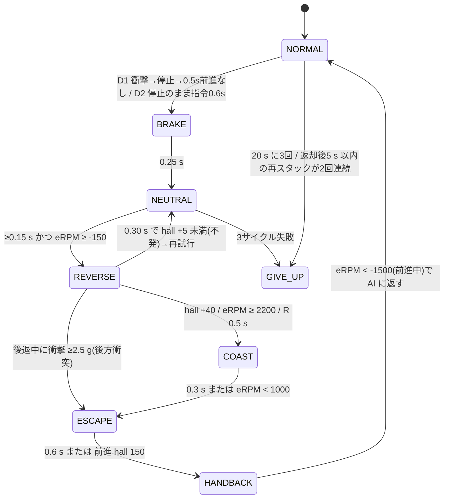
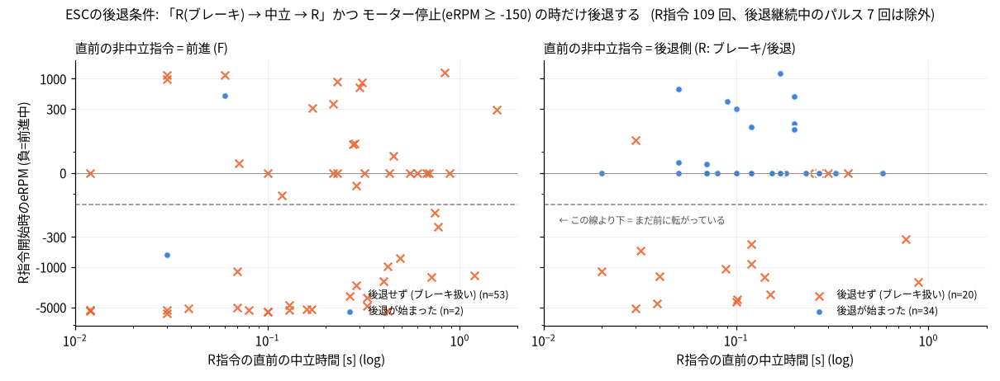
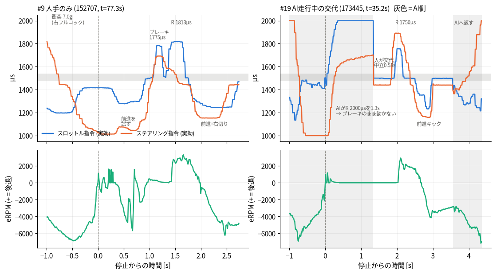
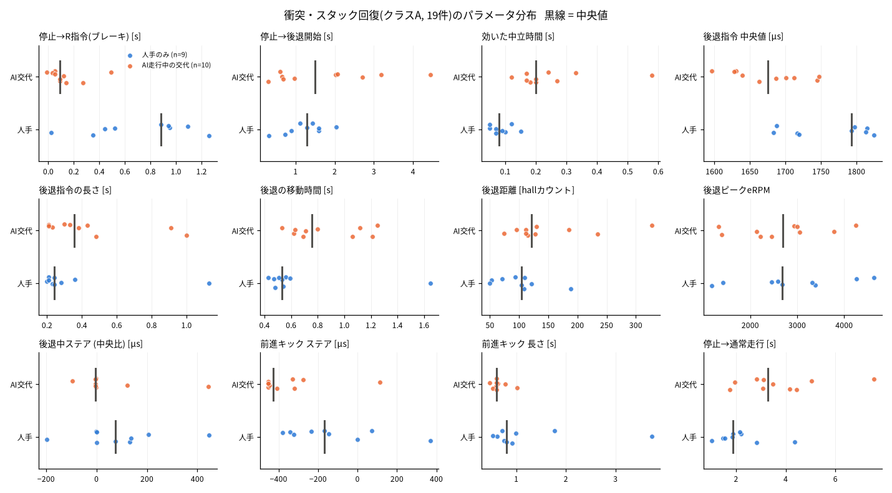
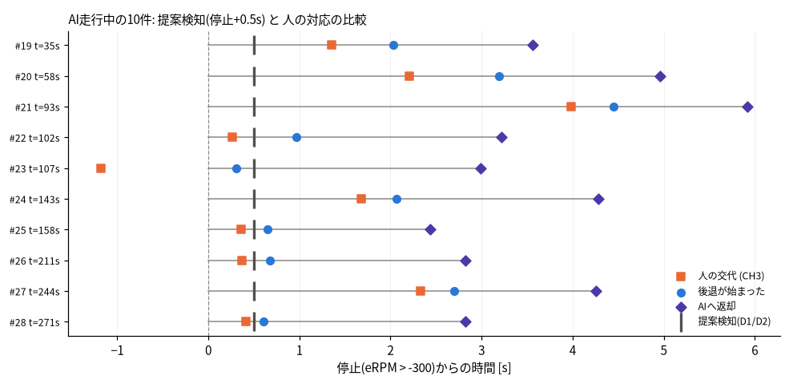

# 人の「衝突・スタックからの回復操作」の解析と、自動回復マニューバの推奨値

JetFormer 2026-10-10 セッション。人手のみの収集ログ5本(135449 / 144028 / 150424 / 152405 / 152707)と、AI走行ログ3本(163247 / 172910 / 173445)の人が操作した区間を使った。
解析はすべてオフラインで行い、実車では検証していない。数値の機械可読版は `human_recovery.json`、再現用スクリプトは `human_recovery_src/` にある。

---

## 0. 結論(先に要点)

1. **ESCの後退条件をデータで確認した。** 後退が始まるのは次の3つが揃ったときだけだった。
   - 直前の非中立指令が R(ブレーキ)である
   - そのあと中立を挟む
   - R を再び入れる時点でモーターが前に回っていない(eRPM ≥ −150)

   根拠は次のとおり。
   - 前進の直後に入れた R では、人の29回すべてが後退しなかった(0/29)。AIの26回で後退した2回は、衝突直後の跳ね返りだった。中立を1.5 s 置いても結果は同じだった。30 ms の前進ブリップを1回挟むだけで、次の R はまたブレーキに戻った。
   - 「R → 中立 → R」でも、まだ前に転がっている間に入れた R は14回すべて失敗した(0/14、eRPM −327〜−5324)。
   - 停止中、または後ろに転がっている間の「R → 中立 → R」は、人の操作で 33/37 回(89%)成功した。
   - 成功時の中立時間は中央値 0.12 s、範囲 0.02〜0.58 s。R を入れてから動き出すまでは中央値 0.08 s、最大 0.27 s だった。
   - AIが停止したまま R(1663〜2000 µs)を 0.7〜2.8 s 出し続けた場面が6回あった(173445 で5回、163247 で1回)。0.5 s 経過後の移動はいずれも −1〜+2 カウントで、ESCはブレーキを保持し続けていた。
2. **AIは後退しようとしていた。足りなかったのはESCの手順だけだった。** AI側で起きたスタック10件のうち8件で、AIは停止の前後 0.15 s 以内に自分で R(1550〜2000 µs、throttle_gain 2.0 で増幅された値)を出していた。ステアリングはすべて停止前と逆側(+97〜+557 µs)だった。それでも前進直後の R なのでブレーキ扱いになり、車は動かなかった。人が交代して「中立 → R」を入れた途端に後退した。
3. **人の回復手順は短く、定型だった**(衝突・スタック回復 19 件、中央値):
   - ブレーキ R 約1730 µs を約0.27 s → 中立 0.08〜0.2 s → 後退 R 約1712 µs を 0.28 s だけ入れ、あとは惰性。後退の移動は 0.62 s、111 カウントで、ToF からの粗い換算では約0.4〜0.5 m。
   - 後退が終わる約0.15 s 前に前進キックに切り替えていた。前進キックは −130〜−230 µs を 0.6〜0.8 s、ステアリングは壁と反対側に大きく切る。
   - 後退中のステアリングは中央が 12/19 件、逆側 4、同側 2 だった。
4. **スタックの検知は「衝撃 → 停止 → 0.5 s 前に進まない」(D1)で十分だった。**
   - AI走行中に起きた10件すべてを、停止から 0.5 s で検知できた。人が交代したのは中央値 0.88 s、後退が始まったのは中央値 1.5 s だった。
   - AI走行 424 s の誤検知は0件だった。この間に 2.5 g 以上の衝撃が54回あり、うち44回は速度を保ったままのかすり接触だった。
   - 予備の D2(停止したまま、中立帯の外の指令が 0.6 s 続く)も誤検知0件だった。
   - 停止状態からの通常発進は、指令から動き出すまで 0.06〜0.29 s(10件)だったので、0.6 s のしきい値に余裕がある。
5. **AIに返したあと、2/9 件は 2.7 s 以内に再びスタックした(173445 の 93〜108 s で3件連続)。** そのため段階的な強化(エスカレーション)と、諦める条件(ギブアップ)が必要になる。

---

## 1. 推奨ステートマシン(具体値)

値はすべて **絶対PWM [µs]** で出力し、`apply_gains`(throttle_gain / steer_gain)を通さない。
基準値はステアリング中央 1443 µs、スロットル中立 1498 µs。前進は中立より小さい値、R(ブレーキ/後退)は大きい値になる。中立帯は 1478〜1538 µs とした。

| 状態 | スロットル [µs] | ステアリング [µs] | 遷移条件・時間 | 根拠(人の操作の中央値 [IQR]) |
|---|---|---|---|---|
| **DETECT** | (AIの指令) | (AIの指令) | **D1**: 前進中(直前 0.2 s の eRPM 中央値 < −500)に衝撃が起きる。衝撃は「\|a\|−1g ≥ 2.5 g」かつ ±50 ms に 1 g 超のサンプルが2つ以上(単発のノイズを除く)。そのあと 0.6 s 以内に eRPM > −300 となり、続く **0.5 s** の前進が 20 カウント未満なら発火。 **D2**: 停止状態(\|eRPM\| < 150 かつ \|Δhall\| ≤ 2 / 0.1 s)のまま、指令が中立帯の外(<1478 または >1538)にある状態が **0.6 s** 続いたら発火。AI開始・返却から 1.0 s はマスクする。 | 検知は停止から 0.5 s。人の交代は 0.88 s [0.36–2.08]、人が後退を始めたのは 1.5 s [0.66–2.54] だった(AI走行中の10件) |
| **BRAKE** | **1700** | 1443(中央) | **0.25 s** | 前進直後の R は必ずブレーキになるので、この1回は意図的に「捨てる」。人のブレーキパルスは 1729 µs [1676–1797]、0.27 s [0.24–0.51]。1559 µs / 0.12 s でも効いたが、1547 µs / 0.07 s(AI)は効かなかった |
| **NEUTRAL** | 1498 | 1443 | **0.15 s 以上、かつ eRPM ≥ −150 になるまで**。1.0 s でタイムアウトしたら BRAKE へ戻る | 成功時の中立時間は 0.12 s [0.08–0.17]、範囲 0.02–0.58。前に転がっている間に入れた R は 0/14 で全敗した |
| **REVERSE** | **1720**(許容 1680–1800) | **1443(中央)**。停止前と逆側へ最大150 µs までは可。同側は不可 | **0.30 s** の時点で hall が +5 に届かなければ不発とみなし、NEUTRAL 0.2 s → 再度 REVERSE(最大3サイクル)。hall +40 / eRPM ≥ 2200 / R が 0.5 s 続く、のいずれかで COAST へ。後退中に衝撃 ≥ 2.5 g を受けたら即 ESCAPE | 後退指令 1712 µs [1673–1770]、指令時間 0.28 s [0.22–0.41]。指令中の移動は 38 カウント [28–62] で、全移動の約38%(中央値)にあたる。指令を離した時の eRPM は 2211。動き出しは 0.08 s(最大 0.27 s)。後退中のステアリングは中央 12/19 |
| **COAST** | 1498 | 1443 | **0.3 s** または eRPM < 1000 | 人は後退指令を離したあと惰性で約0.3 s 下がり、全体で 111 カウント [95–129]、0.62 s [0.53–0.93] 移動した |
| **ESCAPE_FORWARD** | **1360**(中立から −138) | **壁と反対側にフルロック**。a_y < −2 g(左側の接触)なら約1000(右)、a_y > +2 g なら約1890(左)、判断できない時は停止前の旋回方向 | **0.6 s** または前進 150 カウント | AI交代時のキックは 1369 µs、0.60 s、ステアリング −428(ほぼ右フルロック)。人手のみでは 1266 µs、0.80 s、−168。前進時のステアリングは「接触と反対側」が 13/17(中央 2)、「停止前と同側」が 15/19 |
| **HANDBACK** | 1498(惰性、最大 0.4 s) | 1443 | **eRPM < −1500**(前進中)になったら AI に返す。後退の終わりから約1.0 s が目安 | 人がAIに返したのは後退の終わりから 1.08 s [1.01–1.12](最短 0.76 s)。返した瞬間の eRPM は −1778 [−1955, −1131]。停止から返却までは 3.39 s [2.86–4.28] |
| **COOLDOWN** | – | – | 返却後 1.0 s は D2 をマスクする。D1 は常に有効(新しい衝撃が必要なので連続発火しない) | 通常発進の遅れは最大 0.29 s |
| **ESCALATE** | – | – | 返却後 10 s 以内に再スタックしたら、後退目標を ×1.5(約170 カウント)に、ESCAPE をフルロック 0.8 s にする | 173445 では返却後 2.56 s と 2.69 s で再スタックした(9回中2回。残りは 10〜50 s 後) |
| **GIVE_UP** | 1498 を保持し、人に通知 | 1443 | 次のいずれかで発動。(a) REVERSE が3サイクルとも不発(約1.5 s)。(b) 20 s に3回回復した。(c) 返却後 5 s 以内の再スタックが2回連続した | 人の操作でも、後退の不発は37回中4回あった(後述) |

想定所要時間は、検知 0.5 + 0.25 + 0.15 + 約0.1 + 約0.25 + 0.3 + 0.6 + 約0.1 で、**停止から約2.3 s で AI に返す**計算になる。人の場合(AI交代)は 3.39 s [2.86–4.28] だった。

### 実装メモ(drive.py への組み込み)
- 制御ループはカメラ周期(約30 Hz)で回っているが、遷移判定は VEHICLE(100 Hz)の `erpm` と `hall_count`、IMU(100 Hz)の |a| を使う。eRPM と hall の関係は `hall_count` の増加速度 = eRPM/10 [counts/s] で、実測の比は 0.1000 だった。後退すると hall は増える。
- 回復の出力は `apply_gains` の後、`out.write` の直前で差し替える。throttle_gain は回復の出力にかけない。
- **最小限の対策**としては、「AIが停止中に R を要求したら、自動で中立 0.15 s を挟む ESC アダプタ」だけでもAIは後退できるようになる。実際に 173445 t=99.0〜100.2 では、AIが偶然 R1665 → 中立 0.20 s → R1701 と出力して 112 カウント後退した。
  ただし、そのまま後退し続けて **t=100.17 に後方へ衝突した(2.6 g)**。AIの R は長く(0.7〜2.8 s)強い(gain 2.0 で 1900〜2000 µs)。このため推奨は、時間と距離を制限したスクリプト型のマニューバにすることである。AIの R 出力についても、ゲインを前進側だけにかけるか、上限を 1800 µs にクランプすることを勧める。

---

## 2. ESCの後退ルール(図1)

全ログで 0.05 s 以上続いた R 指令(>1538 µs、実効指令)116回を、直前の文脈で分類した。

「後退が始まった」の判定条件は次のとおり:
- R 指令から +0.1 s までに hall が +15 カウント以上増えた
- かつ、R 開始時に停止していて(|eRPM| ≤ 150)eRPM が 800 以上に達した、または開始時の eRPM より 800 以上加速した

衝突直後の跳ね返り(+3〜+30 カウントで、その後すぐ減速する)を後退と誤判定しないため、この条件にした。

| 直前の文脈 | 人 | AI | 解釈 |
|---|---|---|---|
| 直前の非中立指令が前進(F)。中立時間 0〜1.56 s、停止中を含む | **0/29** | 2/26 | 前進直後の R は必ずブレーキになる。AIの2回はいずれも衝撃後 0.1〜0.25 s の跳ね返り(e0 = −621 / +513)で、ESCによる後退ではない |
| R(ブレーキ)→ 中立 → R だが、まだ前に転がっている(eRPM < −150) | **0/10** | 0/4 | モーターが前に回っている間はブレーキのまま(eRPM −327〜−5324、中立 0.02〜0.88 s) |
| R(ブレーキ)→ 中立 → R で、停止中または後ろに転がっている | **33/37** | 1/3 | 後退する。AIの成功1回は上記の 99.7 s。失敗2回は直前の「ブレーキ」が 1502〜1516 µs で、実質中立だった |
| 後退中の R → 中立 → R(パルス操作) | 7回 | – | 後退が続く(図1からは除外) |

成功した33回(人)の内訳:
- 中立時間: **0.12 s** [0.08–0.17](0.02–0.58)
- R から動き出しまで: **0.08 s** [0.06–0.10](最大 0.27 s。1590〜1631 µs と弱い指令の時に遅かった)
- 直前のブレーキパルス: 1729 µs [1676–1797]、0.27 s [0.24–0.51]
- 後退の R: 1793 µs [1701–1863]

失敗した4回(人、停止中の R → 中立 → R):
1. 163247 t=92.99。直前の「ブレーキ」がAIの 1547 µs / 0.07 s で、ESCのブレーキしきい値(推定 1550〜1560 µs 前後)に届いていなかった可能性がある。
2. 172910 t=159.85。後退 R が 1586 µs と弱く、0.22 s で 9 カウントしか動かなかった。後退には入ったが、力が足りなかった。
3. 173445 t=288.15。R パルスが 0.10 s と短く、8 カウントで指を離した。後退には入っていた。
4. **173445 t=60.88 は原因不明。** AIの R 1945 µs を 2.18 s 出したあと中立 0.38 s → R 1667 µs を 0.27 s 入れたが、まったく動かなかった。次の中立 0.18 s → R 1631 µs では後退した。

このため、ステートマシンには「0.3 s で不発と判定 → 中立 → 再試行(最大3回)」を入れた。
また、後退から前進への切り替えにはロックアウトがない。人は後退の惰性が終わる 0.15 s 前に前進キックを入れ、そのまま前進していた(全19件で、後退終了から前進までが 0.04〜0.19 s)。

---

## 3. 回復エピソードの抽出と分類

人が出した R によって後退が始まった時点を起点にした。その前の「通常走行」(eRPM < −2000 が 0.5 s 以上続く区間)の終わりを停止時刻とし、次の通常走行までを1件のエピソードとして **28件** 抽出した。カメラ画像(停止前・停止・後退終了・前進の4コマ)を目視して、3つに分類した。

- **A: 衝突・スタック回復 19件**(人手のみ 9 件、AI走行中の交代 10 件)。白いバリア端・バリア・カーテンへの接触。19件中17件が左側の接触(a_y ≤ −2 g)だった。
- **B: 衝撃なしで壁際に止まってから後退 4件**(#7, #11, #12, #16)。人またはAIがブレーキで止めたケース。
- **C: 障害物のない場所での切り返し・位置直し 5件**(#13, #14, #15, #17, #18。いずれも run002 / 163247)。パラメータ推定には使っていない。

衝撃が起きた後の経過(|a|−1g ≥ 2.5 g、単発のノイズを除く):
- AI側54回のうち44回、人側38回のうち26回は、0.3〜0.6 s 後も速度を保っていた(かすり接触)。
- 停止に至ったもののうち、後退せずに前進で抜けたものは4回あった(152405 t=17.1 / 52.4 / 62.8 と 172910 t=86.0(AIが自力で回復))。前輪から強く当たって大きく跳ね返った時は、それだけで壁から離れていた。

### エビデンス表(A と B。時間はすべて停止(eRPM > −300 になった時刻)を基準にした秒数)

「停止→R」は、AI交代のケースではAI自身が出した R(ブレーキ)である。「空振りR」は後退にならなかった R の回数で、必須のブレーキ1回を含む。ステアリングは中央 1443 µs からの差で、+ が左。後退中ステアの分類は、停止前 0.5 s のステアリングと比べた結果(±100 µs 未満は中央扱い)。
#12 のブレーキ欄は抽出時のアーティファクトである(実際のブレーキは停止前の 1623 µs)。

| # | 分類 | ログ / 停止t | 状況 | 衝撃 g (a_y) | 停止前ステア | 停止→R | 停止→後退 | 中立 | ブレーキ µs/s | 空振りR | 後退指令 µs 中央/最大 | 指令 s | 移動 s | カウント | ピークeRPM | 後退中ステア | 前進キック µs / s / ステア | 停止→通常走行 | 交代/返却 |
|---|---|---|---|---|---|---|---|---|---|---|---|---|---|---|---|---|---|---|---|
| 1 | A | 135449 / 92.4 | 人手 | 3.0 (-2.6) | +400 | 0.95 | 1.60 | 0.12 | 1700/0.43 | 1 | 1688/1694 | 0.20 | 0.43 | 53 | 1414 | +132 同側 | 1306 / 0.75 / +73 | 2.19 | - |
| 2 | A | 144028 / 8.8 | 人手 | 0.7 (-0.5) | -114 | 0.02 | 0.32 | 0.08 | 1559/0.12 | 1 | 1683/1691 | 0.21 | 0.48 | 50 | 1174 | +447 逆 | 1330 / 3.74 / -1 | 1.01 | - |
| 3 | A | 150424 / 11.0 | 人手 | 2.0 (-2.8) | +224 | 0.35 | 0.73 | 0.07 | 1749/0.24 | 1 | 1824/1837 | 0.24 | 0.56 | 109 | 2682 | -196 逆 | 1266 / 0.61 / +371 | 1.47 | - |
| 4 | A | 150424 / 116.5 | 人手 | 7.7 (-8.0) | -449 | 1.26 | 2.04 | 0.10 | 1797/0.61 | 1 | 1793/1853 | 0.23 | 0.59 | 108 | 4267 | +206 逆 | 1239 / 0.80 / -342 | 2.83 | - |
| 5 | A | 152405 / 54.9 | 人手 | 2.9 (+0.2) | -451 | 0.94 | 1.29 | 0.05 | 1726/0.25 | 1 | 1717/1776 | 0.21 | 0.47 | 71 | 2588 | -1 中央 | 1208 / 0.72 / -379 | 1.87 | - |
| 6 | A | 152405 / 87.0 | 人手 | 7.1 (-8.0) | -449 | 0.88 | 1.59 | 0.15 | 1722/0.51 | 3 | 1719/1866 | 1.13 | 1.65 | 188 | 4627 | +75 中央 | 1308 / 0.53 / -323 | 4.36 | - |
| 7 | B | 152405 / 119.8 | 人手 | 0.6 (-1.1) | +366 | 0.18 | 0.26 | 0.10 | 1712/0.22 | 1 | 1638/1822 | 0.74 | 1.34 | 303 | 3477 | -1 中央 | - | - | - |
| 8 | A | 152707 / 67.6 | 人手 | 8.9 (-8.0) | -282 | 0.52 | 0.89 | 0.09 | 1771/0.23 | 1 | 1815/1905 | 0.28 | 0.54 | 104 | 3390 | +0 中央 | 1251 / 0.92 / -168 | 1.56 | - |
| 9 | A | 152707 / 77.3 | 人手 | 7.0 (-8.0) | -351 | 1.09 | 1.43 | 0.05 | 1775/0.19 | 1 | 1813/1819 | 0.36 | 0.53 | 121 | 3317 | +1 中央 | 1254 / 0.99 / -235 | 2.14 | - |
| 10 | A | 152707 / 85.9 | 人手 | 6.5 (-7.3) | +152 | 0.44 | 1.11 | 0.07 | 1773/0.51 | 1 | 1797/1925 | 0.24 | 0.51 | 93 | 2461 | +137 同側 | 1279 / 1.77 / -146 | 1.85 | - |
| 11 | B | 152707 / 98.4 | 人手 | 1.4 (-0.7) | +9 | 0.14 | 0.22 | 0.10 | 1738/0.19 | 0 | 1678/1744 | 0.28 | 0.95 | 144 | 1993 | -2 中央 | - | - | - |
| 12 | B | 163247 / 27.8 | AI→交代 | 0.8 (-0.0) | -3 | 0.41 | 0.68 | 0.02 | (1501/0.53) | 0 | 1695/1838 | 0.62 | 0.73 | 132 | 3172 | -339 (停止前中央) | - | 3.50 | -0.51 / 3.22 |
| 16 | B | 163247 / 89.5 | AI→交代 | 0.7 (-0.3) | +345 | 0.50 | 0.55 | 0.23 | 1663/0.73 | 0 | 1863/1943 | 0.27 | 0.76 | 178 | 3474 | +398 同側 | - | 1.39 | 0.27 / 2.52 |
| 19 | A | 173445 / 35.2 | AI→交代 | 4.1 (-4.4) | -443 | 0.05 | 2.03 | 0.58 | 2000/1.30 | 1 | 1745/1755 | 0.23 | 0.62 | 111 | 2933 | +121 逆 | 1353 / 0.47 / -274 | 2.82 | 1.35 / 3.56 |
| 20 | A | 173445 / 58.3 | AI→交代 | 5.3 (-6.1) | -443 | 0.03 | 3.19 | 0.18 | 1667/0.27 | 2 | 1631/1632 | 0.38 | 0.63 | 74 | 1398 | -3 中央 | 1371 / 0.59 / -451 | 5.05 | 2.21 / 4.96 |
| 21 | A | 173445 / 93.1 | AI→交代 | 5.3 (-6.1) | -443 | 0.14 | 4.45 | 0.33 | 1900/2.77 | 1 | 1687/1747 | 0.33 | 0.71 | 128 | 3782 | -1 中央 | 1423 / 0.53 / -319 | 7.54 | 3.98 / 5.92 |
| 22 | A | 173445 / 101.6 | AI→交代 | 3.3 (-2.1) | +270 | 0.49 | 0.97 | 0.17 | 1628/0.25 | 1 | 1663/1799 | 1.00 | 1.25 | 328 | 4254 | -96 中央 | 1367 / 0.60 / +114 | 4.16 | 0.26 / 3.22 |
| 23 | A | 173445 / 107.5 | AI→交代 | 4.1 (-4.9) | -1 | 0.27 | 0.31 | 0.17 | 1739/0.22 | 0 | 1639/1660 | 0.91 | 1.21 | 235 | 2459 | +443 (停止前中央) | 1374 / 1.02 / -451 | 1.76 | -1.18 / 2.99 |
| 24 | A | 173445 / 143.2 | AI→交代 | 4.5 (-4.9) | -443 | 0.05 | 2.07 | 0.24 | 1954/1.63 | 1 | 1628/1634 | 0.43 | 1.12 | 115 | 1324 | -1 中央 | 1405 / 0.63 / -409 | 4.45 | 1.68 / 4.28 |
| 25 | A | 173445 / 157.8 | AI→交代 | 5.2 (-6.0) | -443 | 0.09 | 0.65 | 0.20 | 1562/0.27 | 1 | 1701/1709 | 0.21 | 0.80 | 112 | 2141 | -3 中央 | 1358 / 0.60 / -447 | 3.11 | 0.36 / 2.44 |
| 26 | A | 173445 / 210.6 | AI→交代 | 4.2 (-4.3) | -443 | -0.01 | 0.68 | 0.20 | 1571/0.38 | 2 | 1596/1777 | 0.48 | 1.06 | 185 | 3005 | -3 中央 | 1342 / 0.60 / -328 | 1.96 | 0.37 / 2.82 |
| 27 | A | 173445 / 244.3 | AI→交代 | 6.1 (-6.5) | -405 | 0.12 | 2.70 | 0.27 | 1736/2.21 | 1 | 1747/1763 | 0.21 | 0.53 | 96 | 2211 | -3 中央 | 1365 / 0.60 / -451 | 3.48 | 2.33 / 4.26 |
| 28 | A | 173445 / 271.2 | AI→交代 | 7.1 (-7.2) | -393 | 0.09 | 0.61 | 0.12 | 1608/0.32 | 1 | 1712/1747 | 0.30 | 0.69 | 130 | 3059 | -3 中央 | 1370 / 0.78 / -451 | 3.07 | 0.41 / 2.82 |

C(除外): #13 163247 34.9(85 カウント)、#14 47.2(189)、#15 52.0(132)、#17 92.2(1216 カウント、4.95 s。駐車スペースへのバック)、#18 120.0(203)。

---

## 4. 人の回復操作のパラメータ(図2・図3)

図2の左は人手のみの #9 である。右フルロックで衝突(7.0 g)したあと、前進をもう一度試し、ブレーキ 1775 µs → 中立 0.05 s → R 1813 µs と操作し、そのまま右に切って前進した。
右はAI走行中の #19 である。AIは R 2000 µs を 1.3 s 出したが、ブレーキ扱いで動かなかった。人が交代し、中立 0.58 s → R 1750 µs → 前進キック → AIに返却、と操作した。灰色の区間がAI側。

| 項目 | A 全体 (n=19) | 人手のみ (n=9) | AI交代 (n=10) |
|---|---|---|---|
| 衝撃 [g] | 5.2 [3.7–6.8] | 6.5 [2.9–7.1] | 4.9 [4.1–5.3] |
| 停止前の速度 [eRPM] | −4189 [−5156, −3912] | −5442 | −4160 |
| 停止→R(ブレーキ)[s] | 0.27 [0.07–0.70] | **0.88** [0.44–0.95] | 0.09(AI自身の R) |
| 停止→後退開始 [s] | 1.29 [0.71–2.04] | 1.29 [0.89–1.59] | 1.50 [0.66–2.54](交代待ちを含む) |
| 効いた中立時間 [s] | 0.15 [0.09–0.20] | 0.08 [0.07–0.10] | 0.20 [0.17–0.26](CH3 切り替えを含む) |
| 空振りR(必須のブレーキを含む) | 1 [1–1](最大3) | 1 | 1 |
| 後退指令 中央値 [µs] | **1712** [1673–1770] | 1793 [1717–1813] | 1675 [1633–1709] |
| 後退指令 最大値 [µs] | 1763 [1702–1828] | 1837 [1776–1866] | 1747 [1672–1761] |
| 後退指令の長さ [s] | **0.28** [0.22–0.41] | 0.24 [0.21–0.28] | 0.36 [0.25–0.47] |
| 後退の移動時間 [s] | 0.62 [0.53–0.93] | 0.53 [0.48–0.56] | 0.76 [0.65–1.11] |
| 後退距離 [hall カウント] | **111** [95–129](50–328) | 104 [71–109] | 122 [111–171] |
| 後退ピーク eRPM | 2682 [2176–3354] | 2682 | 2696 |
| 後退中ステア [µs] | −1 [−3, +127] | +75 [0, +137] | −3 [−3, −1] |
| 後退中ステアの分類 | 中央12 / 逆4 / 同側2 / 停止前中央1 | 中央4 / 逆3 / 同側2 | 中央8 / 逆1 / 停止前中央1 |
| 後退終了→前進 [s] | 0.07 [0.065–0.08](最大 0.19) | 0.07 | 0.075 |
| 前進キック [µs / s] | – | 1266 / 0.80 | **1369 / 0.60** |
| 前進キック中のステア [µs] | – | −168 [−323, −1] | **−428** [−451, −321] |
| 前進ステア vs 停止前 | 同側15 / 逆1 / 中央2 / 停止前中央1 | 同側7 / 逆1 / 中央1 | 同側8 / 中央1 / 停止前中央1 |
| 前進ステア vs 接触側 | 反対側13 / 接触側2 / 中央2 / 不明2 | 反対側5 / 接触側1 / 中央1 / 不明2 | 反対側8 / 接触側1 / 中央1 |
| 停止→通常走行(eRPM < −2000 が 0.5 s)[s] | 2.82 [1.86–3.82] | **1.87** [1.56–2.19] | 3.30 [2.88–4.38] |
| ToF 障害物距離 停止時 → 後退終了時 [m](参考値) | 0.34 → 0.70 | 0.33 → 0.66 | 0.36 → 0.80 |

読み取れること:
- **後退は「短い指令 + 惰性」だった。** R を入れていたのは 0.2〜0.4 s で、その間に進んだのは全後退距離の約38%(中央値、38 カウント [28–62])だけだった。残りは惰性で下がっていた。指令を離した時の eRPM は 2211(中央値)。閉ループで制御するなら「hall +40 で離す」とすれば人の操作とほぼ同じになる。
- **1カウントあたりの距離は粗い推定で約4 mm**(±30%)とした。ToF の障害物距離が後退で +0.35〜0.45 m 増えたことから見積もった。100 カウントで約0.4 m、人の後退距離は約0.4〜0.5 m になる。ToF のこの指標は走行中にノイズが大きく(遠くが開けていても 0.14 m 前後の偽の近距離を返す)、停止時の参考値にとどめた。
- **後退中のステアリングは中央が多数派だった。** AI交代時の人はステアリングスティックを中央のまま R だけを操作していた。人手のみの収集では「軽く逆へ(+75〜+200 µs)」が多い。同側は 2/19 と少数だった。
  一方で、AIが自分で出した R は全8件で停止前と逆側(+97〜+557 µs)だった。逆ハンドルで下がると機首が旋回方向へ回るので、理屈としては有利である。ただし、今回の後退距離(約0.4 m)ではその効果は小さい。推奨は「中央、または逆側へ ≤150 µs」とした。
- **抜け出し方向は、ほぼ全件で「停止前に曲がっていた方向 = 接触と反対側」だった。** 今回は接触の 17/19 が左側で、停止前のステアリングも 14/19 が右だったため、2つの規則(停止前と同側/接触の反対側)を分離できない。実装では、IMU の a_y が明確な場合(|a_y| ≥ 2 g)は接触の反対側を、そうでない場合は停止前の旋回方向を使うことを勧める。
- **人がAIに返すタイミングは非常に揃っていた。** 後退の終わりから 1.08 s [1.01–1.12] で、前進キック(約0.6 s)のあとスティックを中立に戻し、eRPM −1778 [−1955, −1131] で惰性前進している最中に CH3 を戻していた。#21 では、返却直後に AI 自身が R1974(ブレーキ)→ 中立 → R1650〜1797 と出して 127 カウント後退し、t=100.17 に後方へ衝突した(この AI の後退は表の値には含めていない)。

---

## 5. スタック検知(図4)

- **前進方向のスタック(前進指令が出ているのに eRPM がほぼ0)は、今回のデータにはほとんど存在しなかった。** 1030 s 中で 0.15 s 以上続いたのは2回(各 0.18 s)だけで、どちらも通常の発進だった。衝突すると、車は跳ね返るか、AIや人がすぐ R を出していた。AI側のスタックの実体は「**停止したまま R(ブレーキ)を出し続ける**」状態で、5件が交代まで 1.08〜2.06 s 続いた。このため D2 は前進と後退の両方向の指令を対象にした。
- **停止状態からの通常発進**(0.5 s 以上停止してから中立帯の外の前進指令を出したケース)では、eRPM が 300 を超えるまで 0.06〜0.29 s(n=10、中央値 0.11 s)かかった。D2 のしきい値 0.6 s は最悪値の2倍ある。加えて AI 開始・返却から 1.0 s はマスクする。
- **D1 の確認時間は 0.5 s を推奨する。** 0.3 s にすると、172910 t=86.0 で AI が自力で前進して抜けたケース(0.44 s 後に前進)で誤って発火する。

| D2 時間 | D1 確認時間 | AI走行中 A の検知 | A 全体の検知 | A 以外での発火(全体) | うち AI 側 | 停止→検知の中央値 |
|---|---|---|---|---|---|---|
| 0.3 s | 0.3 s | 10/10 | 15/19 | 10 | 1 | 0.30 s |
| 0.3 s | 0.5 s | 10/10 | 14/19 | 6 | 0 | 0.50 s |
| 0.6 s | 0.3 s | 10/10 | 14/19 | 7 | 1 | 0.30 s |
| **0.6 s** | **0.5 s** | **10/10** | 11/19 | **3** | **0** | **0.50 s** |
| 1.0 s | 0.5 s | 10/10 | 11/19 | 2 | 0 | 0.50 s |

- 「A 全体の検知」が 11/19 にとどまるのは、人手のみの9件のうち多くで、人が停止から 0.5 s 以内に前進を試したり、自分で R を入れたりしたためである。AIが運転していれば検知されていた可能性が高く、検出器の弱点ではない。
- 推奨設定で A 以外に発火した3回は、いずれも人が運転している区間だった。152405 t=63.7(正面 9.6 g、大きな跳ね返り)、163247 t=50.3(位置直し中の 7.2 g 衝突)、163247 t=40.7(人が停止中にブレーキを 0.95 s 保持)。どれも実際に壁際で止まった状況で、回復を始めても害はない。
- AI走行 424 s では、2.5 g 以上の衝撃54回(うち44回はかすり接触)、AIの自力回復1回、発進数回に対して、**誤検知は0件**だった。

---

## 6. 交絡要因と限界(正直な注意点)

- **1セッション・1モデル・1コースのデータである。** AI交代の10件はすべて 173445(ai_run_007、gain 1.4/2.0)から来ていて、ほとんどが**同じ白いバリア端で左側を擦り、右フルロックで止まる**同じパターンだった。そのため「抜け出しステアリング = 停止前と同側 = 接触の反対側」が交絡していて、右側の接触や正面衝突での最適な操作は検証できていない。
- **人の操作スタイルが状況で違う。** 人手のみの収集では速く(eRPM −5400)、強い R(約1790 µs)を短く入れていた。AI交代時は低速(−4200)の接触に対して、弱め(約1675 µs)で長め(0.36 s)の R を、ステアリング中央で入れていた。推奨値(1720 µs、hall +40 で離す)はその中間にとった。
- **バッテリー電圧の違いを調整していない。** 収集(13:54〜15:27)とAI走行(16:32〜17:35)は時刻が離れているので、同じ µs でも加速が違う可能性がある。距離は時間ではなく hall カウントで制御することを勧めるのはこのためでもある。
- **ESCの挙動はデータから推定したもので、ESCの仕様書は確認していない。** ブレーキとみなされる最小値(約1550〜1560 µs)と、中立の最短時間(0.02 s でも成功例あり)は境界付近のサンプルが少ない。推奨値(1700 µs / 0.25 s、中立 0.15 s 以上)は境界から十分離した。原因不明の不発が1回(173445 t=60.9)あったので、再試行ロジックは必須である。
- **サンプル数が少ない**(A 19件、うちAI交代10件)。IQR は目安にとどまる。
- **センサーの制約。** IMU は ±8 g で飽和するので、強い衝撃の a_y は −8.0 に張り付いている。eRPM はモーター回転数であり、空転や跳ね返りでは車体速度と一致しない。ToF の障害物距離は自作の簡易指標で、走行中は使えない。1カウント ≈ 4 mm も粗い推定である。
- **分類(A/B/C)はカメラ4コマの目視で手作業で行った。** 163247 のシーン 0021・0022 は電源断で破損していたため除外した(約40 s 分)。
- **提案したステートマシンはオフラインのログ再生(検知部分)と人の操作の統計に基づくもので、実車では未検証である。** 後退は後方を見ていない。AIが偶然後退した例(173445 t=100.17)では後方の何かに衝突しているので、後退中の衝撃で中断する処理と、距離(カウント)の上限は外さないこと。

---

## 付録: 手法

- **実効指令**: VEHICLE.select(CH3 で AI 側)が真の間は AI_CMD.out の最新値(サンプルホールド)、偽の間は送信機の PWM(CH1/CH2)を使った。範囲外の PWM(<900 または >2100 µs、計28サンプル)は直前値で埋めた。
- **状態の帯域**: 前進(F)は <1478、中立(N)は 1478〜1538、R は >1538 µs。停止状態から動き出した時の指令は、前進で最も中立寄りが 1476 µs(CH3 切り替え時の1件を除く)、後退で最も中立寄りが 1589 µs だった。R 側のしきい値を中立 +20〜+60 µs で振っても、§2 の表の結論(人の前進直後 0/29〜0/31、転がり中 0/9〜0/11、停止中の R → 中立 → R 33/37)は変わらなかった。+80 µs にすると、弱いブレーキ(<1578 µs)が中立扱いになるため、人の前進直後が 1/31 になる。
- **停止**: 通常走行(eRPM < −2000 が 0.5 s 以上)が終わったあと、初めて eRPM > −300 になった時刻とした。
- **後退開始**: hall が +5 カウント増えた時刻とした。
- **衝撃**: |a|−1g [g] が 2.5 を超え、±50 ms に 1 g 超のサンプルが2つ以上あるもの(単発のノイズを除く)。
- **再現手順**: `human_recovery_src/` で `rruns3.py` → `episodes2.py` → `stops.py` → `stall.py` → `detect.py` → `simdet.py` → `summary.py` → `fwdkick.py` → `figs.py` → `build_json.py` の順に実行する(conda `jetracer`、作業ディレクトリに中間 JSON を出力)。
