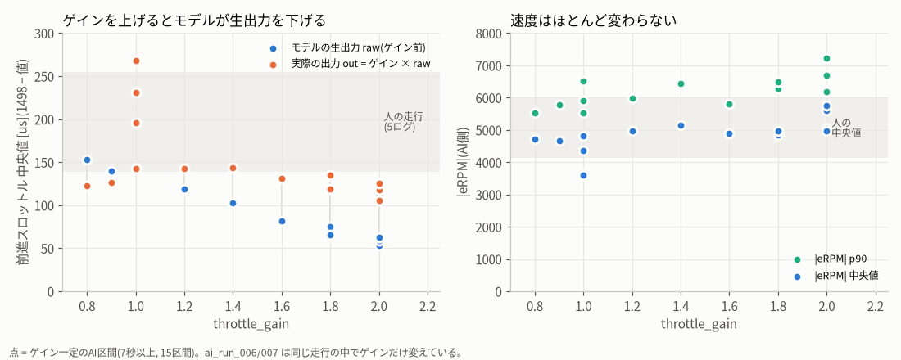
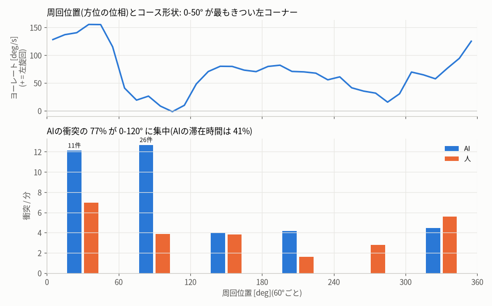
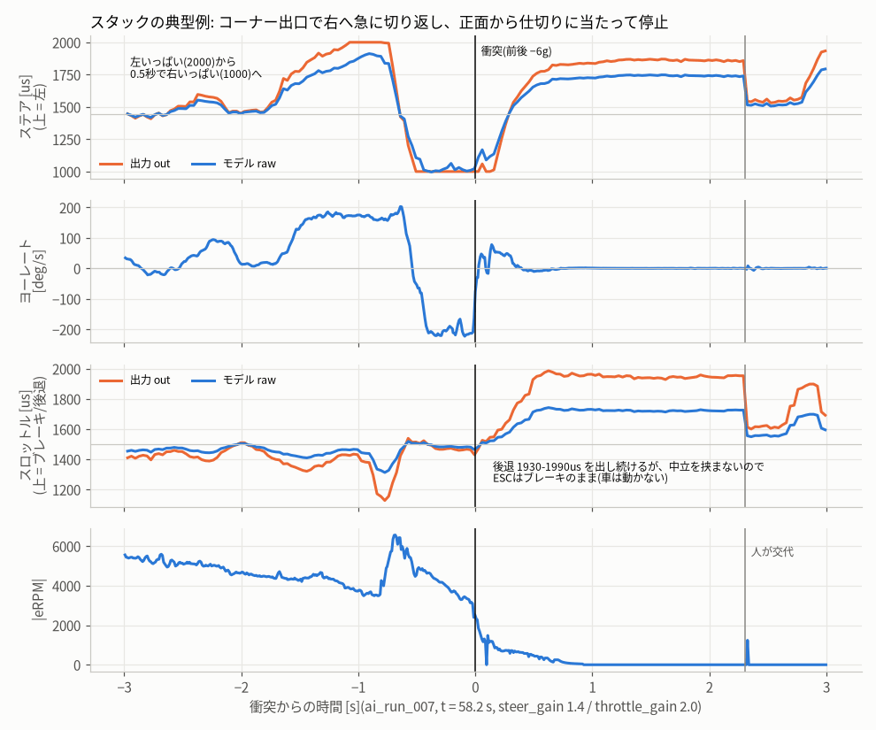

# AI走行のパラメータ調整 — 2026-10-10 全AI走行の比較と調整手順

対象モデル: `first_trial_20261010-s3-20261010-153629`(全走行で同じ)。コースは全走行・全学習データとも左回り(CCW)。
集計スクリプト: `params_study.py`(このフォルダ。引数なしで本書の数値・図・`params.json` を再生成、ログ名を渡すと新しい走行の指標だけを表示)。

## 0. 要点

1. **throttle_gain を上げても、ほぼ速くならない。** モデルは eRPM(速度)を入力に持つので、ゲインを上げるとモデル自身が生の指令(raw)を下げて打ち消す。ゲイン一定の12区間で raw の前進量は gain^-1.13(R²=0.95)、実際に出た前進量 out は gain^-0.13 でほぼ一定(106–144 µs)。速度は 2倍のゲインで中央値 +9%、p90 +13% だけ。ai_run_007 の終盤に 2.0 → 1.0 へ戻してもラップは遅くならなかった(9.9 秒 対 10.1–10.7 秒)。高いゲインで増えたのは、加速の突き上げ(out の p90)と後退指令(≥1900 µs)だけ。
2. **衝突の 77% は、コースの1か所(最もきつい左コーナーとその出口の直線、周回位置 0–120°)で起きている。** この区間にAIがいた時間は 41% で、衝突率は 12.5 回/分。ほかの区間では 2.6 回/分で、人(3.6 回/分)より少ない。人は同じ区間で 4.8 回/分。カメラ画像では、出口の右側にある白い仕切りの端に当たっている。
3. **衝突はほとんど「正面〜右前」から当たっている。** 横から当たったのではない。走行データから IMU の向きを確かめると、+y = 前、+x = 右 だった(加減速との相関 r=0.64–0.90、旋回の遠心力との相関 r=−0.96〜−0.98)。「ay −6〜−8 g = 左側面への接触」というこれまでの読みは、正しくは「前から当たって急減速」。AI の衝突 67件の内訳は、正面 28・右前 30・左前 4・右 4・後ろ 1。人は 28件で、正面 16・左前 6・右前 4・右 2。
4. **スタック 6件のうち 4件は、コーナー出口で右いっぱいへ急に切り返して起きた。** 左いっぱいから 0.5 秒で右いっぱいへ切り返し、ヨーは −200 deg/s。そのまま正面から仕切りに当たり、止まった。この切り返しは**ゲイン前(raw 1018–1094 µs)の時点ですでに右いっぱい**で、steer_gain 1.0 でも起きている。止まったあとモデルは後退(raw 1600–1760、gain 2.0 では out 1940–2000)を出し続けるが、中立を挟まないので ESC はブレーキのまま。6件とも人が交代した。
5. **steer_gain と lookahead が衝突に効くかどうかは、今のデータからは判断できない。** 区間ごとの衝突/周とゲインの相関は R²≈0 で、どの区間の95%信頼区間も重なる。走行中にスライダーを動かしたため、ai_run_006 では22通り、ai_run_007 では13通りの設定が混ざった。この2本の36区間のうち7秒以上続いたのは10区間だけで、全走行を合わせても15区間しかない。
6. **ラップタイムは人と同程度。** AI は ai_run_006 で中央値 9.5 秒(IQR 9.2–9.7、14周)、ai_run_007 で 10.1 秒(9.7–10.6、13周)。人は中央値 9.8 秒(IQR 8.5–12.1、24周)。AI のほうがばらつきは小さい。
7. **ステアの中心(1443 µs)は合っている。** ヨーレートが 0 になるステア値は、AI 側で 1444–1452 µs、人で 1427–1451 µs。steer_trim と osc_percent を補正する根拠はない。

## 1. 推奨パラメータ

| パラメータ | 推奨範囲 | 最初の値 | 根拠 | 根拠の強さ |
|---|---|---|---|---|
| throttle_gain | **1.0–1.2** | 1.0 | 1.2 を超えても速度もラップも伸びない(要点1)。上げるほど out の p90 が増え(弾性 0.25)、後退が 2000 µs まで増幅され、モデルの raw が人の学習範囲(前進 139–255 µs)から外れて 53–63 µs まで下がる。入力の分布外で動かすことになる。 | 強い(同じ走行の中での比較) |
| steer_gain | **1.3–1.5** | 1.4 | モデルの raw は人より切れ角が小さい(\|偏差\|中央値: raw 75 µs、人 133 µs)。1.4–1.45 の区間では out の |偏差| 中央値が 86–121 µs になり、人(87–163、中央値 133)に近づく。ロック使用率も 8–18% で、人(7–17%)と同じくらいになる。1.6 以上では限界(1000/2000)に張り付く時間が増え、左は人が使わない 1895 µs 超まで出る。切り返しの頻度は 0.4–0.8 回/秒で人(0.57–0.75)と同程度なので、振動の兆候はない。 | 中(分布を合わせただけで、衝突への効果は未確認) |
| lookahead | **2–3** | 3 | 予測は内部で一貫していて、pred[k] は pred[0] より約 k フレーム先を表す。予測のジッタは la3 で 11 µs/フレーム、la5 で 14 µs/フレーム。出力からヨーが立ち上がるまで約 3 フレーム(100 ms)、撮像から出力まで 28 ms。la=1 が人の操作と同じタイミングで、la を増やすほど人より早く切ることになる。la5 で良くなった証拠はない。 | 弱い(la1 は I2C 修正前のデータしかない) |
| steer_trim_us | 0 | 0 | ヨーが 0 になるステア値が中心と ±10 µs 以内で一致している。 | 中 |
| osc_percent | 0 | 0 | AI(PCA9685)と人(受信機)のパルスでヨーが 0 になる点が ±10 µs 以内(クロック誤差 <0.7%)。 | 弱い |

### パラメータ以外で、より効くと考える対策(優先順)

1. **後退の手順を入れる。** ESC は「後退(ブレーキ) → 中立 約0.15 s → 後退」でないと後退しない。モデルの後退指令が 0.3 秒以上続き、かつ |eRPM| < 300 のときは、中立を 0.15–0.2 秒挟んでから後退するようにする。後退の大きさは 1650–1700 µs 程度で上限を設け、throttle_gain は前進側にだけ掛ける。今日のスタック 6件(すべて人が交代)の大半は、これで自力で抜けられた可能性がある。ただし未検証の仮説。
2. **集中区間の学習データを足す。** 左コーナーの出口と、白い仕切りの端の周辺。人が普通に通過するデータに加えて、仕切りに近づいた位置から離れる「回復」の操作も含める。パラメータでは消えない失敗(要点2、4)は、データで直すしかない。
3. **1回の走行(ログ)では1つの設定だけで走る。** 走行中にスライダーを動かさない。今日の ai_run_006/007 は 36 区間(35 通りの設定)のうち 26 区間が 7 秒未満で、比較に使えなかった。
4. **ステアの出力上限を、スロットルとは別に持つ。** 今は `config.DRIVE` の min_us/max_us = 1000/2000 が両方の出力で共通。人の操作範囲は約 995–1895 µs なので、AI は左に 105 µs 多く切っている。まず 1895 µs と 2000 µs で実際の切れ角が変わるかを静止状態で測る。変わらなければ(サーボのストッパーに当たっているなら)、ステアの上限を 1895 µs 付近にする。2000 µs のほうが実際に多く切れるなら、今のままでよい(4.2 の「左いっぱいでも曲がり切れない」型には有利)。
5. **バッテリー電圧を記録する。** 今日は記録がなく、走行順と電池の消耗を切り分けられない。
6. **IMU の取り付け向きを calibration に反映する。** `config.CALIBRATION['IMU']` の回転は [1,0,0,0] だが、実測では z 軸まわりに −90° 回っている(quaternion ≈ [0.707, 0, 0, −0.707])。学習と走行で同じ生の軸を使っているのでモデルには影響しない。ただし、衝突の向きなどの解析は今日のように誤る。
7. **交代の基準を決める。** 例: 「止まって2秒たったら交代」「仕切りに向かって全速なら交代」。今日は交代 11回のうち 9回が衝突から 2.5 秒以内で、交代/分は運転者の判断に強く左右される。

## 2. 調整の手順

**基本方針**: 一度に変えるパラメータは1つ。1つの設定を1つのログで走る。比べるときは A-B-A の順で走り、最初と最後の A の差を時間や電池による変化の目安にする。速度が違う設定どうしは「回数/分」ではなく「回数/周」で比べる。

**1回の試行の長さ**: AI 側で **4 分(約 24 周)以上**。今日の衝突は約 1.15 回/周なので、
- 24 周では衝突が約 28 件で、95% 信頼区間は −34%〜+45%。**3倍の差**なら見分けられる(必要なのは片側 約 23 周)。
- **2倍の差**を見分けるには片側 **約 43 周(7 分)** が必要。迷ったら同じ設定をもう 1 本(ABAB)。
- ラップタイムは周ごとのばらつきが約 0.45 秒なので、20 周ずつあれば **0.4 秒程度の差**が見える。
- スタックは約 0.1–0.2 回/周と少ないので、1 回の試行での比較には使えない。最後の確認(手順 6)で合計 50 周以上を集めて判断する。

**判定に使う指標**(`python params_study.py <ログ名>` で表示される):

| 指標 | 目安(今日の値 → 目標) | 何を見るか |
|---|---|---|
| 衝突/周 | AI 1.15–1.2、人 0.75 → **人と同じ 0.75 以下** | 主な判定。95%信頼区間も見る |
| 集中区間(0–120°)の衝突数 | 衝突の 77% → 人と同じ 50% 前後 | パラメータで変わらないならデータの問題 |
| スタック/10周 | 007 で 2.2、全体で 1.1 → 0 | 後退の手順を入れたかどうかで大きく変わるはず |
| 交代/分、AI区間の最長 | 2.8/分・51 秒 → 1/分以下・2 分以上 | 運転者の判断も入るので補助的に |
| ラップ中央値 / IQR | 9.5–10.1 秒 / ±0.5 → 悪化させない | 速さ |
| \|eRPM\| p50 / p90 | 4700–5800 / 5500–7200 | 速度が変わったかの確認 |
| ステア限界の割合(右1000 + 左2000) | 8–18% → 5–15% | 20% を超えたら steer_gain が大きすぎる |
| ステア \|偏差\| 中央値(out) | 86–125 µs → 人の 115–160 µs | 下回るなら切れ角が足りない |
| 切り返し/秒(out) | 0.4–0.8 → 1.0 未満 | 1.0 を超えたら振動。ゲインか lookahead を下げる |
| 後退 ≥1900 µs の割合 | 007 で 2.5% → 0% | 後退の手順を入れるまでは throttle_gain を上げない |
| hold_ratio、遅延 p50 | 0、28 ms | 0 でなければ試行を無効にする |

**手順**

0. **準備(毎回)**: 電池を満充電にする(電圧が測れるなら記録)。左回りで走る。交代の基準を決めておく。ログの説明は `tune_<日付>_s1.4_t1.0_la3_A` のように設定がわかる名前にする。走り始めの 20–30 秒で hold_ratio=0、遅延 p50 < 35 ms、カメラ 30 fps を確かめる。
1. **基準(A)**: steer_gain 1.4 / throttle_gain 1.0 / lookahead 3 / trim 0 で 4 分。これが以後の比較の基準になる。
2. **steer_gain**: 1.2 と 1.6 を 4 分ずつ走り、最後にもう一度 1.4(A)を走る(A-B-C-A)。
   - 衝突/周がいちばん少ない設定を選ぶ。どれも信頼区間が重なるなら、**ステア限界の割合が 5–15%、out の \|偏差\| 中央値が 110–150 µs、切り返しが 0.8/秒未満**に収まる設定にする(迷ったら 1.4)。
   - 1.2 で \|偏差\| 中央値が 100 µs を下回り、コーナーで膨らむ衝突(右前、0–60°)が増えるなら、1.2 は小さすぎる。
3. **lookahead**: 手順 2 で選んだゲインのまま、3 と 2 を A-B-A で比べる。2 が良ければ 1 も試す。
   - 0–60° の衝突(右への切り返し・コーナー内での接触)、スタック、予測のジッタを見る。差が信頼区間の中なら 3 のままにする。5 以上には上げない。
4. **throttle_gain(速くしたいときだけ)**: 1.0 → 1.2。ラップ中央値が 0.3 秒以上速くなり、衝突/周の増加が 30% 以内のときだけ採用する。後退の手順を入れるまでは 1.2 を超えない。速度を本当に上げたいなら、ゲインではなく「速く走った人の学習データ」を足すほうが確実(要点1)。
5. **steer_trim(任意)**: 手順 2–4 のあとで、AI に特有の右前の衝突(直線 60–120° と、コーナー内で曲がり切れない型)が今のように多く残る場合だけ、左寄せの +10 µs と +20 µs を A-B-A で試す(中心より上 = 左)。このコースに右カーブはほぼないので、悪影響は小さいと見込む。ただし +20 µs でも 6000 eRPM で約 13 deg/s 曲がる量になる。中心の較正は合っていて(要点7)、ずれはモデルが画像を見て打ち消す可能性も高いので、効果は期待薄。
6. **確認**: 最良の設定を、別の満充電の電池でもう 2 本(各 4 分以上)走り、基準 A と比べる。合計 50 周以上でスタックも比べる。
7. **止めどき**: どの設定でも集中区間(0–120°)が衝突の 60% 以上を占め続けるなら、パラメータ調整はそこまでにする。データ追加と再学習(対策2)と、後退の手順(対策1)に進む。

所要時間の目安: 準備 10 分 + 4 分 × 約 10 本(基準 3 本、steer 2 本、lookahead 2 本、throttle 1 本、確認 2 本)で、走行は約 40 分(電池 3–4 本)。

## 3. 比較表

### 3.1 走行ごと(AI 側だけ)

ログ名: trial = 20261010-155820、run_001 = -160306、run002 = -163247、ai_run_003 = -171639、ai_run_004 = -172505、ai_run_006 = -172910、ai_run_007 = -173445。ゲインは AI 側の時間で重み付けした平均。ai_run_006/007 は走行中にゲインを変えているので、3.3 の区間ごとの表も見ること。trial と run_001 は I2C 修正前のデータで、0.5 秒の中立保持がそれぞれ AI 時間の 8% と 6% ある。run002 は AI 側が 26% しかない。この 3 本は比較から外して読む。

| 走行 | steer/throttle gain | la | 全体 s | AI s (比率) | AI区間 中央/最長 s | 交代 /AI分 | 衝突 /AI分 [95%CI] | 衝突 /周 | 上下バンプ | スタック /AI分 (件) |
|---|---|---|---|---|---|---|---|---|---|---|
| trial | 1.00/1.00 | 1 | 49 | 36 (74%) | 6.7 / 12.6 | 6.7 (4) | 10.1 [3.7-22.0] (6) | 2.84 | 0 | 0.00 (0) |
| run_001 | 1.60/1.00 | 3 | 69 | 39 (56%) | 5.9 / 17.5 | 7.7 (5) | 4.6 [1.0-13.6] (3) | 0.75 | 0 | 1.55 (1) |
| run002 | 1.60/1.00 | 3 | 140 | 36 (26%) | 2.8 / 15.2 | 13.2 (8) | 9.9 [3.6-21.6] (6) | 1.96 | 1 | 0.00 (0) |
| ai_run_003 | 1.00/0.80 | 3 | 80 | 60 (75%) | 30.0 / 30.1 | 2.0 (2) | 6.0 [2.2-13.1] (6) | 1.24 | 0 | 0.00 (0) |
| ai_run_004 | 1.50/0.90 | 3 | 20 | 14 (69%) | 13.7 / 13.7 | 4.4 (1) | 4.4 [0.1-24.3] (1) | 0.68 | 0 | 0.00 (0) |
| ai_run_006 | 1.50/1.71(平均) | 5 | 163 | 152 (94%) | 76.1 / 145.1 | 0.8 (2) | 7.5 [4.5-11.7] (19) | 1.19 | 5 | 0.00 (0) |
| ai_run_007 | 1.44/1.80(平均) | 3 | 300 | 236 (79%) | 21.7 / 50.7 | 2.8 (11) | 6.6 [4.3-9.7] (26) | 1.15 | 0 | 1.27 (5) |

| 走行 | \|eRPM\| p50 / p90 | 周回 (完全周) | ラップ 中央値 s | AI秒/周 | 切り返し /s out(raw) | 右1000 / 左2000 | ステア\|偏差\| p50 out(raw) | スロットル out p5/p50/p95 | 前進量 p50 raw→out | ブレーキ/後退 (≥1900) |
|---|---|---|---|---|---|---|---|---|---|---|
| trial | 3648 / 5918 | 2.1 (0) | - | 16.9 | 0.46 (0.46) | 0.9% / 0.0% | 81 (81) | 1121 / 1267 / 1484 | 231 → 231 | 0.4% (0.0%) |
| run_001 | 3608 / 6522 | 4.0 (1) | 7.4 | 9.7 | 0.63 (0.55) | 10.2% / 1.8% | 88 (55) | 1156 / 1230 / 1443 | 268 → 268 | 2.3% (0.0%) |
| run002 | 4365 / 8455 | 3.1 (0) | - | 11.8 | 0.81 (0.70) | 14.1% / 11.9% | 229 (143) | 1118 / 1302 / 1525 | 196 → 196 | 7.1% (0.0%) |
| ai_run_003 | 4705 / 5518 | 4.9 (2) | 11.1 | 12.3 | 0.54 (0.54) | 0.9% / 0.0% | 81 (81) | 1298 / 1376 / 1461 | 153 → 122 | 0.5% (0.0%) |
| ai_run_004 | 4655 / 5775 | 1.5 (0) | - | 9.3 | 0.44 (0.44) | 3.2% / 0.0% | 78 (52) | 1307 / 1372 / 1458 | 140 → 126 | 0.0% (0.0%) |
| ai_run_006 | 5277 / 6459 | 15.9 (14) | 9.5 | 9.5 | 0.68 (0.47) | 6.6% / 5.5% | 105 (71) | 1272 / 1372 / 1491 | 72 → 126 | 3.4% (0.0%) |
| ai_run_007 | 4956 / 6103 | 22.7 (13) | 10.1 | 10.4 | 0.61 (0.50) | 5.7% / 8.6% | 114 (79) | 1241 / 1369 / 1608 | 70 → 129 | 7.1% (2.5%) |

### 3.2 人の走行(学習データ、全区間が人の操作)

ラップ中央値は完全な周回が 3 周以上あるログだけが目安になる(135449 は 1 周、144028 は 2 周)。

| 人の走行 | 時間 s | 衝突 /分 (件) | 衝突 /周 | \|eRPM\| p50(走行中) / p90 | 周回 (完全周) | ラップ 中央値 s | 切り返し /s | ステア\|偏差\| p50 | 右≤1010 / 左≥1880 | 前進量 p50 / p90 |
|---|---|---|---|---|---|---|---|---|---|---|
| 20261010-135449 | 60 | 3.0 (3) | 0.60 | 4139 / 5657 | 5.0 (1) | 5.3 | 0.57 | 87 | 2.9% / 4.4% | 139 / 193 |
| 20261010-144028 | 40 | 1.5 (1) | 0.25 | 5099 / 6613 | 4.0 (2) | 11.3 | 0.62 | 114 | 3.1% / 14.3% | 174 / 237 |
| 20261010-150424 | 100 | 1.8 (3) | 0.34 | 5161 / 7131 | 8.7 (3) | 9.6 | 0.75 | 140 | 6.6% / 7.9% | 209 / 291 |
| 20261010-152405 | 128 | 5.2 (11) | 1.07 | 5301 / 7711 | 10.3 (10) | 11.5 | 0.69 | 150 | 5.9% / 10.9% | 207 / 299 |
| 20261010-152707 | 100 | 6.0 (10) | 1.08 | 5983 / 8714 | 9.3 (8) | 8.6 | 0.66 | 163 | 4.6% / 11.4% | 254 / 343 |

### 3.3 ゲイン一定の区間ごと(AI 側 7 秒以上)

| 区間 | gain s/t | la | AI s | 周回 | 衝突 (件) /AI分 [95%CI] | 衝突/周 | \|eRPM\| p50 / p90 | AI秒/周 | 前進量 p50 raw→out | out p90 | ブレーキ/後退 | 右/左 限界 | \|偏差\| p50 out(raw) | 切り返し/s | スタック |
|---|---|---|---|---|---|---|---|---|---|---|---|---|---|---|---|
| trial 0-49s | 1.00/1.00 | 1 | 36 | 2.1 | 6 / 10.1 [3.7-22.0] | 2.84 | 3648 / 5918 | 16.9 | 231 → 231 | 349 | 0.4% | 0.9% / 0.0% | 81 (81) | 0.46 | 0 |
| run_001 0-70s | 1.60/1.00 | 3 | 39 | 4.0 | 3 / 4.6 [1.0-13.6] | 0.75 | 3608 / 6522 | 9.7 | 268 → 268 | 330 | 2.3% | 10.2% / 1.8% | 88 (55) | 0.63 | 1 |
| run002 0-140s | 1.60/1.00 | 3 | 36 | 3.1 | 6 / 9.9 [3.6-21.6] | 1.96 | 4365 / 8455 | 11.8 | 196 → 196 | 358 | 7.1% | 14.1% / 11.9% | 229 (143) | 0.81 | 0 |
| ai_run_003 0-100s | 1.00/0.80 | 3 | 60 | 4.8 | 6 / 6.0 [2.2-13.1] | 1.24 | 4705 / 5518 | 12.4 | 153 → 122 | 186 | 0.5% | 0.9% / 0.0% | 81 (81) | 0.54 | 0 |
| ai_run_004 0-20s | 1.50/0.90 | 3 | 14 | 1.5 | 1 / 4.4 [0.1-24.4] | 0.68 | 4656 / 5780 | 9.3 | 140 → 126 | 172 | 0.0% | 3.2% / 0.0% | 78 (52) | 0.44 | 0 |
| ai_run_006 0-29s | 1.80/1.20 | 5 | 29 | 3.0 | 5 / 10.5 [3.4-24.5] | 1.68 | 4969 / 5986 | 9.6 | 119 → 142 | 195 | 3.2% | 6.2% / 6.1% | 115 (64) | 0.77 | 0 |
| ai_run_006 33-48s | 1.45/1.40 | 5 | 15 | 1.5 | 1 / 4.0 [0.1-22.5] | 0.65 | 5136 / 6435 | 9.7 | 103 → 144 | 198 | 4.4% | 6.9% / 0.9% | 86 (59) | 0.74 | 0 |
| ai_run_006 48-60s | 1.45/1.60 | 5 | 12 | 1.3 | 0 / 0.0 [0.0-19.2] | 0.00 | 4886 / 5808 | 8.8 | 82 → 131 | 178 | 1.8% | 5.0% / 3.0% | 112 (77) | 0.35 | 0 |
| ai_run_006 60-75s | 1.45/1.80 | 5 | 15 | 1.5 | 1 / 4.1 [0.1-22.8] | 0.68 | 4842 / 6288 | 9.9 | 75 → 135 | 223 | 0.9% | 9.2% / 5.9% | 119 (82) | 0.55 | 0 |
| ai_run_006 75-83s | 1.25/1.80 | 5 | 8 | 0.9 | 0 / 0.0 [0.0-28.6] | 0.00 | 4981 / 6489 | 8.4 | 66 → 118 | 194 | 1.3% | 0.9% / 0.0% | 94 (75) | 0.26 | 0 |
| ai_run_006 83-93s | 1.25/2.00 | 5 | 10 | 0.6 | 1 / 6.1 [0.2-33.9] | 1.60 | 5604 / 7234 | 15.8 | 56 → 112 | 264 | 2.4% | 8.0% / 0.0% | 125 (100) | 0.61 | 0 |
| ai_run_006 93-163s | 1.45/2.00 | 5 | 59 | 6.5 | 11 / 11.2 [5.6-20.0] | 1.70 | 5763 / 6688 | 9.1 | 53 → 106 | 201 | 4.9% | 7.5% / 9.0% | 106 (73) | 0.78 | 0 |
| ai_run_007 0-78s | 1.40/2.00 | 3 | 51 | 5.0 | 4 / 4.7 [1.3-12.1] | 0.80 | 5036 / 6213 | 10.1 | 59 → 118 | 218 | 7.7% | 6.4% / 11.3% | 121 (86) | 0.55 | 2 |
| ai_run_007 79-229s | 1.60/2.00 | 3 | 134 | 12.6 | 14 / 6.3 [3.4-10.5] | 1.11 | 4968 / 6189 | 10.7 | 63 → 125 | 232 | 7.6% | 7.2% / 10.9% | 125 (78) | 0.70 | 1 |
| ai_run_007 237-300s | 1.00/1.00 | 3 | 43 | 4.4 | 7 / 9.8 [3.9-20.1] | 1.61 | 4816 / 5523 | 9.9 | 142 → 142 | 188 | 6.3% | 0.2% / 0.0% | 71 (71) | 0.42 | 2 |

## 4. 根拠

### 4.1 throttle_gain はモデル自身が打ち消す

- ai_run_006 では、時間の経過とともに throttle_gain を 1.2 → 1.4 → 1.6 → 1.8 → 2.0 と上げた。raw の前進量は 119 → 103 → 82 → 75 → 53 µs と下がり、out(= ゲイン × raw)は 142 → 144 → 131 → 135 → 106 µs でほぼ一定だった。電池の消耗で遅くなったのなら、モデルは低い eRPM を見て raw を**上げる**はず。実際は逆なので、電池では説明できない。
- ai_run_007 では t=237 s に 2.0 → 1.0 へ戻した。raw は 63 → 142 µs に上がり、out は 125 → 142 µs でほぼ同じ。|eRPM| の p50 は 4968 → 4816、p90 は 6189 → 5523(−11%)、ラップは 10.7 → 9.9 秒で、遅くはならなかった。
- ゲイン一定の 12 区間(I2C 修正前の3本を除く)で弾性(ln 指標 / ln ゲイン の傾き)を求めた。raw 前進量 −1.13(R² 0.95)、out 前進量 −0.13(0.21)、|eRPM| p50 +0.12(0.42)、p90 +0.18(0.61)、out 前進量 p90 +0.25(0.47)。
- 仕組み: モデルの入力には eRPM(erpm_scale 20000)と、自分のひとつ前の指令(ゲイン前)が入っている。そのため人の「速度に応じてアクセルを戻す」操作を学習した速度調節器として振る舞う。
- 高いゲインの副作用: 後退 ≥1900 µs が出たのは gain 2.0 のときだけだった(ai_run_007 で計 5.8 秒、そのうち 7 割はスタック中)。out の p95 は 1608 µs。加速の突き上げは、たとえば図4 の −0.75 秒で raw 1310 → out 1127 µs。
- I2C 修正前の 3 本は raw 前進量が 196–268 µs と大きい一方、|eRPM| p50 は 3600–4400 と低い。中立保持と交代が多く(AI 区間の中央値 2.8–6.7 秒)、何度も止まって再加速していたためと考えられる。run002 は電源断で終わっているので電池の影響もありうる。比較からは外した。

### 4.2 衝突はコースの1か所に集中している(パラメータに関係なく)

| 周回位置 | AI 時間 s | AI 衝突 | AI /分 | 人 時間 s | 人 衝突 | 人 /分 |
|---|---|---|---|---|---|---|
| 0–60°(最もきつい左コーナー) | 55 | 11 | 12.1 | 43 | 5 | 7.0 |
| 60–120°(出口の直線) | 123 | 26 | 12.7 | 108 | 7 | 3.9 |
| 120–360°(残り) | 253 | 11 | 2.6 | 235 | 14 | 3.6 |

- 周回位置の求め方: ai_run_006 の 145 秒連続した AI 区間から、ヨーレートを方位の位相(10° ごと)に対して並べた「コースの指紋」を作った。12 秒以上・400° 以上の各区間をこの指紋に相関で合わせている(r ≥ 0.5 の区間だけ使う)。磁気センサーは全サンプルが NaN で使えなかった。AI の衝突 67 件のうち 48 件、人の 28 件のうち 26 件の位置が決まった。
- 0–120° の衝突は、どのゲインの区間でも出ている。ai_run_007 では 1.4/2.0 で 3件、1.6/2.0 で 10件、1.0/1.0 で 5件。ai_run_006 では 1.45/2.0 だけで 10件。ゲインを変えても、この区間の衝突はなくならない。
- AI のこの区間の速度は人より速くない。|eRPM| 中央値は、0–60° で AI 3570–4680、人 3130–4930。60–120° で AI 4790–5580、人 3840–6190。「速すぎて曲がれない」のではなく、走行ラインと操作の判断の問題と考える。
- AI の衝突 67 件を型で分けると次のとおり。
  - **直進のまま当たる**: 38 件(60–120° に集中)。ステアは中心 ±100 µs、|eRPM| 約 6200、当たる向きは右前 19・正面 14・右 3・左前 2。34 件は速度の 60% 以上を保ったまま走り続けている(かすめる当たり方)。衝撃の中央値は 7.3 g で、人の同じ型(11 件)の 4.8 g より強い。
  - **右へ切り返して当たる**: 8 件(0–55° と 345°)。右いっぱい・ヨー −95〜−210 deg/s で正面から当たり、4 件がスタックになった。
  - **左いっぱいでも曲がり切れない**: 5 件。うち 4 件は ai_run_006 の 1.45/2.0 の区間で、out 2000(raw 1876–1895 = 人の左の最大)のまま右前が当たった。
  - **その他**: 16 件。ai_run_003(1.0/0.8)の 5 件は 160–190° の長い左カーブで起きている(ステア 1550–1570)。
- 当たった向きの合計は、AI が正面 28・右前 30・左前 4・右 4・後ろ 1。人は正面 16・左前 6・右前 4・右 2。**右前から当たるのは AI に特有**で、AI の走行ラインが右側(白い仕切りの側)に寄っていると読める。

上の2行は ai_run_006 の「直進のまま当たる」型(t=95.2 s, 113.3 s)、下の2行は ai_run_007 のスタック(t=58.2 s, 143.2 s)。各行は衝突の 1.5 秒前から衝突の瞬間まで。どの例でも、コーナーを出たところで右側にある白い仕切り(端に支柱がある)へ向かっていく。

### 4.3 スタックの仕組み

- スタックは 6 件(run_001 で 1、ai_run_007 で 5)で、6 件とも人が交代した。
- 4 件は 4.2 の「右へ切り返して当たる」型。どれも直前に左いっぱい(out 2000、raw 約 1890)でコーナーを回り、0.5 秒ほどで raw が 1018–1051 µs(右いっぱい)へ変わっている。**ゲインを掛ける前の時点ですでに右いっぱい**なので、steer_gain を下げても防げない。ai_run_007 の 1.0/1.0 の区間でもスタックは 2 件(うち切り返し型 1 件)起きている。
- 人も 0–60° では右いっぱい(≤1100 µs)を 16–32% 使っており、AI(19–33%)と同程度。切り返しそのものは人から学んだ操作で、問題は**切り返しのタイミングと深さ**にある。
- 止まった直後、ai_run_007 の 5 件ではモデルが後退を出し続けた(raw 1600–1760 µs、out は gain 2.0 で 1940–2000 µs、1.0 で 1600–1740 µs)。中立は 0–2 フレームしか通らず、ESC が後退に入るのに必要な約 0.15 秒の中立がないので、ブレーキのままだった。run_001 の 1 件は前進(1282 µs)で壁を押し続けた。

### 4.4 steer_gain

- モデルの raw は人より切れ角が小さい(回帰が平均に寄る、よくある傾向)。中心からの |偏差| の p50/p75/p90 は、人が 133/322/448 µs、AI の raw(003–007)が 75/217/399 µs で、比は 1.76/1.48/1.12。1本の直線ゲインでは分布全体を合わせられない。中央値を合わせようとすると(約 1.7)、大きく切る場面がすべて限界に張り付く。1.4 前後が妥協点になる。
- ステアが限界(1000/2000)にいる割合は steer_gain とともに増える(+0.19 / ゲイン 1.0、R² 0.43)。throttle_gain が高い区間でも多い(1.45 で 1.4 → 2.0 にすると 8% → 15–17%)。人の操作の上限は左 約1895、右 約995。gain ≥1.4 の区間では、人が出さない 2000 µs を 1–11% の時間出している(006/007 全体では 5.5%/8.6%)。
- 衝突/周と steer_gain の相関は R² 0.002 で、関係は見えない。切り返しの頻度(0.26–0.78/秒)にも傾向はなく、人(0.57–0.75)の範囲内。ゲインを上げると振動するという兆候は、この範囲(1.0–1.8)では見えない。

### 4.5 lookahead

- 学習の目標は「撮像の 1–10 フレーム先の人の操作」。pred[k] と pred[0] の相互相関から、pred[k] は約 k フレーム先を表している(006/007 で k=9 は 8 フレーム)。モデルの予測は時間方向に一貫している。
- 予測がフレームごとにどれだけ揺れるか(中央値): k=0 で 6–8、k=2(la3)で 11、k=4(la5)で 13–14 µs/フレーム。先を見るほど揺れる。
- 出力ステアからヨーが立ち上がるまで約 3 フレーム(100 ms、r 0.75–0.93)。撮像から出力まで 28 ms(p50)。人のデータには人自身の先読みが含まれているので、la=1 が人と同じタイミング。la を増やすほど人より早く操作する。
- 比較できるデータがない。la1 は I2C 修正前の 36 秒だけ。la5 は ai_run_006 だけで、ゲインも走行中に変えている。006 と 007 は衝突/周 1.19 対 1.15、ラップ 9.5 秒 対 10.1 秒。ただし 006 は |eRPM| p50 が 6% 高く、それだけでラップ差 6% が説明できる。その速度差が la、ゲイン、時刻(5 分差)のどれによるのかは分けられない。

### 4.6 ラップと走行距離

- AI の完全な周回は、006 で 14 周(中央値 9.46 s、IQR 9.19–9.66)、007 で 13 周(10.10 s、9.66–10.59)、003 で 2 周(11.1 s)。人は 24 周(9.8 s、8.5–12.1。最速 8.2 s、5.3/6.2 s の2周はスピンか近道の可能性)。AI は人並みの速さで、ばらつきが小さい。
- 1 周あたりのモーター電気回転数(走行距離とスリップの目安)は、AI 006/007 で 827/802、人で 815–1007(速い 2 ログは 997–1007)。AI は速い人より約 20% 少ないが、内側のラインを通っているのか、スリップが少ないのかは区別できない。

### 4.7 ステアの中心と IMU の向き

- ヨーレート/速度 が 0 になるステア値(中心 ±200 µs の範囲で直線を当てはめた)は、AI 側で 1444(006)、1452(007)、1449(003)、1448(004)。人は 1427–1451。中心 1443 は合っている。
- IMU の軸を、加減速との相関(ay: r 0.64–0.90、ax: r −0.06〜0.21)と、ヨー × 速度(遠心力)との相関(ax: r −0.96〜−0.98、ay: r ≈ −0.07)で確かめた。+y = 前、+x = 右、+z = 上。`params.json` の `imu_axes_check` に値がある。

## 5. 言えること / 言えないこと

| 主張 | 判定 | 理由 |
|---|---|---|
| throttle_gain を 1.0 → 2.0 にしても、速度・ラップはほとんど変わらない | **言える** | 同じ走行の中で比べて、raw が逆比例して下がった(R² 0.95) |
| throttle_gain が高いと、後退指令と加速の突き上げが大きくなる | **言える** | ≥1900 µs は gain 2.0 のときだけ、out の p90 弾性 0.25 |
| 衝突の大半はコースの1か所(0–120°)で、ゲインに関係なく起きる | **言える** | 77%(時間は 41%)、どのゲイン区間にもある |
| スタックの主因は、出口での右いっぱいへの切り返しと、中立を挟まない後退 | **言える**(6 件) | 4/6 で raw が右いっぱい、5/5 で後退が効かない |
| AI の衝突は正面〜右前、人は正面〜左前 | **ほぼ言える** | 8 g 飽和(AI 20/67 件)で向きは粗い |
| ステアの中心・PCA9685 のクロックは合っている | ほぼ言える | ヨー 0 の点が ±10 µs |
| steer_gain が衝突を増やす/減らす | **言えない** | R² 0.002、信頼区間が全部重なる |
| lookahead 3 と 5(または 1)の優劣 | **言えない** | la1 は修正前のデータだけ、la5 は 1 本で設定も混在 |
| ai_run_006 が ai_run_007 より速かった理由 | 言えない | la・ゲイン・時刻・電池が同時に違う |
| 電池の残量の影響 | 言えない | 電圧の記録がない。スロットルと eRPM の関係も加減速が混ざって判断できなかった |
| AI のほうが内側のラインを通る | 言えない | 1周あたりの回転数が 20% 少ないが、スリップと区別できない |

## 6. データと交絡についての注意

- **解析中に生データが変わった**: 20261010-155820 のシーン 0001–0002 が 17:54 に削除され、今は 0003–0005 の 48.5 秒(以前のドライブレポートでは 5 シーン、AI 54.6 秒)。ほかにも 172910 には 0001 がなく、171639 には 0001 と 0004 がない(途中に 20 秒の欠落)。173445 は 0001–0015 だけ(ドライブレポートでは 17 シーン・328 秒)。本書の数値は 18:07 時点のファイルによる。20261010-155018 はなくなっていたので、対象外にした。
- 20261010-163247(run002)はシーン 0008–0020 がなく、0021–0022 は壊れていて(EOF)、0023 は不完全。7 シーン(140 秒)で集計した。
- I2C 修正前(trial, run_001)には 0.52 秒の VEHICLE の欠損がある(8 回、4 回)。run_001 には IMU の 0.87 秒の欠損も 3 回あり、方位はその間を直線補間した台形積分で求めた。周回数は概算で、run_001 の「1 周 7.4 秒・1 周あたり回転 596」はスピンの可能性がある。
- 1 日 1 セッション、モデルは 1 つ、左回りだけ。走行の順番とパラメータの順番が重なっているので、時刻・電池・路面・運転者の慣れの影響は分けられない。人の走行(13:54–15:30)はすべて学習データ。
- 件数が少ない。ゲイン区間ごとの衝突は 0–14 件で、95% 信頼区間は 0–34 回/分と広い。区間の長さは 8–134 秒。
- 衝突は水平 ≥2.5 g と定義した。加速度は ±8 g で飽和するので強さは過小評価で、向きもおおまか。eRPM はモーターの回転なので、衝突後にタイヤが空転していると「速度が残った」ように見える。
- 周回位置の合わせ込みの誤差は ±10–20° 程度。周回数(方位 360° = 1 周)には、スピンや近道も 1 周として入りうる。
- 交代の回数は運転者の判断に左右される。

## 7. 指標の定義と再現

- **AI 側**: VEHICLE.select == True(プロポの CH3)。時間は 100 Hz のサンプル間隔の合計で、1 秒を超える欠損は除く。0.52 秒の I2C 停止は連続とみなす。
- **AI 区間**: select が連続して True の区間。**交代**: AI 区間が select=False で終わった回数(データの終わりや欠損で切れたものは含めない)。
- **衝突**: IMU の水平(x または y)の |加速度| ≥ 2.5 g。最初のサンプルから 0.6 秒以内は 1 件にまとめる。±50 ms 以内に |a|−1g > 1 g のサンプルが 1 つしかないもの(センサーの跳ね = suspect)は除く。AI 側のものだけ数える。**上下バンプ**: |az − 1g| ≥ 2.5 g で水平は 2.5 g 未満のもの。**当たった向き**: ピーク時の加速度の逆向きを車体座標(前 = +IMU y、左 = −IMU x)で 6 方向に分けた。
- **スタック**: AI 側の衝突から 1 秒以内に |eRPM| < 300 が始まり、0.5 秒以上続いたもの。
- **周回**: AI 側の gyro z(静止時の中央値でバイアスを補正し、±990 deg/s で切る)を台形積分した正味の方位 ÷ 360。全走行で左回り(+)。**完全周のラップ**: 1 つの区間の中で、方位が新しく 360° の倍数を越えた時刻の間隔(行き戻りは数えない)。**AI秒/周** = AI 時間 ÷ 周回数(止まっていた時間も含む)。
- **切り返し**: 出力ステアが中心(1443)±50 µs を越えて、左右の反対側へ移った回数 ÷ 時間。**限界**: out ≤1001(右)、≥1999(左)。
- **前進量** = 1498 − スロットル µs。実際に出る前進量 = throttle_gain × (1498 − raw)。**ブレーキ/後退**: out > 1513 µs。
- **再現**: `source ~/miniconda/etc/profile.d/conda.sh && conda activate jetracer && python params_study.py`(約 5 秒。`params.json` と `fig_*.png`、`fig_hotspot_frames.jpg` を作り直す)。新しい走行の判定は `python params_study.py <ログ名> [...]` で、ファイルは書かない。
- `params.json`: `runs`(走行ごとの全指標)、`gain_blocks`(ゲイン一定 ≥7 秒の区間)、`human`(人の 5 ログ)、`collisions`(1 件ごとの時刻・向き・型・周回位置)、`stuck_events`、`sectors`、`ref_signature`、`imu_axes_check`、`definitions`。
