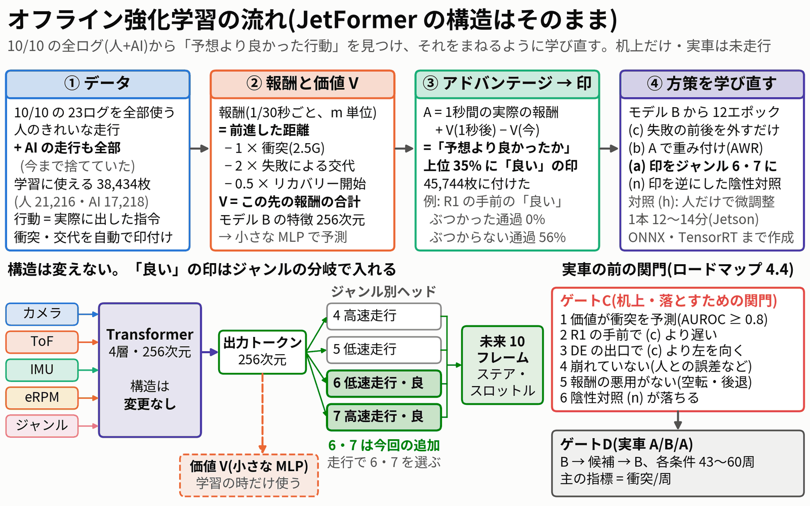
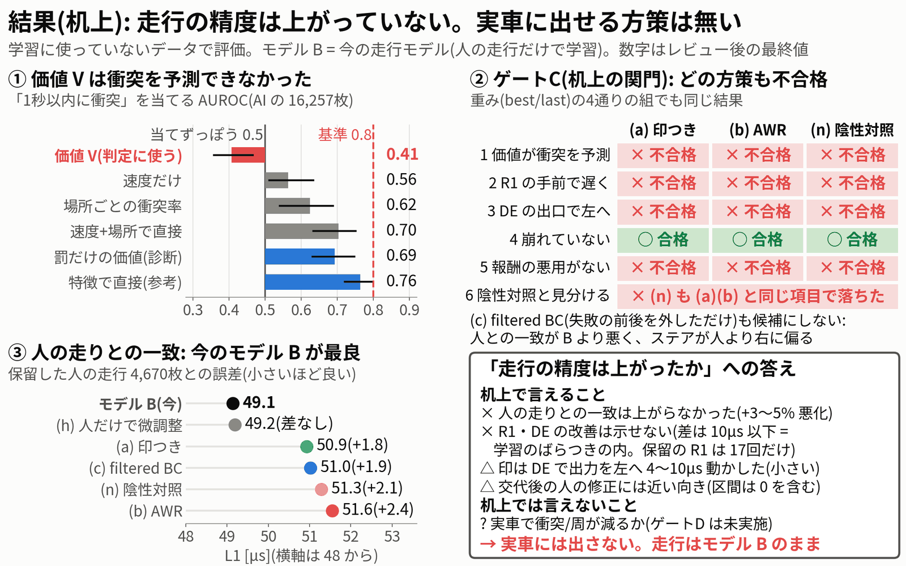
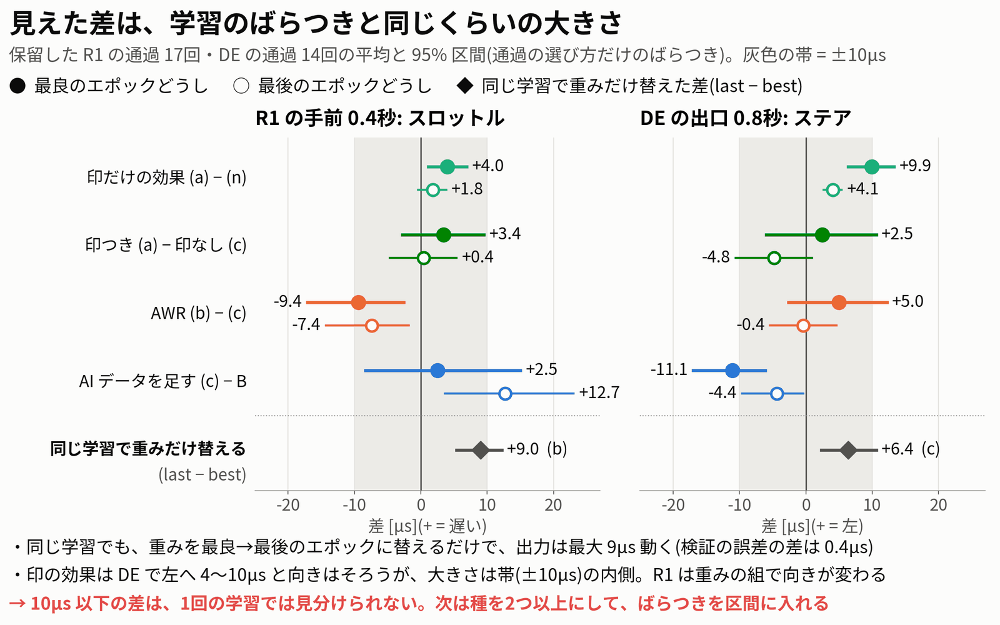
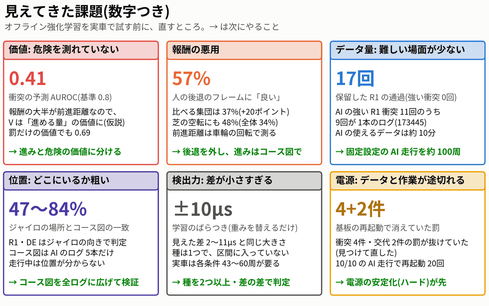

# オフライン強化学習のチャレンジ(2026-10-11)

作成: 2026-10-12。対象の作業: 2026-10-11 21時〜10-12 2時(データ点検 → 価値と印 → 方策4本 → 机上の評価 → レビュー2回と修正)。
**机上だけの結果である。実車は走らせていない。** 管理画面の jetformer-web は再起動していない。PCA9685・車両の基板には触れていない。
数字はすべて、レビューの指摘を直した後の最終値である。詳しい数字と根拠は、各段階のレポートにある。

| 段階 | レポート | 中身 |
|---|---|---|
| 0 データ点検 | `data_check.md` | ai_mix と介入セットの点検、ラベルのバグ1件の修正 |
| 1 価値と印 | `value.md` | 価値 V、アドバンテージ、「良い」の印(ゲートC の 1) |
| 2 方策 | `policies.md` | 方策4本の学習と、エンジンの作成 |
| 3 評価 | `evaluation.md` | ゲートC の判定、人との一致、レビューで直した点(10章)、ゲートD の走行カード(7章) |

---

## 要約

**今日の目標**: 「オフライン強化学習にチャレンジし、走行の精度が上がったかをレポートでまとめる」。

**答え: 机上では、走行の精度は上がらなかった。実車に出せる方策は無い。走行は今のモデル B のまま。**

- 価値 V は「1秒以内の衝突」を予測できなかった(AUROC **0.41**。基準は 0.8)。
- 机上の関門(ゲートC)は、方策4本のどれも通らなかった。重み(best/last)の組を4通りに替えても同じだった。
- 保留した人のきれいな走行との誤差は、**モデル B が最良**(49.1µs)。方策は 50.9〜51.6µs で、+3〜5% 悪かった。人だけで同じく学び直した対照 (h) は 49.2µs で B と同じなので、悪化は AI のデータを足した分である。
- 「良い」の印には、方策を動かす力があった(DE の出口でステアを左へ 4〜10µs)。ただし、同じ学習で重みを替えるだけでも出力は最大 9µs 動く。**見えた差は、学習のばらつきと同じくらいの大きさだった。**
- 実車で衝突が減るかは、机上では分からない(ゲートD は未実施)。

図(動画用。どれも 2160×1350、1920×1080 の動画にそのまま入る):

| 図 | 中身 |
|---|---|
| `fig/summary_pipeline.png` | オフライン強化学習の流れ(データ → 価値 → 印 → 方策 → 関門)。JetFormer の構造はそのまま |
| `fig/summary_results.png` | 結果の全体: 価値の AUROC と基準、ゲートC の合否、人との一致、「精度は上がったか」への答え |
| `fig/summary_noise.png` | 見えた差の大きさと、学習のばらつき(±10µs)の比較 |
| `fig/summary_issues.png` | 見えてきた課題(数字つき)と次にやること |

---

## 1. 10/10 の課題から、なぜオフライン強化学習か

### 1.1 10/10 の課題(`summary_20261010/fast_and_safe_plan.md` 1章)

AI の衝突は3か所に集まっていた。006/007 で AI は **1.17回/周**(R1 0.34・GM 0.21・DE 0.52・その他 0.10)、人は 0.59〜0.99回/周だった。

| 場所 | 何が起きていたか | 数字 |
|---|---|---|
| **R1**(右ヘアピン) | 進入速度で決まる。速く入るとグリップの限界を超えてぶつかる | 006/007 の AI の R1 の衝突: 進入 5,500 eRPM 未満 1/21、5,500〜6,200 2/7、**6,200 以上 6/8** |
| **DE**(緑マットの後) | マットを出た後も右へ曲がり続ける | 出口の 0.2〜0.8秒後のヨー: **AI −36°/s**、人 −5〜+9°/s |
| **GM**(芝のヘアピン) | 低μ。左いっぱいでも曲がりきれない | 左いっぱいでの実際の曲率は LH の 0.74〜0.85倍 |

今回のデータセット(ai_mix)のラベルから、この診断を数字のうえで再現できた(`data_check.md`)。R1 は 1/22・2/7・6/9、DE 出口のヨーは AI −37.1°/s・人 −3.6°/s だった。

### 1.2 捨てていたデータ

- モデル B は、**人の走行だけ**で学習している(clean_driving_20261011、52シーン)。AI が走った間のデータ(AI 側、使えるもので約10分・18,866枚)は、学習に使っていなかった。
- 模倣学習は、人の衝突までまねる。AI 自身の失敗から「どこで何をすると、ぶつかるか」を学ぶ方法が無かった。
- AI のデータには、同じ場所で「良い行動」と「悪い行動」の両方がある。例: R1 に遅く入って抜けた通過と、速く入ってぶつかった通過。

### 1.3 なぜオフライン強化学習か(`overnight_20261011/research/offline_rl.md` 0・3・4章)

1. **AI 自身の成功と失敗から学べる。** 報酬(進んだ距離 − 衝突・交代の罰)で、行動の良し悪しを測れる。
2. **シミュレータも、新しい走行も要らない。** 第1回は、10/10 に集めたデータだけでできる。
3. **最小形なら安全側。** 価値で「良い行動」に印を付けてまねるだけなので、データに無い行動を作らない。Q 学習のように「やったことの無い速さ」を過大評価する心配が無い。
4. **JetFormer の構造を変えなくてよい。** 印は、今ある「走行ジャンル」の分岐(ヘッド)で入れられる。推論の速さも変わらない。
5. **Jetson で回せる。** 価値は特徴を固定した小さな MLP。方策の学習は今の学習と同じ。

あわせて、**先に関門を決めた**(`roadmap.md` 4.4・4.5)。ゲートC(机上)は「落とすための関門」で、通っても実車で良くなる根拠にはならない。採用を決めるのは実車の A/B/A(ゲートD)だけ、とした。

---

## 2. やったこと

図: `fig/summary_pipeline.png`(上)

### 2.1 データ(`data_check.md`)

| 項目 | 中身 |
|---|---|
| データセット | `data/datasets/ai_mix_20261011`: 10/10 の 23ログ(人 12・AI 11)から、人のきれいな走行と AI の走行の全部。109シーン・60,842フレーム |
| 使えるフレーム | 学習: 人 21,216・AI 17,218。保留(val): 人 5,753・AI 1,648(AI のログ 172505・204208 は丸ごと保留) |
| AI の行動ラベル | 実際に出した指令(out)を、走行の固定設定(ステアのゲイン 1.3・速度 1.0)で割り戻した値。生ログから計算し直した値と 22,088枚すべて一致 |
| 衝突・交代のラベル | `tools/label_events.py`。衝突の地図(collision_map.md)の 45件をすべて見つけ、場所も 45/45 一致 |
| 介入セット | `data/datasets/intervention_val_20261011`: 交代の後に人が前進して直した 29窓・採点 1,570フレーム |
| **直したバグ** | 強い衝突で基板が再起動すると、衝突とその後の交代の罰が、再起動のマスクの中に落ちて消えていた(155820・181504。AI の衝突 4件、うち 3件は 7.1〜11.1G、失敗による交代 2件)。罰を直前の AI のフレームへ移すようにした(`carry_penalties`、テスト 2件)。作り直しで変わったのは、この2本の報酬・リターン・区間の終わり方だけ |

### 2.2 報酬と価値 V(`value.md`)

- **報酬**(1/30秒ごと、単位 m): `r = 前進した距離 − 1 × 衝突(水平 2.5G) − 2 × 失敗による交代 − 0.5 × リカバリー開始`。前進した距離は車輪の回転(eRPM)から出した。割引 γ = 0.99(約 3.3秒)。
- **終端**: 失敗による交代で終わる区間だけを終端にした。それ以外の終わり(打ち切り・ログの終わり)は、V で続きを見積もった。
- **価値 V**: モデル B の出力トークン(256次元、固定)+ 速度 + ジャンル → 2層の MLP(隠れ 128)。目標は割引リターン、Huber 損失。
- **ログ単位の5分割で交差推定**した。どのフレームの V も、そのログを見ていないモデルで出している。
- 印には、場所(R1・DE などの区間)も入力した V を使った(学習の時だけ使う情報。方策は使わない)。ゲートC の 1 は、場所を入れない V で判定した(場所だけでも衝突をある程度当てられるため)。
- GPU は特徴を取る1回だけ(264秒)。ほかは CPU。

### 2.3 アドバンテージと「良い」の印(`value.md`)

- `A = (1秒間の実際の報酬) + V(1秒後) − V(今)`。「予想より良かったか」を表す。
- ジャンルごとに、A の上位 35% に「良い」の印(I = 1)を付けた。方策に使えるフレーム 45,744枚。
- 「良い」の割合: AI 31.7%、人 35〜39%。AI の DE がいちばん低い(22%)。
- 例: R1 で強くぶつかった AI の通過(10回)は、手前 0.4秒の「良い」が **0%**。ぶつからなかった通過(44回)は **56%**。
- 陰性対照の印(I_neg): A の**下位** 35% を「良い」にしたもの。

### 2.4 方策(`policies.md`)

**JetFormer の構造はそのまま。** どれもモデル B の重みから始め、データの使い方だけを変えた。

| 方策 | 何をしたか | 学習サンプル | 走行のジャンル |
|---|---|---|---|
| (c) filtered BC | 人 + AI のデータから、衝突・失敗の前後を外して、ふつうにまねる(比べる基準) | 9,545 | 4・5 |
| (b) AWR | (c) に AI の失敗の前後を足し、損失に重み w = clip(exp(A/β), 0, 20) を掛ける(β = 1.51) | 11,637 | 4・5 |
| **(a) 印つき** | 「良い」のフレームを新しいジャンル **6「低速走行・良」・7「高速走行・良」**に移して学習(30% の確率で元のジャンルに戻す)。走行では 6・7 を選ぶ | 11,637 | 6・7 |
| (n) 陰性対照 | (a) と同じで、印だけを逆にしたもの。関門で落ちるはずのもの。**走らせない** | 11,637 | (走らせない) |
| (h) 対照(レビューで追加) | (c) と同じ設定で、AI のフレームを外したもの(人だけで微調整) | 5,885 | エンジンなし |

- 共通: 12エポック、学習率 1e-4(cosine)、間引き 1/3、バッチ 64、workers 4、種 0、今の操作値を入れない。1本 11.6〜13.7分(Jetson、GPU は1つずつ)。
- 4本とも ONNX・TensorRT FP16 エンジンまで作った。エンジンと PyTorch の差は最大 1.07µs。

### 2.5 評価のやり方(`evaluation.md` 1章)

- ゲートC の判定の規則と保留データを、この段階の予測の前に `evaluation/heldout.json` に固定した。
- 保留データ: ai_mix の val(17シーン・9,415フレーム。人の 11シーンはモデル B の val と同じ)。R1 の通過 17回(AI 4)、DE の通過 14回(AI 4)、直線 542フレーム。介入セット 29窓。
- 方策の出力は、ゲートD の固定設定(ステアのゲイン 1.3・速度のゲイン 1.0・先読み 3)で計算した。
- 走行の精度の指標(人の操作との誤差など)は、`tools/compare_models.py` の `metrics` をそのまま使った。
- **レビューを2回受け、指摘をすべて直した**(`evaluation.md` 10章)。主な修正: 最後のエポックの重み(last.pth)でも計算し直した。人だけの対照 (h) を足した。「DE で右へ寄った」は DE に固有ではなく全体のずれだったと訂正した。印だけが違う (a) と (n) の比較を足した。4本のエンジンを走行の一覧から外した。

---

## 3. 結果

### 3.1 価値の AUROC(ゲートC の 1)

AI が前進している 16,257フレーム(1秒以内に衝突 2,401)で、「1秒以内に衝突するか」を当てる AUROC。

| スコア | AUROC [95% 区間] |
|---|---|
| **価値 V(位置なし、判定に使う)** | **0.407 [0.358, 0.466]** → 不合格(基準 0.8、当てずっぽうは 0.5) |
| 速度だけ | 0.563 |
| 場所ごとの衝突率 | 0.624 |
| 速度 + 場所で直接当てる | 0.703 |
| 診断: 罰だけの価値(同じ特徴) | 0.693 [0.631, 0.747] |
| 参考: 特徴で衝突を直接当てる | 0.763 [0.721, 0.795] |

- V は、特徴を使わない基準にも負けた。報酬の大半が前進距離なので、V は「この先どれだけ進めるか(前が開けているか)」の価値になったと考える(仮説)。衝突の 0.3秒前まで V は上がり続け、衝突のいちばん多い DE で最も高かった。
- 特徴には危険の手がかりがある(罰だけの価値 0.69、直接当てると 0.76)。ただし 0.8 には届かない。

### 3.2 ゲートC の合否

| 項目 | (a) 印つき | (b) AWR | (n) 陰性対照 |
|---|---|---|---|
| 1 価値が衝突を予測(AUROC ≥ 0.8) | × | × | × |
| 2 R1 の手前で (c) より遅い | × | ×(逆に速い: −9.4µs) | × |
| 3 DE の出口で (c) より左 | × | × | × |
| 4 崩れていない(直線・人との誤差) | ○ | ○ | ○ |
| 5 報酬の悪用がない | × | × | × |
| 6 陰性対照と見分けられる | ×((n) も (a)(b) と同じ項目で落ちた) | | |

- best/best・last/last・混ぜた組の4通りで計算し直しても、候補は出なかった。
- (c) filtered BC も候補にしない。人との一致が B より悪く(+1.9µs、ログ単位でも区間は 0 を含まない)、ステアが人より右に偏った(−7.7 / −3.0µs。B は +1.2 / +0.9µs)。
- 項目5 で見つかった報酬の悪用: 人の後退のフレームの 57% に「良い」が付いた(比べる集団 37%)。芝の空転のフレームも 48%(全体 34%。場所をそろえると +7ポイント)。

### 3.3 人との一致(走行の精度の机上の代わり)

保留した人のきれいな走行(11シーン・4,670フレーム)。1〜10フレーム先の誤差の平均 L1。小さいほど人に近い。

| モデル | L1 [µs](best / last) | B との差 [95% 区間] |
|---|---|---|
| **モデル B(今の走行モデル)** | **49.1** / 49.1 | — |
| (h) 人だけで微調整(対照) | 49.2 / 49.3 | +0.05 [−0.30, +0.45] |
| (a) 印つき | 50.9 / 51.1 | +1.8 [+0.8, +2.9] |
| (c) filtered BC | 51.0 / 50.7 | +1.9 [+0.9, +2.9] |
| (n) 陰性対照 | 51.3 / 51.1 | +2.1 [+0.9, +3.4] |
| (b) AWR | 51.6 / 51.6 | +2.4 [+1.0, +4.1] |

交代の後の人の修正(介入セット、29窓・1,570フレーム)。難しい場面での一致。

| モデル | L1 [µs](29窓) | B との差 | ログも保留した3窓(218フレーム) |
|---|---|---|---|
| モデル B | 129.5 | — | 149.9 |
| (c) | 122.3 | −7.2 [−14.2, +0.4] | 143.4 |
| (a) 印つき | 124.3 | −5.2 [−12.4, +2.3] | 150.0 |
| (n) 陰性対照 | 121.8 | −7.7 [−15.3, +0.4] | 148.8 |
| (b) AWR | 128.9 | −0.6 [−7.0, +6.2] | 155.5 |

- どのモデルも、修正の場面では人から遠い(きれいな走行の約2.5倍)。モデルは、人が慎重に動かす場面で速く前へ出ようとする(前進の偏り −56〜−71µs)。
- 方策のほうが B に近い向きだが、区間は 0 を含む。29窓のうち 26窓は、方策が同じログの AI のフレームを学習している。ログごと保留した3窓では差が無かった。

### 3.4 どの方策が良かったか

**良かったと言える方策は無い。**

- 人との一致では、今のモデル B が最良だった。(a)(c)(n)(b) は互いに ±1µs 以内で、区別できない。
- 印つき (a) と AWR (b) は、印を使わない (c) と平均ではほとんど同じだった。AWR (b) は R1 の手前で (c) より**速く**なった(狙いと逆。大半は場所によらない全体のずれ)。
- 印の効き目がいちばんきれいに見えるのは、印だけが違う (a) と (n) の比較だった(事後の分析)。DE の出口のステアは、4通りの重みの組すべてで (a) のほうが**左へ 4〜10µs**(14通過のうち 13〜14回で左)。狙った向きではある。ただし大半は場所によらない全体のずれで、DE に固有の分は約 2µs。R1 は組によって −2〜+8µs で、はっきりしない。

### 3.5 見えた差の大きさと、学習のばらつき

- 同じ学習の中で、重みを「最良のエポック」から「最後のエポック」に替えるだけで、R1 の手前のスロットルは最大 9µs、DE 出口のステアは最大 6µs 動いた。検証の誤差は 0.4µs しか違わない。
- (c) − B は、DE で −11.1µs(best)と −4.4µs(last)、R1 で +2.5µs と +12.7µs だった。**結論が重みの選び方で変わる。**
- 種(乱数)を替えた学習はしていないので、本当のばらつきはこれより大きいかもしれない。**別々に学習したモデルの 10µs 以下の差は、学習のばらつきの内と見る。**
- 微調整した方策は、どれもステアが場所によらず右へずれた((c): 人のきれいな走行で −6〜−13µs)。人だけの対照 (h) も −2〜−5µs ずれたので、ずれの一部は微調整そのもの、残りが AI のデータを足した分である。学習データの AI のステアは、人の低速走行より約 10µs 右だった。

### 3.6 「走行の精度が上がったか」への正直な答え

**机上で言えること**
- 人の走りとの一致は上がらなかった。方策は B より +3〜5% 悪い(どの重みの組でも、ログ単位でも区間は 0 を含まない)。
- R1(遅く入る)・DE(左を向く)の改善は示せなかった。差は 10µs 以下で、学習のばらつきの内。保留の R1 の通過は 17回で、強い衝突は 0回。10/10 の R1 の問題(6,200 eRPM 以上で 6/8 が衝突)を確かめる力が、この保留データには無い。
- 印は方策を動かす(DE で左へ 4〜10µs)が、関門に通るにも、実車で意味を持つにも小さい。
- 価値が危険を測れていない(0.41)ので、印は「その後1秒に何が起きたか」をほぼそのまま反映し、運に左右される。

**机上では言えないこと**
- 実車で衝突/周が減るか、増えるか。閉ループ(自分の出力で状態が変わる)のずれは、机上では測れない。ゲートD は未実施。
- 関門で全部落ちたので、言えるのは「良くなる見込みが机上で示されなかった」までである。

**結論: 今回の4本は、どれも実車に出さない。走行はモデル B のまま。**

---

## 4. 実車で確かめる手順(ゲートD)

**今回は該当する候補が無い。** 次にゲートC に合格した方策が出たときの手順として書く。B の部分は、今すぐ「基準値を取る走行」に使える。詳しくは `evaluation.md` 7章。

### 4.1 エンジンの場所

| モデル | エンジン | 今の状態 |
|---|---|---|
| **モデル B**(基準) | `/home/jetson/jetformer/data/runs/clean_driving_20261011-nocmd-s3-20261011-024626/jetformer_fp16.engine` | 走行の一覧の先頭。選べる |
| (c) filtered BC | `/home/jetson/jetformer/data/runs/ai_mix_20261011-rl-c-fbc-nocmd-s3-e12/jetformer_fp16.engine.do_not_drive` | 一覧から外した |
| (b) AWR | `/home/jetson/jetformer/data/runs/ai_mix_20261011-rl-b-awr-nocmd-s3-e12/jetformer_fp16.engine.do_not_drive` | 一覧から外した |
| (a) 印つき | `/home/jetson/jetformer/data/runs/ai_mix_20261011-rl-a-recap-nocmd-s3-e12/jetformer_fp16.engine.do_not_drive` | 一覧から外した |
| (n) 陰性対照 | `/home/jetson/jetformer/data/runs/ai_mix_20261011-rl-n-negctl-nocmd-s3-e12/jetformer_fp16.engine.do_not_drive` | 一覧から外した。**絶対に走らせない** |
| (h) 人だけの対照 | `/home/jetson/jetformer/data/runs/ai_mix_20261011-rl-h-humanft-nocmd-s3-e12/`(エンジンなし) | 走らせない |

- 名前を変えたのは、陰性対照 (n) が一覧のいちばん上にあり、ジャンル 6・7 に「低速走行・良」「高速走行・良」という名前が付いていたため。
- ゲートC に合格した候補だけ、名前を戻す(`mv <学習結果>/jetformer_fp16.engine.do_not_drive <学習結果>/jetformer_fp16.engine`。コマンドは `evaluation/disabled_engines.json`)。一覧は開くたびに読み直されるので、サービスの再起動は要らない。

### 4.2 ジャンルの選び方

| モデル | 選ぶジャンル |
|---|---|
| モデル B・(c)・(b) | **5 低速走行**(AI はいつもジャンル 5 で走っていた。4 高速走行も学習済み) |
| (a) 印つき | **6 低速走行・良**(B の 5 と比べる)。高速なら 7 |
| (n) 陰性対照 | 使わない |

- ジャンル 6・7 は `data/modes.json` に登録した(ID は永久)。**収集のジャンルの一覧にも出るので、収集では選ばない。**

### 4.3 テストカード

**走る前に、画面でモデル B を選び直す。** 10-12 1時の時点で、管理画面の「前回のモデル」は `first_trial_20261010-s3-20261010-153629`、ステアのゲインは 1.5 になっている。

| 項目 | 値 |
|---|---|
| 順番 | モデル B → 候補 → モデル B(同じ日・同じコース配置・同じ照明)。後半の B は時間による変化(電池・路面・タイヤ)の確認 |
| 固定設定(走行中にスライダーに触らない) | ステアのゲイン **1.3**・速度のゲイン **1.0**・先読み **3**・トリム 0 |
| ToF ガード | 1(記録だけ)。安全の床が無いので、人が CH3 ですぐ取り返せる位置にいる |
| リカバリー / 後退の前に中立 | ON / ON |
| 収集 | ON。description に「ai_run_XXX \| モデル \| 1.0/1.3/3 \| ガード1 \| 配置 \| 照明 \| 電池# \| 幾何」 |
| 量 | 各条件 **43周以上、目標 60周**(43周では2倍の差までしか見分けられない)。1走行 = 1設定・4分以上、各条件 3走行くらい。電池は走行ごとに満充電に替え、番号と電圧を記録する |
| 走る前 | 幾何チェック(バンパーの行・直線の床の ToF)、センサーの周期、画面のモデル名・設定・ジャンル |
| 交代 | 「危険」「止まってから2秒」「終了」のときだけ。理由のボタンを押す |
| 中止 | 最初の10周で衝突が20回を超えた。0.5秒以上の後退の暴走。hold。衝突の直前の速度の中央値が前半の B より 0.5 m/s 以上高い |
| 無効 | 基板の再起動・幾何チェックの不合格・設定の変更が起きた走行は数えない |

**走った後の集計**

| 指標 | どこから出すか |
|---|---|
| **主: 衝突/周** | `python tools/label_events.py <ログ>`(水平 2.5G の衝突と場所)と、`tools/drive_report.py` の周回数 |
| 失敗による交代/周 | `label_events.py` |
| R1 に 6,200 eRPM 以上で入った割合 | `label_events.py` の R1 の起点と、`tools/offline_rl.py` の `course_passes` |
| DE 出口のヨー | `course_passes` の de_yaw_dps(10/10: AI −36°/s、人 −5〜+9°/s) |
| きれいな周のラップの中央値(悪化 0.3秒以内) | `drive_report.py` の laps |
| ステアの張り付き率・反転/秒、hold・センサーの途切れ・遅れ | `drive_report.py` |

- 採用の条件: 周を単位にした片側検定(p < 0.05)で衝突/周が下がり、かつラップの悪化が 0.3秒以内。
- **今やる価値があるのは、モデル B だけを固定設定(ジャンル 5)で 43〜60周走らせて、基準値を取ること。** どの施策を比べるにも、この基準値が要る。

---

## 5. 見えてきた課題

| 課題 | 数字 | 次にやること |
|---|---|---|
| **価値が危険を測れていない** | V の AUROC 0.41(基準 0.8)。速さの十分位の中でも 0.36〜0.54。罰だけの価値は 0.69(速い十分位では 0.77〜0.87) | 価値を「進み」と「危険(N 秒以内の衝突・失敗)」に分け、ゲートC の 1 は危険の価値で判定する。未来の ToF を予測する補助目的で、特徴の危険の情報を増やす |
| **報酬の悪用** | 人の後退のフレームの 57% に「良い」(比べる集団 37%)。芝の空転 48%(全体 34%)。前進距離は車輪の回転で測るので、空転も「進んだ」になる | 使えるフレームから人の後退(eRPM > 300)を外す。進みはコース図で測る(コース図にすると GM の「良い」が 47% → 35%) |
| **データ量: 難しい場面が少ない** | 保留した R1 の通過 17回(AI 4、強い衝突 0回)、DE 14回(AI 4)。AI の強い R1 衝突 11回のうち 9回が1本のログ(173445)。AI の使えるデータは約10分。介入セットの 26/29窓は学習側のログ。人の修正 1,838枚は今のデータセットでは使えない | 固定設定の AI 走行を約100周集める(ロードマップの実車#1・#3)。または 173445 を含む fold を保留して学び直す |
| **位置: どこにいるか粗い** | R1・DE はジャイロの向きで判定。コース図との一致は 47〜84%(006/007 は 82〜84%、009/010/101 は 47〜73%)。コース図があるのは AI のログ5本だけ。走行中は位置が分からない | コース図への当てはめを人のログにも広げ、保留検証をする |
| **検出力: 差が小さすぎる** | 重みを替えるだけで最大 9µs。見えた差は 2〜11µs。種は1つで、区間に学習のばらつきが入っていない。保留データは最良のエポックの選択にも使われていた。実車は各条件 43〜60周が要る | 方策ごとに種を2つ以上。ゲートC の 2・3 を「シーンの平均を引いた差(差の差)」で判定すると、先に決める。評価のログを、V の学習と早期終了から外す |
| **AI のデータは右寄り** | AI の低速走行のステアは人より約 10µs 右(学習側の DE 出口では約 40µs)。足すと方策も右へずれ、人との一致が +3〜5% 悪化((h) では悪化しない) | AI のデータは、「良い」の判定が安全を測れるようになってから使う |
| **電源** | 基板の再起動で、衝突 4件・交代 2件の罰が消えていた(直した)。10/10 の AI 走行で基板の再起動 20回。10/10 の電源断で 2シーン(163247-0021・0022)のカメラのデータが壊れ、生ログには空の AI_CMD もある。10/11 もデータセットを作った直後に Jetson が電池切れで落ちた(ファイルは無事だった) | 電源の安定化(ハード)が先。作業は全段階を途中から再開できる形にした |
| データの質(小) | 人のスロットルに受信機の読み取りの異常 84枚(900µs 未満、最小 149µs)。打ち切りに近いフレーム(人 14.5%・AI 8.7%)はリターンが小さく出る | 方策の学習・評価は 950〜2050µs のフレームだけ。打ち切りは V で補う(今回そうした) |

**次にやる順番(提案)**
1. 実車: モデル B だけを固定設定で 43〜60周走らせ、基準値を取る(4章)。
2. 電源の安定化。
3. 価値を「進み」と「危険」に分け、危険の価値が AUROC 0.8 に届くかを見る。報酬の進みはコース図で測り、人の後退を外す。
4. 0.8 に届いたら、印を作り直して (a)・(c) を種2つ以上で学び直し、差の差で先に決めた規則でゲートC をやり直す。
5. ゲートC に合格したものだけ、4章の A/B/A へ。

---

## 6. ファイル一覧

### レポートと図(`/home/jetson/jetformer_reports/offline_rl_20261011/`)

| パス | 中身 |
|---|---|
| `README.md` | このまとめ |
| `data_check.md`・`data_check/` | データ点検(`data_check.json`・`src/check_data.py`・`src/frames.py`) |
| `value.md`・`value/` | 価値と印(`value_eval.json`・`advantages.json`・`sanity.json`) |
| `policies.md`・`policies/` | 方策の学習(`policy_sets.json`・`summary.json`・`common_val.json`・`engine_check.json`・`target_shift.json`・`logs/`・`src/`) |
| `evaluation.md`・`evaluation.json`・`evaluation/` | 評価(`heldout.json`・`evaluation.json`・`review.json`・`crosscheck.json`・`engine_check.json`・`disabled_engines.json`・`logs/`) |
| `review/logs/` | レビューの対応の実行ログ |
| `modes_before_policies.json` | ジャンル 6・7 を登録する前の modes.json の写し |
| `fig/summary_*.png`(4枚) | このまとめの図(動画用)。作り方: `fig/src/fig_pipeline.py`・`fig_results.py`・`fig_noise.py`・`fig_issues.py`(`common.py` は summary_20261010 と同じ) |
| `fig/value_*.png` など 9枚 | 価値と印の図(value.md) |
| `fig/policy_*.png` 5枚 | 方策の図(policies.md。`policy_target_shift.png` は「方策が動くはずの量」ではないので動画では使わない) |
| `fig/eval_*.png` 5枚・`fig/review_*.png` 2枚 | 評価とレビューの図(evaluation.md) |

### コード(`/home/jetson/jetformer/`。ローカルにコミット済み: ba5c6b1 ラベル・データセット、e83ac0e オフライン強化学習)

| パス | 中身 |
|---|---|
| `tools/label_events.py`(新規。`carry_penalties` を含む)・`tests/test_label_events.py` | 衝突・交代・報酬のラベル |
| `tools/build_ai_dataset.py`・`tests/test_ai_dataset.py` | ai_mix データセットの作成 |
| `tools/make_intervention_set.py` | 介入セットの作成 |
| `tools/offline_rl.py`・`tools/figures_offline_rl.py`・`tests/test_offline_rl.py` | 特徴・価値・印 |
| `tools/rl_policies.py`・`tests/test_rl_policy_training.py` | 方策の学習とエンジン |
| `tools/train.py`・`jetformer/train_data.py`(変更) | `--init`・`--init-mode-copy`・`--seed`・`--drop-mask`・`--sample-weights-npz`・`--mode-remap-npz`・`--mode-remap-dropout` を追加。既定の動きは変えていない |
| `tools/rl_evaluate.py`・`tools/figures_rl_evaluate.py`・`tests/test_rl_evaluate.py` | ゲートC の評価 |
| `tools/rl_review.py`・`tools/figures_rl_review.py`・`tests/test_rl_review.py` | レビューの対応(対照 (h)・事後の分析・エンジンの名前の変更) |

- テスト: 上の RL 関係の6ファイルで 94件が通る(CPU、約10秒。2026-10-12 に確認)。全体は 167 passed・2 skipped(evaluation.md 10章)。
- `rl_review.py` は `rl_evaluate.py`・`rl_policies.py` を読み込むので、まとめてコミットした。
- コース図への当てはめの道具(`tools/course_fit.py`・`course_landmarks.py`・`course_map.py`・`course_track.py`)は未コミット。`course_track.py` は 10/11 の電源断の書き込み途中でファイルの末尾が壊れている(作り直しが要る)。

### データと学習結果(`/home/jetson/jetformer/data/`。git の外)

| パス | 中身 |
|---|---|
| `datasets/ai_mix_20261011/`・`datasets/intervention_val_20261011/` | データセット(`dataset_card.json` つき) |
| `labels/` | ログごとのラベル(23ログ) |
| `rl/ai_mix_20261011/` | 特徴・価値・印(`advantages.npz`)・方策のフレームの表(`policy/`)・評価の予測(`eval/`)・`log_folds.json` |
| `runs/ai_mix_20261011-rl-{c-fbc,b-awr,a-recap,n-negctl,h-humanft}-nocmd-s3-e12/` | 方策5本(best.pth・last.pth・ONNX・エンジン・model_config.json・result.json) |
| `modes.json` | ジャンル 6「低速走行・良」・7「高速走行・良」を追加(今後 UI で作るデータセットは num_modes 8 になる。走行は壊れない) |

---

## 付録: 動画の構成案(約1分)

図の順番: `fig/summary_pipeline.png` → `fig/summary_results.png` → `fig/summary_noise.png` → `fig/summary_issues.png`。

ナレーションの下書き(約340字):

> 10月10日の課題は、AI が R1 のヘアピンに速く入ってぶつかることと、緑のマットの後で右へ曲がり続けることでした。そこで、今まで捨てていた AI 自身の走行データも使う「オフライン強化学習」に挑戦しました。報酬から価値を学び、予想より良かった行動に印を付けて、JetFormer の構造はそのまま、ジャンルの分岐で学び直しました。結果、価値は衝突を予測できず、AUROC は 0.41 でした。机上の関門は、どの方策も通らず、人の走りとの一致も今のモデル B が最良でした。印は出力を動かしましたが、その差は学習のばらつきと同じくらいの小ささです。走行の精度が上がったとは言えないので、実車には出しません。見えてきた課題は、危険を測る価値、報酬の悪用、難しい場面のデータの少なさ、位置、検出力、電源です。次は、モデル B の基準の走行から始めます。

使わないこと: 「AI のデータを足すと AI の癖をまねて DE で右へ寄った」(DE に固有ではなく、全体のずれだった)、「AI の走りの再現が良くなった」(AI 自身の失敗する走りとの一致で、精度ではない)、`policy_target_shift.png` の数字を「方策が動く量」として使うこと。
