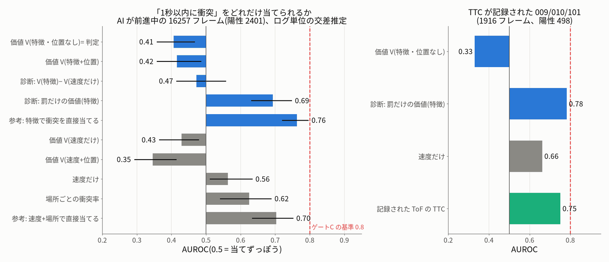
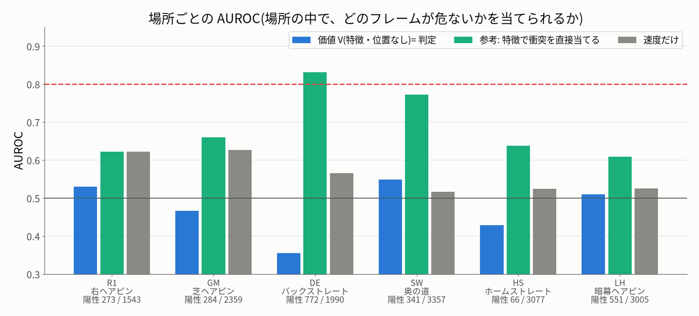
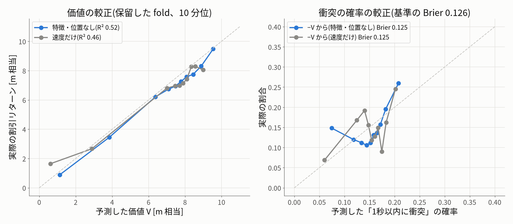
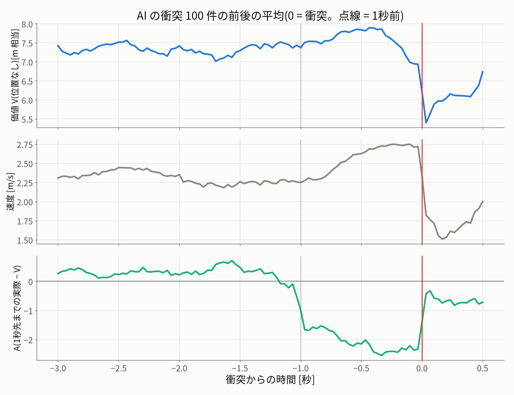
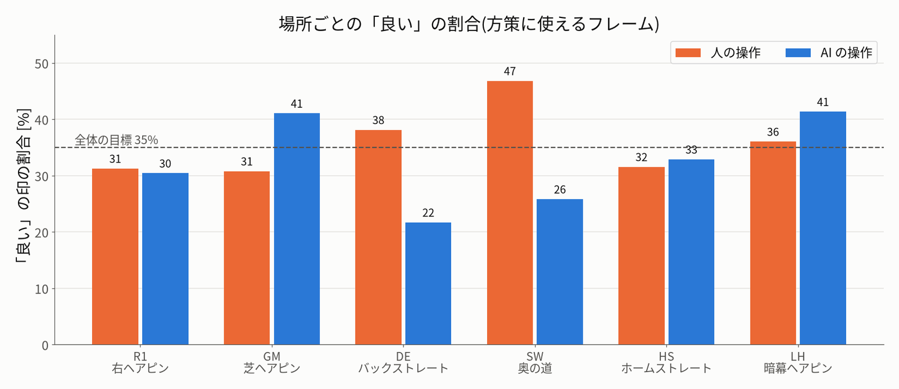
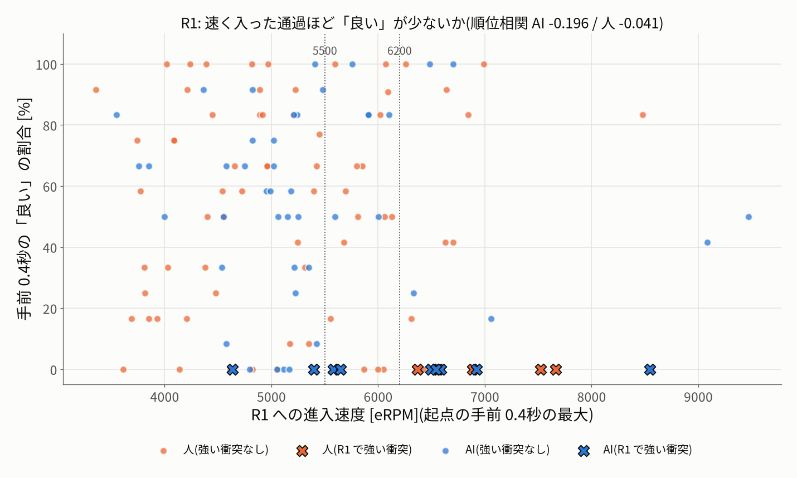
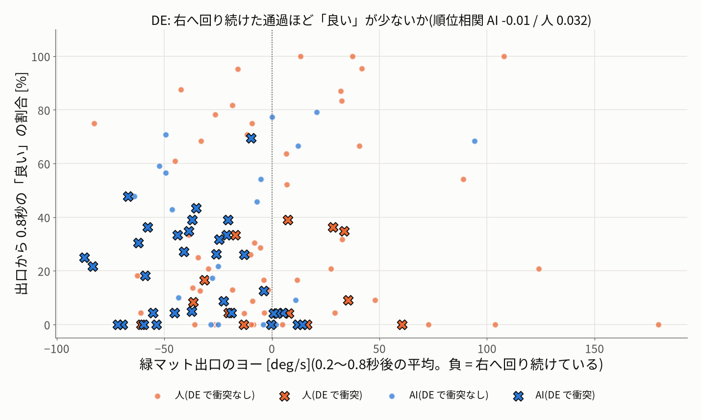
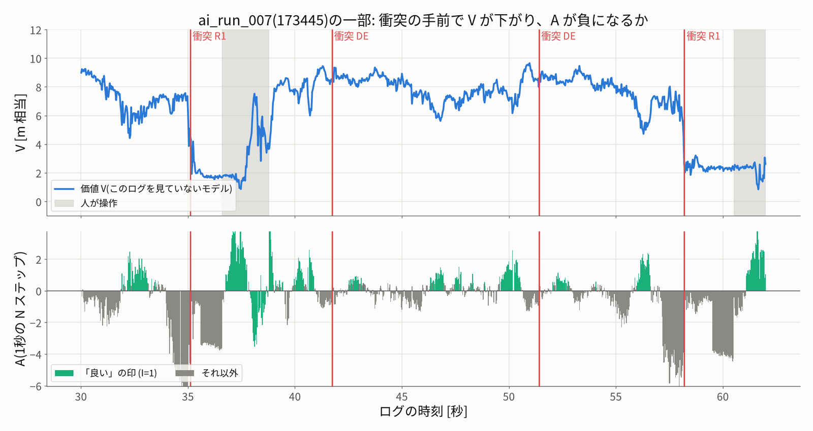

# オフライン強化学習 その1: 価値 V と「良い行動」の印

作成: 2026-10-11 22:45(机上だけ。実車は動かしていない。GPU は特徴を取る 1回・約4.5分だけ使った)。
対象: `data/datasets/ai_mix_20261011`(109シーン・60,842フレーム。人のきれいな走行と AI の走行の全部)。
基準モデル: モデル B(`clean_driving_20261011-nocmd-s3-20261011-024626`。今の操作値を入れない)。
仕様: `overnight_20261011/research/offline_rl.md` 5.2〜5.3、`roadmap.md` 4.3〜4.5。
コード: `tools/offline_rl.py`(段階ごとのコマンド。途中から続けられる)、`tools/figures_offline_rl.py`(図)、`tests/test_offline_rl.py`(14件)。

---

## 0. 結論

**ゲートC の 1(価値の妥当性)は不合格。** 位置を使わない価値 V で「1秒以内に衝突」を当てる AUROC は **0.41**(95% 区間 0.36〜0.47)だった。基準の 0.8 に届かず、当てずっぽう(0.5)より悪い。特徴を使わない基準(速度だけ 0.56、場所ごとの衝突率 0.62、速度+場所の回帰 0.70)にも負けた。

**原因は、特徴よりも V の作り方にある(下の診断から。仮説を含む)。**
- 報酬の大半は前進距離なので、V は「この先どれだけ進めるか」をほぼ表している。速いほど V が高い。衝突は速いときに起きるので、−V は衝突の手前で**かえって下がる**(図 `collision_event_average.png`: V は衝突の 0.3秒前まで上がり続ける)。
- **追記(2026-10-12、その3 のレビュー)**: 速さだけでは説明できない。速さの十分位の中で比べても、−V の AUROC は 0.36〜0.54(10のうち 9 で 0.5 以下)だった。衝突までの時間で分けると、0.3〜0.6秒前がいちばん悪く(0.354)、0〜0.3秒前は 0.47、0.6〜1.0秒前は 0.40。V は、衝突がいちばん多い DE(衝突率 39%)で最も高く、衝突の少ない HS(2%)で低い。V は「速さの価値」というより「前が開けていて、この先進める」ことの価値に近い(`evaluation/review.json` の value_diagnostics。仮説を含む)。罰だけの価値は、速い十分位で 0.77〜0.87 と高く、進みと危険を分ける提案(6章)を支える。
- 同じ特徴で**罰だけ**を回帰した診断用の V(危険の価値)は AUROC **0.69**(0.63〜0.75)になった。特徴から衝突を直接当てるロジスティック回帰は **0.76**(0.72〜0.80)だった。
- つまり、トランクの特徴には危険の情報が**ある程度は**入っている。ただし 0.8 には届かない。また、速度+場所の基準(0.70)との差は小さい。
- 罰を 2倍にしても、V の AUROC は 0.45 だった。罰の重みを少し変えるだけでは直らない。

**ロードマップ 4.5 の決まりに当てはめると「方策(C1)は作らない」になる。** 4.5 は「価値の AUROC < 0.7 → トランクの特徴に危険の情報が少ない。段階A2 の補助目的(未来の ToF)を先にやる」としている。上の診断から、理由の半分は「V が速さの価値になっていて、危険を表していない」ことだと考える。そこで、**4.5 の読み方を1つ足すことを提案する**: 進みの価値と危険の価値を分け、ゲートC の 1 は危険の価値で判定する(6章)。

**「良い」の印(アドバンテージ)は作れた。** 方策に使えるフレーム 45,744枚に付けた。印は「その後 1秒に何が起きたか」をよく反映している。
- R1 で強くぶつかった AI の通過(10回)は、手前 0.4秒の「良い」が **0%** だった。ぶつからなかった通過(44回)は 56% だった。
- R1 の手前で「良い」になった AI のフレームは、スロットルの指令が中立側に **約40µs** 寄っている(1368 対 1329µs)。印で条件付けた方策は、R1 の手前で遅くなる方向に学ぶはず(仮説)。
- DE で衝突した AI の通過は「良い」が 19%、衝突しなかった通過は 38% だった。ただし、出口のヨーそのものと印の間に関係は見えなかった(順位相関 −0.01)。
- **注意**: V が衝突を予測できていないので、この印は「価値で見積もった良し悪し」ではなく、「その後 1秒の結果から速さの分を引いたもの」にほぼなっている。運に左右される(Paster 2022 の心配がそのまま当てはまる)。

**報酬を変えたときの一致**: 前進距離だけ(罰なし)で 92.8%、罰 2倍で 94.0%、位置を使わない V で 85.4%、コース図の進みで 89.6% だった。V を使わない 1秒の報酬和では、前進距離とコース図の進みの一致は **83.0%**(offline_rl.md 1.5 の 83% を再現)だった。芝(GM)は、コース図の進みにすると「良い」が 47% から 35% に減る。

**机上の数字は、実車で良くなることを示さない。** 方策はまだ学習していない。この結果から言えるのは「今の V と印をそのまま実車に持っていく根拠は無い」ということまでである。

---

## 1. やったこと

| 段階 | 中身 | 時間 |
|---|---|---|
| frames | 全フレームの表。ラベルの行・fold(ログ単位の5分割、`log_folds.json`)・コース図の位相(AI のログ5本、18,948枚)・人の修正の印を付けた | 1秒 |
| features(GPU) | モデル B を eval で全 60,842枚に通した。Transformer の最後の LayerNorm の後の出力トークン(256次元、trunk の前)と、予測した操作列 [10,2] を保存した。1プロセス・batch 32・workers 3 | 264秒(230枚/秒) |
| value | V = 2層 MLP(隠れ 128)。入力は [特徴, 速度, ジャンルの one-hot](+位置)。目標は γ=0.99 の割引リターンで、Huber 損失。ログ単位の5分割で交差推定した。各 test fold に、内側の検証 fold を替えた 4本の平均を使った | 7種類で約50分(CPU) |
| evaluate | AI が前進しているフレームで「1秒以内に衝突」の AUROC を出した。区間単位のブートストラップで 95% 区間を付けた。ほかに較正と、TTC の規則との比較 | 20秒 |
| advantages | N=30 のアドバンテージと印 I。ε はジャンルごとに「良い」が 35% になる値。人の修正は I=1。陰性対照の印も作った | 3秒 |
| sanity | 場所ごとの「良い」の割合。R1 の進入速度・DE 出口のヨーとの関係 | 2秒 |

**確かめたこと**: モデル B の予測を、val の人のフレーム(使えるもの・衝突の前後を除く)と比べた。誤差は 48.8µs で、モデル B の val 49µs と合う。正規化・今の操作値を入れない設定・ジャンルの入れ方は、学習のときと同じになっている。

**打ち切りの扱い**(データ点検の提案のとおり):
- 失敗による交代(end_code=1)で終わる区間だけを終端にした。
- V は 2回学習した。1回目は、ほかの終わり方の区間の手前 3.3秒を目標から外した。2回目は、その区間のリターンに γ^(残り+1)・V1(区間の最後のフレーム) を足し、全フレームで学習した。V1 は、同じ test fold を見ていないモデルである。
- 1回目と2回目で、AUROC はほとんど変わらなかった(0.407 / 0.407)。

**ハイパーパラメータ**:
- 特徴の MLP は 1〜2エポックでログを覚えて過学習した。検証の Huber は最初のエポックが最良で、その後は上がった。
- 隠れ 128・lr 3e-4・重みの減衰 1e-2 は、fold 0 を使わずに、内側の fold(1 と 3 を検証。入力の選び方の確認には 2 も)で選んだ。
- この選び方は、fold 1〜3 が test になるときには、その fold を検証に使ったことになる。3つの値を選んだだけなので影響は小さいと考えるが、厳密な入れ子にはなっていない。

---

## 2. 価値 V の評価(ゲートC の 1)

評価フレーム: AI が前進している 16,257枚。条件は、assist なし(古いファームの「記録なし」を含む)・hold なし・0.5 m/s 超・直前 2秒に衝突なし。陽性(1秒以内に水平 2.5G の衝突)は 2,401枚(14.8%)。ロードマップのレビューの 16,257枚・14.4% と同じ母集団になる。
スコア: V は「低いほど危ない」ので −V を使った。場所・位置は、ほかの fold の衝突率で付けた。



| スコア | 特徴 | AUROC | 95% 区間 | fold ごと(0/1/2/3/4) |
|---|---|---|---|---|
| **V(位置なし)= 判定** | ○ | **0.407** | 0.358〜0.466 | 0.29 / 0.41 / 0.34 / 0.47 / 0.46 |
| V(位置あり) | ○ | 0.416 | 0.358〜0.485 | 0.30 / 0.45 / 0.28 / 0.49 / 0.47 |
| V(罰 2倍、位置あり) | ○ | 0.446 | 0.393〜0.510 | |
| V(前進距離だけ、位置あり) | ○ | 0.392 | 0.326〜0.471 | |
| 診断: V(特徴) − V(速度だけ) | ○ | 0.472 | 0.415〜0.556 | |
| **診断: 罰だけの価値(特徴)** | ○ | **0.693** | 0.631〜0.747 | 0.83 / 0.80 / 0.73 / 0.72 / 0.48 |
| **参考: 特徴で衝突を直接当てる** | ○ | **0.763** | 0.721〜0.795 | 0.85 / 0.82 / 0.78 / 0.68 / 0.69 |
| V(速度だけ) | — | 0.429 | 0.365〜0.478 | |
| V(速度+位置) | — | 0.346 | 0.293〜0.413 | |
| 速度だけ | — | 0.563 | 0.512〜0.633 | |
| 場所ごとの衝突率(loc_code) | — | 0.624 | 0.541〜0.688 | |
| 参考: 速度+場所で直接当てる | — | 0.703 | 0.634〜0.751 | 0.83 / 0.83 / 0.79 / 0.49 / 0.51 |

- **判定(ゲートC の 1)**: AUROC 0.407 < 0.8。特徴を使わない基準のいちばん良いもの(0.703)も下回る → **不合格**。
- **一部のフレームだけで比べたもの**(全体とは母集団が違う):

| 対象 | V(位置なし) | 罰だけの価値 | 直接(特徴) | 直接(速度+場所) | 速度 | 位置・TTC の基準 |
|---|---|---|---|---|---|---|
| コース図のある5ログ(10,463枚、陽性 1,606) | 0.375 | 0.737 | 0.791 | 0.790 | 0.557 | コース図 0.5m ごとの衝突率 **0.736**(レビュー 0.725) |
| TTC のある 009/010/101(1,916枚、陽性 498) | 0.330 | **0.783** | 0.727 | 0.763 | 0.662 | 記録された TTC **0.751**(レビュー 0.745) |

- **TTC の規則と、誤警報(陰性のフレーム)の数をそろえて比べた**(009/010/101、AI 前進 1.06分、衝突 20件)。
  - TTC < 0.5秒の規則: 陽性 247枚・陰性 251枚に警報。衝突は 20/20 件を手前 1秒のうちに捉えた。
  - 同じ 251枚の誤警報で、V(位置なし)は陽性 44枚・衝突 10/20件。罰だけの価値は 289枚・19/20件。特徴の直接回帰は 260枚・19/20件。
  - 罰だけの価値は、フレームの数では TTC の規則を少し上回る。ただし、衝突 20件・1分だけの比較である。
- 人が前進しているフレーム(25,827枚、陽性 1,420)でも同じ傾向だった。V(位置なし) 0.417、罰だけの価値 0.646、速度 0.617。

### 2.1 場所ごと



| 場所 | 陽性 / 枚 | V(位置なし) | 罰だけの価値 | 直接(特徴) | 速度 |
|---|---|---|---|---|---|
| R1 | 273 / 1,543 | 0.53 | 0.66 | 0.62 | 0.62 |
| GM | 284 / 2,359 | 0.47 | 0.63 | 0.66 | 0.63 |
| DE | 772 / 1,990 | **0.36** | **0.75** | **0.83** | 0.57 |
| SW(other) | 341 / 3,357 | 0.55 | 0.59 | 0.77 | 0.52 |
| HS | 66 / 3,077 | 0.43 | 0.57 | 0.64 | 0.52 |
| LH | 551 / 3,005 | 0.51 | 0.56 | 0.61 | 0.53 |

- DE では、特徴は危険をよく表している(直接回帰 0.83)。ところが V はいちばん悪い(0.36)。DE は速い直線で、V が高く出るからである。
- R1 では、特徴を使っても速度だけと変わらない(0.62)。R1 の危険は「進入の速さ」でほぼ決まっていて、画像から足せる情報が少ないと読める(仮説)。

### 2.2 較正



- **V はリターンの予測としては悪くない。** 保留した fold で、打ち切りの影響が小さいフレーム(失敗で終わる区間か、残りが 6.7秒以上)40,941枚を見た。
  - R² は、fold ごとの定数と比べて 0.52(速度だけの V は 0.46)、相関 0.71。
  - 人のフレームは R² 0.72、AI のフレームは 0.27 だった。
- **AI のフレームでは V が高すぎる**(実際 − 予測 = −0.98 m)。V は人と AI を区別しない「混ざった方策の価値」で、AI は人より失敗が多いからである。そのため、AI のフレームの A は平均で負になる(−0.14。人は +0.10〜0.17)。
- **−V から作った衝突の確率は、ほとんど情報が無い。** ほかの fold で当てはめた。Brier は 0.1252 で、基準の率だけのとき(0.1263)とほぼ同じだった。罰だけの価値でも 0.1196 だった。



AI の衝突 100件の前後で、V・速度・A を平均した(上の図)。
- V は、衝突の 0.3秒前まで速度と一緒に上がり続ける。下がるのは衝突の直前からである。
- A は、衝突の 1秒前から負になる(−2 前後)。A は「その後 1秒の実際の報酬」を使うので、後から見て悪かったところに付く。

---

## 3. アドバンテージと印

- A_t = Σ_{k<30} γ^k r_{t+k} + γ^30 V(o_{t+30}) − V(o_t)。区間の中だけで計算した(`nstep_advantage`、テストで総当たりの計算と一致を確かめた)。
  - 区間が先に終わるとき、失敗による交代なら最後までの報酬だけにした。それ以外は、区間の最後の V で補った。
  - V は**位置ありの V**(特権情報。offline_rl.md 1.5 のとおり)を使った。位置なしの V の印も、比較のために残した。
- 方策に使えるフレーム(eligible): future_valid・vehicle_valid・ジャンルあり・label_valid で、未来の操作が 950〜2050µs のもの。45,746枚(A が有限なのは 45,744枚)。
- ε(ジャンルごとに上位 35%): ジャンル4 = 0.402、ジャンル5 = 0.486。A の標準偏差は 1.51。99% のフレームは V で補っている(1秒以内に失敗で終わるのは 1%)。
- 「良い」の割合:
  - 人のジャンル4: 35.0%(人のデータだけなので、そうなるように決まる)
  - 人のジャンル5: 38.7%
  - AI(全部ジャンル5): 31.7%
  - train 34.8%、val 36.2%
- **人の修正**: 1,838枚(介入の検証セットの、前進している修正のフレーム。採点 1,570枚を含む)は I=1 にした。ただし ai_mix では、これらは future_valid=False(使えないフレーム)である。方策の学習に入れるには、データセットを作り直す必要がある。
- **陰性対照** `I_neg`: ジャンルごとに下位 35% を「良い」にした(人の修正は 0)。ゲートC の 6 で使う。



| 場所 | 人 | AI |
|---|---|---|
| R1 | 31% | 30% |
| GM | 31% | 41% |
| DE | 38% | **22%** |
| SW | 47% | 26% |
| HS | 32% | 33% |
| LH | 36% | 41% |

- AI の DE がいちばん低い(22%)。10/10 の診断(DE で右へ回り続けてぶつかる)と合う。
- AI の GM が高い(41%)のは、前進距離の報酬が芝の空転を「進んだ」と数えるためと考えられる(下の比較)。

### 3.1 報酬を変えたときの一致(方策に使えるフレーム、人の修正を除く)

| 比べたもの | 枚 | 印の一致 | 「良い」の Jaccard | A の順位相関 | 違いが出た場所 |
|---|---|---|---|---|---|
| 前進距離だけ(罰なし。V も学習し直し) | 45,744 | 92.8% | 0.81 | 0.95 | DE で「良い」が 31% → 28%、衝突の前後の一致 91% |
| 罰 2倍(V も学習し直し) | 45,744 | 94.0% | 0.84 | 0.97 | 場所による偏りは小さい |
| 位置なしの V | 45,744 | 85.4% | 0.66 | 0.87 | 場所が不明のフレームで 44% → 28%、GM 34% → 40% |
| コース図の進み(V は同じ。AI のログ5本) | 11,515 | 89.6% | 0.74 | 0.94 | **GM 47% → 35%**、R1 30% → 42%、LH 47% → 54% |
| 参考: V なしの 1秒の報酬和(前進距離 対 コース図、AI のフレーム) | 12,576 | **83.0%** | 0.61 | 0.78 | GM 31% → 19%、R1 15% → 31%、LH 1% → 19% |

- 一番下の行は、offline_rl.md 1.5(83%・Jaccard 0.60・順位相関 0.75)を再現した。
- 罰を外しても印が 93% 一致するのは、**失敗で区間が終わること自体が、大きな暗黙の罰になっている**からである。その後の進み(V ≈ 6〜8 m)を失う。明示の罰(−1・−2)の効きは小さい。
- 芝(GM)の偏りは、コース図の進みにすると減る。ただし、コース図はまだ AI のログ5本しか無く、保留検証も済んでいない。

---

## 4. 確認: R1 と DE(通過ごと)



**R1**(R1 の起点の手前 0.4秒のフレーム、通過ごとの「良い」の割合):

| | 進入 <5500 eRPM | 5500〜6200 | ≥6200 | 強い衝突あり | 強い衝突なし | 進入速度と「良い」の順位相関 |
|---|---|---|---|---|---|---|
| AI | 49%(34通過・強い衝突 2) | 56%(8・2) | **28%**(12・6) | **0%**(10通過) | 56%(44) | −0.20(54通過) |
| 人 | 54%(45・0) | 52%(15・0) | 43%(13・4) | 0%(4) | 54%(69) | −0.04(73) |

- 速く入った通過ほど「良い」が少ない。ただし、それは主に「ぶつかった通過がすべて 0%」から来ている。ぶつからなかった速い通過は「良い」になる(例: 172910 の 6,482 eRPM は 100%)。
- 「良い」のフレームの指令(R1 の手前、方策に使えるもの):
  - AI: スロットル 1368µs(その他 1329µs)。中立に近いほど遅い。A との順位相関 +0.22。
  - 人: 1326µs(その他 1305µs)。
  - 印で条件付けた方策は、R1 の手前で 20〜40µs 遅くなる方向に学ぶ見込み(仮説。方策は未学習)。
- AI の強い R1 衝突 11回のうち 9回は 173445 にある。R1 の結論は、ほぼこの1本のログについての話である。



**DE**(緑マット出口から 0.8秒のフレーム):

| | 衝突あり | 衝突なし | ヨーと「良い」の順位相関 | 出口のヨーの中央値(衝突あり / なし) |
|---|---|---|---|---|
| AI(52通過) | 19%(33) | 38%(19) | −0.01 | −37.0 / −24.9 °/s |
| 人(65通過) | 14%(13) | 36%(52) | +0.03 | +7.4 / −6.7 °/s |

- 衝突した通過の「良い」は少ない。しかし、出口のヨー(右へ回り続けているか)と印の間には、関係が見えなかった。
- DE の衝突は出口の 2.3秒後まで起きる。1秒の窓では、出口の操作と衝突を結び付けきれていない可能性がある(仮説)。
- 2.5G 未満の「壁こすり」は罰になっていない。



---

## 5. 限界と注意

1. **机上だけ。** 方策は学習していない。実車も走らせていない。ゲートC の 2〜6(R1・DE・崩れ・報酬の悪用・陰性対照)は、方策が無いのでまだ測れない。
2. **AI の R1 の強い衝突は 11回で、9回が 173445 にある。** DE の衝突も 172910・173445 に集中している。fold ごとの AUROC のばらつき(罰だけの価値で 0.48〜0.83)は、この偏りも反映している。
3. **人の train のフレームは、モデル B が学習に使ったフレーム**である(誤差 24µs、val は 49µs)。特徴の性質が、AI のフレーム(モデル B は見ていない)と違う可能性がある。
4. **場所(loc_code)はジャイロの向きで決めている。** コース図との一致は、006/007 で 82〜84%、009/010/101 で 47〜73%。位相はコース図のある AI のログ5本(18,948枚)だけにある。
5. **衝突は水平 2.5G で数えている。** DE の壁こすり(2.5G 未満)は陽性にも罰にも入らない。
6. **V は人と AI を区別しない。** AI のフレームでは高すぎる(−0.98 m)。そのぶん、AI の「良い」が少なめに出る(31.7%)。
7. **TTC との比較は 1.06分・衝突 20件だけ**である。
8. ハイパーパラメータは内側の fold で選んだ(1章)。厳密な入れ子ではない。

---

## 6. 次にやること(提案)

1. **ゲートC の 1 を事前の決まりどおりに扱う。** 今の V・印で作った方策は、実車(ゲートD)に出さない。
2. **価値を「進み」と「危険」に分ける**(提案。ロードマップ 4.4・4.5 への追記の案)。
   - 危険の価値(罰だけの割引和、または「N 秒以内に衝突・失敗」の確率)を別のヘッドで学ぶ。ゲートC の 1 は、こちらで判定する。今は 0.69(直接回帰でも 0.76)。
   - アドバンテージは A = A_進み − λ·A_危険 にして、λ を感度として振る。
   - 罰 2倍の V は 0.45 にしかならなかった。1つの V で罰を大きくする方向は、効きが悪いと見ている。
3. **特徴の危険の情報を増やす**(4.5 の A2)。未来の ToF・衝突を予測する補助目的を、トランクの学習に入れる。DE は今でも 0.83 あるが、R1 は速度並み(0.62)である。R1 は、速度の入力とペースのつまみで扱うほうが早い可能性がある。
4. **机上の練習として方策 (a)(b)(c) を学習するなら**:
   - `advantages.npz` の `I`(位置ありの V)を使う。陰性対照には `I_neg` を使う。
   - 人の修正を入れるなら、ai_mix の作り直しが要る。
   - R1 の手前のスロットル(fold 1 = 173445 を保留したもの)を (c) filtered BC と比べる。
   - 結果は「印の効果」を見る練習にとどめる。ゲートC の 1 が不合格なので、実車の候補にはしない。
5. **V に「誰が運転しているか」を入れるかを決める。** AI の方策と人の方策は結果が違う。混ざった V のままだと、AI のフレームは一律に低く評価される。

---

## 付録 A. ファイル

| 場所 | 中身 |
|---|---|
| `data/rl/ai_mix_20261011/frames.npz` | フレームの表(シーン・フレーム・ログ・fold・ラベルの行から取った値・位相・人の修正) |
| `data/rl/ai_mix_20261011/features_<シーン>.npz`(109個)・`features_meta.json` | 出力トークンの特徴 `feat` [N,256]・予測 `pred` [N,10,2] µs・使ったジャンル |
| `data/rl/ai_mix_20261011/value_<種類>.npz`・`value/<種類>/r<回>_f<fold>.npz` | out-of-fold の V(`V` = 2回目、`V1` = 1回目)・目標・fold。種類: feat・feat_loc・speed・loc・feat_loc_fwd・feat_loc_x2・feat_risk |
| `data/rl/ai_mix_20261011/value_eval.json`・`value_eval_scores.npz` | 2章の数字の全部・フレームごとのスコア |
| `data/rl/ai_mix_20261011/advantages.npz`・`advantages.json` | フレームごと(scene・frame で ai_mix に対応)の A・I・V。比較の印(`_noloc`・`_fwd`・`_x2`・`_course`)・`I_neg`・`eligible`・`human_correction`。ε と一致の表 |
| `data/rl/ai_mix_20261011/passes.json`・`sanity.json` | R1 の起点ごとの通過と、4章の数字 |
| `jetformer_reports/offline_rl_20261011/value/` | 上の json の写し |
| `jetformer_reports/offline_rl_20261011/fig/` | 図 9枚 |
| `jetformer_reports/offline_rl_20261011/logs/` | 実行のログ |

## 付録 B. 再現

```bash
source ~/miniconda/etc/profile.d/conda.sh && conda activate jetracer
cd ~/jetformer
python -m pytest -q tests/test_offline_rl.py                 # 14 passed(1秒未満)
python tools/offline_rl.py frames
python tools/offline_rl.py features --batch 32 --workers 3   # GPU。ほかの GPU の処理と同時に動かさない
python tools/offline_rl.py value                             # CPU。fold ごとにファイルを残すので、止まっても続きから
python tools/offline_rl.py evaluate
python tools/offline_rl.py advantages
python tools/offline_rl.py sanity
python tools/offline_rl.py figures --fig-dir ~/jetformer_reports/offline_rl_20261011/fig
```

## 付録 C. 動画用の要点(約1分)

- 価値 V を作って、「1秒以内にぶつかるか」を当てさせた。結果は 0.41 で、当てずっぽう以下だった。ゲートC は不合格。
- 理由(と考えていること): 報酬の大半が「進んだ距離」なので、V は「この先どれだけ進めるか(前が開けているか)」の価値になった。ぶつかる直前まで上がり続け、衝突のいちばん多い DE の直線で最も高い。同じ速さどうしで比べても当てずっぽう以下(0.36〜0.54)で、衝突の 0.3〜0.6秒前がいちばん悪い(0.35)。単に「速さの価値」ではない。
- 罰だけで学ばせた「危険の価値」は 0.69、特徴で直接当てると 0.76 だった。特徴には危険の手がかりがあるが、基準の 0.8 には届かない。
- 「良い」の印は、R1 でぶつかった通過は 0%、ぶつからなかった通過は 56% と、結果をよく反映した。ただし、結果を後から見て付けた印に近い。
- 次の課題: 価値を「進み」と「危険」に分ける。未来の ToF を予測させて、特徴の危険の情報を増やす。
