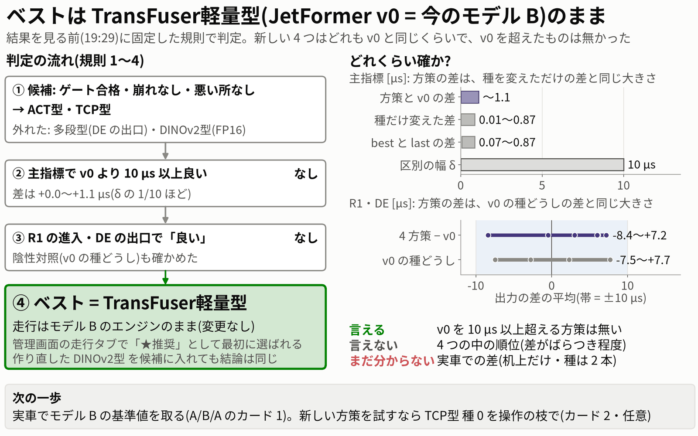
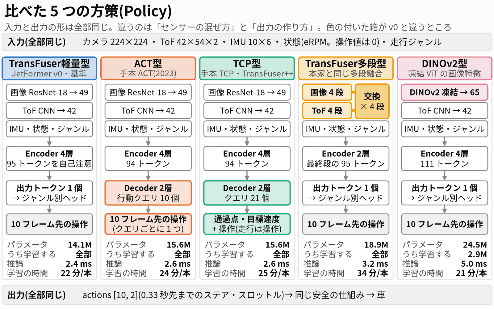
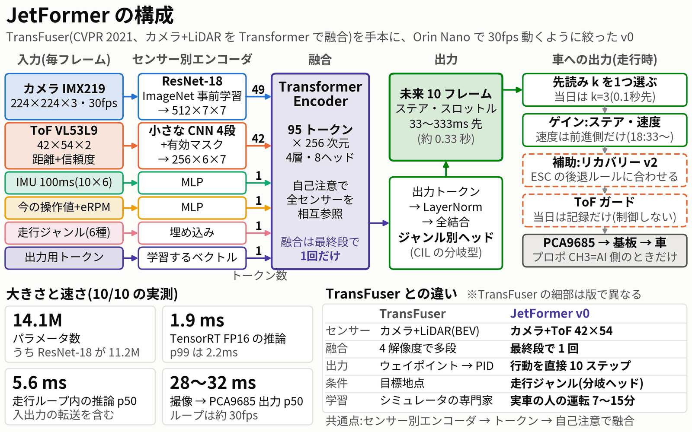
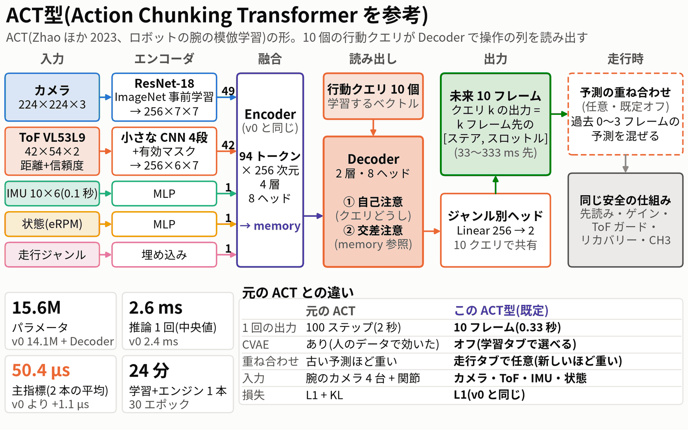
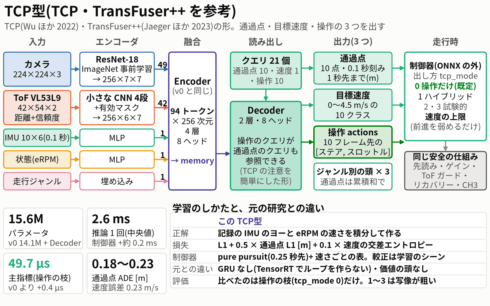
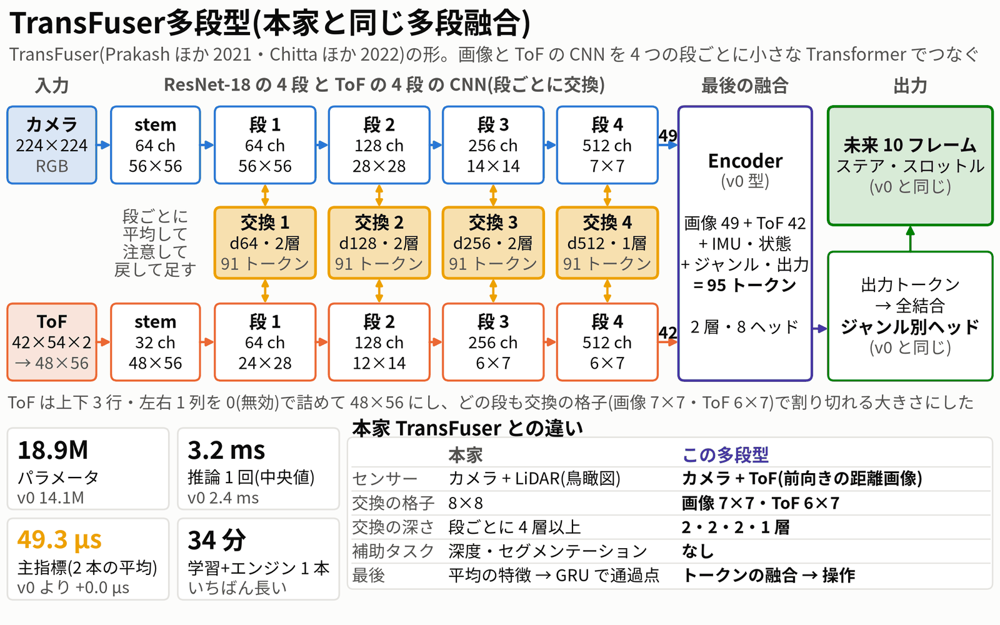
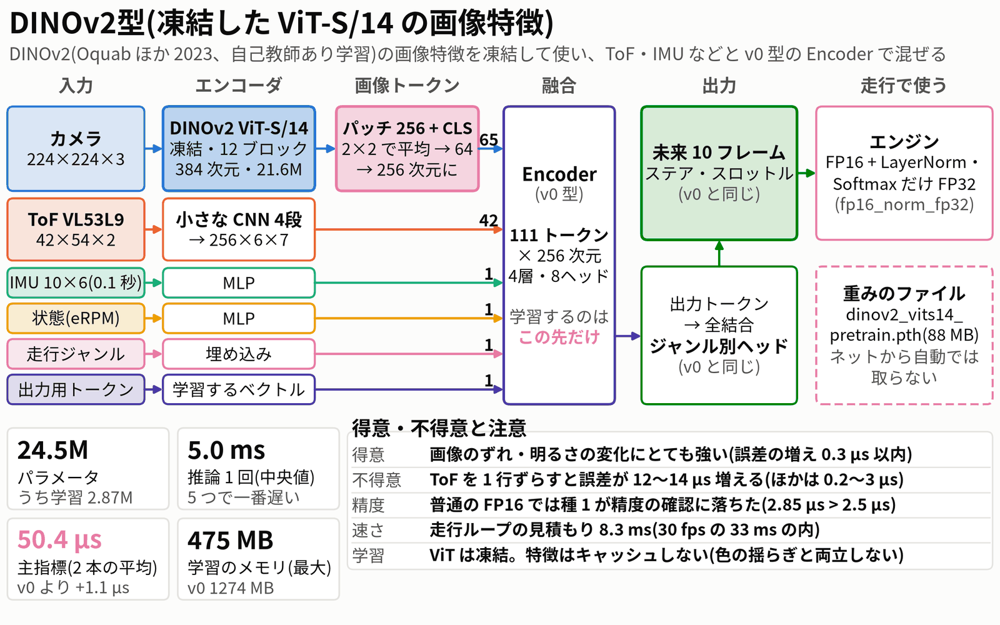
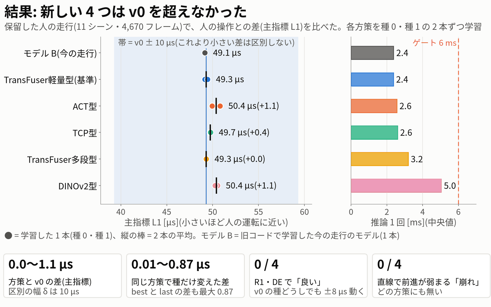
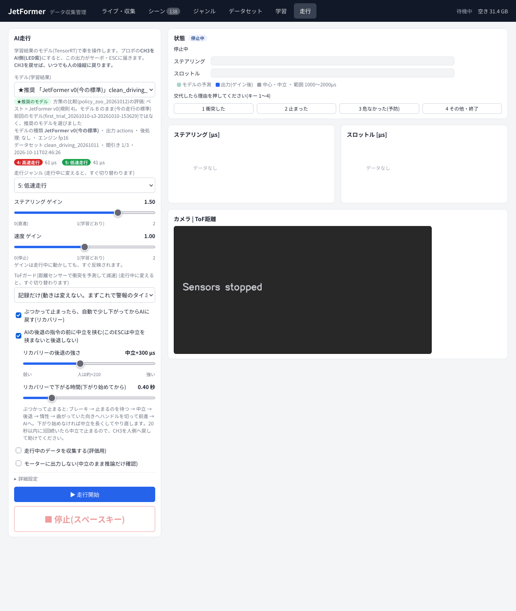

# Policy の比較(2026-10-12): ACT型・TCP型・TransFuser多段型・DINOv2型(基準: TransFuser軽量型)

> **呼び名**(2026-10-12 に統一): **TransFuser軽量型** = JetFormer v0(`jetformer_v0`。今の走行モデル B と同じ形。TransFuser を参考に、融合を最後に1回だけにした軽量版)・**TransFuser多段型** = `msfusion`(本家と同じ多段融合)・**ACT型** = `act`・**TCP型** = `tcp`(TCP・TransFuser++ を参考)・**DINOv2型** = `dinov2`。本文の「v0」は TransFuser軽量型のこと。

作成 2026-10-12 22:50 ・ 対象 `/home/jetson/jetformer`(main 7239fea の作業ツリー。commit 33e5812(呼び名の統一はその次の commit))・
車は走らせていない ・ 管理画面(jetformer-web)は 22:20:30 にこの作業のコードで再起動済み(推奨のモデル = モデル B)

ユーザーの依頼: 「ACT 型・TCP/TransFuser++ 型・本家 TransFuser に近い多段融合・DINOv2 の画像特徴 の Policy を追加して比較し、
どのモデルがベストモデルかを評価する」「各種学習し、最後にどのモデルが賢いかを比較した動画レポートを」。

この README は今日の作業全体のまとめ。細かい数字・手順は各段の記録にある:
[`spec.md`](spec.md)(設計)・[`training.md`](training.md)(学習)・[`evaluation.md`](evaluation.md)(評価。表 1〜15)・
[`results/zoo_rules.json`](results/zoo_rules.json)(判定の規則)・[`deploy/`](deploy/)(管理画面への反映)。
数字は最後の値(評価のやり直しの確認・レビューの後)。図は `fig/src/` の道具が `eval/zoo_eval.json`・`train/summary.json` から作る(手で写していない)。

---

## 0. 結論



- **ベストのモデルは `jetformer_v0` のまま = 今走っているモデル B**(`data/runs/clean_driving_20261011-nocmd-s3-20261011-024626/jetformer_fp16.engine`)。
  走行のエンジンは変えない。管理画面の走行タブでは、このモデルが「★推奨」として一覧の先頭に出て、最初から選ばれる。
- 新しい 4 つの方策は、**机上の評価(人の運転をまねる誤差)ではどれも v0 と同じくらいで、v0 を超えたものは無かった**。
  人の運転をまねる誤差(主指標)は v0 が 49.3 µs、TransFuser多段型 49.3 µs(差 +0.0)、TCP型 49.7 µs(+0.4)、ACT型 50.4 µs(+1.1)、DINOv2 50.4 µs(+1.1)。
  差は最大 1.1 µs(約 2%)で、先に決めた実用上の差の閾値 δ = 10 µs(L1 の約 20%)の 1/10 ほど。同じ方策を乱数の種だけ変えて学習した差(最大 0.87 µs)と同じ大きさ。
- 難しい場所(R1 ヘアピンの進入のスロットル・DE の出口のステア)でも「v0 より良い」と言える方策は無かった。
- 判定は、結果を見る前(19:29)に固定した規則の 4 番(「良い」方策が 1 つも無いときは v0)で決まった。規則は変えていない。
- **確かなこと**: v0 を 10 µs 以上超える方策は無い(best.pth でも last.pth でも、どの種でも)。
  **言えないこと**: 4 つの中の順位(差が学習のばらつきと同じ大きさ)。**まだ分からないこと**: 実車での差(机上の評価だけ。6 章)。
- 4 つとも学習・ONNX・TensorRT FP16(DINOv2 は FP16 + LayerNorm・Softmax だけ FP32)・走行と同じ手順でのエンジンの読み込みの確認までできていて、
  走行タブで選べる(実際の走行のループを偽の PCA9685 で回して確かめたのはモデル B と TCP型 種 0)。
  どれも同じ安全の仕組み(先読み・ゲイン・トリム・ToF ガード・リカバリー・ラップ・CH3 の交代・センサーの途切れで中立)の下で走れる。

---

## 1. なぜこの 4 つか

v0(JetFormer)は TransFuser を手本に「センサーごとのトークンを最後に 1 回だけ Transformer で混ぜ、10 フレーム先までの操作を一度に出す」形。
4 つは、それぞれ v0 の別の部分を、その分野でよく効いた方法に替えたもの(どれも依頼で名前が挙がったもの)。

| 方策 | 元の研究 | v0 から替えた所 | 確かめたかったこと | 前もって見えていたリスク |
|---|---|---|---|---|
| `act`(ACT型) | ACT(Zhao ほか 2023、ロボットの腕の模倣学習。行動のまとまり k=1 → 100 で成功率 1% → 44%) | 出力の作り方: 1 個の出力トークン → **10 個の行動クエリの Decoder** | 行動の列を専用の Decoder で読み出すと、未来の操作が人に近くなるか | v0 もすでに 10 ステップを一度に出している。伸びしろは Decoder の分だけ |
| `tcp`(TCP型) | TCP(Wu ほか 2022)・TransFuser++(Jaeger ほか 2023) | 出力: 操作に加えて **通過点(1 秒先まで)と目標速度** も出す。走行で制御器・**速度の上限**を選べる | 「どこを通るか」と「どの速さか」を分けると、R1 の進入の速すぎを上限で抑えられるか | 通過点を追う制御では、予測の 5 cm の横ずれがステアで約 180 µs の誤差になる(設計時の計算)。L1 では不利 |
| `msfusion`(TransFuser多段型) | TransFuser(Prakash ほか 2021・Chitta ほか 2022) | 融合の場所: 最後に 1 回 → **画像と ToF の CNN を 4 つの段ごとに交換** | 早い段から画像と距離を混ぜると、位置のずれなどに強くなるか | パラメータが増えて過学習。論文の中でも段数の差は種のばらつきの内 |
| `dinov2`(DINOv2) | DINOv2(Oquab ほか 2023、自己教師あり学習) | 画像のエンコーダ: ImageNet の ResNet-18 → **凍結した DINOv2 ViT-S/14** | 汎用の強い画像特徴で、少ないデータ(約 6 千サンプル)でも過学習しにくく、照明などの変化に強くなるか | 推論が遅い(5 ms)・TensorRT FP16 の精度 |

設計の調査は [`design_research.md`](design_research.md)、実装の仕様は [`spec.md`](spec.md)。
**期待は控えめにしていた**: 設計の段で「学習ごとのばらつき(約 10 µs)を超える L1 の差は、どの方策でも出ない可能性が高い」と書いていた(design_research §0.2-7)。

---

## 2. 方策の登録簿(policy registry)

どの方策も同じ「入出力の約束」を守るので、学習・書き出し・エンジン・走行・評価の道具は方策の名前を知っていれば共通に使える。

**入出力の約束(contract 1)**: 入力 `image [1,3,224,224]`・`tof [1,2,42,54]`・`imu [1,10,6]`・`state [1,3]`・`mode [1,ジャンル数]`(float32・バッチ 1・固定の形)。
出力は必ず `actions [1,10,2]`(33 ms 刻みの 1〜10 フレーム先の [ステア, スロットル]、(µs − 1500)/500)。追加の出力は名前を変えて足す(tcp だけ)。

| 名前 | 画面の名前 | 出力 | 走行の後処理 | 学習タブで変えられる設定 | エンジンの精度 | 目安(推論・パラメータ) |
|---|---|---|---|---|---|---|
| `jetformer_v0` | JetFormer v0(今の標準) | actions | なし | なし | fp16 | 2.3 ms・14.1M |
| `act` | ACT型(行動クエリの Decoder) | actions | なし | Decoder の層の数(1〜4)・CVAE・KL の重み | fp16 | 2.5 ms・15.6M |
| `tcp` | TCP型(通過点 + 目標速度) | actions・waypoints・speed_logits | TCP の制御器(`tcp_controller`) | なし | fp16 | 2.7 ms・15.6M |
| `msfusion` | TransFuser多段型 | actions | なし | 融合する段・出力の作り方 | fp16 | 3.1 ms・18.9M |
| `dinov2` | DINOv2型(ViT-S/14 凍結) | actions | なし | 画像トークンの平均(2 / 1)・ViT の最後の何ブロックを学習するか(0 / 2) | **fp16_norm_fp32** | 5.1 ms・24.5M(学習 2.9M) |

仕組み(どれも `/home/jetson/jetformer/` の中):

| ファイル | 役目 |
|---|---|
| `jetformer/policies/__init__.py` | 登録簿。**torch を読まない**(drive.py・web/server.py・training.py も読むため)。`PolicySpec`(既定値・画面の設定・目安・ジャンルの層)、`resolve()`(画面からは options だけ・CLI の `--policy-cfg` は全部のキー)、`from_config()`(`policy` の無い古い学習結果は v0 の凍結した既定値 dim 256・4 層・8 ヘッドで読む)、`check_io()`・`drivable()`(エンジン・ONNX の入出力が走行で使えるか) |
| `jetformer/policies/runtime.py` | torch の側: 名前で渡す forward、損失(`policy_loss` があればそれ)、ONNX の書き出し(入力の名前は書き出した ONNX から読み直す)、`load_run()`(評価の道具が使う) |
| `jetformer/policies/blocks.py` | v0 と同じトークン化を、v0 と**同じ層の名前**で新しいモデルに直接足す(state_dict のキーが v0 と同じ) |
| `jetformer/policies/{jetformer_v0,act,tcp,msfusion,dinov2,vit}.py` | 各方策。`jetformer_v0` は今までの `JetFormer` をそのまま返す |
| `jetformer/policies/post.py`・`controller.py`・`ensemble.py` | 走行と評価が**同じコード**で使う後処理(numpy だけ): TCP の制御器・予測の重ね合わせ |
| `jetformer/policies/tcp_labels.py`・`tools/make_tcp_labels.py` | TCP の正解(通過点・目標速度)と制御器の較正。`data/derived/<データセット>/` に書く(データセットのフォルダーに入れない) |
| `tools/train.py --policy <名前> [--policy-cfg '{...}']` | 学習。`model_config.json` に `policy`・`policy_cfg`・`inputs`・`outputs`・`engine.precision`・(tcp は)`postprocess` を書く |
| `tools/build_engine.py` | 精度を `model_config.json` の `engine.precision` から読み、一時ファイルに作ってから入出力を確かめて置き換える |
| `jetformer/drive.py` | `model_info()` が方策・出力・後処理・エンジンの確認(`engine_check.json`)を返す。**精度の確認に落ちたエンジンは選べず、走行も始めない**。`data/drive_recommended.json` の推奨のモデルを先頭に出す |
| `tools/policy_zoo.py` | 比較の評価(`plan`・`predict`・`crosscheck`・`engine-check`・`evaluate`・`figures`・`recommend`) |

古い学習結果(`policy` の無いもの。モデル B を含む)は、そのまま `jetformer_v0` として読める(レビューで走行タブに出る全 21 本の `drivable`・`check_io` と、
モデル B の出力が旧来の読み方と差 0.0 であることを確かめた)。

---

## 3. 各方策の構成



色の付いた箱が v0 と違う所。入力 5 つと出力 `actions [10, 2]` はどれも同じなので、走行の安全の仕組みはどれにもそのまま掛かる。
「推論」は同じ道具(`run_numpy`: 入出力の転送を含む TensorRT の 1 回、100 回の空回しの後 600 回の中央値)の値で、
2026-10-11 の図の「TensorRT 1.9 ms」(エンジンだけ・別の道具)とは測り方が違う(v0 のエンジンだけの値は 1.5 ms)。「学習の時間」は 30 エポック + エンジンの作成。

### 3.1 JetFormer v0(基準・今のモデル B と同じ形)



2026-10-11 の日報の図を同じ道具で描き直したもの(`fig/src/fig_arch_v0.py`。元は `experiments/20261011_day_summary/fig/src/fig_architecture.py`)。
ResNet-18 の画像 49・ToF 42・IMU・状態・ジャンル・出力用の 95 トークンを Encoder 4 層で混ぜ、出力トークンからジャンル別のヘッドで 10 フレーム先までの操作を出す。
図の「今の操作値+eRPM」は、モデル B と今回の 10 本では操作値を 0 にして eRPM だけを使う(今の操作値を入れない学習)。下のタイルの数字は 2026-10-11 の実測。

### 3.2 ACT型



- v0 と同じ 94 トークン(出力用トークンなし)→ Encoder 4 層 → **10 個の行動クエリ**(1 クエリ = 1 フレーム先)が Decoder 2 層で読み出す → クエリで共有のジャンル別ヘッド。
- CVAE(学習のときだけの潜在変数)は既定オフ。予測の重ね合わせ(ACT の temporal ensembling)は方策によらない走行側の選択肢(既定オフ)にした。
- 1 回の出力は 10 フレーム(0.33 秒)。元の ACT は 100 ステップ(2 秒)。

### 3.3 TCP型(TCP型)



- v0 と同じ Encoder の後、21 個のクエリ(通過点 10・速度 1・操作 10)の Decoder 2 層。出力は 3 つ: 通過点(0.1 秒刻みで 1 秒先まで、m)・目標速度(0〜4.5 m/s の 10 クラス)・操作 `actions`。
- 正解は記録の IMU のヨーと eRPM の速さを積分して作る(`tcp_labels_v1`)。損失 = L1 + 0.5 × 通過点の L1 [m] + 0.1 × 速度の交差エントロピー(重みは先に固定)。
- 制御器は ONNX の外(numpy の `TCPPost`)。走行タブで出し方を選ぶ: **0 = 操作の枝だけ(既定・比較で評価した出力)**、1 = ハイブリッド、2・3 = 試験的。
  速度の上限 `speed_cap` は前進を弱めるだけ(速くはしない)で、速度ゲインに関係なく効く(レビューで直した)。

### 3.4 TransFuser多段型(本家と同じ多段融合)



- ResNet-18 の 4 段と ToF の 4 段の CNN を、段ごとに小さな Transformer(画像 7×7 + ToF 6×7 = 91 トークン、d 64/128/256/512・2/2/2/1 層)でつなぎ、
  最後の段のトークンを v0 型の Encoder 2 層で混ぜる。ToF は 48×56 に 0 で詰めて、どの段も格子で割り切れる大きさにした。
- 本家との違い: ToF はカメラと同じ向きの距離画像(LiDAR の鳥瞰図ではない)・交換は浅め・補助タスク(深度など)なし・最後はトークンの融合。

### 3.5 DINOv2型



- 画像を凍結した DINOv2 ViT-S/14(12 ブロック・384 次元・21.6M)で読み、256 パッチを 2×2 で平均した 64 + CLS = 65 トークンにして、
  ToF・IMU・状態・ジャンル・出力用と合わせた 111 トークンを v0 型の Encoder 4 層で混ぜる。学習するのは 2.87M だけ。
- 重みは `data/pretrained/dinov2_vits14_pretrain.pth`(公式、88 MB、Apache-2.0)。ネットから自動では取らない(取り方はリポジトリの README)。
- 普通の FP16 のエンジンは精度が足りないことがある(5.2)ので、登録簿の既定のエンジンの精度を `fp16_norm_fp32`(LayerNorm・Softmax だけ FP32)にした。

---

## 4. 学習のレシピ

モデル B と同じ条件で、方策ごとの調整はしていない(ここが一番大きな限界。6.3-4・9 章)。

```
cd ~/jetformer && nice -n 10 python -u tools/train.py --policy <方策> --data data/datasets/clean_driving_20261011 \
    --out data/runs/clean_driving_20261011-<方策>-s<種>-nocmd-stride3-e30 --epochs 30 --seed <種> \
    --stride 3 --batch 64 --lr 3e-4 --workers 4 --no-command-input --impact-g 2.5      # 電源断の後は --resume
nice -n 10 python -u tools/build_engine.py <run>/jetformer.onnx <run>/jetformer_fp16.engine  # 別のプロセス
```

| 項目 | 値 |
|---|---|
| データ | `clean_driving_20261011`(人の 52 シーン)。間引き 1/3 で学習 5,912・検証 1,559 サンプル。分け方は `splits.json`(種によらない) |
| 入力 | 今の操作値(ステア・スロットル)は入れない(モデル B と同じ。state は eRPM だけ) |
| 衝突の除外 | 水平 2.5G 以上の 1 秒前〜2 秒後を学習に使わない(学習 3,522・検証 1,083 フレーム) |
| 最適化 | AdamW(lr 3e-4・wd 1e-4)・cosine・30 エポック・勾配のクリップ 1.0・バッチ 64・AMP。画像の色の揺らぎは全方策で同じ |
| 種 | 0 と 1(各方策 2 本、計 10 本)。3 本目の種・方策ごとの調整(spec の任意 O1〜O3)は行っていない |
| 選ぶ重み | `best.pth` = 検証の actions の L1 が一番小さいエポック(全方策で同じ選び方)。`last.pth` も評価に並べた |
| 時間 | 10 本で 252.7 分(14:11 → 18:24、学習 228 分 + エンジン 25 分)。電源断・再開 0 回。GPU は常に 1 プロセス(nice) |
| 1 本あたり(学習 + エンジン) | v0 22 分・ACT 24 分・TCP 25 分・TransFuser多段型 34 分・DINOv2 21 分 |
| 学習のメモリの最大 | v0 1,274・ACT 1,332・TCP 1,349・TransFuser多段型 1,741・DINOv2 475 MB(どれもゲート 4 GB の内) |
| 学習中の検証 L1(種 0 / 種 1) | v0 49.3 / 49.3・ACT 50.8 / 50.0・TCP 49.3 / 49.5・TransFuser多段型 49.1 / 49.3・DINOv2 50.7 / 50.3 µs(モデル B 49.0) |

- 電源断に備えて毎エポック `last.pth` を書き、`--resume` で続きから学習できる(10 本で約 28 分の上乗せ。予算の 1.15 倍になった主な理由)。
- 学習の曲線などの図: [`fig/train_curves_by_policy.png`](fig/train_curves_by_policy.png)・[`fig/train_val_overlay.png`](fig/train_val_overlay.png)・
  [`fig/train_best_val.png`](fig/train_best_val.png)・[`fig/train_loss_parts.png`](fig/train_loss_parts.png)。
- TransFuser多段型は最初の 10 エポックで検証が 91〜150 µs まで暴れ、学習の L1 も v0 の 2 倍(32 対 14 µs)。ACT・TCP は 10 エポックまで 55〜65 µs と収束が遅かった。

---

## 5. 結果



**評価のしかた**(規則は `results/zoo_rules.json`、計算の手順は `eval/protocol.json`。どちらも保留データの予測の前に固定):
主指標 L = 保留した人のきれいな走行(検証の 11 シーン・4,670 フレーム、衝突の前後を除く)で、PyTorch FP32 の予測と人の操作の差の絶対値を
10 ステップ × [ステア, スロットル] で平均したもの。δ = max(10 µs, {モデル B, v0 種 0, v0 種 1} の範囲)= 10 µs。
副指標 = R1 の進入前 0.4 秒のスロットル(17 通過)・DE の出口 0.8 秒のステア(14 通過)の、v0 との差の通過ごとのブートストラップ。
陰性対照 = v0 の種 1 を「方策」とみなして同じ判定にかけたもの(同じ方策の種どうしで判定が偶然出ないかの確かめ)。

### 5.1 精度(主指標と副指標)

| 方策 | L best 種 0 / 種 1 [µs] | L̄(2 本) | v0 との差 | L last 種 0 / 種 1 | 種どうしの差 | R1 の差 d̄ [µs](+ = 遅い) | DE の差 d̄ [µs](+ = 左) | 崩れ(直線の前進の低下) | ずれへの強さ(平均 ΔL1 種 0 / 種 1) |
|---|---|---|---|---|---|---|---|---|---|
| モデル B(今の走行) | 49.14 | 49.14 | −0.16 | 49.09 | — | −0.2 | +0.5 | なし | 0.79 |
| **jetformer_v0** | 49.15 / 49.46 | **49.30** | 基準 | 49.23 / 49.75 | 0.31 | 基準 | 基準 | 基準 | 0.70 / 0.89 |
| act | 50.81 / 49.94 | 50.38 | +1.07(+2.2%) | 51.17 / 50.42 | 0.87 | +7.2 | +6.0 | なし(2.1%) | 0.55 / 1.09 |
| tcp | 49.70 / 49.77 | 49.73 | +0.43(+0.9%) | 49.84 / 49.92 | 0.07 | +6.1 | −0.5 | なし(3.9%) | 0.81 / 0.79 |
| msfusion | 49.30 / 49.31 | 49.30 | +0.00 | 50.09 / 49.38 | 0.01 | +3.0 | **−8.4(悪い*)** | なし(2.1%) | **0.60 / 0.53(強い)** |
| dinov2 | 50.54 / 50.27 | 50.40 | +1.10(+2.2%) | 50.79 / 51.13 | 0.27 | −8.4 | +7.2 | なし(2.4%) | 2.56 / 2.82(ToF のずれに弱い) |
| 陰性対照 A / B(v0 の種どうし) | — | — | +0.31 / −0.16 | — | — | +7.7 / **−7.5(悪い)** | −2.8 / +2.3 | なし | — |

- 主指標は 4 方策とも「同等」(差は δ = 10 µs よりずっと小さい)。ACT・TCP・DINOv2 は種 2 本 × best/last の 4 通りすべてで v0 の 2 本より悪かったが、
  2 本対 2 本でこうなる確率は差が無くても 1/6 あるので、**本当の差の証拠にはならない**(レビューの指摘)。
- シーンごとに見ても、v0 より小さいシーンは ACT 4・TCP 6・TransFuser多段型 6・DINOv2 4(11 シーン中)で、どれかが一貫して良いということは無い。
- R1・DE で「良い」(99.375% の区間・両方の種・4 組すべてで 10 µs 以上・シーンの平均を引いた差、の全部)になった方策は無い。
- \* TransFuser多段型の DE の「悪い」(95% の区間の上限 −0.4 µs)は**もろい**: 14 通過は 8 本の記録(11 シーン)から来ていて、記録ごとにまとめて選び直すと
  区間は [−18.3, +2.7] µs で 0 を含む(この README のために CPU で計算。レビューのシーンごとの計算では [−17.6, +2.0])。陰性対照 B も同じ大きさで「悪い」になった。
- 詳しい表は [`evaluation.md`](evaluation.md) の表 1〜15(フレーム先ごとの誤差・ジャンル別・交代の後の人の修正・R1 の進入の見積もりなど)。

### 5.2 速さ・大きさ・エンジン

| 方策 | パラメータ 全体 / 学習 | run_numpy 中央 [ms](種 0 / 種 1) | エンジンだけ 中央 [ms] | 走行ループの見積もり [ms] | FP16 の精度の確認 最大 [µs](ゲート 2.5) | 学習 + エンジン [分/本] |
|---|---|---|---|---|---|---|
| jetformer_v0 | 14.08M / 全部 | 2.37 / 2.36 | 1.49 / 1.52 | 5.6 | 0.65 / 0.85 | 22 |
| act | 15.57M / 全部 | 2.59 / 2.52 | 1.69 / 1.66 | 5.8 | 1.10 / 1.16 | 24 |
| tcp | 15.59M / 全部 | 2.66 / 2.52 | 2.00 / 1.67 | 5.8〜5.9(制御器なし) | 1.57 / 1.13 | 25 |
| msfusion | 18.92M / 全部 | 3.19 / 3.19 | 2.23 / 2.21 | 6.4 | 2.09 / 1.50 | 34 |
| dinov2 | 24.50M / 2.87M | 5.11 / 4.98(作り直し後 5.10 / 5.14) | 3.95 / 3.95 | 8.3〜8.4 | **2.46 / 2.85(不合格)** → 作り直し 1.78 / 2.05 | 21 |

- 速さはどれも走行のゲート(run_numpy 中央 6 ms)の内。v0・ACT・TCP の差(2.4〜2.7 ms)は測り直しの揺れ(約 0.15 ms)と同じくらいで、順位は付けない。
  「走行ループ」「カメラ → PWM」はモデル B の実車の値(5.6 ms・約 28 ms)に run_numpy の差を足した**見積もり**で、新しい方策の実車の値は測っていない。
- DINOv2 は普通の FP16 では種 1 が精度の確認(TensorRT と PyTorch FP32 の差、実フレーム 64 個)に落ちた。先に決めたとおり判定の候補から外した(D7)。
  LayerNorm・Softmax だけ FP32 で作り直したエンジン(`fp16_norm_fp32`)は 2 本とも合格し、速さもほぼ同じなので、`data/runs` の 2 本のエンジンはこれに替えた(ファイル名は `jetformer_fp16.engine` のまま。走行タブで選べる)。
- 図: [`fig/eval_primary.png`](fig/eval_primary.png)(主指標、best と last)・[`fig/eval_primary_zoom.png`](fig/eval_primary_zoom.png)・
  [`fig/eval_r1_de.png`](fig/eval_r1_de.png)(R1・DE の区間と陰性対照)・[`fig/eval_robustness.png`](fig/eval_robustness.png)(ずれへの強さ)・
  [`fig/eval_mae_by_step.png`](fig/eval_mae_by_step.png)(何フレーム先かごとの誤差)・[`fig/eval_tcp_modes.png`](fig/eval_tcp_modes.png)(TCP の出し方)・
  [`fig/eval_speed_vs_l1.png`](fig/eval_speed_vs_l1.png)(速さと主指標。**縦軸は約 2 µs の幅しか無いので、差が大きく見える**。差の大きさは `eval_primary.png` か上の図で見る)。

### 5.3 方策ごとの得意・不得意(傾向。どれも δ よりずっと小さい)

| 方策 | 得意 | 不得意 |
|---|---|---|
| jetformer_v0 | 主指標が一番小さい組(種 0 49.15 µs)。速い・小さい。新しいコードでモデル B(49.14 µs)を再現 | 画像を 3 行下へずらすと誤差が増えやすい(+1.4・+2.5 µs) |
| act | 交代の後の人の修正(学習データの中の参考)で少し近い | スロットルの遠い先(k10 53〜54 µs、v0 51 µs)。種どうしの差が一番大きい(0.87 µs) |
| tcp | 種どうしの差が小さい(2 本だけの範囲なので性質とは言えない)。通過点(ADE 0.18〜0.23 m)・目標速度(誤差 0.22〜0.24 m/s)も出せる | ステアの近い先(k1 が v0 より約 2 µs 悪い)。直線の前進が v0 より 3.9% 弱い |
| msfusion | **ずれに強い**(v0 の 0.71 倍)。スロットルの近い先・遠い先が一番小さい | DE の出口で右寄り(上の * のとおり、もろい判定)。学習が不安定(学習の条件が合っていない可能性) |
| dinov2 | **画像のずれ・明るさの変化にとても強い**(±0.3 µs 以内)。学習のメモリが小さい | **ToF を 1 行ずらすと誤差が 12〜14 µs 増える**(画像の特徴を凍結したので ToF に頼っているという仮説)。一番遅い |

TCP の速度の上限(2.75 m/s ≒ 5,500 eRPM)は、記録に当てると R1 の窓のスロットルを +24 µs 弱め(95% の区間 +1.4〜+52 µs)、進入の見積もりを 4,660 → 4,005 eRPM に下げる。
ただし上限はコースの全部で効くので、記録の速さで再生した開ループの見積もりでは直線の前進も 71〜74% 弱まる(閉ループでは上限の近くの速さで落ち着くはずなので過大な見積もり)。
出し方 1・3 は、スロットルの写像が粗い(正解の目標速度を入れても人のスロットルとの相関 0.48)ので、今の較正では使えない(D13)。

---

## 6. ベストのモデルと、どれくらい確かか

### 6.1 判定(規則を順に当てた結果)

| 方策 | ゲート(2 本とも) | 主指標 | 崩れ | R1 | DE | 候補(規則 1) |
|---|---|---|---|---|---|---|
| act | 合格 | 同等(+1.07) | なし | 良い × / 悪い × | 良い × / 悪い × | ○ |
| tcp | 合格 | 同等(+0.43) | なし | 良い × / 悪い × | 良い × / 悪い × | ○ |
| msfusion | 合格 | 同等(+0.00) | なし | 良い × / 悪い × | 良い × / **悪い ○** | ×(DE) |
| dinov2 | **不合格**(種 1 の FP16 2.85 µs) | 同等(+1.10) | なし | 良い × / 悪い × | 良い × / 悪い × | ×(ゲート) |

1. 候補 = ACT型・TCP型。 2. 主指標で v0 より 10 µs 以上良い候補: なし。 3. 主指標が同等で R1・DE のどちらかが「良い」候補: なし(陰性対照は「良い」にならず、規則 3 は有効だった)。
4. → **ベスト = `jetformer_v0`(モデル B のエンジンのまま)**。

判定の感度(参考): DINOv2 を作り直したエンジンで候補に入れても、TransFuser多段型の DE の「悪い」をばらつきとみなして候補に入れても、last.pth で判定しても、ベストは v0 のまま。

### 6.2 確かさ

- **確か**: 「v0 を 10 µs 以上超える方策は無い」。一番良い TransFuser多段型でも差は +0.0 µs で、10 µs まで遠い。best/last・種のどれで見ても変わらず、
  シーンごとに見ても v0 より小さい差は最大 7.0 µs(TransFuser多段型の 1 シーン)で 10 µs に届かない。
  保存した予測から CPU で評価をやり直すと全項目が一致し(`eval/verify/verify.json`)、レビュー(2 人)も主指標を小数 3 桁まで計算し直して同じだった。
- **言えない**: 4 つの中の順位、「ACT・DINOv2 は v0 より少し悪い」という話。差(0〜1.1 µs)は種を変えただけの差(0.01〜0.87 µs)・best と last の差(最大 0.87 µs)と同じ大きさ。
  R1・DE の出力の差(−8.4〜+7.2 µs)も、v0 の種どうしの差(−7.5〜+7.7 µs)と同じ大きさ。
- **まだ分からない**: 実車での差。ログの車は方策の指令に反応しないので、閉ループの速さ・衝突は机上では分からない。机上の結論は実車の改善を示さない。

### 6.3 正直に書いておくこと(レビューの指摘)

1. **固定した規則の厳しさが、判定を決めた所がある。** spec §5.3 に最初に書いた規則(95% の通過ごとのブートストラップ・2 つの種の両方で差 > 0)のままだと、
   ACT型は DE で「良い」(+6.0 µs、95% [+0.4, +11.4](10,000 回の選び直し)、種 +9.5 / +2.5)になり、規則 3 で「机上の候補」になっていた。
   レビューで足した条件(D1〜D3: 4 組すべてで 10 µs 以上・シーンの平均を引いた差・8 回の比較の補正)で「良い」にならなかった。
   この強化が正しかったと考える根拠: (a) 同じ古い規則は、陰性対照 A(v0 の種どうし)の R1 も「良い」にする(+7.7 µs、95% [+0.1, +15.9])。
   (b) ACT の DE の差は last.pth では消え(+1.5 µs、95% [−4.5, +7.3])、シーンの平均を引いても消える(99.375% [−5.5, +9.8])。
   (c) 模擬では、古い規則は差が無くても 1 項目あたり 11〜26%、8 項目のどれかで 60〜91% の確率で「良い」を出す(`results/sim_rule_false_positive.json`)。
2. **規則を固定したのは、学習中の検証 L1 を見た後**(主指標の 1/3 と同じフレーム)。主指標の結果はほぼ分かっていた状態で、強化は R1・DE の道にだけ効いた。
   ただし規則の固定は保留データのどの予測(19:59 以降)よりも前で、その後は変えていない(sha256 を照合済み)。
3. **TransFuser多段型が候補から外れたのは、もろい「悪い」による**(5.1 の *)。実車のカード 2 で TCP型を選んだのは、この印があるため。
   DE の出口の右寄りは前回の実車で AI が失敗した向きなので、TCP型を選ぶのは慎重な側ではある。ただし TCP型も last.pth では DE が「悪い」(−7.7 µs、95% [−14.0, −1.8])。
4. **学習の条件は v0 向け**(D10)。方策ごとの調整をしていない。ACT は CVAE も重ね合わせも無し、TCP は操作の枝だけで比べた、TransFuser多段型は学習が不安定で学習の L1 も高い。
   各方策を調整すれば結果が変わる可能性はある。
5. **保留は同じセッションの中**(D8)。検証の 11 シーンは学習のシーンと同じ記録から取られ、3 か所は 0.033 秒で続いている(その前後 1 秒を除いても結論は同じ)。
   セッションの外の確かめは、AI の R1 4 通過・DE 4 通過と、交代の後の人の修正の 3 窓だけ。

---

## 7. 管理画面での学習・走行のしかた

管理画面: `http://<Jetson>:8080`(jetformer-web)。22:20:30 に新しいコードで再起動済み。

### 7.1 学習タブ

1. 「データセット」を選ぶ。
2. **「モデルの種類」**で方策を選ぶ(5 つ。既定は「JetFormer v0(今の標準)」で、選ばなければ今までとまったく同じ学習)。下に説明と目安が出る。
   方策ごとの設定(下の表)が出るものもある。まだ準備できていない方策(例: DINOv2 の重みが無い)は理由が出て選べない。
3. 間引き 1/3・エポック 30・バッチ 64・学習率 0.0003(今回の比較と同じ)。「学習後に TensorRT エンジンを作る」はオン。
4. モデル B と同じ条件にするなら「今の操作値を入力に使わない」をオン、「ぶつかった前後を学習に使わない」をオン、
   「詳細」の「衝突とみなす加速度」を **2.5 G**、「乱数の種」に 0 や 1 を入れる(比べるときに条件をそろえるため)。
5. 「学習を開始」。所要時間の見積もりは方策の目安から出る(1 本 21〜34 分)。学習結果の一覧に方策のバッジが付く。

| 方策 | 学習タブの設定 | 注意 |
|---|---|---|
| JetFormer v0 | なし | 今までと同じ |
| ACT型 | Decoder の層の数(1〜4、既定 2)・CVAE(既定オフ)・KL の重み(1 / 10) | CVAE は学習のときだけ。推論は z = 0 |
| TCP型 | なし | 学習の前に正解と較正を自動で作る(`data/derived/<データセット>/`。can_bus の記録が要る) |
| TransFuser多段型 | 融合する段(1〜4・2〜4・3〜4・1〜3、既定 1〜4)・出力の作り方(tokens / pooled) | 一番時間がかかる(34 分/本) |
| DINOv2 | 画像トークンの平均(2 = 64 トークン / 1 = 256)・ViT の最後の何ブロックを学習するか(0 / 2) | 重み `data/pretrained/dinov2_vits14_pretrain.pth` を先に手で取る(リポジトリの README)。エンジンは自動で `fp16_norm_fp32` |

CLI で同じことをするときは 4 章のコマンド(`--policy-cfg '{"dec_layers": 3}'` で全部の設定を変えられる)。電源断の後は同じコマンドに `--resume`。

### 7.2 走行タブ



1. 「モデル(学習結果)」の一覧の先頭に **「★推奨」= モデル B** が出て、ページを開くと最初から選ばれる(前回のモデルより先)。
   各モデルに方策・出力・後処理・エンジンの精度と、エンジンの確認(`engine_check.json`)の結果が出る。精度の確認に落ちたエンジンは選べず、理由が出る。
2. 走行ジャンル・ステアと速度のゲイン・ToF ガード・リカバリー・後退の前の中立・トリム・先読みは今までと同じ。どの方策でも同じ順で掛かる
   (推論 → 後処理・重ね合わせ → 先読み → ゲイン → ToF ガード → 補助/リカバリー → 範囲の切り詰め → 出力。CH3 で人に戻る・センサーが途切れたら中立も同じ)。
3. 「詳細設定」の **予測の重ね合わせ**(何フレーム前の予測まで混ぜるか 0〜3、既定オフ・新しい予測ほど重い)はどの方策にも使える。比較の判定には使っていない。
4. **TCP型のモデルを選んだときだけ**「TCP型の出し方」の欄が出る: 出し方(0 = 操作の枝だけ・既定)、速度の上限(0 = なし、2.75 m/s ≒ 5,500 eRPM の目盛り)、
   目標速度の倍率(出し方 1〜3 だけ)、走行中の目標速度 v_hat・上限の後の v_cmd。出し方は起動のたび・モデルを替えたときに 0 に戻る。
   後処理の無いモデルで上限が設定に残っていると「効きません」と出る。
5. 推奨のモデルは `data/drive_recommended.json`。評価をやり直したら `python tools/policy_zoo.py recommend`(手で決めるなら `--run <学習結果> --reason <理由>`)。

### 7.3 比較をやり直すとき

`tools/policy_zoo.py`: `plan`(規則を先に固定)→ 学習(`tools/train.py`。今回は `train/zoo_train.py` で 10 本を順に・出来たものを飛ばす)→
`predict`(保留データの予測を保存)→ `crosscheck` → `engine-check` → `evaluate` → `figures` → `recommend`。
GPU を使うのは学習・`predict`・`crosscheck`・`engine-check` で、1 つずつ・nice で回す。`evaluate`・`figures`・`recommend` は CPU。

---

## 8. 実車のテストカード(この作業では走らせていない。人と一緒に行う)

詳しい版は [`evaluation.md`](evaluation.md) §7。ここでは、管理画面の再起動(22:20:30)を反映した版を書く。

**カード 1: 基準値の走行(A/B/A の形。ベスト = モデル B なので、3 ブロックとも モデル B)**

```
目的       : 推奨のエンジン(モデル B)が固定設定で走れることの確認と、基準値・ブロックどうしの揺れ(電池・タイヤ・路面・時間)を取る
モデル     : clean_driving_20261011-nocmd-s3-20261011-024626(jetformer_fp16.engine)= 走行タブの「★推奨」
走らせる順 : A1(モデル B)→ B(モデル B)→ A2(モデル B)。同じ日・同じコース配置・同じ照明
量         : 各ブロック 43 周以上(目標 60 周)。1 走行 = 1 設定・4 分以上、各ブロック 3 走行くらい
固定設定   : ジャンル 5(低速走行)・ステアのゲイン 1.3・速度のゲイン 1.0・先読み 3・トリム 0・ToF ガード 1(記録だけ)・
             リカバリー オン・後退の前に中立 オン・予測の重ね合わせ オフ(0)。3 ブロックとも同じ。走行中にスライダーに触らない
走る前     : ステアのゲインは保存値が 1.5 のままなので 1.3 にはっきり直す。重ね合わせ・速度の上限は起動をまたいで残る項目なので
             オフ・0 を確かめる。車輪を浮かせて推論の確認(dry run、「モーターに出力しない」)を 60 秒以上: 中立(hold)0 回、infer_ms を記録。
             幾何チェック(バンパーの行・直線の床の ToF)。センサーの周期(カメラ・ToF 30Hz、IMU・車両 100Hz)
電池       : 各ブロックの前に車の電池の電圧を記録し、同じ状態(満充電に替える)で始める。Jetson の電池の残量も記録
収集       : オン。description に「ai_run | モデル | 1.0/1.3/3 | ガード1 | ジャンル5 | 照明 | 電池# | 電圧 | 幾何」
安全       : 人が送信機を持ち、CH3 でいつでも取り返す。安全の仕組みは 1 つも切らない。
             交代は「危険」「止まってから 2 秒」「終了」のときだけ。交代したら理由のボタン(1〜4)を押す
記録する   : 周回数とラップタイム、1 周あたりの交代・衝突(水平 2.5G 以上)・リカバリー、R1 の進入 eRPM の中央値と 5,500 以上の割合、
             DE の出口のヨー、中立(hold)の回数と理由、infer_ms・latency_ms
中止の条件 : 最初の 10 周で衝突が 20 回を超えた / 後退の指令が 0.5 秒以上暴走した・リカバリー以外で後ろへ動いた /
             推論による中立が起きた / ステアが限界に張り付く・振れ続ける / 同じ場所で 3 周続けて衝突 /
             衝突の直前の速さの中央値が最初の A より 0.5 m/s 以上高い / R1 の旋回中にブレーキが出た / 電池が打ち切りの電圧を下回った
集計       : python tools/label_events.py <ログ>(衝突と場所)、python tools/drive_report.py <ログ>(ラップ・交代・hold・遅れ)。
             A1・B・A2 の衝突/周・交代/周・ラップの中央値とブロックどうしの差 = 「同じモデルでも出る揺れ」(これからの A/B/A の物差し)
```

**カード 2(任意・探索): 机上の次点を試すとき**

```
候補       : TCP型 種 0(clean_driving_20261011-tcp-s0-nocmd-stride3-e30)。出し方 0(操作の枝)・速度の上限 0 = 比べた出力そのまま
             (規則 1 の候補 ACT・TCP のうち主指標の平均が小さい TCP、その 2 本のうち L が小さい種 0。TransFuser多段型は DE の印で候補外 = 6.3-3)
前提       : カード 1 を先に終えている。走行タブで TCP型の欄が出て、出し方が 0・上限が 0 であることを確かめる
走らせる順 : A(モデル B)→ B(TCP型 種 0)→ A(モデル B)。各ブロック 43 周以上。設定・中止の条件はカード 1 と同じ
良いと言える: B の「1 周あたりの交代 + 衝突」が両方の A より少なく、ラップタイムが A の平均の 5% より遅くない
```

- 各 43 周で見分けられるのは、衝突/周の 40〜50% 以上の差だけ。机上の差(主指標 +0.4 µs など)から見ると、実車で大きな差が出る見込みは低い。
- 速度の上限・出し方 1〜3 のカードは、スロットルの写像を直すまで行わない(D13)。

---

## 9. 課題

**評価の限界**

1. 机上の評価だけ。閉ループ(実車)の速さ・衝突は分からない。新しい方策の実車の走行ループの時間も測っていない(見積もり)。
2. 方策の差は学習のばらつきと同じ大きさで、種は 2 本だけ。順位を付けるなら種を増やす(spec の O1)必要がある。
3. 学習の条件は v0 向けで、方策ごとの調整なし(6.3-4)。特にTransFuser多段型は学習が不安定で、ACT の CVAE・TCP の出し方 1〜3 は比べていない。
4. 保留は同じセッションの中で、R1 17・DE 14 通過しかない。セッションの外のデータ(別の日の人の走行)での確かめが要る。
5. 規則の強化(D1〜D3)が判定に効いた所がある(6.3-1)。次の比較では、規則を学習の前に固定する。
6. 主指標は「人の今の操作を入れずに人をまねる誤差」。人の今の操作を続けるだけの予測(走行中には使えない)の方が小さい所もあり、L1 の値そのものを実車の精度と読まない。

**方策ごと**

7. DINOv2: 普通の FP16 のエンジンは精度が足りない。エンジンの確認の最大の差は作るたびに揺れる(同じ設定で 1.72・1.78 µs)。推論 5 ms で一番遅い。
   ToF のずれに弱い(12〜14 µs)ので、ToF の取り付けがずれたときに注意。
8. TCP: 出し方 1・3 のスロットルの写像が粗い。速度の上限は「コース全体の速さの上限」で、R1 の手前だけを遅くするものではない。
9. TransFuser多段型: 学習の初めに検証が暴れる。学習率・ウォームアップの調整が先。

**コード(レビューの指摘で、まだ直していないもの)**

10. 予測の重ね合わせ(`ensemble_j`・`ensemble_m`)と速度の上限 `speed_cap` は `drive_settings.json` に残り、起動のたびに戻らない(`RESET_ON_BOOT` は `tcp_mode`・`speed_scale` だけ)。
    重ね合わせは開始の確認画面にも出ない。カードでは毎回 0 を確かめる。
11. 速度の上限のスライダーは 0.05〜0.25 m/s にも設定できる。止まる速さ(0.3 m/s)より下では前進しなくなるので、下限を 0.3 にするか警告を出す。
12. 走行中に TCP の出し方を 1〜3(試験的)へ替えるときに確認が無い(確認は開始のときだけ)。
13. `jetformer/policies/controller.py` の「速さが分からないとき(vn = 0)は上限が弱くしか効かない」というコメントが逆(実際は強く効く)。
14. `ENGINE_PRECISIONS` に bf16 が残っている(同じ DINOv2 の重みで FP16 より悪い 4.31 µs)。外すか注意書きを付ける。
15. `tests/test_policy_act.py` が単独で約 31 秒(ファイルあたり 30 秒未満の決まりを少し超える)。
16. `evaluation.md` の §6・§7 カード 2・§9.12 にある「jetformer-web は 11:13 からの古いコード」は、22:20:30 の再起動で古くなった(この README が新しい)。

**運用**

17. ここまでの作業は commit していない(主のセッションがレビューして commit する)。
18. tof_guard の `K_LEFT` が小さい切れ角では小さすぎる(設計の調査で見つけた。今回の範囲の外)。

---

## 10. 動画レポート用の素材

1 分の動画は、次の 3 枚の図(どれも 2160×1350、16pt 以上、文字の重なりを道具と目で確かめた)を順に使う。

| 順 | 図 | 言うこと |
|---|---|---|
| 1 | [`fig/zoo_arch_overview.png`](fig/zoo_arch_overview.png) | 比べた 5 つの方策と、v0 との違い |
| 2 | [`fig/zoo_results_overview.png`](fig/zoo_results_overview.png) | 結果: 全部が v0 ± 10 µs の帯の中。速さはゲートの内 |
| 3 | [`fig/zoo_verdict.png`](fig/zoo_verdict.png) | 判定: ベストは v0 のまま。どれくらい確かか。次の一歩 |

**ナレーションの案(約 1 分)**

> ACT型、TCP型、TransFuser多段型、DINOv2型の 4 つの方策を追加して、今の TransFuser軽量型(JetFormer v0)と比べました。
> 入力と出力は同じで、違うのはセンサーの混ぜ方と出力の作り方です。
> 各方策を 2 本ずつ同じ条件で学習し、全部 TensorRT にして、管理画面から学習も走行もできるようにしました。
> 結果、v0 を超えた方策はありませんでした。人の運転との差は、v0 の 49.3 マイクロ秒に対して大きくても 1.1 マイクロ秒の違いで、
> 種を変えて学習し直しただけの差と同じくらいです。速さは全部、6 ミリ秒以内でした。
> 先に決めた規則で判定して、ベストは今のモデル B のままです。
> ただし机上の比較なので、次は実車でモデル B の基準の周回を取ります。

(読み上げは約 305 字。Gemini TTS・声 Achernar で約 1 分の見込み。長ければ 2 文目を省く)

---

## 11. ファイル

| ファイル | 中身 |
|---|---|
| `README.md` | このまとめ |
| `fig/zoo_arch_overview.png`・`fig/zoo_results_overview.png`・`fig/zoo_verdict.png` | 動画用の 3 枚 |
| `fig/arch_act.png`・`fig/arch_tcp.png`・`fig/arch_msfusion.png`・`fig/arch_dinov2.png`・`fig/arch_jetformer_v0.png` | 方策ごとの構成図(v0 は 2026-10-11 の日報の図を同じ道具で描き直したもの) |
| `fig/src/` | 図を作る道具(`common.py` は日報の図と同じ設定の写し、`zoolib.py` は部品と重なりの確かめ)。`cd fig/src && python fig_arch_overview.py` などで作り直せる(CPU) |
| `fig/eval_*.png`・`fig/train_*.png` | 評価・学習の段の図 |
| `spec.md`・`design_research.md`・`interfaces.md` | 設計 |
| `training.md`・`train/` | 学習の記録(`train/summary.json`・`train/plan.json`・`train/engine_check/`) |
| `evaluation.md`・`evaluation.json`・`eval/` | 評価(表 1〜15、`eval/zoo_eval.json` が全部の結果) |
| `results/zoo_rules.json` | 判定の規則(19:29 に固定。D1〜D13) |
| `deploy/` | 管理画面への反映の確認(走行タブの画面・API の結果) |
| `/home/jetson/jetformer/data/runs/clean_driving_20261011-<方策>-s<種>-nocmd-stride3-e30/` | 学習結果 10 本(`best.pth`・`last.pth`・`jetformer.onnx`・エンジン・`engine_check.json`) |
| `/home/jetson/jetformer/data/drive_recommended.json` | 走行タブの推奨のモデル(モデル B) |
