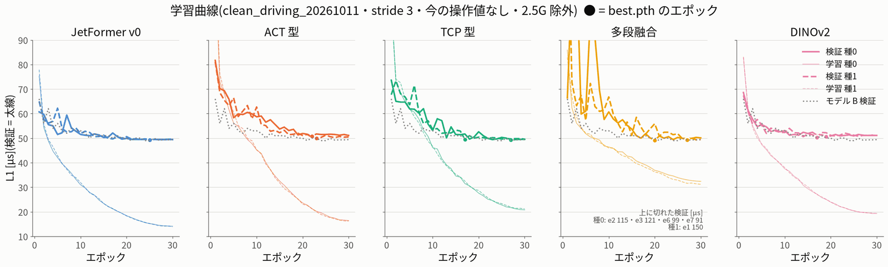
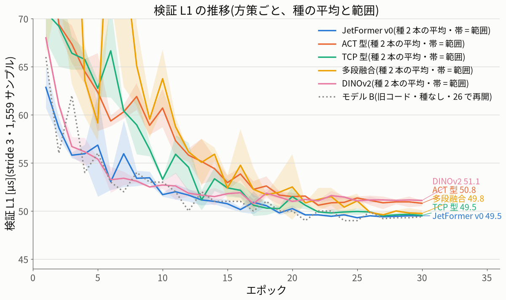
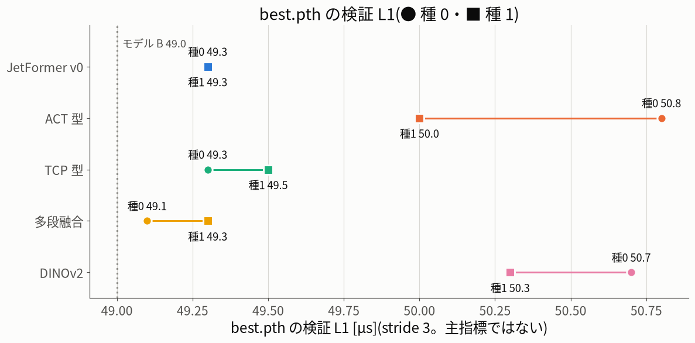

# 方策の比較: 段階4(学習)の記録

作成 2026-10-12 18:50(レビューを受けて 19:40 に直した。直した点は §11)・ 対象 `/home/jetson/jetformer`(main 7239fea の作業ツリー。**commit はしていない**)・ jetformer-web は再起動していない ・
車は動かしていない・PCA9685 と車両の基板には触れていない ・ GPU は常に1プロセスずつ(nice 10)

経緯: この段の最初の担当はネットワークの切断で途中で終わったが、切り離して起動した学習の列(`zoo_train.py train`、14:11 起動)は止まらずに最後まで動いた。
引き継いだ担当が 15:38 から列を見守り(2つ目の列は起動していない)、終わった後にエンジンの確認・dinov2 の精度の実験・まとめ・この記録を行った。

## 0. 要約

- **本体の 10 本(5つの方策 × 種 0・1、30 エポック)と、10 本の TensorRT FP16 エンジンが全部できた。** 何も削っていない(エポックも種も spec のまま)。
  任意の O1〜O3 は時間のため行っていない(指示どおり)。
- 学習とエンジンの実時間は **252.7 分**(14:11:25 → 18:24:05)。spec の予算 219.4 分の 1.15 倍で、上限(1.3 倍 = 285.2 分)の内。
  電源断・再開は無かった(10 本とも1回で最後まで。`--resume` 0 回)。全部の学習・エンジンは同じコード(指紋 `4eeb809ad09d`。学習の後も同じ)。
- 学習の検証 L1(best.pth を選んだ検証。主指標ではない)は **49.1〜50.8 µs** に全部が入った。モデル B は 49.0 µs。
  方策どうしの差は最大 1.7 µs。**学習のばらつき(実測)は、種どうしで 0.0〜0.8 µs、best.pth と last.pth の差で 0.1〜1.0 µs**。
  先に決めた δ = 10 µs(実用上の差の閾値。L1 の約 20%)を超える差は無いので、**この表で v0 より 10 µs 以上良い方策は無い**。
  **v0・tcp・msfusion はほぼ同じ。act・dinov2 は best でも last でも、2 つの種の両方で v0 より約 1 µs(2%)悪い**(小さいが一貫した差)。
  どれも学習中の検証(主指標の 1/3 と同じフレーム)の値で、確かめは評価の段の主指標で行う(§4)。
- 新しいコードで学び直した `jetformer_v0` は 49.3 / 49.3 µs で、モデル B(旧コード、49.0 µs)をほぼ再現した。
- エンジンの確認(走行と同じ手順で読む・実フレーム 64 個で PyTorch FP32 と比べる・速さ): **10 本とも読めて(`drivable`・`check_io` 合格)、速さのゲートも全部合格**。
  ただし **`dinov2` 種 1 は FP16 の精度ゲートに落ちた**(actions の差の最大 2.85 µs > 2.5 µs)。`dinov2` 種 0 も 2.46 µs で際どい。
  spec §5.1 は「方策は2つの種の両方が満たすこと」なので、**今のエンジンのままでは dinov2 は走行の候補にならない**(予測の前に D7 で決めた。§5.1)。
- その場合の代わりとして、段階3の実験(FP16 + LayerNorm・Softmax だけ FP32)のエンジンを dinov2 の2本で作って同じ確認をした:
  **種 0 1.72 µs・種 1 2.26 µs(両方合格)、速さはほぼ同じ(`run_numpy` 中央 5.0〜5.1 ms)**。このエンジンは報告のフォルダーにだけ置き、
  `data/runs` のエンジンは置き換えていない(`build_engine.py` にこの選択肢はまだ無い)。
- **dinov2 の扱いは保留データの数字を出す前に決めた(`results/zoo_rules.json` の D7)**: spec のとおり「ゲート不合格 = 走行の候補にしない」。
  一部 FP32 は結果を見た後の案なので事後の参考だけ。主指標は FP32 で計算するので、順位には影響せず、影響は候補かどうかだけ。
  走行タブには「確認に落ちたエンジン」の警告を出すようにした(走れるのは変えない。差の平均 0.29 µs・p99 1.68 µs で安全の問題ではない)。
- **評価の規則は、保留データの予測の前に `results/zoo_rules.json`(19:29)に固定した**。spec §5 をそのまま写し、レビューで直した点
  (R1・DE の「良い」に学習のばらつきの条件・差の差・Bonferroni・陰性対照など)を逸脱 D1〜D13 として時刻つきで書いた(§11)。
- 走行の tcp の後処理についてのレビューの指摘もコードで直した(速度の上限が速度ゲイン 1.0 のときしか効かなかった・重ね合わせで上限のブレーキが弱まった・後処理が読めないと黙って actions だけで走った・中立で上限の上げ方が途切れた・試験的な出し方が設定に残った)。**車で試すのは tcp_mode 0 だけ**(制御器のスロットルの写像はまだ粗い。§8)。全テスト 375 passed(§11)。

## 1. 条件(レシピ)

spec §4.1 のとおり、モデル B と同じ条件で 1 本ずつ:

```
cd ~/jetformer && nice -n 10 python -u tools/train.py --policy <P> --data data/datasets/clean_driving_20261011 \
    --out data/runs/clean_driving_20261011-<P>-s<S>-nocmd-stride3-e30 --epochs 30 --seed <S> \
    --stride 3 --batch 64 --lr 3e-4 --workers 4 --no-command-input --impact-g 2.5   # (last.pth があれば --resume)
nice -n 10 python -u tools/build_engine.py <run>/jetformer.onnx <run>/jetformer_fp16.engine      # 別のプロセス
```

- データ: `clean_driving_20261011`(人の 52 シーン)。学習 5,912・検証 1,559 サンプル(stride 3)。衝突(水平 2.5G)の前後として外したフレーム: 学習 3,522・検証 1,083。
- ジャンル別の学習サンプル: 高速走行(4)2,228・低速走行(5)3,684。今の操作値(steer・throttle)は入力しない(モデル B と同じ)。
- `--policy-cfg` なし(各方策の既定の形。spec §3)。AMP(FP16)・勾配のクリップなどは `tools/train.py` の既定のまま。
- 順番: 種 0 の5本(v0 → act → tcp → msfusion → dinov2)→ 種 1 の5本(同じ順)。途中で止まっても全方策に1本ずつある順(spec §4.2)。
- 実行の道具: `train/zoo_train.py`(`probe` → `plan` → `train` → `check` → `summary`。どれも出来たものを飛ばすので電源断の後は同じコマンドで続きから)。
  spec §4.5 の `tools/policy_zoo.py`(持ち主 E)がまだ無いため、その `train`・`engine-check` の部分を報告のフォルダーの道具で代わりに行った。
  GPU の手順の前に毎回、ほかの GPU の道具が動いていないこと・管理画面が走行中/学習中でないこと・空きメモリ 3.5 GB 以上を確かめている。
- **名前が spec §4.1 と違う**: spec は `clean_driving_20261011-zoo-<slug>-seed<S>-nocmd-s3-e30`、実際は今回の指示の形
  `clean_driving_20261011-<方策>-s<種>-nocmd-stride3-e30`。状態のファイルも spec §4.4 の `data/zoo/.../zoo_state.json` ではなく
  `train/state.json`。評価の段(`policy_zoo.py`)はこの名前を `train/plan.json` の `runs` から読むこと。
- 各学習結果に `run.json`(`policy`・`policy_cfg`・`seed`・`impact_g` 2.5・`command_input` false・注記)を書いた。管理画面の学習タブ・走行タブの一覧に出る
  (新しいコードの `drive.model_info` で 10 本とも `listed`・`drivable` を確かめた)。

## 2. 1エポックの試し(probe)と計画

本体の前に、5つの方策を 1 エポックだけ学習して時間を測った(`data/runs/_zoo_probe/`、終わったら消した。14:03〜14:11、7.2 分)。

| | jetformer_v0 | act | tcp | msfusion | dinov2 |
|---|---|---|---|---|---|
| 1エポック [秒](probe。1エポック目なので遅め) | 44.9 | 38.3 | 39.9 | 53.2 | 36.8 |
| エポックの外(起動・読み込み・ONNX)[秒] | 41.3 | 43.7 | 40.7 | 53.9 | 41.6 |
| 学習のピークのメモリ [MB] | 1,274 | 1,332 | 1,349 | 1,741 | 475 |
| パラメータ(全体 / 学習) | 14.08M | 15.57M | 15.59M | 18.92M | 24.50M / 2.87M |
| 1本の見込み(30 エポック + エンジン)[分] | 24.6 | 21.8 | 22.6 | 31.2 | 21.2 |

- 見込みの合計は **242.6 分**。spec の予算 219.4 分(学習 190 + エンジン 19.4 + 起動 10)を超えるが、上限 1.3 倍(285.2 分)の内なので
  **エポックは 30 のまま、種も 2 のまま**(`plan.json` の `cut` = なし)。spec §4.3 のとおり、超えた分は任意(O1〜O3)を行わないことで吸収した。

## 3. 実時間

| 学習結果 | 学習 [分] | 1エポック 中央 [秒] | エポックの外 [秒] | エンジン [秒] | 合計 [分] | spec の見込み [分] |
|---|---|---|---|---|---|---|
| jetformer_v0 種 0 | 20.1 | 33.3 | 178 | 103 | 21.8 | 18.2 |
| act 種 0 | 22.4 | 35.4 | 253 | 130 | 24.5 | 19.6 |
| tcp 種 0 | 23.6 | 37.8 | 272 | 128 | 25.8 | 19.6 |
| msfusion 種 0 | 29.8 | 49.9 | 277 | 243 | 33.9 | 29.5 |
| dinov2 種 0 | 18.9 | 32.6 | 124 | 128 | 21.0 | 17.8 |
| jetformer_v0 種 1 | 20.2 | 33.3 | 191 | 104 | 21.9 | 18.2 |
| act 種 1 | 21.9 | 35.5 | 226 | 122 | 23.9 | 19.6 |
| tcp 種 1 | 22.1 | 37.0 | 198 | 131 | 24.3 | 19.6 |
| msfusion 種 1 | 30.3 | 49.0 | 308 | 246 | 34.4 | 29.5 |
| dinov2 種 1 | 18.9 | 32.6 | 138 | 139 | 21.2 | 17.8 |
| **合計** | **228.1** | | | **1,472(24.5 分)** | **252.7** | 219.4(予算) |

- 「1エポック」は `result.json` の `seconds`(学習 + 検証 + `best.pth` の保存)。「エポックの外」= 学習の実時間 − その合計。
  その大部分は **毎エポックの `last.pth`(116〜217 MB。電源断からの再開のため)の書き込み** で、1本あたり 87〜244 秒(1エポックあたり 3〜8 秒、
  遅いときは 21 秒。`train.log` の各エポックの秒 − `seconds` から)、10 本で約 28 分。残りは起動・データの読み込み・CPU での ONNX の書き出し(1本 20〜50 秒)。
  spec は「起動・書き出し 1本 約1分」としていて、この保存の時間を見込んでいなかった。これと、エンジンの作成がプロセスの起動を含めて段階3の試しより長かったこと
  (msfusion 207 → 243 秒)が、予算を 15% 超えた主な理由。
- エンジンの作成の秒数は `engine.log` の表示(作成だけ)では v0 74・msfusion 214・dinov2 110 秒など。表はプロセス全体(読み込み・`check_io` を含む)。
- このほかの GPU の時間: probe 7.2 分、エンジンの確認(§5)3.2 分、dinov2 の精度の実験(§5.1)4.7 分。全部で約 268 分。
- `train.log` の各エポックの秒は `last.pth` の書き込みを含むので、msfusion では 55〜71 秒と表示されたエポックがある。学習と検証だけ(`seconds`)は
  49〜57 秒でほぼ一定で、伸びたのはディスク(eMMC)への書き込みの方。学習の結果には影響しない。

## 4. 学習の結果(検証 L1。主指標ではない)

ここの「検証 L1」は `train.py` が best.pth を選ぶのに使った検証(clean の val 11 シーン・stride 3・1,559 サンプル)の値。
**best.pth をこの検証で選んでいるので、この値はやや楽観的**で、その甘さは終盤の検証の揺れが大きい方策ほど大きい(下の best − last)。
spec §5.2 の主指標(stride 1・4,670 フレーム)は評価の段で計算するが、**主指標のフレームの 1/3 はこの検証と同じフレームそのもの**で、
残りも 33 ms 隣のフレームなので、主指標はこの表とほぼ同じ量になる見込み。

| 方策 | best 種 0(エポック) | best 種 1(エポック) | 平均 | 最後のエポック 種 0 / 種 1 | 学習 L1(最後)| best の 高速 / 低速 [µs] 種 0・種 1 |
|---|---|---|---|---|---|---|
| jetformer_v0 | 49.3(25) | 49.3(25) | 49.3 | 49.4 / 49.6 | 14.1 / 13.9 | 60.6 / 41.4 ・ 61.1 / 41.0 |
| act | 50.8(22) | 50.0(23) | 50.4 | 51.1 / 50.5 | 16.4 / 16.2 | 61.8 / 43.1 ・ 60.6 / 42.7 |
| tcp | 49.3(27) | 49.5(17) | 49.4 | 49.5 / 49.6 | 20.8 / 21.2 | 60.6 / 41.4 ・ 61.2 / 41.4 |
| msfusion | 49.1(20) | 49.3(29) | 49.2 | 50.1 / 49.4 | 32.4 / 31.2 | 60.5 / 41.1 ・ 60.7 / 41.4 |
| dinov2 | 50.7(19) | 50.3(17) | 50.5 | 51.1 / 51.1 | 19.3 / 19.3 | 61.4 / 43.2 ・ 61.2 / 42.6 |
| (モデル B・旧コード) | 49.0(25) | — | — | 49.4 | — | 61.0 / 41.0 |

| 方策 | 種の範囲(best)[µs] | best − last 種 0 / 種 1 [µs] | v0 との差の向き(種 × {best, last} の全部の組) |
|---|---|---|---|
| jetformer_v0 | 0.0 | −0.1 / −0.3 | — |
| act | 0.8 | −0.3 / −0.5 | **全部で悪い**(best 50.0〜50.8 > 49.3・last 50.5〜51.1 > 49.4〜49.6) |
| tcp | 0.2 | −0.2 / −0.1 | そろわない |
| msfusion | 0.2 | **−1.0** / −0.1 | そろわない(best は良い側、last 種 0 は悪い側) |
| dinov2 | 0.4 | −0.4 / **−0.8** | **全部で悪い**(best 50.3〜50.7・last 51.1) |

読み方(ばらつきを正直に):

- 10 本の best は 49.1〜50.8 µs の 1.7 µs の幅に全部入った。**学習のばらつきの実測**は、種の違いだけで 0.0〜0.8 µs、同じ学習の
  best.pth と last.pth の差で 0.1〜1.0 µs(前回の RL の実験の各方策の主指標も 50.85〜51.55 µs の 0.7 µs の幅だった)。
- 先に決めた δ = 10 µs は **実用上の差の閾値(L1 の約 20%)** で、学習のばらつきではない(前の版の「別々に学習しただけで主指標は最大 ~10 µs
  動く」は誤り。10 µs は前回の実験の R1・DE の窓の出力のばらつきで、L1 は同じ実験で 0.4 µs しか違わなかった)。判定は δ = 10 µs のまま行う
  (学習中の検証は主指標とほぼ同じなので、今 δ を下げると結果を見てからの変更になる)。
- その上で: **v0 より 10 µs 以上良い方策は無い。v0・tcp・msfusion はほぼ同じ(49.2〜49.4 µs、向きがそろわない)。act・dinov2 は
  約 1 µs(2%)悪い**。act・dinov2 の差は、2 つの種 × best・last のどの組でも同じ向きなので、学習のばらつき(0.0〜0.8 µs)では説明しにくい
  「小さいが一貫した差」。ただし δ よりずっと小さく、実用上の差とは言えない。どれもこの1つの検証(best.pth を選んだもの)の値で、
  評価の段の主指標で確かめる(主指標でも同じなら、この形で結論を書く)。
- **学習の条件は v0 向けに決めたもの**(lr 3e-4・cosine・30 エポック・AdamW wd 1e-4・勾配のクリップ 1.0)で、方策ごとの調整はしていない。
  v0 に有利になりうるので、結論は「v0 の学習の条件で、方策ごとの調整なし」に限る(下の学び始めの不安定さ・収束の遅さを参照)。
- 新しいコードの `jetformer_v0` は種 0・種 1 とも 49.3 µs(エポック 25)で、モデル B(49.0 µs・エポック 25)を 0.3 µs で再現した。
  新しい方策の枠組みに通しても v0 の学習は変わっていない(種で曲線は違うので、種は効いている)。
- 学習 L1(最後)は方策でかなり違う: v0 14 µs・act 16 µs・dinov2 19 µs・tcp 21 µs・msfusion 31〜32 µs。
  検証はどれも ~50 µs なので、どれも強く過学習しており、検証の差は小さい。msfusion は学習の誤差が大きいまま検証は同じ(当てはめが緩い)、
  tcp は通過点・速度の損失も学ぶため actions の学習誤差が大きめ。
- 学び始めの安定さが違う(図1):
  - msfusion は最初の 10 エポックで検証が大きく暴れた(種 0: e2 115・e3 121・e6 99・e7 91 µs、種 1: e1 150 µs)。16 エポックあたりから落ち着き、最後は他と同じ。
  - act・tcp は 10 エポックあたりまで検証が 55〜65 µs と、同じ頃 51〜54 µs の v0・dinov2 より収束が遅い(原因は確かめていない。最後は同じ所に来る)。
  - dinov2 は 11 エポックあたりでほぼ頭打ち(学習するのは 2.87M だけ)。
- tcp の損失の内訳(図4): 段階3で心配した通過点の損失(wp_m)は 1 エポック目 0.64 m → 30 エポック 0.055 m、速度の分類(ce)1.7 → 0.45 で、
  2つの種でほぼ同じ曲線。actions の検証も他と同じ所まで下がったので、通過点の損失に引っ張られて actions が学べない、ということは起きていない。

## 5. エンジンの確認(走行タブと同じ手順)

`train/engine_load_check.py`(1本ずつ別のプロセス): ① `drive.model_info`(走行タブの一覧と同じ関数)で `drivable` →
② 検証のシーンの実フレーム 64 個(等間隔・2.5G の衝突の前後を除く)で PyTorch FP32(CPU、best.pth)と TensorRT(`run_numpy`)の差 →
③ `drive._run` と同じ順(CUDA の初期化 → `TRTRunner` → `policies.check_io` → 空回し)→ ④ 速さ(100 回の空回しの後 600 回)。
走行のループ(`Driver._loop`)は段階3で配線を確かめたので、ここでは回していない。PWM は出していない。

| 学習結果 | drivable・check_io | actions の差 最大 / 平均 / p99 [µs] | 精度 ≤ 2.5 µs | `run_numpy` 中央 / p99 [ms] | エンジンだけ 中央 / p99 [ms] | エンジン [MB] | 全ゲート |
|---|---|---|---|---|---|---|---|
| jetformer_v0 種 0 | 合格 | 0.65 / 0.13 / 0.50 | 合格 | 2.37 / 2.65 | 1.49 / 1.68 | 27.8 | 合格 |
| jetformer_v0 種 1 | 合格 | 0.85 / 0.13 / 0.50 | 合格 | 2.36 / 2.56 | 1.52 / 1.74 | 27.8 | 合格 |
| act 種 0 | 合格 | 1.10 / 0.20 / 0.75 | 合格 | 2.59 / 2.88 | 1.69 / 2.13 | 30.9 | 合格 |
| act 種 1 | 合格 | 1.16 / 0.18 / 0.71 | 合格 | 2.52 / 2.69 | 1.66 / 1.70 | 30.9 | 合格 |
| tcp 種 0 | 合格(出力3つ) | 1.57 / 0.22 / 1.02 | 合格 | 2.66 / 2.95 | 2.00 / 2.22 | 31.0 | 合格 |
| tcp 種 1 | 合格(出力3つ) | 1.13 / 0.18 / 0.71 | 合格 | 2.52 / 2.66 | 1.67 / 1.91 | 31.0 | 合格 |
| msfusion 種 0 | 合格 | 2.09 / 0.12 / 0.66 | 合格 | 3.19 / 3.49 | 2.23 / 2.53 | 37.8 | 合格 |
| msfusion 種 1 | 合格 | 1.50 / 0.11 / 0.70 | 合格 | 3.19 / 3.46 | 2.21 / 2.41 | 37.8 | 合格 |
| dinov2 種 0 | 合格 | 2.46 / 0.25 / 1.42 | 合格(際どい) | 5.11 / 5.30 | 3.94 / 4.15 | 49.7 | 合格 |
| **dinov2 種 1** | 合格 | **2.85** / 0.29 / 1.68 | **不合格** | 4.98 / 5.23 | 3.86 / 4.07 | 51.6 | **不合格** |

- tcp の追加の出力: 通過点の差 最大 0.0049 m(種 0)・0.0051 m(種 1)、ゲート 0.02 m。通過点の大きさは最大 3.99 m・3.81 m(学習した値。段階3の試しの 5.8 m のでたらめではない)。
  目標速度の期待値の差 最大 0.0027 m/s・0.0051 m/s、ゲート 0.05 m/s。両方合格。後処理は `tcp_controller`。
- 速さのゲート(`run_numpy` 中央 ≤ 6.0 ms・p99 ≤ 8.0 ms)は全部合格。dinov2 が一番遅く 5.0〜5.1 ms(余裕 0.9 ms)。段階3の試しの値とほぼ同じ(揺れ ~0.15 ms)。
- **速さの比べ方**: 測り方は 10 本とも同じだが、各 1 回の測定で、測り直すと ~0.15 ms 揺れる(段階3で v0 のエンジンだけ 1.63 → 1.48 ms、
  ここでも tcp は種 0 2.66・種 1 2.52 ms)。**v0・act・tcp(`run_numpy` 2.4〜2.7 ms)には順位を付けない**。はっきり遅いのは msfusion(3.2 ms)・
  dinov2(5.0 ms)。モデル B の「TRT 1.9 ms・走行ループ 5.6 ms」は別の道具・実車で測った値、spec §0.1 の表は乱数の重みの値なので、ここの数字と
  並べない。tcp の数字は制御器(TCPPost。tcp_mode ≠ 0 のとき動く)の時間を含まない。新しい方策の実車での走行ループの時間は測っていない。
- 学習のメモリのゲート(`peak_mem_mb` ≤ 4,096): 最大は msfusion の 1,741 MB で全部合格。
- 64 フレームでの PyTorch の出力の広がり(actions の標準偏差の平均)は 126〜143 µs で、差の最大 0.65〜2.85 µs はその 2% 以下。
  走行への影響は小さいはずだが、**ゲートは結果を見る前に決めたものなので、dinov2 種 1 は不合格として扱う**。

### 5.1 dinov2 の精度の実験(FP16 + LayerNorm・Softmax だけ FP32)

段階3の結論(bf16 は FP16 より精度が悪く、fp32 は 9.5 ms で遅すぎる。候補は一部の層だけ FP32)に従い、
`smoke/build_mixed_experiment.py norm,softmax`(`OBEY_PRECISION_CONSTRAINTS`、2,331 層のうち正規化・Softmax の 51 層を FP32)で
dinov2 の2本のエンジンを作り、同じ `engine_load_check.py` で確かめた(`train/mixed_check/`。作成 114 秒・98 秒)。

| dinov2 | FP16(今のエンジン)最大 / p99 [µs] | 一部 FP32 最大 / p99 [µs] | `run_numpy` 中央 / p99 [ms] FP16 → 一部 FP32 | 全ゲート(一部 FP32) |
|---|---|---|---|---|
| 種 0 | 2.46 / 1.42 | **1.72** / 1.15 | 5.11 / 5.30 → 5.02 / 5.33 | 合格 |
| 種 1 | 2.85 / 1.68 | **2.26** / 1.25 | 4.98 / 5.23 → 5.13 / 5.35 | 合格 |

- 一部 FP32 にすると両方の種が合格し、速さはほぼ変わらない(差は測るたびの揺れ ~0.15 ms と同じ程度)。ただし種 1 は 2.26 µs で余裕は小さい。
- **64 フレームの差の最大はエンジンの作成ごとに揺れる**: 同じ FP16 の設定で 1.43 µs(段階3の試しの重み)・2.46 µs(種 0)・2.85 µs(種 1)。
  種 0 合格・種 1 不合格を、モデル(種)の差と読まない。
- **扱い(保留データの数字を出す前に決めた。`results/zoo_rules.json` の D7)**: spec §5.1 のとおり dinov2 は「ゲート不合格 = 走行の候補にしない」。
  先に決めた代わり(§3.4 の bf16 → fp32)は両方だめだった(bf16 4.31 µs、fp32 `run_numpy` 9.5 ms)。一部 FP32 は結果を見た後の案なので、
  この比較では事後の参考として載せるだけ。主指標は PyTorch FP32 なので順位には影響せず、影響は候補に入れるかどうかだけ。
- 各学習結果のフォルダーに `engine_check.json`(この確認の結果とエンジンの大きさ・更新時刻。`train/write_engine_check.py`)を書き、
  走行タブ(`drive.model_info` の `engine_check`)が「確認に落ちたエンジン」に警告を出すようにした(dinov2 種 1。種 0 には注記)。
  走れること(`drivable`)は変えていない。エンジンを作り直すと、古い確認は表示されない。
- このエンジンは `train/mixed_check/runs/<名前>/jetformer_fp16.engine`(best.pth などは `data/runs` への symlink)にだけ置いた。
  **`data/runs` の dinov2 のエンジンは FP16 のまま、置き換えていない**。走行タブから使うには、`build_engine.py` に精度の選択肢
  (`model_config.json` の `engine.precision` に例えば `fp16_norm_fp32`)を足して作り直す必要がある(M の判断)。
- 同じ FP16 のエンジンを作り直すだけで(戦術の選び方が変わって)ゲートを通る可能性もあるが、それは結果を見てからゲートを合わせることになるので行っていない。

## 6. 図(`fig/`)

| 図 | 中身 |
|---|---|
| `fig/train_curves_by_policy.png` | 方策ごとの学習曲線(検証 = 太線・学習 = 細線、種 0 = 実線・種 1 = 破線、● = best.pth のエポック、灰色の点線 = モデル B の検証)。msfusion の範囲外の値は右下に文字で |
| `fig/train_val_overlay.png` | 検証 L1 の重ね描き(種 2 本の平均と範囲の帯、縦 44〜70 µs に拡大、右端に最後のエポックの値) |
| `fig/train_best_val.png` | best.pth の検証 L1(● 種 0・■ 種 1、灰色の線 = モデル B 49.0 µs) |
| `fig/train_loss_parts.png` | tcp の損失の内訳(通過点 wp_m・速度の分類 ce) |







## 7. 学習結果のフォルダーの確認

10 本とも(`data/runs/clean_driving_20261011-<方策>-s<種>-nocmd-stride3-e30/`):

- `best.pth`・`last.pth`・`model_config.json`・`result.json`・`run.json`・`jetformer.onnx`・`jetformer_fp16.engine`・`train.log`・`engine.log` がある。
- `result.json`: `state` = done・`epochs_done` = 30・`seed` = 0/1・`policy`・`policy_cfg`・`impact_g` 2.5・`command_input` false・`peak_mem_mb`・`params_m`。
- `model_config.json`: `policy`・`policy_cfg`・`contract` 1・`outputs`(tcp は `actions`・`waypoints`・`speed_logits`、ほかは `actions`)・`engine.precision` = fp16・
  tcp は `postprocess`(`tcp_controller`)。
- エンジンは ONNX より新しい(ONNX の後に作った)。
- 10 本で 3.4 GB(`data/runs` は 18 本 → 28 本)。ディスクの空きは 31 GB。

## 8. 気をつけること・限界

- **jetformer-web は 11:13 に起動したまま(方策の枠組みを入れる前のコード)**。動いている管理画面の走行タブの一覧(`/api/drive/models`)に
  この 10 本は **もう出ている**(21 本中 10 本。古いコードなので `drivable`・`policy` の欄は空で、方策を見分けない)。
  古いコードで選んでも危なくはない: HEAD の `drive.py` は `res['actions']` しか使わず、HEAD の `TRTRunner` は追加の出力(tcp の
  `waypoints`・`speed_logits`)もつなぐので、10 本とも(tcp も)tcp_mode 0 と同じ動き(操作の枝)で走り、安全の仕組みも全部効く
  (10 本のエンジンの入力は全部、基本の5つ)。ただし古いコードはエンジンの確認(dinov2 種 1 の不合格)を表示しない。
  **新しいコードで走行の確認(dry run)をするまで、この 10 本を車で走らせないこと**。再起動は M がレビューの後に行う。
- 種は2本だけなので、方策ごとの範囲は「2点の差」でしかない。結論は評価の段の主指標と `results/zoo_rules.json` の規則で出す。
- 検証 L1 は best.pth を選んだ検証そのもので、評価の段の主指標(同じ人の 11 シーンを stride 1 で)の 1/3 と同じフレーム。
  **「保留」は「同じセッションの中で保留したシーン」**: 検証の 11 シーンは全部、学習のシーンと同じ記録(セッション)から取られ、3 か所は境目が
  0.033 秒で続いている(152405-0001(学習)→ 0002(検証)、152405-0002(検証)→ 0003(学習)、152707-0001(検証)→ 0002(学習))。
  本当にセッションの外にあるのは、AI の R1 4 通過・AI の DE 4 通過(記録 20261010-172505・204208)と交代の後の人の修正の 3 窓だけ。
  評価の段で、この 3 つの境目の前後 1 秒を除いた主指標も参考に出す(D8)。
- 学習の条件は v0 向けに決めたもので、方策ごとの調整はしていない(§4)。結論は「v0 の学習の条件で、方策ごとの調整なし」に限る。
- 1エポックの時間・エンジンの速さは、同じ条件で測り直すと ~0.15 ms・数秒動く。
- 段階3の caveat の確認: 「学習した重みで tcp の通過点と dinov2 の精度をもう一度確かめる」→ tcp は合格(通過点 0.005 m)、dinov2 は種 1 が不合格(上)。
- **tcp の出し方 1〜3 は、車ではまだ試さない(tcp_mode 0 だけ)**。検証のシーンで正解の目標速度と正解の通過点を制御器に入れても(CPU、
  `tcp_check/oracle_modes.json`、4,185 フレーム × 10 ステップ)、**tcp_mode 1 のスロットルは人との相関 0.48・平均の差 71 µs・前進を出す割合 85%
  (人 93%)・平均で人より 45 µs 弱い前進** で、スロットルの写像はまだ使える精度ではない。tcp_mode 3 のステア(通過点を追う)は平均の差 52 µs・
  相関 0.94 で、こちらはそこそこ合う。(レビューの見積もりは相関 0.34・差 81 µs・前進 85%(人 96%)・ステア 58.8 µs・0.93。フレームの選び方の違いで、
  結論は同じ)
- 交代の後の人の修正(intervention_val)は学習に使った記録とほとんど重なっている(ログ単位で保留なのは 29 窓中 3 窓)。数字を出すなら
  「学習データの中の参考」で、方策の比較の根拠にはしない。
- エンジンのファイル名は精度が bf16・fp32 でも `jetformer_fp16.engine` のまま(spec §1 でファイル名を変えないと決めたため。`training.py`・
  `drive.ENGINE_FILE`)。精度は `model_config.json` の `engine.precision` にあり、走行タブのモデルの説明に「エンジン fp16」のように出すようにした。

## 9. 次の段(評価)への引き継ぎ

- **評価の規則は `results/zoo_rules.json`(と `data/zoo/policy_zoo_20261012/zoo_rules.json`)に、保留データの予測の前(2026-10-12 19:29:27)に書いた**。
  spec §5 をそのまま写し(spec.md の sha256 `d9bc9077…cad05`、最後の更新 13:51:14 = 学習の開始より前)、学習の結果を見た後に変えた点を逸脱
  D1〜D13 として書いてある。`policy_zoo.py evaluate` はこのファイルの `parameters`・`deviations`・`verdict_rules_effective` に従うこと。
  書き直すときは `results/write_zoo_rules.py`(中身が違えば止まる。予測があれば止まる)。
- 主な逸脱: R1・DE の「良い」は 4 組すべて d ≥ 10 µs + 差の差の区間の下限 > 0 + Bonferroni 99.375%(10,000 回)。陰性対照(v0 種 1 を方策、
  {v0 種 0, B} を基準。逆向きも)がどこかで「良い」・「崩れ」なら規則 3 は無効。δ = 10 µs は変えない(書き方だけ「実用上の閾値」に)。
- 学習結果の名前は `train/plan.json` の `runs`、エンジンの確認の結果は `train/engine_check/<名前>.json`(`policy_zoo.py engine-check` の代わりに使える。同じ計算)。
- dinov2 の精度のゲートは決めた: 今の FP16 のまま不合格(候補外)。一部 FP32 のエンジンを走行に使うなら、`build_engine.py` に精度の選択肢を
  足し、作り直しの揺れを含めて先に決めた確認(例: 3 回作って全部 2.5 µs 以下)を別に行う。

## 10. ファイル

| ファイル | 中身 |
|---|---|
| `train/zoo_train.py` | 学習の道具(`probe`・`plan`・`train`・`check`・`summary`。出来たものは飛ばす) |
| `train/plan.json` | 計画(30 エポック・種 0/1・見込み 242.6 分・削ったもの なし) |
| `train/state.json` | 状態(probe の値、各学習の開始・終了・再開のエポック・コードの指紋・エンジンの時間) |
| `train/summary.json` | まとめ(`zoo_summary.py`。学習結果ごとの値・方策ごとの平均・エンジンの確認) |
| `train/engine_load_check.py`・`train/engine_check/<名前>.json` | エンジンの確認の道具と結果(10 本) |
| `train/mixed_check/run_mixed.sh`・`train/mixed_check/<名前>.json`・`train/mixed_check/runs/` | dinov2 の一部 FP32 のエンジンの実験(§5.1。エンジン 2 つ、102 MB) |
| `train/zoo_summary.py` | まとめと図(CPU) |
| `train/logs/` | `driver_probe.log`・`driver_train.log`・`driver_check.log`・`probe_<方策>.log`・`check_<名前>.log` |
| `fig/train_*.png` | 図4枚(§6) |
| `data/runs/clean_driving_20261011-<方策>-s<種>-nocmd-stride3-e30/` | 学習結果 10 本(`train.log`・`engine.log` を含む) |
| `train/write_engine_check.py` | エンジンの確認を各学習結果の `engine_check.json` に写す(走行タブの警告用。CPU) |
| `results/zoo_rules.json`(sha256 `2ba738bd…6e5c8d`)・`results/write_zoo_rules.py` | 評価の規則(予測の前に固定。spec §5 の写し + 逸脱 D1〜D13) |
| `results/sim_rule_false_positive.py`・`.json` | R1・DE の「良い」が学習のばらつきだけで偶然に通る割合の見積もり(§11) |
| `tcp_check/oracle_modes.py`・`.json` | 正解を入れたときの tcp_mode 1・3 の出力と人の操作の一致(§8) |

## 11. レビューで直した点(2026-10-12 夜)

レビューの指摘は全部確かめた。誤りだった指摘は無かった。GPU は使っていない(再学習・再評価は不要だった)。

### 11.1 必ず直す点

**1. R1・DE の「良い」が学習のばらつきに対する検定になっていなかった** → 評価の規則を予測の前に固定し、逸脱として直した。

- 確かめたこと: 前回の実験の `evaluation.json` の `review.ckpt_noise` で、同じ学習の last.pth − best.pth の区間が 0 を含まない組は 16 組中 12 組
  (R1 は 8 組全部、DE は c・n_good・n_base・h の 4 組)。`review.global_offset` の c − B の DE は −11.1 µs、シーンの平均を引くと +6.8 µs。
  前回の `evaluation.md` §0・§9-2 と README §5 が「種を2つ以上」「差の差で判定」を対策に挙げていた。保留データの予測はまだ無い(`data/zoo` も無かった)。
- 偶然に通る割合の見積もり(`results/sim_rule_false_positive.py`。学習のばらつき = 学習結果ごとの全体のずれ σ_t 3〜5 µs、通過ごとの揺れ 5〜10 µs、
  本当の差 0。模型の仮定は粗く、差の差は全体のずれを全部消すと仮定したので新しい規則には甘めの見積もり): **元の規則は 1 項目あたり 11〜26%、8 項目のどれかが通る確率 60〜91%**(独立とみなした値)。レビューの見積もり(4〜12%・25〜60%)より
  悪かった。**新しい規則は 1 項目あたり 0.08% 以下、8 項目で 0.6% 以下**。その代わり検出力は低い(本当に 10 µs 以上の差が無いと「良い」にならない)ので、
  「良い」が出なくても「差が無い」とは言えない(spec §5.6 のとおり)。
- 直したこと(`results/zoo_rules.json`、19:29:27。spec.md の sha256 `d9bc9077…cad05` と §5 の全文を写した):
  D1 4 組すべてで d_ij ≥ 10 µs、D2 差の差の区間の下限 > 0、D3 8 回の Bonferroni(99.375%・10,000 回。「悪い」は 95% のまま)、
  D4 陰性対照(v0 種 1 を方策・{v0 種 0, B} を基準、と逆向き。どこかで「良い」・「崩れ」なら規則 3 は無効)。

**2. ばらつきの大きさを取り違えていた** → この記録の §0・§4 の文を直した(判定の δ = 10 µs は変えない)。

- 確かめたこと: `tools/rl_review.py:60` の `TRAINING_NOISE_US = 10.0` と前回の `evaluation.md` §0・§4.1 の 10 µs は、R1・DE の窓の出力のばらつきで、
  同じ箇所で検証の誤差は「0.4 µs しか違わない」。今回の L1 の種の範囲は 0.0〜0.8 µs、best − last は 0.1〜1.0 µs。前回の RL の各方策の
  `human_clean_l1_us` も 50.85〜51.55 µs。act・dinov2 は best でも last でも 2 つの種の両方で v0 より悪い。
- 直したこと: δ は「実用上の差の閾値(L1 の約 20%)」と書く。学習のばらつきは実測(§4 の表)。結論は「v0 より 10 µs 以上良い方策は無い。
  v0・tcp・msfusion はほぼ同じ。act・dinov2 は約 1 µs(2%)悪い(小さいが一貫した差)」の形。spec §5.4-5 の「δ の中の順位には意味が無い」は
  使わない(`zoo_rules.json` D5)。

### 11.2 できれば直す点

| 指摘 | 確かめたこと | 直したこと |
|---|---|---|
| 規則を先に固定していない | spec.md の最後の更新 13:51:14、学習の開始 14:11:19(plan.json)。sha256 は指摘どおり | `results/zoo_rules.json` に §5 の写し・sha256・時刻・見えていた結果・逸脱を書いた。あいまいな点(R は v0 の種の平均、組は全部の組、崩れは種の平均で判定 + 陰性対照)を D6 で決めた |
| dinov2 の精度ゲート | 種 1 2.85 µs、bf16 4.31 µs、fp32 `run_numpy` 9.5 ms、同じ設定の揺れ 1.43・2.46・2.85 µs | 予測の前に「spec のまま不合格 = 候補外、一部 FP32 は事後の参考」と決めた(D7)。§5・§5.1 に書いた |
| 「保留」の意味が弱い | 検証の 11 シーンは全部、学習のシーンと同じ記録から。続いている境目 3 か所(0.033 秒)を `aligned` の時刻で確かめた | 「同じセッションの中で保留したシーン」と書く。境目の前後 1 秒を除いた主指標を評価の段で出す(D8)。§8 |
| 「主指標は全方策で同じだけ楽観的」は誤り | best − last は msfusion 種 0 1.0 µs・dinov2 種 1 0.8 µs、v0 0.1・0.3 µs | この文は使わない(D9)。§4 に best − last の表 |
| ハイパーパラメータは v0 向け | msfusion の 1〜10 エポックの暴れ・学習 L1 32 µs、act・tcp の収束の遅さ | 結論は「v0 の学習の条件で、方策ごとの調整なし」に限る(D10)。§4・§8 |
| 速さの比べ方 | 測り直しの揺れ ~0.15 ms(v0 1.63 → 1.48 ms、tcp 2.66・2.52 ms) | v0・act・tcp には順位を付けない。モデル B の 1.9・5.6 ms、spec §0.1 と並べない。tcp は制御器の時間を含まない。速さで決めるのは 0.3 ms 以上の差だけ(D11)。§5 |
| 崩れ・ずれは点推定だけ | — | 陰性対照で確かめる(D4・D6) |
| intervention_val | 29 窓中、ログ単位で保留は 3 窓 | 「学習データの中の参考」と書き、比較の根拠にしない(D12)。§8 |
| 速度の上限が速度ゲイン 1.0 のときしか効かない | 較正(c0 1490.73・c1 −72.07・c2 −13.65、中立 1496)で釣り合いを計算: ゲイン 0.5・上限 1.0 m/s で 0.318 m/s(指摘どおり)、ゲイン 2.0 では上限より下で釣り合わない | **コード**: 制御器が上限のスロットルを速度ゲインで割り戻す(`controller.TCPPost.cap_raw`。ゲインの後でちょうど thr_ff(上限) になる。ゲイン 1.0 = 評価の設定ではビット単位で前と同じ)。閉ループの模型でゲイン 0.5・1.0・2.0 とも上限 ±0.1 m/s に落ち着くテストを足した(前のコードでは落ちる) |
| 重ね合わせが上限のブレーキを弱める | — | **コード**: `post.Stage.apply` が重ね合わせの後に、今のフレームの上限のスロットル(`info['thr_cap']`)で掛け直す。テストを足した(掛け直さないと落ちる) |
| 後処理が読めないと黙って actions だけで走る | `post.make` が None を返し、drive は記録の注記に書くだけだった | **コード**: 後処理が書いてあるのに読めず、速度の上限 > 0 か出し方 ≥ 1 なら、走行を始めない(ValueError → 400)。走行中にその設定を入れるのも断る。後処理の無いモデルで上限・出し方が残っていると、走行タブに「効きません」と戻すボタンを出す |
| 中立で止めると上限の上げ方が途切れる | `Stage.reset` → `TCPPost.reset` が `cap_prev` を消していた | **コード**: reset でも `cap_prev` を残す(時刻は忘れ、次は 1/30 秒ぶん上げる)。上限が一定の評価では結果は同じ |
| 出し方・上限が設定ファイルに残る | `drive_settings.json` に保存され、起動しても残っていた | **コード**: 起動のたびに `tcp_mode`・`speed_scale` を既定へ戻す(上限は前進を弱めるだけなので残す)。走行タブでモデルを替えたら出し方を「操作の枝だけ」に戻す。出し方 1〜3 で始めるときは確認の文に注意を出す |
| tcp_mode 1・3 の写像の精度 | CPU で確かめた: スロットルの相関 0.48・平均の差 71 µs・前進 85%(人 93%)、ステアは 52 µs・相関 0.94(`tcp_check/oracle_modes.json`。レビューの値と少し違うのはフレームの選び方の違いで、結論は同じ) | **車で試すのは tcp_mode 0 だけ** と §8 と `zoo_rules.json`(D13)に書いた。走行タブにも注意を出した。§5.7 の別のカード(hybrid・上限)は写像を直すまで行わない |
| dinov2 が走行タブで警告なく選べる | — | **コード**: 各学習結果の `engine_check.json`(今のエンジンの確認のときだけ)を `drive.model_info` が読み、走行タブで警告を出す(走れるのは変えない) |
| 「再起動前の jetformer-web では tcp を選ばないで」の理由 | HEAD の `drive.py` は `res['actions']` だけ、HEAD の `TRTRunner` は全部の出力をつなぐ(`git show HEAD:jetformer/trt_runtime.py`)。10 本のエンジンの入力は全部基本の5つ | 理由を直した(古いコードでも tcp_mode 0 と同じ動きで安全の仕組みも効く。それでも新しいコードで確かめるまで車では走らせない)。§8 |
| エンジンのファイル名・上限の表示 | — | ファイル名は spec §1 で変えないと決めたため `jetformer_fp16.engine` のまま(§8 に注記)。走行タブのモデルの説明にエンジンの精度を出す。後処理の無いモデルで上限が効かないことを出す |

テスト: `tests/test_policy_tcp_controller.py`(+8: 上限とゲイン 5 通り・ゲイン 1.0 のビット一致・閉ループ・reset の続き)、
`tests/test_policy_post.py`(+2: 重ね合わせの後の掛け直し・読めない印)、`tests/test_drive.py`(+6: 起動で出し方を戻す・読めない後処理で始めない・
読める後処理では始める・走行中に断る・`engine_check.json`・`apply_gains` を通した閉ループ)。**全テスト 375 passed・2 skipped(110 秒、CPU)**。
jetformer-web は再起動していない(新しいコードは再起動の後に効く)。
