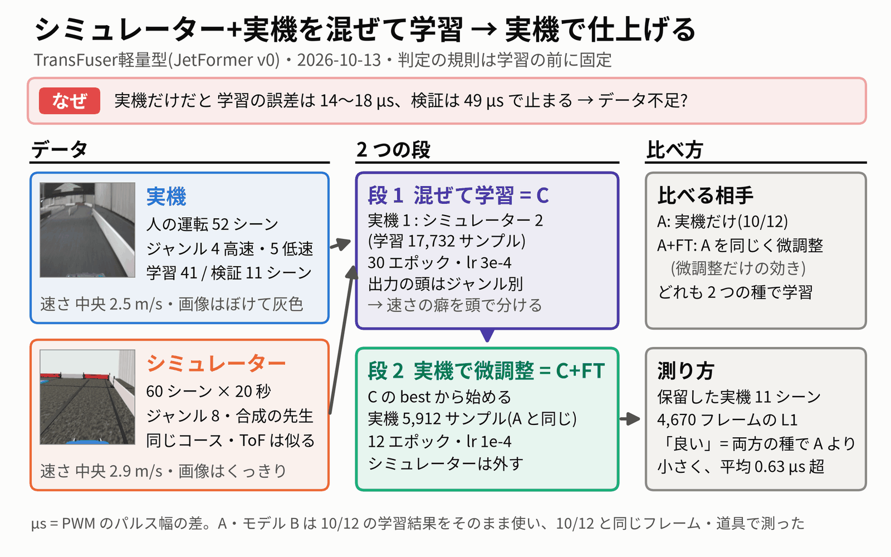
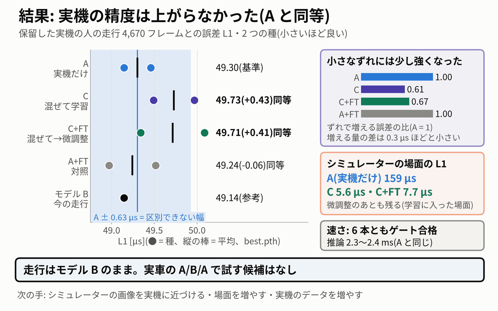

# シミュレーター+実機の混合学習 → 実機で finetuning(2026-10-13)

> **モデル**: TransFuser軽量型(JetFormer v0)= `jetformer_v0`。今の走行のモデル B と同じ形です。
> **データ**: **実機** = `clean_driving_20261011`(人のきれいな高速・低速の周回 52 シーン、ジャンル 4・5)、**シミュレーター** = `jetformer-simulator-id8-20min_20261012-150956_b55616cf`(60 シーン × 600 フレーム、ジャンル 8)。
> **腕**: **A** = 実機だけ(10/12 の 2 本)、**C** = シミュレーターと実機を混ぜて学習、**C+FT** = C のあと実機だけで finetuning(微調整)、**A+FT** = A を同じ方法で微調整した対照。どの腕も種 0・1 の 2 本です。

動画用のまとめの図は 2 枚です: やり方 `fig/summary_method.png`(3 章)、結果 `fig/summary_results.png`(4 章)。

---

## 0. 結論

**実機の精度は上がりませんでした。** シミュレーターを混ぜて学習した C も、そのあと実機で微調整した C+FT も、保留した実機の人の走行に対する誤差は、実機だけの A と「同等」でした。判定の規則は、学習の前に固定したものです。

| 腕 | 誤差 L1(2 つの種の平均、best.pth) | A との差(+ は悪い向き) | 判定(best・last の両方) |
|---|---|---|---|
| A(実機だけ・基準) | 49.30 µs | — | — |
| C(混ぜて学習) | 49.73 µs | +0.43 µs(+0.9%) | 同等 |
| C+FT(C → 実機で微調整) | 49.71 µs | +0.41 µs(+0.8%) | 同等 |
| A+FT(A → 実機で微調整・対照) | 49.24 µs | −0.06 µs | 同等 |
| モデル B(今の走行・参考) | 49.14 µs | −0.16 µs | — |

- **走行のモデルはモデル B のままです。** 実車の A/B/A で試す候補もありません(「良い」の腕が無いため)。
- **得られたもの**は 2 つです。
  - 小さな入力のずれへの強さが少し上がりました(ずれで増える誤差が A の 0.61〜0.67 倍)。ただし差は 0.3 µs ほどです。
  - シミュレーターの場面への当てはまりも上がりました(5.6〜7.7 µs。A は 159 µs)。これは学習に入った場面での値です。
  - どちらも微調整のあとも大部分が残りました。
- **確かさ**: 改善があるとしても約 0.5 µs(1% 程度)より小さいと見られます。10 µs の実用上の差はありません(5 章)。

## 1. なぜやったか — 実機のデータが足りないのでは

実機だけで学習すると、学習のデータでの誤差は下がり続けますが、見ていない走行(検証)の誤差は 49 µs で止まります。

| エポック | 10 | 15 | 20 | 25 | 30 |
|---|---|---|---|---|---|
| 学習の誤差(A 種 0) | 31.0 µs | 23.4 µs | 18.4 µs | 15.2 µs | 14.1 µs |
| 検証の誤差(A 種 0) | 51.5 µs | 50.3 µs | 49.9 µs | 49.3 µs | 49.4 µs |

学習 14〜18 µs に対して検証 49 µs という開きは、「学習のデータを覚えているが、新しい周には広がらない」形です。実機の学習データは 41 シーン(1/3 に間引いて 5,912 サンプル)しかありません。そこで、データの量を増やせば検証も下がるのでは、と考えました。

ユーザーの問いは「たくさんのデータで先に学び、そのあと目的の走行データで仕上げる(事前学習 → 事後学習)と精度は上がるか」でした。選んだのは案 C です。

> 「C 混ぜて学習: シミュレーター(ジャンル8)と実機(ジャンル4・5)を一緒に学習(ジャンル別の出力の頭が、速さの癖などの差を吸収できる)。そのあと、実機データのターゲットに近いデータで finetuning」

## 2. シミュレーターのデータ — 実機と何が違うか

| 項目 | 実機 | シミュレーター |
|---|---|---|
| シーン | 52(学習 41・検証 11)| 60 × 20 秒(600 フレーム)、全部を学習に使用 |
| 運転 | 人 | 合成の先生(プログラム) |
| ジャンル | 4(高速)・5(低速) | 8「シミュレーター」 |
| コース | 実機のコース | 同じコース |
| ステアの約束ごと | 直進 1442 µs・左は中央より大きい | 同じ |
| 前進の約束ごと | eRPM が負 = 前進 | 同じ |
| 速さ(中央値) | 2.5 m/s | 2.9 m/s(速い) |
| スロットル(中央値) | 1315 µs | 1267 µs(強い前進) |
| ToF(距離センサー) | 基準 | 実機とよく似ている |
| カメラ画像 | ぼけていて灰色、コントラストが低い | くっきりして色が濃い、暗く粗い模様の床 |

カメラ画像の違いを数字にすると、次のとおりです(300 枚ずつの中央値。`eval/readme_checks.py` → `eval/readme_checks.json`。参考の値で、判定には使いません)。

| 画像の量 | 実機 | シミュレーター |
|---|---|---|
| コントラスト(灰色の標準偏差) | 34.8 | 60.9(約 1.7 倍) |
| 彩度 | 12.9 | 50.0(約 4 倍) |
| 輪郭の強さ | 7.2 | 16.1(約 2 倍) |
| 下 1/3(床)の明るさ | 100.1 | 84.0(暗い) |

**この README を書くときに気づいたこと(後から見た参考)**: シミュレーターの 60 シーンは、ほぼ同じ 20 秒の走りのくり返しです。

- 60 シーンのステアを、フレーム番号でそろえた平均の軌跡と比べました。ずれは平均 7.6 µs(最大のシーンでも 18.1 µs)です。
- 1 シーンの中では、ステアは時間で約 220 µs(標準偏差)動きます。それに比べると、シーンどうしの違いはとても小さいです。スロットルも、シーンどうしのずれは 3.8 µs、1 シーンの中の動きは 68.5 µs です。
- つまり「60 シーン・36,000 フレーム」の中身は、ほぼ同じ 1 本の道すじです。量は多くても、新しい場面は少ないデータでした。

## 3. やり方 — 2 つの段



**段 1: 混ぜて学習(C)**
- 混ぜたデータセット `simreal_mix_20261013` を作りました。実機 52 + シミュレーター 60 = 112 シーンです。
- 検証は実機の 11 シーンだけで、A と同じフレームです。best のエポックも実機だけで選びます。
- 学習は 17,732 サンプルです。うちシミュレーターが 11,820 で、実機 1 : シミュレーター 2 の割合です。
- 条件は A と同じにしました: 30 エポック・lr 3e-4・cosine・バッチ 64・1/3 に間引き・今の操作値の入力なし・衝突 2.5 G の前後を除外。
- 出力の頭はジャンル別で、4・5・8 の 3 つを学びます。シミュレーターの速さの癖は頭 8 に分けて持たせるねらいです。

**段 2: 実機だけで微調整(C+FT)**
- 同じ種の C の best.pth から始めました。
- ドロップの表でシミュレーターの 36,000 フレームを全部外しました。残りは実機の 5,912 サンプルで、A と同じサンプルが同じ順に並びます。
- 12 エポック・lr 1e-4 で学習しました。
- 「ターゲットに近いデータ」には、実機の学習の 41 シーン全部を使いました。これは目的の走り(人のきれいな高速・低速の周回)そのものです。

**対照: A+FT**
- A の best.pth から、C+FT と同じ微調整をしました。
- C+FT が良くなったときに、シミュレーターの効き目か、追加の 12 エポックの効き目かを分けるためです。

**測り方**
- 10/12 の評価と同じ道具・同じフレームを使いました。保留した実機の人のきれいな走行 11 シーン・4,670 フレームで、10 ステップ先までのステアとスロットルの L1 を測ります。
- 「良い」と言える条件は 2 つです。腕の 2 つの種がどちらも A の 2 本より小さいこと。平均で 0.626 µs(= 2 × A のばらつき 0.313 µs)より大きく改善すること。
- last.pth でも同じ判定をしました。
- 規則は `protocol.json` に書き、11:57:51 に固定しました(sha256 91a50d41…)。最初の学習は 12:00:31 です。

## 4. 結果



### 4.1 主な表(保留した実機の人の走行 4,670 フレーム)

| 腕 | 種 0 best / last [µs] | 種 1 best / last [µs] | 平均 best / last [µs] | A との差 best / last [µs] | 判定 | シミュレーターの L1 [µs] | ずれへの強さ ΔL1 [µs](A との比) | 推論 run_numpy 中央 [ms] |
|---|---|---|---|---|---|---|---|---|
| A(実機だけ) | 49.146 / 49.235 | 49.457 / 49.752 | **49.301** / 49.494 | — | 基準 | 158.7(頭 5)・160.7(頭 4) | 0.793(1.00) | 2.37・2.36 |
| C(混ぜて学習) | 49.967 / 50.213 | 49.491 / 50.286 | **49.729** / 50.249 | +0.428 / +0.756 | 同等 | **5.6**(頭 8)・115・115(頭 4・5) | **0.482(0.61)** | 2.43・2.35 |
| C+FT(C → 微調整) | 50.087 / 50.266 | 49.340 / 50.033 | **49.714** / 50.149 | +0.412 / +0.656 | 同等 | **7.7**(頭 8)・112・113(頭 4・5) | **0.531(0.67)** | 2.33・2.29 |
| A+FT(対照) | 48.971 / 49.176 | 49.516 / 49.717 | **49.243** / 49.447 | −0.058 / −0.047 | 同等 | 152.4(頭 5)・156.8(頭 4) | 0.794(1.00) | 2.37・2.33 |
| モデル B(参考) | 49.144 / 49.091 | — | 49.144 / 49.091 | −0.157 / −0.403 | — | 151.3(頭 5)・150.8(頭 4) | 0.791 | 2.38 |

- 閾値は best 0.626 µs・last 1.322 µs です。
- **シミュレーターの L1** は、元のシミュレーターのデータセットの検証 12 シーン(7,080 フレーム)で測りました。C・C+FT ではこの 12 シーンも学習に入っているので、「覚えているか」の目安です。A・A+FT・B にはジャンル 8 の頭が無いので、頭 5・頭 4 で測りました。
- **ずれへの強さ**は、5 つのずれ(画像を 3 行下・3 行上、明るさ ×0.8・×1.2、ToF を 1 行下)で誤差が増える量の平均です。1,559 フレームで測り、小さいほど強いです。
- **推論**: 6 本の新しいエンジン(TensorRT FP16)はどれもゲートに合格しました。PyTorch との差は最大 0.86〜1.61 µs(ゲート 2.5 µs)です。A・B の速さは 10/12 の値です。

### 4.2 腕どうしの比較(同じ規則)

| 比べたもの | 平均の差 best / last [µs] | 判定 | 意味 |
|---|---|---|---|
| C+FT − C | −0.015 / −0.100 | 同等 | 微調整は C の誤差をほとんど変えなかった |
| C+FT − A+FT | +0.470 / +0.703 | 同等 | 同じ微調整どうしで比べても、シミュレーターの効き目は見えない |
| A+FT − A | −0.058 / −0.047 | 同等 | 12 エポックの追加の微調整そのものにも効き目は無い |

### 4.3 難しい場所 R1・DE(参考。判定には使わない)

- **R1** は、進入前 0.4 秒のスロットルです(+ = 遅い)。17 回の通過で測りました。
- **DE** は、緑マットの出口から 0.8 秒のステアです(+ = 左)。14 回の通過で測りました。

| 比べたもの | R1 の差の平均 [µs] | DE の差の平均 [µs] |
|---|---|---|
| C − A | +5.4 | −2.1 |
| C+FT − A | −0.1 | −3.0(「悪い」の印) |
| A+FT − A | +4.0 | +8.0 |
| C+FT − C | −5.6(「悪い」の印) | −0.9 |
| C+FT − A+FT | −4.1 | −11.0(「悪い」の印) |
| 陰性対照(10/12、同じ作り方の種どうし) | +7.7 / −7.5 | −2.8 / +2.3 |

- どの腕も「良い」にはなりませんでした。
- 崩れもありません。崩れとは、直線で前進が弱まる・向きを間違える、のどちらかです。
- 「悪い」の印は 3 つあります。そのうち 2 つは、同じ作り方の種どうしの差(R1 7.7 µs・DE 2.8 µs)とほぼ同じ大きさです。
- 残りの DE の C+FT − A+FT −11.0 µs は大きめです。ただしその多くは、A+FT が A より左に 8 µs 動いたことから来ています。

### 4.4 微調整で、シミュレーターから得たものを失ったか — 大部分は残った

- **ずれへの強さ**: C で得た強さのうち、微調整で戻ったのは約 16% でした。C+FT も「ずれに強い」の条件を満たします。
- **シミュレーターの L1(頭 8)**: 5.6 → 7.7 µs で、+2.1 µs 増えただけです。C が A より良くなった 153 µs のうち、失ったのは 1.4% です。
- **重みの動き**: 微調整で、学習する重みは 3.9〜5.1% 動きました。BatchNorm の統計は約 26% 動きました。ジャンル 8 の埋め込みは動いていません(実機のフレームだけで学ぶので、勾配が来ないため)。

### 4.5 速さの癖は移ったか — ジャンルの平均では移っていない。ただし低速の直線では少し移った

- **ジャンルの平均**: 前進の偏りの A からのずれは最大 3.9 µs で、規則の 10 µs より小さいです。シミュレーターは速く走りますが、ジャンル別の頭が速さの違いの大部分を分けて持てています。
- **低速(5)の直線**(場所の札 HS、411 フレーム): 前進の偏りは A が −1.0 / +0.8 µs、C が −11.3 / −22.9 µs、C+FT が −4.0 / −26.8 µs でした(負 = 人より強く前進)。C は両方の種、C+FT は種 1 で、A より強く前進を出していました。この直線だけは頭で分けきれていません。
- C・C+FT を実車で使うと、この直線で速めに出るおそれがあります。どちらも推奨ではないので、今は実車で試しません。
- この直線の結果は、レビューで後から見た内訳です。判定には使いません。

## 5. 精度は上がったか、どれくらい確かか

**上がっていません。** 5 つの比較(C・C+FT・A+FT vs A、C+FT vs C、C+FT vs A+FT)は、best でも last でもすべて「同等」です。

**どれくらい確かか**
- **差の大きさ**
  - 4 つの腕の種 2 本の範囲から、種 1 本の標準偏差は約 0.46 µs と見積もれます。
  - C+FT − A は +0.41 µs(悪い向き)でした。改善があるとしても約 0.5 µs(1% 程度)より小さいと見るのが妥当です。
  - 10 µs の実用上の差は、どちらの向きにもありません。
- **悪くなったとも言えません**
  - C は 2 つの種 × best・last の 4 通りすべてで A の 2 本より大きい値でした。
  - ただし best と last は同じ種の重みなので、実質は 2 つの種です。差が無くても 1/6 の確率で起きます。
  - そのため、「混ぜると悪くなる」とも言えません。
- **数字の確かめ**
  - 10/12 の予測をこの道具で作り直すと、10,985 フレームすべてで差は 0.0 µs でした。A・モデル B の値もすべて 10/12 と一致しました。
  - レビューでは、評価の道具を使わずに保存された予測から全部の数字を計算し直しました。合わない数字は 0 でした。
- **漏れと公平さ**(レビューで確認)
  - 保留の 11 シーンは、C の学習のフレームと時刻もファイル名も 1 つも重なっていません。
  - A と C は、同じ実機の 5,912 サンプルを同じ順で学んでいます。
  - 検証は全部の腕で同じ 1,559 サンプルです。
- **差の出かた**(後から見た内訳。判定には使わない)
  - C の +0.43 µs は、11 シーンのうち 2 シーン(20261010-152707-0001・20261010-193638-0003)の悪化から来ています。
  - 残りの 9 シーンでは、C はわずかに小さい向きでした。
  - ただし、これは後から選んだ分け方です。シーンごとの揺れ(A+FT − A で −2.0〜+1.2 µs)と同じくらいの大きさなので、改善の証拠にはなりません。

**なぜ上がらなかったか(どれも仮説で、まだ確かめていません)**

1. **シミュレーターのデータは、量のわりに中身が少なかった。** 60 シーンはほぼ同じ 20 秒の走りのくり返しでした(2 章)。C はそれをよく覚えましたが(L1 5.6 µs)、実機の新しい周に役立つ「新しい場面」はあまり増えていません。
2. **カメラの見た目が大きく違う。** コントラスト・彩度・床の模様が違います(2 章)。実機の頭(4・5)で測ったシミュレーターの L1 も 112〜115 µs と大きく、画像の特徴が共有されていません。
3. **合成の先生の運転が人と違う。** シミュレーターの先生は、人とは違う走り方をします。人の操作を当てる主指標には、直接は役に立ちにくいです。
4. **49 µs の多くは、人の操作の揺れかもしれない。** 人は同じ場所でも毎周少しずつ違う操作をします。10/12 に 5 つの形の方策(DINOv2 の事前学習つきも含む)を比べたときも、どれも 49.3〜50.4 µs でした。今日の 4 つの腕も 49.2〜49.7 µs です。どのモデル・どのデータでもほぼ同じ所に止まるので、ここが「下げられない底」に近い可能性があります。その場合、学習 14 µs と検証 49 µs の開きは、データ不足よりも人の揺れの大きさを表しています。

## 6. 次に試すこと

安くて答えがはっきり出るものから並べました。

1. **「下げられる余地」を先に測る(CPU だけ)。** 同じ場所を通る人の周どうしで、操作がどれだけ違うかを測ります。そこから、どのモデルでも越えられない誤差の底を見積もります。底が 45 µs ほどなら、データの工夫で得られるのは数 µs までと分かり、ほかの手の優先度が決まります。
2. **実機のデータの量と誤差の関係を測る(GPU 約 1 時間)。** 実機の学習 41 シーンのうち 1/2・3/4・全部で学習し、誤差の下がり方を見ます。下がり続けるなら、実機のターゲットのデータ(きれいな高速・低速の周回)を集めるのが一番の近道です。平らなら、5 章の 4 番の仮説が強まります。
3. **シミュレーターの場面を増やす。** 今の 60 シーンはほぼ同じ走りなので、次のように散らします。
   - 出発の位置・速さ・走る線をばらつかせる
   - 先生の操作に揺らぎを入れ、そこから戻る操作も記録する(コースの外れからの戻り方を学べる)
4. **シミュレーターのカメラを実機に近づける。**
   - 動きのぼけを入れる
   - コントラストを約 0.6 倍、彩度を約 0.25 倍に下げる
   - 床の模様・色を実機の写真から取る
   - カメラの高さ・向き・画角を合わせる
   - 近づいたかは、2 章の画像の量で確かめられます。
5. **色・明るさのランダム化。** 学習のとき、シミュレーターの画像(と実機の画像)の明るさ・コントラスト・彩度・ぼけ・ノイズを大きく揺らします。シミュレーター側のテクスチャや照明を毎シーン変えるのも同じねらいです。
6. **ToF を重く見る。** ToF は実機とシミュレーターでよく似ているので、共有しやすい特徴です。たとえば、シミュレーターのフレームだけ画像の特徴を一定の割合で隠して ToF から当てさせます。ToF の枝を太くする手もあります。
7. **混ぜ方の調整は後回し。** 混ぜる割合(今は 1 : 2)・学習率・エポック数は調整していません。ただし、3〜5 でデータの中身を変えないかぎり、割合だけ変えても大きくは動かないと見ています。

別の作業として、`jetformer.dataset.build_dataset` の直しもあります。展開したシミュレーターのシーンから作り直すと、未来の操作値が 1 フレームずれます(36,000 フレーム中 24,000 フレーム)。今回のデータセットでは元の値に戻して使いました。シミュレーターのデータを作り直すときは注意が要ります(`plan.md` §2)。

## 7. 実車で使うエンジン

- **推奨は今のままモデル B です。** 変更はありません。
  - エンジン: `/home/jetson/jetformer/data/runs/clean_driving_20261011-nocmd-s3-20261011-024626/jetformer_fp16.engine`
  - ジャンルは 4(高速)・5(低速)を使います。
- **A/B/A のカード**: 今回は候補がありません。規則の 4 番で、「良い」かつ 10 µs 以上の改善・崩れなし・ゲート合格の腕だけが候補になります。今日はその腕がありません。実車の基準値を取るなら、10/12 の評価のカード 1(モデル B だけの A/B/A)がそのまま使えます(`/home/jetson/jetformer_reports/policy_zoo_20261012/evaluation.md` 7 章)。
- **新しいエンジンを試しに走らせる場合の注意**:
  - C・C+FT のエンジンはジャンル数 9 で、走行タブでジャンル 8(シミュレーター)も選べます。実車ではジャンル 4・5 だけを使ってください。
  - C・C+FT は低速の直線で前進が強めに出るおそれがあります(4.5)。
  - どれも机上の比較用です。

## 8. 注意と限界

- **主指標の甘さ**: 主指標の 11 シーンは、best のエポックを選んだ検証のシーンと同じです(10/12 と同じ条件)。どの腕も同じ形で甘くなるので、last.pth でも判定し、同じく「同等」でした。微調整の腕は best を 2 回選んでいて、有利な向きです。それでも「良い」にはなりませんでした。
- **シミュレーターの L1**: C・C+FT の値は、学習に入ったシーンで測ったものです。新しいシミュレーターの場面への強さではありません。
- **C+FT のばらつき**: C+FT の 2 つの種の差は 0.747 µs で、2 × s_A を超えました。種を増やせば平均は動きえます。ただし、どちらの種も A の小さい方(49.146 µs)より大きいので、「良い」になる形ではありません。
- **電源断**: A+FT 種 0 は電源断のあと、2 エポック目から再開しました。重み・最適化・学習率の位置は戻しましたが、データの並べ替えと色の揺らしの順番は、止まらなかった場合と違います。
- **結論の範囲**: TransFuser軽量型(JetFormer v0)・この学習の条件(A と同じレシピ、割合 1 : 2)・このシミュレーターのデータ(60 シーン・合成の先生)に限ります。机上の結論で、実車の走りは測っていません。
- **2 章の数字**: 画像の量とシーンどうしのずれは、この README のために測った参考の値です。判定には使っていません。
- **この作業でしたこと・していないこと**: 車は動かしていません。PCA9685 には触っていません。jetformer-web は再起動していません。git commit もしていません。
- **リポジトリの変更**:
  - 足したもの: `tools/sim_cotrain.py`(準備)、`tools/sim_cotrain_eval.py`・`tools/sim_cotrain_figures.py`、`tests/test_sim_cotrain.py`・`tests/test_sim_cotrain_eval.py`(CPU のテスト)
  - 変えたもの: `tools/rl_policies.py` の GPU_PATTERNS に 2 つ追加
  - 詳しくは各段の文書にあります。

## 9. ファイル

| もの | 場所(`/home/jetson/jetformer_reports/sim_cotrain_20261013/` から) |
|---|---|
| この文書 | `README.md` |
| 計画・固定した規則 | `plan.md`、`protocol.json`、`prepare_check.json` |
| 学習の記録 | `training.md`、`train/`(`summary.json`・`state.json`・ドライバー)、`logs/` |
| 評価 | `evaluation.md`(9 章にレビュー)、`evaluation.json`、`eval/tables.md`、`eval/logs/` |
| レビュー | `eval/review/review_check.py`・`review_check.json`・`review_check.log` |
| README の参考の数字 | `eval/readme_checks.py` → `eval/readme_checks.json` |
| 動画用のまとめの図 | `fig/summary_method.png`(やり方)、`fig/summary_results.png`(結果)。作り方は `fig/src/summary_figs.py`(`evaluation.json` から読む) |
| ほかの図 | `fig/eval_*.png`(評価の 5 枚)、`fig/train_*.png`(学習の 4 枚) |
| 1 分の動画の絵コンテ | `video/simreal_1min_storyboard.json`(7 場面・63.2 秒)、確認の記録 `video/timing.log`、静止画 `video/check/`、決まりごとの確認 `video/src/check_storyboard.py` |
| 学習結果 | `~/jetformer/data/runs/simreal_mix_20261013-cotrain-s{0,1}`・`-cotrain-ft-s{0,1}`・`clean_driving_20261011-jetformer_v0-s{0,1}-ft-real-lr1e-4-e12` |
| 予測 | `~/jetformer/data/zoo/sim_cotrain_20261013/{pred,pert,sim}/` |

図の作り直し(CPU だけ):

```
source ~/miniconda/etc/profile.d/conda.sh && conda activate jetracer
cd /home/jetson/jetformer_reports/sim_cotrain_20261013
CUDA_VISIBLE_DEVICES= python fig/src/summary_figs.py
CUDA_VISIBLE_DEVICES= python eval/readme_checks.py
```

## 10. 1 分の動画のナレーション案

(図 1 `fig/summary_method.png` → 図 2 `fig/summary_results.png` の順。約 360 字、約 1 分)

動画に使う実際のセリフは、絵コンテ `video/simreal_1min_storyboard.json` にあります(下の案を短くし、「上がらなかった理由(仮説)」の場面を足したもの。63.2 秒)。

> 実機だけで学ぶと、学習の誤差は 15 マイクロ秒ほどまで下がるのに、見ていない走行では 49 マイクロ秒で止まります。そこで、シミュレーターのデータを混ぜて学び、そのあと実機のデータだけで仕上げる方法を試しました。シミュレーターは同じコースですが、速く走り、画像はくっきりしています。
>
> 結果、実機の精度は上がりませんでした。混ぜても、仕上げても、実機だけの場合と区別できない差です。得られたのは、小さな入力のずれへの強さと、シミュレーターの場面への当てはまりで、仕上げのあとも大部分が残りました。走行はモデル B のままです。
>
> 課題は 3 つです。ほぼ同じ走りのくり返しだったシミュレーターの場面を散らすこと。画像を実機に近づけること。そして、人の操作の揺れで決まる誤差の底を測り、実機のデータを増やす価値を確かめることです。
