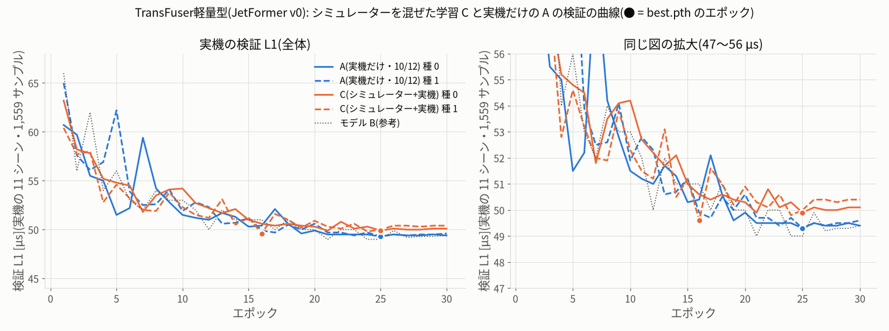
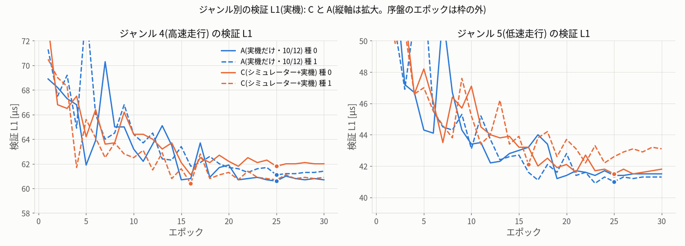
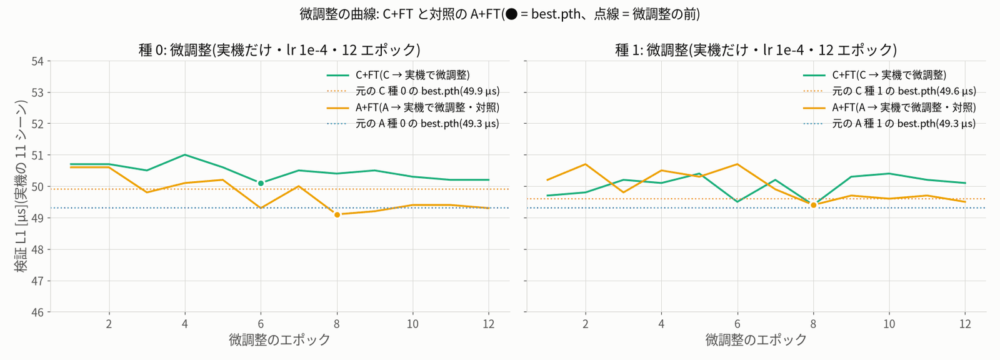
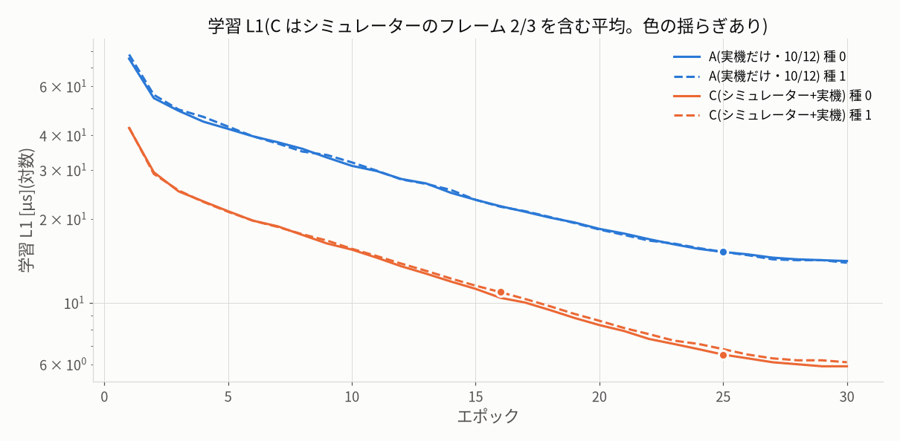

# 学習の段の記録 — シミュレーターと実機を混ぜた学習(案 C)2026-10-13

モデルは TransFuser軽量型(JetFormer v0)= `jetformer_v0`(今の走行のモデル B と同じ形)です。
手順は学習の前に固定した `protocol.json`(sha256 91a50d41…)のとおりに進め、途中で変えていません。

## 0. 要点

- **学習と微調整(finetuning)は 6 本とも最後まで終わりました。** 内訳は C(混ぜて学習)種 0・1、C+FT(C のあと実機だけで微調整)種 0・1、
  対照の A+FT(実機だけの A を同じ方法で微調整)種 0・1 です。どれも終了コード 0 で、エンジン(FP16)も 6 本作りました。
  6 本とも走行タブと同じ手順でエンジンを読み込めて、精度と速さのゲートに合格しています。車は動かしていません。
- 14:08 ごろに電源が落ち、A+FT 種 0 が 1 エポック目を終えたところで止まりました。14:12 に `last.pth` から再開して、最後まで終わりました(§5)。
  ほかの 4 本は電源断の前に済んでいて、ファイルが壊れていないことも確かめました。
- **学習中の検証(実機の 11 シーン・1,559 サンプル)の傾向**: シミュレーターを混ぜても、そのあと微調整しても、
  基準 A より良くはなっていません。

  | 腕 | best の検証 L1(種 0 / 種 1) | 平均 | 最後のエポック(種 0 / 種 1) |
  |---|---|---|---|
  | A(実機だけ・10/12) | 49.3 / 49.3 µs | 49.3 | 49.4 / 49.6 |
  | C(混ぜて学習) | 49.9 / 49.6 µs | 49.75 | 50.1 / 50.4 |
  | C+FT(C → 実機で微調整) | 50.1 / 49.4 µs | 49.75 | 50.2 / 50.1 |
  | A+FT(A → 実機で微調整・対照) | 49.1 / 49.4 µs | 49.25 | 49.3 / 49.5 |
  | モデル B(参考) | 49.0 µs | — | 49.4 |

  微調整の前後の差は、どちらの腕も種ごとに −0.2〜+0.2 µs でした(C+FT − C、A+FT − A)。
  これは 10 µs の実用上の差よりずっと小さい値です。
  **ただし、これは主指標ではありません**(値は 0.1 µs に丸めてあり、best のエポックを選んだのと同じシーンで測っています)。
  「良い・同等・悪い」の判定は、次の評価の段で決めます。そこでは保留の 4,670 フレームについて best.pth と last.pth で予測を出し、
  protocol.json の規則(閾値 0.626 µs)で判定します。

## 1. 学習の作り方(レシピ)

共通の条件は基準 A(10/12 の policy zoo の v0)と同じです。

| 項目 | 値 |
|---|---|
| 学習の道具 | `tools/train.py --policy jetformer_v0`(既定の形: dim 256・4 層・8 ヘッド) |
| バッチ・workers | 64・4(`nice -n 10`) |
| 間引き | 1/3(`--stride 3`) |
| 今の操作値の入力 | なし(`--no-command-input`) |
| 衝突の前後の除外 | 2.5 G(`--impact-g 2.5`) |
| 最適化 | AdamW(wd 1e-4)・cosine(T_max = エポック数)・AMP |
| best の選び方 | 実機の検証の 11 シーン(`clean_driving_20261011` の val。全部の腕で同じ 1,559 サンプル) |

| 腕 | データ | 初期値 | lr・エポック | 学習 / 検証 サンプル | ジャンル(頭)の数 | 学習結果(`data/runs/`) |
|---|---|---|---|---|---|---|
| A(基準・新しく学習しない) | 実機 `clean_driving_20261011` | ImageNet | 3e-4・30 | 5,912 / 1,559 | 6 | `clean_driving_20261011-jetformer_v0-s{0,1}-nocmd-stride3-e30` |
| C | 混ぜたデータ `simreal_mix_20261013`(実機 41 + シミュレーター 60 シーンで学習) | ImageNet | 3e-4・30 | 17,732(うちシミュレーター 11,820)/ 1,559 | 9 | `simreal_mix_20261013-cotrain-s{0,1}` |
| C+FT | 同じデータ + `--drop-mask drop_sim_frames.npz`(シミュレーターの 36,000 フレームを外す → A と同じ 5,912) | 同じ種の C の best.pth | 1e-4・12 | 5,912 / 1,559 | 9 | `simreal_mix_20261013-cotrain-ft-s{0,1}` |
| A+FT(対照) | 実機 `clean_driving_20261011` | 同じ種の A の best.pth | 1e-4・12 | 5,912 / 1,559 | 6 | `clean_driving_20261011-jetformer_v0-s{0,1}-ft-real-lr1e-4-e12` |

種は 0 と 1 です(`--seed`)。コマンドは全部 `protocol.json` の `arms.*.commands` に入っています。
走らせたのは `train/cotrain_train.py train` で、1 本ずつ「学習 → エンジン → エンジンの確認」の順に進めました。
GPU を使うプロセスは常に 1 つだけで、各段の前にほかの GPU プロセス・走行中・学習中でないことと、空きメモリ 3.5 GB 以上を確かめています。
微調整は重みだけを引き継ぎ、最適化の状態(AdamW のモーメント)は新しく始めます(`--init`)。

## 2. 時間(1 エポック目の実測と見込み)

C 種 0 の最初の 5 エポックを実測し(表示の秒数 102・117・108・102・102 秒、中央値 104 秒)、12:10 に見込みを直しました。
直した見込みは「学習の段 約 2.7 時間(12:00 開始 → 約 14:45)」です(plan.md §7.1)。実際は次のとおりでした。

| 段 | 見込み(12:10) | 実測(学習 + エンジン + 確認) |
|---|---|---|
| C 1 本 | 約 54 分 | 種 0: 52.6 分(50.6 + 1.7 + 0.4)・種 1: 52.8 分(50.7 + 1.6 + 0.4) |
| C+FT 1 本 | 約 10 分 | 種 0: 10.7 分・種 1: 10.4 分 |
| A+FT 1 本 | 約 10 分 | 種 0: 約 12 分(電源断で失った約 1 分を含む。再開後 9.2 + 1.5 + 0.4)・種 1: 10.3 分 |
| **学習の段の合計** | **約 2.7 時間** | **GPU の時間 約 2.48 時間**(8,874 秒 + 電源断で失った約 50 秒)。 実時間は 12:00:31 → 14:34:00 の 2 時間 34 分(電源断の約 4.5 分を含む) |

- 1 エポックの秒数(result.json の history の中央値。`last.pth` の書き込みは含まない)は、C が 91.6 秒、
  C+FT と A+FT が 33.0〜36.6 秒、A(10/12)が 33.3 秒でした。サンプルあたりにすると C は 4.75 ms で、A の 4.46 ms の約 1.07 倍です。
  GPU が律速しています。
- ピークのメモリは 1,274 MB でした(A+FT 種 0 は再開で `last.pth` を読んだため 1,330 MB)。空きメモリが 4.5 GB を割ることはありませんでした。
- 評価の段の予測(約 18 分の見込み)は、この段には含めていません(§6)。

## 3. 学習の結果(学習中の検証)

### 表 1: 学習の結果(学習中の検証。主指標ではない)

| 腕・種 | 学習結果(data/runs/) | 学習 / 検証 サンプル | ジャンル数 | best の検証 L1 [µs](エポック) | 高速 / 低速 [µs] | 最後 [µs] | best − last | 学習 L1(最後) |
|---|---|---|---|---|---|---|---|---|
| A 種 0 | `clean_driving_20261011-jetformer_v0-s0-nocmd-stride3-e30` | 5,912 / 1,559 | 6 | 49.3(25) | 60.6 / 41.4 | 49.4 | -0.1 | 14.1 |
| A 種 1 | `clean_driving_20261011-jetformer_v0-s1-nocmd-stride3-e30` | 5,912 / 1,559 | 6 | 49.3(25) | 61.1 / 41.0 | 49.6 | -0.3 | 13.9 |
| C 種 0 | `simreal_mix_20261013-cotrain-s0` | 17,732 / 1,559 | 9 | 49.9(25) | 61.8 / 41.5 | 50.1 | -0.2 | 5.9 |
| C 種 1 | `simreal_mix_20261013-cotrain-s1` | 17,732 / 1,559 | 9 | 49.6(16) | 60.4 / 42.1 | 50.4 | -0.8 | 6.1 |
| C+FT 種 0 | `simreal_mix_20261013-cotrain-ft-s0` | 5,912 / 1,559 | 9 | 50.1(6) | 62.1 / 41.6 | 50.2 | -0.1 | 10.5 |
| C+FT 種 1 | `simreal_mix_20261013-cotrain-ft-s1` | 5,912 / 1,559 | 9 | 49.4(8) | 60.3 / 41.8 | 50.1 | -0.7 | 13.0 |
| A+FT 種 0 | `clean_driving_20261011-jetformer_v0-s0-ft-real-lr1e-4-e12` | 5,912 / 1,559 | 6 | 49.1(8) | 60.2 / 41.4 | 49.3 | -0.2 | 12.5 |
| A+FT 種 1 | `clean_driving_20261011-jetformer_v0-s1-ft-real-lr1e-4-e12` | 5,912 / 1,559 | 6 | 49.4(8) | 60.8 / 41.4 | 49.5 | -0.1 | 12.2 |
| モデル B(参考) | `clean_driving_20261011-nocmd-s3-20261011-024626` | 5,912 / 1,559 | 6 | 49.0(25) | — | 49.4 | — | — |

曲線から読めること(どれも学習中の検証で、主の判定ではありません):

- **C(混ぜて学習)**: 序盤(1〜4 エポック目)の検証は A とほぼ同じ速さで下がりました。混ぜたことで早く良くなる様子はありません。
  終盤は A より上(悪い側)で落ち着いています。20〜30 エポック目の平均は C が 50.2・50.3 µs、A が 49.5・49.6 µs で、0.5〜0.8 µs の差です。
  学習 L1 は 5.9〜6.1 µs で、A の 14 µs よりずっと低くなりました。学習の 2/3 を占めるシミュレーターのフレームは、合成の先生の操作なので当てやすいためです。
  ジャンル別の best を見ると、高速(4)は種 0 が A より 1.2 µs 悪く、種 1 は 0.2〜0.7 µs 良いなど、種によって向きが変わります。
  低速(5)は両方の種で A より 0.1〜1.1 µs 悪い側です。
- **微調整(C+FT・A+FT)**: どちらも 1 エポック目で検証が元の best より 0.1〜1.3 µs 上がりました(最適化の状態を新しく始めたため)。
  その後の 2〜12 エポック目は、元の値から −0.2〜+1.4 µs の間で上下しただけです。最後のエポックの値は元の値から 0〜+0.5 µs でした。
  C+FT 種 0 は元の C 種 0(49.9)より下に一度も行かず、種 1 は 8 エポック目に 49.4(元 49.6)になりました。
  A+FT は種 0 が 49.1(元 49.3)、種 1 が 49.4(元 49.3)です。
  微調整で検証が下がり続ける傾向は、どちらの腕にもありませんでした。
- best の位置: 30 エポックの C は 25・16 エポック目、12 エポックの微調整は 6・8・8・8 エポック目でした。
  best − last は −0.1〜−0.8 µs で、best を選んだことによる甘さは 1 µs 未満です(last.pth の確認は評価の段で行います)。

## 4. エンジン(TensorRT FP16)と読み込みの確認

各学習結果の `best.pth` から書き出した `jetformer.onnx` を、`tools/build_engine.py` で FP16 にしました。1 本ずつ別のプロセスで、
1 本あたり 81〜100 秒です。そのあと `train/engine_load_check.py` で、走行タブと同じ手順で読めるかを確かめました。この確認では車は動かさず、
PWM も出さず、走行のループも回していません。中身は次の 4 つです。

1. `drive.model_info` で drivable かどうか
2. 実機の検証のフレーム 64 個で、PyTorch FP32(CPU・best.pth)と TensorRT(`run_numpy`)の actions の差
3. `drive._run` と同じ順番(torch の CUDA の初期化 → TRTRunner → `policies.check_io` → 空回し)
4. 速さ(100 回の空回しの後に 600 回)

### 表 3: エンジンの確認

| 腕・種 | drivable・check_io | ジャンル数・走行で選べるジャンル | actions の差 最大 / p99 [µs] | 精度 ≤ 2.5 µs | run_numpy 中央 / p99 [ms] | エンジンだけ 中央 [ms] | エンジン [MB] | 全ゲート |
|---|---|---|---|---|---|---|---|---|
| C 種 0 | 合格・合格 | 9・[4, 5, 8] | 1.25 / 0.79 | 合格 | 2.43 / 2.74 | 1.54 | 27.8 | 合格 |
| C 種 1 | 合格・合格 | 9・[4, 5, 8] | 1.10 / 0.55 | 合格 | 2.35 / 2.70 | 1.49 | 27.8 | 合格 |
| C+FT 種 0 | 合格・合格 | 9・[4, 5] | 0.90 / 0.58 | 合格 | 2.33 / 2.61 | 1.44 | 27.8 | 合格 |
| C+FT 種 1 | 合格・合格 | 9・[4, 5] | 1.61 / 0.61 | 合格 | 2.29 / 2.62 | 1.40 | 27.8 | 合格 |
| A+FT 種 0 | 合格・合格 | 6・[4, 5] | 0.86 / 0.48 | 合格 | 2.37 / 2.54 | 1.49 | 27.8 | 合格 |
| A+FT 種 1 | 合格・合格 | 6・[4, 5] | 1.21 / 0.84 | 合格 | 2.33 / 2.44 | 1.48 | 27.8 | 合格 |

ゲートは「精度 ≤ 2.5 µs・run_numpy 中央 ≤ 6.0 ms・p99 ≤ 8.0 ms」で、6 本とも合格です。速さは A(10/12、run_numpy 中央 2.37・2.36 ms)と同じくらいでした。
各学習結果のフォルダーに `run.json`(管理画面の一覧用。腕と微調整の元を記録)と `engine_check.json`(走行タブの確認の表示)も書きました。
`run.json` の note には「机上の比較用で、走行の標準はモデル B のまま」と書いてあります。

## 5. 電源断と再開

- 14:07:00 に A+FT 種 0 の学習を始めました。14:07:48 に 1 エポック目の `best.pth`・`last.pth` を書き終え、そのあと 14:08 ごろに電源が落ちました
  (journal: 前の起動の最後の記録が 14:08:04)。
- 再開の前に CPU だけで次のことを確かめました。
  - 済んだ 4 本(C・C+FT の各 2 本)と途中の 1 本の全ファイル: json はすべて読めて、.pth・.onnx・.engine に 0 で埋まった 1 MB の塊はありませんでした
  - `best.pth` に NaN・Inf はありませんでした
  - A+FT 種 0 の `last.pth` は epoch = 1 で、中の重みは `best.pth` と完全に同じでした(1 エポック目が best なので、これが正しい状態です)
- 14:12:33 に同じドライバー(`cotrain_train.py train`)を実行しました。済んだ 4 本は飛ばされ、A+FT 種 0 は `--resume` で
  2 エポック目から続けて最後まで進みました。その後に A+FT 種 1、エンジン、確認と進んで、14:34:00 に「全部済みました」になりました。
- 再開した A+FT 種 0 について: `tools/train.py` は乱数の種を起動したときに 1 回だけ設定します。そのため、2〜12 エポック目のシャッフルと色の揺らぎの乱数は、
  止まらなかった場合とは違う並びになります。重み・最適化の状態・学習率の位置は `last.pth` から戻しているので、学習の条件は同じです。
  この違いは種の違いと同じ種類のばらつきです。
- 学習に使ったコードの指紋(`tools/train.py` などの sha1)は、6 本の全部の試行で同じ `31a451f1d0ab` でした。

## 6. この段でしていないこと(次の評価の段)

`protocol.json` の gpu_order の残りの「予測」は、plan.md §6・§7.1 のとおり次の評価の段で行います。対象は次のとおりです。

- 保留の 10,985 フレームを best・last で予測
- 5 つのずれの予測
- シミュレーターの 12 シーンの予測

そのあとの評価(CPU)で、主指標 L(4,670 フレーム)、ジャンル別の値、R1・DE、ずれへの強さ、崩れ、シミュレーターの L1 を出し、
`judge_primary`・`final_verdict` で判定します。A とモデル B は 10/12 の予測(`data/zoo/policy_zoo_20261012/pred/`・`pert/`)をそのまま使います。

## 7. 注意

- 表 1 の検証 L1 は学習中の値です。0.1 µs に丸めてあり、間引き 1/3 の 1,559 サンプルで測っています。best のエポックを選んだのと同じシーンでもあります。
  腕どうしの差(0.5 µs 前後)は、10/12 の A の種のばらつき(主指標で 0.3 µs)と同じくらいの大きさなので、ここから良し悪しは決めません。
- C のエンジンは、走行タブで選べるジャンルに 8(シミュレーター)が出ます(trained_modes = [4, 5, 8])。実車で頭 8 を使う想定はないので、
  走らせるならジャンル 4・5 を選んでください。C+FT は trained_modes が [4, 5] ですが、頭 8 の重みは C から引き継いでいます
  (シミュレーターの L1 を出すときは、ジャンル 8 を one-hot で直接与えます)。
- どの学習結果も机上の比較用です。走行の標準はモデル B のままで、jetformer-web の設定は変えていません。git commit もしていません。

## 8. ファイル

| もの | 場所 |
|---|---|
| 学習の記録(これ) | `training.md` |
| 図 | `fig/train_val_curves.png`・`fig/train_val_by_genre.png`・`fig/train_ft_curves.png`・`fig/train_loss_train.png` |
| まとめの数字・表 | `train/summary.json`・`train/tables.md`(`train/cotrain_summary.py` が書く。CPU) |
| 実行の状態 | `train/state.json`(各試行の開始・終了・秒数・コードの指紋・エンジンと確認の結果) |
| ドライバー | `train/cotrain_train.py`(`train`・`status`)、`train/engine_load_check.py` |
| ログ | `logs/train_driver.log`、`logs/check_<学習結果>.log`、各学習結果の `train.log`・`engine.log` |
| エンジンの確認 | `train/engine_check/<学習結果>.json`、各学習結果の `engine_check.json` |
| 学習結果 | `~/jetformer/data/runs/simreal_mix_20261013-cotrain-s{0,1}`・`-cotrain-ft-s{0,1}`・`clean_driving_20261011-jetformer_v0-s{0,1}-ft-real-lr1e-4-e12`(best.pth・last.pth・jetformer.onnx・jetformer_fp16.engine・model_config.json・result.json・run.json) |
