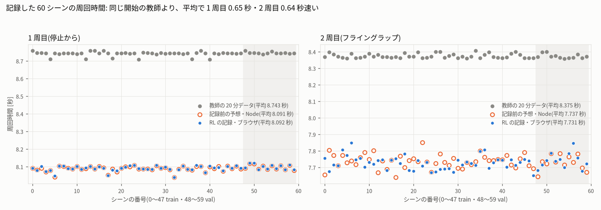
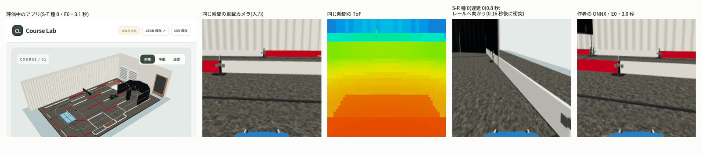

# シミュレーターの強化学習ベストラップ → JetFormer の学習(sim_rl_bestlap_20261013)

- 作成 2026-10-14 11:10(報告の段)。期間 2026-10-13 15:00 〜 2026-10-14 11:10。
- 確認の段(2026-10-14、`review.md`)で数字を生の記録から数え直し、言い過ぎ・書き違いを直しました(直す前の版は `review/README.before_review.md`)。
- 依頼(ユーザー、2026-10-13): 「シミュレーターは強化学習でベストラップの走行を実現したいです。それをシミュレーターデータとして学習させたい」
- あわせて受けた質問: 「今後、速くぶつからないようにするには、どういうアップデートが有望ですか？」(答えは **8 章**)
- 実車・PCA9685・I2C には触れていません。ユーザーのシミュレーター(`/home/jetson/sim/extracted/course-simulator`)は変えていません(コピーを使い、
  コピーが元とバイト単位で同じことを確かめました)。`jetformer/web`・`jetformer/sim*`・`data/sim*`・`data/modes.json` は変えていません。git にはコミットしていません。

## 結論

| 段 | 結果 |
|---|---|
| **強化学習**(H1) | **成立**。RL(PPO)の方策は停止から 1 周 **8.092 秒**・フライングラップ **7.656 秒**。作者の RC 教師(8.931・8.370 秒)より、停止から 1 周で 0.84 秒速い。独立な確認 3 回で本物と確かめた |
| **シミュレーターデータ** | RL の走りで 20 分・60 シーン・36,000 フレーム(カメラ・ToF・IMU・PWM)を記録。全部の検証に合格し、JetFormer に取り込んだ(ジャンル 8、`jetformer-simulator-rl-bestlap-20min_20261013-174515_7f3650b0`) |
| **JetFormer の学習** | RL のデータ(S-R)と作者の教師のデータ(S-T)で 2 種ずつ学習。RL のデータは 4〜7 倍まねしにくい(学習中の検証 L1 17.5 対 2.3 µs、全フレームの 10 ステップの平均 19.6 対 4.7 µs。差はほとんど舵) |
| **シミュレーター内の周回**(H2) | **できなかった**。S-R は 12 本すべて、走り出してすぐ(最初の直線。E5 はゲート 20 の直線)0.9〜1.4 秒でぶつかった(完走 0/12)。S-T は 12 本のうち 2 本が完走(8.830・8.840 秒。教師より速い)、作者の ONNX は 6 本のうち 2 本(9.022・9.033 秒) |

- **なぜ失敗したか**: どちらの線にも、余裕の小さい所が 1 か所ある。RL の線は最初の直線で右の壁(z = 2.8 m の幕・レール・柱の脚)まで約 10 cm
  (作者の教師は同じ区間で最小 29 cm)。作者の教師の線は点 4 のゲートの端まで 2.2 cm(RL は 13.8 cm)。周全体の最小すき間は RL 7.1 cm・教師 6.7 cm で
  同じくらいなので、「速い線ほど全体に余裕がない」のではなく、余裕の小さい場所が違う。JetFormer のまねの誤差は、
  ぶつかるまでに 10〜18 cm のずれになる。しかも JetFormer は線から外れたときの戻し方を習っていない(RL なら衝突の 0.13〜0.33 秒前まで立て直せた)。
- **遅く走らせても直らない**(前進ゲイン 0.8・0.9 でも同じ所でぶつかる)。先読み 2 は少し効いた。S-T は前進ゲイン 1.01 で完走した(余裕の小ささの表れ)。
- **有望なアップデート**(8 章): ① RL の線に余裕を約束させる(障害物・ゲートの端まで、JetFormer のずれに見合う 10〜20 cm。速さの損は未測定)、② RL を先生にして JetFormer に外れたときの戻し方を教える(DART・DAgger)、
  ③ RL の操作をなめらかにする、④ RL をまねする側の誤差(遅延 1・舵の乱れ)に強くする。
- 数字の確かさ: 作者の ONNX(陽性対照)は完走し、ユーザーの確認器が PASS。同じ条件の 2 回は完全に同じ。全 59 走行で、記録した操作の再生と自前の数え直しが一致した。
  確認の段でも、Python で書いた別の積分・判定で 59 走行すべてが一致し、ランダムな 2 つの開始で RL の周が有効なことを確かめた(evaluation.md 5.1 節)。

---

## 1. 目的

ユーザーの CourseLab シミュレーター(現行コース v3、33 ゲート + 黒シートの必須横断)で、次の 3 つを行い、うまくいったかを確かめる。

1. 強化学習(RL)で、作者の RC 教師より速い **ベストラップ**(衝突 0・有効な周)を走らせる。
2. その走りを、作者の 20 分データと同じ形(カメラ・ToF・IMU・PWM、60 シーン・36,000 フレーム)の **シミュレーターデータ** として記録する。
3. そのデータで **JetFormer を学習** し、シミュレーターの中で同じように速く完走できるかを測る。

結果を見る前に、手順と合格の基準を `protocol.json`(sha256 `1f249211…b8b6`)と `design.md` に固定しました。基準はあとから変えていません。

| 問い | 中身 | 判定 |
|---|---|---|
| H1 | RL(PPO)は、作者の RC 教師より速い有効なラップ(停止から 1 周・フライングラップ)を、同じ物理・同じ判定で走れるか | **成立**(3 章) |
| H2 | RL のラップを記録して JetFormer を学習すると(S-R)、閉ループでそのラップに近い速さで完走し、教師データで学習した JetFormer(S-T)より速いか | **できなかった**(5 章) |

---

## 2. 方法

### 2.1 全体の流れ

| 段 | やったこと | 主な出力 |
|---|---|---|
| A・B. RL | Node でシミュレーターの物理を動かし、PPO で学習。チェックポイントを決まった基準で選び、元の物理で確かめる | `rl.md`・`rl/`・`fig/rl_*.png` |
| 確認 r1〜r3 | 別の道具で RL の周を作り直し、言い過ぎを探す(3 回) | `rl_check_r1.md`〜`rl_check_r3.md` |
| C. 記録 | ブラウザ(WebGL)のアプリの「連続試験」と収集器で、RL の方策に運転させて 20 分のデータを作る。検証して JetFormer に取り込む | `record.md`・`recording/` |
| D. 学習 | JetFormer を 2 つのデータ(RL・教師)で 2 種ずつ学習。シミュレーター用のモデル一式を作る | `train.md`・`train/`・`bundles/` |
| E. 評価 | ブラウザのアプリで、学習した JetFormer に運転させる(閉ループ)。判定 H2 | `evaluation.md`・`evaluation.json`・`eval/` |
| 確認 | 報告を生の記録から数え直す(別の積分・ランダムな開始・データセットの取り込み直し・テスト一式) | `review.md`・`review/` |

### 2.2 RL の設計(`design.md` 2 章・`protocol.json`)

- **環境**: ユーザーの `dist/sim-core.js` を Node で読む高速版(元と 101 件で完全一致)と現行コース v3。ワーカー 4 つ × 16 環境 = 64 環境を並べて動かす。
  three.js(画面)は使わない。最後の数字はすべて **元の `sim-core.js`** で測り直した(高速版との差 0 秒)。
- **観測(79 次元)**: 正解の状態から作る(カメラは使わない)。速さ・実際の舵角・ヨーレート、前回の行動、参照ループ(作者の RC 教師の 1 周の軌跡)からの
  横ずれと向きのずれ、参照ループの 0.25〜4 m 先の 16 点の位置と路面の摩擦、車体から全障害物までの 19 本の距離(高さに関係なく、脚も含む)、
  車体の路面の摩擦、今の目標ゲートに対する位置、車体と障害物の最小距離。参照ループは物差しにだけ使い、沿うことに報酬はない。
- **行動**: 舵 = 0.52·a0 rad、目標速度 = 4.5·(a1+1)/2 m/s(0〜4.5 m/s。4.5 m/s は教師の上限・実車の速さの 99% 点)。後退はしない。
  記録のときは作者のアプリと同じ式で PWM にする(舵 1442 µs 中心、スロットル 1498 µs 中立)。
- **PPO**(自前の実装、CPU): 方策・価値とも 79→256→256 の MLP、64 環境 × 256 ステップごとに更新、γ 0.995・GAE λ 0.95、lr 3e-4 → 3e-5、
  1 本 1,000 万ステップ(約 30 分)。本番は `main` の種 0・1・2、参考に上限 7.24 m/s の `open` 種 0。
- **回(エピソード)**: 停止から 20 秒の連続周回(記録と同じ長さ)。開始は 50% がゲート 0、50% が全ゲートから。横 ±0.12 m・向き ±8° でずらす。
- **選び方**: 記録の 60 条件(REC60)で 60/60 本とも 2 周有効・衝突 0・最小すき間 ≥ 3 cm、標準の単周を完走、頑健さの 24 条件(ROB24)で 22/24 以上。
  そのうえで REC60 の (1 周目 + 2 周目) の平均がいちばん小さいもの。

### 2.3 報酬(1 フレームごと)

```
r = 進み(参照ループ上の s の増分。実際に動いた距離 + 5 cm と「今の目標ゲート + 0.75 m」で頭打ち)
  − 0.02·(舵の行動の変化)² − 0.01·(速さの行動の変化)²        なめらかさ
  − 0.02·max(0, ρ − 1.1)                                      横の頭打ちの大きな超過(ρ = v²|tanδ| / (0.26·μ·g))
  − 0.05·max(0, (0.05 − d_min)/0.05)                          障害物まで 5 cm 未満
終わり(罰): 衝突 −10、ゲート逃し(線を越えたのに横 0.65 m の外)−10、黒シートの違反・周の距離不足 −10、停止 −10、逆走 −10
打ち切り(罰なし): 20 秒 → 最後の状態の価値で補う
```

- 20 秒で進む距離を最大にする = 周回時間を最小にする。完走の賞与は置いていない。
- パイロット(300 万ステップ、本番に数えない)で **報酬の抜け道**(ゲートの線の手前でコースの内側へ出て、射影の進みだけを稼ぐ)が見つかった。
  手順で許された 1 回の調整で、進みの頭打ち(目標ゲート + 0.75 m)と停止・逆走の罰の強化(−5 → −10)を入れた(`deviations.md`)。

### 2.4 物理の設定(作者の 20 分データと同じ。変えていない)

| 項目 | 値 |
|---|---|
| コース | `indoor-course-eval-3-turf-board-removed`(v3)、33 ゲート(半幅 0.65 m)+ 黒シートの必須横断 |
| 時間 | 30 Hz(dt 1/30 秒)、衝突で止める |
| 車体 | 0.42 × 0.19 m、軸距 0.26 m、最大舵角 0.52 rad、舵の速さ 1.2 rad/s |
| 前後の応答 | `real-drive-response-estimate-v1`(時定数 0.40 秒・加速の上限 6 m/s²・制動 1.2 m/s²)、最高速 7.24 m/s |
| 横 | 路面の摩擦 μ·g で頭打ち(縦と横は別々。摩擦円は無い) |
| 制御遅延 | RL と記録は 0。JetFormer の閉ループ評価は 1 フレーム(アプリの評価専用の固定遅延。作者の ONNX と同じ) |
| センサー(記録・評価) | カメラ 25 cm・ToF 20 cm(`measured-height-approx`)、RGB 224×224・ToF 54×42、IMU 10 サンプル |

### 2.5 JetFormer の学習と評価の方法

- **学習の腕**: S-R = RL のデータだけ、S-T = 作者の教師のデータだけ(`jetformer-simulator-id8-20min`)。どちらも種 0・1、ImageNet から 30 エポック、
  `jetformer_v0`・間引き 3・バッチ 64・今の操作値なし(`train.md`)。
- **評価の一式**: 学習した ONNX に、作者の `shortcut-rc-finetuned` と同じ物理・センサーの欄と、遅延 1・先読み 1・ゲイン 1.0・ジャンル 8・
  中心 1442 / 1498 µs を書いた `model_config.json` を付けた ZIP(`bundles/`)。
- **閉ループ評価**: ブラウザ(Firefox、DISPLAY :0 の WebGL)でコピーしたアプリ(`index.html`。元と同じ)を開き、画面の「モデル ZIP を読み込む」で一式を読み込み、
  アプリの「連続試験」で走らせる。推論はユーザーの `bridge.py` を専用の venv(onnxruntime 1.31.0、CPU)で動かした。
  - 開始 6 条件の停止から 1 周(単周、上限 15 秒): E0 = 標準、E1・E2 = 学習データの範囲の端(±3 cm・±3°)、E3・E4 = 範囲の外(±8 cm・∓5°)、E5 = ゲート 20(長い直線)。
  - フライングラップ: E0・E1 から連続周回 20 秒。
  - 対象: S-R 種 0・1、S-T 種 0・1、外部の参照(作者の ONNX、ジャンル 4・前進ゲイン 1.01)。
  - 確認: E0 の単周はユーザーの `qa/verify-learned-lap.mjs <結果> --model <ONNX>`。全走行で、記録した操作を元の `sim-core.js` で再生し、
    自前の積分でゲート・黒シート・衝突を数え直した。
- **合格の基準 H2**(結果を見る前に固定):
  - (a) S-R の 2 本がどちらも E0 を完走しユーザーの確認器が PASS、かつ 12 回(6 条件 × 2 種)のうち 9 回以上完走。
  - (b) S-R の完走した回の T(S-R, e) / T_RL(e) の中央値 ≤ 1.05(RL の方策に近い速さ)。
  - (c) S-R と S-T の両方が完走した組で T(S-T) − T(S-R) の中央値 > Δ(組が 3 未満なら、S-R の E0 が両方の種とも外部の参照の E0 − 0.10 秒より速い)。
  - (a)(b)(c) すべて →「学習できた」、(a) と [(b) か (c)] →「一部できた」、それ以外 →「できなかった」。

---

## 3. 強化学習の結果(H1: 成立)

選んだ方策は `main` 種 1 の 1,001 万ステップ目(`rl/best/main/`)。数字は元の `sim-core.js` で測ったもの(`rl.md` 1・4 章)。

| 物差し | RL(選んだ方策) | 作者の RC 教師 | H1 の条件 |
|---|---:|---:|---|
| 停止から 1 周(標準の開始・単周・遅延 0) | **8.092 秒** | 8.931 | ≤ 8.831 ○ |
| フライングラップ(連続周回の 2 周目) | **7.656 秒** | 8.370 | (参考) |
| REC60 の 1 周目 / 2 周目の平均(60 条件) | **8.091 / 7.737 秒** | 8.743 / 8.375 | 0.10 秒以上速い ○ |
| 選べるチェックポイントがあり単周が 8.931 秒より速い種 | 3 本とも(8.522・8.092・8.401) | — | 2 本以上 ○ |
| 停止から 1 周・遅延 1 フレーム(参考) | 8.366〜8.397 秒 | 衝突 | — |
| 遅延 1 + 前進ゲイン 1.01(作者の学習済み ONNX の記録 8.964 秒の条件。参考) | 8.436〜8.481 秒 | 衝突 | — |

- 停止から 1 周で教師より **0.839 秒(9.4%)速い**。同じ条件(遅延 1 + ゲイン 1.01)の作者の ONNX より 0.48〜0.53 秒速い。
- REC60 は 60/60 本・120 周すべて有効(33 ゲート・黒シート 1 回・衝突 0)、最小すき間 5.7 cm。閉ループの開始 E0〜E5 もすべて完走(8.085〜8.131 秒)。
- 独立な確認を 3 回行った(`rl_check_r1.md`〜`r3.md`)。**ベストラップは 3 回とも本物(valid = true)**。周回時間・操作列が別の道具で一致した。
- **学習曲線**(どの種も、ある時点で急に周を完走するようになる。速くなるほどすき間を削る傾向がある):


**RL の弱いところ(正直に)**
- **操作が荒い**。舵の指令が端(±0.494 rad 以上)にある時間が 20.5%(教師 5.6%)、速さの指令は 4.5 m/s と 0 の 2 値が約 7 割。
- **線が障害物に近い所がある**。すき間の最小は 7 cm(標準の単周。REC60 では 5.7 cm)で、最初の直線では右の壁(幕・レール)まで約 10 cm に寄る(教師は同じ区間で 29 cm)。
  ただし周全体の最小は教師も 6.7 cm(REC60 では 3.2 cm)で、全体として RL のほうが詰めているわけではない(evaluation.md 5.2 節)。
- **物理のずれに弱い**(参考の追加実験 r2・r3、`rl.md` 11・14 章)。r3(角を多めに引くランダム化 + すき間の約束)で、遅延 0 の「遅い舵 × 弱いブレーキ」の角は直った。
  ただし確認 r3 によると、**制御遅延 1 フレームでは直っていない**(舵 0.85 × ブレーキ 0.8 × 遅延 1 で REC60 の開始 23/60・29/60)。
  この報告の段で、`rl.md` のこの 2 か所の言い過ぎ(角と摩擦円の反事実)を確認 r3 の must-fix のとおりに直した(`deviations.md`)。

---

## 4. 収集したデータ(`record.md`)

| 項目 | 結果 |
|---|---|
| 名前 | **`jetformer-simulator-rl-bestlap-20min_20261013-174515_7f3650b0`**(JetFormer に取り込み済み。シーンタブにも 60 シーン) |
| ジャンル・タグ | ジャンル 8(シミュレーター)のまま。データセットのタグ `simulator` + `rl-bestlap`(シーンタブの 60 シーンのタグは `simulator` だけ) |
| 大きさ | 60 シーン(train 48 / val 12、雑音なし 30 / ToF に 25 mm の雑音 30)、36,000 フレーム = 20.0 分、学習に使えるフレーム 35,400。ZIP 647.6 MiB |
| 記録のしかた | アプリ(`app.js`・`sim-core.js`・収集器)はユーザーのまま。RC 教師の差し込み口だけを RL の方策に差し替えた(`rl.html` の import map) |
| 周回時間 | 1 周目(停止から)平均 **8.092 秒**、2 周目(フライング)平均 **7.731 秒**。同じ開始の教師のデータより 0.65 秒・0.64 秒速い |
| 衝突・周 | 全シーンで衝突 0。120 周すべて有効 |
| 検証 | 60/60 合格。記録した操作の再生 ≤ 1.3e-13、記録した状態からの方策の再計算 ≤ 2.1e-14、PWM の再計算の差 0 µs、画像は 36,000 枚すべて互いに違う |
| ラベルの荒さ | 舵が端の時間 18.8%(教師 3.7%)、舵の PWM の 1 フレームの変化 平均 58 µs(教師 18 µs) |



---
## 5. JetFormer の学習とシミュレーター内の周回結果(H2: できなかった)

### 5.1 学習(`train.md`)

| 腕・種 | データ | 最良の検証 L1(学習中、間引き 3) | RL の val の全フレーム: 舵 1 フレーム先 / 舵とスロットルの 10 ステップの平均 | 教師の val の全フレーム: 舵 / 舵とスロットルの 10 ステップの平均 |
|---|---|---:|---|---|
| S-R 種 0 | RL の 20 分 | 17.5 µs | 29.6 / 19.6 µs | 98.4 / 96.2 µs |
| S-R 種 1 | RL の 20 分 | 17.4 µs | 29.8 / 19.7 µs | 102.1 / 97.4 µs |
| S-T 種 0 | 教師の 20 分 | 2.3 µs | 106.2 / 102.9 µs | 4.1 / 4.7 µs |
| S-T 種 1 | 教師の 20 分 | 2.4 µs | 107.6 / 104.2 µs | 4.1 / 4.7 µs |

- **RL のデータは、教師のデータより 4〜7 倍まねしにくい**(学習中の検証 17.5 対 2.3 µs で 7.6 倍、1 フレーム先の舵 29.6 対 4.1 µs で 7.2 倍、
  舵とスロットルの 10 ステップの平均 19.6 対 4.7 µs で 4.2 倍)。差はほとんど舵(1 フレーム先の舵 29.6 対 4.1 µs ≒ 0.03 対 0.004 rad)。RL の操作が荒い(舵が端・速さが 0 か 4.5)ため。
- モデルは自分のデータの走り方しか知らない(相手のデータでは 90〜110 µs)。
- 間引き 3 の学習は、IMU の 3 つの位相のうち 1 つしか見ていない(見ていない位相では誤差が 1.2〜2.8 倍)。閉ループでは毎フレーム推論する。

### 5.2 閉ループの周回(ブラウザのアプリ、`evaluation.md`)

停止から 1 周の時間(秒)。× は完走しなかった回(終わり方・通過したゲート / 33・終わった時刻)。「点 n」は元の経路の点の番号。

| モデル | E0 標準 | E1 +3 cm・+3° | E2 −3 cm・−3° | E3 +8 cm・−5° | E4 −8 cm・+5° | E5 ゲート 20 | 完走 |
|---|---|---|---|---|---|---|---:|
| **S-R 種 0**(RL のデータ) | × 衝突 2/33・1.22 秒 | × 衝突 1/33・1.00 | × 衝突 1/33・1.01 | × 衝突 1/33・1.11 | × 衝突 1/33・1.08 | × 衝突 1/33・1.02 | **0/6** |
| **S-R 種 1**(RL のデータ) | × 衝突 1/33・1.14 | × 衝突 1/33・1.05 | × 衝突 1/33・0.87 | × 衝突 2/33・1.23 | × 衝突 1/33・1.10 | × 衝突 2/33・1.35 | **0/6** |
| S-T 種 0(教師のデータ) | × 時間切れ 22/33(点 4 のゲートを 2.4 cm 外した) | **8.830** | × 時間切れ(点 4 を 1.9 cm 外) | **8.840** | × 時間切れ(点 4 を 4.1 cm 外) | × 時間切れ 30/33(点 18 を 4.4 cm 外) | 2/6 |
| S-T 種 1(教師のデータ) | × 時間切れ(点 4 を 33.4 cm 外) | × 時間切れ(点 4 を 16.9 cm 外) | × 衝突 17/33・13.79 | × 時間切れ(点 4 を 2.7 cm 外) | × 時間切れ(点 4 を 28.9 cm 外) | × 時間切れ(点 18 を 0.9 cm 外) | 0/6 |
| 外部の参照(作者の ONNX) | **9.022** | × 衝突 31/33・8.62 | × 衝突 31/33・8.66 | × 衝突 31/33・8.62 | **9.033** | × 時間切れ(点 4 を 0.6 cm 外) | 2/6 |
| RL の方策(遅延 0・Node) | 8.092 | 8.092 | 8.090 | 8.104 | 8.085 | 8.131 | 6/6 |
| RC 教師(遅延 0・Node) | 8.931 | 8.982 | 8.953 | —(約束の外) | — | — | 3/3 |

- **フライングラップ**(E0・E1 の連続 20 秒): S-R は 4 本とも 1.0〜1.2 秒で衝突。S-T は種 0 の E1 だけ 1 周目 8.829 秒を走り、2 周目に衝突。
  ほかは点 4 のゲートを外して 1 周目が 17.3 秒(無効)。外部の参照は E0 で 9.021 / **8.494 秒**(2 周とも有効)、E1 は衝突。RL は 8.091 / 7.656 秒。
- **判定 H2 =「できなかった」**(protocol の基準のまま):
  - (a) S-R は 12 回のうち 0 回完走(基準: E0 の 2 本 + 9/12 以上)。×
  - (b) S-R の完走が無いので、RL の時間との比は計算できない。×
  - (c) S-R と S-T の両方が完走した組が 0 なので予備の基準(S-R の E0 が外部の参照の E0 9.022 − 0.10 秒より速い)。S-R が完走しないので ×
- **評価のしくみは正しく動いた**: 外部の参照の E0 は完走し、ユーザーの `verify-learned-lap.mjs` が PASS(陽性対照)。作者の記録 8.964 秒との差 0.06 秒は、
  描画の環境(Firefox・llvmpipe と作者のブラウザ)の違いと考える。S-R 種 0 の E0 を 2 回走らせると、軌跡は完全に同じ(差 0)。
  全 59 走行(手順の 44 + 参考の 15)で、記録した操作を元の `sim-core.js` で再生した軌跡と、自前の積分・ゲート・黒シート・衝突の数え直しが一致した。
  モデルの sha256・遅延・先読み・ゲイン・開始は、全走行で計画どおり。
- **ゲインの感度**(S-R 種 0 の E0、参考): 前進 1.01・舵 0.95・舵 1.05 のどれも 1〜2.4 秒で衝突。




### 5.3 失敗の形

**S-R(RL のデータで学習)は、最初の直線で、毎回 1 秒前後で右の壁(レール 8 本・幕 2 本・柱の脚 2 本)にぶつかる。**
- RL の線は、最初の直線を右の壁(z = 2.8 m のレール・幕・柱の脚)に向かって進み、壁から約 10 cm(いちばん近いのは幕。ぶつかったレールまでは 14 cm)の所で左へ曲がる
  (作者の教師は同じ区間で最小 29 cm、レールまで 34 cm)。数字は evaluation.md 5.2 節(`review/derived_numbers.json`)。
- JetFormer は、最初の 0.5 秒は RL とほぼ同じ舵を出す。そのあと、少しずれた向きを直す小さな左の舵(RL なら +0.1〜0.15 rad)を出さず、まっすぐ進んでしまう。
  同じ開始の RL の走りからのずれは、0.5 秒で 0〜3 cm、ぶつかる時点で 11〜19 cm(E0 の RL の線からは 10〜18 cm。S-R の E0〜E4 の 10 本)。そして壁に当たる(下の図)。
- **引き継ぎの診断**(参考、`eval/takeover.json`): ブラウザの走行の操作を Node で再生し、フレーム k から先を RL の方策に任せると、
  S-R の 12 本すべてで、**衝突の 4〜10 フレーム(0.13〜0.33 秒)前まで、RL は立て直して完走できた**(k = 0 では RL 自身の 8.092 秒と一致し、道具の確認になった)。
  つまり、JetFormer がぶつかる状態は、正しい操作さえ知っていれば戻れる状態だった。JetFormer は、RL の線の上の状態しか習っていない。


**S-T(教師のデータで学習)は速い(8.83 秒、教師の 8.93 秒より速い)が、点 4 のゲートを外しやすい。**
- 作者の RC 教師は、点 4 のゲートを半幅 0.65 m のうち 0.628 m の所(端まで 2.2 cm)で通る。S-T 種 0 が完走した E1 では 0.644 m(端まで 0.6 cm)。
  わずかなまねの誤差で、ゲートの外を通る(1〜33 cm)。sim は外したゲートを目標のまま残すので、次の周でそこを通り直すまでゲートが数えられず、時間切れになる。
- 外部の参照(作者の ONNX)も 6 本のうち 2 本だけ完走。E1〜E3 は 31 ゲートのあと最後の直線の脚(x ≈ −2.3 m・z ≈ 2.65 m)にぶつかる。
  作者の 8.964 秒の周も、開始が少しずれると完走しない。


### 5.4 参考の追加条件(結果を見てから足した。合否に使わない)

S-R がすべて 1 秒前後でぶつかったので、「遅延の扱い」「先読み」「遅く走る」で避けられるかを E0 の単周で試しました(`deviations.md` 10)。

| 条件(E0 の単周) | S-R 種 0 | S-R 種 1 | S-T 種 0 | S-T 種 1 | 外部の参照 |
|---|---|---|---|---|---|
| 標準(遅延 1・先読み 1・前進ゲイン 1.0。5.2 節) | 衝突 1.22 秒 | 衝突 1.14 秒 | 時間切れ(点 4 を外す) | 時間切れ(点 4 を外す) | 完走 9.022(ゲイン 1.01) |
| 遅延 0(記録の教師と同じ遅延) | 衝突 0.96 秒 | 衝突 3.16 秒(黒シートの入口の幕) | 衝突 4.90 秒 | 衝突 3.29 秒 | 衝突 4.69 秒 |
| 先読み 2(遅延 1 のまま、2 フレーム先の予測を使う) | 衝突 3.40 秒(黒シートの入口の幕) | 衝突 1.75 秒 | 衝突 4.97 秒 | 衝突 2.56 秒 | — |
| 前進ゲイン 0.9(遅く走る) | 衝突 1.05 秒 | 衝突 1.06 秒 | — | — | — |
| 前進ゲイン 0.8(もっと遅く) | 衝突 1.23 秒 | 衝突 1.14 秒 | — | — | — |
| 前進ゲイン 1.01(作者の値) | 衝突 1.05 秒 | — | **完走 8.802 秒** | 時間切れ(点 4 を外す) | — |

- **遅く走っても S-R はぶつかる**(前進ゲイン 0.8・0.9 でも同じレールに 1.1〜1.2 秒で)。速さではなく、向きのずれを直さないことが原因。
- **遅延 0 は、作者の ONNX も S-T もぶつかる**。ラベルは「次のフレームの操作」なので、遅延 1 + 先読み 1 が約束に合う(作者の README の「遅延 0 で衝突」と同じ)。
- **先読み 2 は少しだけ効いた**。S-R の 2 本とも最初の直線のレールは避けた(1.75・3.40 秒まで走った)。ただし次の難所(U ターン・黒シートの入口の幕)でぶつかる。
- **S-T 種 0 は前進ゲイン 1.01 で E0 を完走した(8.802 秒、教師より 0.13 秒速い)**。1.0 では点 4 のゲートを 2.4 cm 外していた。
  ゲインの 1% で結果が変わるほど余裕が小さい。ユーザーの確認器は、モデルが宣言したゲイン(1.0)と走ったゲイン(1.01)が違う 2 項目だけで FAIL
  (それ以外の項目と、自前の再生・数え直しは合格)。
- 事後の条件の引き継ぎの診断でも、S-R の先読み 2 の 2 本は、U ターンの入口(1.4〜1.5 秒)より後は RL も立て直せなかった。

---

## 6. 分かったこと

1. **RL は作者の教師より 0.84 秒速いベストラップを見つけた**(H1 成立)。3 回の独立な確認で本物と分かった。
2. **その走りは、そのままシミュレーターデータになった**。ブラウザのアプリ自身の収集器で 20 分・60 シーンを記録し、全部の検証に合格した。
3. **しかし JetFormer は、カメラからその走りを再現できなかった**(H2 =「できなかった」)。S-R は 12 本とも 1 秒前後で衝突した。
4. **原因は「線に余裕の小さい所がある」ことと「線の上しか習っていない」ことの組み合わせ**と考える。
   - RL の線は最初の直線で右の壁まで約 10 cm、作者の教師の線は点 4 のゲートの端まで 2.2 cm。どちらも JetFormer のまねの誤差(舵 約 0.03 rad、ぶつかるまでに 10〜18 cm のずれ)より小さい。
     周全体の最小すき間は RL 7.1 cm・教師 6.7 cm で同じくらい。速い線が全体に詰めているのではなく、余裕の小さい 1 か所でまねの誤差が効く。
   - JetFormer は線から外れた状態の戻し方を知らない。RL なら衝突の 0.13〜0.33 秒前まで立て直せた。
   - RL のラベルは荒く(舵が端 18.8%、速さが 0 か 4.5)、まねの誤差が教師のデータの約 7 倍になった。
5. **教師のデータの JetFormer(S-T)は、完走すれば教師より速い(8.83 秒)が、完走は 12 本のうち 2 本**。作者の ONNX も 6 本のうち 2 本。
   この評価(開始を少しずらす 6 条件・遅延 1)は、作者の 8.964 秒の記録より厳しい。
6. **遅く走らせる・遅延を変えるだけでは直らない**(参考の追加条件)。先読み 2 は少し効いたが、次の難所でぶつかった。S-T は前進ゲイン 1.01 で E0 を完走し、余裕の小ささが分かった。
7. **数字は信用できる**: 陽性対照(作者の ONNX)が完走して確認器が PASS、同じ条件の 2 回は完全に同じ、全 59 走行の再生と数え直しが一致した。

---

## 7. 課題

- **H2 は「できなかった」**。この 20 分の RL データをそのまま学習するだけでは、JetFormer は RL のベストラップを走れない。
- RL の方策の弱いところが残っている: 制御遅延 1 の「遅い舵 × 弱いブレーキ」の角(確認 r3)、操作の荒さ、すき間の小ささ。
- 引き継ぎの診断では、S-T の走りの 1.5 秒(点 4 のゲートの手前の U ターンの入口。S-T 種 1 の E2 は 1.4 秒)から RL に任せると、RL もぶつかった(S-T の E0〜E4 の 10 本すべて)。
  完走しなかった 8 本では、そこより後のどこから任せても RL は完走できなかった(完走した 2 本では、ぶつかるのは 1.5〜1.7 秒から任せたときだけ)。RL の方策も、自分の線から外れた状態にはいつも強いわけではない。
  外れた状態の正しい操作を JetFormer に教えるには、RL 側もそこを学ぶ必要がある。
- 閉ループの評価はブラウザで 1 フレーム 0.3〜0.4 秒かかった(別の作業と CPU を分け合ったため。ONNX の推論の中央値 160〜195 ms)。結果は変わらないが、多くの条件は試しにくい。
- 作者の ONNX の E0 は、この Jetson のブラウザでは 9.022 秒(作者の記録 8.964 秒)。描画の環境で数字が少し変わる。
- S-T と作者の ONNX は、作者の環境で描いた画像で学習したモデルで、この評価はこの Jetson の llvmpipe で描いた画像(作者のデータとの差は PSNR の中央値 42.8 dB、
  `webgl_probe/compare_probe-*.json`)。S-R は同じ llvmpipe の画像で学習した。S-T にわずかに不利な条件だが、S-R が完走しなかったので H2 の判定は変わらない。
- シーンタブの 60 シーンからデータセットを作り直すと、今の JetFormer のコード(`dataset._aligned_arrays` の時刻での引き方)では、sim のフレームの間隔(33,333 / 33,334 µs)のため
  正解の 1/3 が 1 フレームずれる(舵の正解の差 平均 19.5 µs、`review/dataset_check/rebuild_label_shift.json`)。取り込んだデータセット(学習に使ったもの)は正しい(100% 一致)。
  直し方はほかの作業(sim_rl_modes)が用意している(`dataset_frame_index.patch`)。それまでは、シーンタブから作り直さず、取り込んだデータセットをそのまま使う。
- 実車での確かめはしていない(シミュレーターの中だけ)。

---

## 8. 今後、速く・ぶつからないようにするには(ユーザーの質問への答え)

この評価で見えた失敗の形から、有望な順に挙げます。1〜4 は、この段の数字に根拠があります。

1. **教える線に「余裕」を持たせる(いちばん有望)**
   - 根拠: S-R は右の壁まで約 10 cm の線から 10〜18 cm ずれて衝突した。S-T は端まで 2.2 cm のゲートを 1〜33 cm 外した。
   - RL の学習で、障害物までのすき間とゲートの端までの余裕を「守る約束」にする。幅は JetFormer のずれ(S-R でぶつかるまでに 10〜18 cm)に合わせ、10〜20 cm から試す。
   - 約束は周のすべての点の最小に当てる(確認の段の数え直し: 周全体の最小すき間は RL 7.1 cm・教師 6.7 cm、点 4 のゲートの端までは RL 13.8 cm・教師 2.2 cm。
     どちらの線も、余裕の小さい 1 か所で失敗している。平均ではなく、いちばん狭い所を広げる)。
   - 遅く走らせるだけ(前進ゲイン 0.8・0.9)では S-R は同じ所でぶつかった。速さを落とすのではなく、線そのものに余裕を作る必要がある。
   - r3 で、すき間 3 cm の約束は速さをあまり落とさずに効いた(8.5 秒前後で教師より速いまま、`rl.md` 14 章)。幅を広げたときの速さの損を測る必要がある。
2. **JetFormer に「外れたときの戻し方」を教える(DAgger・DART)**
   - 根拠: S-R がぶつかる状態は、衝突の 0.13〜0.33 秒前まで RL なら立て直せた。RL の方策はどの状態にも操作を返せる。
   - DART(手間が小さい): RL で記録するときに操作へ小さな乱れを入れて走らせ、ラベルは記録した状態から RL の方策で計算し直す。
     記録した状態から方策を計算し直す仕組みは、記録の段で確かめ済み(差 ≤ 2.1e-14)。
   - DAgger: JetFormer をシミュレーターで走らせ、そのときの状態に RL の操作を付けてデータに足し、学習し直す(2〜3 回)。
   - ただし RL 自身も、教師の線の上の一部の状態(U ターンの入口)からは立て直せなかった(7 章)。RL を、ほかの線や外れた状態からも走れるように学習しておく必要がある。
3. **RL の操作をなめらかにする**
   - 根拠: RL のデータのまねの誤差は教師のデータの約 7 倍で、差はほとんど舵。舵が端の時間は 18.8%(教師 3.7%)。
   - RL の学習で、舵の変化の速さに上限を付ける(サーボの速さに合わせる)。速さの指令の 0 と 4.5 の行き来にも罰を付ける。
4. **RL を「まねする側の誤差」に強くする**
   - 根拠: JetFormer は遅延 1・舵の誤差 約 0.03 rad で走る。RL は遅延 1 の角が弱い(確認 r3)。
   - RL の学習の回に、遅延 1・舵の乱れ(0.03〜0.06 rad)・観測の乱れを入れる。そうして見つけた線は、まねしても崩れにくい。
   - JetFormer 側では先読み 2(2 フレーム先の予測を使う)が少し効いた(S-R が最初の直線を抜けた)。すぐ試せるが、根本の対策ではない。
5. **評価を「1 周の速さ」から「完走の割合 × 速さ」にする**
   - 作者の ONNX も、開始が少しずれると 6 本のうち 2 本しか完走しない。速さだけで選ぶと、余裕のない線を選んでしまう。
6. **JetFormer の学習の細かい点**(効果は小さい見込み)
   - シミュレーターのデータは全フレームで学習する(IMU の位相)。学習データの開始の幅を広げる。
7. **実車へ向けて**: 実車の舵の速さ・ブレーキ・制御の遅れを測り、RL の学習の範囲の中心と幅を決める(`rl.md` 12 章)。

---

## 9. 再現方法

コードは `/home/jetson/jetformer/experiments/20261013_sim_rl_bestlap/`、出力はこのフォルダー。重い処理は `jf-heavy` を通す。

```bash
EXP=/home/jetson/jetformer/experiments/20261013_sim_rl_bestlap
REP=/home/jetson/jetformer_reports/sim_rl_bestlap_20261013
source ~/miniconda/etc/profile.d/conda.sh && conda activate jetracer

# 1) RL(CPU。1 本 約 30 分。途中で止まっても同じコマンドで続きから)
$EXP/rl/run_rl.sh main-s1 main 1 10000000
cd $EXP && python rl/analyze_rl.py curves && python rl/analyze_rl.py select   # 学習曲線・選定(rl/selection.json)・書き出し(rl/best/main/)
node rl/final_eval.mjs --policy-json $REP/rl/best/main/policy.json --variant main --out $REP/rl/final/final_eval_main.json \
    --records $REP/rl/final/records --teacher --learned-lap                      # 元の sim-core.js での最終の評価

# 2) 記録(Firefox は DISPLAY :0 の窓。WebGL 2 が要る)
python -I $EXP/record/install_bestlap.py --policy-dir rl/best/main      # コピーした dist に rl.html と方策を置く
python -I $EXP/run_bridge.py --port 8791 --no-browser --policy calibration_only_policy.py &
jf-heavy --mem 2500M --lock big -- python -I $EXP/browser_collect.py --plan recording/plan_rlbest60.json \
    --collection-name jetformer-simulator-rl-bestlap-20min --out-dir recording/browser
python -I $EXP/record/verify_rl_collection.py $REP/recording/session_ids.json --workers 2
jf-heavy --mem 2G --lock none -- python -I $EXP/record/import_dataset.py <集約 ZIP>     # rl_dataset.json の archive

# 3) JetFormer の学習(GPU。4 本を順に。学習 → エンジン → 一式 → ブリッジでの確認)
cd ~/jetformer && python -u $EXP/train/bestlap_train.py train

# 4) 閉ループ評価(ブリッジは専用の venv の onnxruntime、CPU)
python -I $EXP/eval/make_ext_bundle.py                                   # 外部の参照の ZIP と一式の sha256
jf-heavy --mem 1500M --lock none -- $EXP/.venv-bridge/bin/python -I $EXP/run_bridge.py --port 8792 --no-browser &
jf-heavy --mem 2500M --lock big -- python3 -I $EXP/eval/browser_eval.py --models SR-s0,SR-s1,ST-s0,ST-s1,EXT
jf-heavy --mem 2500M --lock big -- python3 -I $EXP/eval/browser_eval.py --plan-kind extra --shot-from 20   # 参考の追加条件
node $EXP/eval/verify_eval.mjs && node $EXP/eval/takeover.mjs            # 1 走行ずつの確認・引き継ぎの診断
python3 -I $EXP/eval/analyze_eval.py && python3 -I $EXP/eval/render_md.py   # 判定・図・evaluation.json / .md

# 5) 確認の段(review.md。CPU だけ)。analyze_eval.py は evaluation.json を作り直すので、そのあと attach_review.py → render_md.py の順
node $EXP/review/recheck_runner.mjs $REP/review/random_starts/poses.json $REP/review/random_starts/reports   # ランダムな開始(poses.json は draw.json の値)
python3 -I $EXP/review/independent_lap_check.py $REP/review/own_check_closed_loop.json $REP/eval/closed_loop/{EXT,SR-s0,SR-s1,ST-s0,ST-s1}/*-*.json
python3 -I $EXP/review/derived_numbers.py $REP/review/derived_numbers.json    # 失敗の形の数字
python3 -I $EXP/review/attach_review.py && python3 -I $EXP/eval/render_md.py   # evaluation.json の review_20261014 と evaluation.md 5.1・5.2 節
python3 -I $EXP/review/video/make_slides.py                                     # 動画の図 video/fig/v1〜v4
```

- `.venv-bridge` は conda の Python 3.13 から作り、`requirements-model.txt` と同じ版(numpy 2.2.6・opencv-python-headless 4.13.0.92・onnxruntime 1.31.0)を入れた。
- 閉ループ評価は決定的(同じ条件の 2 回で軌跡の差 0)。ただしブラウザと描画の環境が違うと、周回時間が少し変わる(作者の ONNX で 0.06 秒)。

---

## 10. ファイル

| ファイル | 中身 |
|---|---|
| `README.md` | この報告 |
| `design.md`・`protocol.json`(`protocol.sha256`) | 設計と、結果を見る前に固定した手順・基準 |
| `deviations.md` | 手順と違ったこと(いつ・何を・なぜ・影響) |
| `rl.md`・`rl/`・`rl_check_r1.md`〜`rl_check_r3.md` | RL の学習・選定・確認(段 A・B) |
| `record.md`・`recording/`・`rl_dataset.json` | 記録・検証・取り込み(段 C) |
| `train.md`・`train/`・`bundles/` | JetFormer の学習と一式(段 D) |
| `review.md`・`review/` | 確認の段: 生の記録からの数え直し・ランダムな開始での確かめ・データセットの取り込み直し・テスト一式・ユーザーのファイルの sha256 |
| `evaluation.md`・`evaluation.json`・`eval/` | 閉ループ評価と判定(段 E)。1 走行ずつの全記録は `eval/closed_loop/<モデル>/<走行>.json`、軌跡は `.trajectory.csv`、表は `eval/runs.csv` |
| `fig/` | 図(`rl_*`・`record_*`・`train_*`・`eval_*`) |
| `screens/` | 画面(記録中・評価中のシミュレーター、JetFormer のデータセットタブ・シーンタブ) |
