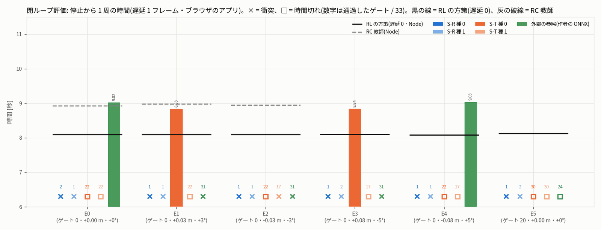
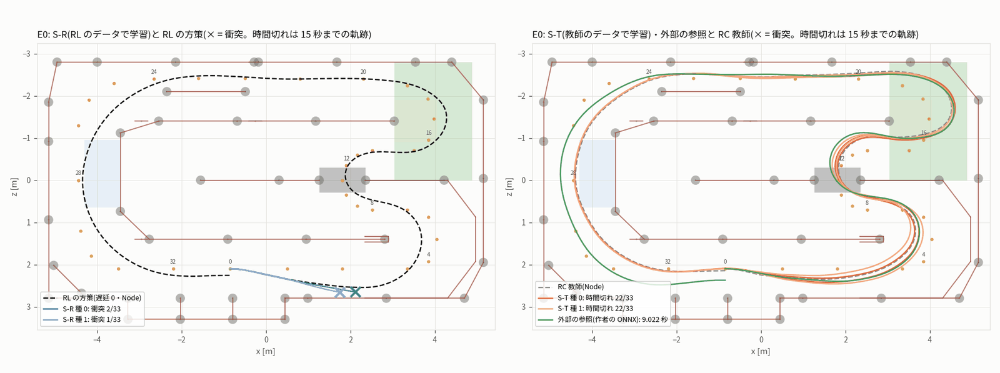
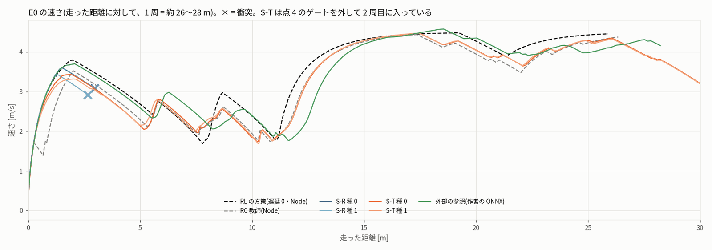
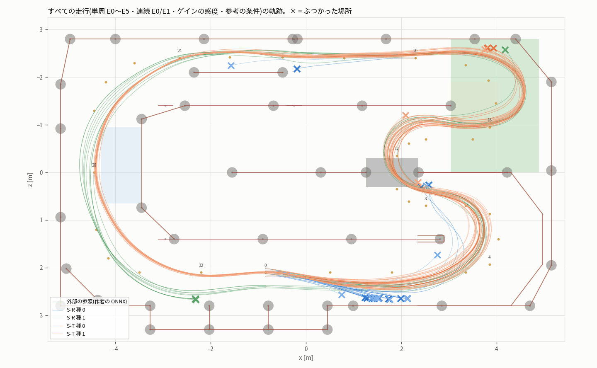
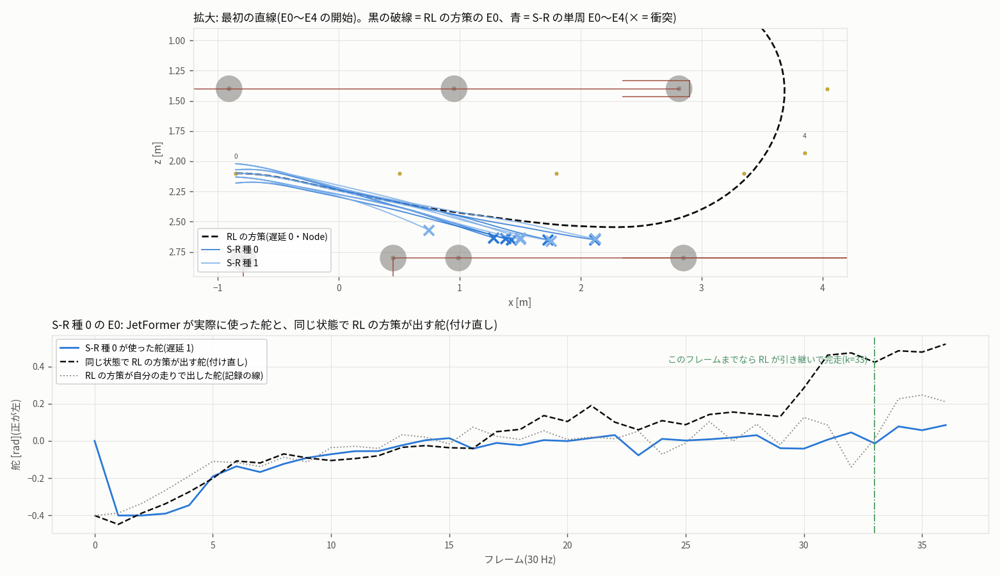

# 閉ループ評価の結果(sim_rl_bestlap_20261013、段 E)

- 作成 2026-10-14T11:12:34。手順は protocol.json(sha256 `1f249211…b8b6`、記録した値 `1f249211…` と一致)の closed_loop_eval・acceptance_H2 のとおり。基準は変えていない。
- 場所: ブラウザ(Firefox 157、DISPLAY :0、WebGL 2 = Mesa llvmpipe)のアプリ(コピーした dist/index.html、元とバイト単位で同じ)の連続試験。ブリッジはユーザーの bridge.py(コピー、元と同じ)を専用の venv(onnxruntime 1.31.0、CPU)で 127.0.0.1:8792
- 設定: 制御遅延 1 フレーム・先読み 1・舵ゲイン 1.0・前進ゲイン 1.0(外部の参照は 1.01)・ジャンル 8(外部の参照は 4)・単周の上限 15 秒・物理とセンサーは記録の 60 条件(REC60)と同じ(RC 応答の物理・measured-height-approx)。
- 物語の本文は README.md。この文書は表と判定だけ。数字はすべて `evaluation.json` から作った(`eval/render_md.py`)。

## 1. 判定(H2: JetFormer が RL のベストラップを学んだか)

**判定: できなかった**

| 基準(protocol.json acceptance_H2) | 値 | 合否 |
|---|---|:-:|
| (a) S-R の種 0・1 がどちらも E0 を完走しユーザーの確認器が PASS、かつ 12 回のうち 9 回以上完走 | E0 の両方: いいえ・完走 0/12 | × |
| (b) S-R の完走した回の T(S-R, e)/T_RL(e) の中央値 ≤ 1.05 | 完走した回が無い | × |
| (c) S-R と S-T の両方が完走した組で T(S-T) − T(S-R) の中央値 > Δ(組が 3 未満なら予備の基準) | 組 0(3 未満)→ 予備の基準: S-R の E0 —, — 対 外部の参照の E0 9.022 − 0.10 秒 | × |

## 2. 停止から 1 周(単周・E0〜E5)

| モデル | E0(ゲート 0・+0.00 m・+0°) | E1(ゲート 0・+0.03 m・+3°) | E2(ゲート 0・-0.03 m・-3°) | E3(ゲート 0・+0.08 m・-5°) | E4(ゲート 0・-0.08 m・+5°) | E5(ゲート 20・+0.00 m・+0°) |
|---|---|---|---|---|---|---|
| S-R 種 0 | × 衝突 2/33・1.22 秒・curtain | × 衝突 1/33・1.00 秒・rail | × 衝突 1/33・1.01 秒・rail | × 衝突 1/33・1.11 秒・rail | × 衝突 1/33・1.08 秒・rail | × 衝突 1/33・1.02 秒・post-foot |
| S-R 種 1 | × 衝突 1/33・1.14 秒・rail | × 衝突 1/33・1.05 秒・rail | × 衝突 1/33・0.87 秒・post-foot | × 衝突 2/33・1.23 秒・curtain | × 衝突 1/33・1.10 秒・rail | × 衝突 2/33・1.35 秒・rail |
| S-T 種 0 | × 時間切れ 22/33・15.00 秒・点 4 のゲートを外した(2.4 cm 外) | **8.830** | × 時間切れ 22/33・15.00 秒・点 4 のゲートを外した(1.9 cm 外) | **8.840** | × 時間切れ 22/33・15.00 秒・点 4 のゲートを外した(4.1 cm 外) | × 時間切れ 30/33・15.00 秒・点 18 のゲートを外した(4.4 cm 外) |
| S-T 種 1 | × 時間切れ 22/33・15.00 秒・点 4 のゲートを外した(33.4 cm 外) | × 時間切れ 22/33・15.00 秒・点 4 のゲートを外した(16.9 cm 外) | × 衝突 17/33・13.79 秒・post-foot | × 時間切れ 17/33・15.00 秒・点 4 のゲートを外した(2.7 cm 外) | × 時間切れ 17/33・15.00 秒・点 4 のゲートを外した(28.9 cm 外) | × 時間切れ 30/33・15.00 秒・点 18 のゲートを外した(0.9 cm 外) |
| 外部の参照(作者の ONNX) | **9.022** | × 衝突 31/33・8.62 秒・post-foot | × 衝突 31/33・8.66 秒・post-foot | × 衝突 31/33・8.62 秒・post-foot | **9.033** | × 時間切れ 24/33・15.00 秒・点 4 のゲートを外した(0.6 cm 外) |
| RL の方策(遅延 0・Node・元のコア) | 8.092 | 8.092 | 8.090 | 8.104 | 8.085 | 8.131 |
| RC 教師(遅延 0・Node。E0〜E2 だけが教師の約束の範囲) | 8.931 | 8.982 | 8.953 | — | — | — |

- 単位は秒。× は完走しなかった回(終わり方・通過したゲート / 33・終わった時刻)。「点 n」は元の経路の点の番号。
- 参考: RL の方策の遅延 1 の E0 は 8.397 秒、RC 教師の遅延 1 は 衝突(ゲート 16 のあと)。外部の参照の作者の記録(作者の環境のブラウザ)は 8.964 秒。

## 3. フライングラップ(連続周回 20 秒、E0・E1)

| モデル | E0: 終わり方 / 1 周目 / 2 周目 | E1: 終わり方 / 1 周目 / 2 周目 |
|---|---|---|
| S-R 種 0 | 衝突(1.22 秒・ゲート 2) / なし | 衝突(1.00 秒・ゲート 1) / なし |
| S-R 種 1 | 衝突(1.14 秒・ゲート 1) / なし | 衝突(1.05 秒・ゲート 1) / なし |
| S-T 種 0 | 20 秒(20.00 秒・ゲート 45) / 17.254(無効) | 衝突(13.70 秒・ゲート 50) / 8.829 |
| S-T 種 1 | 20 秒(20.00 秒・ゲート 44) / 17.290(無効) | 20 秒(20.00 秒・ゲート 44) / 17.393(無効) |
| 外部の参照(作者の ONNX) | 20 秒(20.00 秒・ゲート 77) / 9.021 / 8.494 | 衝突(8.62 秒・ゲート 31) / なし |
| RL の方策(遅延 0) | 20 秒 / 8.091 / 7.656 | 20 秒 / 8.092 / 7.666 |
| RC 教師(遅延 0) | 20 秒 / 8.758 / 8.370 | 20 秒 / 8.738 / 8.367 |

- 「(無効)」は sim は周として数えたが、自前の数え直しで 33 ゲート・黒シートの有効な横断ちょうど 1 回・衝突 0 のどれかを満たさなかった周(ベストラップの定義に合わない)。

## 4. 参考(合否に使わない)

- **決定性**: S-R 種 0 の E0 を 2 回: 衝突・37 フレーム と 衝突・37 フレーム、軌跡の差の最大 0.0。同じだったので、3 回の中央値は使っていない。
- **ゲインの感度**(S-R 種 0 の E0): protocol: 衝突(ゲート 2)、steer0.95: 衝突(ゲート 2)、steer1.05: 衝突(ゲート 2)、thr1.01: 衝突(ゲート 1)
- **事後に足した参考の条件**(E0 の単周。結果を見てから決めた。deviations.md):

| 走行 | 遅延 | 先読み | 舵 / 前進ゲイン | 終わり方(時刻・場所) | 停止から 1 周 | ゲート | ユーザーの確認器 |
|---|---:|---:|---|---|---:|---:|---|
| EXT-E0-single-x-d0 | 0 | 1 | 1 / 1.01 | 衝突(4.69 秒・rail(x 4.18, z -2.57)) | — | 3 | — |
| SR-s0-E0-single-x-d0 | 0 | 1 | 1 / 1 | 衝突(0.96 秒・rail(x 1.24, z 2.63)) | — | 1 | — |
| SR-s0-E0-single-x-la2 | 1 | 2 | 1 / 1 | 衝突(3.40 秒・curtain(x 2.57, z 0.26)) | — | 2 | FAIL |
| SR-s0-E0-single-x-thr0.8 | 1 | 1 | 1 / 0.8 | 衝突(1.23 秒・rail(x 1.73, z 2.65)) | — | 1 | FAIL |
| SR-s0-E0-single-x-thr0.9 | 1 | 1 | 1 / 0.9 | 衝突(1.05 秒・rail(x 1.38, z 2.64)) | — | 1 | FAIL |
| SR-s1-E0-single-x-d0 | 0 | 1 | 1 / 1 | 衝突(3.16 秒・curtain(x 2.52, z 0.27)) | — | 2 | — |
| SR-s1-E0-single-x-la2 | 1 | 2 | 1 / 1 | 衝突(1.75 秒・curtain(x 2.75, z 1.73)) | — | 2 | FAIL |
| SR-s1-E0-single-x-thr0.8 | 1 | 1 | 1 / 0.8 | 衝突(1.14 秒・rail(x 1.44, z 2.64)) | — | 1 | FAIL |
| SR-s1-E0-single-x-thr0.9 | 1 | 1 | 1 / 0.9 | 衝突(1.06 秒・rail(x 1.37, z 2.64)) | — | 1 | FAIL |
| ST-s0-E0-single-x-d0 | 0 | 1 | 1 / 1 | 衝突(4.90 秒・rail(x 3.93, z -2.61)) | — | 3 | — |
| ST-s0-E0-single-x-la2 | 1 | 2 | 1 / 1 | 衝突(4.97 秒・post-foot(x 3.80, z -2.61)) | — | 3 | FAIL |
| ST-s0-E0-single-x-thr1.01 | 1 | 1 | 1 / 1.01 | 完走(8.80 秒) | 8.802 | 33 | FAIL |
| ST-s1-E0-single-x-d0 | 0 | 1 | 1 / 1 | 衝突(3.29 秒・rail(x 2.09, z -1.21)) | — | 2 | — |
| ST-s1-E0-single-x-la2 | 1 | 2 | 1 / 1 | 衝突(2.56 秒・post-foot(x 2.35, z 0.21)) | — | 2 | FAIL |
| ST-s1-E0-single-x-thr1.01 | 1 | 1 | 1 / 1.01 | 時間切れ(15.00 秒・点 4 のゲートを外した) | — | 17 | FAIL |

- **外部の参照との差**: 学習したモデルと外部の参照の両方が完走した開始は無かった(差は計算できない)。

- **オフライン L1**(学習の段の `train/offline_l1.json`。全フレーム 7,080・間引きなし・PyTorch FP32。単位 µs):

| モデル | RL の val: 舵 1 フレーム先 / スロットル 1 フレーム先 / 10 ステップの平均 | 教師の val: 舵 / スロットル / 10 ステップの平均 |
|---|---|---|
| S-R/s0 | 29.6 / 7.7 / 19.6 | 98.4 / 91.1 / 96.2 |
| S-R/s1 | 29.8 / 8.4 / 19.7 | 102.1 / 94.7 / 97.4 |
| S-T/s0 | 106.2 / 90.8 / 102.9 | 4.1 / 4.3 / 4.7 |
| S-T/s1 | 107.6 / 93.0 / 104.2 | 4.1 / 4.8 / 4.7 |

- **引き継ぎの診断**(`eval/takeover.json`。ブラウザの走行の操作を Node の元のコアで再生し、フレーム k(3 フレームおき)から先を RL の方策(遅延 0・正解の状態)に任せて単周を完走できるか。付け直し = 同じ状態で RL の方策が出す舵と、JetFormer が実際に使った舵の差):

| 走行 | ブラウザの終わり方 | フレーム数 | RL が引き継いで完走できた最後の k | RL が引き継いでも完走できなかった最初の k | 付け直しの舵の差の平均(全体 / 最初の 20 フレーム)[rad] |
|---|---|---:|---:|---:|---|
| SR-s0-E0-single-rep2 | 衝突 | 37 | 33 | 36 | 0.144 / 0.060 |
| SR-s0-E0-single-x-d0 | 衝突 | 29 | 24 | 27 | 0.215 / 0.091 |
| SR-s0-E0-single-x-la2 | 衝突 | 103 | 42 | 45 | 0.400 / 0.090 |
| SR-s0-E0-single | 衝突 | 37 | 33 | 36 | 0.144 / 0.060 |
| SR-s0-E1-single | 衝突 | 31 | 21 | 24 | 0.243 / 0.130 |
| SR-s0-E2-single | 衝突 | 31 | 24 | 27 | 0.197 / 0.069 |
| SR-s0-E3-single | 衝突 | 34 | 30 | 33 | 0.173 / 0.052 |
| SR-s0-E4-single | 衝突 | 33 | 27 | 30 | 0.191 / 0.106 |
| SR-s0-E5-single | 衝突 | 31 | 24 | 27 | 0.240 / 0.196 |
| SR-s1-E0-single-x-d0 | 衝突 | 95 | 45 | 42 | 0.500 / 0.098 |
| SR-s1-E0-single-x-la2 | 衝突 | 53 | 42 | 45 | 0.415 / 0.106 |
| SR-s1-E0-single | 衝突 | 35 | 30 | 33 | 0.171 / 0.057 |
| SR-s1-E1-single | 衝突 | 32 | 27 | 30 | 0.197 / 0.061 |
| SR-s1-E2-single | 衝突 | 26 | 21 | 24 | 0.215 / 0.123 |
| SR-s1-E3-single | 衝突 | 37 | 33 | 36 | 0.144 / 0.062 |
| SR-s1-E4-single | 衝突 | 33 | 27 | 30 | 0.176 / 0.058 |
| SR-s1-E5-single | 衝突 | 41 | 33 | 36 | 0.176 / 0.121 |
| ST-s0-E0-single-x-d0 | 衝突 | 148 | 42 | 39 | 0.221 / 0.185 |
| ST-s0-E0-single-x-la2 | 衝突 | 149 | 42 | 45 | 0.222 / 0.207 |
| ST-s0-E0-single | 時間切れ | 450 | 42 | 45 | 0.236 / 0.188 |
| ST-s0-E1-single | 完走 | 265 | 264 | 45 | 0.146 / 0.163 |
| ST-s0-E2-single | 時間切れ | 450 | 42 | 45 | 0.238 / 0.227 |
| ST-s0-E3-single | 完走 | 266 | 265 | 45 | 0.148 / 0.194 |
| ST-s0-E4-single | 時間切れ | 450 | 42 | 45 | 0.233 / 0.156 |
| ST-s0-E5-single | 時間切れ | 450 | 234 | 159 | 0.221 / 0.081 |
| ST-s1-E0-single-x-d0 | 衝突 | 99 | 42 | 45 | 0.268 / 0.229 |
| ST-s1-E0-single-x-la2 | 衝突 | 77 | 42 | 45 | 0.333 / 0.243 |
| ST-s1-E0-single | 時間切れ | 450 | 42 | 45 | 0.253 / 0.223 |
| ST-s1-E1-single | 時間切れ | 450 | 42 | 45 | 0.246 / 0.184 |
| ST-s1-E2-single | 衝突 | 414 | 39 | 42 | 0.252 / 0.255 |
| ST-s1-E3-single | 時間切れ | 450 | 42 | 45 | 0.272 / 0.225 |
| ST-s1-E4-single | 時間切れ | 450 | 42 | 45 | 0.273 / 0.188 |
| ST-s1-E5-single | 時間切れ | 450 | 240 | 159 | 0.225 / 0.059 |
| EXT-E0-single-x-d0 | 衝突 | 141 | 48 | 51 | 0.183 / 0.147 |
| EXT-E0-single | 完走 | 271 | 270 | 63 | 0.173 / 0.133 |
| EXT-E1-single | 衝突 | 259 | 246 | 249 | 0.168 / 0.137 |
| EXT-E2-single | 衝突 | 260 | 249 | 45 | 0.184 / 0.154 |
| EXT-E3-single | 衝突 | 259 | 246 | 249 | 0.161 / 0.140 |
| EXT-E4-single | 完走 | 271 | 270 | 63 | 0.171 / 0.106 |
| EXT-E5-single | 時間切れ | 450 | 141 | 144 | 0.259 / 0.068 |

## 5. 確かめたこと

- 全 59 走行で、記録した操作を元の sim-core.js で再生すると軌跡・集計が一致し、自前の積分とゲート・黒シート・衝突の数え直しも一致した(記録の正しさ 59/59)。設定(モデルの sha256・遅延・先読み・ゲイン・開始)が計画と違う走行: 0。
- ユーザーの `qa/verify-learned-lap.mjs <結果> --model <ONNX>`(E0 の単周): EXT-E0-single: PASS、SR-s0-E0-single: FAIL(Episode did not terminate with successful route_complete)、SR-s0-E0-single-rep2: FAIL(Episode did not terminate with successful route_complete)、SR-s0-E0-single-steer0.95: FAIL(Episode did not terminate with successful route_complete)、SR-s0-E0-single-steer1.05: FAIL(Episode did not terminate with successful route_complete)、SR-s0-E0-single-thr1.01: FAIL(Episode did not terminate with successful route_complete)、SR-s0-E0-single-x-la2: FAIL(Episode did not terminate with successful route_complete)、SR-s0-E0-single-x-thr0.8: FAIL(Episode did not terminate with successful route_complete)、SR-s0-E0-single-x-thr0.9: FAIL(Episode did not terminate with successful route_complete)、SR-s1-E0-single: FAIL(Episode did not terminate with successful route_complete)、SR-s1-E0-single-x-la2: FAIL(Episode did not terminate with successful route_complete)、SR-s1-E0-single-x-thr0.8: FAIL(Episode did not terminate with successful route_complete)、SR-s1-E0-single-x-thr0.9: FAIL(Episode did not terminate with successful route_complete)、ST-s0-E0-single: FAIL(Episode did not terminate with successful route_complete)、ST-s0-E0-single-x-la2: FAIL(Episode did not terminate with successful route_complete)、ST-s0-E0-single-x-thr1.01: FAIL(sensor_contract.calibration.throttle_gain: numeric replay/re)、ST-s1-E0-single: FAIL(Episode did not terminate with successful route_complete)、ST-s1-E0-single-x-la2: FAIL(Episode did not terminate with successful route_complete)、ST-s1-E0-single-x-thr1.01: FAIL(Episode did not terminate with successful route_complete)

### 5.1 確認の段(review.md)で数え直したこと

- Python の自前の積分・判定(`review/independent_lap_check.py`。JS のコードを使わない)で、閉ループの 59 走行すべてが sim の集計と一致(59/59、軌跡の差の最大 5.8e-13)。数えた周 11 のうち、ベストラップの定義に合う周 8(合わない 3 周は 17 秒台の周で、黒シートの横断が 2 回)。RL・教師の記録 18 本も一致(18/18)。
- ランダムな 2 つの開始(種 2713733778): P1 = ゲート 0・+0.020 m・-2.92°、P2 = ゲート 6・-0.046 m・+7.00°。選んだ RL の方策を元の sim-core.js で走らせ、自前の判定で数え直した:
  - P1-single: 8.082 秒、ベストラップの定義に合う 1/1、最小すき間 7.3 cm、sim と一致 ○
  - P1-continuous: 8.081 / 7.810 秒、ベストラップの定義に合う 2/2、最小すき間 6.2 cm、sim と一致 ○
  - P2-single: 7.940 秒、ベストラップの定義に合う 1/1、最小すき間 5.3 cm、sim と一致 ○
  - P2-continuous: 7.939 / 7.789 秒、ベストラップの定義に合う 2/2、最小すき間 5.3 cm、sim と一致 ○
  - ユーザーの確認器の周の項目(完走・衝突・ゲート・黒シート・再生): sanity-E0-single.json: 合格、P1-single.json: 合格、P2-single.json: 合格
- データセットのランダムな 2 シーン(種 2708978707): 20261013-170034-0b52d979-0001: 8.086 / 7.715 秒(有効 2/2)、20261013-173553-eb300e81-0001: 8.107 / 7.847 秒(有効 2/2)

### 5.2 失敗の形の数字(README 5.3 節。`review/derived_numbers.json`)

- 最初の直線(開始から車の x が初めて 2.6 m を超えるまで。車体の長方形と障害物の最小距離)でいちばん近い障害物: RL の E0 = segment-43(curtain)まで 10.4 cm、教師の E0 = disk-26(post-foot)まで 29.0 cm。S-R がぶつかったレール segment-11 までは RL 13.9 cm・教師 34.1 cm。
- 周全体の最小すき間(標準の単周): RL 7.1 cm・教師 6.7 cm。
- S-R(E0〜E4 の 10 本)の RL の線からのずれ: ぶつかった時点で 10〜18 cm(E0 の RL の線から)・11〜19 cm(同じ開始の RL の走りから)。0.5 秒の時点で 0.1〜2.8 cm(同じ開始の RL から)。
- 点 4 のゲートを通った横の位置(半幅 0.65 m。副ステップで計算): teacher_E0 0.628 m、ST-s0-E1 0.644 m、ST-s0-E3 0.585 m、EXT-E0 0.450 m、RL_E0 0.512 m
- S-R 種 0 の E0、フレーム 15〜26: 同じ状態で RL の方策が出す舵 − JetFormer が使った舵 = -0.05〜+0.17 rad。S-R の 12 本のぶつかった相手: curtain 2・rail 8・post-foot 2

## 6. 図

## 7. ファイル

- 1 走行ずつの全記録(sim.report() + world + context + 毎フレームの推論): `eval/closed_loop/<モデル>/<走行>.json`、軌跡: 同じ名前の `.trajectory.csv`
- 1 走行ずつの確認と要約: `eval/closed_loop/runs_verified.json`、表: `eval/runs.csv`、ユーザーの確認器の出力: `eval/closed_loop/user_verifier/`
- 判定: `evaluation.json`(`acceptance_H2`)・`eval/verdict.json`、一式の sha256: `eval/bundles/bundles.json`、ブラウザの実行の記録: `eval/closed_loop/session_*.json`
- 画面: `screens/eval_*.png`(窓・車載カメラ・ToF)
