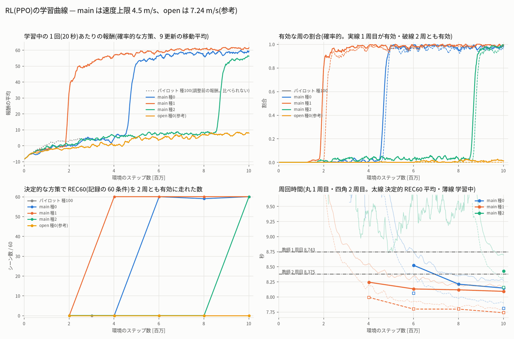
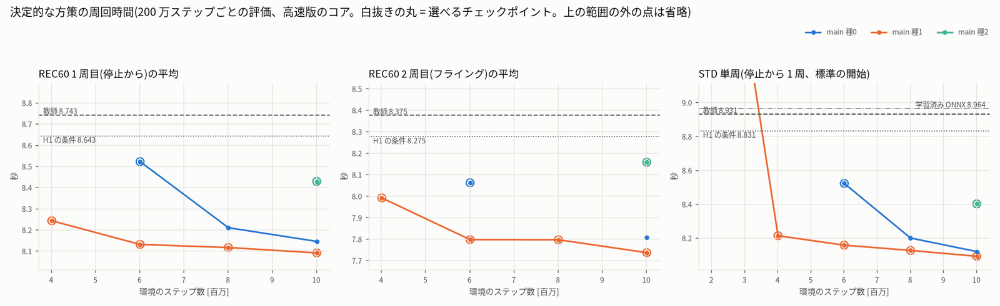
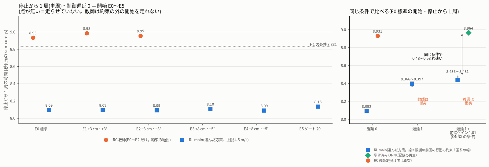
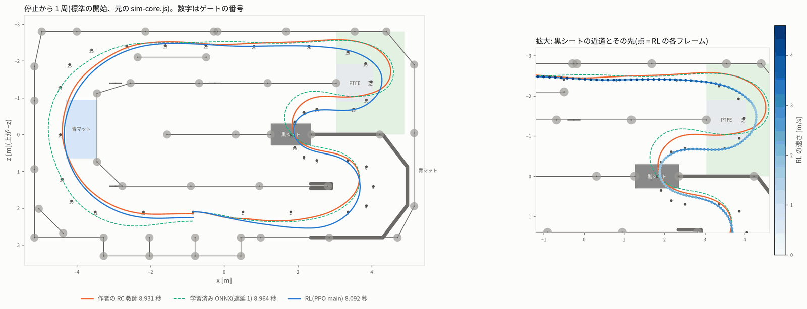
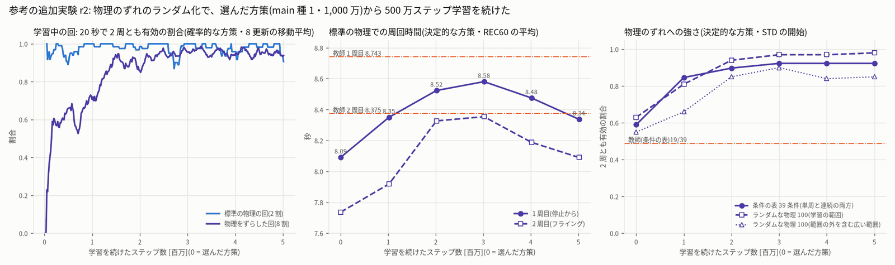
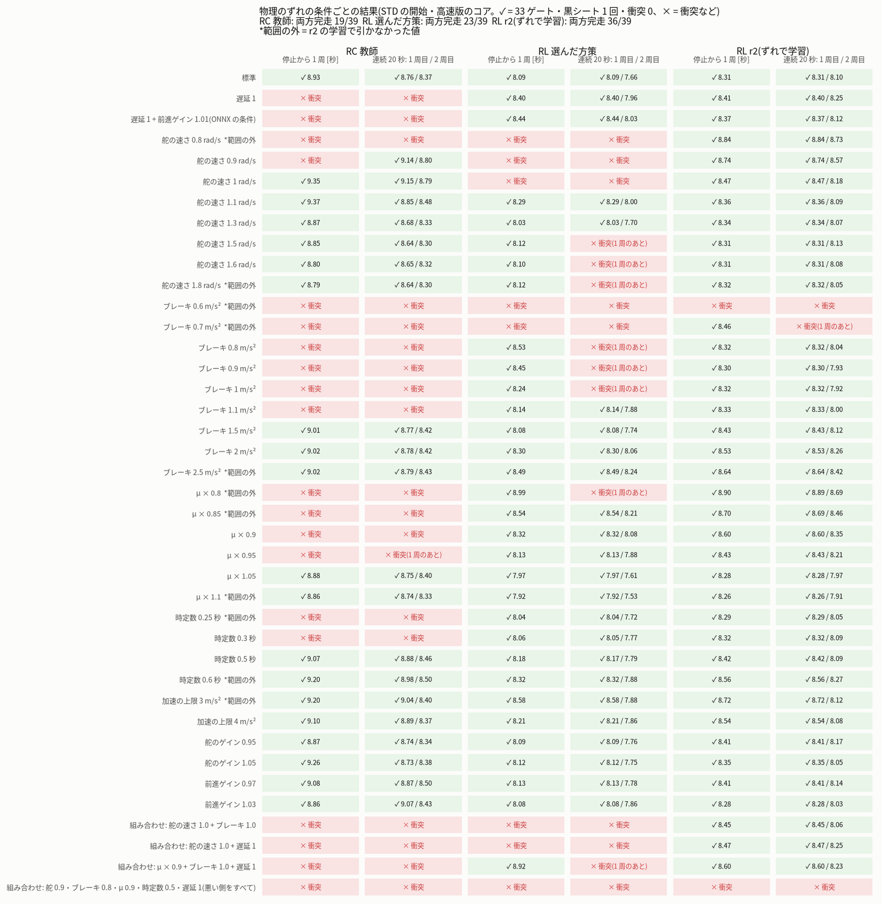
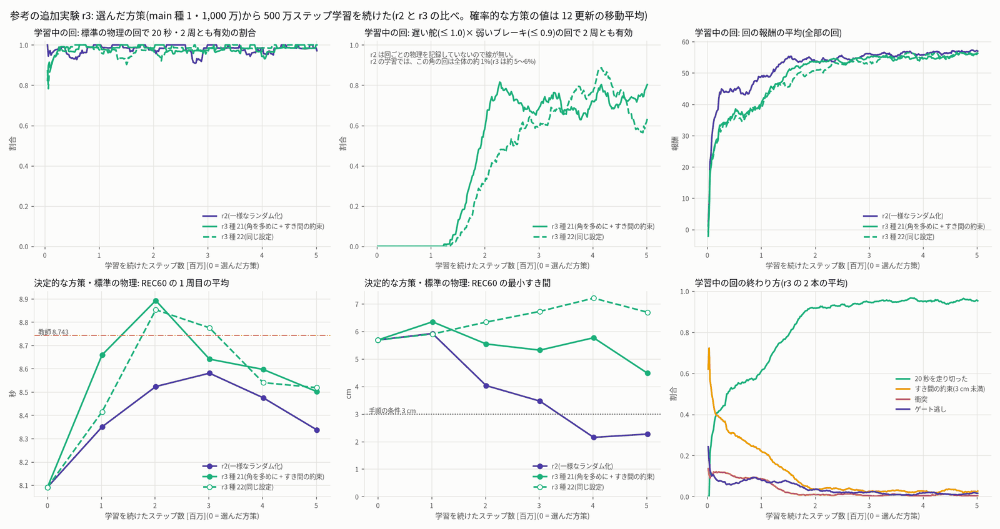
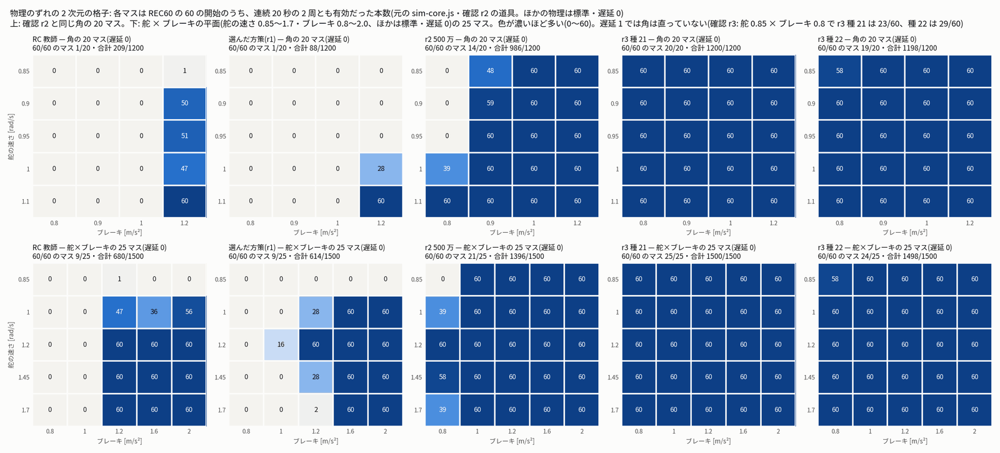
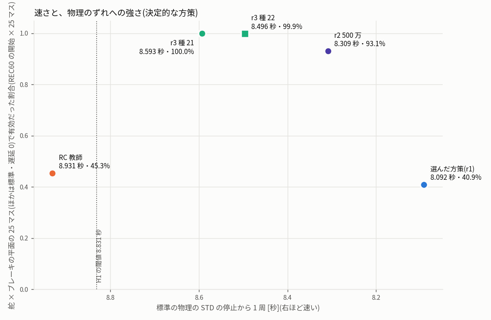
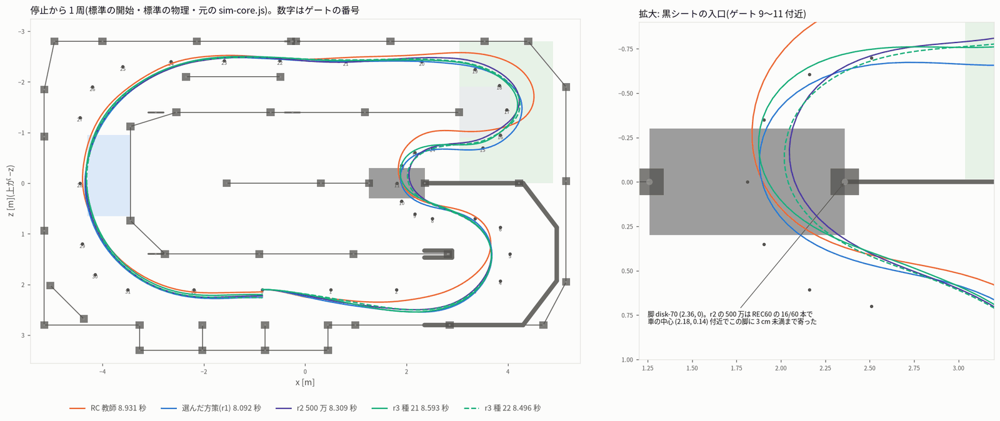

# RL(PPO)のベストラップ — 学習と選定(sim_rl_bestlap_20261013、段 B)

- 作成 2026-10-13(この段は 18:25〜)。手順は design.md 2.7〜3.6 節・protocol.json(sha256 `1f249211…b8b6`、変えていない)のとおり。
  手順と違うことは `deviations.md` に書いた(パイロットのあとの 1 回の調整など。7 章)。
- 16:08 と 17:57 の再起動で前の試みが 2 回止まった。2 回目はパイロット(300 万ステップ)が終わった直後だったので、
  パイロットの結果を読んで続きから始めた(パイロットのやり直しはしていない)。
- 実車・PCA9685・I2C・GPU・Firefox は使っていない。RL はすべて CPU で、`jf-heavy --mem 2G --lock rl` の下で 1 本ずつ動かした。
  `jetformer/web`・`jetformer/sim*`・`data/sim*`・ユーザーのシミュレーターは変えていない。git にはコミットしていない。
- コード: `/home/jetson/jetformer/experiments/20261013_sim_rl_bestlap/rl/`。出力: このフォルダーの `rl/`・`fig/`。
- **r2 の改訂(21:10〜)**: 独立な確認 r1(`rl_check_r1.md`)は「RL の周は本物(valid = true)」としたうえで、学習済み ONNX との比べ方の
  直しを求めた(must-fix)。この版で直した点と、r1 のほかの指摘への対応は **10 章**にまとめた。
  - ONNX の 8.964 秒は「制御遅延 1 フレーム・前進ゲイン 1.01」の条件の値。同じ条件の RL を測り直した。差は 0.872 秒ではなく **0.48〜0.60 秒**。
  - あわせて、ユーザーの質問「今後、速く・ぶつからないようにするには、どういうアップデートが有望か」に答えるため、手順の外の参考の追加実験を 1 本行った
    (物理のずれのランダム化、11 章)。答えは **12 章**。選んだ方策・H1 の判定・記録の段の予定は変えていない。
  - r2 で使ったのも CPU だけ(`jf-heavy --lock rl`)。GPU・Firefox・実車は使っていない。起動したプロセスはすべて終わっている。
- **r3 の改訂(22:40〜)**: 独立な確認 r2(`rl_check_r2.md`)は「選んだ方策のベストラップは本物(valid = true)。r1 の must-fix の直しも正しい」としたうえで、
  r2 の追加実験の書き方に must-fix を 1 つ出した: **学習の範囲の「角」(遅い舵 × 弱いブレーキ)の失敗を書いていない**。直し方は **13 章**にまとめた。
  - 1 章の要約・11 章(結果の表と読み取れること)・12 章の 1 に、角の失敗を数字で書いた。言い過ぎだった 2 つの文
    (「残った失敗は範囲の外のブレーキ 0.6・0.7 と全部重ねた組み合わせだけ」「舵の速さ 0.8〜1.8・ブレーキ 0.8〜2.5 で完走」)は「1 つずつ動かしたときだけの話」と直した。
  - ほかの指摘(3 cm 未満が 16/60 本・100 万の弱さ・フライングの差 0.27 秒・ONNX との比べの書き方・「前もって決めた」の時刻)も直した。
  - ユーザーの質問に答えるため、12 章でいちばん有望とした更新(角を多めに引くランダム化 + すき間の約束)を実際に試した(参考の追加実験 r3、**14 章**)。
    今回は学習を始める前に、手順・評価・判定を deviations.md(22:40)に書いた。選んだ方策・H1 の判定・記録の予定は変えていない。
  - **r3 の結果**: 種 2 本とも、**遅延 0 の**角(r2 で 0/60)を 58〜60/60 に、REC60 の最小すき間を 4.49・6.70 cm に戻した。
    ただし制御遅延 1 フレーム(アプリの固定遅延・学習の範囲の中)の角は直っていない(確認 r3。下の「確認 r3 の must-fix」)。代わりに停止から 1 周は 8.593・8.496 秒で、
    r2(8.309)より遅いが教師(8.931)より速い。事前登録の判定は(遅延 0 で測った角について)「有望(種によらない)」。答えは **12 章**(更新した)。
- **確認 r3 の must-fix の直し(2026-10-14 の報告の段で直した)**: 独立な確認 r3(`rl_check_r3.md`)は、選んだ方策と r3 の 2 本の周を本物(valid = true)としたうえで、
  2 か所の言い過ぎを指摘した。この版では次のように直した(数字は `rl_check_r3/` の JSON)。
  1. 「角は直った」は **遅延 0 のときだけ**。遅延 1 では、舵 0.85 × ブレーキ 0.8 で REC60 の開始 23/60・29/60(種 21 は STD 単周も衝突)、種 22 は舵 0.9 × ブレーキ 0.8 でも 49/60。事前登録の判定(20 マスすべてで ≥ 57/60)を遅延 1 に当てると 2 本とも満たさない。ONNX の条件(遅延 1 + 前進ゲイン 1.01)では 7/60・20/60。学習の範囲の箱の角でも、遅い舵 + 弱いブレーキ + 遅延 1 の 8 角はすべて 0〜10/20。
     「範囲の端をすべて重ねた組み合わせ」(REC60 19/60・14/60)は、遅延 0 にすると 2 本とも 60/60 で、原因は遅延 1。3 つ(遅い舵・弱いブレーキ・遅延 1)がそろえば落ち、学習では約 5% の回にあたる。
  2. 摩擦円の反事実は、やり方しだいで種 21 の結果が逆になる(14 章)。
  - 「1(角を多めに引く)と 2(すき間の約束)は試して効いた」は「一緒に入れて効いた(どちらが効いたかは分からない)」が正確。開始 × 物理の新しい種 515152 には角が 1 本も無いので、その 60/60 は角の強さの証拠にならない。
  - 「学習の範囲全体の 25 マス」は、舵 × ブレーキの平面(ほかは標準・遅延 0)の 25 マス。表と図(`fig/rl_r3_corner.png`・`fig/rl_r3_tradeoff.png`、作り直した)の名前を直した。
  - r3 で使ったのも CPU だけ(`jf-heavy --lock rl`)。GPU・Firefox・実車は使っていない。起動したプロセスはすべて終わっている。

## 1. 結果のまとめ

**H1(RL が教師のベストラップを超える)は成立した。** 選んだ方策は `main` 種 1 の 1,000 万ステップ目で、値は元の `sim-core.js` で測った。

| 物差し(元の sim-core.js) | RL main(選んだ方策) | RC 教師 | 学習済み ONNX | H1 の条件 |
|---|---:|---:|---:|---|
| 停止から 1 周(STD・単周)・**遅延 0** | **8.092 秒** | 8.931 | —(この条件の記録は無い) | ≤ 8.831 ○ |
| 停止から 1 周・**遅延 1 フレーム**(参考) | 8.366〜8.397(注 1) | 衝突(ゲート 16 のあと) | — | (参考) |
| 停止から 1 周・**遅延 1 + 前進ゲイン 1.01**(学習済み ONNX の記録の条件。参考) | **8.436〜8.481**(注 1) | 衝突(ゲート 10 のあと) | **8.964** | (参考) |
| フライングラップ(STD・連続の 2 周目) | **7.656 秒** | 8.370 | — | (参考) |
| REC60 の 1 周目の平均(60 条件) | **8.091 秒**(8.040〜8.119) | 8.743(8.710〜8.758) | — | ≤ 8.643 ○ |
| REC60 の 2 周目の平均(60 条件) | **7.737 秒**(7.640〜7.853) | 8.375(8.359〜8.407) | — | ≤ 8.275 ○ |
| 選べるチェックポイントがあり、単周が 8.931 秒より速い種 | **3 本とも**(8.522・8.092・8.401 秒) | — | — | 2 本以上 ○ |

注 1: 遅延 1 では、観測の「前回の行動」に何を入れるかで値が変わる(幅はこの 2 通り。`rl/r2/same_condition_vs_onnx.json`)。
- 「実際に適用した 1 フレーム前の指令」(RL の段の評価の約束): 遅延 1 は 8.397 秒、遅延 1 + ゲイン 1.01 は 8.436 秒。
- 「方策が今出した値」(確認 r1 の約束): 遅延 1 は 8.366 秒、遅延 1 + ゲイン 1.01 は 8.481 秒。

- 停止から 1 周は、同じ遅延 0 の教師より **0.839 秒(9.4%)速い**。
- **学習済み ONNX(8.964 秒)は「遅延 1 フレーム・前進ゲイン 1.01」の条件の値**。同じ条件の RL は 8.436〜8.481 秒で、**同じ条件で 0.48〜0.53 秒速い**
  (遅延 1 だけの 8.366〜8.397 秒と比べると 0.57〜0.60 秒。合わせて **0.48〜0.60 秒**)。前の版の「ONNX より 0.872 秒速い」は、遅延 0 の RL と
  遅延 1・ゲイン 1.01 の ONNX を並べた誤りだった(確認 r1 の must-fix。10 章)。RL が速いという結論は変わらない。
- REC60 の 60/60・ROB24 の 24/24 で、2 周とも有効(33 ゲート・黒シートの有効な横断が各周 1 回・衝突 0)。REC60 の最小すき間は 5.7 cm(教師は 3.2 cm)。
  ただし、これは**開始の姿勢**に対する強さ(REC60 の noise の 30 条件は RL の観測に効かないので、REC60 は実質「開始 ±3 cm・±3° の 60 条件」。10 章)。
  **物理のずれ**(舵の速さ・ブレーキなど)には弱いところがある(10 章・11 章)。
- 閉ループの開始 E0〜E5(教師の約束の外の E3〜E5 を含む)はすべて完走し、8.085〜8.131 秒。
  **制御遅延 1 フレーム**(アプリの固定遅延)でも STD の停止から 1 周を完走する(8.366〜8.397 秒)。教師は遅延 1 でゲート 16 のあと衝突する。
  ただし遅延 1 の REC60 は 2 周とも有効が **56/60**(RL の段の約束)・59/60(確認 r1 の約束)で、60/60 ではない(10 章)。
- 高速版のコアと元のコアの結果は、REC60・STD・ROB24 のすべての周で **差 0**。独立な確認器(自前の積分とゲート・黒シート・衝突の数え直し)も
  全周で合格。JS の方策と PyTorch の行動の差は 1 万状態で最大 9.9e-7(基準 1e-4)。
- **注意(手順の印): 教師より荒い。** 舵の指令が端(±0.494 rad 以上)にある時間が 20.5%(教師 5.6%)、舵の指令の変化の速さの 95% 点が 4.95 rad/s
  (教師 1.75)。速さの指令も 4.5 m/s と 0 の 2 値が約 7 割(STD の連続 20 秒。0 はブレーキの代わり)。横加速度の 95% 点は 7.87 m/s²(教師 7.64、+3%)。
  記録して JetFormer に学ばせるときに、ラベルがぎざぎざになる(6 章)。
- パイロットで **報酬の抜け道(射影の飛び)** が見つかり、手順で許された 1 回の調整で直した(2 章)。予備策(BC での初期化)は使っていない。
- 参考の `open`(速度の上限 7.24 m/s)は、1,000 万ステップでは周を走れるようにならなかった(決定的な方策は 5 回の評価すべてで REC60 0/60、
  黒シートの入口のゲート 9〜10 の手前で止まる)。そのため「上限 4.5 m/s で何秒失っているか」は今回は測れていない(open は手順で参考だけ・記録しない)。

- **r2 の参考の追加実験(11 章)**: 物理のずれをランダムにして 500 万ステップ学習を続けた。
  - **1 つずつのずれ**には強くなった: ずれの条件表の完走は 23 → 36/39、一様に引いたランダムな物理は 63 → 98/100、遅延 1 の REC60 は 56 → 60/60。
  - **ただし、遅い舵 × 弱いブレーキの「角」は未解決**(確認 r2 が見つけた)。
    - 舵の速さ ≤ 0.95 rad/s とブレーキ 0.8 m/s² を同時に入れると(どちらも学習の範囲の中・ほかは標準・遅延 0)、REC60 の 60 の開始で **0/60**。STD の連続 20 秒でも衝突する。
    - 開始(REC60)と学習の範囲の物理を同時に引くと 56/60 で、落ちた 4 本はすべてこの角だった。
    - 一様な抽出ではこの角は約 1% しか出ない。「98/100」は、この角をほとんど試していない値。
    - この向き(サーボが遅く、ブレーキが弱い)は、実車でずれる見込みの高い向き。
  - 標準の物理では停止から 1 周 8.309 秒・フライング 8.100 秒で、選んだ方策より 0.2〜0.45 秒遅い。それでも教師より速い(停止から 1 周で 0.62 秒、フライングで 0.27 秒)。
  - 代わりに REC60 の最小すき間が 2.3 cm に減った。1 本だけでなく、60 本のうち 16 本で 3 cm 未満(黒シートの入口の脚を毎周かすめる線)。
- **r3 の参考の追加実験(14 章)**: 角・辺を多めに引くランダム化(遅い舵 × 弱いブレーキの回を 1% → 6%)と、すき間の約束(3 cm 未満で −10 で回を終える)を
  一緒に入れて、選んだ方策から 500 万ステップ学習を続けた(種 21・22 の 2 本。学習を始める前に手順と判定を deviations.md に書いた)。
  - **角は遅延 0 では直った**: 遅延 0 の角の 20 マスで REC60 の開始 1200/1200・1198/1200(r2 は 986)。舵 ≤ 0.95 × ブレーキ 0.8 は 58〜60/60(r2 は 0/60)。
    舵 × ブレーキの平面の 25 マス(ほかは標準・遅延 0)は 1500・1498/1500、開始 × 物理は 60/60(新しい種 515152 には角が無い)。
  - **遅延 1 では角は直っていない(確認 r3)**: 遅延 1 では、舵 0.85 × ブレーキ 0.8 で REC60 の開始 23/60・29/60(種 21 は STD 単周も衝突)、種 22 は舵 0.9 × ブレーキ 0.8 でも 49/60。事前登録の判定(20 マスすべてで ≥ 57/60)を遅延 1 に当てると 2 本とも満たさない。ONNX の条件(遅延 1 + 前進ゲイン 1.01)では 7/60・20/60。
    箱の角では、遅い舵 + 弱いブレーキ + 遅延 1 の 8 角がすべて 0〜10/20(遅延 0 なら 639/640・640/640)。
  - **すき間も戻った**: REC60 の最小すき間 4.49・6.70 cm(3 cm 未満の本は 0)。2 本とも手順の「選べる」条件を満たす。
  - **代わりに遅い**: 停止から 1 周 8.593・8.496 秒、フライング 8.138・8.250 秒。r2 より 0.04〜0.28 秒、選んだ方策より 0.40〜0.59 秒遅い。
    それでも教師より 0.12〜0.43 秒速い。ONNX と同じ条件(遅延 1 + 前進ゲイン 1.01)では 8.512〜8.533 秒で、ONNX(8.964 秒)より 0.43〜0.45 秒速い。
  - 事前登録の判定(角・すき間・速さ)は、遅延 0 で測った角について 2 本とも満たした →「有望(種によらない)」。同じ角の判定を遅延 1 に当てると 2 本とも満たさない。
  - 残る弱さ: 遅い舵 × 弱いブレーキ × 遅延 1 の角(上)。範囲の端をすべて重ねた組み合わせ(REC60 の開始 14〜19/60)も、遅延 0 なら 60/60 で原因は遅延 1。
    範囲の外(ブレーキ ≤ 0.7 m/s² など)、操作の荒さ(舵が端 約 10%)。
- 「今後、速く・ぶつからないために有望なアップデート」の答えは 12 章。

## 2. パイロットと 1 回の調整(deviations.md に記録)

- パイロット(種 100・301 万ステップ、本番に数えない、`rl/pilot-main-s100/`)では、決定的な方策が REC60 0/60。終わり方は全体で衝突 36%・停止 33%、終盤は停止が 6〜7 割だった。
- 原因を走りで確かめると、方策は **ゲート 3 の線を越えずにコースの内側の空き地へ出て**、衝突もゲート逃しもないまま走り、最後に止まっていた。
  進みの報酬は参照ループへの射影 s の増分で、射影は「前の s の −0.5〜+1.5 m」を探すので、コースを外れても s が前へずれ続けて報酬が入る
  (この走りで進み 7.27 m、実際のゲートの進みは 4.2 m)。ゲート逃しの終了は線を越えたときだけなので、線の手前で外れると止められない。
- 調整(本番の種を始める前に 1 回だけ、`env_core.mjs` の REWARD、`reward_version = rl-bestlap-reward-v2-gatecap`):
  1. **進みの頭打ち**: 進みは「今の目標ゲートの s + 0.75 m」までしか数えない。教師の REC60 の全フレームで s − 目標ゲートの s は最大 0.34 m なので、
     正しい走りの報酬は変わらない(試験で確認)。パイロットの抜け道の走りは進み 7.27 → 4.91 m、回の報酬 +1.73 → −5.63 になる。
  2. **停止・逆走の罰を −5 → −10**(衝突と同じ)。難所の手前で止まるほうが得、という形をなくした。
  - 観測(ブラウザと共有の `features.mjs`)・行動・ほかの係数・PPO の設定・評価・選び方は変えていない。試験は Node 10 件・pytest 12 件すべて合格。
- 予算 B: パイロットの 4,945 steps/s × 50 分 = 1,484 万 → 手順の式で **B = 1,000 万ステップ**(`rl/budget.json`)。1 本 約 30 分。

## 3. 学習(種ごと)

| run | 有効な周が初めて出た | 回の半分以上が 2 周とも有効 | 速さ | 時間 | 選べるチェックポイント | 一番良い選べるもの(REC60 1 周目・2 周目の平均、単周) |
|---|---:|---:|---:|---:|---|---|
| main 種 0 | 200 万 | 472 万 | 5,509 steps/s | 30.6 分 | 600 万だけ | 600 万: 8.522・8.062、単周 8.522 |
| main 種 1 | 128 万 | 206 万 | 5,298 | 31.8 分 | 400・600・800・1,000 万 | **1,000 万: 8.091・7.737、単周 8.092(選んだ方策)** |
| main 種 2 | 170 万 | 872 万 | 5,737 | 29.4 分 | 1,000 万だけ | 1,000 万: 8.428・8.157、単周 8.401 |
| open 種 0(参考) | 447 万 | — | 5,898 | 28.6 分 | なし | —(決定的な方策は黒シートの入口で止まる) |

- どの種も、ある時点で急に周を完走するようになる(種 0 は 450 万前後、種 2 は 800〜1,000 万)。難所は種によって違い、種 0 はゲート 3〜4 の U ターンの入口、
  種 2 は黒シートの入口(ゲート 10)で長く止まっていた。種 2 は予算の最後の 200 万ステップで抜けたので、種のばらつきは大きい。
- **速くなるほどすき間を削る**傾向がはっきり出た。種 0 は 800 万・1,000 万ステップで REC60 の 1 周目の平均 8.21・8.15 秒とさらに速くなったが、
  最小すき間が 0.02 cm・0.20 cm(障害物をかすめる)になり、選ぶ条件(3 cm 以上)を満たさなかった。種 1 は速さとすき間(5〜6 cm)を両立した。
- **open 種 0 は「這う」走りに落ちた**: 決定的な方策はゲート 9 を通ったあと黒シートの入口(ゲート 10)の手前で、0.2 m/s 前後の速さで
  ゆっくり進み続ける(速さが 0.2 m/s を下回る時間が 2 秒続かないので「停止」の終了に当たらず、20 秒の打ち切りまで続く)。
  学習の終盤は確率的な方策でも 9 割の回が周なしで 20 秒を走り切っていた。main 種 2 の 800 万ステップまでの足踏みも同じ場所(ゲート 10)。
- 電源断・再開はなかった(各 run.json の resumes は空)。予備策 1・2(BC)は条件に当たらなかった(種 0 は 200 万ステップで有効な周を走り、H1 も成立)。

### 200 万ステップごとの評価(決定的な JS の方策、高速版のコア)

| run | ステップ | 選べる | REC60 有効 | 1 周目平均 | 2 周目平均 | 最小すき間 [cm] | STD 単周 | STD フライング | ROB24 |
|---|---:|:-:|---:|---:|---:|---:|---:|---:|---:|
| main-s0 | 2.0M | × | 0/60 | — | — | 31.87 | — | — | 0/24 |
| main-s0 | 4.0M | × | 0/60 | — | — | 20.50 | — | — | 0/24 |
| main-s0 | 6.0M | ○ | 60/60 | 8.522 | 8.062 | 3.04 | 8.522 | 8.094 | 24/24 |
| main-s0 | 8.0M | × | 59/60 | 8.210 | — | 0.02 | 8.200 | 7.808 | 23/24 |
| main-s0 | 10.0M | × | 60/60 | 8.145 | 7.808 | 0.20 | 8.120 | 7.792 | 24/24 |
| main-s1 | 2.0M | × | 0/60 | 10.737 | — | 0.13 | 10.754 | — | 1/24 |
| main-s1 | 4.0M | ○ | 60/60 | 8.243 | 7.991 | 4.49 | 8.213 | 7.998 | 24/24 |
| main-s1 | 6.0M | ○ | 60/60 | 8.131 | 7.797 | 6.39 | 8.158 | 7.788 | 24/24 |
| main-s1 | 8.0M | ○ | 60/60 | 8.116 | 7.796 | 5.09 | 8.126 | 7.773 | 24/24 |
| main-s1 | **10.0M** | ○ | 60/60 | **8.091** | **7.737** | 5.69 | **8.092** | **7.656** | 24/24 |
| main-s2 | 2.0M〜8.0M | × | 0/60 | — | — | 12.9〜30.8 | — | — | 0/24 |
| main-s2 | 10.0M | ○ | 60/60 | 8.428 | 8.157 | 5.23 | 8.401 | 8.138 | 24/24 |
| open-s0 | 2.0M〜10.0M | × | 0/60 | — | — | 11.8〜21.5 | — | — | 0/24 |

(1 周目平均は 60 条件すべてが 1 周目を完走したときだけ。全部の行は `rl/summary.json` の runs。)

## 4. 選んだ方策の周回(元の sim-core.js、`rl/final/final_eval_main.json`)

選び方は手順どおり(REC60 60/60 有効・最小すき間 ≥ 3 cm・STD の単周が完走・ROB24 22/24 以上 → 点数 = REC60 の 1 周目 + 2 周目の平均が最小)。
点数: 種 0 16.584、**種 1 15.828**、種 2 16.586(教師 17.118)。元のコアでやり直した値は高速版と完全に同じ(差 0 秒、`fast_vs_original.within_1e9 = true`)。

### 閉ループの開始ごとの周(停止から 1 周は単周モード、連続は 20 秒)

| 誰 | 開始 | 周回時間 [秒] | ゲート | 黒シート | 衝突 | 最小すき間 [cm] | 最高速 [m/s] | 横加速度の最大 [m/s²] | 舵指令の速さ 95% / 最大 [rad/s] | 舵が端 [%] | 確認器 |
|---|---|---|---:|---:|---:|---:|---:|---:|---:|---:|:-:|
| RL main | E0 標準 | **8.092** | 33 | 1 | 0 | 7.1 | 4.48 | 8.18 | 4.66 / 12.0 | 15.8 | ○ |
| RL main | E1 +3 cm・+3° | 8.092 | 33 | 1 | 0 | 6.9 | 4.48 | 8.16 | 4.55 / 13.6 | 16.6 | ○ |
| RL main | E2 −3 cm・−3° | 8.090 | 33 | 1 | 0 | 7.0 | 4.48 | 8.18 | 4.93 / 10.2 | 17.0 | ○ |
| RL main | E3 +8 cm・−5° | 8.104 | 33 | 1 | 0 | 6.9 | 4.48 | 8.18 | 4.77 / 11.8 | 16.5 | ○ |
| RL main | E4 −8 cm・+5° | 8.085 | 33 | 1 | 0 | 6.6 | 4.48 | 8.18 | 4.78 / 12.6 | 12.0 | ○ |
| RL main | E5 ゲート 20 | 8.131 | 33 | 1 | 0 | 6.8 | 4.46 | 8.17 | 4.75 / 8.5 | 16.1 | ○ |
| RL main | E0 連続 20 秒 | 8.091 / **7.656** | 84 | 3 | 0 | 6.8 | 4.48 | 8.18 | 5.00 / 12.0 | 18.4 | ○ |
| RL main | E1 連続 20 秒 | 8.092 / 7.666 | 84 | 3 | 0 | 6.5 | 4.48 | 8.16 | 5.01 / 13.6 | 16.9 | ○ |
| RC 教師 | E0 標準 | 8.931 | 33 | 1 | 0 | 6.8 | 4.44 | 7.99 | 2.24 / 7.3 | 6.4 | ○ |
| RC 教師 | E1 | 8.982 | 33 | 1 | 0 | 7.3 | 4.44 | 7.83 | 2.16 / 15.5 | 5.6 | ○ |
| RC 教師 | E2 | 8.953 | 33 | 1 | 0 | 7.4 | 4.44 | 7.83 | 2.04 / 5.6 | 3.0 | ○ |
| RC 教師 | E0 連続 20 秒 | 8.758 / 8.370 | 78 | 3 | 0 | 7.3 | 4.44 | 7.88 | 1.79 / 2.7 | 5.2 | ○ |
| RC 教師 | E1 連続 20 秒 | 8.738 / 8.367 | 78 | 3 | 0 | 4.6 | 4.44 | 7.87 | 1.73 / 10.9 | 7.3 | ○ |
| 学習済み ONNX(**遅延 1・前進ゲイン 1.01**) | E0(記録の再生) | 8.964 | 33 | 1 | 0 | 7.8 | 4.59 | 8.06 | 1.60 / 3.6 | 5.3 | ○ |

- 最小すき間はこの表だけ「走りのフレームごとの車体と障害物の距離」。確認器の小区間ごとの値は STD の単周で 7.05 cm、ゲートの端までの最小 3.6 cm、
  黒シートの端までの最小 32 cm。舵角そのものの速さは、どの走りもサーボの上限 1.2 rad/s に当たっている(物理の上限)。
- 教師は約束の範囲(ゲート 0・±3 cm・±3°)の外からは走れないので、E3〜E5 は RL だけ。学習済み ONNX は記録された 1 周の操作の再生(E0 だけ)で、
  **ほかの行と違い、遅延 1 フレーム・前進ゲイン 1.01 の条件**。同じ条件の RL は 8.436〜8.481 秒(1 章の表)。
- 参考(合否に使わない、`rl/final/delay1_seeds_main.json`、元のコア。約束は「適用した指令」): 遅延 1 フレームでの STD の停止から 1 周 —
  RC 教師 **衝突**(ゲート 16 のあと)、main 種 0(600 万)8.812 秒・種 0(1,000 万)8.379 秒・**種 1(選んだ方策)8.397 秒**・種 2(1,000 万)8.554 秒(すべて完走・衝突 0)、
  open 種 0 は遅延 0 でも完走しない(遅延 1 では衝突)。RL の方策は遅延 0 で学習したが、遅延 1 でも完走した(遅延 0 より 0.15〜0.29 秒遅い)。

## 5. 走り方の違い(上から見た軌跡と区間)

区間ごとの時間(STD の停止から 1 周、ゲートの線を越えた時刻から。`rl/final/section_times_main.json`):

| 区間(ゲート) | RL main(遅延 0) | RC 教師(遅延 0) | 学習済み ONNX(遅延 1・ゲイン 1.01。参考) | RL − 教師 |
|---|---:|---:|---:|---:|
| 発進〜3 | 1.558 | 1.855 | 1.630 | −0.297 |
| U ターン 3〜8 | 0.959 | 0.915 | 0.898 | +0.044 |
| 黒シートの近道 8〜15 | 1.244 | 1.391 | 1.491 | −0.147 |
| 芝・PTFE 15〜20 | 1.365 | 1.641 | 1.655 | −0.276 |
| 奥の直線 20〜26 | 1.491 | 1.549 | 1.510 | −0.058 |
| 青マットのコーナー〜ゴール 26〜33 | 1.475 | 1.579 | 1.778 | −0.104 |
| **1 周** | **8.092** | 8.931 | 8.964 | **−0.839** |
| 走った距離 [m] | 26.02 | 26.49 | 28.24 | −0.47 |

- 学習済み ONNX の列は条件が違う(遅延 1・前進ゲイン 1.01)ので、RL・教師との差は出していない。
- **発進**: 教師は発進の直後に速さの指令を 1.2〜1.4 m/s まで下げる(参照の速さの計画)。RL は最初から 4.5 m/s を指令し、ゲート 2 の手前で 0 を指令して
  ブレーキ(一定の 1.2 m/s²)で合わせる。
- **芝・PTFE**: 教師は滑る PTFE(μ 0.22)の上を 0.50 秒走る。RL は 0.03 秒だけで、ゲート 16〜18 の外側の芝(μ 0.6)を回る(手順で認めた線)。
- **黒シート**: 近道の S 字をより小さく回り、距離も短い。U ターン(3〜8)だけは教師がわずかに速い。

## 6. 現実味の指標(protocol realism_metrics、REC60 の全 36,000 フレーム、走行中 = 0.3 m/s 超)

| | 最高速 | 速さ 99% | 4 m/s 超 | 横加速度 最大 | 横加速度 95% | ρ>1 | 舵指令の速さ 95% | 舵角の速さ 95% | 舵が端 | スロットル 1% [µs] | 最小すき間 [m] |
|---|---:|---:|---:|---:|---:|---:|---:|---:|---:|---:|---:|
| RL main(選んだ方策) | 4.48 | 4.48 | 0.318 | 8.21 | 7.87 | 0.376 | 4.95 | 1.20 | **0.205** | 1188.5 | 0.057 |
| RC 教師 | 4.44 | 4.42 | 0.222 | 8.03 | 7.64 | 0.098 | 1.75 | 1.20 | 0.056 | 1188.5 | 0.032 |
| 学習済み ONNX の 8.964 秒の周(E0 の 1 周だけ・遅延 1・前進ゲイン 1.01) | 4.59 | 4.55 | 0.312 | 8.06 | 7.84 | 0.252 | 1.60 | 1.20 | 0.053 | 1173.1 | 0.078 |
| 実車 clean_driving_20261011(目安。eRPM・ジャイロから) | 5.18 | 4.47 | 0.061 | 21.13 | 8.62 | — | 2.29 | — | 0.049 | 1120.0 | — |

(単位: 速さ m/s、横加速度 m/s²、舵の速さ rad/s、割合は 0〜1。実車の横加速度の最大は滑りで大きく出る。open は周を走れないので表に入れていない。)

- **手順の印(3.4 節)**: 横加速度の 95% 点は教師の +3%(印の 25% に届かない)。**舵が端の割合は教師の 3.7 倍**(印に当たる)→ **「教師より荒い」**。
- 速さの指令は 4.5 m/s が 38%、**0(ブレーキの代わり)が 32%**、その間が 31%(STD の連続 20 秒。教師は 0 が 0%)。この物理では目標が今の速さより低ければ
  いつも同じ 1.2 m/s² で減速するので、0 を指令しても損がない。記録の PWM では、スロットルが 1188.5 µs と中立 1498 µs の間を行き来するラベルになる。
- ρ > 1(横の頭打ち)の時間は 38%(教師 10%)。RL は横の限界で走る時間が長い(罰は ρ > 1.1 だけ)。
- 確認 r1 の数え方(縦と横の合成の加速度)では、合成が μg を超える時間が RL 37%・教師 17〜21%・ONNX 29%、合成 / μg の 95% 点は RL 1.17・教師 1.05。
  sim は縦と横を別々に頭打ちにする(摩擦円が無い)ので、RL はこの単純化を教師より多く使っている。摩擦円を入れた反事実の物理では RL も教師もぶつかる(10 章)。
- 最高速・スロットルの下限は上限 4.5 m/s のとおりで、教師と同じ範囲(実車の 99% 点 4.47 m/s とも同じ程度)。

## 7. 手順と違うこと・判断(deviations.md にも記録)

1. パイロットのあとの 1 回の調整(2 章)。係数だけでなく、進みの頭打ちという式の変更を含む。パイロットの数字は報酬が違うので本番と比べられない。
2. torch のスレッドは 4(設計は 2)。PPO の更新の間は Node のワーカーが止まっているので、更新を速くするため。パイロットも同じ設定で、予算 B はこの速さで決めた。
3. open 種 0 を走らせる前に連続実行を一度止める仕掛けを置き、H1 の 3 つ目の条件(2 本以上の種)が種 0・1 で満たされたのを見て外した(`rl/logs/chain.log`)。
   予備策 2(H1 不成立のときの BC)は要らなかった。予備策 1 の判断(パイロットは確率的な方策で有効な周を 1 回走ったので当たらない)も deviations.md に書いた。
4. **r2(21:10〜)**: 確認 r1 の must-fix に合わせて報告を直した(10 章)。ユーザーの質問に答えるため、手順の外の参考の追加実験(物理のずれのランダム化、11 章)を 1 本走らせた。
   - そのため `env_core.mjs`・`env_worker.mjs`・`vec_env.py`・`train_rl.py` に、既定では動かない選択肢を足した。
   - `analyze_rl.py` の `runs()` は、r2-* を本番の選定・曲線に入れない。
   - 変える前のファイルは `rl/r2_backup/` にある。選定・H1・記録の予定は変えていない。
5. **r3(22:40〜)**: 確認 r2 の must-fix に合わせて報告を直した(13 章)。ユーザーの質問に答えるため、手順の外の参考の追加実験 r3
   (角・辺を多めに引くランダム化 + すき間の約束、種 2 本)を走らせた(14 章)。
   - 学習を始める前に、deviations.md(22:40)に設定・報告する方策・評価・判定を書いた(種 21 の開始は 22:43:03)。
   - `env_core.mjs`(`DR_SPECS.r3`・`sampleDr` の角・辺・`REWARD_R3`・`REWARDS`・約束の終了)・`env_worker.mjs`・`vec_env.py`(reward)・
     `train_rl.py`(`--reward`、角の回の集計)に、既定では動かない選択肢を足した。r2 の引き方は、1,000 回の sha256 が変える前と同じ。
   - 試験は Node 13 件・pytest 13 件すべて合格(`rl/r3/tests_*.log`)。変える前のファイルは `rl/r3_backup/` にある。選定・H1・記録の予定は変えていない。

## 8. 書き出した方策(記録の段で使うもの)

`rl/best/main/`(選んだ方策。`rl/selection.json` に出どころ)

| ファイル | 中身 |
|---|---|
| `policy.json` | JS の方策の重み(schema `rl-bestlap-policy/v1`、観測の正規化は固定値)。sha256 `7c43cb53…53ee` |
| `policy_weights.mjs` | 同じ重みの ESM(ブラウザの差し込みモジュール `rl-teacher-bestlap.js` から import する形) |
| `policy.pt` | PyTorch の方策の重み(actor の state_dict・正規化・log σ・meta) |
| `policy_ts.pt` | TorchScript(正規化と [−1, 1] の切り出し込みの決定的な方策。入力は 79 次元の生の観測) |
| `checkpoint.pt` | 学習の再開用の一式(方策・価値・最適化・正規化) |
| `eval_fast.json` / `js_torch_check.json` | 高速版のコアでの評価 / JS と PyTorch の一致(1 万状態、最大差 9.9e-7) |
| `provenance.json` | 出どころ(run・ステップ・報酬の版・features・参照ループ・protocol の sha256・PPO の設定) |

- 方策の計算は `rl/policy_forward.mjs`(node: を使わない純粋な ESM)、観測は `rl/features.mjs`(features `rl-bestlap-features-v1`、参照ループ sha256 `0bd89546…f97e4`)。
- 行動は a ∈ [−1, 1]²: 舵 = 0.52·a0 [rad](正が左)、目標速度 = 4.5·(a1+1)/2 [m/s]。制御遅延 0 で学習したが、遅延 1 でも完走する(4 章)。
- open には選べるチェックポイントが無いので `rl/best/open/` は作っていない(open は手順で記録しない)。

## 9. 次の段(記録・JetFormer の学習)への注意

- 記録は手順どおり `main` の選んだ方策で行う(open は記録しない)。選んだ方策は REC60 の 60 条件すべてで 2 周とも有効なので、集約の条件は満たす見込み。
- **ラベルが荒い**: 舵が端 20%、速さの指令が 0 と 4.5 の 2 値が 7 割。JetFormer の 2 乗誤差の学習では、2 値の行き来が平均にならされて遅れやすい。
  S-R の閉ループ評価(遅延 1)で教師データの S-T より遅く・不安定になる可能性がある。結果を見る前に変えることはしない(手順どおり)。
- RL の周は教師の周と線が違う(PTFE を避ける・発進が速い)。S-R と S-T の比べでは、線の違いも結果に入る。
- **物理のずれに弱い**(10 章): 選んだ方策は舵の速さ 1.0 rad/s・ブレーキ ≤ 1.0 m/s² などでぶつかる。記録は標準の物理なので記録そのものは成り立つが、
  この方策をまねた JetFormer も同じ弱さを受け継ぐ見込みがある。
- **ユーザーが選べること(手順は変えていない)**: 物理のずれに強い方策を記録の教師にする道もある。ただし r2 の方策には、それぞれ注意がある。
  - r2 の 500 万(`rl/r2/dr/`、11 章): 標準の物理で 0.2〜0.45 秒遅い。REC60 の最小すき間 2.3 cm(16/60 本で 3 cm 未満)で、手順の 3 cm を満たさない。
    遅い舵 × 弱いブレーキの角(舵 ≤ 0.95 × ブレーキ 0.8)では REC60 の開始 0/60。
  - r2 の 100 万(`rl/r2-dr-s11/policies/step_001015808.json`)は、手順の「選べる」条件(REC60 60/60・すき間 5.9 cm・ROB24 24/24)は満たすが、**勧めない**(前の版の勧めを取り下げる)。
    - 標準の物理でも、ゲート 2 から開始すると衝突する(全ゲートからの開始で 32/33。確認 r2)。
    - 条件表は 33/39 で、「舵の速さ 1.0 + ブレーキ 1.0」は REC60 の開始で 9/60。角の 20 マスはほぼ全滅(60/60 は 4 マスだけ)。
    - 結果を見たあとに途中のチェックポイントを選ぶことにもなる。
  - **r3 の 2 本(14 章、`rl/r3/r3-s21/`・`rl/r3/r3-s22/`)は、手順の「選べる」条件と角の条件の両方を満たす**
    (REC60 60/60・最小すき間 4.49・6.70 cm・STD 完走・ROB24 24/24、角の 20 マスすべてで 58/60 以上)。
    - 物理のずれに強い教師を選ぶなら、この 2 本が候補。標準の物理では選んだ方策より 0.40〜0.59 秒遅いが、教師よりは 0.12〜0.43 秒速い。
    - どちらを使うか、または手順どおり選んだ方策で記録するかは、ユーザーが決める(この段では選定・記録の予定を変えない)。
    - 荒さ(舵が端 約 10%、舵の指令の変化の速さ 4.4〜4.8 rad/s)は、ラベルの注意として残る。

## 10. 独立な確認 r1 の指摘と、この版(r2)での対応

確認 r1(`rl_check_r1.md`)は、RL のコード・RL の確認器を使わずに、ユーザーの元の `dist/sim-core.js` と `scene.js` のコースで周を作り直し、
**反証できなかった(valid = true)**。直すべきこと(must-fix)は報告の書き方 1 つだった。指摘ごとの対応:

| 指摘 | この版での対応 |
|---|---|
| **【must-fix】** 学習済み ONNX の 8.964 秒(遅延 1・前進ゲイン 1.01)と、遅延 0 の RL の 8.092 秒を並べて「0.872 秒速い」と書いていた | 同じ条件の RL を元のコアで測り直した(`rl/r2/same_condition.mjs` → `rl/r2/same_condition_vs_onnx.json`)。遅延 1: 8.366〜8.397 秒、遅延 1 + ゲイン 1.01: 8.436〜8.481 秒(幅は観測の約束 2 通り)。差は **同じ条件で 0.48〜0.53 秒・遅延 1 だけで 0.57〜0.60 秒**。冒頭・1 章の表と本文・4〜6 章の ONNX の行・`fig/rl_lap_comparison.png`(右に同じ条件の図)・`rl/summary.json`(`same_condition_vs_onnx`)を直した。確認 r1 の 8.481 秒(遅延 1 + ゲイン 1.01)は「方策の出力」の約束の値で、この版でも同じ値を再現した |
| sim の単純化(縦と横の頭打ちが別々・摩擦円なし)を教師より多く使う(合成 > μg の時間 RL 37%・教師 17〜21%) | 6 章に書いた。sim の物理は変えない(ユーザーのシミュレーターの規則で測る手順)。摩擦円の反事実では r2 の方策も試した(11 章)。実車へ持ち込むときの最大の注意として 12 章に入れた |
| 舵の速さに敏感(1.0 rad/s で衝突、1.5・1.6 rad/s とブレーキ ≤ 1.0 m/s² で 2 周目に衝突)。RL の「頑健さ」は開始姿勢の主張で、物理のずれには当てはまらない | 1 章・4 章の書き方を「開始の姿勢に対して」に直した。同じ条件表を、選んだ方策・教師・r2 の方策で走らせ直した(`rl/r2/robust_eval.json`。確認 r1 の値と一致)。**この弱点を直す候補(物理のずれのランダム化)を参考の追加実験として試した(11 章)** |
| 遅延 1 の REC60 は 59/60(train-39 が 2 周目の最初の直線で衝突) | RL の段の約束(適用した指令)でも測った: **56/60**(4 本が衝突)。1 章に書いた。遅延 1 は参考(手順で合否に使わない)のまま |
| REC60 の noise の 30 条件は RL に効かない(雑音は sim のレイだけで、RL の観測は使わない) | 1 章に「REC60 は実質、開始 ±3 cm・±3° の 60 条件」と書いた。確認 r1 の格子 121/121・範囲の外 30/30・全ゲート 99/99・ROB24 24/24 で開始の強さは裏付けられている |
| ゲートを 1 つ外すと、観測の目標ゲートが外したゲートのまま残り、戻ろうとして手すりにぶつかる(立て直しを学習していない) | 観測(`features.mjs`)はブラウザと共有で、この段では変えない。12 章の更新の候補に入れた |
| 操作が荒い(舵が端 20.4%、舵の指令の速さ 95% 点 4.95 rad/s、速さの指令が 0 と 4.5 の 2 値で 7 割) | 6 章のとおり(手順の印に当たる)。r2 の方策の荒さも測った(11 章)。12 章の候補に入れた |
| ユーザーの verify-learned-lap.mjs は、仕組み上 RL の周を合格にできない(外部 ONNX の証跡を要求) | 手順(best_lap_definition.verification)どおり、RL の周は元のコアでの再生 + 自前の数え直しで確かめている。確認 r1 では、証跡以外の項目(再生・現行コース・33 ゲート・黒シートの形・衝突 0・完走・寸法)はすべて通った |

## 11. 参考の追加実験 r2: 物理のずれのランダム化で学習を続ける(手順の外。記録・選定・H1 には使わない)

**ねらい**: 確認 r1 で、選んだ方策は「開始の姿勢」には強いが「物理のずれ」(舵の速さ・ブレーキなど)に弱いと分かった。
実車の値(舵の速さ 1.2 rad/s・ブレーキ 1.2 m/s² などはどれも推定値)がずれても、速く・ぶつからずに走れるかを確かめる。

**やり方**(`deviations.md` 2026-10-13 21:25。報告する方策は「最後のチェックポイント(500 万)」とした):
- **記録の時刻についての注意(確認 r2 の 5)**: この項目を書いたのは 21:25 で、学習の開始(21:14)と、学習の中の自動の評価(100〜300 万の標準の物理、21:17〜21:23)のあと、
  ずれの評価(21:36)の前だった。「結果を見る前に決めた」は記録の上では確かめられない。最後のチェックポイントを選ぶのはふつうの選び方なので、結果は変わらない
  (r3 は学習を始める前に決めた。14 章)。
- 選んだ方策(main 種 1・1,000 万)の方策・価値・観測の正規化・log σ から、500 万ステップ学習を続けた(`rl/r2-dr-s11/`、種 11、lr 1e-4 → 3e-5、約 15 分、5,640 steps/s)。
- 回ごとに物理を引く(`env_core.mjs` の `DR_SPECS.r2`): 舵の速さ 0.85〜1.7 rad/s、ブレーキ 0.8〜2.0 m/s²、時定数 0.3〜0.5 秒、加速の上限 4〜6 m/s²、μ ×0.88〜1.08、
  制御遅延 1 フレームが 4 割、舵のゲイン ±5%、前進ゲイン ±3%。回の 2 割は標準の物理。**観測は標準の物理の値で作る**(方策は今の物理を知らない)。
- 報酬・観測・行動・PPO のほかの設定は本番と同じ。perturb なしの動きはビット単位で同じことを試験で確かめた(Node 11 件・pytest 12 件すべて合格、`rl/r2/tests_*.log`)。
- 評価(`rl/r2/robust_eval.mjs`): 確認 r1 と同じ形の条件表 39 条件(1 つずつ・組み合わせ。学習の範囲の外の値を含む)を STD の開始で単周と連続 20 秒、
  ランダムな物理 100 条件 × 2(学習の範囲・範囲の外を含む広い範囲。種は学習と別)、REC60(遅延 0・1)、摩擦円の反事実(確認 r1 の自前の積分)、操作の荒さ。
  高速版のコアで全部を測り、選んだ方策・r2 の 500 万・教師は元の sim-core.js でも測り直して **240 回の走りと REC60 がすべて同じ**(差 0 秒、`rl/r2/fast_vs_original.json`)。
  r2 の 500 万は、確認 r1 の独立な道具(ユーザーの dist・scene.js のコース・app.js の式)でも同じ値になった(`rl/r2/indep_check_dr.json`)。

### 結果(チェックポイントごと。太字が前もって決めた報告対象)

| | RC 教師 | 選んだ方策(r1) | r2 100 万 | r2 300 万 | **r2 500 万** |
|---|---:|---:|---:|---:|---:|
| 停止から 1 周(STD・標準の物理) | 8.931 | **8.092** | 8.277 | 8.565 | **8.309** |
| フライングラップ(STD) | 8.370 | **7.656** | 7.905 | 8.340 | **8.100** |
| REC60 1 周目 / 2 周目の平均(遅延 0) | 8.743 / 8.375 | 8.091 / 7.737 | 8.350 / 7.919 | 8.581 / 8.354 | **8.337 / 8.090** |
| REC60 の最小すき間 | 3.2 cm | 5.7 cm | 5.9 cm | 3.5 cm | **2.3 cm**(手順の 3 cm を下回る) |
| 手順の「選べる」条件(60/60・すき間 ≥ 3 cm・STD・ROB24) | — | ○ | ○ | ○ | **×**(すき間だけ) |
| REC60 で 2 周とも有効・遅延 1 | 0/60 | 56/60 | 60/60 | 60/60 | **60/60**(8.377 / 8.128) |
| 遅延 1 + 前進ゲイン 1.01(ONNX の条件)の停止から 1 周 | 衝突 | 8.436 | 8.301 | 8.481 | **8.370** |
| 条件表 39 条件で単周・連続とも完走 | 19 | 23 | 33 | 36 | **36** |
| ランダムな物理 100(学習の範囲から一様に引く。角はほとんど出ない)で 2 周とも有効 | 27 | 63 | 81 | 97 | **98** |
| ランダムな物理 100(範囲の外を含む広い範囲) | 22 | 55 | 66 | 90 | **85** |
| **角: 舵の速さ ≤ 0.95 × ブレーキ 0.8 の REC60 の開始(確認 r2)** | 0/60 | 0/60 | 0/60 | — | **0/60**(3 マスとも) |
| **角の 20 マス(舵 0.85〜1.1 × ブレーキ 0.8〜1.2)で REC60 の開始 60/60 のマス(確認 r2)** | 1/20 | 1/20 | 4/20 | — | **14/20** |
| 角の 20 マスの REC60 の開始の合計(確認 r2) | 209/1200 | 88/1200 | 356/1200 | — | **986/1200** |
| **開始(REC60)× 学習の範囲のランダムな物理(確認 r2 の rec60x)** | 21/60 | 35/60 | — | — | **56/60**(落ちた 4 本はすべて角) |
| REC60 で最小すき間 3 cm 未満の本数(確認 r2) | 0/60 | 0/60 | 0/60 | 0/60 | **16/60** |
| 全 33 ゲートからの開始(標準の物理・連続 20 秒、確認 r2) | — | 33/33 | **32/33**(ゲート 2 で衝突) | 33/33 | 33/33 |
| 摩擦円の反事実(STD 単周) | 衝突 | 衝突 | 完走 8.459 | 完走 8.604 | **衝突**(ゲート 18 のあと) |
| 舵の指令が端(STD 連続 20 秒) | 5.2% | 18.4% | 13.0% | 10.9% | **10.4%** |
| 舵の指令の変化の速さ 95% 点 | 1.78 | 4.99 | 5.20 | 5.54 | **4.57** rad/s |
| 速さの指令が 0(ブレーキの代わり)の割合 | 0% | 32% | 27% | 12% | **13%** |
| ρ > 1(横の頭打ち)の割合 | 8.5% | 36.7% | 23.5% | 20.9% | **22.0%** |

(1 周目・2 周目の単位は秒。荒さの 4 行は STD の連続 20 秒だけの値で、6 章の REC60 全体の値とは母集団が違う。
「確認 r2」の行は、独立な確認 r2 が自前の道具(元の sim-core.js・ユーザーの遅延の待ち行列・自前の乱数)で測った値(`rl_check_r2/e4_corner_*.json`・`e3_rec60x_selected-r2_5M-teacher.json`・
`e2_rec60_*.json`・`e3_starts_*.json`)。教師の角の 20 マスは、確認 r2 の教師の閉ループの値。「—」は測っていない。)

**読み取れること**
- **1 つずつのずれへの強さは大きく上がった**。選んだ方策がぶつかった舵の速さ 0.8〜1.0・1.5〜1.8 rad/s、ブレーキ 0.8〜1.0 m/s²、μ ×0.8 は、
  **1 つずつ動かしたときは** r2 の 500 万ですべて完走した。表にあった組み合わせ「舵の速さ 1.0 + ブレーキ 1.0」「舵の速さ 1.0 + 遅延 1」も完走した。
  学習の範囲の外の値(舵 0.8・1.8、μ ×0.8・×1.1、時定数 0.25・0.6、加速の上限 3)も、1 つずつなら完走した。
  条件表(1 つずつ動かすものと、組み合わせ 4 つ)で落ちたのは、範囲の外の **ブレーキ 0.6・0.7 m/s²** と、悪い側をすべて重ねた組み合わせだった。
  ただし、これは **1 つずつ動かしたときだけの話** で、次の「角」は表に無かった。
- **【r2 では未解決】遅い舵 × 弱いブレーキの「角」(確認 r2 の must-fix)**。2 つを同時にずらすと、学習の範囲の中でも落ちる。確認 r2 の 20 マス
  (ほかの物理は標準・遅延 0。各マスは REC60 の 60 の開始で、連続 20 秒の 2 周とも有効だった本数)は次のとおり。

  | 舵の速さ [rad/s] | ブレーキ 0.8 m/s² | 0.9 | 1.0 | 1.2(標準) |
  |---|---:|---:|---:|---:|
  | 0.85 | **0/60** | 48/60 | 60/60 | 60/60 |
  | 0.90 | **0/60** | 59/60 | 60/60 | 60/60 |
  | 0.95 | **0/60** | 60/60 | 60/60 | 60/60 |
  | 1.00 | 39/60 | 60/60 | 60/60 | 60/60 |
  | 1.10 | 60/60 | 60/60 | 60/60 | 60/60 |

  - 舵の速さ ≤ 0.95 rad/s × ブレーキ 0.8 m/s² で、r2 の 500 万は REC60 の開始が **0/60**。STD の連続 20 秒でも衝突する。
    舵の速さの範囲は 0.85〜1.7、ブレーキは 0.8〜2.0 なので、**この角は学習の範囲の中**。
  - 開始(REC60 の ±3 cm・±3°)と学習の範囲の物理を同時に引くと **56/60** で、落ちた 4 本はすべてこの角(舵 0.88〜0.96 × ブレーキ 0.81〜0.84)だった。
  - 一様に引くと、この角(舵 < 0.96 かつブレーキ < 0.84)は約 1% しか出ない。ランダムな物理の 98/100(確認 r2 の自前の種では 100/100)は、
    **この角をほとんど試していない一様な抽出の値**。学習でも同じく、この角の回はほとんど無かった。
  - この向き(サーボが推定の 1.2 rad/s より遅く、ブレーキが推定の 1.2 m/s² より弱い)は、確認 r1 がいちばん心配した、**実車でずれる見込みの高い向き**。
  - 教師・選んだ方策・r2 の 100 万は、この角でもっと悪い(20 マスで 60/60 は 1・1・4 マス)。「r2 の 500 万がいちばん強い」は変わらない(r2 の時点で)。
  - **その後(r3、14 章)**: 角を多めに引くランダム化とすき間の約束を入れた r3 では、この 20 マスが 2 本とも 1200/1200・1198/1200 になった。
- **代わりに標準の物理で 0.2〜0.45 秒遅くなる**(停止から 1 周 8.092 → 8.309 秒、フライング 7.656 → 8.100 秒)。それでも教師より速い。
  - 停止から 1 周で 0.62 秒(8.931 → 8.309)、フライングで **0.27 秒**(8.370 → 8.100)、REC60 の平均で 1 周目 0.41 秒・2 周目 0.29 秒。合わせて **0.27〜0.62 秒**。
  - ONNX と同じ条件(遅延 1 + 前進ゲイン 1.01)の r2 は 8.343〜8.370 秒(観測の約束 2 通り)で、ONNX(8.964 秒)より 0.59〜0.62 秒速い。
- 学習の途中(200〜300 万)はいったん遅くなり(8.52〜8.58 秒)、そのあと強さを保ったまま速さが戻った(500 万で 8.34 秒)。
- **すき間は学習が進むと削られる**(5.9 → 3.5 → 2.3 cm)。本番の種 0 と同じ傾向で、500 万は手順の 3 cm を満たさない。
  - 1 本だけの偶然ではない。REC60 の 60 本のうち **16 本で 3 cm 未満** で、黒シートの入口近くの脚(disk-70、脚の中心は (2.36, 0)。車の中心は (2.18, 0.14) 付近)を毎周かすめる線に変わっている。
  - 確認 r2 が太らせた車体を小区間ごとに再生して確かめたので、2.27 cm より近い所は無く、すり抜け・衝突の見落としは無い。
  - 手順の条件をすべて満たすのは 100〜300 万(100 万は速い・すき間 5.9 cm・条件表 33/39、300 万は遅い・36/39)。
    ただし 100 万は、ゲート 2 からの開始で衝突し、角はほぼ全滅(9 章)。
- **摩擦円の反事実は安定しない**: 100〜400 万は完走したが、500 万はゲート 18 のあとで手すりにぶつかった。sim に摩擦円が無いかぎり、学習はその単純化を使い続ける。
- **荒さは一部だけ減った**: 舵が端の時間 18 → 10%、速さ 0 の指令 32 → 13%。舵の指令の変化の速さ(95% 点 4.6 rad/s)は、教師(1.8)の 2.6 倍・実車(2.3)の 2 倍のまま。
- r2 の 500 万は `rl/r2/dr/` に書き出した(`policy.json`・`policy_weights.mjs`・`policy.pt`・`policy_ts.pt`・`checkpoint.pt`・`provenance.json`。
  JS と TorchScript の差は 1 万状態で最大 8.8e-7、`js_torch_check.json`)。選定(`rl/selection.json`・`rl/best/`)と記録の予定は変えていない。

## 12. 今後、速く・ぶつからないために有望なアップデート(ユーザーの質問への答え)

この段(本番・確認 r1・追加実験 r2・確認 r2・追加実験 r3)で分かったことから、有望な順に挙げる。
1 と 2 は実際に試した。1 は r2 では角が残った。r3 で 1 と 2 を一緒に入れると、遅延 0 の角は直った(どちらが効いたかは分からない)。
遅延 1 の角は直っていない(確認 r3)。3〜7 は、この段で見えた失敗の形から考えた候補で、まだ試していない。

**先に結論**
- **いちばん有望なのは「角・辺を多めに引くランダム化 + すき間の約束」(r3)**。
  - 種 2 本とも、遅延 0 の遅い舵 × 弱いブレーキの角(r2 で REC60 の開始 0/60)を 58〜60/60 にした。
  - ただし遅延 1 では、舵 0.85 × ブレーキ 0.8 で 23/60・29/60(事前登録の判定を遅延 1 に当てると 2 本とも満たさない)。遅延を角の軸に入れて学習・評価する必要がある。
  - すき間も 4.5〜6.7 cm に戻した(r2 は 2.3 cm)。
  - 代わりに標準の物理で r2 より 0.04〜0.28 秒遅い。それでも教師より 0.12〜0.43 秒速い。
- **次の一手は、実車の舵の速さとブレーキの測定(3)**。
  - r3 でも、範囲の端をすべて重ねた組み合わせと、範囲の外(ブレーキ ≤ 0.7 m/s²)は残っている。
  - 実車の値が範囲のどこにあるかで、範囲を狭めて速さを取り戻すか、広げて強さを足すかが決まる。

1. **物理のずれをランダムにして学習する。角・辺を多めに引く — r2 では角が残り、r3 で効いた(11・14 章)**
   - **r2(一様に引く)**: 1 つずつのずれには効いた。条件表の完走は 23 → 36/39、一様に引いたランダムな物理は 63 → 98/100、遅延 1 の REC60 は 56 → 60/60。
     - しかし遅い舵 × 弱いブレーキ(舵の速さ ≤ 0.95 rad/s × ブレーキ 0.8 m/s²、どちらも学習の範囲の中)は、REC60 の開始で 0/60 のまま(確認 r2)。
       実車でずれる見込みの高い向き。一様に引くとこの角は約 1% しか出ず、学習でも評価でもほとんど試されていなかった。
     - ONNX と同じ条件(遅延 1 + 前進ゲイン 1.01)の r2 は 8.343〜8.370 秒で、ONNX(8.964 秒)より 0.59〜0.62 秒速い。教師(遅延 0)よりは 0.27〜0.62 秒速い。
   - **r3(角・辺を多めに引く + 2. のすき間の約束)**: 角の回を 1% → 6% にした。
     - 遅延 0 の角の 20 マスは 1200/1200・1198/1200(r2 は 986)、舵 × ブレーキの平面の 25 マス(ほかは標準・遅延 0)は 1500・1498/1500(r2 は 1396)。
     - 開始 × 物理は 60/60(r2 は 56/60)。ここまでは遅延 0 で、種 2 本とも同じ結果。
     - **遅延 1 では角は直っていない**(確認 r3): 遅延 1 では、舵 0.85 × ブレーキ 0.8 で REC60 の開始 23/60・29/60(種 21 は STD 単周も衝突)、種 22 は舵 0.9 × ブレーキ 0.8 でも 49/60。事前登録の判定(20 マスすべてで ≥ 57/60)を遅延 1 に当てると 2 本とも満たさない。ONNX の条件(遅延 1 + 前進ゲイン 1.01)では 7/60・20/60。
       箱の角では、遅い舵 + 弱いブレーキ + 遅延 1 の 8 角がすべて 0〜10/20。
   - 代わりに標準の物理で遅くなる。停止から 1 周は、選んだ方策 8.092 → r2 8.309 → r3 8.496〜8.593 秒。
     それでも教師(8.931 秒)より速く、ONNX と同じ条件では ONNX より 0.43〜0.45 秒速い。
   - 評価は「1 つずつ」でなく、2 次元の格子と「開始 × 物理」で行う(r2 の言い過ぎの原因は、1 つずつの表と一様な抽出だけで確かめたこと)。
   - 残り: 遅い舵 × 弱いブレーキ × 遅延 1(3 つがそろえば落ちる。学習では約 5% の回)。範囲の端をすべて重ねた組み合わせ(舵 0.85・ブレーキ 0.8・時定数 0.5・
     加速の上限 4・μ × 0.88・遅延 1)の REC60 の開始 14〜19/60 も、遅延 0 にすると 60/60 で、原因は遅延 1。
     範囲の外のブレーキ ≤ 0.7 m/s² で衝突。範囲をどうするかは、3. の測定で決める。
2. **すき間を「罰」ではなく「守る約束」にする — r3 で効いた(14 章)**
   - 本番でも r2 でも、学習が進むと速さと引き換えにすき間を削った(種 0 は 0.2 cm、r2 の 500 万は 2.3 cm・16/60 本で 3 cm 未満)。
   - r3 では、学習の回ですき間が 3 cm を下回ったら −10 で回を終えた。
     - REC60 の最小すき間は 4.49・6.70 cm(3 cm 未満の本は 0)。500 万ステップまで 4.5〜7.2 cm を保った。
     - 学習の終盤に約束で終わる回は 2〜3% で、学習の妨げにはならなかった。
   - 4.5 m/s では 1 フレームで 15 cm 進むので、速い衝突は約束では止まらない。衝突の罰はそのまま要る。
   - 次は、約束の幅を実車の位置の誤差(カメラ・推論の遅れの間に進む距離など)に合わせて決める。
3. **シミュレーターの物理を実車に合わせる(舵の速さ・ブレーキ・摩擦円)— いちばん優先して測る**
   - r3 が落ちるのは「範囲の端をすべて重ねた所」と「範囲の外のブレーキ ≤ 0.7」。実車の値がどこにあるかで、r3 の強さで足りるかが決まる。
   - 舵の速さ(推定 1.2 rad/s)とブレーキ(推定 1.2 m/s²)を、実車のログ(eRPM・IMU・舵の指令)で測る。
     測った値を学習の範囲の中心にすれば、範囲を狭めて速さを取り戻せる見込みがある。
   - sim は縦と横の頭打ちが別々で、選んだ方策は合成の加速度が μg を超える時間が 37%(教師 17〜21%)。
     - 摩擦円の反事実は、**やり方しだいで種 21 の結果が逆になる**。
       - 横を優先する(縦を削る)やり方(確認 r1 の自前の積分): r3 の 2 本は完走した(8.655・8.677 秒)。選んだ方策・r2 の 500 万・教師は衝突した。
       - 縦を優先するやり方(確認 r3。sim-core のコピーの横の上限 1 行だけを変更): 種 21 は STD 単周で衝突(19 ゲートのあと segment-4)・REC60 0/60。
         種 22 は 8.628 秒で完走・57/60。選んだ方策は単周を完走(8.259 秒)・11/60、r2 は 1/60、教師は 6/60(単周 9.225 秒)。
     - sim に摩擦円(縦と横の合成を μg まで)を、実車に合うやり方で入れて確かめる必要がある。
4. **操作をなめらかにする — 未着手**
   - r3 でも舵が端の時間は約 10%(教師 5.6%)。舵の指令の変化の速さの 95% 点は 4.4〜4.8 rad/s(教師 1.75、実車 2.3)。
   - 舵の指令の変化をサーボの速さに合わせて上限を付ける(行動を「舵の変化量」にする方法もある)。速さの指令の 0 と 4.5 の行き来にも罰を付ける。
   - 周回は少し落ちるかもしれないが、JetFormer がまねしやすいラベルになり、実車のサーボ・ESC にも合う。
5. **ゲートを外したあとの立て直しを教える**
   - 今の観測は、外したゲートを目標のまま残す。そのため方策は戻ろうとして、内側の手すりにぶつかる(確認 r1)。
   - 線を越えたら外しても次のゲートを目標にする(features の版を上げ、ブラウザの差し込みも合わせる)。
   - 学習では、外したあとも回を続けて罰だけ与える。
6. **JetFormer に「外れた状態からの戻り方」を教える(DAgger・DART)**
   - RL の方策はどの状態でも正しい操作を返せる。
   - JetFormer をシミュレーターで走らせ、外れた状態に RL の操作を付けて学習データに足す。
   - または、記録のときに操作へ小さな乱れを入れて走らせ、ラベルは乱れのない操作にする。
   - こうすると、記録の 60 条件の外でもぶつかりにくくなる。
7. **「進まない」の判定を速さから進みに変える(学習を速くする)**
   - open 種 0 は、0.2 m/s 前後で這って停止の判定をすり抜けた。
   - 「3 秒で進みが 0.3 m 未満なら終了」のように進みで判定すると、難所の手前での足踏みが減る。

**次に試すなら**:
- 実車の舵の速さとブレーキ、そして制御の遅れを測り、r3 のランダム化の範囲の中心と幅を決め直す(3)。遅延 1 を角の軸に入れて学習・評価する(確認 r3)。
- r3 の設定に 4(舵の変化の上限)を足して学習し直し、同じ確かめ方(角の 20 マス・25 マス・開始 × 物理・範囲の端をすべて重ねた組み合わせ)で比べる。
- 最初から r3 の設定で学習しても同じになるかを確かめる(r3 は 2 本とも選んだ方策から続けたもの)。
- 記録の教師に r3 を使うかは、ユーザーが決める(9 章)。

## 13. 独立な確認 r2 の指摘と、この版(r3)での対応

確認 r2(`rl_check_r2.md`)は、RL の env も確認 r1 の道具も通さずに道具を作り直し(元の `sim-core.js`・ユーザーの `control-delay.js` の待ち行列・
`scene.js` のコース・`app.js` の式・自前の MLP・自前の乱数)、**反証できなかった(valid = true)**。選んだ方策のベストラップ(停止から 1 周 8.091953 秒・
フライング 7.656319 秒・REC60 60/60)と、r1 の must-fix の直し(同じ条件で 0.48〜0.60 秒速い)は正しかった。直すべきこと(must-fix)は、r2 の書き方の 1 つだった。

| 指摘 | この版での対応 |
|---|---|
| **【must-fix】** 学習の範囲の角(遅い舵 × 弱いブレーキ)の失敗を書いていない。舵の速さ ≤ 0.95 rad/s × ブレーキ 0.8 m/s² で r2 の 500 万は REC60 の開始 0/60、STD の連続でも衝突。開始と物理を同時に引くと 56/60 で、落ちた 4 本はすべてこの角。「残った失敗は範囲の外と全部重ねた組み合わせだけ」「舵の速さ 0.8〜1.8・ブレーキ 0.8〜2.5 で完走」は 1 つずつ動かしたときだけの話 | **1 章**の要約に角の失敗を 4 点で書いた。**11 章**の表に確認 r2 の値の行を 6 つ足し(角の 3 マス 0/60・20 マスで 60/60 のマス・合計・開始 × 物理 56/60・3 cm 未満の本数・全ゲートの開始)、「読み取れること」に角の 20 マスの表と 5 点(範囲の中であること・56/60・一様な抽出では約 1%・実車でずれる見込みの高い向き・ほかの方策はもっと悪い)を書いた。言い過ぎの 2 つの文は「1 つずつ動かしたときだけの話」と直した。**12 章の 1** は「効いたが、遅い舵 × 弱いブレーキ(実車でずれる見込みの高い向き)は r2 では未解決」と書いた。さらに、角を直す候補を **r3 で実際に試した(14 章)** |
| r2 の 500 万で REC60 のすき間が 3 cm 未満の本は 16/60(黒シートの入口近くの脚 disk-70 を毎周かすめる) | 1 章・9 章・11 章(表と本文)に本数と場所を書いた |
| 100 万を代わりの教師に勧める記述の注意が足りない(ゲート 2 からの開始で衝突、条件表 33/39、「舵 1.0 + ブレーキ 1.0」は 9/60、角はほぼ全滅、結果を見たあとの選び方) | **9 章の勧めを取り下げた**。弱さ 3 点と、結果を見たあとの選び方になることを書いた。使うなら r3 のように学習し直したものを同じ確かめ方で確かめてから、とした |
| findings の「教師より 0.29〜0.62 秒速い」はフライングが抜けている(r2 のフライング 8.100 秒は教師 8.370 秒より 0.270 秒速いだけ) | 1 章・11 章・12 章で **0.27〜0.62 秒** に直した(フライング 0.27・REC60 の 2 周目 0.29・1 周目 0.41・停止から 1 周 0.62) |
| 要約の「8.309 秒 … 学習済み ONNX(同じ条件で 8.964 秒)より約 0.6 秒速い」は、遅延 0 の値と遅延 1 + ゲイン 1.01 の ONNX を 1 つの文に並べている | 比べた値を明記した: **同じ条件(遅延 1 + 前進ゲイン 1.01)の r2 は 8.343〜8.370 秒で、ONNX より 0.59〜0.62 秒速い**(11 章・12 章)。遅延 0 の 8.309 秒は教師(遅延 0 の 8.931 秒)とだけ比べる |
| deviations.md の r2 の「前もって決めた」は 21:25 付けで、学習の開始(21:14)と 100〜300 万の標準の評価(21:17〜21:23)のあと。記録の上では確かめられない | 11 章のやり方と deviations.md(22:40 の項目)に、この事実をそのまま書いた。**r3 は学習を始める前に**、設定・報告する方策・評価・判定を deviations.md(22:40)に書いてから始めた(run.json の started_at はそのあと) |
| r2 は種 1 本で、選んだ方策から続けて学習したもの。角の弱さが種によるものかは分からない | r3 は同じ設定で **種 2 本**(21・22)を走らせ、2 本とも報告した(14 章) |
| 摩擦円の反事実は、確認 r1 の自前の積分を使った(閉ループは自前)。ゲートを通った横の位置はフレームの補間による近似 | 注意として残す(r3 の摩擦円も同じ道具) |
| (確認 r2 の 7 章、ユーザーの質問への補足)ランダム化は角や辺を多めに引き、2 次元の格子と「開始 × 物理」で確かめる。実車の舵の速さとブレーキの測定の優先度を上げる。すき間の約束はランダム化と一緒に入れる | r3 で、角・辺を多めに引くランダム化とすき間の約束を一緒に入れて学習し、角の 20 マス・学習の範囲全体の 25 マス・開始 × 物理 2 組で確かめた(14 章)。12 章の順番に反映した |

## 14. 参考の追加実験 r3: 角を多めに引くランダム化 + すき間の約束(手順の外。記録・選定・H1 には使わない)

**ねらい**: 確認 r2 で、r2 の 500 万に 2 つの問題が見つかった。
1. 遅い舵 × 弱いブレーキの角(学習の範囲の中)で、REC60 の開始 0/60。
2. 標準の物理でのすき間が 2.27 cm(16/60 本で 3 cm 未満)。

12 章の「次に試すなら」の 1 + 2(角を多めに引くランダム化 + すき間の約束)を一緒に入れて、この 2 つが直るか、代わりに標準の物理で何秒失うかを確かめた。

**やり方**(学習を始める前に `deviations.md` 2026-10-13 22:40 に書いた。種 21 の run.json の started_at は 22:43:03、種 22 は 23:06:31)
- r2 との違いは 2 つだけ。
  1. **角・辺を多めに引くランダム化**(`env_core.mjs` の `DR_SPECS.r3`): 範囲は r2 と同じ。標準の物理の回 2 割も同じ。
     ずらす回の半分は r2 と同じ一様、残りの半分は「角・辺の回」で、物理の 5 つの値をそれぞれ範囲の下の端か上の端の幅 15% から引く。
     学習の回のうち遅い舵(≤ 1.0)× 弱いブレーキ(≤ 0.9)の回は **6.0%**(r2 は約 1%)。
  2. **すき間の約束**(`REWARD_R3`): 学習の回で、車体と障害物のすき間が 3 cm を下回ったら、衝突と同じ −10 で回を終える。評価では使わない。
- 初期値は r2 と同じ選んだ方策(main 種 1・1,000 万)。500 万ステップ、lr 1e-4 → 3e-5。報酬のほかの係数・観測・行動・PPO の設定は本番・r2 と同じ。
- **種 21 と 22 の 2 本**を順に走らせた(1 本 約 21〜22 分、3,900〜4,200 steps/s。ほかの作業と CPU を分け合ったので r2 より遅い)。電源断・再開はなかった。
- 報告する方策は前もって決めたとおり、各種の **最後のチェックポイント(5,013,504 ステップ)を 2 本とも**。
- 評価:
  - 主な値(標準の物理の REC60・同じ条件の比べ・角の 20 マス・25 マス・開始 × 物理・悪い側をすべて重ねた組み合わせ・開始の姿勢)は、
    **確認 r2 の道具**(`check_r2/common_r2.mjs`: 元の `sim-core.js`・ユーザーの遅延の待ち行列・自前の MLP・自前の乱数)で測った(`rl/r3/indep_check_r3.mjs`)。
  - 同じ道具で選んだ方策・r2 の 500 万・教師も測り直した。確認 r2 の値と同じになった(角の合計 88・986・209/1200、開始 × 物理 35・56・21/60、すき間 2.27 cm・16/60 本)。
  - 条件表 39・ランダムな物理 100 × 2・摩擦円・荒さは、r2 と同じ `rl/r2/robust_eval.mjs`(高速版のコア)で測った。
  - 閉ループの開始 E0〜E5・現実味の指標・周の確認器は `rl/final_eval.mjs`(元のコア)で測った。高速版と元のコアの差は、REC60・STD で 0 秒だった。

### 結果(太字は事前登録の判定に使う値)

| 物差し(標準の物理は遅延 0) | RC 教師 | 選んだ方策(r1) | r2 500 万 | **r3 種 21** | **r3 種 22** |
|---|---:|---:|---:|---:|---:|
| 停止から 1 周(STD・単周) | 8.931 | 8.092 | 8.309 | **8.593** | **8.496** |
| フライングラップ(STD 連続の 2 周目) | 8.370 | 7.656 | 8.100 | 8.138 | 8.250 |
| REC60 で 2 周とも有効 / 1 周目の平均 / 2 周目の平均 | 60/60 / 8.743 / 8.375 | 60/60 / 8.091 / 7.737 | 60/60 / 8.337 / 8.090 | 60/60 / 8.502 / 8.193 | 60/60 / 8.519 / 8.239 |
| **REC60 の最小すき間**(フレームごと) | 3.21 cm | 5.69 cm | 2.27 cm | **4.49 cm** | **6.70 cm** |
| REC60 ですき間 3 cm 未満 / 5 cm 未満の本数 | 0 / 23 | 0 / 0 | **16** / 56 | 0 / 4 | 0 / 0 |
| 小区間ごとに太らせた車体で再生したすき間の下限(いちばん近い本) | — | 5.67 cm | 2.26 cm | 4.47 cm | 6.68 cm |
| 手順の「選べる」条件(REC60 60/60・すき間 ≥ 3 cm・STD 完走・ROB24 ≥ 22/24) | — | ○ | ×(すき間) | ○(ROB24 24/24) | ○(ROB24 24/24) |
| 遅延 1 の REC60(観測の約束 2 通り) | 0/60 | 56/60・59/60 | 60/60・60/60 | 60/60・60/60 | 60/60・60/60 |
| 遅延 1 + 前進ゲイン 1.01(学習済み ONNX の条件)の停止から 1 周 | 衝突 | 8.436〜8.481 | 8.343〜8.370 | 8.512〜8.533 | 8.521〜8.530 |
| **角の 20 マス**(舵 0.85〜1.1 × ブレーキ 0.8〜1.2・ほかは標準・**遅延 0**)で REC60 の開始 60/60 のマス / ≥ 57/60 のマス | 1 / 1 | 1 / 1 | 14 / 15 | **20 / 20** | **19 / 20** |
| 角の 20 マス(遅延 0)の REC60 の開始の合計 | 209/1200 | 88/1200 | 986/1200 | **1200/1200** | **1198/1200** |
| 舵 ≤ 0.95 × ブレーキ 0.8 の 3 マス(REC60 の開始・遅延 0) | 0・0・0 | 0・0・0 | 0・0・0 | 60・60・60 | 58・60・60 |
| **遅延 1** の舵 0.85 × ブレーキ 0.8(REC60 の開始。確認 r3) / ONNX の条件(遅延 1 + 前進ゲイン 1.01) | — | — | 箱の角 × 遅延 1 は 239/400・舵 ≤ 1.0 × ブレーキ 0.8 は 0/20 | **23/60**(STD 単周も衝突) / 7/60 | **29/60**(0.9 × 0.8 は 49/60) / 20/60 |
| 舵 × ブレーキの平面の 25 マス(舵 0.85〜1.7 × ブレーキ 0.8〜2.0・ほかは標準・遅延 0)で 60/60 のマス / 合計 | 9 / 680 | 9 / 614 | 21 / 1396 | **25 / 1500** | **24 / 1498** |
| 開始 × 学習の範囲のランダムな物理(確認 r2 の種 515151 / 新しい種 515152。515152 には角が 1 本も無い) | 21 / 17 | 35 / 34 | 56 / 60 | **60 / 60** | **60 / 60** |
| うち角(舵 < 0.96 かつブレーキ < 0.84)を引いた本 | 0/4 / なし | 0/4 / なし | 0/4 / なし | 4/4 / なし | 4/4 / なし |
| 範囲の端をすべて重ねた組み合わせ(舵 0.85・ブレーキ 0.8・時定数 0.5・加速の上限 4・μ × 0.88・遅延 1): STD 単周 / 連続 / REC60 | × / × / 0/60 | × / × / 0/60 | × / × / 0/60 | ○ 9.371 / ○ / **19/60** | × / × / **14/60** |
| 開始の姿勢(ゲート 0 の ±15 cm × ±10° の 25 条件 / 全 33 ゲート) | — | 25 / 33 | 25 / 33 | 25 / 33 | 25 / 33 |
| 条件表 39 で単周・連続とも完走 | 19 | 23 | 36 | **38**(落ちたのは範囲の外のブレーキ 0.6) | **37**(範囲の外のブレーキ 0.6・0.7) |
| ランダムな物理 100(学習の範囲から一様 / 範囲の外を含む広い範囲) | 27 / 22 | 63 / 55 | 98 / 85 | 99 / 90 | 100 / 95 |
| 摩擦円の反事実(STD 単周): 横を優先(確認 r1 の積分) / 縦を優先(確認 r3) | 衝突 / 9.225(REC60 6/60) | 衝突 / 8.259(REC60 11/60) | 衝突 / —(REC60 1/60) | 完走 8.655 / **衝突**(REC60 0/60) | 完走 8.677 / 完走 8.628(REC60 57/60) |
| 最高速 / 横加速度の最大 / 舵の指令の速さ 95% 点(STD 単周) | 4.44 / 7.99 / 2.24 | 4.48 / 8.18 / 4.66 | 4.45 / 8.00 / 4.60 | 4.40 / 7.97 / 4.75 | 4.43 / 7.88 / 4.51 |
| 舵が端の割合 / 舵の指令の速さ 95% 点 / ρ > 1 の割合(REC60 の全フレーム) | 5.6% / 1.75 / 9.8% | 20.5% / 4.95 / 37.6% | 10.2% / 4.58 / 24.1% | 10.3% / 4.75 / 19.6% | 10.2% / 4.38 / 20.0% |
| 閉ループの開始 E0〜E5 の停止から 1 周(すべて確認器に合格) | E0〜E2 8.93〜8.98 | 8.085〜8.131 | 8.307〜8.513 | 8.418〜8.593 | 8.436〜8.634 |

(周回時間の単位は秒、速さは m/s、横加速度は m/s²、舵の速さは rad/s。教師の遅延 1 は衝突。「—」は測っていない、または教師の約束の外。
`rl/r3/r3_summary.json`・`rl/r3/indep/*.json`・`rl/r3/robust_eval_r3_s2*.json`・`rl/r3/*/final_eval.json`。)

### 事前登録の判定(deviations.md 22:40)

| 判定 | 条件 | r3 種 21 | r3 種 22 |
|---|---|:-:|:-:|
| 角が直った(遅延 0) | 角の 20 マスすべてで REC60 の開始 ≥ 57/60 | ○(20 マスすべて 60/60) | ○(最小 58/60) |
| (確認 r3)同じ判定を遅延 1 に当てたとき | 角の 20 マスすべてで ≥ 57/60 | ×(舵 0.85 × ブレーキ 0.8 で 23/60) | ×(29/60・49/60) |
| すき間の約束が効いた | 標準の物理の REC60 の最小すき間 ≥ 3 cm | ○(4.49 cm) | ○(6.70 cm) |
| 速さを保った | 標準の物理の STD の単周 ≤ 8.831 秒 | ○(8.593) | ○(8.496) |

**2 本とも 3 つを満たしたので、前もって決めた言い方で「有望(種によらない)」。** ただし角の判定は遅延 0 で測ったもので、遅延 1 に当てると 2 本とも満たさない(確認 r3)。 2 本とも、手順の「選べる」条件と角の条件の両方を満たすので、
記録の教師の候補としてユーザーに示す(9 章。選定・記録の予定は変えていない)。

**読み取れること**
- **角は遅延 0 では直った。遅延 1 では直っていない**。遅い舵 × 弱いブレーキの角は、遅延 0 では r2 の 500 万で REC60 の開始 0/60 だった 3 マスが、r3 では 2 本とも 58〜60/60 になった。
  ただし遅延 1 では、舵 0.85 × ブレーキ 0.8 で REC60 の開始 23/60・29/60(種 21 は STD 単周も衝突)、種 22 は舵 0.9 × ブレーキ 0.8 でも 49/60。事前登録の判定(20 マスすべてで ≥ 57/60)を遅延 1 に当てると 2 本とも満たさない。ONNX の条件(遅延 1 + 前進ゲイン 1.01)では 7/60・20/60(確認 r3、`rl_check_r3/e6_corner_delay1_*.json`・`e3_box_*.json`・`e8_corner_cell.json`)。
  舵 × ブレーキの平面の 25 マス(ほかは標準・遅延 0)でも 1500/1500・1498/1500 で、開始 × 物理(確認 r2 と同じ 60 本。角を 4 本含む)は 60/60 だった。
  - 確認 r2 の道具で測ったので、確認 r2 の値とそのまま並べられる。
  - 角を多めに引くこと(角の回 1% → 6%)と、すき間の約束を一緒に入れて効いた(どちらが効いたかは分からない)。学習の曲線(上の図の中央上)でも、角の回の完走は約 130 万ステップまで 0 で、そのあと 6〜9 割まで上がった
    (確率的な方策の値。決定的な方策の評価は上の表)。
- **すき間も戻った**。REC60 の最小すき間は 4.49 cm・6.70 cm で、手順の 3 cm を満たす(r2 は 2.27 cm、16/60 本で 3 cm 未満)。3 cm 未満の本は 0、5 cm 未満は 4 本・0 本。
  - r2 は学習が進むとすき間を削った(5.9 → 2.3 cm)。r3 は 500 万まで 4.5〜7.2 cm を保った(上の図の中央下)。
  - 学習の終盤で、約束で終わる回は 2〜3%。約束が厳しすぎて学習が止まることはなかった。
- **代わりに、標準の物理では r2 より遅い**。
  - 停止から 1 周: 8.593・8.496 秒で、r2(8.309)より 0.19〜0.28 秒、選んだ方策(8.092)より 0.40〜0.50 秒遅い。
  - フライング: 8.138・8.250 秒で、r2(8.100)より 0.04〜0.15 秒遅い。
  - それでも教師より速い。同じ遅延 0 で、停止から 1 周で 0.34〜0.43 秒、フライングで 0.12〜0.23 秒、REC60 の平均で 1 周目 0.22〜0.24 秒・2 周目 0.14〜0.18 秒。
    合わせて **0.12〜0.43 秒**。H1 の 3 つの条件(REC60 の 1 周目の平均 ≤ 8.643・2 周目の平均 ≤ 8.275・単周 ≤ 8.831)も 2 本とも満たす。
  - 学習済み ONNX と同じ条件(遅延 1 + 前進ゲイン 1.01)では 8.512〜8.533 秒で、ONNX(8.964 秒)より **0.43〜0.45 秒速い**。
- **摩擦円の反事実は、やり方しだいで種 21 の結果が逆になる**。
  - 横を優先する(縦を削る)やり方(確認 r1 の自前の積分)では、2 本とも完走した(8.655・8.677 秒)。選んだ方策・r2 の 500 万・教師は衝突した。
  - 縦を優先するやり方(確認 r3。sim-core のコピーの横の上限 1 行だけを変更)では、種 21 は STD 単周で衝突(19 ゲートのあと segment-4)・REC60 0/60。
    種 22 は 8.628 秒で完走・57/60。選んだ方策は単周を完走(8.259 秒)・11/60、r2 は 1/60、教師は 6/60。
  - そのため「2 本とも完走 → r2 より余裕がある」は、横を優先するやり方の 1 通りだけで言えることで、種によらないとは言えない(`rl_check_r3/e4_friction_circle.json`・`e4b_teacher_fc.json`)。
- **まだ残る弱さ**:
  - **範囲の端をすべて同時に重ねた組み合わせ**(舵 0.85・ブレーキ 0.8・時定数 0.5・加速の上限 4・μ × 0.88・遅延 1)では、REC60 の開始で 19/60・14/60。
    種 22 は STD の開始でも衝突する。ほかの方策(教師を含む)は 0/60。ただし遅延 0 にすると 2 本とも 60/60 で、落ちる原因は遅延 1(確認 r3)。
    遅い舵・弱いブレーキ・遅延 1 の 3 つがそろえば落ち(箱の角の 8 角はすべて 0〜10/20)、学習ではこのような回が全体の約 5% ある。
  - **学習の範囲の外**: ブレーキ 0.6〜0.7 m/s² で衝突する(条件表・広い範囲のランダム)。μ × 0.87 未満 + 遅延 1 でも衝突がある。
    舵の速さ 0.8 rad/s 未満では、種 21 はぶつからないが 20 秒で 2 周を回り切れない回がある(1 周 10.1〜10.4 秒)。種 22 は舵 0.80 + 遅延 1 で衝突した回が 1 本ある。
  - 学習の範囲の一様なランダム 100 でも、種 21 は 1 本衝突した(舵 0.89・ブレーキ 0.97・μ × 0.91・遅延 1)。
  - **荒さは r2 と同じ程度で、直っていない**。舵が端 約 10%(教師 5.6%)、舵の指令の変化の速さの 95% 点 4.4〜4.8 rad/s(教師 1.75、実車 2.3)。12 章の 4 は未着手。
  - 種は 2 本だけ。どちらも選んだ方策から続けて学習したもの。最初から r3 の設定で学習したときに同じになるかは分からない。
- r3 の 2 本は `rl/r3/r3-s21/`・`rl/r3/r3-s22/` に書き出した(`policy.json`・`policy_weights.mjs`・`policy.pt`・`policy_ts.pt`・`checkpoint.pt`・`provenance.json`・
  `final_eval.json`・`records/`。JS と TorchScript の差は 1 万状態で最大 8.2e-7・1.0e-6、`js_torch_check.json`)。
  選定(`rl/selection.json`・`rl/best/`)と記録の予定は変えていない。

## 15. ファイル

| ファイル | 中身 |
|---|---|
| `rl/pilot-main-s100/` | パイロット(調整前の報酬)。progress.jsonl・評価・方策 |
| `rl/main-s0/`・`rl/main-s1/`・`rl/main-s2/`・`rl/open-s0/` | 本番の各 run(run.json・progress.jsonl・checkpoints/・policies/・evals/・done.json) |
| `rl/logs/` | 各 run と連続実行(chain.log)のログ |
| `rl/budget.json` | 予算 B の計算とパイロットの終わり方の集計 |
| `rl/selection.json` | 選定(各 run の選べるチェックポイントと最良、選んだ方策) |
| `rl/best/main/` | 書き出した方策(8 章)。open は選べるチェックポイントが無いので無い |
| `rl/final/final_eval_main.json` | 元のコアでの最終の評価(REC60・STD・ROB24・E0〜E5・連続・遅延 1・現実味・確認器)。教師と学習済み ONNX も含む(`final_eval_teacher.json` は先に教師と ONNX だけを走らせたもので、同じ値) |
| `rl/final/records/` | 各走りの sim のレポート(操作列・軌跡。確認器・図の元) |
| `rl/final/section_times_main.json`・`delay1_seeds_main.json` | 区間ごとの時間・遅延 1 の参考 |
| `rl/summary.json` | H1 の判定・全チェックポイントの表・現実味の表 |
| `rl/realism_realcar.json` | 実車の現実味の指標(clean_driving_20261011) |
| `fig/rl_learning_curves.png`・`rl_laptime_eval.png`・`rl_lap_comparison.png`・`rl_trajectory_vs_teacher.png` | 図(`rl_lap_comparison.png` は r2 で、右に「同じ条件で比べる」図を足した) |
| `rl/r2/same_condition_vs_onnx.json` | r2: 学習済み ONNX と同じ条件(遅延 1・前進ゲイン 1.01)の RL の周回時間。観測の約束 2 通り・遅延 1 の REC60・教師(must-fix への対応) |
| `rl/r2-dr-s11/` | r2: 物理のずれのランダム化で学習を続けた run(run.json・progress.jsonl・checkpoints/・policies/・evals/・done.json)。ログは `rl/logs/r2-dr-s11.log` |
| `rl/r2/robust_eval.json`・`robust_eval_original.json`・`fast_vs_original.json` | r2: ずれの条件表・ランダムな物理・REC60(遅延 0・1)・摩擦円・荒さ(高速版のコアと元のコア。差 0) |
| `rl/r2/indep_check_dr.json` | r2: r2 の 500 万を確認 r1 の独立な道具で走らせ直した値 |
| `rl/r2/dr/` | r2 の 500 万の書き出し(policy.json・policy_weights.mjs・policy.pt・policy_ts.pt・checkpoint.pt・provenance.json・js_torch_check.json) |
| `rl/r2/tests_node.log`・`tests_pytest.log` | r2 の変更後の試験(Node 11 件・pytest 12 件すべて合格) |
| `rl/r2_backup/` | r2 で変える前の rl.md・summary.json・図・コード |
| `fig/rl_r2_dr_curves.png`・`fig/rl_r2_robustness.png` | r2 の学習曲線と、ずれの条件ごとの結果 |
| `rl/r3-s21/`・`rl/r3-s22/` | r3: 学習の run(run.json・progress.jsonl・checkpoints/・policies/・evals/・done.json)。ログは `rl/logs/r3-s21.log`・`r3-s22.log`・`r3_chain.log` |
| `rl/r3/r3-s21/`・`rl/r3/r3-s22/` | r3: 最後のチェックポイントの書き出し(`policy.json`・`policy_weights.mjs`・`policy.pt`・`policy_ts.pt`・`checkpoint.pt`・`provenance.json`・`eval_fast.json`・`js_torch_check.json`)と、元のコアの最終の評価(`final_eval.json`・`records/`: E0〜E5・連続・遅延 1・現実味・確認器) |
| `rl/r3/r2_5M/` | r3 の段で測り直した r2 の 500 万の最終の評価(`final_eval.json`・`records/`) |
| `rl/r3/indep/<名前>.json` | 確認 r2 の道具で測った値(教師・選んだ方策・r2 の 500 万・r3 の 2 本): REC60(遅延 0・1、すき間)・同じ条件の比べ・角の 20 マス・25 マス・開始 × 物理 2 組・範囲の端をすべて重ねた組み合わせ・開始の姿勢。`sanity_r2_5M.json` は道具の確かめ(確認 r2 の値と一致) |
| `rl/r3/robust_eval_r3_s21.json`・`robust_eval_r3_s22.json` | r3: 条件表 39・ランダムな物理 100 × 2・REC60・摩擦円・荒さ(r2 と同じ `robust_eval.mjs`) |
| `rl/r3/r3_summary.json` | r3: 表と事前登録の判定 |
| `rl/r3/tests_node.log`・`tests_pytest.log` | r3 の変更後の試験(Node 13 件・pytest 13 件すべて合格) |
| `rl/r3_backup/` | r3 で変える前の rl.md・deviations.md・summary.json・コード |
| `fig/rl_r3_curves.png`・`rl_r3_corner.png`・`rl_r3_tradeoff.png`・`rl_r3_trajectory.png` | r3: 学習曲線・角と 25 マスの格子・速さとずれへの強さ・軌跡 |

コード(`experiments/20261013_sim_rl_bestlap/rl/`): `ppo.py`・`train_rl.py`・`run_rl.sh`・`run_chain.sh`(学習)、`env_core.mjs`(報酬の調整)、
`analyze_rl.py`(曲線・選定・書き出し・軌跡の図)、`final_eval.mjs`(最終の評価)、`make_summary.py`(H1・表・比べの図)、`section_times.mjs`、
`delay1_seeds.mjs`、`check_js_torch.py`、`bc_init.py`(予備策 1 の用意。使っていない)。試験: `tests/env.test.mjs`(調整後の報酬の試験を追加)・`tests/test_ppo.py`・`tests/test_vec_env.py`。
r2: `rl/r2/same_condition.mjs`(同じ条件の比べ)・`rl/r2/robust_eval.mjs`(ずれへの強さ)・`rl/r2/indep_check_dr.mjs`(独立な道具での確認)・`rl/r2/export_dr.py`(書き出し)・
`rl/r2/r2_figs.py`(図)。`env_core.mjs` の `DR_SPECS`・`sampleDr`・perturb と `train_rl.py --dr --init-ckpt`(既定では動かない)。`tests/env.test.mjs` に r2 の試験を 1 件追加。
r3: `rl/r3/run_r3.sh`(学習)・`rl/r3/indep_check_r3.mjs`(確認 r2 の道具での評価)・`rl/r3/export_r3.py`(書き出し)・`rl/r3/r3_summary.py`(表と判定)・
`rl/r3/r3_figs.py`(図)。`env_core.mjs` の `DR_SPECS.r3`・`REWARD_R3` と `train_rl.py --reward r3`(既定では動かない)。`tests/env.test.mjs` に 2 件、`tests/test_vec_env.py` に 1 件追加。
