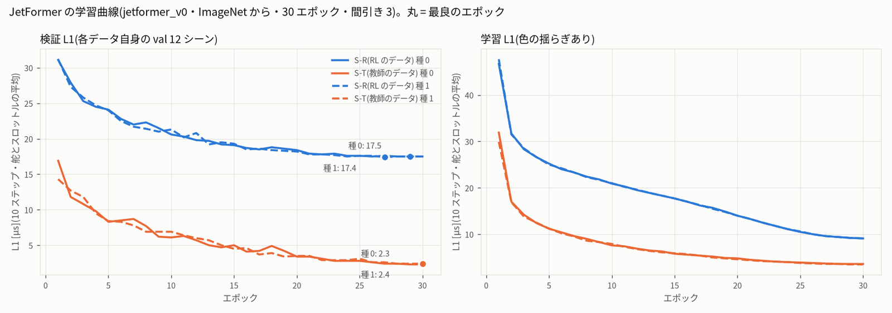
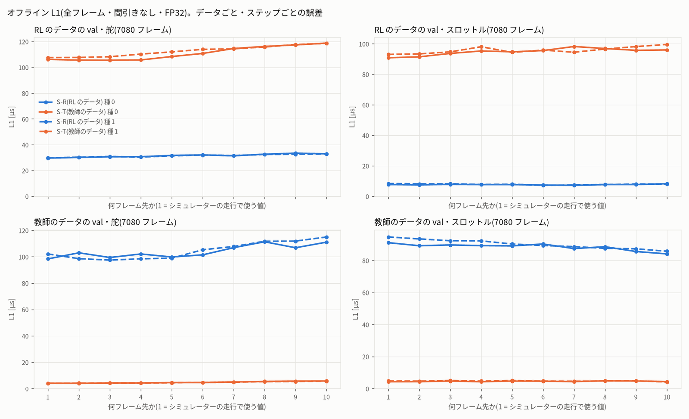
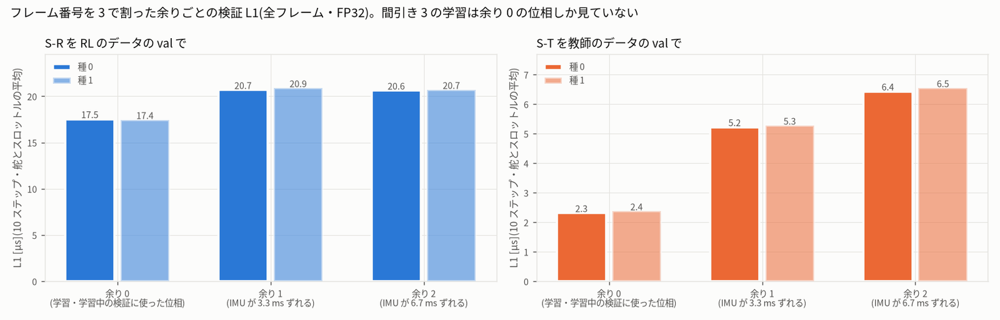

# JetFormer の学習の段(段 D)— sim_rl_bestlap_20261013

2026-10-14 03:20〜09:15。protocol.json の training_arms のうち S-R(RL のベストラップのデータ)と S-T(作者の RC 教師のデータ)を、種 0・1 の 4 本学習した。
FP16 のエンジンと、シミュレーターのブリッジで読み込める一式(ONNX・model_config.json・io_spec.json の ZIP)も作った。
手順と違ったことは deviations.md の「2026-10-14 09:15」の項目にまとめた。

---

## 1. 結論

- **4 本とも 30 エポックまで学習した。** 最良の検証 L1(各データ自身の val 12 シーン、学習と同じ間引き 3)は次のとおり。
  - S-R(RL のデータ)種 0 / 種 1: **17.5 / 17.4 µs**
  - S-T(教師のデータ)種 0 / 種 1: **2.3 / 2.4 µs**
  - 種のばらつきは 0.1 µs で小さい。
- **RL のデータは、教師のデータより約 7 倍まねしにくい。** 違いはほとんどが舵。
  - 走行で使う 1 フレーム先の舵の誤差: S-R は RL の val で 29.6〜29.8 µs、S-T は教師の val で 4.1 µs。
  - スロットルの差は小さい(7.7〜8.4 µs と 4.3〜4.8 µs)。
  - RL のラベルは舵が端にある時間が 19.7%(教師は 4.3%)で、これがまねしにくさの元と考えられる(record.md 7 章)。
- **エンジン 4 本は走行タブと同じ手順の確認に合格した。** FP32 との差は最大 0.40〜1.48 µs(基準 2.5 µs)、run_numpy の中央値 1.9〜2.1 ms。
- **シミュレーター用の一式 4 つは、ユーザーのブリッジで読み込めた。**
  - アプリの「モデル ZIP を読み込む」と同じ順(bridge.py の save_bundle → activate_model)で確かめた。
  - ジャンル(走行モード)8、one-hot の長さ 9(学習と同じ)、中心 1442 / 1498 µs、制御の遅れ 1 フレーム、ゲイン 1.0、先読み 1。
  - ONNX と PyTorch の出力の差は最大 0.0003 µs。
- **新しく見つけたこと: 間引き 3 の学習は、IMU の 3 つの位相のうち 1 つしか見ていない。**
  - シミュレーターでは、IMU の時刻がカメラに対して 0 / 3.3 / 6.7 ms ずれる 3 フレーム周期がある。
  - 学習で見ていない位相のフレームでは誤差が上がる。S-T は 2.3 → 5.2・6.4 µs、S-R は 17.5 → 20.7・20.6 µs。
  - 閉ループでは毎フレーム推論するので、3 フレームのうち 2 フレームがこの「見ていない位相」になる。
- **この段では、まだ「速く走れたか」は分からない。** 周回時間・完走は次の段(閉ループ評価)で測る。この段で分かるのは、
  「RL のデータは、カメラ・ToF・IMU から 17 µs 程度の誤差でまねできる。ただし教師のデータよりかなり荒い」ことまで。

---

## 2. 学習のしかた

- コマンドは protocol.json のとおり(名前だけこの段の指示の `simrl_bestlap_20261013-` に変えた):
  `tools/train.py --policy jetformer_v0 --data data/datasets/<データ> --epochs 30 --lr 3e-4 --seed <種> --stride 3 --batch 64 --no-command-input --impact-g 2.5`
  (ImageNet から、AdamW wd 1e-4、cosine。最良のエポックは各データ自身の val で選ぶ)
- データ:
  - S-R: `jetformer-simulator-rl-bestlap-20min_20261013-174515_7f3650b0`(記録の段で作った RL のベストラップ 20 分)
  - S-T: `jetformer-simulator-id8-20min_20261012-150956_b55616cf`(作者の RC 教師の 20 分)
  - どちらも 60 シーン(学習 48 / 検証 12)、ジャンル 8、ジャンル数 9。学習 9,456 / 検証 2,364 サンプル。
- 順番: S-R 種 0 → S-T 種 0 → S-R 種 1 → S-T 種 1(protocol の優先 1 → 2)。GPU は 1 本ずつ。
- 1 本ごとに次を自動で行った(`experiments/20261013_sim_rl_bestlap/train/bestlap_train.py`。電源断・止まったあとは同じコマンドで続きから):
  1. 学習(jf-heavy の上限 3G・lock big)
  2. FP16 のエンジン(`tools/build_engine.py`、上限 2500M)
  3. エンジンの確認(`train/engine_load_check.py`。走行タブと同じ読み方・実フレーム 64 個で FP32 との差・速さ)
  4. run.json と engine_check.json(管理画面の一覧用。「シミュレーター専用(ジャンル 8)。実車では使わない」)
  5. シミュレーター用の一式と、ユーザーのブリッジでの確認(`train/export_bundle.py`・`train/check_bundle.py`)
- メモリ: 上限 3G では最初は学習が始まらなかった(CUDA の確保が cgroup で約 1.8 GB と数えられた)。
  CUDA のメモリの取り方(expandable_segments)・THP なし・workers 2 → 1 で上限の中に収めた。計算の結果は変わらない(詳しくは deviations.md)。
  別の作業とメモリを取り合ったときは、見張りが自分の学習だけを止め、空いてから続きを学習した(S-T 種 0 で 5 回)。

---

## 3. 学習曲線

- S-R(青)は 30 エポックまで検証 L1 が下がり続け、27〜29 エポック目で 17.4〜17.5 µs に落ち着いた。学習 L1 は 9.1 µs で、検証との差は 8 µs。
- S-T(橙)は 30 エポック目が最良(2.3・2.4 µs)。学習 L1(色の揺らぎあり)は 3.5〜3.6 µs で、検証のほうが小さい。
- 種 0 と種 1 の曲線はほぼ重なる。

### 数字

| 腕・種 | 学習結果 | 学習 / 検証のサンプル | 最良の検証 L1 [µs] | 最良のエポック | 30 エポック目の検証 / 学習 L1 [µs] | 1 エポック [秒](中央値) | 30 エポックの計算 [分] | 試行(上限 / 見張り / 始め直し) | workers |
|---|---|---|---|---|---|---|---|---|---|
| S-R 種 0 | `simrl_bestlap_20261013-SR-s0` | 9456 / 2364 | **17.5** | 29 | 17.5 / 9.1 | 62 | 32 | 6(3 / 0 / 2) | 2 |
| S-T 種 0 | `simrl_bestlap_20261013-ST-s0` | 9456 / 2364 | **2.3** | 30 | 2.3 / 3.6 | 85 | 47 | 12(4 / 5 / 2) | 1 |
| S-R 種 1 | `simrl_bestlap_20261013-SR-s1` | 9456 / 2364 | **17.4** | 27 | 17.5 / 9.1 | 79 | 40 | 2(1 / 0 / 0) | 1 |
| S-T 種 1 | `simrl_bestlap_20261013-ST-s1` | 9456 / 2364 | **2.4** | 30 | 2.4 / 3.5 | 64 | 34 | 2(1 / 0 / 0) | 1 |

- 「試行」は学習を始めた回数。上限 = 自分のメモリの上限で止まった回、見張り = 全体の空きが足りず自分で止めた回、始め直し = 待っている間に連続実行を直して始め直した回(学習の前)。
- エポックごとの数字は各学習結果の `result.json` の history、ログは `train/logs/<学習結果>.train.log`。

---

## 4. オフラインの誤差(全フレーム・間引きなし・FP32)

protocol の offline_eval(段 E の 6.3 節)を、GPU を持っている間にこの段で行った。合否には使わない。
RL の val 12 シーンと教師の val 12 シーンのすべてのフレーム(各 7,080)で、1 フレーム先(シミュレーターの走行で使う値)と 10 フレームの平均を舵・スロットル別に出した。

| 腕・種 | RL の val 舵 1 / 10 | RL の val スロットル 1 / 10 | RL の val 平均(余り 0 / 1 / 2) | 教師の val 舵 1 / 10 | 教師の val スロットル 1 / 10 | 教師の val 平均(余り 0 / 1 / 2) |
|---|---|---|---|---|---|---|
| S-R 種 0 | 29.6 / 31.5 | 7.7 / 7.7 | 19.6(17.5 / 20.7 / 20.6) | 98.4 / 104.0 | 91.1 / 88.4 | 96.2(95.9 / 96.6 / 96.2) |
| S-T 種 0 | 106.2 / 110.9 | 90.8 / 94.8 | 102.9(102.8 / 103.0 / 102.8) | 4.1 / 4.8 | 4.3 / 4.5 | 4.7(2.3 / 5.2 / 6.4) |
| S-R 種 1 | 29.8 / 31.4 | 8.4 / 7.9 | 19.7(17.4 / 20.9 / 20.7) | 102.1 / 104.7 | 94.7 / 90.2 | 97.4(97.1 / 98.0 / 97.2) |
| S-T 種 1 | 107.6 / 112.6 | 93.0 / 95.8 | 104.2(104.0 / 104.3 / 104.3) | 4.1 / 4.7 | 4.8 / 4.8 | 4.7(2.4 / 5.3 / 6.5) |

(単位 µs。「余り」はフレーム番号を 3 で割った余り。学習と学習中の検証は余り 0 だけを使う)

- **自分のデータでは**: S-R の舵の誤差(29.6 µs ≒ 舵角 約 0.03 rad)は、S-T の舵(4.1 µs ≒ 約 0.004 rad)の約 7 倍。
  スロットルは 7.7 µs(≒ 0.11 m/s)と 4.3 µs(≒ 0.06 m/s)で差は小さい。S-R の舵の 1 フレーム先の 90% 点は 73 µs。
- **相手のデータでは**: どちらも 90〜110 µs で大きい。同じジャンル 8・同じコースでも、教師の線と RL の線は違う。モデルは自分のデータの走り方しか知らない。
- **余りごとの差**(下の図): 学習で使った余り 0 の位相がいちばん小さい。学習中の検証の数字(2.3・17.5 µs)は、全フレームの数字(4.7・19.6 µs)より小さく出ている。

- 原因の候補: シミュレーターの IMU は 100 Hz でカメラ(30 Hz)と位相がそろっていて、IMU の 10 サンプルの時刻がカメラに対して
  余り 0 で 0 ms、余り 1 で 3.3 ms、余り 2 で 6.7 ms ずれる(aligned の imu_timestamps_us で確かめた)。ラベル・ToF の時刻には余りによる差はない。
  入力の何が効いているかまでは、この段では切り分けていない。

---

## 5. エンジン(FP16)

| 腕・種 | FP32 との差 最大 / 平均 [µs] | run_numpy 中央値 / p99 [ms] | 確認 |
|---|---|---|---|
| S-R 種 0 | 1.48 / 0.15 | 2.02 / 6.43 | 合格 |
| S-T 種 0 | 0.50 / 0.06 | 2.02 / 5.92 | 合格 |
| S-R 種 1 | 1.14 / 0.14 | 2.06 / 3.47 | 合格 |
| S-T 種 1 | 0.40 / 0.07 | 1.94 / 2.13 | 合格 |

- 確認は `train/engine_load_check.py`(10/13 の混合学習の写し。計算は同じ): 走行タブの一覧と同じ関数で読み、入出力(ジャンル 9)を確かめ、
  各データの val の実フレーム 64 個で TensorRT と PyTorch FP32 の差(基準 2.5 µs)、100 回の空回しの後 600 回の速さ(中央値 ≤ 6 ms・p99 ≤ 8 ms)。
- 結果は `train/engine_check/<学習結果>.json` と、学習結果の `engine_check.json`。エンジンの作成は 1 本 75〜84 秒(メモリの空き待ちを除く)。
- **シミュレーター専用のモデルです。** エンジンがあるので管理画面の走行タブの一覧に出ますが、実車では選ばないでください(run.json のメモにも書いた)。

---

## 6. シミュレーター用の一式(次の段で使う)

| 腕・種 | ZIP | ZIP の sha256(先頭) | ONNX の sha256(先頭) |
|---|---|---|---|
| S-R 種 0 | `bundles/simrl_bestlap_20261013-SR-s0.zip` | ea5293114957f5c3 | 46435add17ffa412 |
| S-T 種 0 | `bundles/simrl_bestlap_20261013-ST-s0.zip` | 39e9af01b681ef50 | bcb756293251888a |
| S-R 種 1 | `bundles/simrl_bestlap_20261013-SR-s1.zip` | 5836a1f1e94200b0 | 3149f03b5b2b6555 |
| S-T 種 1 | `bundles/simrl_bestlap_20261013-ST-s1.zip` | 470c6633cee67331 | e4086e1882785876 |

(各 53.9 MB。完全な sha256 は `train/runs.json` と各 `bundles/<学習結果>/export.json`)

- **中身**(ZIP の中の `<学習結果>/`): `jetformer.onnx`(学習結果のものをそのまま)・`model_config.json`・`io_spec.json`・`calibration.json`・`README.md`。
  ブリッジは同じフォルダーの ONNX・model_config・io_spec を使い、ほかの 2 つは読まない。
- **model_config.json に足した/直したもの**(protocol の eval_bundle のとおり。`data/runs` の元のファイルは変えていない):
  - `steer_center_us` 1442・`throttle_neutral_us` 1498。学習が出した値は S-R で 1103.9 / 1188.5、S-T で 1375.3 / 1332.9 µs
    (「止まっているフレームの中央値」なので、シミュレーターのデータでは中心にならない)。直さないと PWM から舵角・速さへの換算がずれる。
  - 作者の `shortcut-rc-finetuned` と同じ `simulator_physics`(RC 応答の物理)・`simulator_sensors`・`simulator_world_version`・
    `simulator_sensor_profile`・`evaluation_route`・`required_route_event`
  - `simulator_execution: {control_delay_frames: 1}`、`simulator_calibration`(作者の値でジャンル 8・舵ゲイン 1.0・前進ゲイン 1.0・先読み 1)、
    `recommended_inference: {steering_gain 1.0, throttle_gain 1.0, lookahead 1}`
  - `simulator_bundle`(元の学習結果・直した欄・学習が出した中心値の記録。アダプターは読まない)
- **ジャンルの数**: モデルのジャンル数は 9(data/modes.json の 0〜8)、学習したジャンルは [8] だけ。ブリッジ(jetformer_policy.py)は
  `num_modes` の長さの one-hot の `mode_id` 番目を 1 にして渡す。アプリの走行モードの選択肢は trained_modes から作られるので 8 だけが出る。
  学習の mode の入力と同じことを確かめた(`bundle_check.json` の mode_input)。アダプターの上限(ジャンル数 9 まで)にも収まっている。
- **確かめたこと**(`bundles/<学習結果>/bundle_check.json`、4 つとも合格):
  - レポートのフォルダーのシミュレーターの写し(bridge.py・jetformer_policy.py・calibration.example.json)が、元とバイト単位で同じ。
  - `BridgeServer.save_bundle(ZIP)` → `activate_model({onnx_token, config_token, calibration_token, mode_id 8})` が通る
    (中で io_spec と model_config の照合・物理とセンサーの欄の検査・較正の検査・ONNX のセッションの検査・0 の入力での空回し)。読み込み 1.5〜2.1 秒。
  - 読み込んだ結果: 走行モード 8(シミュレーター)・学習したジャンル [8]・ジャンル数 9・今の操作値なし・中心 1442 / 1498・先読み 1・ゲイン 1.0 / 1.0・
    遅れ 1 フレーム・RC 応答の物理・最大舵角 0.52 rad・最大速度 7.24 m/s・一式の既定の較正を使用・jetformer_v0。
  - ONNX(onnxruntime 1.31.0、CPU)と PyTorch FP32(best.pth)の actions の差: 各データの val の 16 フレームで最大 0.00018〜0.00032 µs。
- 使ったブリッジの Python は data/sim/venv(onnxruntime 1.31.0・numpy 2.2.6・opencv 4.13.0、ユーザーの requirements-model.txt と同じ版)。読むだけで、何も入れていない。

---

## 7. 手順と違ったこと(deviations.md 2026-10-14 09:15 の要約)

1. 学習結果の名前を `simrl_bestlap_20261013-<腕>-s<種>` にした(protocol は `simrl-bestlap-<腕>-s<種>`)。中身のコマンドは同じ。
2. メモリ: 上限 3G に収めるため、CUDA のメモリの取り方・THP なし・workers 2 → 1 にした。始める空きを 3.5 → 3.2 GB に下げた。
   再開で上限に当たった 1 本だけ、再開の上限を 3400M にした。全体の空きを見張って、危ないときは自分の学習だけを止めた(5 回)。
3. protocol は「エンジンを作らない」だったが、この段の指示で作った(シミュレーター専用と明記)。
4. S-TR(任意)は protocol の cut_order_if_late のとおり作らなかった。
5. 一式(6.1 節)とオフライン評価(6.3 節)を、段 E の前にこの段で行った。

---

## 8. ユーザーの質問「今後、速くぶつからないようにするには、どういうアップデートが有望か」への補足(この段で分かったこと)

答えの本体は rl.md 12 章と record.md 8 章です。この段の学習から、次の 4 つが数字で見えました。

1. **RL の方策の舵をなめらかにする(いちばん有望)**
   - RL のデータは、カメラで走る JetFormer にとって教師のデータより約 7 倍まねしにくい(検証 L1 17.5 対 2.3 µs)。差はほとんど舵(1 フレーム先 29.6 対 4.1 µs)。
   - まねの誤差は、そのまま閉ループのふらつきになる。速く走るほど、ふらつきがぶつかりにつながる。
   - RL の学習で舵の変化に上限(サーボの速さ)を付ける、舵が端に張り付く時間を減らす。そうして記録し直すと、同じ速さでもまねしやすいラベルになる見込み
     (記録のしくみはそのまま使える。record.md 8 章)。
2. **シミュレーターのデータは全フレームで学習する(手間が小さい)**
   - 間引き 3 では IMU の 3 つの位相のうち 1 つしか学習していない。見ていない位相では誤差が 1.2〜2.8 倍になった(4 章)。
   - `--stride 1`(全フレーム)で学習するか、エポックごとに間引きの始まりをずらす。データを集め直す必要はない。1 エポックの時間は約 3 倍。
3. **制御の遅れを、記録と走行でそろえる**
   - 記録は遅れ 0 で行ったが、評価(と作者の ONNX)は遅れ 1 フレームで走らせる。4.5 m/s では 1 フレームで 15 cm 進む。
   - 選んだ RL の方策は遅れ 1 でも完走するが(rl.md 1 章: 8.37〜8.40 秒)、記録したラベルは遅れ 0 の走りなので、JetFormer は遅れ 1 を習っていない。
   - 次の段で先読み 2(1 フレーム先の代わりに 2 フレーム先の値を使う)を参考として試す価値がある。根本的には、遅れに強い RL の方策
     (rl.md 11・14 章の r2・r3 は、回の 4 割で制御遅延 1 フレームを引いて学習した)を、遅れ 1 で走らせて記録し直す。
4. **外れた状態からの戻り方を教える(DAgger)**
   - 相手のデータでの誤差は 90〜110 µs で、モデルは自分のデータの線の上しか知らない。JetFormer が線から外れると、正しい操作を習っていない場面になる。
   - RL の方策はどの状態でも操作を返せるので、JetFormer をシミュレーターで走らせ、外れた状態に RL の操作を付けて足す(rl.md 12 章の 6)と、ぶつかりにくくなる見込み。

1 と 3 は RL のやり直しと記録し直し(合わせて約 2 時間)、2 は学習のやり直しだけ(1 本 約 1.5〜2 時間)で試せます。どれも、次の段の閉ループ評価の結果を見てから決めるのが確実です。

---

## 9. 次の段(閉ループ評価)への注意

- 使う一式: `bundles/<学習結果>.zip`(または同じ名前のフォルダー)。対応表は `train/runs.json`。
  アプリの「モデル ZIP」から読み込むと、既定でジャンル 8・先読み 1・ゲイン 1.0 / 1.0 になる(protocol の closed_loop_eval の設定と同じ)。
- 学習中の検証の数字(2.3・17.5 µs)は余り 0 の位相だけの値。閉ループに近いのは全フレームの数字(4.7・19.6 µs)。
- エンジンは閉ループ評価には使わない(ブリッジは ONNX を CPU で動かす)。
- メモリ: 別の作業(sim_rl_modes)が動いている間、全体の空きは 2.1〜3.4 GB だった。Firefox(上限 2500M)を始めるときは空きを確かめること。
- 学習結果のフォルダーは各 298 MB(4 本で約 1.2 GB)、一式は 4 つで約 440 MB(フォルダーと ZIP)。ディスクの空きは 18 GB。

---

## 10. ファイル

- 報告: この train.md、deviations.md(2026-10-14 09:15 の項目)
- 図: `fig/train_curves.png`・`fig/train_offline_l1.png`・`fig/train_frame_phase.png`
- 数字: `train/summary.json`(図と表の元)・`train/tables.md`・`train/offline_l1.json`・`train/runs.json`・`train/state.json`(試行の記録)
- ログ: `train/logs/`(`<学習結果>.train.log`・`.engine.log`・`.engine_check.log`・`.bundle.log`・`driver.log`・`offline_eval.log`・メモリの測定 `memprobe_*`・`memsample_train.log`)
- エンジンの確認: `train/engine_check/<学習結果>.json`
- 一式: `bundles/<学習結果>/`・`bundles/<学習結果>.zip`・確認に使った PyTorch の出力 `bundles/_check/`
- 学習結果: `/home/jetson/jetformer/data/runs/simrl_bestlap_20261013-{SR,ST}-s{0,1}/`
- コード: `/home/jetson/jetformer/experiments/20261013_sim_rl_bestlap/train/`
  - `bestlap_train.py`(連続実行)・`engine_load_check.py`・`export_bundle.py`・`check_bundle.py`・`offline_eval.py`・`train_report.py`・`nothp.py`
