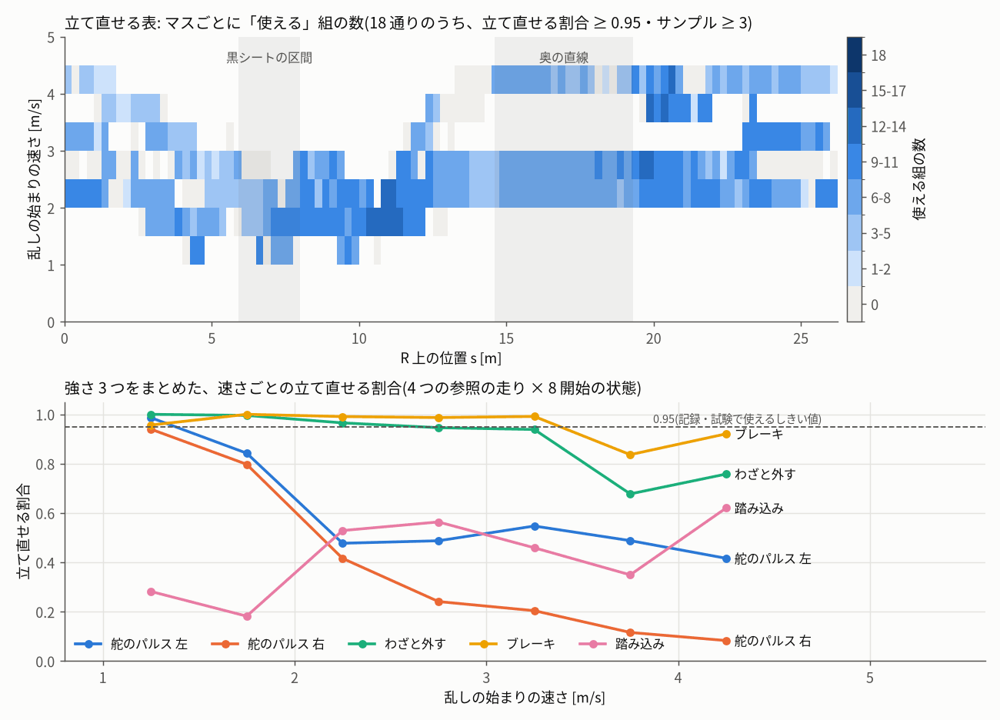
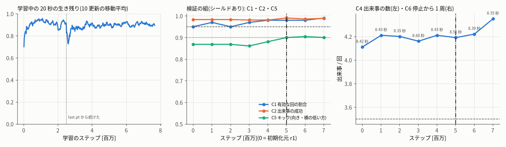
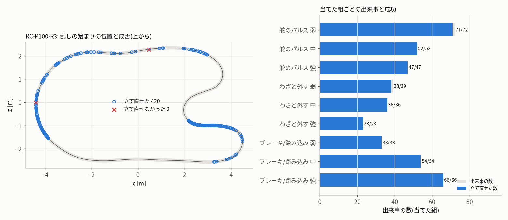
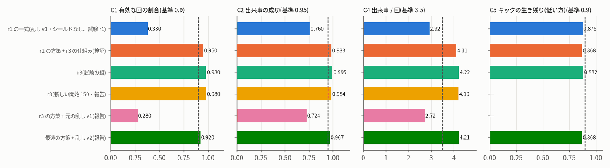

# 離脱復活(recover)r3 の学習・試験

- 段: r3 の学習の段(recover)。計画 `r3/plan.md` 3 章・追補の決まり `r3/protocol_recover_r3.json`(sha256 `0a58b11c…09d3545`、`r3/protocol_r3.sha256` と同じ)。
- 依頼(ユーザー、2026-10-13 21:20): 「シミュレーターの走行は、ほかにももっといろいろなパターン、ぶつかるのを避けたり、いろいろな経路を通るパターンなども作成できるように。
  強化学習モード(最速)・(絶対壁にぶつからない)・(離脱復活)など、データセットのバリエーションが出る構成のモードを用意」。2026-10-14 08:30「作業を引き続き実施」。
- 最終更新 2026-10-14 16:15。学習(11:24〜15:23、途中で中断と順番待ち)・選び(検証の組)・試験の組(1 回だけ、15:28〜15:38)・報告だけの組・候補の書き出しまで終わった。
- 守ったこと: modes の作業(wf_7e500cf6-ccd)が使うファイル(`bundle/`・`web/rl/`・`rl/runtime/`・`protocol.json`・JetFormer 本体・`jetformer/sim`・画面)は変えていない。
  コードは `experiments/20261013_sim_rl_modes/r3/rc/`(共有のコードは写して使い、元の sha256 は `r3/rc3/sources_sha256_recover_r3.txt`)、結果は `r3/rc3/`・`r3/fig/`、
  候補は `experiments/…/r3/candidates/recover_r3/`。学習は `jf-heavy --mem 2G --lock rl -- nice -n 15`、Node の評価は `jf-heavy --lock none -- nice -n 15`。
  実車・PCA9685・I2C・GPU・Firefox は使っていない。ユーザーのシミュレーター・ブリッジ・jetformer-web には触れていない。git にコミットしていない。
  deviations.md には末尾に 1 項目(「第 3 回(r3)recover の学習の段」)を足しただけ。

---

## 0. 結論

**判定は不合格(7 項目のうち 5 つ合格)。候補の一式は「不合格(参考)」で `r3/candidates/recover_r3/` に書き出した(bundle は変えていない)。**

| 項目(試験の組、1 回だけ) | 値 | 基準 | 判定 | r1 の一式(試験 r1) |
|---|---|---|---|---|
| C1_r3 有効な回(止まり・進みも見る) | **98/100** | ≥ 90/100 | 合格 | 38/100 |
| C2 出来事の成功 | **0.995**(420/422) | ≥ 0.95 | 合格 | 0.760 |
| C3 戻るまで 中央値・90% 点 | 0 秒・0.70 秒 | ≤ 1.2・≤ 2.5 秒 | 合格 | — |
| C4 出来事 / 回・外す割合 | **4.22**・0.174 | ≥ 3.5・0.10〜0.40 | 合格 | 2.92・0.119 |
| C7(新)強さ・種類のばらつき | 弱 0.34・中 0.34・強 0.32 / 舵のパルス 0.41・わざと外す 0.23・ブレーキ/踏み込み 0.36 | 各 ≥ 0.15 / ≥ 0.10 | 合格 | — |
| C5_r3 キックの生き残り | 向き **30/34**・横 **30/34**(0.88) | 各 ≥ 0.90 | **不合格** | 35/40・36/40 |
| C6_r3 乱しなし | 停止から 1 周 8.51 秒・REC60 60/60(最小 6.05 cm)・U60 60/60・最小 **1.90 cm** | ≤ 9.0 秒・全部有効・≥ 3 cm | **不合格**(U56 の開始のすき間 1.89 cm だけ。方策によらない決まりの穴) | 2.12 cm |

- **確認 r1・r2 の主な不合格(有効 34〜38%・成功 0.75・出来事 3.0 回/回)は直った**: 乱しを「立て直せる組」に作り直し(乱し v2)、乱し以外のフレームにすき間シールドを足し、
  学び直した(r1 の 2,015,232 から +5,013,504 で選んだ。合計の学習 7,667,712 ステップで早く止めた)。新しい開始 150 回(報告)でも 有効 147/150・成功 0.984・4.19 回/回。
- **効いたのは主に乱しの作り直し**: 同じ開始を元の乱し v1 で走らせると r3 の方策でも 有効 28/100・成功 0.724(r1 と同じくらい)。立て直せない乱しは学習しても救えない
  (計画の段の oracle と同じ結論)。同じ仕組み(乱し v2・シールド)・同じ検証の組では、r3 の方策は r1 の方策より少し良い(有効 98 vs 95・成功 0.990 vs 0.983・C3 の 90% 点 0.67 vs 0.93 秒・C5 0.90〜0.925 vs 0.87〜0.92)。
- **C5_r3(キック)は 0.88 で届かなかった**: 落ちた 8 回は全部「キックと同じステップでぶつかった(3)」か「キックの直後にシールドの 23 の候補のどれも 3.5 cm を守れないと見た(5)」で、
  スタートのゲートの柱・カーテン・柵のそば(s ≈ 25.9〜3.6 m、右の余地 0.18〜0.27 m)を 4 m/s 前後で走っているときの右向きのキック。検証の組では 500 万〜700 万で 0.90〜0.925 だった。
  方策が右の柵から 0.15 m より離れて走らないと、横 0.15 m のキックは物理として避けられない。最速の方策も同じ組で 0.87(向き)。
- **C6_r3 は決まりの穴で落ちる**: RC-U60-R3 の U56 は開始のフレームのすき間が 1.89 cm(開始は「すき間 > 0」だけで選ぶ決まり)。それを除くと 119 回全部有効・最小 3.51 cm・停止から 1 周 8.51 秒で、
  C6 の中身は満たしている。学習・試験の前に組の定義だけから見つけて deviations.md に書いた(しきい値は変えていない)。
- **新しく見つけた危うさ: ゲートの外し**。乱しありの有効な回の 38/98(新しい開始 150 では 55/147)でゲートを 1 つ外す(乱しなしの回は 0、最速の方策は同じ乱しで 4/92)。
  検証の組で調べると全部が乱しの終わりから 2 秒以内で、多くは奥の直線の出口(s 19.8〜20.8 m)の中・強の舵のパルスのあと。立て直せる表の成功の条件(線と向きに戻る)に
  「ゲートを通る」が入っていないため。記録の前の確かめ(統合の段の組はゲートの外し 0)で外すので記録には入らないが、使える開始は約 6 割に減る。次の回は表の成功の条件にゲートを足す。
- **昇格の段への手当て**(JetFormer 本体の学習除外の漏れ道 a・b): 差分 `r3/rc/promote/dataset_frame_index.patch` と試験 2 つを用意し、今の本体の写しで確かめた
  (差分ありで 13 本合格・差分なしで新しい試験が 3 本落ちる、9 章)。
- **出すかどうか**: protocol publication は「不合格でも r1 の一式より数字が良ければ r3 を不合格(参考)で出す」。r3 の一式は C1・C2・C4・C6(REC60 のすき間)で r1 の一式よりはっきり良く、
  C5 は同じくらいなので、昇格の段で r3 の一式を「不合格(参考)」として出すのがよい(候補の eval.json の compare_r1)。

---

## 1. 確認 r1・r2 の指摘(must fix)と、この段の対応

| 指摘 | 対応 | 結果(試験の組) |
|---|---|---|
| 有効な回 34〜38%(要 90%)・出来事の成功 0.75(要 0.95)・出来事 3.0 回/回(要 3.5) | 乱しを「立て直せる組」に作り直した(乱し v2: 立て直せる表・替え方・散らし。2・3 章) | 有効 98/100・成功 0.995・4.22 回/回(合格) |
| 立て直せない乱しがある(黒シートの出口の右へのパルス 0/82 ほか) | 表を oracle(方策を使わない 24 通りの操縦 + 参照の方策の続き)で先に作り、立て直せる割合 ≥ 0.95 のマスだけ使う | 表の使えるマス 2,161。頼んだ組のとおり 44%・向きだけ逆 29%・別の組(ほとんどブレーキ)27%。黒シートの出口で始めた出来事 64/64 成功 |
| 弱い → 強いのカリキュラム・早く安全に戻る報酬・もっと学習 | 強さ 0.5 → 1.0(300 万)・立て直しの報酬 +1.0/+0.5/−1.0・すき間の壁 5 cm・止まりの見張り・種 32 | 学び直し 501 万で選んだ(4・6 章)。C3 の 90% 点 0.93 → 0.70 秒 |
| キックの向き 0.865(要 0.90) | 学び直し(状態のキック 25%)+ 乱し以外のフレームのすき間シールド | 検証の組では 500 万〜700 万で 0.90〜0.925 に上がったが、試験の組で 0.88(不合格)。落ちたキックは全部 物理として避けにくい(0 章・8 章) |
| 止まったままの回が有効・記録の前の確かめを通る | valid_episode_r3(止まり・20 秒で 1 周の進み)で判定。記録の前の確かめ `r3/rc/predict_scenes_rc3.mjs` も同じ決まり。学習で止まりの見張り(−10) | 止まり P84(開始のすき間 0.58 cm)を無効に数えた。検証の止まり V68 を `predict_scenes_rc3.mjs` が valid = false にすることを確かめた(元の valid_episode は true) |
| REC60 の最小すき間 2.12 cm(要 3 cm) | 乱し以外のフレームにすき間シールド 3.5 cm | REC60 60/60・最小 6.05 cm。シールドの作動は乱しのあと 3 秒の中 0.07%・それ以外 3.5% |
| 取り込みの学習除外の漏れ道 (a) 1 フレームのずれ・(b) ジャンルの付け直し | 昇格の段の差分と試験を用意し、JetFormer の一時の写しで確かめた(9 章) | 写しで 13 本合格。差分の前の本体では新しい試験が 3 本落ちる(ずれを見つける) |

---

## 2. 立て直せる表(乱し v2 の土台)

`r3/rc/build_recoverable_table.mjs`(oracle_proto.mjs が元・乱数を使わない決定的な手順)を lock rl・nice 15・4 本で 10:02〜10:37(35 分)走らせ、
`r3/rc/merge_recoverable_table.py` でまとめた。**表の sha256 `410f18c2…f1ee014a` を学習の前に `r3/protocol_recover_r3_table.sha256` に固定**した
(`r3/rc/recoverable_table_v1.json`、ブラウザでも読める形 `r3/rc/rt/recoverable_table.mjs` `921e1514…`)。

| 項目 | 値 |
|---|---|
| 参照の走り | 4 つ(離脱復活 r1 の方策 7720f275…・最速の方策 7c43cb53…・r1 + 上限 3.0 m/s・r1 + 上限 2.2 m/s、どれも乱しなし・シールドなし)× 開始 8 つ(STD + mulberry32(0x7ab1e001) の記録の開始の分布 7 つ・種 3,240,000 + n) |
| 走り | 32 回とも 600 フレーム・衝突 0 |
| 状態 | フレーム 30〜590 を 4 フレームおき = 141 × 32 = **4,512 状態**(計画の見積もり約 3,600 より多い) |
| 組 | 18 通り(クラスの上限 = 悪い側)。わざと外すは、その側の幅(先 1.5 m)が d + 0.05 m に足りない状態では使えない(20,448 行) |
| 枝分かれ | 81,216 行(わざと外すの幅が足りない 20,448 を除く 60,768 が表のサンプル)。立て直せた 38,215(63%)。最初に立て直せた操縦: その driver の方策の続き 17,657・r1 の方策の続き 6,579・24 通りの操縦 13,979。どれでもだめ 22,553 |
| マス | 5,118(s 0.25 m × 速さ 0.5 m/s × 組)。**使える(≥ 0.95・サンプル ≥ 3)2,161**、学習で使える(≥ 0.80)2,632 |
| 自己試験 | 置き換えた core と元の sim-core.js の 600 フレームの軌跡の差 **0**、保存と戻しの差 **0**、途中から作り直した方策の運転手と参照の走りの指令の差 **0**(32 回とも) |

記録の幅の決まり(v1 の始めてよい位置)の中の状態での組ごとの立て直せる割合(全部の速さをまとめた値):

| 組 | 弱 | 中 | 強 |
|---|---|---|---|
| 舵のパルス 左 | 0.94 | 0.55 | 0.42 |
| 舵のパルス 右 | 0.67 | 0.29 | 0.14 |
| わざと外す 左 / 右 | 0.94 / 0.99 | 0.88 / 0.99 | 0.76 / 0.92 |
| ブレーキ | 0.98 | 0.98 | 0.98 |
| 踏み込み | 0.58 | 0.45 | 0.36 |



- 計画の段の下調べ(oracle の試作)と同じ形: 中・強の舵のパルスは速さで決まり(2 m/s を越えると 5 割を切る)、踏み込みは遅いところでも 2〜6 割、ブレーキとわざと外すはほぼ立て直せる。
  表を引くと、速いところの強い舵のパルスは「逆の向き」か「わざと外す」「ブレーキ」に替わる。
- 黒シートの区間・奥の直線(どちらも v1 で乱しを始めない区間)にも使えるマスはあるが、記録・試験では v1 の幅の決まりで始めないので使わない(学習は幅 0.45 m の決まり)。
- 表の成功の条件は「ps から pe + 3 秒まで衝突なし・すき間 ≥ 2 cm・前へ 0.5 m/s 以上・最大すき間の線から 0.2 m・向き 0.3 rad」で、**ゲートを通ることは入っていない**(0 章・10 章の危うさ)。

## 3. 乱し v2 と走行中の仕組み(`r3/rc/rt/`)

- `rt/` は web/rl の写し(10:00、sha256 は `r3/rc3/sources_sha256_recover_r3.txt`)に、計画の段の `r3/runtime/shield.mjs`(jf-shield/v4-proto)を入れ、次を足した:
  - `perturb_v2.mjs`(新): v1 と同じ 12 個の一様乱数で「頼んだ組」を決め、表で使えなければ 逆の向き(ブレーキ/踏み込みは 踏み込み ⇄ ブレーキ)→ 同じ強さのわざと外す(頼んだ向き → 逆)
    → 同じ強さのブレーキ → 1 つ弱く の順で「当てた組」にする。どれも使えなければ始めず、次のフレームで同じ頼んだ組で調べ直す(乱数は引き直さない)。
    使える組があっても mix32(mix32(種, f), 0x5a7e)/2³² < 0.25 のときだけ始める(散らし)。乱数の列は v1 と同じ数・同じ順(出来事ごとに 12 個 + 終わりに 1 個)。
    出来事の記録に 頼んだ組・当てた組・替え方・待ったフレーム数・始まりの速さ を書く。試験 `r3/rc/test_perturb_v2.mjs`(v1 と同じ乱数の列・表を全部使えるにすると v1 と同じ出来事)。
  - `mode_runtime.mjs`: 離脱復活だけ、乱し v2(params.perturb_version、既定 'v2'。'v1' は報告の比べ用)と、**乱しのフレーム(ph = 'perturb')以外のすき間シールド**
    (c_nominal 0.035・悲観 −1・見張り・見積もり・模型 Q・すくみをほどく は切る・H 24・keep_nominal)。シールドが替えた指令は l = 1・sh = 1。
    jf.p(フレーム 0)に perturb_version、metadata に乱しの id・表の sha256・シールドの値を書く。ほかのモードは変えていない。
  - `recoverable_table.mjs`(自動生成): 表をそのまま埋め込んだ ESM(ブラウザでも同じファイル)。
- 判定と同じ走らせ方(元の sim-core.js・自前のすき間の積分)は `r3/rc/episode_rc3.mjs`(rl/episode.mjs の写し。読み込む先だけ r3/rc/rt)。
- 判定・報告は `r3/rc/eval_rc3.mjs`(rl/eval_modes.mjs の recover の部分を r3 の組・判定に。`--set validation | test | fresh | v1 | fallback`)。
  報告だけの診断として、キックで落ちた回に「同じステップでぶつかった」「キックの直後にシールドの候補がどれも合格しない」を足した(判定は変えない)。

## 4. 学習の設定(protocol_recover_r3.json training のとおり)

| 項目 | 値 |
|---|---|
| 入口 | `r3/rc/run_chain_rc3.sh main`(jf-heavy --mem 2G --lock rl -- nice -n 15。表がまだならまとめて固定 → `r3/rc/train/train_rc3.py --run recover_r3 --steps 10000000 --eval`。止まっても同じコマンドで last.pt から続く) |
| 初期化 | 離脱復活 r1 の選んだチェックポイント(train/recover/main の 2,015,232 ステップ、checkpoint sha256 55fc04eb…、方策 7720f275…)。観測 base79v のまま |
| 種 | 32(allowed_tuning.retry の「元の種 + 1」) |
| PPO | r1 と同じ(64 環境 × 256、5 エポック、ミニバッチ 4,096、clip 0.2、γ 0.995、λ 0.95、target_kl 0.03、lr 1e-4 → 3e-5、torch 4 スレッド)。差し込んだ行動のステップは方策の損失から外す |
| 乱し(学習) | 乱し v2 の scheduler(同じ表、学習では立て直せる割合 ≥ 0.80 のマスも使う)+ 状態のキック。種類の割合は modes.json のまま(舵のパルス 0.35・わざと外す 0.25・ブレーキ/踏み込み 0.15・キック 0.25)。予定・幅は modes.json の学習の決まり(TRAIN_SPEC: 幅 0.45 m・黒シートの区間を除く) |
| 強さのカリキュラム | 0.5 → 1.0(最初の 300 万ステップ) |
| 報酬 | v2-gatecap + ゲートの外し −3 + **立て直しの報酬**(出来事の終わりのあと recovered になったら一度だけ +1.0(1.5 秒以内)/ +0.5(3 秒以内)、3 秒で戻らなければ −1.0。線は初期化元の方策の乱しなしの線 `r3/rc3/nominal_line_r1.json`)+ **すき間の壁**(d_min < 5 cm で −0.3·min(4, ((0.05 − d)/0.02)²)、乱しの区間の中は 0)+ 衝突・停止・逆走・黒シート違反・周の距離不足 −10 + **止まりの見張り**(1.5 秒以降、直近 60 フレームの R の進み < 0.6 m で −10。ブレーキの乱しと速さを下げるキックの始まりから 90 フレームは見ない) |
| シールド | 学習では使わない。検証・試験はシールドあり |
| 検証 | チェックポイント(100 万ごと)ごとに `r3/rc/eval_rc3.mjs --set validation`(高速版・シールドあり・290 回)を裏で |
| 早く止める | 400 万以降、続けて 3 つのチェックポイントが検証の組で全部合格。C6_r3 は検証の組でも開始のすき間のせいで満たせないので、`r3/rc/early_stop_watch.py` が「C6_r3 が開始のすき間 3 cm 未満の開始のためだけに落ちている」ものも合格に数えて止める合図を送る(10 章) |

## 5. 学び直す前の確かめ: r1 の方策を r3 の仕組みで(検証の組、`r3/rc3/val_r1_init.json`)

| 項目 | 値 | 判定 |
|---|---|---|
| C1_r3 有効(valid_episode_r3) | 95/100(無効: 衝突 3・止まり 2 = V57・V68 はほぼ動かない開始) | 合格 |
| C2 出来事の成功 | 0.983(411 件) | 合格 |
| C3 戻るまで | 中央値 0・90% 点 0.93 秒 | 合格 |
| C4 出来事・外す割合 | 4.11 回/回・0.171 | 合格 |
| C7 強さ・種類 | 弱 0.37・中 0.34・強 0.29 / 舵のパルス 0.36・わざと外す 0.30・ブレーキ/踏み込み 0.34 | 合格 |
| C5_r3 キック | 向き 35/38(0.92)・横 33/38(0.87) | 不合格 |
| C6_r3 | 停止から 1 周 8.42 秒・REC60 15/15・VU30 30/30・最小すき間 0.32 cm(VU8 の開始のすき間そのもの)。REC60 だけなら 3.58 cm | 不合格(開始のすき間) |

- 乱しを作り直しただけで、確認 r1・r2 の不合格の主な 3 つ(C1・C2・C4)は r1 の方策のままで合格の水準になった。替えた出来事 56%、待ったフレーム 中央値 2・90% 点 8。
- 残るのは C5_r3(キック)と C6_r3(開始のすき間。方策によらない。10 章)。

## 6. 学習の経過と検証の組

- 11:24 に lock rl を取って始め(計画では recover が先だったが no_wall r3 の学習が先に取った)、12:30 にこの段の 1 本目のエージェントの中断で止まった
  (2,883,584 まで進んだが last.pt は 2,506,752)。その間に経路いろいろ r3 の学習が lock rl を取ったので後ろに並び直し、14:06 に last.pt から続けた(run.json の resumes)。
- 15:22 に早く止める見張りが 500 万・600 万・700 万の 3 つ続けての合格(C6_r3 は開始のすき間だけ)で止める合図を送り、7,667,712 ステップで止まった(`train/main/early_stop.json`)。
  学習の速さは CPU の混み方で 290〜4,600 steps/s(ほかの作業の Firefox・Node と重なった)。学習の量は r1 の初期化から 7,667,712 ステップ(中断で捨てた 376,832 ステップは数えない)。
- 学習中の 20 秒の生き残り(確率的な方策・乱し 1.0)は 0.87〜0.91 で横ばい。

| ステップ | C1_r3 | C2(件数) | C3 中央値 / 90% | C4 回/回・外す | C5_r3 向き・横 | C6_r3 最小(開始 < 3 cm を除く)・REC60・1 周 | C7 | 満たす数 | 落ちたキックの内訳 | 替えた割合 | シールド |
|---|---|---|---|---|---|---|---|---|---|---|---|
| r1(初期化元) | 95/100 | 0.983(411) | 0.00 / 0.93 | 4.11・0.171 | 35/38・33/38 | 0.32 cm(—)・3.58 cm・8.42 秒 | 合格 | 5/7 | — | 0.56 | 0.43% |
| 1,015,808 | 97/100 | 0.983(421) | 0.00 / 0.57 | 4.21・0.172 | 34/38・33/38 | 0.32 cm(5.02 cm)・5.13 cm・8.43 秒 | 合格 | 5/7 | — | 0.61 | 0.52% |
| 2,015,232 | 95/100 | 0.983(420) | 0.00 / 0.70 | 4.20・0.172 | 33/38・34/38 | 0.32 cm(5.17 cm)・6.89 cm・8.35 秒 | 合格 | 5/7 | 同じステップ 4・候補なし 5 | 0.63 | 0.44% |
| 3,014,656 | 97/100 | 0.981(416) | 0.00 / 0.67 | 4.16・0.172 | 31/36・32/36 | 0.32 cm(8.32 cm)・8.55 cm・8.60 秒 | 合格 | 5/7 | 同じステップ 4・候補なし 5 | 0.60 | 0.40% |
| 4,014,080 | 98/100 | 0.981(421) | 0.00 / 0.60 | 4.21・0.175 | 40/42・37/42 | 0.32 cm(7.78 cm)・8.05 cm・8.43 秒 | 合格 | 5/7 | 同じステップ 5・候補なし 2 | 0.58 | 0.39% |
| **5,013,504** | **98/100** | **0.990(419)** | 0.00 / 0.67 | 4.19・0.176 | **37/40・36/40** | 0.32 cm(6.00 cm)・6.07 cm・8.51 秒 | 合格 | **6/7** | 同じステップ 3・候補なし 4 | 0.58 | 0.41% |
| 6,012,928 | 98/100 | 0.986(422) | 0.00 / 0.63 | 4.22・0.174 | 38/42・38/42 | 0.32 cm(5.87 cm)・7.83 cm・8.39 秒 | 合格 | 6/7 | 同じステップ 4・候補なし 4 | 0.60 | 0.39% |
| 7,012,352 | 99/100 | 0.989(435) | 0.00 / 0.54 | 4.35・0.177 | 36/40・36/40 | 0.32 cm(5.92 cm)・6.55 cm・8.35 秒 | 合格 | 6/7 | 同じステップ 4・候補なし 4 | 0.63 | 0.45% |



- C5 の判定に使う回の数(36〜42)は、キックの瞬間の位置が v1 の始めてよい位置かどうかで方策ごとに変わる。
- 検証の組の無効な回はどのチェックポイントでも V68(止まり)が残る: ゲート 23・左 +0.12 m・向き +13° の開始で、シールドなしなら 12 フレームで壁にぶつかり、
  シールドありでは「止まって舵を切る」のまま 571 フレーム動かない(すくみをほどくは決まりで切ってある)。valid_episode_r3 と記録の前の確かめで外れる(`r3/rc3/diag/pred_v.json`)。

## 7. 選んだチェックポイント

`r3/rc/select_rc3.py`(protocol selection.rule)。全部を満たす点は無い(C6_r3 が全部の点で開始のすき間のせいで落ちる)ので「満たす数が一番多く、同じなら C2」:
6/7 の 500 万・600 万・700 万のうち C2 が一番高い **5,013,504 ステップ**(C2 0.9905)。方策 `train/main/policies/step_005013504.json`、sha256 **`8d686076…cb4a94`**
(`train/main/selection.json`、写し `train/best/`)。試験の結果を見て選び直していない。

## 8. 試験の組(1 回だけ、`r3/rc3/eval_test.json`)

- 15:28〜15:38、元の sim-core.js(キックだけ高速版)・シールドあり・3 本。試験の前のコードの sha256 は `r3/rc3/code_sha256_before_test.txt`(eval_rc3.mjs `fe81fa54…`・mode_runtime.mjs `7b92aa4e…`・perturb_v2.mjs `bb7e58f7…`・shield.mjs `29c9d111…`)。
- 試験のあとに変えたコードは `export_candidate_rc3.py`(status.json の notes_ja・eval.json の compare_r1 を足した)と `figs_rc3.py`(学習曲線の続きの扱い・数字の桁)だけで、判定・走らせ方には関係しない。
- 判定は 0 章の表。無効な回は P84(止まり。開始のすき間 0.58 cm の開始)・P99(衝突、7.4 秒)。失敗した出来事は 2 件(わざと外す 弱 s 1.33 m で戻るのが 3.2 秒、舵のパルス 弱 s 21.4 m で戻らない)。

| 報告(protocol acceptance.reported) | 値 |
|---|---|
| 頼んだ組と当てた組 | 422 件のうち、頼んだとおり 44%・向きだけ逆 29%・同じ強さのブレーキ 25%・ほか(わざと外す・1 つ弱く)2%。頼んだ種類 舵のパルス 202・わざと外す 170・ブレーキ/踏み込み 50 → 当てた 171・98・153(踏み込みはほとんどブレーキに替わる)。待ったフレーム 中央値 3・90% 点 11 |
| 始まりの位置 | 黒シートの出口(s 8.0〜8.25 m)15%・奥の直線の出口 0%・ほか 85%(元の乱し v1 では 33%・26%・42%) |
| 強さ・種類ごとの成功 | 弱 142/144・中 142/142・強 136/136。舵のパルス 170/171・わざと外す 97/98・ブレーキ/踏み込み 153/153 |
| ゲートの外しのある有効な回 | **38/98**(キック 14/144・REC60 0・U60 0)。0 章・10 章 |
| シールドの作動 | 乱しのあと 3 秒の中 0.07%・それ以外 3.5%・全部 0.32% |
| キック(全部の位置) | 向き 61/72・横 62/72 |
| VM7・VM3 | 有効な乱しありの回(3,000 フレームに間引いた参考): VM7 871 マス・VM3 0.033 m(最速の方策 + 同じ乱し: 920・0.037 m) |



### 8.1 報告だけの組(試験のあとに 1 回ずつ。`r3/rc/run_test_rc3.sh`)

| 組 | 方策 | C1 | C2 | C3 90% 点 | C4 | C5 | C7 | そのほか |
|---|---|---|---|---|---|---|---|---|
| 新しい開始 150(mulberry32(0x3c3c0002)、種 3,320,000〜、`eval_fresh.json`) | r3 | 147/150 | 0.984(629 件) | 0.73 秒 | 4.19 | — | 合格 | ゲートの外し 55/147・無効 Q0・Q75(衝突)・Q105(止まり) |
| 同じ開始を元の乱し v1 で(RC-P100-R3-V1、`eval_v1.json`) | r3 | 28/100 | 0.724(272 件) | 1.38 秒 | 2.72 | — | 合格 | 強い乱し 49/98・舵のパルス 106/169 しか立て直せない |
| 最速の方策 + 乱し v2(`eval_fastest_test.json`) | 最速 7c43cb53… | 92/100 | 0.967 | 0.67 秒 | 4.21 | 33/38・35/38 | 合格 | ゲートの外し 4/92 |
| 代わりの試験(protocol fallbacks.recover: 強さ 弱・中だけ、`eval_fallback.json`) | r3 | 98/100 | 0.988 | 0.63 秒 | 4.25 | (この組には無い) | 不合格(強 0) | 落ちたのは C5・C6 なので、強さを弱めても合格にはならない |



## 9. 取り込みの学習除外の漏れ道(確認 recover r2 の指摘 a・b)— 昇格の段への手当てと試験

JetFormer 本体はこの段では変えていない(modes の作業が動いているため)。統合の段(modes の作業)が 09:00〜 に入れた手当てを前提に、
昇格の段がそのまま当てられる差分と試験を `experiments/20261013_sim_rl_modes/r3/rc/promote/` に用意し、**JetFormer の一時の写し**(scratchpad、
`JETFORMER_DATA` も一時フォルダー)で確かめた。16:10 に今の本体(dataset.py sha256 `09367357…`、09:10 の統合の段の版)から写し直して確かめ直した(`r3/rc3/promote_verify.log`):
`git apply --check` が通る・差分を当てた写しで 13 本合格・当てない写しでは新しい試験が 3 本落ちる(正解のずれを見つける)。

| 指摘 | 今の JetFormer 本体(統合の段の手当て) | この段で用意したもの | 確かめ |
|---|---|---|---|
| (b) シーンタブでジャンルを付け直す(`dataset.update_scene(mode_id=…)`)と外した区間(未設定)が消える | `scene_import.dataset_to_scenes` が scene.json に `label_mask.unset_segments` を書き、`update_scene` が `_segments_keeping_mask` でその区間を未設定のまま残す(`tests/test_sim_modes.py` に試験あり) | 端から端までの試験 `test_sim_label_mask_e2e.py`(乱し v2 の形の出来事 3 つ・180 フレーム・33,333/33,334 µs): 取り込み → 展開 → 作り直し → 全シーンを `update_scene(mode_id=8)` → 作り直し。学習に使う観測の正解に l = 0 の操作 0・外した観測が付け直しの前後で同じ・RC 教師のシーンは外さない | 差分ありの写しで 2 本とも合格。差分なしでも「漏れ 0」の確かめは合格(統合の段の手当てで塞がっている)。差分なしで落ちるのはフレームの番号どおりの確かめだけ |
| (a) 展開したシーンから作り直すと、正解を時刻で引くため 1 フレームずれ、出来事の終わり pe − 1 の観測の正解に乱した操作が入る | 外す範囲を `[ps − 10, pe − 1]` に 1 つ広げた(`jetformer/sim/label_mask.py`)→ 漏れは塞がった | **正解の質の直し** `dataset_frame_index.patch`(59 行): `dataset._aligned_arrays` に `_frame_indexed(veh, cam_t)`(VEHICLE の quality = 'snapshot' で、操作がカメラのフレームと 1 対 1)を足し、そのときだけ future_actions[k] = vehicle[k+1..k+10](有効でない操作を含む観測は future_valid = False)。実機のシーン・1 対 1 でない snapshot は今までどおり時刻で引く | `test_sim_label_frame_index.py` 5 本: 差分を当てた写しで 5 本合格・`tests/test_sim_label_mask.py` 6 本も合格。**差分の前の本体では 2 本が落ちる**。e2e でも差分の前は観測 1 の正解が [2, 2, 4, 5, 5, 7, 8, 8, 10, 11](同じ操作が 2 回・飛び)、差分のあとは [2..11] |

昇格の段ですること(この順で):
1. `git -C ~/jetformer apply --check experiments/20261013_sim_rl_modes/r3/rc/promote/dataset_frame_index.patch`(統合の段が dataset.py を変えていたら手で合わせる)→ 当てる。
2. `test_sim_label_frame_index.py`・`test_sim_label_mask_e2e.py` を `jetformer/tests/` に写す(e2e は `modes.MODES_FILE` も一時フォルダーへ差し替えている。本物の data/modes.json に触れない)。
3. `jf-heavy --mem 2500M --lock big -- python -m pytest -q tests/`(全部)。実機のシーンの作り直しがビット単位で同じことは `test_real_scene_unchanged` と、既存の dataset の試験で見る。
4. 1 シーンの ZIP の形(simulation/frames.jsonl)は統合の段の試験 `test_sim_label_mask.py` にある。乱し v2 のシーン(info.jf の ph = 'perturb'・l = 0)も同じ形なので追加の手当ては要らない。
5. 記録の前の確かめは `r3/rc/predict_scenes_rc3.mjs`(valid_episode_r3: 止まり 1 秒以上・20 秒で 1 周に届かない回は不可)に、統合の段の組の決まり(ゲートの外し 0・すき間)を重ねる。
   r3 の候補では有効でゲートの外しが無い開始は約 6 割(試験の組 60/100)なので、プランの 3 倍の候補で足りる見込み。
6. web/rl に入れるとき: 候補の `runtime/` は r3/rc/rt の写しで、`runtime/manifest.json` は web/rl の写したときのまま(mode_runtime.mjs・perturb_v2.mjs・recoverable_table.mjs・shield.mjs の sha256 とは合わない)。
   候補の一式の sha256 は上の段の `manifest.json`。`rl/make_web_bundle.mjs` で作り直すこと。

## 10. 決まりの読み方・決まりの穴・残る危うさ(deviations.md の末尾にも書いた)

- **決まりの読み方(書いていなかった所を決めた)**:
  1. 立て直せる表の oracle の枝分かれは、元の sim-core.js を `r3/rc/core_oracle.mjs` で読み込み時に置き換えた写し(近くの障害物だけ判定・写しを省く・状態の保存と戻し。
     物理は 1 文字も変えない)で走らせた。元の sim-core.js と 600 フレームの軌跡がビット単位で同じこと・保存と戻しで同じ軌跡になること・途中から作り直した方策の運転手が
     参照の走りと同じ指令を出すことを、表づくりの最初に確かめた(全部差 0)。
  2. 替え方の「向きを逆に」は、ブレーキ/踏み込みでは 踏み込み ⇄ ブレーキ とした。弱い強さへの替えは、固定の強さ(代わりの試験 弱・中)のときもその中だけ。
  3. 散らしの mix32(シーンの種, f, 0x5a7e) は mix32(mix32(種, f), 0x5a7e)(rng.mjs の mix32 は 2 引数)。
  4. 検証の組の RC-REC60 は protocol の検証の決まりどおり最初の 15、RC-VU30-R3 の開始は RC-V100-R3 の続きの Halton 番号(RC-U60-R3 と同じ作り方)。
  5. 止まり(definitions_added.stall)の「ブレーキの乱しの区間とそのあと 30 フレームは数えない」は、その区間のフレームを数えず、続きも切らない(きびしい側)。
  6. 学習の立て直しの報酬の「乱しなしの線」は、初期化元(離脱復活 r1 の方策 7720f275…)の線を固定で使った(学習中に方策が変わっても作り直さない)。
     判定(C2・C3)は protocol のとおり、評価する方策そのものの線。
  7. 学習の止まりの見張りは「ブレーキの乱し(と速さを下げる状態のキック)の始まりから 90 フレームは見ない」。
- **決まりの穴(しきい値は変えずに報告)**: RC-U60-R3(と検証の RC-VU30-R3)の開始は「開始のすき間 > 0」だけで、C6_r3 の最小すき間 ≥ 3 cm は
  開始のフレームも数える。試験の組の U56 は開始のすき間が 1.89 cm(検証の VU8 は 0.32 cm・VU16 は 1.89 cm。`r3/rc3/diag/start_clearance.txt`、組の定義だけから数えた)なので、
  **C6_r3 は方策によらず試験の組で満たせない**。決まりを変えず、判定どおり不合格に数え、報告に「開始のすき間が 3 cm 未満の開始を除いた最小すき間」を並べた。
  次の回は開始のすき間 ≥ 3 cm の開始だけにするか、開始のフレームを除く決まりにする。
- **早く止める条件の読み方**: 上の穴のため「全部合格」が決してかからないので、「C6_r3 が開始のすき間 3 cm 未満の開始のためだけに落ちている」ものも合格に数えて止めた
  (`r3/rc/early_stop_watch.py` が外から SIGTERM。500 万・600 万・700 万で 15:22 に止めた)。学習の量を減らすだけで、選び・判定は変えていない。
- **残る危うさ**:
  1. **ゲートの外し**: 乱しのあとに 1 つゲートを外す有効な回が多い(試験 38/98・新しい開始 55/147・検証の 500 万 28/98。r1 の方策でも検証で 23/95)。
     検証の組の 29 件を走らせ直すと(`r3/rc3/diag/gm_diag.json`)、全部が乱しの終わりから 2 秒以内で、26 件は舵のパルス(強 17・中 8・弱 1)、3 件はわざと外す、多くは奥の直線の出口(s 19.8〜20.8 m)で始まったもの。
     線には戻る(立て直しは成功)がゲートの外を通る。表の成功の条件にゲートが無いため。記録の前の確かめで外せるが、次の回は表の成功の条件に「次のゲートを通る」を足す。
  2. **キック(C5)**: スタートのゲートのそばで右の柵から 0.15 m 以内を 4 m/s 前後で走るので、横 0.15 m・向き 0.3 rad の右向きのキックが物理として避けられない回が残る。
     検証の組では 0.90〜0.925、試験の組で 0.88。合格させるには、方策がその区間で柵から離れて走ること(報酬で余地を求める)か、キックの判定の位置の決まりの見直しが要る。
  3. **止まり**: 壁を向いた開始(開始のすき間が小さい)では、シールドが止めたまま動かない(すくみをほどくは決まりで切ってある)。valid_episode_r3 と記録の前の確かめで外れる。
  4. **乱しの中身の偏り**: 踏み込み(burst)は表でほとんど使えず、ブレーキに替わる(当てた種類のブレーキ/踏み込み 153 件のうち踏み込みは 6 件。頼んだ踏み込み 23 件のうち 18 件がブレーキに替わった)。データセットの説明に書く(候補の mode.json の dataset_card)。

## 11. ファイル

| 置き場所 | 中身 |
|---|---|
| `jetformer_reports/sim_rl_modes_20261013/r3/train_recover_r3.md` | このノート |
| `r3/protocol_recover_r3_table.sha256` | 立て直せる表の sha256(学習の前に固定) |
| `r3/rc3/table/`(rows_0〜3.jsonl・shard_*.log・table_summary.json・recoverable_table_v1.json) | 表づくりの行・自己試験・まとめ |
| `r3/rc3/nominal_line_r1.json` | 学習の立て直しの報酬の線(r1 の方策の乱しなしの線) |
| `r3/rc3/val_r1_init.json` | r1 の方策を r3 の仕組み・検証の組で(5 章) |
| `r3/rc3/train/main/`(run.json・progress.jsonl・checkpoints・policies・evals/recover・early_stop.json・selection.json・last.pt)・`train/main.log`・`train/best/` | 学習・検証・選び |
| `r3/rc3/eval_test.json`(試験の組)・`eval_fresh.json`・`eval_v1.json`・`eval_fastest_test.json`・`eval_fallback.json`・`run_test.log`・`compare_items.json` | 試験と報告だけの組 |
| `r3/rc3/code_sha256_before_test.txt`・`sources_sha256_recover_r3.txt` | 試験の前のコードの sha256・写した元の sha256 |
| `r3/rc3/diag/`(gm_diag.json・pred_v.json・plan_v.json・start_clearance.txt)・`promote_verify.log` | ゲートの外し・記録の前の確かめ・開始のすき間・昇格の段の差分の確かめ |
| `r3/fig/recover_r3_table.png`・`recover_r3_learning_curve.png`・`recover_r3_events_test.png`・`recover_r3_events_val_r1.png`・`recover_r3_compare.png` | 図 |
| `experiments/…/r3/candidates/recover_r3/`(policy.json `8d686076…`・mode.json・shield.json・perturbation.json・eval.json・status.json(not_accepted「不合格(参考)」)・recoverable_table_v1.json・runtime/・manifest.json) | 候補の一式(bundle は変えていない) |
| コード `experiments/…/r3/rc/` | `build_recoverable_table.mjs`・`core_oracle.mjs`・`merge_recoverable_table.py`・`rt/`(走行中の仕組み)・`episode_rc3.mjs`・`eval_rc3.mjs`・`gate_miss_rc3.mjs`・`variation_metrics_rc3.mjs`・`train/`(train_rc3.py・env_rc3.mjs・env_worker_rc3.mjs・vec_env_rc3.py・ppo_modes.py)・`run_chain_rc3.sh`・`run_train_rc3.sh`・`early_stop_watch.py`・`select_rc3.py`・`run_test_rc3.sh`・`export_candidate_rc3.py`・`figs_rc3.py`・`predict_scenes_rc3.mjs`・`write_fid_rc3.mjs`・`test_perturb_v2.mjs`・`promote/`(差分と試験 2 つ)・`diag/` |

やり直し方(要点):

```bash
E=~/jetformer/experiments/20261013_sim_rl_modes; R=~/jetformer_reports/sim_rl_modes_20261013/r3/rc3
cd $E && bash r3/rc/run_chain_rc3.sh main                     # 学習(lock rl、last.pt から続く)
python3 -I r3/rc/select_rc3.py --run $R/train/main            # 選び(検証の組だけ)
bash r3/rc/run_test_rc3.sh $R/train/main/policies/step_005013504.json   # 試験の組(もう eval_test.json があれば走らせない)
python3 -I r3/rc/export_candidate_rc3.py --policy $R/train/main/policies/step_005013504.json --eval $R/eval_test.json \
  --fallback-eval $R/eval_fallback.json --fresh $R/eval_fresh.json --v1 $R/eval_v1.json --fastest $R/eval_fastest_test.json --selection $R/train/main/selection.json
python3 -I r3/rc/figs_rc3.py curve main; python3 -I r3/rc/figs_rc3.py events $R/eval_test.json recover_r3_events_test.png; python3 -I r3/rc/figs_rc3.py compare $R/compare_items.json
```

## 12. 起動したプロセス

- 学習(`run_chain_rc3.sh` → jf-heavy --lock rl → train_rc3.py と Node の環境 4 本・検証の評価)は 15:23 に終わった。早く止める見張り(`early_stop_watch.py`)は 15:22 に合図を送って終わった。
- 試験と報告だけの組(`run_test_rc3.sh`、Node 3 本ずつ)は 16:06 に終わった。下調べの Node(ゲートの外し・止まり・記録の前の確かめの確かめ)と JetFormer の写しの pytest も終わっている。
- 段の終わりに `ps` で r3 recover のプロセスが 0 であることを確かめた。次の段が続ける学習は無い(last.pt は 7,667,712 ステップで残してある)。
- RL の学習・Firefox・GPU・jetformer-web の再起動・ユーザーのブリッジには触れていない(学習は lock rl の順番どおり)。
