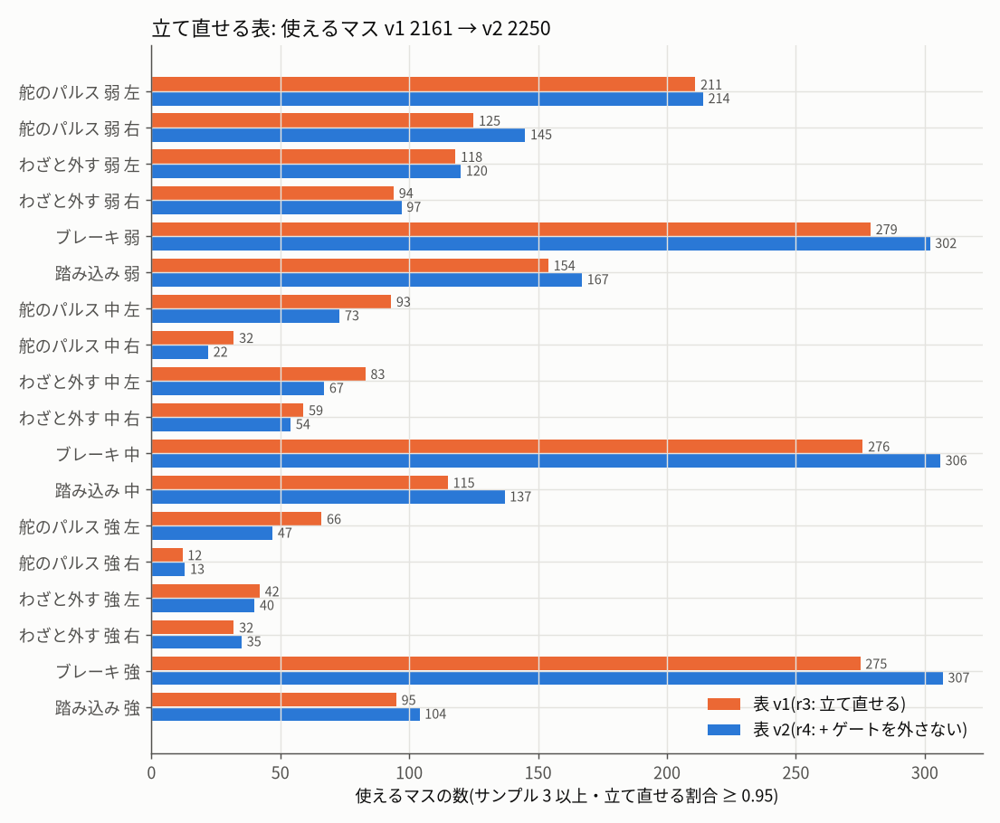
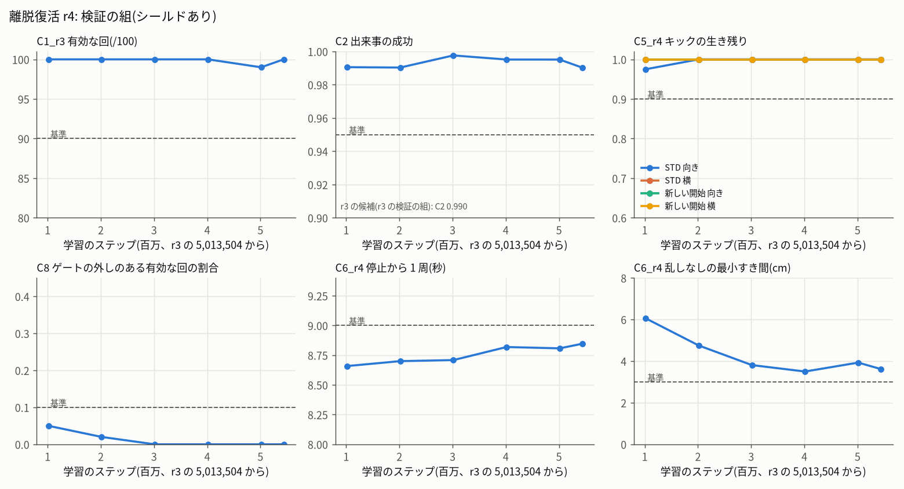
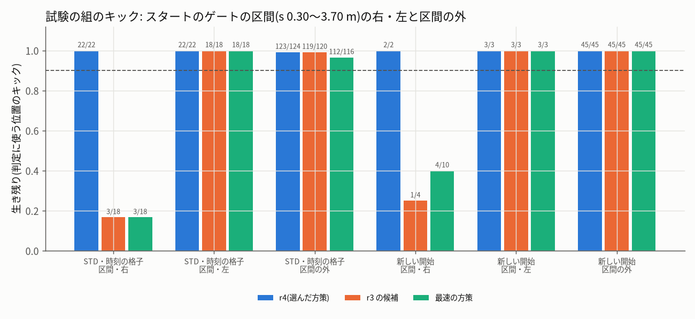
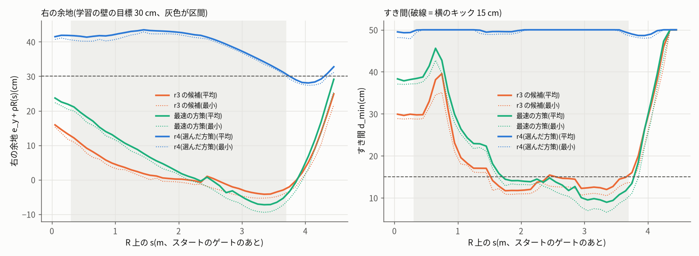

# 離脱復活(recover)r4 の学習・試験

- 段: r4 の学習の段(recover)。確認 recover r3(`r3/check_recover_r3.md`)の不合格(pass = false)を受けて、must fix を直し、学び直し、新しい追補の決まり
  `r3/protocol_recover_r4.json`(sha256 `1b6bd8ad…7468172`、`r3/protocol_recover_r4.sha256`。学習・試験の前、2026-10-14 22:14 に固定)の試験の組で 1 回だけ試験した。
- 依頼(ユーザー、2026-10-13 21:20):「シミュレーターの走行は、ほかにももっといろいろなパターン、ぶつかるのを避けたり、いろいろな経路を通るパターンなども作成できるように。
  強化学習モード(最速)・(絶対壁にぶつからない)・(離脱復活)など、データセットのバリエーションが出る構成のモードを用意」。2026-10-14 08:30「作業を引き続き実施」。
- 最終更新 2026-10-15 00:50。下調べ(21:55〜22:30)・表 v2 づくり(22:35〜23:06)・学習(23:06〜00:07、早く止めた)・選び・試験の組(00:07〜00:16、1 回だけ)・報告だけの組(〜00:39)・
  候補の書き出し・昇格の段の手当て(差分 2 つ + 試験 + 記録したシーンの確かめ)まで終わった。
- 守ったこと: 共有のファイル(`bundle/`・`web/rl/`・`rl/runtime/`・`protocol.json`・JetFormer 本体・`jetformer/sim`・画面)は変えていない。コードは
  `experiments/20261013_sim_rl_modes/r3/rc4/`(写した元の sha256 は `r3/rc4/sources_sha256_recover_r4.txt`)、結果は `r3/rc4/`・`r3/fig/`、候補は
  `experiments/…/r3/candidates/recover_r4/`。学習と表づくりは `jf-heavy --mem 2G --lock rl -- nice -n 15`、Node の評価は `--lock none -- nice -n 15`、pytest 一式は
  `--mem 2500M --lock big`。JetFormer は scratchpad の写しでだけ動かした。実車・PCA9685・I2C・GPU・Firefox は使っていない。ユーザーのシミュレーター・ブリッジ・
  jetformer-web には触れていない。git にコミットしていない。deviations.md には末尾に 2 項目を足しただけ。

---

## 0. 結論

**新しい試験の組(1 回だけ)で 8 項目すべて合格。候補の一式を `r3/candidates/recover_r4/`(status accepted「合格」、確認の段の前)に書き出した(bundle は変えていない)。**

| 項目(試験の組、1 回だけ) | 値 | 基準 | 判定 | r3 の候補を同じ組で(報告) |
|---|---|---|---|---|
| C1_r3 有効な回(止まり・進みも見る) | **99/100**(無効は P27 の止まり) | ≥ 90/100 | 合格 | 100/100 |
| C2 出来事の成功 | **0.993**(405/408) | ≥ 0.95 | 合格 | 0.991 |
| C3 戻るまで 中央値・90% 点 | 0 秒・0.80 秒 | ≤ 1.2・≤ 2.5 秒 | 合格 | 0・0.57 秒 |
| C4 出来事 / 回・外す割合 | 4.08・0.183 | ≥ 3.5・0.10〜0.40 | 合格 | 4.34・0.193 |
| **C5_r4** キック(STD の時刻の格子 向き・横 / 新しい開始 向き・横) | **83/84・84/84 / 24/24・26/26**(最小 0.988) | 4 つとも ≥ 0.90 | **合格** | 70/78・70/78 / 21/23・28/29(**不合格**) |
| **C6_r4** 停止から 1 周・REC60・U60(開始のすき間 ≥ 3 cm)・最小すき間 | 8.85 秒・60/60・60/60・**3.50 cm** | ≤ 9.0 秒・全部有効・≥ 3 cm | **合格** | 8.51 秒・60/60・60/60・3.76 cm |
| C7 強さ・種類のばらつき | 弱 0.35・中 0.34・強 0.31 / 舵のパルス 0.27・わざと外す 0.40・ブレーキ/踏み込み 0.33 | 各 ≥ 0.15 / ≥ 0.10 | 合格 | 合格 |
| **C8(新)** ゲートの外し(乱しありの有効な回・乱しなし) | **0/99・0/120** | ≤ 10%・0 | 合格 | 1/100・0/120 |

- **確認 r3 の must fix の対応と結果**(くわしくは 1 章):
  1. **C5(スタートのゲートの区間の右向きのキック)**: 学習にこの区間のキック(戻さない)と右の余地の壁を足して学び直した。区間の右向きのキックの生き残り
     **r3 の候補 4/22 → r4 24/24**(最速の方策 7/28)。区間の外も 168/169。方策は区間で右の余地を 30〜43 cm 残して走る(r3 は −5〜+16 cm、すき間は 10〜15 cm → r4 は約 50 cm。図 4)。
  2. **C6 の穴**: 乱しなしの組の開始を開始のすき間 ≥ 3 cm に限った(RC-U60-R4。最小の開始のすき間 3.76 cm)。最小すき間 3.50 cm(U28、開始のすき間 32 cm の回の途中)で合格。
  3. **ゲートの外し**: 立て直せる表に「ゲートを外さない・次のゲートを通る」を足し(表 v2)、学習でゲートの外しを −10 で終わりにした。乱しありの有効な回の外し **r3 の試験 38/98 → 0/99**
     (新しい開始 150 回でも 0/148)。**表 v2 だけでも r3 の方策で 1/100**(報告の組)なので、効いたのは主に表の条件。記録したブラウザのシーンを確かめ直す道具も作った(5 章)。
  4. **差分の説明と実機の形の試験**: `dataset_frame_index_v2.patch`(説明を直した)と、quality = 'snapshot'・VEHICLE 100 Hz の実機の形の試験 2 つ。差分の前後で同じ値(data/raw の実機 138 シーンもビット単位で同じ)。
  5. **ジャンル 8 の無い Jetson**: `scene_import_unset_segments.patch`(未設定で残すのは学習除外で外した観測だけ)と、一時フォルダーのジャンル表で閉じた試験(ジャンル 8 あり/なしの両方)。
  6. **シールドの止まり**: 「すくみをほどく」(3 cm)を入れ、r3 の確認の止まりの開始 7 のうち 5 が走るようになった(残る 2 は開始のすき間 1.6・2.4 cm)。残る止まりを画面の説明に書く文を候補に入れた。
- **代わりに払ったもの**: r4 は r3 より遅い(停止から 1 周 8.51 → **8.85 秒**、基準 9.0 秒まで 0.15 秒。乱しなしの 1 周目 8.47 → 8.84 秒、乱しありの走りの平均の速さ 3.07 → 2.88 m/s)。
  スタートのゲートの区間を真ん中寄りに、ゆっくり走るため(区間の平均 3.50 → 3.10 m/s)。乱しなしの最小すき間も 3.76 → 3.50 cm と基準に近い。
- **残る危うさ**(10 章): 新しい止まり(P27: ゲート 7・右 0.197 m の開始で壁へ寄ってシールドが止める。r3 の方策では走る)、乱しありの有効な回の最小すき間 1.1 cm(判定の外・乱しのフレーム)、
  ブラウザでの見え方は確かめていない(昇格の段の U5)。確認の段 r4 の反証はまだ。

---

## 1. 確認 r3 の must fix と、この段の対応

| 指摘(check_recover_r3.md) | 対応 | 結果 |
|---|---|---|
| C5_r3 0.882。落ちた 33 回は全部 s 0.39〜3.63 m の右向き。キックのあとに逃げ道 0 = キックの前の線が原因 | 学び直し(4 章): スタートのゲートの区間(s 0.30〜3.70 m)を通るたびに 50% でキック(向き ±0.20〜0.35 rad / 横 ±0.10〜0.18 m、右 70%、**すき間が小さくなっても戻さない** = ぶつかれば −10)+ 右の余地の壁(余地 = e_y + ρR(s) < min(0.30, 区間の幅の半分) で罰)。新しい試験の組で C5 を 4 つ(STD の格子 288 回・新しい開始 100 回 × 向き・横)に | C5_r4 83/84・84/84・24/24・26/26。区間の右 24/24(r3 の候補を同じ組で 4/22) |
| C6_r3 は U56(開始のすき間 1.89 cm)でどの方策でも満たせない | RC-U60-R4 = 開始のすき間 ≥ 3 cm の開始だけ(しきい値・開始のフレームを数えることは同じ) | 60/60・最小 3.50 cm |
| ゲートの外し 28〜39%(最速は 4/96)。ブラウザと Node で 7% ずれる | 表 v2(枝の [ps, pe + 3 秒] で次のゲートの s + 0.30 m を越えない・pe のあとに次のゲートを通る)、学習のゲートの外し −10 で終わり、判定 C8(新)、記録したブラウザのシーンを確かめ直す道具 `check_recorded_scenes_rc4.mjs` | 試験 0/99・新しい開始 0/148。既存の記録 192 シーンで道具を確かめた(5 章) |
| dataset_frame_index.patch の説明の誤り(実機も quality = 'snapshot')、実機の形の試験が無い | 説明を「見分けは 1 対 1 の条件」に直した v2 の差分。試験 `test_real_car_snapshot_100hz_unchanged`・`test_real_car_snapshot_same_count_but_not_aligned` | 写しの pytest で差分の前後とも通る(前後で同じ値)。data/raw の実機 138 シーンはビット単位で同じ、展開したシーン 222 は future_actions だけ変わる(直したい変化) |
| ジャンル 8 の無い Jetson でシーン全体が未設定のまま。試験がこの Jetson の modes.json に頼る | `scene_import_unset_segments.patch`(元のデータセットで mode 0 かつ future_valid = False のフレームだけを未設定で残す)。`test_sim_modes.py` の client を一時フォルダーのジャンル表に(`test_sim_modes_hermetic.patch`)+ ジャンル 8 なしの試験。e2e の試験をジャンル 8 あり/なしの 2 回に | 差分ありの写し 669 通過・1 失敗(下の SIGINT)。差分なしの写しでは新しい試験 7 つが落ちる |
| シールドの止まり(開始のすき間 0.6〜4.6 cm、ゲート 16・右 0.2 m・+15° の 0.49 m の開始)。画面の説明か unstick | すくみをほどく(しきい値 3 cm、15 フレーム止まったら 0.5・1.0 m/s ではう)を入れた(下調べ 3 章)。残る止まりは画面の説明の文(候補の mode.json ui_note_ja・status.json) | 確認 r3 の止まりの開始 7 のうち 5 が走る(r4 の方策) |

## 2. 追補の決まり protocol_recover_r4.json(学習・試験の前に固定)

- 書いた時刻 22:14、sha256 `1b6bd8ad32bf7010271864b94cbf3a4590bddca9aaed2bfe9c462302e7468172`。作り手 `r3/rc4/make_protocol_r4.py`(固定のときのコードの sha256 を files.code_sha256_at_freeze に。
  試験の前に照合して変わったファイル 0)。コードの写し `r3/rc4/code_at_freeze/rc4_code_221443.tgz`。
- **しきい値は全部そのまま**(C1・C2・C3・C4・C5 の 0.90・C6・C7)。きびしくする向きに足したもの: C5 を 4 つ、C8(ゲートの外し)、試験の組を新しく。
- 試験の組(どの段でも使っていない番号・種): RC-P100-R4(Halton 80,001〜・種 8,120,000 + i)・RC-KICK-R4(STD・時刻 1.05/1.30 + 0.5k・288 回)・RC-KICKR-R4
  (mulberry32(0x6b1c4004)・開始のすき間 ≥ 3 cm・時刻 U(1.5, 19.0) 秒・100 回)・RC-STD・RC-REC60・RC-U60-R4(続きの Halton・開始のすき間 ≥ 3 cm)。
  検証の組: Halton 85,001〜 100 回・VKICK(1.4 + 0.5k)144 回・VKICKR 60 回・STD・REC60 の 15・VU30。
- 選び: 検証の組で全部合格のうち一番後(無ければ満たす数 → C5_r4 の最小 → C2)。早く止める: 200 万以降に続けて 3 つが全部合格。
- 決まりの外のこと(deviations.md): 新しい試験の組・種 33(retry の外)・表 v2 を決まりを書いている間に作り始めた(コードの sha256 は固定、表の sha256 は学習の前に固定)・シールドに unstick。

## 3. 下調べ(試験の組を使わない)

### 3.1 立て直せる表 v2(`r3/rc4/build_recoverable_table_v2.mjs`、lock rl・4 本、22:35〜23:06)

| 項目 | r3 の表 v1 | 表 v2 |
|---|---|---|
| 参照の走り | r1 の方策 7720f275…・最速・r1 + 上限 3.0/2.2 | **r3 の方策 8d686076…**・最速・r3 + 上限 3.0/2.2(× 同じ 8 開始。32 回とも衝突 0・ゲートの外し 0) |
| 立て直せたの条件 | 衝突なし・すき間 ≥ 2 cm・前へ 0.5 m/s・最大すき間の線から 0.2 m・向き 0.3 rad | 同じ **+ ゲートを外さない・pe のあとに次のゲートを通る** |
| 状態・行 | 4,512 状態・81,216 行 | 4,512 状態・81,216 行(わざと外すの幅が足りない 20,690) |
| マス・使える(≥ 0.95)・学習で使える(≥ 0.80) | 5,118・2,161・2,632 | 5,375・**2,250**・2,632 |
| sha256 | `410f18c2…` | **`8735365c…e9dc433f`**(`r3/protocol_recover_r4_table.sha256`、学習の前に固定) |
| 自己試験 | 差 0 | 置き換えた core と元の sim-core.js の軌跡の差 0・保存と戻しの差 0・途中から作り直した運転手の指令の差 0(32 回とも) |



- ゲートの条件で、わざと外す 左(弱 0.94 → 0.86・中 0.88 → 0.72・強 0.76 → 0.63)と中・強の舵のパルスが減り、ブレーキはほぼ同じ(0.97〜0.98)。参照の走りを r3 の方策に替えたぶん
  使えるマスの数は少し増えた(図)。試験の組で当てた組は、頼んだとおり 32%・向きを逆 25%・同じ強さのブレーキ 20%・わざと外す(両向き)16%・1 つか 2 つ弱く 6%。

### 3.2 シールドの「すくみをほどく」(`r3/rc4/diag/dev_shield_rc4.mjs`、r3 の方策、乱しなし、結果 `r3/rc4/dev/shield_dev_*.jsonl`)

| 開始 | 開始のすき間 | r3 のシールド(unstick なし) | unstick あり(しきい値 3 cm) |
|---|---|---|---|
| 確認 r3 の FP_P82(ゲート 22) | 4.6 cm | 止まり 570 フレーム・進み 0.2 m | **走る**(60 m・最小 3.02 cm) |
| GRID ゲート 22・左 0.1 m・+7.5° | 4.0 cm | 止まり 570 フレーム | **走る**(61 m・最小 3.13 cm) |
| FC ゲート 16・右 0.2 m・+15° | 49 cm | 止まり(1.4 m で止まる) | 直らない(r3 の方策) |
| FC ゲート 8・右 0.2 m・−15°(方策の止まり) | 24 cm | 止まり(シールドは働かない) | 直らない(r3 の方策) |
| 新しい一様な開始 24 回 | — | 全部ふつうに走る | 全部同じ結果(unstick は一度も働かない) |
| 開始のすき間 < 3.5 cm(P131 1.6 cm など) | — | どの候補も合格しない(max_clearance)で止まり | 直らない(unstick は「速さ 0 だけ合格」のときだけ働く) |

→ 決まりに unstick(c 0.03)を入れた。r4 の方策で確認 r3 の止まりの開始 7 を走らせ直すと(`r3/rc4/diag/stall_cases_r4.jsonl`)、**5 つが走る**(ゲート 16 と ゲート 8 の右の開始は方策が変わって普通に走る。
最小すき間 3.04〜7.49 cm。P59 は開始のすき間 2.09 cm のまま離れて走り出す)、**残る 2 つは開始のすき間 1.6・2.4 cm**(どの候補も 3.5 cm を守れない)。

## 4. 学習(`r3/rc4/train/train_rc4.py`、run recover_r4、`r3/rc4/run_chain_rc4.sh`)

| 項目 | 値 |
|---|---|
| 初期化 | 離脱復活 r3 の選んだチェックポイント(r3/rc3/train/main の 5,013,504、sha256 `b6f72990…`、方策 8d686076…) |
| 種・環境 | 33・64 環境(4 ワーカー × 16)・PPO は r3 と同じ(lr 1e-4 → 3e-5、6M ステップの予定) |
| 乱し | 乱し v2 + 表 v2(学習は ≥ 0.80 のマス)+ 状態のキック 25%(TRAIN_SPEC)。強さの倍率 1.0 |
| 足したもの | スタートのゲートの区間のキック(戻さない)・右の余地の壁(−0.1·min(4, ((m − 余地)/0.10)²))・ゲートの外しで −10 で終わる・立て直しの報酬の線を r3 の方策の線(`r3/rc4/nominal_line_r3.json`) |
| 時間 | 23:06〜23:51(5,439,488 ステップで早く止める合図。1,100〜5,300 steps/s、ほかの作業の Node と CPU を分けた)、最後の検証の評価が 00:07 に終わった |
| 早く止めた理由 | 200 万・300 万・400 万の検証が続けて全部合格(`train/main/early_stop.json`) |

学習中のエピソードの終わり方(この区間に終わった回の割合):

| ステップ | 20 秒走り切る | 衝突 | ゲートの外し | 右の余地の罰(回あたり) |
|---|---|---|---|---|
| 0〜50 万 | 0.52 | 0.37 | 0.10 | −18.7 |
| 100〜150 万 | 0.77 | 0.14 | 0.08 | −16.4 |
| 200〜250 万 | 0.85 | 0.06 | 0.09 | −3.9 |
| 300〜350 万 | 0.86 | 0.07 | 0.07 | −1.3 |
| 500〜544 万 | 0.91 | 0.04 | 0.05 | −0.5 |

検証の組(シールドあり、高速版、`train/main/evals/recover/`):

| ステップ | C1 | C2 | C3 中央値 / 90% | C4 | C5_r4 STD 向き・横 / 新しい開始 向き・横 | C6_r4 1 周・REC60・VU30・最小 | C7 | C8 乱しあり・なし | 区間のキック 右・左・外 | 判定 |
|---|---|---|---|---|---|---|---|---|---|---|
| 1,015,808 | 100/100 | 0.991 | 0.00 / 0.70 | 4.23・0.188 | 39/40・40/40 / 17/17・21/21 | 8.66 秒・15/15・30/30・6.06 cm | 合格 | 5/100・**1/45** | 14/15・12/12・91/91 | 7/8 |
| 2,015,232 | 100/100 | 0.990 | 0.13 / 0.84 | 4.13・0.184 | 42/42・42/42 / 18/18・16/16 | 8.70 秒・15/15・30/30・4.75 cm | 合格 | 2/100・0/45 | 16/16・15/15・87/87 | 全部 |
| 3,014,656 | 100/100 | 0.998 | 0.00 / 0.70 | 4.17・0.188 | 40/40・40/40 / 19/19・19/19 | 8.71 秒・15/15・30/30・3.81 cm | 合格 | 0/100・0/45 | 18/18・15/15・85/85 | 全部 |
| 4,014,080 | 100/100 | 0.995 | 0.00 / 0.70 | 4.11・0.184 | 40/40・40/40 / 18/18・16/16 | 8.82 秒・15/15・30/30・3.50 cm | 合格 | 0/100・0/45 | 18/18・15/15・81/81 | 全部 |
| 5,013,504 | 99/100 | 0.995 | 0.00 / 0.67 | 4.09・0.185 | 42/42・42/42 / 18/18・17/17 | 8.81 秒・15/15・30/30・3.93 cm | 合格 | 0/99・0/45 | 22/22・19/19・78/78 | 全部 |
| **5,439,488** | 100/100 | 0.990 | 0.00 / 0.77 | 4.10・0.185 | 42/42・42/42 / 18/18・17/17 | 8.85 秒・15/15・30/30・3.62 cm | 合格 | 0/100・0/45 | 18/18・15/15・86/86 | 全部 |



- 100 万の C8 の乱しなしの外し(VU26、ゲート 2 の開始)は、区間の出口(s ≈ 4.3 m)で外していた。200 万以降は 0。
- 学びが進むほど停止から 1 周が遅く(8.66 → 8.85 秒)、乱しなしの最小すき間が小さく(6.1 → 3.5〜3.9 cm)なった。どちらも基準の中だが余裕は小さい。

## 5. 選びと試験の組(1 回だけ)

- 選び(`r3/rc4/select_rc4.py`): 全部合格のうち一番後 = **5,439,488 ステップ**、方策 `train/main/policies/step_005439488.json`、sha256 **`68e321e4…3990ef`**(`train/main/selection.json`、写し `train/best/`)。
- 試験(`r3/rc4/run_test_rc4.sh`、00:07〜00:16、元の sim-core.js・キックだけ高速版・3 本、`r3/rc4/eval_test.json`)。試験の前のコードの sha256 `r3/rc4/code_sha256_before_test.txt`
  (決まりの固定のときと同じ)。結果は 0 章の表(8/8 合格)。試験のあとに変えたのは図と書き出しの説明の文(`figs_rc4.py`・`export_candidate_rc4.py`)だけ。

| 報告(試験の組) | 値 |
|---|---|
| 無効な回 | P27(止まり。ゲート 7・右 0.197 m・+3.3° の開始(すき間 35 cm)で、方策が右の壁へ寄り、シールドが 144 フレーム替え(unstick 91)・524 フレーム止まり、進み 1.1 m。r3 の方策ではこの開始は普通に走る。記録の前の確かめ `predict_scenes_rc4.mjs` は valid = false にする) |
| 失敗した出来事 3/408 | わざと外す 強 右(s 20.5 m)・わざと外す 弱 左(s 1.1 m、戻るのが 3.5 秒)・ブレーキ 強(s 11.1 m) |
| 強さ・種類ごとの成功 | 弱 143/144・中 139/139・強 123/125。舵のパルス 109/109・わざと外す 161/163・ブレーキ/踏み込み 135/136 |
| 頼んだ組と当てた組 | 替えた割合 0.68(頼んだ種類 舵のパルス 194・わざと外す 158・踏み込み 35・ブレーキ 21 → 当てた 109・163・10・126)。踏み込みは表でほとんど使えずブレーキに替わる(r3 と同じ) |
| 始まりの位置 | 黒シートの出口 20%・ほか 80% |
| キック(全部の位置) | 向き 174/194・横 172/194(判定に使わない位置を含む)。判定に使う位置で落ちたのは 1 回(STD 13.80 秒の右向きの向き、s 12.6 m・すき間 23 cm、キックの直後にシールドの候補が無いと見た) |
| シールドの作動 | 全フレームの 0.15%(乱しありの組で 0.31%、乱しのあと 3 秒の中 0.08%) |
| 有効な乱しありの回の最小すき間 | 1.1 cm(P44、判定の外。乱しのフレームはシールドを通さない) |
| VM7(有効な乱しありの回、3,000 フレームに間引いた参考) | r4 919・r3 の候補 868・最速の方策 963 |

### 5.1 報告だけの組(試験のあとに 1 回ずつ)

| 組 | 方策 | C1 | C2 | C5_r4 | C6_r4 | C8 | そのほか |
|---|---|---|---|---|---|---|---|
| 新しい開始 150(mulberry32(0x3c3c0004)、`eval_fresh.json`) | r4 | 148/150 | 0.990(602 件) | — | — | 0/148 | 無効 Q68(止まり)・Q71(衝突)。C3・C4・C7 合格 |
| 同じ開始を元の乱し v1 で(`eval_v1.json`) | r4 | 25/100 | 0.678 | — | — | 15/25 | 立て直せない乱しは学習でも救えない(r3 と同じ) |
| r3 の候補を同じ試験の組で(`eval_r3_test.json`) | r3 8d686076… | 100/100 | 0.991 | **70/78・70/78 / 21/23・28/29(不合格)** | 8.51 秒・60/60・60/60・3.76 cm | 1/100 | 区間の右のキック 4/22 |
| 最速の方策 + 同じ乱し(`eval_fastest_test.json`) | 最速 7c43cb53… | 92/100 | 0.971 | 65/76・68/76 / 27/29・25/29 | (組に無い) | 3/92 | 区間の右のキック 7/28 |



- **r3 からの変化の切り分け**: 同じ走行中の仕組み(表 v2・unstick)で r3 の候補を走らせると、C1・C2・C4・C6・C8 は r4 と同じくらい良い(ゲートの外しは表 v2 で 1/100 まで減る)。
  **r3 の候補が落ちるのは C5 だけ**で、区間の右のキック 4/22。r4 の学び直しが直したのはこの点(24/24)。

### 5.2 スタートのゲートの区間の線(`r3/rc4/diag/band_line_rc4.mjs`、乱しなし 9 回、図 4)

| 方策 | 区間の右の余地 平均・最小 | 区間のすき間の最小 | 区間の速さ | 乱しなしの 1 周目 |
|---|---|---|---|---|
| r3 の候補 | 0.2 cm・−5.3 cm | 10.5 cm | 3.50 m/s | 8.47〜8.51 秒 |
| 最速の方策 | 1.6 cm・−9.5 cm | 6.5 cm | 3.79 m/s | 8.09〜8.11 秒 |
| **r4** | **39.4 cm・30.6 cm** | **48.9 cm** | 3.10 m/s | 8.83〜8.86 秒 |



## 6. 取り込みの学習除外(確認 r3 の指摘 4・5)— 昇格の段の手当てと試験(`r3/rc4/promote/`、候補の `promote/` にも写した)

| ファイル | 中身 |
|---|---|
| `dataset_frame_index_v2.patch` | r3 の差分と同じコード。`_frame_indexed` の説明を「見分けの本体は 1 対 1 の条件。quality = 'snapshot' は実機の VEHICLE.npz(100 Hz)にも付く」に直した。`git apply --check` が今の本体(dataset.py `09367357…`)に通る |
| `scene_import_unset_segments.patch` | `dataset_to_scenes` の `label_mask.unset_segments` を「元のデータセットで mode 0 かつ future_valid = False のフレーム」だけに(この Jetson に無いジャンルで 0 になっただけの区間は入れない)。`unset_rule` を scene.json に残す。`git apply --check` が通る |
| `test_sim_modes_hermetic.patch` | `tests/test_sim_modes.py` の client が一時フォルダーのジャンル表(0〜5 + 8)を使う。`test_import_without_genre8_keeps_only_masked_frames_unset`(ジャンル 8 の無い表で、展開したては全部未設定・残す区間は外した観測 [ps − 10, pe − 1] だけ・付け直すとほかはジャンル 4)を足す |
| `test_sim_label_frame_index.py` | r3 の 5 つ + 実機の形(quality 'snapshot'・VEHICLE 9.5〜10.5 ms おき・カメラ 33〜34 ms おき・無効なサンプルあり)の 2 つ。差分の前後どちらでも同じ値を確かめる |
| `test_sim_label_mask_e2e.py` | 取り込み → 展開 → 作り直し → 付け直し → 作り直しを、ジャンル 8 あり/なしの 2 回。未設定の区間 = 外した観測、付け直したあと外していない観測はジャンル付き、学習に使う観測の正解はちょうど k+1〜k+10、RC 教師のシーンも |
| `real_scene_equal_rc4.py`・`run_pytest_copies_rc4.sh` | data/raw の全シーンで差分の前後の配列を比べる(読むだけ)・写し 2 つの pytest 一式 |
| `check_recorded_scenes_rc4.mjs` | 記録したブラウザのシーンを確かめ直す(7 章) |

確かめ(JetFormer の HEAD を scratchpad に 2 つ写す。`JETFORMER_DATA` も一時フォルダー):

| 写し | pytest 一式(`jf-heavy --lock big`) | 落ちた試験 |
|---|---|---|
| 差分 3 つ + 新しい試験 | **669 passed・1 failed・8 skipped**(5 分 54 秒) | `test_sim_runner.py::test_runner_sigint_stops` |
| 差分なし + 新しい試験(+ 閉じた test_sim_modes) | 662 passed・8 failed・8 skipped | 新しい試験 7(frame_index 2・e2e 4・ジャンル 8 なし 1)+ `test_runner_sigint_stops` |

- `test_import_merges_scenes_with_mask_and_tags` は一時フォルダーのジャンル表で両方の写しで通るようになった(確認 r3 では写しで落ちた)。
- `test_runner_sigint_stops` は両方の写しで単独でも落ちる(SIGINT で −2 = 合図の受け手を入れる前に止まる。負荷の下の時間の問題で、差分とは関係しない。`r3/rc4/promote/pytest_sigint_alone.log`)。
- data/raw の 360 シーン(読めない 2 を除く)を差分 v2 の前後で比べると、**実機の 138 シーンは全部の配列がビット単位で同じ**、展開したシミュレーターのシーン 222 は future_actions だけ変わる
  (`r3/rc4/promote/real_scene_equal_v2.json`。全シーンの VEHICLE が quality = 'snapshot')。

## 7. 記録したブラウザのシーンを確かめ直す(確認 r3 の指摘 3 の後半)

`r3/rc4/promote/check_recorded_scenes_rc4.mjs <シーン | データセットの根> … --out 結果.json`(読むだけ):
frames.jsonl の位置(pose_pre_action・state_post_action)と evaluation-report.json だけから、valid_episode(終わり方・600 フレーム・衝突 0)・止まり(ブレーキの乱しの区間 + 30 フレームを除く)・
進み(R への射影で 26.12 m)・本当のゲートの外し(sim-core の advanceGates と同じ決まりでゲートを数え直し、2.019 m の決まり)を出し、数え直した passed_gates が sim の値と同じか
(終わりの 5 フレームの 1 つのずれは許す)を確かめる。同じでなければ「確かめられない」で取り込まない。

既存の記録(data/datasets の sim-rl-*・jetformer-simulator-rl-*、192 シーン、`r3/rc4/promote/recorded_scene_check_existing.json`):
数え直しが sim と同じ 192/192(終わりの 1 つのずれ 3 を含む)、取り込んでよい 184、**外れた 8 は全部 離脱復活 r1 の記録のゲートの外し**:
`sim-rl-recover_20261014-1025` 2/3・`sim-rl-recover_20261014-1125` 6/15(sim の passed_gates 40〜65、ほかは 76〜79)。記録の段の README の「2/15」と違う(deviations.md に書いた)。
最速・no_wall・速さいろいろ・ベストラップの記録は全部通る。

## 8. 候補の一式(`experiments/20261013_sim_rl_modes/r3/candidates/recover_r4/`、bundle は変えていない)

| ファイル | 中身 |
|---|---|
| `policy.json` | 選んだ方策(68e321e4…、base79v) |
| `shield.json` | シールド r4(c_nominal 0.035・悲観/見張り/見積もり/模型 Q は切る・H 24・keep_nominal・**unstick c 0.03**)。乱しのフレームは通さない。画面の説明の文 ui_note_ja |
| `perturbation.json` | 乱し v2 + 表 v2(sha256 `8735365c…`)の決まり |
| `recoverable_table_v2.json`・`runtime/`(r3/rc4/rt の写し: mode_runtime.mjs の RECOVER_R4・SHIELD_R4、recoverable_table.mjs v2 ほか) | 走行中の仕組み。web/rl に入れるときは rl/make_web_bundle.mjs で作り直す(runtime/manifest.json は古いまま) |
| `mode.json`・`eval.json`・`status.json`・`manifest.json` | status accepted「合格」・pending「確認の段 r4 の前」。eval.json に試験の組と報告だけの組 4 つ |
| `promote/` | 6・7 章の差分・試験・道具 |

## 9. 昇格の段への申し送り

1. 確認の段 r4 で崩れなければ、`bundle/recover/` を r4 の一式で置き換える(status accepted)。崩れたら r3 と同じく「不合格(参考)」。
2. web/rl: `runtime/` の mode_runtime.mjs(RECOVER_R4・SHIELD_R4)・recoverable_table.mjs(v2)・shield.mjs(unstick を使う)を `rl/make_web_bundle.mjs` で入れ、ほかのモードの F-ID の差 0 を確かめる。
   ブラウザで U1・U3・U5(F-ID: 乱し v2 + 表 v2、シールドの unstick のフレーム)を 192.168.55.1:8080 で。
3. JetFormer 本体: `git apply` で `dataset_frame_index_v2.patch`・`scene_import_unset_segments.patch`・`test_sim_modes_hermetic.patch` を当て、試験 2 ファイルを tests/ に写して pytest 一式。
   当てると data/raw の展開したシミュレーターのシーン 222 は作り直しで正解が変わる(直したい変化)。実機のシーンは変わらない。
4. 記録: 記録の前に `predict_scenes_rc4.mjs`(valid_episode_r3 かつ本当のゲートの外し 0)、記録のあと取り込みの前に `check_recorded_scenes_rc4.mjs`(ブラウザで記録したシーンそのもの)。
   既存の `sim-rl-recover_*` の 8 シーンはゲートを外している(7 章)。データセットを作り直すか、カードに書く。
5. 画面の説明: 開始のすき間が 3.5 cm より小さい開始(壁を向いた開始)と、まれな開始(P27 の形)では、シールドが止めたまま 20 秒動かないことがある(記録には入らない)。
   「離脱復活」は r3 より遅い(停止から 1 周 8.85 秒)ことをカードに書く。

## 10. 決まりの読み方・残る危うさ

- **決まりの読み方**: (1) 表 v2 のゲートの数えは自前の射影の s と sim の passed_gates(base79v の仮想の外しと同じ 0.30 m)。(2) 学習の区間のキックは、乱しの出来事の間とフレーム 30 より前は待つ。
  (3) RC-KICKR-R4 の種類は回の番号の偶奇(偶 = 向き)。(4) 早く止める合図のあと、合図の時点までの 5,439,488 で最後のチェックポイントを作り、検証して選びに入れた(train_rc4.py のとおり)。
- **残る危うさ**:
  1. **遅くなった**: 停止から 1 周 8.85 秒(基準 9.0 秒)、乱しなしの最小すき間 3.50 cm(基準 3 cm)。どちらも余裕が小さい。学び直すなら右の余地の壁の目標を 0.30 m より小さく(0.20 m)して速さを戻す余地がある。
  2. **新しい止まり**: P27(ゲート 7・右 0.2 m)。新しい開始でも Q68 が止まり。記録の前の確かめで外れるが、画面で手で走らせると止まって見える。
  3. **ブラウザで確かめていない**: この段は Node だけ。確認 r3 で見つかった閉ループのずれ(Math の最後の桁)は r4 でも起こるはず。記録のあとの確かめ(7 章)で外す。
  4. **出来事の中身の偏り**: 踏み込みはほとんどブレーキに替わる(当てた踏み込み 10/408)。r3 と同じ。確認 r3 の「線の帯から出ない出来事で C2 が水増しされる」は、この段では数え直していない。
  5. 乱しありの有効な回の最小すき間は 1.1 cm(乱しのフレーム。判定の外)。

## 11. ファイル

| 置き場所 | 中身 |
|---|---|
| `jetformer_reports/…/r3/train_recover_r4.md` | このノート |
| `r3/protocol_recover_r4.json`・`.sha256`・`protocol_recover_r4_table.sha256` | 追補の決まり(固定)・表 v2 の sha256 |
| `r3/rc4/table/`(rows_0〜3.jsonl・shard_*.log・table_summary.json・recoverable_table_v2.json) | 表 v2 づくり |
| `r3/rc4/train/main/`(run.json・progress.jsonl・checkpoints・policies・evals/recover・early_stop.json・selection.json・done.json・last.pt)・`train/main.log`・`train/best/` | 学習・検証・選び |
| `r3/rc4/eval_test.json`(試験)・`eval_fresh.json`・`eval_v1.json`・`eval_fastest_test.json`・`eval_r3_test.json`・`run_test.log`・`code_sha256_before_test.txt` | 試験と報告だけの組 |
| `r3/rc4/dev/`・`r3/rc4/diag/`(band_line_*.json・stall_cases_r4.jsonl・p27_*.jsonl・prefilter_pred_r4.json) | 下調べ・報告の材料 |
| `r3/rc4/promote/`(pytest_full_*.log・pytest_full.status・pytest_sigint_alone.log・real_scene_equal_v2.json・recorded_scene_check_existing.json) | 昇格の段の手当ての確かめ |
| `r3/rc4/nominal_line_r3.json`・`code_at_freeze/` | 学習の線・固定のときのコード |
| `r3/fig/recover_r4_table.png`・`recover_r4_learning_curve.png`・`recover_r4_kicks.png`・`recover_r4_band_line.png` | 図 |
| コード `experiments/…/r3/rc4/` | build_recoverable_table_v2.mjs・merge_recoverable_table_v2.py・run_chain_rc4.sh・make_protocol_r4.py・rt/・episode_rc4.mjs・eval_rc4.mjs・gate_miss_rc4.mjs・variation_metrics_rc4.mjs・nominal_line_train_rc4.mjs・train/(train_rc4.py・env_rc4.mjs・env_worker_rc4.mjs・vec_env_rc4.py・ppo_modes.py)・select_rc4.py・run_test_rc4.sh・export_candidate_rc4.py・figs_rc4.py・predict_scenes_rc4.mjs・diag/・promote/ |
| 候補 `experiments/…/r3/candidates/recover_r4/` | 8 章 |

やり直し方(要点):

```bash
E=~/jetformer/experiments/20261013_sim_rl_modes; R=~/jetformer_reports/sim_rl_modes_20261013/r3/rc4
cd $E && bash r3/rc4/run_chain_rc4.sh main              # lock rl: 表 v2(組ごとに続きから)→ 表の固定 → 決まりの固定を待つ → 学習(last.pt から)
python3 -I r3/rc4/select_rc4.py --run $R/train/main     # 選び(検証の組だけ)
bash r3/rc4/run_test_rc4.sh $R/train/main/policies/step_005439488.json   # 試験(eval_test.json があれば走らせない)と報告だけの組
python3 -I r3/rc4/export_candidate_rc4.py --policy $R/train/main/policies/step_005439488.json --eval $R/eval_test.json --fresh $R/eval_fresh.json \
  --v1 $R/eval_v1.json --fastest $R/eval_fastest_test.json --r3 $R/eval_r3_test.json --selection $R/train/main/selection.json
for f in table curve kicks band; do python3 -I r3/rc4/figs_rc4.py $f; done
node r3/rc4/promote/check_recorded_scenes_rc4.mjs ~/jetformer/data/datasets/sim-rl-recover_* --out 結果.json
```

## 12. 起動したプロセス

- 表づくり・学習(`run_chain_rc4.sh` → jf-heavy --lock rl)は 00:07 に終わった(終了コード 0)。試験と報告だけの組(`run_test_rc4.sh`)は 00:39 に終わった。
  下調べ(dev_shield 2 本 × 2 回・止まりの開始・P27・記録の前の確かめ・区間の線)、pytest 一式 2 回(lock big)・単独 2 回、実シーンの比べも終わっている。
  最初の下調べの 2 本は遅い開始(1 回 160 秒)を含んでいたので途中で止めて組を小さくした。
- 次の段が続ける学習は無い(last.pt は 5,439,488 で残してある)。ユーザーのブリッジ・jetformer-web・JetFormer 本体・共有のファイルには触れていない。
