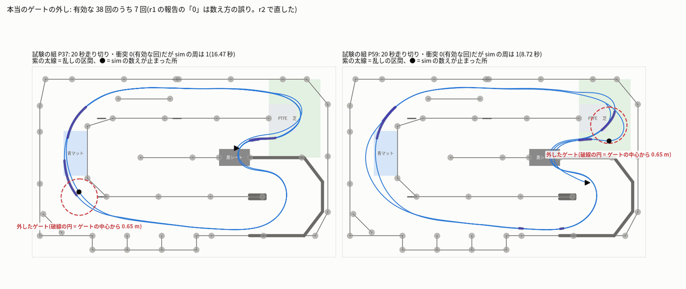
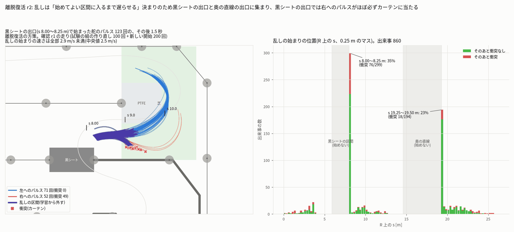

# 学習の段 — 強化学習モード(離脱復活)r2(sim_rl_modes_20261013)

- 作成 2026-10-14 04:42。段の役目: 離脱復活(`recover`)の方策を protocol のとおりに学習・選択・試験し、ブラウザ向けに書き出し、図を作る。
  **r2 は r1 が差し戻されたあとの回**で、確認 recover r1(`check_recover_r1.md`)の must_fix 5 つを先に直した(1 章)。
  r1 の報告はそのまま `train_recover_r1.md` に残した(この r2 の報告が r1 の誤りを直す)。
- 依頼(ユーザー、2026-10-13 21:20):「シミュレーターの走行は、ほかにももっといろいろなパターン、ぶつかるのを避けたり、いろいろな経路を通るパターンなども作成できるように。
  強化学習モード(最速)・(絶対壁にぶつからない)・(離脱復活)など、データセットのバリエーションが出る構成のモードを用意」。
  離脱復活 = 走っている途中で乱して(舵のパルス・わざと外す・ブレーキ/踏み込み)、そこからぶつからずに戻る走りを集めるモード。乱した操作は学習から外す。
- 守ったこと: ベストラップの作業のファイル・ユーザーのシミュレーター・ブリッジ・jetformer-web(再起動していない)・`protocol.json`(sha256 21dba877… のまま)・
  modes.json は変えていない。実車・PCA9685・I2C・GPU・Firefox は使っていない。Node は `jf-heavy --mem 1000〜1500M --lock none -- nice -n 15`、
  pytest は対象のファイルだけ(`jf-heavy --mem 900〜1200M --lock none`)。RL の学習はしていない(lock rl を取っていない。4 章)。git にコミットしていない。
  共有のコードを変えた所と理由は `deviations.md` の「離脱復活(recover)r2」の項に書いた。

---

## 0. 要点

1. **判定は不合格(参考)のまま**。方策は r1 と同じ(本番 1,000 万ステップのうち検証の組で選んだ 2,015,232 ステップ、sha256 `7720f275…`)。
   試験の組を r2 のコードで数え直すと、判定の値も 309 回の結果も r1 と 1 回ずつ同じ: C1 **38/100**(要 90)・C2 **0.760**(要 0.95)・C3 合格(0.47 / 1.00 秒)・
   C4 **2.92 回/回**(要 3.5)・C5 向き **35/40 = 0.875**(要 0.90)/ 横 36/40・C6 停止から 1 周 8.422 秒は合格だが REC60 の最小すき間 **2.124 cm**(要 3 cm)。
2. **r1 の誤りを直した**(1 章の表):
   - **ゲートの外し**: r1 の「有効な回でゲートの外し 0」は数え方の誤り。正しくは **有効な 38 回中 7 回**(P36・P37・P59・P68・P69・P89・P99)、
     生き残ったキック 127 回中 15 回。`bundle/recover/eval.json` を直した(`reported.gate_miss_episodes` = 7、`reported.gate_miss` に内訳)。
   - **取り込みの学習除外**: JetFormer の取り込み(`dataset_import.import_archive`)が `info.jf.l` を読み、乱した操作を正解に含む観測を外すようにした。
     jf の無い行も外す(fail closed)。強化学習モードでないシーンは変えない。試験 6 本。
   - **r1 の説明の誤り**: 選んだ方策は「速さをすき間と引き換えた」のではない(乱しなしのすき間の中央値は最速と同じ 6.3 cm、3 cm 未満の回は多い)。
     失敗は「乱しの始まりの速さ」だけでは決まらず、**黒シートの出口の右へのパルスはほぼ必ず衝突する**(52 回中 49 回。左へは 71 回中 0 回。始まりの速さは全部 2.9 m/s 未満)。
     「C2 と C6 は両立しない」は粗い目安で証明ではない(5 章に、もっと確かな見積もりを足した)。
   - **記録のプランとデータセットの説明**: 走り切るのは記録の開始の約 3 割(前もって走らせて替える)、走り切ったシーンの約 3 割にゲートの外し、
     乱しの始まりは s 8.00〜8.25 m に約 35%・19.25〜19.50 m に約 23%、の 3 つを `bundle/recover/mode.json` の `recording`・`dataset_card` に書いた。
3. **なぜ届かないか(新しい下調べ)**: 衝突した舵のパルスの記録を再生して逃げ道を探すと、黒シートの出口の右へのパルス 49 件は、乱しの間にブレーキを踏み、
   乱しのあと思い切り左へ切っても **1 件も避けられない**。避けるには始まりの速さを約 0.6 倍(2.5 → 1.5 m/s)にする必要がある。出口の外の舵のパルスの衝突
   (再生が元の走りと一致した 80 件)も 9 件しか避けられず、約 0.6 倍(4.0 → 2.4 m/s)が要る。出口だけ 1.5 m/s に落とすと停止から 1 周は 8.42 → 8.89 秒(C6 の中)だが、
   乱してよい位置ぜんぶで 2.4〜3.0 m/s に抑えると 9.8〜10.5 秒になり C6(9.0 秒)を越える(この方策で上限をかけた目安)。
4. **作り直し(種 32)はしなかった**: 範囲の中の調整では記録の乱しの決まりは変わらず、3 の見積もりでは C2 と C6 を両方満たす見込みが低い。
   lock rl は no_wall の作り直しと obstacle の本番が使っていて、入れると 1 時間以上遅れる。
5. **データセットとしては使える(ただし説明つき)**: 走り切ったシーンの出来事 4.33 回/シーン・学習から外す割合 0.174(基準の中)・VM7 は教師の 5.8〜6.1 倍。
   ただし乱しなしの最速のモードでも VM7 は教師の 2.6 倍あり、離脱復活のばらつきの大部分は「乱しの差し込み」から来る(最速の方策 + 同じ乱しで 1,297 マス、離脱復活の方策で 1,623 マス)。

---

## 1. 前の回(r1)の指摘と直し方

| # | 指摘(確認 recover r1) | 直したこと | 確かめ |
|---|---|---|---|
| 1 | 凍結した判定に届かず、作り直しの値も全部同じ。「不合格(参考)」は残すこと | 方策・判定は変えていない。試験の組を r2 のコードで数え直し(`train/recover/r2/eval_test_r2.json`)、状態は「不合格(参考)」のまま(`bundle/recover/status.json`)。作り直しをしなかった理由は 4 章・5 章 | 309 回の理由・フレーム・衝突・すき間・周・出来事・立て直し・キックが r1 の `eval_test.json` と全部同じ。judged も同じ |
| 2 | 「有効な回でゲートの外し 0」は誤り(本当は 7/38・15/127・18/65)。r1 の数え方(`valid_laps < laps.length`)はいつも 0、ランタイムの `wrapper.misses` も使えない | 新しい `rl/gate_miss.mjs`: sim の passed_gates が変わらないまま R 上の s が「ゲートの間の最大 1.519 m + 0.5 m」を越えて進んだら外し(確認 r1 と同じ決まり)。`rl/episode.mjs` がフレームごとの sim の数えを残し、`rl/eval_modes.mjs` が `reported.gate_miss_episodes` と内訳 `reported.gate_miss` を出す。`bundle/recover/eval.json` を書き直した。この報告の 3 章 | 有効な 38 回中 **7 回**(P36・P37・P59・P68・P69・P89・P99)、生き残ったキック **15/127**、ランタイムの仮想の外しは 21/38(参考)= 確認 r1 の値と全部一致。試験 `tests/gate_miss.test.mjs` 4 本 |
| 3 | 取り込みが `info.jf.l` を読まない。`rl/masking.py` は jf の無い行を学習に使う(fail open) | `jetformer/sim/label_mask.py`(新規)を `jetformer/dataset_import.py` の `import_archive` から呼ぶ。強化学習モードのシーンだけ、l = 0 の操作を正解に含む観測を future_valid = False・mode = 0。**jf・l の無い行、frames.jsonl に無いフレーム、読めない frames.jsonl は外す**。dataset_card.json に label_mask。`rl/masking.py` も安全側にした。この報告の 4 章 | jetformer の `tests/test_sim_label_mask.py` 6 本・`tests/test_masking.py` 5 本(JS・JetFormer 側と同じ外し方)・既存の取り込みの試験(`test_dataset_import`・`test_scene_import`・`test_sim_datasets`)が合格 |
| 4a | 選んだ方策は速さをすき間と引き換えていない(すき間の中央値は最速と同じ 6.3 cm、3 cm 未満は 5/100 vs 2/98、REC60 の最小 2.1 vs 5.7 cm) | r1 の 3 章の「遅く・壁から離れて走るようになった」は**後のチェックポイント(1 周 9.3〜9.6 秒)の話で、選んだ 2,015,232 ステップには当てはまらない**と直した(5.1 節) | 確認 r1 の値をそのまま使った |
| 4b | 「乱しの始まりの速さで決まる」は一部だけ。黒シートの出口の舵のパルスは全部 3 m/s 未満でも 41% 失敗。始まりの 58% が 2 か所に集まる。両立しないの見積もりは粗い目安 | 確認 r1 の走りを読み直し、**黒シートの出口では向きで決まる**(右へのパルス 49/52 が衝突、左へ 0/71)ことを示した。逃げ道の探索と、速さの上限をかけた 1 周の目安で「両立しない」を見積もり直した(5.2〜5.4 節)。「証明ではない」と書いた | `train/recover/r2/hotspot_analysis.json`・`exit_escape.json`・`escape_other.json`・`exit_slow_lap.json`、図 `fig/recover_r2_black_sheet_exit.png` |
| 5 | 記録のプランとデータセットの説明に 3 つを書くこと | 記録の決まりの開始 96 本を走らせて数え直し(`train/recover/r2/recording_facts.json`)、`bundle/recover/mode.json` の `recording` と `dataset_card.notes_ja` に書いた。この報告の 7 章 | 走り切り 29/96 = 30%、走り切ったシーンのゲートの外し 11/29 = 38%(最初の 15 本で 4/15)、始まり s 8.00〜8.25 m に 33%・19.25〜19.50 m に 24% |

---

## 2. 判定(試験の組、元の sim-core.js、`train/recover/r2/eval_test_r2.json`)

| 判定 | 基準 | 選んだ方策(r1 と同じ値) | 最速の方策(初期化元、build の段) | 弱・中だけ(代わりの試験、r1 で 1 回) |
|---|---|---|---|---|
| C1 有効な回(RC-P100) | ≥ 90/100 | **38/100** ✗ | 30/100 | 48/100 ✗ |
| C2 出来事の成功率 | ≥ 0.95 | **0.760**(292 件)✗ | 0.752(286 件) | 0.822(325 件)✗ |
| C3 立て直しの時間 中央値 / 90% 点 | ≤ 1.2 / 2.5 秒 | 0.47 / 1.00 秒 ✓ | 0.40 / 1.02 秒 | 0.33 / 1.00 秒 ✓ |
| C4 出来事 / 回・外す割合 | ≥ 3.5・0.10〜0.40 | **2.92**・0.119 ✗ | 2.86・0.112 | 3.25・0.119 ✗ |
| C5 キックの生き残り 向き 0.3 rad / 横 0.15 m | 各 ≥ 0.90 | **35/40 = 0.875** ✗ / 36/40 = 0.90 | 33/40 / 35/40 | (同じ) |
| C6 停止から 1 周・REC60・すき間 | ≤ 9.0 秒・60/60・≥ 3 cm | 8.422 秒・60/60・**2.124 cm** ✗(`rc20-mode8-val-54`) | 8.092 秒・60/60・5.7 cm | (同じ) |

- 確認 r1 は自前の作り方で同じ値を出した(C2 は乱しなしの線のマスの作り方の差で 0.764。3 件だけ成否が違う)。新しい種・新しい開始(200 回)でも
  有効 65/200・C2 0.750・キック 向き 53/57・横 48/55 で不合格(確認 r1 3 章)。
- C4 の出来事の数は衝突で早く終わった回も入れた平均。有効な 38 回だけなら 4.18 回/回・外す割合 0.183(基準の中)。
- 報告の値(protocol acceptance.recover.reported)。**r2 で直したのはゲートの外しの行**:

| 報告の値 | 選んだ方策 | 最速の方策 |
|---|---|---|
| 種類ごとの成功(既定) | 舵のパルス 71/123(58%)・わざと外す 117/122(96%)・ブレーキ/踏み込み 34/47(72%) | 76/130・101/107・38/49 |
| 強さごとの成功(既定) | 弱 72/89・中 67/89・強 83/114 | 77/91・66/87・72/108 |
| **ゲートの外しのある有効な回(r2 で直した)** | **7/38**(P36・P37・P59・P68・P69・P89・P99)。全部の回では 14/100、REC60 は 0/60 | (最速の方策は確認 r1 の新しい開始で 8/49) |
| **ゲートの外しのある生き残ったキック(r2 で直した)** | **15/127**(判定に使う位置の回では 向き 4/35・横 3/36) | (確認 r1 の新しい開始で 1/143) |
| RC-KICK の全部の位置(74 ずつ) | 向き 63/74・横 64/74 | 59/74・66/74 |
| 舵のパルス 12 フレームの生き残り(probe と同じ条件、r1) | 衝突なし 27/74(左 19/37・右 8/37) | 23/74 |

---

## 3. ゲートの外し(直した値)



- **数え方**(`rl/gate_miss.mjs`): 毎フレーム、sim の数え(completed_laps と passed_gates)と R 上の s(ランタイムの追跡器の値)を残し、数えが変わらないまま
  s が 2.019 m(ゲートの間の最大 1.519 m + 0.5 m)を越えて進んだら「外し」1 回。ふつうに走っていれば次のゲートまでに数えが必ず増えるので、0.5 m の余白で誤りは出ない。
  sim はゲートを外すとその route_index のまま止まり、1 周後に同じゲートを通るまで周を数えない(P37 の周は 16.47 秒の 1 周だけ)。valid_episode は周を見ないので有効のまま。
- **使わない数え方**: r1 の `valid_laps < laps.length`(laps は sim が数えた周だけ = いつも 0)、ランタイムの仮想の外し `wrapper.misses`
  (外側の線で面を越えるのが遅れただけでも数える。有効な 38 回中 21 回が 1 以上)。eval.json には参考として `virtual_counter_episodes_valid` に残した。
- 外した所の多くは (−4.15, 1.8) のゲート(青マットの下の急な曲がり)を、強・中の舵のパルスのあとに中心から 0.70〜0.72 m(sim の gateHalfWidth 0.65 m の外)で
  横切ったもの(確認 r1 4.2 節)。乱した操作は学習から外すが、外したあとの立て直しの操作(l = 1)は学習に使う。
- 図の P37 は、奥の直線の出口(s 19.33 m)の強い左へのパルスのあと、青マットの下のゲート(s 22.9 m の辺り)を外した回(sim の数えは 141 フレーム目から止まり、
  周は 16.47 秒の 1 つだけ)。P59 は、s 8.93 m の中くらいの右へのパルスのあと、次のゲート (3.98, −1.45) を中心から 0.652 m(0.65 m のすぐ外)で横切った回
  (328 フレーム目から止まる)。図の破線の円は、数えが止まった所の次のゲートを R の上に置いた目安。

---

## 4. 取り込みの学習除外(fail closed)

- **どこで**: `jetformer/dataset_import.py` の `import_archive`(PUT /api/datasets/import・/api/sim/datasets/<id>/import・tools/upload_datasets.py が通る)。
  展開した途中のフォルダで `jetformer/sim/label_mask.py` の `apply_to_dataset` を呼び、そのあとで形を確かめて置き換える(半端なデータセットは残らない)。
  統合の段が作る /api/sim/rl/import も import_archive を通すこと(modes.json common.masking.where)。
- **どのシーンに**: `simulation/scenes/<シーン>/session.json` の `context.teacher.schema` が `jetformer-sim-rl-teacher/v1`(id が `jf-rl-` で始まるものも)、
  または frames.jsonl のどこかに `action_info.jf` があるシーン。RC 教師など jf がどこにも無いシーンは変えない。
- **何を**: frame の番号で並べた learn[j](jf.l が 1 なら 1)から、l = 0 の j を正解(k+1〜k+10)に含む k(= 乱しの区間 [ps, pe) なら k ∈ [ps − 10, pe − 2])を
  future_valid[k] = False・mode[k] = 0 にする。npz の k と frames.jsonl の frame は同じ番号で、future_actions[k] = vehicle[k+1..k+10](ベストラップの記録で確かめた)。
  **jf・l の無い行、l が 0/1 でない行、frames.jsonl に無いフレームは l = 0 とみなし、frames.jsonl が読めないシーンは全フレームを外す**。
  最後の 10 フレームの False は元のまま。vehicle_valid は変えない。
- **カード**: `label_mask = {schema 'jetformer-sim-label-mask/v1', source 'frames.jsonl action_info.jf.l', horizon 10, fail_closed true, masked_frames, per_scene(外した数・
  jf の無い行の数など), before(元の training_frames・mode_frames)}`。training_frames・mode_frames は外したあとの数に数え直す。注意(warnings)にも出る。
- **試験**(jetformer `tests/test_sim_label_mask.py`): 区間の決まり / fail closed の読み方 / 取り込みで強化学習モードのシーンだけ外れる(jf の無い 1 行で 10 観測が外れる)・
  RC のシーンは変わらない・カードの数 / frames.jsonl の無いシーンは全部外れる / session.json が無くても jf があれば外す / 外すと学習に使えるフレームが 0 になる
  データセットは取り込まない。`rl/masking.py`(Python の参照)・`perturb.mjs maskFromLearn`(JS)・`label_mask.py` が同じ外し方(`tests/test_masking.py`)。
- **まだ効いていない所**: jetformer-web は再起動していない。動いているサーバーは古いコードなので、統合の段が再起動するまでは取り込みで外れない
  (離脱復活のシーンはまだ記録されていない)。

---

## 5. なぜ届かないか(r1 の説明を直したもの)

### 5.1 選んだ方策は速さをすき間と引き換えていない(r1 の誤りを直す)

r1 の 3 章の「方策は遅く・壁から離れて走るようになった(1 周 9.3〜9.6 秒・すき間最大 8.3 cm)」は、400 万ステップ以降のチェックポイントの話。
選んだ 2,015,232 ステップは、乱しなしで最速と同じ開始を走らせると(確認 r1 5.1 節、両方有効な 98 組): 線の差の平均 6.4 cm、走っている速さ 3.08 vs 3.29 m/s、
1 周目の中央値 8.51 vs 8.15 秒、**最小すき間の中央値は同じ 6.3 cm、3 cm 未満の回は多い(5/100 vs 2/98)、REC60 の最小は 2.1 vs 5.7 cm**。
= 少し遅いが、壁から離れてはいない。C6 の不合格(2.124 cm)もこの形。

### 5.2 失敗の 4 割は黒シートの出口の 1 か所で、そこでは向きで決まる



確認 r1 の走り(離脱復活の方策、試験の組の作り直し 100 回 + 新しい開始 200 回、出来事 860 件。`train/recover/r2/hotspot_analysis.json`)を読み直した:

- 乱しの始まりは **s 8.00〜8.25 m(黒シートの出口)に 34.8%、19.25〜19.50 m(奥の直線の出口)に 22.6%**。「乱してよい区間に入るまで遅らせる」決まりのため。
- 黒シートの出口の舵のパルス 123 回: **左へ 71 回は衝突 0、右へ 52 回は 49 回が衝突**(弱 9/12・中 18/18・強 22/22)。始まりの速さは 2.17〜2.85 m/s(中央値 2.5)。
  衝突は全部カーテン(s 9.0〜9.5 m の右側)で、パルスの始まりから中央値 0.47 秒。出口のすぐ先でコースは左へ曲がるので、右へのパルスは車をそのまま外側の壁へ向ける。
  始めてよい位置の決まり(先 2 m の幅 ≥ 0.60 m)は幅しか見ないので、この形を除けない。
- 黒シートの出口ではブレーキ/踏み込みも 27/50 が衝突。乱しのあとの衝突 197 件のうち **76 件(39%)が黒シートの出口**、18 件が奥の直線の出口、103 件がほかの所。
- = r1 の「乱しの始まりの速さで決まる」は一部だけ正しい。黒シートの出口は遅い(2.9 m/s 未満)のに失敗が多く、そこでは**パルスの向きと位置**で決まる。

### 5.3 逃げ道はあるか(記録を再生した下調べ)

衝突した舵のパルスの記録を高速版で ps の前まで再生し、ps から「乱しの間の速さ {方策のまま, 0 = ブレーキ}」×「乱しのあとの一定の指令(舵 5 通り × 速さ {0, そのまま})」の
20 通りで、1.5 秒のあいだ衝突しない組を探した(`rl/recover_r2/probe_exit_escape.mjs`)。見つからなければ、始まりの瞬間の速さを c 倍にして探し直した。
(確認 r1 の記録は丸めた値なので、再生の位置のずれは出口の 52 件で最大 8.6 mm。ほかの所は 92 件中 6 件がずれて別の走りになったので除いた。
一定の指令は弱い探し方なので、「見つからない」は目安、「見つかった」は確かに逃げられる。)

| 組 | 衝突した件数(再生で同じく衝突) | 今の速さで逃げ道あり | 始まりの速さ(中央値) | 逃げ道ができる速さ(中央値)・倍率 |
|---|---|---|---|---|
| 黒シートの出口の右へのパルス | 49 | **0** | 2.49 m/s | **1.47 m/s**(弱 2.19・中 1.53・強 1.31)・約 0.6 倍 |
| ほかの所の舵のパルス(左右) | 80 | 9(11%) | 3.96 m/s | **2.38 m/s**(四分位 1.80〜2.66)・約 0.6 倍 |

→ 方策の操縦を良くするだけで救えるのは 1 割ほど。残りは「その速さで乱されたら、どう操縦しても(この探し方の範囲では)ぶつかる」。

### 5.4 遅く走ると C6 はどうなるか(目安)

選んだ方策(乱しなし)を STD の開始・単周で元の sim-core.js で走らせ、速さの指令に位置ごとの上限をかけた(`rl/recover_r2/probe_exit_slow_lap.mjs` → `exit_slow_lap.json`):

| 上限 | 停止から 1 周 | 黒シートの出口での速さ |
|---|---|---|
| なし(試験の C6) | 8.422 秒 | 2.79 m/s |
| s 6.0〜8.3 m だけ 1.5 m/s | **8.890 秒**(C6 の中) | 1.50 m/s |
| s 6.0〜8.3 m だけ 1.3 m/s | 8.921 秒 | 1.37 m/s(ブレーキ 1.2 m/s² で落とし切れない) |
| + 乱してよい位置ぜんぶで 3.0 m/s | 9.795 秒 | 1.50 m/s |
| + 乱してよい位置ぜんぶで 2.4 m/s | **10.531 秒** | 1.50 m/s |
| + 乱してよい位置ぜんぶで 2.0 m/s | 10.899 秒 | 1.50 m/s |

- **黒シートの出口だけなら C6 と両立する見込み**(+0.47 秒)。これで出口の右へのパルスの衝突(49 件 = 全出来事の約 6%)は避けられる可能性がある
  (出口のブレーキ/踏み込みの衝突 27 件も減るかもしれない)。
- しかし C2 ≥ 0.95(失敗 5% 以下)には、出口の外の衝突(奥の直線の出口 18 + ほかの所 103 = 121 件、全出来事の約 14%)も減らす必要があり、そのためには乱してよい位置で 2.4 m/s 前後まで落とすことになり、
  1 周は約 10.5 秒(C6 は 9.0 秒以下)。上限で学習した方策ならもう少し速い線を見つけるかもしれず、逃げ道の探し方も弱いので、**これは目安で証明ではない**。
  r1 の「0.6 倍で 11.3 秒」(距離の割合を時間の割合とみなした見積もり)より確かな数字だが、結論の方向は同じ。
- 基準を満たすには設計(記録の乱しの決まり)の見直しが要る見込み: (a) 始まりを「許される最初のフレーム」に寄せない、(b) 出口のすぐ先が曲がる所ではその曲がりの外側へのパルスを
  出さない(幅だけでなく向きを見る)、(c) パルスの強さを速さに合わせる、(d) C6 の 1 周の上限をゆるめる。どれも protocol・modes.json の変更なので、この段では変えていない。

---

## 6. ばらつきと最速との違い

| 物差し | 離脱復活の方策 | 比べるもの |
|---|---|---|
| VM7(記録の決まりの開始で走り切った 15 シーン、r1 の予想) | **1,684 マス = 教師 15 シーン(278)の 6.06 倍** | 最速の方策 + 同じ乱し 1,483 |
| VM7(確認 r1 の新しい開始、有効な最初の 15) | 1,623(5.8 倍)。学習から外すフレームを除くと 1,337 | 最速の方策 + 同じ乱し 1,297、**最速のモード(乱しなし)726 = 2.6 倍**、離脱復活の方策・乱しなし 743 |
| 出来事 / シーン・学習から外す割合(走り切った 15 シーン) | 4.33・0.174(基準 ≥ 3.5・0.10〜0.40) | — |
| VM3 位置でそろえた横ずれ(r1) | 0.041 m | 教師 0.0032 m |

- per_mode_judged の「VM7 ≥ 教師の 2 倍」は、**乱しなしの最速のモードでも満たす**(2.6 倍)ので、この基準だけでは離脱復活が足したばらつきを示さない。
  最速のモードと比べると離脱復活は 2.2 倍(1,623 / 726)で、その大部分は乱しの差し込み(最速の方策 + 乱しで 1,297)から来る。学習で足されたのは
  有効な回 +16/200 と VM7 +25% ほど(確認 r1 5 章)。
- 学習から外すフレームを除いて数えると VM7 は 1,623 → 1,337 マス。乱しの最中の状態は、記録しても学習には使われない。

---

## 7. 記録のプランとデータセットの説明(`bundle/recover/mode.json` に書いたもの)

記録の決まりの開始(recover.recording.start_distribution の Halton 1〜・開始の衝突なし・種 703000 + i・強さ auto)を 96 本、元の sim-core.js で
衝突しても替えずに走らせた(`rl/recover_r2/recording_facts.mjs` → `train/recover/r2/recording_facts.json`):

| 数 | 値 | 確認 r1 の新しい開始(200 本) |
|---|---|---|
| 20 秒を走り切る割合 | **29/96 = 30%**(95% 区間 22〜40%) | 65/200 = 32.5% |
| 15 シーン(5 分)に要った候補 | **48 本(3.2 倍)** | — |
| 走り切ったシーンのうちゲートの外しあり | **11/29 = 38%**(95% 区間 23〜56%)、最初の 15 本では 4/15 | 18/65 = 28% |
| 乱しの始まりの位置(全部の出来事 293 件) | **s 8.00〜8.25 m に 33%、19.25〜19.50 m に 24%** | 35%・23% |
| 同(走り切ったシーンの出来事 126 件) | 37%・33% | — |
| 走り切った最初の 15 本: 出来事 / シーン・外す割合・最小すき間 | 4.33・0.174・0.85 cm | — |

- `mode.json` の `recording`: 前もって走らせる決まり(`rl/predict_scenes.mjs`。r2 からシーンごとの `gate_miss` と乱しの始まりも出す)、走り切る割合 0.30、15 シーンに候補 48 本。
  **modes.json の「候補はプランの 3 倍まで」(45 本)では平均 13.6 本しか集まらない**。足りないときの扱いは記録の段が決めて deviations.md に書くこと。
- `mode.json` の `dataset_card.notes_ja`(データセットの説明に写す 3 つ):
  1. 記録の開始のうち 20 秒を走り切るのは約 3 割。走り切らない開始は記録の前に替えてあるので、シーンは全部 20 秒・衝突 0 だが、「どの開始・どの乱しでも戻れる」データではない。
  2. 走り切ったシーンの約 3 割にシミュレーターのゲートの外しがある(sim はそのゲートを 1 周後に通るまで周を数えない)。外したあとの操作も学習に使う。
  3. 乱しの始まりは黒シートの出口 s 8.00〜8.25 m に約 35%、奥の直線の出口 s 19.25〜19.50 m に約 23% と 2 か所に偏る。
- `mode.json` の `import_requirements`: 学習除外は必須・fail closed・実装の場所(4 章)。

---

## 8. 学習(r1 の本番のまま)


- r2 では学習していない。方策は r1 の本番(種 31・1,000 万ステップ・調整 1 回: 幅 0.60 m・強さ 1.0 倍・種類 {0.45・0.20・0.15・0.20}、`deviations.md`)から
  protocol selection で選んだ 2,015,232 ステップ(検証の組で C2 0.818 が一番高い、満たす項目 2/6)。学習曲線は r1 の図のとおり: 学習中の 20 秒の生き残りは 0.2〜0.35、
  検証の組の C2 は 0.70〜0.82 を上下するだけで上がる傾向が無く、400 万ステップ以降は 1 周が 9.0 秒を越えた。
- **作り直し(protocol allowed_tuning.retry、種 32・1,000 万まで)をしなかった理由**: (1) 5.3〜5.4 節の見積もりでは、記録の乱しの決まり(調整の範囲の外)のままでは
  C2 0.95 と C6 9.0 秒を両方満たす見込みが低い(学習の範囲の中の調整 = ゲートの外しの罰・種類の割合・強さの上限・学習の幅では記録の乱しは変わらない)。
  (2) 試験の組は 1 モード 2 回までで、作り直しても「不合格(参考)」が変わる見込みが低い。(3) lock rl は no_wall の作り直し(種 22)と obstacle の本番(1,500 万)が
  使っていて、作り直しを入れると約 1 時間遅れる。r2 で直したのは報告・取り込み・説明で、どれも学習を要しない。
- もし作り直すなら(記録の段のあとなど): 黒シートの出口を遅く通る走り(+0.5 秒で C6 の中)を覚えさせると、出口の右へのパルスの衝突(全出来事の約 6%)は減らせる見込み。
  出口の外の衝突(全出来事の約 14%)は残るので、C2 は 0.84 前後の見込み(確認 r1 の新しい開始の 0.750 から出口の衝突 8.8% を引いた粗い値)。

---

## 9. ブラウザ向けの書き出し

- `experiments/20261013_sim_rl_modes/bundle/recover/`(`publish_mode.py --overrides train/recover/r2/overrides_r2.json`、04:26):
  policy.json `7720f275…`(r1 と同じ)・mode.json(上書き: recording・dataset_card・import_requirements)・eval.json(r2 の数え直し。`reported.gate_miss_episodes` 7・
  `reported.gate_miss`)・status.json `{state: not_accepted, label_ja: 不合格(参考), failed: C1・C2・C4・C5・C6}`。r1 の一式の写しは `train/recover/r2/bundle_recover_r1_backup/`。
- **F-ID**: `train/recover/fid_scene_P5.json`(乱し 4 回・学習しないフレーム 107 の 600 フレーム)を、いまの `web/rl/mode_runtime.mjs`(no_wall r2 でシールド v3 に
  作り直したブラウザの組)に与えて **操作の差 0・info の違い 0**(r2 で確かめ直した)。ブラウザの組は r2 で変えていない。登録簿(`data/sim_rl/modes/recover/`)へは統合の段が `--registry` で置く。

---

## 10. 図(`fig/`)

| 図 | 中身 |
|---|---|
| `recover_r2_black_sheet_exit.png`(r2) | 左: 黒シートの出口で始まった舵のパルス 123 回のその後 1.5 秒(青 = 左へ、橙 = 右へ、紫 = 乱しの区間、赤の × = カーテンへの衝突)。右: 乱しの始まりの位置(0.25 m のマス)と、そのあとの衝突 |
| `recover_r2_gate_miss.png`(r2) | 本当のゲートの外しの例(試験の組の P37・P59): 20 秒走り切り・衝突 0 だが sim の周は 1 つだけ。破線の円 = 外したゲート、● = sim の数えが最後に変わった所 |
| `recover_learning_curve.png`(r1) | 学習曲線と検証の組の値(r2 では学習していない) |
| `recover_trajectories.png`・`recover_event_map.png`(r1) | 試験の組の走りと乱しの始まりの位置と成否(値は r2 の数え直しと同じ) |

---

## 11. ファイルと再現のコマンド

r2 で足した・変えたコード(sha256 の先頭。変更の前の写しは `train/recover/r2/before/`):

| ファイル | sha256 | 中身 |
|---|---|---|
| `experiments/…/rl/gate_miss.mjs`(新規) | adccfe1e | 本当のゲートの外しの数え方 |
| `experiments/…/rl/episode.mjs` | a0b37a6b → 3d6e6587 | フレームごとの sim の数えを残し、gate_miss などを結果に足す |
| `experiments/…/rl/eval_modes.mjs` | 58e2e4c7 → ee102065 | 行に gate_miss、recover の reported.gate_miss_episodes を直し内訳を足す |
| `experiments/…/rl/predict_scenes.mjs` | ea6d3ad5 → 6a1f77e3 | シーンごとの gate_miss と乱しの始まり |
| `experiments/…/rl/masking.py` | ccf601be → dc05d721 | jf の無い行を学習しない(fail closed) |
| `experiments/…/tests/gate_miss.test.mjs`(新規)・`tests/test_masking.py` | f2547ea0・e2bdee19 | 試験 |
| `jetformer/jetformer/sim/label_mask.py`(新規) | cdc35eb0 | 取り込みの学習除外 |
| `jetformer/jetformer/dataset_import.py` | d511eac3 → 97d21241 | import_archive から label_mask を呼ぶ(10 行) |
| `jetformer/tests/test_sim_label_mask.py`(新規) | 864aa5fa | 試験 6 本 |
| `experiments/…/rl/recover_r2/`(新規) | `recording_facts.mjs` f194032b・`hotspot_analysis.py` 2084f217・`probe_exit_escape.mjs` 8c281afa・`probe_exit_slow_lap.mjs` e41421aa・`probe_gate_miss_one.mjs` 3cdcfa97・`recover_r2_figs.py` 5567ecc8 | 数え・下調べ・図 |

結果(`/home/jetson/jetformer_reports/sim_rl_modes_20261013/train/recover/r2/`): `eval_test_r2.json`(.log)・`recording_facts.json`(.log)・`hotspot_analysis.json`・
`exit_escape.json`・`escape_other.json`(.log)・`exit_slow_lap.json`・`overrides_r2.json`・`before/`・`bundle_recover_r1_backup/`。

```bash
cd ~/jetformer/experiments/20261013_sim_rl_modes
R=~/jetformer_reports/sim_rl_modes_20261013/train/recover
H="/home/jetson/bin/jf-heavy --mem 1500M --lock none -- nice -n 15"
$H node rl/eval_modes.mjs --mode recover --policy $R/best/policy.json --set test --jobs 2 --out $R/r2/eval_test_r2.json      # 約 3 分
$H node rl/recover_r2/recording_facts.mjs --policy $R/best/policy.json --candidates 96 --out $R/r2/recording_facts.json      # 約 2 分
python -I rl/recover_r2/hotspot_analysis.py ~/jetformer_reports/sim_rl_modes_20261013/check_recover_r1/runs rl/runtime/room_table.json $R/r2/hotspot_analysis.json
$H node rl/recover_r2/probe_exit_escape.mjs ~/jetformer_reports/sim_rl_modes_20261013/check_recover_r1/runs $R/r2/exit_escape.json             # 約 2 分
$H node rl/recover_r2/probe_exit_escape.mjs ~/jetformer_reports/sim_rl_modes_20261013/check_recover_r1/runs $R/r2/escape_other.json other       # 約 2 分
$H node rl/recover_r2/probe_exit_slow_lap.mjs $R/best/policy.json $R/r2/exit_slow_lap.json
python -I rl/publish_mode.py --mode recover --policy $R/best/policy.json --eval $R/r2/eval_test_r2.json --overrides $R/r2/overrides_r2.json --source "…"
node rl/check_fid.mjs --fid $R/fid_scene_P5.json --policy bundle/recover/policy.json --runtime web/rl/mode_runtime.mjs
python -I rl/recover_r2/recover_r2_figs.py
node --test tests/gate_miss.test.mjs; python -m pytest -q tests/test_masking.py
cd ~/jetformer && python -m pytest -q tests/test_sim_label_mask.py tests/test_dataset_import.py tests/test_scene_import.py tests/test_sim_datasets.py
```

---

## 12. 次の段への申し送り

- **登録**: 状態は「不合格(参考)」。画面では試験の組の数字(有効 38/100・出来事の成功 76%・立て直しの中央値 0.47 秒・ゲートの外し 7/38)をそのまま見せる。
- **統合**: jetformer-web を再起動して取り込みの学習除外を効かせる(再起動は学習・記録・走行・セッション・ジョブが無いとき)。/api/sim/rl/import を作るなら
  import_archive を通す。`mode.json` の `dataset_card.notes_ja` を、取り込んだデータセットの説明(カード)に写す。pytest 一式(lock big)はまだ回していない(対象の 4 ファイルだけ)。
- **記録**: `rl/predict_scenes.mjs` で前もって走らせて走り切るシーンだけをプランに入れる。候補は 3.2 倍(15 シーンに 48 本)以上が要る(3 倍だと足りないことがある)。
  強さは既定(自動)。RA5 で、取り込んだ npz の future_valid・mode が mask_rule の数え直しと一致し、カードの label_mask の数が合うことを確かめる。
- **基準を満たすには**: 5.4 節の (a)〜(d) の設計の見直し(protocol・modes.json の変更)をユーザーに相談する。範囲の中の作り直しでは届かない見込み。

## 13. 起動したプロセス

- 試験の組の数え直し(`eval_modes.mjs --jobs 2`)、記録の開始の数え、逃げ道の下調べ 2 本、1 周の目安、図、Node・pytest の試験。**すべて終わっている**
  (段の終わりに `ps` で確かめた)。RL の学習は起動していない。ほかの作業(no_wall の作り直し・obstacle の順番待ち・ベストラップの作業の GPU 学習)・
  ユーザーのブリッジ・jetformer-web には触れていない。
