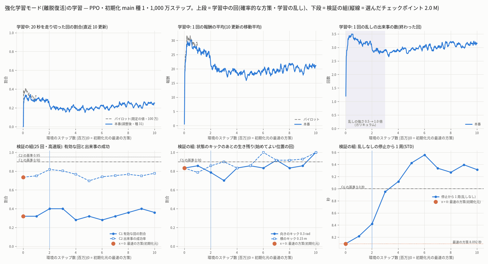
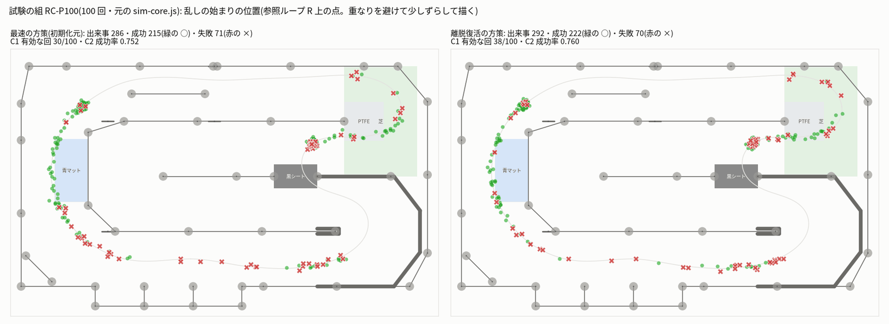
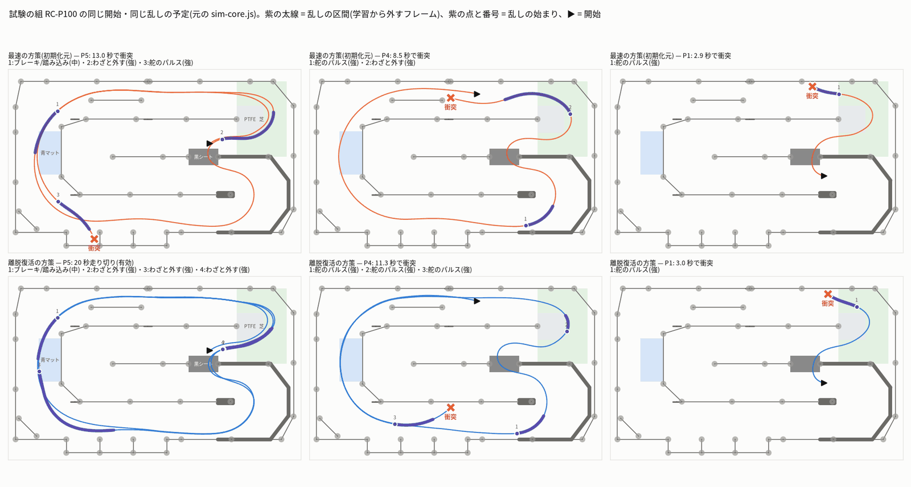

# 学習の段 — 強化学習モード(離脱復活)r1(sim_rl_modes_20261013)

- 作成 2026-10-14 01:35。段の役目: 離脱復活(`recover`)の方策を、`build.md` の仕組み(`rl/train_modes.py`・`rl/eval_modes.mjs`)で protocol のとおりに学習し、
  検証の組でチェックポイントを選び、試験の組で判定し、ブラウザ向けに書き出し、図を作る。
- 依頼(ユーザー、2026-10-13 21:20):「シミュレーターの走行は、ほかにももっといろいろなパターン、ぶつかるのを避けたり、いろいろな経路を通るパターンなども作成できるように。
  強化学習モード(最速)・(絶対壁にぶつからない)・(離脱復活)など、データセットのバリエーションが出る構成のモードを用意」。
  離脱復活 = 走っている途中で乱して(舵のパルス・わざと外す・ブレーキ/踏み込み)、そこからぶつからずに戻る走りを集めるモード。乱した操作は学習から外す。
- 守ったこと: ベストラップの作業のファイル・ユーザーのシミュレーター・JetFormer 本体・ブリッジ・jetformer-web・`protocol.json`(`sha256sum -c protocol.sha256` OK)・
  `build.md` の段のコード(`rl/` の既存のファイル)は変えていない。足したのは `rl/run_train_recover.sh` と `rl/recover_r1/` の下だけ。
  RL の学習は `jf-heavy --mem 2G --lock rl -- nice -n 15`、Node の試験・下調べは `jf-heavy --mem 1500M --lock none -- nice -n 15`。実車・PCA9685・I2C・GPU・Firefox は使っていない。
  git にコミットしていない。調整・代わりの試験・作り直しをしなかったことは `deviations.md` に書いた。

---

## 0. 要点

1. **判定は不合格(参考)**。選んだ方策(本番 1,000 万ステップのうち検証の組で選んだ 2,015,232 ステップ、sha256 `7720f275…`)の試験の組(元の sim-core.js)は
   C1 有効な回 **38/100**(基準 90)・C2 出来事の成功 **0.760**(基準 0.95)・C3 合格・C4 出来事 2.92/回(基準 3.5)・C5 向き 35/40 = 0.875(基準 0.90)/ 横 36/40 = 0.90・
   C6 は停止から 1 周 8.422 秒・REC60 60/60 有効だが最小すき間 **2.1 cm**(基準 3 cm)で不合格。初期化元の最速の方策(C1 30/100・C2 0.752)より少し良いだけ。
2. **代わりの試験(強さ「弱・中」だけ)も不合格**: C1 48/100・C2 0.822(protocol fallbacks.recover。1 回だけ)。
3. **なぜ届かないか(物理)**: 失敗の 7 割は舵のパルス。舵の速さが 1.2 rad/s しかないので、パルスで切れた舵を戻すのにパルスと同じだけ時間がかかり、
   その間に向きが大きくずれる。ぶつかった舵のパルス 39 件を「乱しの始まりの速さを c 倍にしたら」で走らせ直すと、助かるのは c = 0.8 で 7 件・0.6 で 13 件・0.45 で 22 件・0.3 で 37 件。
   C2 ≥ 0.95 には乱しが来うる区間を今の 0.3〜0.6 倍の速さで走る必要があり、**C6(停止から 1 周 ≤ 9.0 秒 = 最速の 1.11 倍まで)と両立しない**。
   学習もこのとおりに動き、方策は遅くなる(1 周 8.09 → 9.56 秒)が、立て直しの成功率は 0.70〜0.82 から上がらなかった。
4. **データセットとしては使える**: 記録の決まりの開始で、20 秒を走り切ったシーン(衝突したシーンは記録で替える)のばらつきの Node の予想は
   VM7 = **1,684 マス = 教師 15 シーン(278 マス)の 6.1 倍**(基準 2 倍)、出来事 **4.33 回/シーン**(基準 3.5)、学習から外すフレーム **0.174**(基準 0.10〜0.40)、
   VM3 0.041 m(教師 0.0032 m)。ただし走り切るのは記録の開始の **31%**(48 本中 15 本)なので、記録の前に `rl/predict_scenes.mjs` で前もって走らせて替える必要がある
   (最速の方策のままだと 24%)。
5. **ブラウザ向けの書き出し**: `experiments/20261013_sim_rl_modes/bundle/recover/`(mode.json・policy.json・eval.json・status.json、状態 `not_accepted` =「不合格(参考)」)。
   F-ID(乱しが 4 回入って 20 秒走り切るシーンの 600 フレーム)を `web/rl/mode_runtime.mjs`(ブラウザに配る写し)に与えると、操作の差 0・info の違い 0。
6. 作り直し(種 32)はしなかった(上の 3 のため。`deviations.md`)。

---

## 1. やったこと(順番)

| 時刻 | 中身 | 結果 |
|---|---|---|
| 23:32〜23:46 | パイロット(既定の値・100 万ステップ、`train/recover/pilot/`。lock rl の順番待ちのあと 23:41 から) | 学習中の 20 秒の生き残り 0.2〜0.5 で上がらず、検証の組 C1 6〜8/25・C2 0.73〜0.74 = 初期化元と同じ |
| 23:33〜23:50 | 下調べ(`train/recover/probe/`): 速さの上限・失敗の出来事の作り直し・乱しの始まりの位置 | 6 章 |
| 23:50 | 1 回だけの調整(`train/recover/tuning_main.json`、`deviations.md`) | 乱しの始めてよい幅 0.45 → 0.60 m・強さの上限 1.2 → 1.0 倍・種類の割合を記録に近づける |
| 00:35〜01:20 | 本番(種 31・1,000 万ステップ・`--eval`、`train/recover/main/`)。no_wall の本番のあとに lock rl が空いてから。44.6 分、中央値 5,323 steps/s | 3 章 |
| 01:21 | チェックポイントの選択(`rl/recover_r1/select_checkpoint.py` → `main/selection.json`) | 2,015,232 ステップ(4 章) |
| 01:22〜01:27 | 試験の組(既定)と代わりの試験(弱・中)、各 `--jobs 2` で 130 秒 | 5 章 |
| 01:27〜01:35 | 書き出し(`publish_mode.py`)・F-ID・報告の値(12 フレームのパルス)・ばらつきの予想・図 | 7〜9 章 |

---

## 2. 学習の設定

| 項目 | 値 |
|---|---|
| 入口 | `rl/run_train_recover.sh main 10000000 --eval --tag main --tuning train/recover/tuning_main.json`(= `rl/run_mode.sh` と同じ包み。出力だけ `train/recover/<名前>`) |
| 初期化 | main 種 1 の 1,000 万(`step_010010624.pt`、ベストラップの作業の選んだ方策 7c43cb53…)。観測は base79v(79 次元・仮想ゲート)なので広げない |
| 種 | 31(protocol seeds.training_seeds) |
| PPO | ベストラップと同じ(64 環境 × 256 = 16,384 / 更新、5 エポック、ミニバッチ 4,096、clip 0.2、γ 0.995、λ 0.95、target_kl 0.03、lr 1e-4 → 3e-5、torch 4 スレッド) |
| 報酬 | v2-gatecap + ゲートを外したら −3 で続ける、衝突・停止・逆走・黒シート違反は −10 で終了 |
| 乱し(学習) | 調整後: 舵のパルス 0.45・わざと外す 0.20・ブレーキ/踏み込み 0.15・状態のキック 0.20、始めてよい位置 = 先 2 m の幅 ≥ **0.60 m** かつ黒シートの区間の外、強さ 0.5 → **1.0** 倍(最初の 300 万ステップ)。差し込んだ行動のステップは方策の損失から外す(学習中 7〜9%) |
| チェックポイント | 100 万ステップごと(`checkpoints/step_N.pt`・`policies/step_N.json`)。各チェックポイントで検証の組(25 + 40〜56 + 1 + 15 回、高速版)を裏で評価 |
| 調整の理由 | パイロットで生き残りが上がらず、失敗が「乱しの始まりの速さと位置」で決まっていた(6 章)。学習の乱しを記録の乱しと同じ所・同じ強さにそろえ、試験と同じ条件の立て直しに学習を集めた |

---

## 3. 学習の経過



- 学習中(確率的な方策・学習の乱し)の 20 秒の生き残りは最初の 50 万ステップで 0.35 前後、強さのカリキュラムが 1.0 倍に近づく 200 万ステップ以降は 0.2〜0.25 で横ばい。
  1 回の報酬は 30 → 20。速さの行動 |a1| の平均は 1.33 → 1.10 に下がった(遅く走るようになった)。
- 検証の組(25 回・高速版)の値:

| ステップ | C1 有効 | C2 成功率 | C3 中央値 / 90% 点 [秒] | C4 出来事 / 外す割合 | C5 向き / 横 | C6 1 周 [秒]・REC15・すき間 | 満たす |
|---|---|---|---|---|---|---|---|
| 0(最速の方策) | 8/25 | 0.736 | 0.27 / 0.69 | 2.88 / 0.111 | 10/12 / 10/12 | 8.092・15/15・5.7 cm | 2/6 |
| 1,015,808 | 8/25 | 0.750 | 0.17 / 0.90 | 3.04 / 0.114 | 12/14 / 11/14 | 8.218・15/15・4.3 cm | 2/6 |
| **2,015,232** | **10/25** | **0.818** | 0.27 / 0.97 | 3.08 / 0.117 | 11/14 / 12/14 | 8.422・15/15・3.2 cm | 2/6 |
| 3,014,656 | 10/25 | 0.803 | 0.20 / 0.83 | 3.04 / 0.114 | 7/10 / 9/10 | 8.951・15/15・3.5 cm | 2/6 |
| 4,014,080 | 7/25 | 0.766 | 0.40 / 1.05 | 3.08 / 0.106 | 10/12 / 10/12 | 9.119・15/15・3.9 cm | 1/6 |
| 5,013,504 | 8/25 | 0.697 | 0.20 / 0.83 | 3.04 / 0.103 | 12/14 / 12/14 | 9.425・15/15・3.7 cm | 1/6 |
| 6,012,928 | 7/25 | 0.740 | 0.37 / 1.38 | 3.08 / 0.110 | 10/12 / 12/12 | 9.558・15/15・8.3 cm | 1/6 |
| 7,012,352 | 8/25 | 0.753 | 0.30 / 1.16 | 3.08 / 0.111 | 11/12 / 11/12 | 9.338・15/15・6.1 cm | 2/6 |
| 8,011,776 | 9/25 | 0.766 | 0.30 / 1.37 | 3.08 / 0.109 | 10/12 / 11/12 | 9.271・15/15・5.5 cm | 1/6 |
| 9,011,200 | 10/25 | 0.750 | 0.48 / 1.20 | 3.20 / 0.118 | 12/14 / 13/14 | 9.394・15/15・3.2 cm | 1/6 |
| 10,010,624 | 9/25 | 0.778 | 0.43 / 1.67 | 3.24 / 0.111 | 12/12 / 12/12 | 9.314・15/15・5.7 cm | 2/6 |

→ 方策は「遅く・壁から離れて」走るようになった(1 周 8.09 → 9.3〜9.6 秒、REC15 のすき間 5.7 → 最大 8.3 cm、C5 のキックは後半 12/12 も出る)が、
乱しのあとの成功率 C2 は 0.70〜0.82 の間を上下するだけで上がる傾向が無い。400 万ステップ以降は 1 周が 9.0 秒を越えて C6 も満たさなくなる。

---

## 4. チェックポイントの選択(protocol selection.rule)

- judged を全部満たすチェックポイントは無い。満たす項目が一番多いのは 2/6(C3・C6、または C3・C5)の 5 つで、主な数字 = C2 の成功率が一番高い
  **2,015,232 ステップ(C2 0.818)** を選んだ(`main/selection.json`)。写し: `train/recover/best/policy.json`(= `main/policies/step_002015232.json`、
  sha256 `7720f2754972efbbd9b714008c99e63822b5421a0eef349840d3d52fb8a0456f`)・`best/checkpoint.pt`。
- 試験の組はこの 1 つだけに使い、試験の結果を見て選び直していない。

---

## 5. 試験の組の結果(元の sim-core.js、`train/recover/eval_test.json`)

| 判定 | 基準 | 選んだ方策 | 最速の方策(初期化元、build の段) | 弱・中だけ(代わりの試験) |
|---|---|---|---|---|
| C1 有効な回(RC-P100) | ≥ 90/100 | **38/100** ✗ | 30/100 | 48/100 ✗ |
| C2 出来事の成功率 | ≥ 0.95 | **0.760**(292 件)✗ | 0.752(286 件) | 0.822(325 件)✗ |
| C3 立て直しの時間 中央値 / 90% 点 | ≤ 1.2 / 2.5 秒 | 0.47 / 1.00 秒 ✓ | 0.40 / 1.02 秒 | 0.33 / 1.00 秒 ✓ |
| C4 出来事 / 回・外す割合 | ≥ 3.5・0.10〜0.40 | 2.92・0.119 ✗(出来事が足りない) | 2.86・0.112 | 3.25・0.119 ✗ |
| C5 キックの生き残り 向き 0.3 rad / 横 0.15 m | 各 ≥ 0.90 | 35/40 = 0.875 ✗ / 36/40 = 0.90 ✓ | 33/40 / 35/40 | (同じ) |
| C6 停止から 1 周・REC60・すき間 | ≤ 9.0 秒・60/60・≥ 3 cm | 8.422 秒・60/60・**2.1 cm** ✗ | 8.092 秒・60/60・5.7 cm | (同じ) |

- C4 の出来事の数は、衝突で早く終わった回も入れた平均。有効な 38 回だけなら **4.18 回/回・外す割合 0.183**(基準の中)。C1 が満たされれば C4 も満たす見込み。
- C6 の不合格は REC60 の 1 シーン(`rc20-mode8-val-54`、すき間 2.12 cm、衝突なし)だけ。ほかの 59 シーンは 3 cm 以上。検証の組(15 シーン)では 3.2 cm だった。
- 報告の値(protocol acceptance.recover.reported):

| 報告の値 | 選んだ方策 | 最速の方策 |
|---|---|---|
| 種類ごとの成功(既定) | 舵のパルス 71/123(58%)・わざと外す 117/122(96%)・ブレーキ/踏み込み 34/47(72%) | 76/130・101/107・38/49 |
| 強さごとの成功(既定) | 弱 72/89(81%)・中 67/89(75%)・強 83/114(73%) | 77/91・66/87・72/108 |
| 失敗した出来事の内訳(既定 70 件) | 舵のパルス 強 28・中 14・弱 10、ブレーキ/踏み込み 13、わざと外す 5 | 舵のパルス 強 32・中 15・弱 7 … |
| 弱・中だけのとき | 舵のパルス 91/129・わざと外す 138/144・ブレーキ/踏み込み 38/52、弱 129/153・中 138/172 | — |
| ゲートの外しのある有効な回 | 0 | 0 |
| RC-KICK の全部の位置(74 ずつ) | 向き 63/74・横 64/74 | 59/74・66/74 |
| 舵のパルス 12 フレームの生き残り(probe と同じ条件、`probe/pulse12_*.json`) | 衝突なし **27/74**(左 19/37・右 8/37)、外しもなし 21/74 | 23/74(左 16・右 7)、理解の段の probe は 22/74 |
| 乱しの始まりの位置(既定の試験) | 黒シートの出口 s 8.00〜8.25 m に 32.5%(成功 80%)、奥の直線の出口 19.30〜19.55 m に 22.9%(92.5%)、そのほか 44.5%(64.6%) | 32.9%(74.5%)・19.6%(94.6%)・47.6%(67.6%) |



- 乱しの始まりは「許される最初のフレームまで遅らせる」決まり(modes.json zones.perturb_allowed)のため、出来事の 3 分の 1 が黒シートの区間を出た直後(s 8.00〜8.25 m)に集まる。
  学習でこの集まりの成功率は 74.5 → 80% に上がった。残りの失敗は、それ以外の場所(R の 59% の区間)の速い所の舵のパルス。



- 図の P5 は、最速の方策が 3 回目の舵のパルス(強)で衝突する回で、選んだ方策は 4 回の乱し(ブレーキ・わざと外す 3 回)を受けて 20 秒を走り切る
  (同じ開始・同じ種でも、走りが変わると乱しの始まる位置が変わる。わざと外す幅が両側とも足りない所では舵のパルスに替わるので、最速の方策の 3 回目は舵のパルスになった)。P4・P1 は両方とも舵のパルス(強)のすぐあとに衝突する。

---

## 6. なぜ足りないか(下調べ、`train/recover/probe/`、試験・検証と重ならない開始と種)

1. **速さの上限を掛けるだけでは良くならない**(`probe_speed_limit.mjs` → `speed_limit_fastest.json`、最速の方策、記録の乱し、39 回): 上限なし 7/39・4.0 m/s 9/39・3.5 m/s 7/39・3.0 m/s 7/39。
   この方策は上限の速さで学習していないうえ、低い速さではヨーレートの頭打ち(μg/v)がゆるみ同じ舵のパルスで向きがもっと大きく変わる(と考えられる)ので、ただ遅くするだけでは助からない。
2. **乱しのあとの操縦を替えても助からない**(`probe_feasible.mjs` → `feasible_fastest.json`): 衝突した 32 件の出来事を、乱しの終わり pe から簡単な操縦
   (R を前方 0.4〜1.2 m で追う pure pursuit × 速さ 0〜3.5 m/s)に替えて走らせ直しても 0 件。乱しの間にブレーキを足しても 6 件(5 件はブレーキ/踏み込みの乱しそのものを打ち消したもの)。
   (この操縦は乱しなしでも 0.8 m/s で衝突することがあり、上限の目安としては弱い。下の 3 が主な根拠。)
3. **乱しの始まりの速さで決まる**(`probe_slower.mjs` → `slower_fastest.json`、80 回): 舵のパルスのあとにぶつかった 39 件を、乱しの始まりで速さを c 倍に書き換え
   (乱しの間は差し込みの舵 + 方策の速さ、上限 c·v。乱しのあとは同じ方策が運転)て走らせ直すと、助かる数は c = 1 で 0・**0.8 で 7・0.6 で 13・0.45 で 22・0.3 で 37**。
   弱は 0.8 倍、中は 0.45〜0.6 倍、強は 0.3 倍でやっと助かる。ほかに乱しの最中にぶつかった 7 件(強)がある。
4. 理由: 舵の速さ(steerRate)が 1.2 rad/s なので、12 フレームのパルスで舵は 0.48 rad まで切れ、戻すのにも 0.4 秒かかる。その 0.8 秒の間に向きが大きくずれ、
   幅 0.6 m の区間(すき間 5 cm)には戻れない。舵の速さはユーザーのシミュレーターの物理(変えられない)。
5. **C2 と C6 は両立しない見込み**: 乱しが来うる区間は R の 59%。粗い見積もり(距離の割合を時間の割合とみなす)で、そこを 0.6 倍で走るだけで 1 周は約 8.09 × (0.41 + 0.59 / 0.6) ≈ 11.3 秒になり、C6 の 9.0 秒を越える。
   学習もこの組み合わせの中で、遅くなる(9.56 秒まで)代わりに成功率は上がらない、という形で止まった(3 章)。

---

## 7. ばらつき(Node の予想。判定は記録の段、`train/recover/variation_selected.json`)

`rl/recover_r1/predict_variation.mjs`: 記録の決まりの開始(recover.recording.start_distribution の Halton 1〜、種 703000 + i)を元の sim-core.js で走らせ、
衝突した回は替えて(記録と同じ)有効な 15 シーンを集めた。教師は RC 教師 × REC60 の 0〜14 番(9,000 フレームのうち開始から 3 m 以降の 8,460)。

| 物差し | 選んだ方策(15 シーン) | 最速の方策 + 同じ乱し(参考) | 教師 15 シーン | 基準(per_mode_judged.recover) |
|---|---|---|---|---|
| VM7 状態の網羅 [マス] | **1,684(6.06 倍)** | 1,483(5.33 倍) | 278 | ≥ 2 倍 |
| VM6 出来事 / シーン | **4.33** | 4.40 | — | ≥ 3.5 |
| VM6 学習から外すフレームの割合 | **0.174** | 0.168 | — | 0.10〜0.40 |
| VM1 時刻でそろえた舵 [µs] | 178.7 | 191.9 | 7.56 | 報告 |
| VM3 位置でそろえた横ずれ [m] | 0.041 | 0.037 | 0.0032 | 報告 |
| 走り切ったシーンの最小すき間 | 0.85 cm | 1.18 cm | — | 報告 |
| 走り切る割合(記録の開始) | 15/48 = **31%** | 15/62 = 24% | — | (記録では替える) |

→ 記録できたシーンのばらつきはモードの基準を満たす見込み(教師の 6 倍の状態を通る)。ただし記録の前に `rl/predict_scenes.mjs` で約 3 倍のシーンを前もって走らせ、
走り切るものだけをプランに入れる必要がある(衝突した回は記録で捨てて替える = C1 の文の決まり)。

---

## 8. ブラウザ向けの書き出し

- 方策: `train/recover/best/policy.json`(schema `jf-sim-rl-mode-policy/v1`・obs_dim 79・obs_wrapper `base79v`・meta に run・種・ステップ・初期化元・調整・protocol と modes.json の sha256)。
- 登録の一式: `python rl/publish_mode.py --mode recover --policy train/recover/best/policy.json --eval train/recover/eval_test.json` →
  `experiments/20261013_sim_rl_modes/bundle/recover/`(policy.json `7720f275…`・mode.json・eval.json `3cc5f177…`・status.json `{state: not_accepted, label_ja: 不合格(参考), failed: C1・C2・C4・C5・C6}`)。
  protocol publication のとおり、優先 1 なので不合格でも「不合格(参考)」として出し、数字をそのまま見せる。登録簿(`data/sim_rl/modes/recover/`)へは統合の段が `--registry` で置く。
- F-ID: `train/recover/fid_scene_P5.json`(試験の P5 と同じ開始・種 903005、600 フレーム、乱し 4 回・学習しないフレーム 107)。`rl/check_fid.mjs` で
  `web/rl/mode_runtime.mjs`(ブラウザに配る写し)に与えて **操作の差 0・info の違い 0**。STD の開始(種 1)の列 `fid_std.json` は 118 フレームで衝突して終わるので、ブラウザの確認には P5 の列を使うのがよい。
- ブラウザの runtime(`web/rl/`)は変えていない(方策の JSON を差し替えるだけで動く)。

---

## 9. 図(`fig/`)

| 図 | 中身 |
|---|---|
| `recover_learning_curve.png` | 上段: 学習中の 20 秒の生き残り・報酬・出来事の数(パイロットは灰の破線)。下段: 検証の組の C1・C2、C5、C6(x = 0 は最速の方策、縦線は選んだチェックポイント) |
| `recover_trajectories.png` | 試験の組の P5・P4・P1 を上から(上段 最速の方策・下段 選んだ方策)。紫の太線 = 乱しの区間、紫の点と番号 = 乱しの始まり、赤の × = 衝突 |
| `recover_event_map.png` | 試験の組の全出来事の始まりの位置と成否(緑の ○ 成功・赤の × 失敗)。左 最速の方策・右 選んだ方策 |

作り方: `python -I rl/recover_r1/recover_figs.py --run main --selected 2.015 --ids P5,P4,P1`(図のための走りは `rl/recover_r1/dump_traces.mjs`)。

---

## 10. ファイルと再現のコマンド

コード(`/home/jetson/jetformer/experiments/20261013_sim_rl_modes/`、この段で足したものだけ):

| ファイル | sha256(先頭) | 中身 |
|---|---|---|
| `rl/run_train_recover.sh` | 4cd55563 | 学習 1 本(jf-heavy・lock rl・nice 15、出力 `train/recover/<名前>`) |
| `rl/recover_r1/select_checkpoint.py` | 4da6b7f5 | protocol selection.rule でチェックポイントを選ぶ |
| `rl/recover_r1/probe_speed_limit.mjs` | 9513a9c0 | 下調べ 1(速さの上限) |
| `rl/recover_r1/probe_feasible.mjs` | 9ceb4f7d | 下調べ 2(乱しのあとの操縦を替える) |
| `rl/recover_r1/probe_slower.mjs` | 8953ee99 | 下調べ 3(乱しの始まりの速さを c 倍) |
| `rl/recover_r1/probe_pp.mjs` | fdda10af | 参考(R を追う一定速の運転に記録の乱し。運転そのものが弱く結論には使わない) |
| `rl/recover_r1/probe_pulse12.mjs` | e4e4cc1f | 報告の値「舵のパルス 12 フレームの生き残り」 |
| `rl/recover_r1/predict_variation.mjs` | 68bff82a | ばらつきの Node の予想 |
| `rl/recover_r1/dump_traces.mjs`・`recover_figs.py` | 28a35998・f723806d | 図 |
| `rl/recover_r1/write_fid_scene.mjs` | 75455dde | 600 フレームの F-ID |

結果(`/home/jetson/jetformer_reports/sim_rl_modes_20261013/train/recover/`): `pilot/`・`main/`(run.json・progress.jsonl・checkpoints・policies・evals・selection.json・done.json)・
`pilot.log`・`main.log`・`tuning_main.json`・`best/`・`eval_baseline_val.json`・`eval_test.json`・`eval_test_weakmed.json`(各 `.log`)・`variation_selected.json`・
`fid_scene_P5.json`・`fid_std.json`・`figdata/`・`probe/`。

```bash
cd ~/jetformer/experiments/20261013_sim_rl_modes
rl/run_train_recover.sh pilot 1000000 --eval --tag pilot --ckpt-every 250000 --save-every 250000
rl/run_train_recover.sh main 10000000 --eval --tag main --tuning ~/jetformer_reports/sim_rl_modes_20261013/train/recover/tuning_main.json
python -I rl/recover_r1/select_checkpoint.py --run ~/jetformer_reports/sim_rl_modes_20261013/train/recover/main
R=~/jetformer_reports/sim_rl_modes_20261013/train/recover
jf-heavy --mem 1500M --lock none -- nice -n 15 node rl/eval_modes.mjs --mode recover --policy $R/best/policy.json --set test --jobs 2 --out $R/eval_test.json
jf-heavy --mem 1500M --lock none -- nice -n 15 node rl/eval_modes.mjs --mode recover --policy $R/best/policy.json --set test --jobs 2 --classes 弱,中 --out $R/eval_test_weakmed.json
python -I rl/publish_mode.py --mode recover --policy $R/best/policy.json --eval $R/eval_test.json
```

---

## 11. 次の段への申し送り・課題

- **登録**: 状態は「不合格(参考)」。画面では数字(試験の組 100 回で有効 38・出来事の成功 76%・立て直しの中央値 0.47 秒)をそのまま見せる。
- **記録**: 走り切るのは記録の開始の約 3 割なので、`rl/predict_scenes.mjs` で前もって走らせて走り切るシーンだけをプランに入れる(Node と元のコアは同じ操作になる)。
  強さは既定(自動)のまま。「弱・中」にすると走り切る割合が上がる(試験で 38 → 48/100)が、どちらも合格ではないので protocol の既定を使う。
  学習から外すフレームは取り込みで `info.jf.l` から作る(有効なシーンで約 17%)。
- **基準を満たすには(設計の見直し。この段では変えていない)**: (a) 乱しの強さを速さに合わせる(例: 舵のパルスのフレーム数を 4 m/s で弱の長さにする)、
  (b) 乱しの始まりを「許される最初のフレーム」に寄せず一様にする(今は 3 分の 1 が黒シートの出口に集まる)、(c) C6 の 1 周の上限をゆるめる(離脱復活は速さのモードではない)、
  のどれかが要る。物理(舵の速さ 1.2 rad/s)のままでは、今の乱しの強さで成功 95% と 1 周 9.0 秒は両立しない(6 章)。

---

## 12. 起動したプロセス

- パイロットと本番の学習(どちらも終わった。`done.json` あり)、検証の組の評価(学習の中から)、試験の組 2 回、下調べ、ばらつきの予想、F-ID、図。**すべて終わっている**
  (段の終わりに `ps` で確認)。ほかの作業(ベストラップの作業・no_wall・cond の学習)のプロセスには触れていない。ユーザーのブリッジ・jetformer-web にも触れていない。
