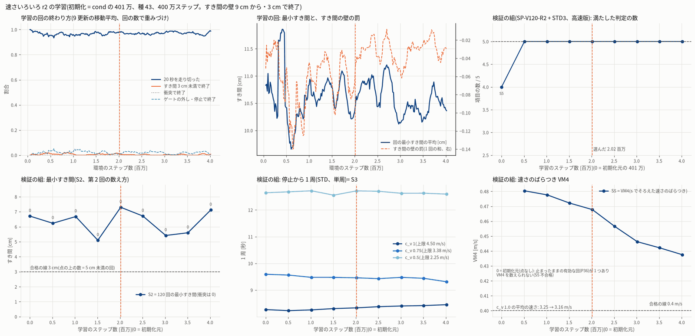
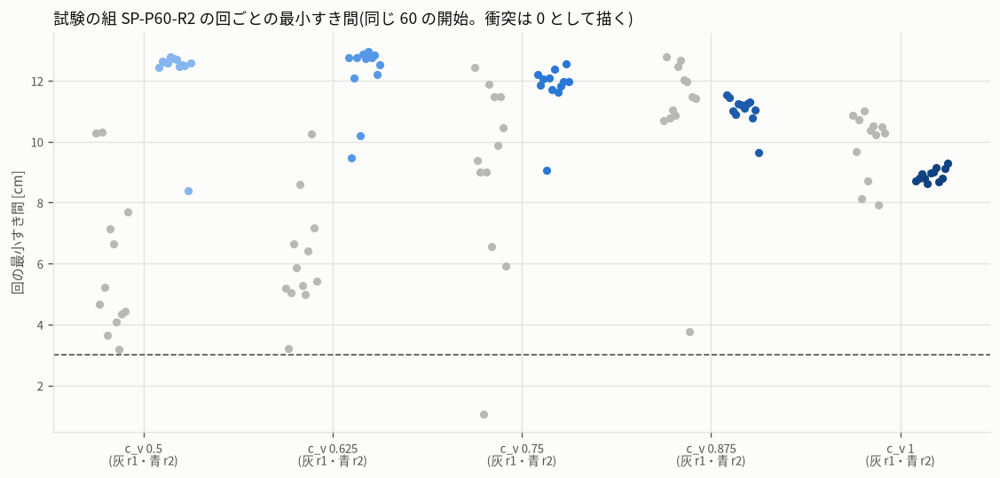
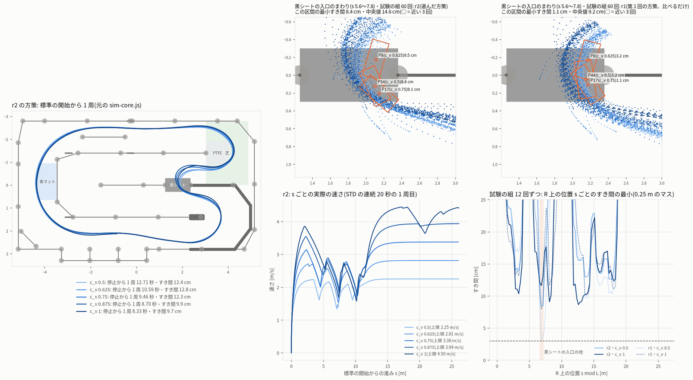

# 学習の段の報告 — 強化学習モード(速さいろいろ)`speed` 第 2 回(sim_rl_modes_20261013)

- 作成 2026-10-14 06:10。段の役目: 第 1 回(不合格・確認 speed r1 で棄却)の直すべき点を直し、速さいろいろ(最速の 50〜100% の速さの上限 = 速さの倍率 c_v の 5 段で走る。
  目標の線は教師の線 R)を学習し直す。決めた試験で判定し、ブラウザ向けに書き出し、図と報告を作る。
- 依頼(ユーザー、10/13 21:20):「シミュレーターの走行は、ほかにももっといろいろなパターン、ぶつかるのを避けたり、いろいろな経路を通るパターンなども作成できるように。
  強化学習モード(最速)・(絶対壁にぶつからない)・(離脱復活)など、データセットのバリエーションが出る構成のモードを用意」
- 守ったこと: ベストラップの作業のファイル・ユーザーのシミュレーター・JetFormer 本体・ブリッジ・jetformer-web には触れていない。実車・PCA9685・I2C・GPU・Firefox は使っていない。
  RL の学習は `jf-heavy --mem 2G --lock rl --need-mb 1200 -- nice -n 15`(起動のときに nice)、Node の試験・図は `jf-heavy --mem 1〜1.5G --lock none -- nice -n 15`。
  `protocol.json` は変えていない(`sha256sum -c protocol.sha256` OK)。speed だけの追補の決まり `protocol_speed_r2.json` を**学習・検証・試験の前に**固めた。git にはコミットしていない。
- 第 1 回の報告は `train_speed_r1.md` に写した(確認 speed r1 の指摘 4 の 2 か所を訂正済み)。

---

## 0. 要点

1. **判定: 合格**。選んだ方策(speed r2、401 万 + 201.5 万ステップ、sha256 `6f4d5e8d…8ac0`)は、第 1 回と重ならない新しい試験の組 SP-P60-R2(元の sim-core.js、63 回、1 回だけ)で
   **S1 60/60・S2 8.38 cm(衝突も数える。3 cm 未満 0・5 cm 未満 0)・S3 8.33 / 9.46 / 12.71 秒(差 4.38 秒)・S4 合格・S5 VM4 0.468 m/s**。
2. **第 1 回の弱点(遅い段が黒シートの入口の柱の横を 3〜5 cm で通る)は直った**。同じ 60 の開始で比べると、第 1 回の方策は最小 1.06 cm・5 cm 未満 10 回、
   第 2 回は最小 8.41 cm・5 cm 未満 0 回。柱の横(s 6.6〜7.2)の中央値は c_v 0.5 で 5.0 → 14.8 cm。開始から 3 m 以降の最小は 3.2 → 8.6 cm。
3. 判定に使わない新しい開始 300 回(一様乱数、開始のすき間 ≥ 12 cm)でも **有効 300/300・衝突 0・3 cm 未満 0**(最小 4.09 cm、5 cm 未満は 1 回)。
   残る一番近い所は「ゲート 6〜7 から止まった所から出て 1.2〜1.6 m 先の柱」で、3 m 以降はどの回も 6.4 cm 以上。
4. 直し方は 2 つ: (a) **決まり**: 開始のすき間 ≥ 0.12 m、S2 は衝突した回も 0 として数える、試験の組を新しくする(`protocol_speed_r2.json`)。
   (b) **学習**: 速さいろいろ専用の run `speed`(線は R の const c0 = 0、c_v は 5 段を多めに)に、**すき間の壁(9 cm から)と 3 cm での −10 の終了**を足して、
   第 1 回の cond の 401 万から 400 万ステップ学び直した。走行中の仕組み(`mode_runtime.mjs`・cond97)は変えていない。
5. 書き出しは `train/speed/r2/export/`(status **accepted**)。第 1 回の `train/speed/export/`(not_published)は変えず、**統合の段は r1 を登録しないこと**(`train/speed/PUBLISH.json`)。
6. 正直に書いておくこと: 速さのばらつき(S3〜S5)は第 1 回と同じく**ほとんど走行中の上限 4.5·c_v から来ている**(学習しない代わりの方法でも S3〜S5 は通る)。学習が足したのは
   **遅い段でも柱・壁から離れて通ること**(代わりの方法は同じ試験の組で S2 0.37 cm)。同じ c_v の中の線はほぼ 1 本(VM3 0.0225 m)。

---

## 1. 確認 speed r1 の直すべき点と、どう直したか

| 指摘 | 直したこと | 確かめ |
|---|---|---|
| 1. r1 を登録簿に出さない。`train/speed/export/status.json` は not_published のまま。代わりの方法も S2 不合格で出せるものは無い | `train/speed/export/` には触れていない(status not_published・policy 629557d7…のまま)。第 2 回の書き出しは別の場所 `train/speed/r2/export/`。統合の段への目印 `train/speed/PUBLISH.json`(登録するのは r2、r1 は登録しない) | `train/speed/export/status.json` の更新時刻 03:51 のまま |
| 2. r1 の試験の組では S2 はどの方策でも満たせない(P20 は置いた時点で 1.50 cm)。開始のすき間の下限を足し、衝突した回はすき間 0 として数える | 追補の決まり `protocol_speed_r2.json`(sha256 5550adcf…1d62)を 05:17 に固めた: 開始の分布に**開始のすき間 ≥ 0.12 m**(no_wall と同じ)、**S2 は全部の回・衝突は 0**、試験の組は**新しい** SP-P60-R2(Halton 25,001〜、r1 の 20,001〜20,062 と重ならない)、検証の組を 120 回に、選び方を「全部満たすもののうち S2 が一番大きいもの」に | 試験の組 60 の開始は全部 12 cm 以上(`tests/speed_r2.test.mjs`)。S2 の数え方は `eval_modes.mjs --protocol speed_r2` |
| 3. 開始の条件だけでは足りない。遅い段が黒シートの入口の柱(s 6.6〜7.2)の横を余裕なく通る(c_v 0.5 は 3 m 以降でも 47% が 5 cm 未満、ゲート 7 から 7 回中 6 回が衝突か 3 cm 未満) | 速さいろいろ専用の学習 run `speed`: **すき間の壁 d_min < 9 cm で −0.2·min(4, ((0.09 − d)/0.04)²)・d_min < 3 cm で −10 で終了**、c_v は 80% を 5 段から等確率(遅い段を第 1 回の約 1.7 倍)、開始の 50% は試験と同じ分布、追従の重み 0.10 → 0.06 | 同じ 60 の開始で r1 → r2: 最小 1.06 → 8.41 cm、柱の横の中央値(c_v 0.5)4.96 → 14.80 cm。新しい開始 300 回の 3 cm 未満 0、ゲート 6〜7 からの 30 回は最小 4.09 cm・3 m 以降 7.8 cm 以上 |
| 4. train_speed.md の 2 か所が誤り | `train_speed_r1.md` に写して取り消し線と【訂正】: (a)「走り出しを過ぎれば 3 cm を割らない」は誤り(新しい開始の c_v 0.5 で 2 周目に 2.59・2.80 cm)、(b)「R 自体が 4〜7 cm」は誤りで、車の向きを R に合わせて置くと s 6.88〜6.95 で **1.2〜1.3 cm**(使える幅の表の clear_at_R でも 1.2〜1.3 cm。目標の e* はここでは R の左 14〜15 cm) | `train_speed_r1.md` 6 章 |

---

## 2. 追補の決まり `protocol_speed_r2.json`(05:17 に固めた。学習・検証・試験の前)

- 変えないもの: しきい値(S1 ≥ 57/60、S2 ≥ 3 cm、S3 差 ≥ 3 秒、S4 隣の差 ≥ 0.05 m/s と 95% 点 ≤ 4.5·c_v + 0.05、S5 VM4 ≥ 0.4 m/s)・SP-STD3・定義・判定のコア・
  走行中の仕組み・c_v の 5 段・publication・経路いろいろ。
- 開始の分布: ゲート U{0..32}・±0.2 m・±15°(modes.json と同じ)+ **開始のすき間 ≥ 0.12 m**。記録・検証・試験・報告の全部に使う。
- 組: 試験 SP-P60-R2(Halton 25,001〜・60 回・種 905500 + i)/ 検証 SP-V120-R2(Halton 10,001〜・120 回・種 805000 + i、高速版)/
  報告 SP-F300-R2(一様乱数 `mix32(6221138, k)`・300 回・種 1900000 + i。判定に使わない)。どれも + SP-STD3、c_v は 1.0・0.875・0.75・0.625・0.5 の順。
- S2: 60 回全部(有効でない回も)、衝突・開始できない・測れない回はすき間 0。
- 選び方: 検証の組で全部満たすもののうち S2 が一番大きいもの(同じなら後)。初期化元は候補に入れない。試験は選んだ 1 つに 1 回。
- 学習の値(下の 3 章)・記録の上書き(開始のすき間 ≥ 12 cm、記録の前の予想で最小すき間 3 cm 未満も替える)も、この中に書いてある。
- 最初に固めた版(b7a707f8…)は written_at の時刻が実際より先(05:30)になっていたので、何も走らせる前に 05:17 に直して固め直した(deviations.md)。

---

## 3. 学習

| 項目 | 値 |
|---|---|
| run | `speed`(`rl/train_modes.py --run speed`、`rl/env_modes.mjs` trainConfig('speed')・`SPEED_R2_DEFAULTS`)。観測 cond97(97 次元)、速さの上限 4.5·c_v |
| 初期化 | 第 1 回の cond の本番の **401 万**(`train/speed/cond-main/checkpoints/step_004014080.pt`、sha256 b134be75…)。1〜400 万で検証のすき間が一番広く、VM4 がまだ下がっていない |
| 種・ステップ | 43・**4,014,080**(protocol の上限 7,500 万の、この段を始めたときの残り 432 万の中)。50 万ごとのチェックポイント 8 個 |
| 条件 | 線はいつも const c0 = 0(走行中と同じ)。c_v は 80% が {1.0, 0.875, 0.75, 0.625, 0.5} から等確率、20% が U(0.5, 1.0) |
| 開始 | 50% 試験と同じ分布(≥ 12 cm)・25% ベストラップの分布(半分ゲート 0・±0.12 m・±8°、≥ 8 cm)・25% 広め(±0.25 m・±20°、≥ 10 cm) |
| 報酬 | v2-gatecap(そのまま)− 0.06·min(1, ((e_y − e*)/0.15)²)− **0.2·min(4, ((0.09 − d_min)/0.04)²)(d_min < 9 cm)**。終了: 衝突・ゲートの外し・停止・逆走 −10、**d_min < 3 cm も −10** |
| 物理 | 標準の物理だけ(記録と試験と同じ)。パイロット・途中の調整は無し |
| 時間 | 05:25:40〜05:52:24(26.7 分、平均 2,713 steps/s。no_wall の確認の Node と重なった) |

- 学習しない下調べ(`rl/speed_r2/probe_env.mjs`、150 回): 初期化元 401 万は c_v 0.5 のすき間の中央値 11.9 cm、壁の罰のかかるフレームは 5 段の平均で 0〜1.7%(r1 の 101 万は 6.1 cm・0.1〜6.4%)。
  壁は「柱のそばだけで効く」強さであることを確かめてから固めた。
- 学習の回(`train/speed/r2/main/progress.jsonl`、6,798 回): 20 秒を走り切る 96〜97%、3 cm 未満で終了 1.0% → 0.6%、ゲートの外し 1.6〜2.2%(広めの開始と学習のときの行動のゆらぎ)、
  回の最小すき間の平均 10.5〜10.6 cm。
- 共有のコードの変更は全部「`speed` の run・`--protocol speed_r2` のときだけ」効く。直す前の env_modes.mjs と、5 つの run(base・no_wall・recover・cond・obstacle)で
  開始・観測・報酬・終わりがビット単位で同じ(`rl/speed_r2/compare_before.mjs`)。試験: `tests/speed_r2.test.mjs`(5 本)+ `cond_gate_miss`・`env`(計 11 本)合格、
  pytest(`test_vec_env_modes.py`・`test_ppo_modes.py`・`test_masking.py`、15 本)合格。

---

## 4. 検証の組(SP-V120-R2 + SP-STD3、高速版)とチェックポイントの選び方

| ステップ(初期化からの) | S1 | S2(120 回の最小、衝突 = 0) | 5 cm 未満 | S3 t(1.0)・t(0.75)・t(0.5) [秒] | S3 の差 | S5 VM4 | STD3 の最小 | 満たした数 |
|---|---|---|---|---|---|---|---|---|
| 0(初期化元 401 万、候補外) | 119/120 | 6.71 cm | 0 | 8.270・9.592・12.644 | 4.37 | **数えられない**(P36 が止まったまま) | 9.89 cm | 4/5 |
| 507,904 | 120/120 | 6.23 cm | 0 | 8.230・9.562・12.679 | 4.45 | 0.480 | 7.85 cm | 5/5 |
| 1,015,808 | 120/120 | 6.68 cm | 0 | 8.259・9.477・12.718 | 4.46 | 0.478 | 7.78 cm | 5/5 |
| 1,507,328 | 119/120 | 5.10 cm | 0 | 8.308・9.475・12.553 | 4.25 | 0.472 | 6.13 cm | 5/5 |
| **2,015,232(選んだ)** | 119/120 | **7.30 cm** | 0 | 8.334・9.460・12.714 | 4.38 | 0.468 | 9.73 cm | **5/5** |
| 2,506,752 | 120/120 | 6.72 cm | 0 | 8.379・9.429・12.700 | 4.32 | 0.457 | 10.05 cm | 5/5 |
| 3,014,656 | 120/120 | 5.42 cm | 0 | 8.405・9.477・12.623 | 4.22 | 0.446 | 8.94 cm | 5/5 |
| 3,506,176 | 120/120 | 5.60 cm | 0 | 8.420・9.441・12.627 | 4.21 | 0.442 | 10.45 cm | 5/5 |
| 4,014,080 | 120/120 | 7.12 cm | 0 | 8.453・9.312・12.593 | 4.14 | 0.438 | 10.55 cm | 5/5 |

- 8 個とも全部を満たし、決まりどおり S2 が一番大きい **2,015,232** を選んだ(`train/speed/r2/selection.json`、`rl/speed_r2/select_speed_r2.py`)。試験の結果を見て選び直していない。
- 119/120 の 1 回は P67(ゲート 11・−0.148 m・+14.3°・c_v 0.75)で、1 周目(9.07 秒)のあと **required_crossing_missing**(黒シートの横断が無いままゴールの線を越えた)で sim が止めた。
  衝突ではない。初期化元・150 万でも同じ開始で同じ終わり方をする。
- 傾向: 第 1 回と同じく、学習が進むほど c_v 1.0 が少し遅くなり(停止から 1 周 8.23 → 8.45 秒、平均の速さ 3.28 → 3.16 m/s)VM4 が下がる(0.480 → 0.438)。400 万までは 0.4 より上。
- 初期化元の S5 が「数えられない」のは、P36(ゲート 3・+0.152 m・−11.1°・c_v 0.875)で**動かないまま 20 秒**が過ぎ、valid_episode(衝突 0・600 フレーム)を満たすのに
  s のマスが全部空になるため(VM4 は全員がそろうマスで数える)。選んだ方策はこの開始で 2 周走る(9.19・8.21 秒、すき間 11.0 cm)。
- 選んだチェックポイントの検証の組は、ほかの段が共有のファイルに足したあとの今のコードで走らせ直しても 123 回が全部同じだった(`train/speed/r2/recheck/`)。

---

## 5. 試験の組 SP-P60-R2 の結果(判定、元の sim-core.js、1 回だけ)

`eval/speed/r2/test_r2_step_002015232.json`(63 回、61 秒、`node rl/eval_modes.mjs --mode speed --protocol speed_r2 --set test --jobs 2`)。すき間は lap_audit の写しで小区間ごとに測り直した値。

| 判定 | 値 | 合否 |
|---|---|---|
| S1 有効な回 ≥ 57/60 | **60/60** | 合格 |
| S2 全部の回の最小すき間 ≥ 3 cm(衝突 = 0) | **8.38 cm**(P54・c_v 0.5)。3 cm 未満 0・5 cm 未満 0・衝突 0 | 合格 |
| S3 t(1.0) < t(0.75) < t(0.5)、差 ≥ 3 秒 | **8.334・9.460・12.714 秒**(差 4.38 秒)。3 回とも 33 ゲート・横断 1 回 | 合格 |
| S4 平均の速さが段ごとに ≥ 0.05 m/s 増え、95% 点 ≤ 4.5·c_v + 0.05 | 2.091・2.522・2.888・3.121・3.238 m/s(差 0.43・0.37・0.23・0.12)、95% 点の最大 2.250・2.812・3.375・3.936・4.429 | 合格 |
| S5 VM4 ≥ 0.4 m/s | **0.468 m/s**(522 マス) | 合格 |

c_v ごと(各 12 回、全部有効・衝突 0・止まった回 0・ゲートの外し 0):

| c_v(上限) | 1 周目の平均 [範囲] | 2 周目 | 平均の速さ | 最小すき間(最小・中央値) | 開始から 3 m 以降の最小 | 柱の横 s 6.6〜7.2 の最小・中央値 |
|---|---|---|---|---|---|---|
| 0.5(2.25 m/s) | 12.65 秒 [12.52〜12.82] | — | 2.09 m/s | 8.38・12.59 cm | 12.52 cm | 8.41・14.80 cm |
| 0.625(2.81) | 10.55 [10.24〜10.82] | — | 2.52 | 9.47・12.74 | 12.13 | 9.73・15.61 |
| 0.75(3.38) | 9.32 [9.07〜9.55] | 8.98 | 2.89 | 9.06・11.97 | 11.67 | 9.08・15.01 |
| 0.875(3.94) | 8.58 [8.39〜8.79] | 8.24 | 3.12 | 9.64・11.15 | 9.68 | 11.11・12.70 |
| 1.0(4.50) | 8.38 [8.03〜8.78] | 7.97 | 3.24 | 8.64・8.87 | 8.64 | 11.61・13.88 |

- 1 周目の幅(最大 − 最小)= **4.79 秒**(variation_metrics.per_mode_judged の lap1_range ≥ 3.0 秒に当たる値。判定は記録の段)。
- ばらつきの物差し(報告): VM1 162.9 µs・VM2 51.0 µs・VM3 0.0225 m・**VM4 0.468 m/s**・VM7 987 マス(第 1 回: 158.3・49.3・0.0237・0.479・1,037)。
- 3 m 以降・柱の横の値は、同じ開始を走らせ直した図のデータ(`train/speed/r2/figdata_r2_step_002015232.json`、試験の結果とすき間が 1e-9 以内で一致することを確かめた)から数えた。

---

## 6. 比べたこと(報告。判定ではない)

### 6.1 同じ 60 の開始で第 1 回の方策と比べる

| | 第 1 回の方策(629557d7…、r1) | 第 2 回(6f4d5e8d…、r2) |
|---|---|---|
| 回の最小すき間の最小 | **1.06 cm**(P17・c_v 0.75、柱の横) | **8.41 cm** |
| 3 cm 未満 / 5 cm 未満 | 1 / 10 | 0 / 0 |
| 開始から 3 m 以降の最小(c_v 0.5・0.625・0.75・0.875・1.0) | 3.19・5.00・5.99・10.77・7.93 cm | 12.52・12.13・11.67・9.68・8.64 cm |
| 柱の横 s 6.6〜7.2 の中央値(同) | 4.96・5.66・9.64・18.34・12.54 cm | 14.80・15.61・15.01・12.70・13.88 cm |

→ 開始のすき間の下限だけでは r1 は S2 を通らない(この組でも 1.06 cm)。学習で柱の通り方を直したことが効いている。

### 6.2 新しい開始 300 回(SP-F300-R2、元のコア、`eval/speed/r2/fresh_r2_step_002015232.json`)

| c_v | 有効 | 1 周目の平均 | 最小すき間(最小・中央値) | 5 cm 未満 |
|---|---|---|---|---|
| 0.5 | 60/60 | 12.65 秒 | 4.09・12.56 cm | 1 |
| 0.625 | 60/60 | 10.56 | 5.77・12.75 | 0 |
| 0.75 | 60/60 | 9.32 | 9.56・12.03 | 0 |
| 0.875 | 60/60 | 8.60 | 8.54・11.04 | 0 |
| 1.0 | 60/60 | 8.33 | 6.36・8.82 | 0 |

- 全部で有効 300/300・衝突 0・**3 cm 未満 0**・止まった回 0・ゲートの外し 0。S1〜S5 の形で数えると全部満たす(VM4 0.465、S2 4.09 cm)。
- 一番近い 3 回(4.09・5.77・5.87 cm)はどれも**ゲート 7 から止まった所から出て 1.3〜1.4 m 先の黒シートの入口の柱**(s 6.96〜6.98、1.1〜1.5 m/s)。
  ゲート 6〜7 から出る 30 回を走らせ直すと、開始から 3 m 以降はどれも 7.8 cm 以上。3 m 以降の最小は 300 回全体で 6.36 cm 以上(c_v 1.0 の P115 が回の最小 6.36 cm)。
- 3 cm 未満が 0/300 なので、60 回の組が S2 を通る見込みは点の推定で 100%、3 cm 未満の割合の 95% 上限(3/300 = 1%)をとっても約 55% 以上。
  第 1 回の確認の新しい開始(開始の分布が違う: すき間の下限なし)では 10/300 が 3 cm 未満だった。

### 6.3 代わりの方法(最速の方策 + 上限 4.5〜2.5 m/s)を同じ試験の組で(参考。cond が合格したので判定に使わない)

`eval/speed/r2/reference_fallback_caps_fastest_test_r2.json`: S1 60/60・**S2 0.37 cm(3 cm 未満 3 回: P17・P43・P44、5 cm 未満 25 回)**・S3 8.092・9.162・11.556 秒・S4 合格・S5 0.420。
→ 速さのばらつき(S3〜S5)は上限だけでも出るが、遅い上限で最速の線をなぞると柱に寄る。**学習の効き目はすき間**(確認 speed r1 の 8 章と同じ結論)。

---

## 7. 図

- `fig/speed_r2_learning_curve.png`: 学習の回の終わり方(走り切り・3 cm で終了・衝突・ゲートの外し/停止)、回の最小すき間と壁の罰、検証の組の満たした数・S2(点の上は 5 cm 未満の回の数)・S3・VM4。
  0 = 初期化元。選んだ 201.5 万に縦線。
- `fig/speed_r2_trajectories.png`: 左 = r2 の方策で STD から c_v 5 段の停止から 1 周(元のコア)。上の 2 つ = 黒シートの入口のまわり(s 5.6〜7.8)の試験の組 60 回のフレーム
  (色 = c_v、○ と四角 = この区間で一番近い 3 回の点と、その回の一番近い所の車体)を r2 と r1 で。下 = r2 の s ごとの速さ(STD の連続 20 秒)と、
  試験の組の c_v 0.5・1.0 の s ごとのすき間の最小(r2 実線・r1 点線、柱の区間を色で)。
- `fig/speed_r2_clearance_by_run.png`: 試験の組の回ごとの最小すき間(灰 = r1、青 = r2、同じ 60 の開始)。
- 乱し・障害物はこのモードには無い(modes.json speed.runtime perturbation null・障害物は使えない)。
- 図のコード `rl/speed_r2/figs_r2.py`(色・コースの描き方は第 1 回の `rl/speed/speed_figs.py` を読み込んで使う。dataviz の参照パレット)・データ `rl/speed_r2/figdata_r2.mjs`。

---

## 8. 書き出しと出し方(統合の段へ)

- `rl/publish_mode.py --mode speed … --out train/speed/r2/export --overrides train/speed/r2/mode_overrides_r2.json` → **status accepted**:
  `policy.json`(jf-sim-rl-mode-policy/v1・obs_dim 97・cond97・mode speed、sha256 6f4d5e8d…8ac0)・`eval.json`(試験の組の結果。protocol_speed_r2_sha256 入り)・
  `mode.json`(上書き: short_ja、recording.start_distribution に min_initial_clearance_m 0.12、recording.prefilter_min_clearance_m 0.03・prefilter_min_valid_laps 1、
  protocol_speed_r2_sha256)・`status.json`。登録簿(`--registry`)には書いていない(統合の段の仕事)。
- 統合の段への目印 `train/speed/PUBLISH.json`: 登録するのは `train/speed/r2/export/`、**`train/speed/export/`(r1、not_published)は登録しない**。
- ランタイムで読めることの確かめ(`rl/speed_r2/check_export.mjs`): STD のフレーム 0 の `p` = {mode speed, line const c0 0, c_v, policy 6f4d5e8d245f}、
  最初の 120 フレームの速さの指令の最大 4.5000(c_v 1.0)・2.2500 m/s(c_v 0.5)、metadata id jf-rl-speed-v1・cond97・speed_cap 4.5·c_v。
- F-ID(ブラウザの照合用): `eval/speed/r2/fid_std_speed_r2_cv1.json`・`fid_std_speed_r2_cv0.5.json`(STD の連続 20 秒の 600 フレームの snapshot と操作)。
  `rl/check_fid.mjs` で `rl/runtime/mode_runtime.mjs` と `web/rl/mode_runtime.mjs` の両方が差 0(舵・速さ・info)。
- **注意**: `web/rl/`(ブラウザに配る組、03:37 の版)は、line r2 の段が 05:34〜05:47 に `rl/runtime/` の line_profiles.mjs・mode_runtime.mjs・obs_modes.mjs を変え、
  line_v2_table を足したので、`rl/runtime/` と同じではない。速さいろいろの走りはどちらでも同じ(上の F-ID)だが、統合の段は `rl/make_web_bundle.mjs` で作り直してから配ること。
- 記録の前の予想: `rl/predict_scenes.mjs --min-clearance 0.03 --min-valid-laps 1`(`--min-valid-laps` はこの段で足した。止まったまま 20 秒のシーンも替える。
  初期化元で止まった P36 の開始で、valid = false になることを確かめた)。

---

## 9. 残っていること・気をつけること

1. **ばらつきの中身**: 速さのばらつきは上限 4.5·c_v から来る(6.3)。同じ c_v の中では線がほぼ 1 本にそろう(回ごとの最小すき間も c_v ごとに数 cm の幅に集まる。VM3 0.0225 m)。
   「いろいろな経路」は経路いろいろ(line)の役目。c_v はフレーム 0 の `p` とタグにしか無く画像には映らない(確認 speed r1 の申し送りのまま。記録・統合の段で扱いを決める)。
2. **一番近い所**はゲート 6〜7 から出る走り出し(新しい開始で 4.09 cm)。記録の前の予想(3 cm 未満を替える)を重ねがけにしてある。
3. 検証の組の P67 のように、まれに黒シートを横切らずにゴールの線を越えて sim が止める回がある(検証 120 回中 1、試験 60 回・新しい開始 300 回では 0)。衝突ではなく S1 で数える。
   記録の前の予想(valid_episode)で替わる。
4. 物理のずれ(DR-T)では試していない(記録・試験は標準の物理。第 1 回の確認では r1 が DR-T で 13/60 衝突)。
5. 判定の作りの穴(報告): 動かないまま 20 秒の回は valid_episode を満たしてしまい、VM4 を数えられなくなる(初期化元の P36)。S5 は不合格側に倒れるので判定は安全側だが、
   記録では `--min-valid-laps 1` で替えること。また S4 の平均の速さは、動かない回を 0 として平均に入れる(安全側)。
6. 学習の予算: 401 万ステップ。この段を始めたときの見積もりでは protocol の上限 7,500 万の中(ほかの段のその後の学習は数えていない)。

---

## 10. ファイル

| ファイル | 中身 |
|---|---|
| `/home/jetson/jetformer_reports/sim_rl_modes_20261013/protocol_speed_r2.json`・`.sha256` | 追補の決まり(5550adcf…1d62) |
| `…/train/speed/r2/` | `run_r2.sh`・`tuning_r2.json`・`main/`(run.json・progress.jsonl・checkpoints 8・policies 8・evals/speed 8・done.json)・`logs/`・`selection.json`・`baseline/`(初期化元の検証)・`recheck/`・`export/`・`mode_overrides_r2.json`・`figdata_r2_step_002015232.json`・`before/`(直す前の共有のファイルの写しと sha256) |
| `…/train/speed/PUBLISH.json` | 統合の段への目印(r2 を登録、r1 は登録しない) |
| `…/eval/speed/r2/` | `test_r2_step_002015232.json/.log`(判定)・`fresh_r2_step_002015232.json/.log`(報告)・`reference_fallback_caps_fastest_test_r2.json/.log`(参考)・`summary_test_r2.json`・`summary_fresh_r2.json`・`fid_std_speed_r2_cv1.json`・`fid_std_speed_r2_cv0.5.json` |
| `…/fig/` | `speed_r2_learning_curve.png`・`speed_r2_trajectories.png`・`speed_r2_clearance_by_run.png` |
| `…/train_speed_r1.md` | 第 1 回の報告(指摘 4 の 2 か所を訂正) |
| `/home/jetson/jetformer/experiments/20261013_sim_rl_modes/rl/speed_r2/` | `select_speed_r2.py`(1d48fe39…)・`summarize_r2.py`(4ee514b4…)・`figdata_r2.mjs`(3ecafcdb…)・`figs_r2.py`(83b606bc…)・`probe_env.mjs`・`compare_before.mjs`・`check_export.mjs`・`make_fid_r2.mjs` |
| `…/rl/env_modes.mjs`・`eval_modes.mjs`・`train_modes.py`・`predict_scenes.mjs` | speed r2 の追加(どれも speed・`--protocol speed_r2`・`--min-valid-laps` のときだけ効く)。段の終わりの sha256 は deviations.md(line r2 の段の追加も含む) |
| `…/tests/speed_r2.test.mjs` | 学習の設定・cond が変わらないこと・壁と 3 cm の終了・第 2 回の組(cfd65a70…) |
| `deviations.md` | 「速さいろいろ(speed)r2: 追補の決まり…」の項 |

## 11. 起動したプロセス

- 学習(lock rl、05:25〜05:52。終了コード 0・done.json)と、その中の検証の評価 8 本、初期化元の検証・選んだものの検証のやり直し・試験・報告の組・代わりの方法(参考)・
  図のデータ・F-ID・下調べ・Node の試験・pytest。**すべて終わっている**(06:08 に ps で確かめた)。lock rl は 05:52 に放した(そのあと line r2 の段が取った)。
- ほかの段のプロセス(line r2 の学習、no_wall r2 の確認、obstacle の下調べ、ベストラップ・JetFormer の学習)には触れていない。
