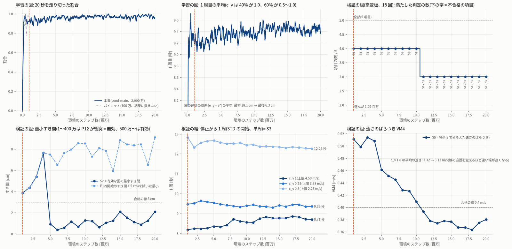
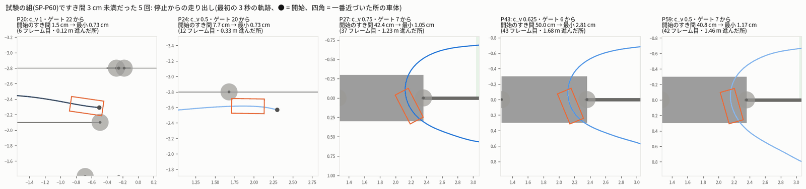
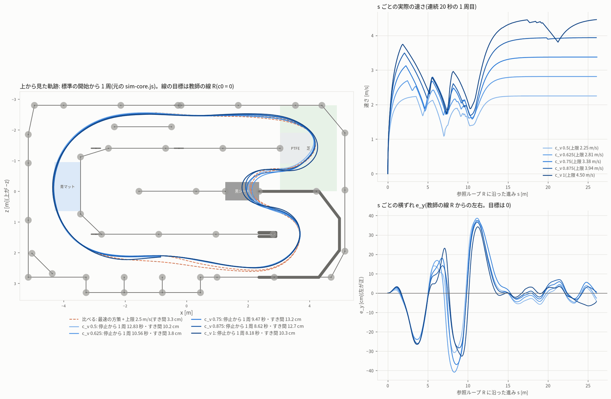

# 学習の段の報告 — 強化学習モード(速さいろいろ)`speed` 第 1 回(sim_rl_modes_20261013)

> **第 1 回の報告の写し(2026-10-14 05:2x、学習の段 speed r2 が `train_speed.md` から写した)**。第 2 回の報告は `train_speed.md`。
> 確認 speed r1 の指摘 4 の 2 か所(6 章の「R 自体が 4〜7 cm」と「走り出しを過ぎれば 3 cm を割らない」)だけ、取り消し線と【訂正】で直した。ほかは第 1 回のまま。

- 作成 2026-10-14 04:00。段の役目: 速さいろいろ(最速の 50〜100% の速さの上限 = 速さの倍率 c_v で走る、目標の線は教師の線 R)を、
  経路いろいろと共通の条件付きの方策 **cond** で学習し、protocol の試験で判定し、ブラウザ向けに書き出し、図と報告を作る。
- 依頼(ユーザー、10/13 21:20):「シミュレーターの走行は、ほかにももっといろいろなパターン、ぶつかるのを避けたり、いろいろな経路を通るパターンなども作成できるように。
  強化学習モード(最速)・(絶対壁にぶつからない)・(離脱復活)など、データセットのバリエーションが出る構成のモードを用意」
- 守ったこと: ベストラップの作業のファイル・ユーザーのシミュレーター・JetFormer 本体・ブリッジ・jetformer-web には触れていない。実車・PCA9685・I2C・GPU・Firefox は使っていない。
  RL の学習は `jf-heavy --mem 2G --lock rl -- nice -n 15`(起動のときに nice)、Node の試験・図は `jf-heavy --mem 1500M --lock none -- nice -n 15`。
  `protocol.json` は変えていない(`sha256sum -c protocol.sha256` OK)。git にコミットしていない。決まりと違うことと調整は `deviations.md` に 3 項書いた。

---

## 0. 要点

1. **判定: 不合格(S2 だけ)**。選んだ方策(cond の本番 101 万ステップ)の試験の組(元の sim-core.js、63 回)は
   **S1 60/60 有効・S3・S4・S5 合格、S2 最小すき間 0.73 cm(要 3 cm)で不合格**。3 cm 未満は 60 回中 5 回で、どれも**停止からの走り出しの 0.1〜1.7 m**
   (開始のすき間がもともと 1.5 cm の回と、ゲート 6〜7 から出て黒シートの入口の柱をかすめる回)。速さのばらつき自体は十分に出ている:
   停止から 1 周 **8.18 秒(c_v 1.0)・9.47 秒(0.75)・12.83 秒(0.5)**、平均の速さ 2.03〜3.26 m/s が段ごとに 0.17〜0.40 m/s ずつ増え、VM4 = **0.479 m/s**(要 0.4)。
2. protocol の決まりのとおり、優先 2 で不合格 → **登録簿に出さない(報告だけ)**。代わりの方法(最速の方策 + 上限 4.5〜2.5 m/s)も S2 不合格(0.16 cm、実装の段と同じ値)。
   参考に回した no_wall の方策 + 上限も S2・S3・S4・S5 で不合格。ブラウザの mode_runtime.mjs が読める書き出しは `train/speed/export/`(status `not_published`)に置いた。
3. **cond の学習は 1 本だけ**(経路いろいろと共通。`train/cond/SHARED.json` で line の段と取り決めた)。パイロット 100 万 → 1 回の調整(tracking_w 0.10・tracking_scale_m 0.15)
   → 本番 2,000 万(seed 41、初期化 main 種 1)。CPU がほかの作業と重なり 2 時間 10 分かかった(平均 2,560 steps/s)。
4. **学習の環境の不具合を見つけて直した**: cond を仮想のゲート番号で学習させると、ゲートを外しても終わらず罰も無かった(modes.json は「base と同じ = −10 で終了」)。
   最初の本番は**ゲートを飛ばす走りを覚え始め**(ゲートの外し 0.17 → 1.44 回/回、STD から 1 周が数えられない)、131 万ステップで止めた。
   `rl/env_modes.mjs` の cond に「外したら −10 で終える」を足し(試験つき)、本番を最初からやり直した。obstacle の段も同じ直しを入れた。
5. **選び方の決まりが早いチェックポイントを選んだ**: 検証の組(1/4、18 回)では S1 に 15/15 が要るが、P12(開始のすき間 4.5 cm)が 1〜400 万では衝突、500 万〜は
   走り切るがすき間 1 cm 前後で S2 不合格になり、**どのチェックポイントも全部は満たさない**。決まり「満たす数が一番多く、同じなら S3 の差が大きいもの」で 101 万を選んだ。
   後のチェックポイントほど走り出しのすき間はよい(P12 を除く最小 3.9 cm → 7.6〜9.1 cm)が、線の追従を覚えるほど速い端が遅くなり、1,100 万〜は VM4 も 0.4 m/s を割る。
6. 第 2 回への提案(10 章): 速さいろいろの開始の分布に「開始のすき間」と黒シートの入口の手前を避ける条件を足す、同点の決め方を S2 の余裕にする、
   速さ専用の短い学習(c_v を 5 段に、線の追従の罰を弱く)にする。

---

## 1. 何を学習したか(cond の 1 本を line と分け合う)

- modes.json: speed の方策は `cond`(観測 cond97 = features.mjs の 79 + 目標の横ずれ e* の先読み 16 + (e_y − e*) + c_v)。行動の速さの上限は 4.5·c_v。
  速さいろいろのシーンは目標の線 c0 = 0(e* = 0 = 教師の線 R)、c_v ∈ {1.0, 0.875, 0.75, 0.625, 0.5}。学習の run は line と同じ 1 本(budget も 1 本分)。
- 23:33 に line の段も同じ cond のパイロットを順番待ちに入れたので、`train/cond/SHARED.json` に「cond は speed の段が 1 本だけ学習し、line の段はそれを使う」と書いた
  (line の段は 23:34 に自分のパイロットを止めた。こちらも一度止めかけたが、行き違いに気づいてすぐ出し直した。経緯は SHARED.json の history)。
  チェックポイントごとに `evals/line`・`evals/speed` の両方が出るので、選び方はモードごと(line は line の段が選ぶ)。

## 2. パイロットと 1 回の調整

- パイロット(`train/speed/cond-pilot/`、101 万ステップ、既定の値、23:46〜23:50): 検証の組で speed は S2〜S5 合格・S1 14/15、
  line は追従の誤差 中央値 10.5 cm・95% 点 38 cm、左右の線の違い 9 cm(要 20 cm)。形ごとでは一定 左寄り 27 cm など、**10 cm を越える誤差が多かった**。
- 調整(`train/speed/tuning_main.json`、deviations.md): **tracking_w 0.08 → 0.10、tracking_scale_m 0.10 → 0.15**。追従の罰 −w·min(1, (e/scale)²) が 10 cm で頭打ちになり、
  それより外れると線へ戻す勾配が 0 になるので、頭打ちを 15 cm に広げた。重みの上げ幅は、c_v 0.5(進み 約 0.067 m/ステップ)で罰が頭打ちのままでも
  先の報酬の和(γ 0.995 で約 190 ステップ)が −6.3 と、衝突の罰 −10 より大きい範囲にした(「ぶつかって罰を止める」が得にならない)。`room_clearance_m` は環境に使い道が無いので変えていない。
  速さいろいろ(e* = 0)では R への追従の罰の形だけが変わる。

## 3. 見つけた不具合: ゲートの外しが学習で罰されない(直した)

| | 直す前の本番(01:20〜01:32、`cond-main-aborted-gatemiss/`) | 直した本番(01:33〜03:44、`cond-main/`) |
|---|---|---|
| 学習の回のゲートの外し | 0.17 → **1.44 回/回**(131 万ステップ) | 外せば −10 で終了。外しで終わった回は 0〜400 万で 3.7〜4.8%、1,000 万〜で 1.2〜2.0% |
| 1 周を数えられた回 | 64/64 → 32/48 | 学習を通して 1 周目の平均 9.0〜9.6 秒で数えられている |
| 100 万の方策の STD の開始 | 3 番のゲートを外し、20 秒走っても周が数えられない(S3 判定不能) | 停止から 1 周 8.18 秒 |

- 原因: `trainConfig('cond')` は `virtual: true`(観測は仮想のゲート番号)で、ゲートの外しの終了は `!virtual` のときだけ、罰は recover の −3 だけだった。
  modes.json line.training.reward.terminal は「base と同じ」= v2-gatecap(ゲートの外しは −10 で終了)。
- 直し: cond の設定に `gate_miss_terminal: true`、`stepCommand` で `virtual && gate_miss_terminal && missEvent` なら reason `gate_miss`・−10 で終える。
  観測(仮想のゲート番号)と走行中の mode_runtime は変えていない。直す前の写しは `train/speed/env_modes.before_gatemiss_fix.mjs`(build_sha256.txt の 76b9fe01…7e71)。
  いまの `rl/env_modes.mjs` は sha256 871afb1a…a354(obstacle の段が同じ直しを obstacle の設定に入れた分を含む)。
- 確かめ: 試験 `tests/cond_gate_miss.test.mjs`(3 本: cond・obstacle は設定あり / base・no_wall・recover は無し、cond は missEvent で gate_miss・−10 で終わる、
  recover は −3 で続ける)と `tests/env.test.mjs`(3 本)が合格。決定的な方策で 48 回: 初期化に近い方策は 46 回走り切り・2 回だけゲートの外しで終了、
  飛ばしを覚えた 100 万の方策は 47/48 回が外しで終わる。本番の run.json の `env.train_config.gate_miss_terminal` = true。

## 4. 本番の学習

- `train/speed/cond-main/`(run.json・progress.jsonl・checkpoints 20 個・policies 20 個・evals/line・evals/speed 各 20・done.json)。ログ `train/speed/logs/cond-main.log`。
  コマンド: `train/speed/run_train.sh cond-main 20000000 --eval --tag main --tuning train/speed/tuning_main.json`(= jf-heavy --mem 2G --lock rl -- nice -n 15 python -u rl/train_modes.py --run cond …)。
- 20,004,864 ステップ、7,800 秒(01:33:50〜03:43:53)。ベストラップの作業の Firefox(nice 0)と no_wall の段の確かめと重なった間は 1,150〜2,600 steps/s、空いてからは 4,900〜5,700 steps/s。
  途中で 1,000 万 / 03:15 で止める案を SHARED.json に書いたが、速さが戻ったので予算どおり 2,000 万まで続けた(止めていない)。
- 学習の回: 20 秒を走り切る割合 0.93〜1.0、線の追従の誤差の平均 18.1 cm → 6.3 cm。図 `fig/speed_learning_curve.png`。

## 5. 検証の組とチェックポイントの選び方

検証の組(高速版、SP-P60 の 1/4 = 15 回 + SP-STD3 の 3 回、種 805000〜・Halton 10,001〜)。S1 は 15/15 が要る(57/60 × 1/4 = 14.25 を切り上げ)。

| ステップ | S1 有効 | S2 最小すき間 | (P12 を除く) | S3 t(1.0)・t(0.75)・t(0.5) [秒] | S3 の差 | S4 平均の速さ c_v 0.5→1.0 [m/s] | S5 VM4 | 満たした数 |
|---|---|---|---|---|---|---|---|---|
| **1,015,808** | 14/15 ✗ | 3.86 cm | 3.9 cm | 8.18・9.47・12.83 | **4.65** | 2.04・2.45・2.79・3.04・3.32 | 0.511 | 4/5 |
| 2,015,232 | 14/15 ✗ | 4.35 cm | 4.3 cm | 8.25・9.51・12.33 | 4.08 | 2.10・2.50・2.81・3.06・3.34 | 0.498 | 4/5 |
| 3,014,656 | 14/15 ✗ | 5.39 cm | 5.4 cm | 8.23・9.64・12.56 | 4.33 | 2.06・2.50・2.82・3.06・3.35 | 0.514 | 4/5 |
| 4,014,080 | 14/15 ✗ | 7.63 cm | 7.6 cm | 8.27・9.59・12.64 | 4.37 | 2.06・2.48・2.82・3.07・3.33 | 0.508 | 4/5 |
| 5,013,504 | 15/15 | 0.92 cm ✗ | 7.5 cm | 8.36・9.54・12.67 | 4.32 | 2.07・2.52・2.85・3.05・3.31 | 0.461 | 4/5 |
| 6,012,928 | 15/15 | 0.38 cm ✗ | 6.5 cm | 8.33・9.46・12.58 | 4.25 | 2.09・2.54・2.86・3.06・3.31 | 0.451 | 4/5 |
| 7,012,352 | 15/15 | 0.59 cm ✗ | 7.6 cm | 8.43・9.42・12.51 | 4.08 | 2.10・2.54・2.87・3.04・3.29 | 0.445 | 4/5 |
| 8,011,776 | 15/15 | 1.16 cm ✗ | 7.9 cm | 8.71・9.38・12.53 | 3.82 | 2.09・2.54・2.86・2.97・3.24 | 0.428 | 4/5 |
| 9,011,200 | 15/15 | 0.68 cm ✗ | 8.5 cm | 8.61・9.33・12.55 | 3.94 | 2.10・2.53・2.85・2.99・3.24 | 0.426 | 4/5 |
| 10,010,624 | 15/15 | 1.26 cm ✗ | 8.5 cm | 8.57・9.39・12.44 | 3.87 | 2.10・2.54・2.85・3.00・3.18 | 0.409 | 4/5 |
| 11,010,048 | 15/15 | 1.20 cm ✗ | 7.3 cm | 8.56・9.44・12.47 | 3.91 | 2.11・2.54・2.85・2.96・3.13 | 0.393 ✗ | 3/5 |
| 12,009,472 〜 20,004,864(9 個) | 15/15 | 0.63〜2.09 cm ✗ | 5.9〜9.1 cm | t(1.0) 8.71〜8.86 | 3.50〜3.62 | c_v 1.0 で 3.05〜3.12 | 0.363〜0.380 ✗ | 3/5 |

- **P12**(ゲート 23・左 14.7 cm・+5.4°)は開始のすき間 4.5 cm で、柱の根もと(disk-74)が目の前にある。下調べ: 舵を右 0.3 rad・0.5 m/s でゆっくり出れば 3.9 cm を保てるが、
  まっすぐ・左・1 m/s 以上ではぶつかる。方策は 1〜400 万では 0.4 秒で衝突(S1 ✗)、500 万〜は走り切るがすき間 0.4〜2.1 cm(S2 ✗)。
- 選んだもの(`train/speed/selection.json`、`rl/speed/select_speed.py`): 全部を満たすものが無いので、満たす数 4/5 の 10 個のうち S3 の差が最大の **1,015,808**
  (方策 `train/speed/cond-main/policies/step_001015808.json`、sha256 629557d7…ad1e)。試験の結果を見て選び直していない。
- 傾向: 線の追従を覚えるほど(line の検証は 101 万 → 2,000 万で追従の誤差の中央値 10.6 → 3.4 cm、左右の違い 9 → 37 cm)、速い端(c_v 1.0)が 3.32 → 3.12 m/s に遅くなり、
  停止から 1 周も 8.18 → 8.71 秒に延びる。速さのばらつき(VM4・S3 の差)は早いチェックポイントほど大きい。

## 6. 試験の組の結果(判定、元のコア)

`eval/speed/test_cond_step_001015808.json`(63 回、44.6 秒、`node rl/eval_modes.mjs --mode speed --set test --jobs 2`)。すき間は lap_audit の写しの測り直し(sim の軌跡との差 0)。

| 判定 | 値 | 合否 |
|---|---|---|
| S1 有効な回 ≥ 57/60 | **60/60** | 合格 |
| S2 有効な回の最小すき間 ≥ 3 cm | **0.73 cm**(3 cm 未満 5 回: P20・P24・P27・P43・P59) | **不合格** |
| S3 停止から 1 周 t(1.0) < t(0.75) < t(0.5)、差 ≥ 3 秒 | 8.183・9.469・12.829 秒(差 4.65 秒) | 合格 |
| S4 平均の速さが段ごとに ≥ 0.05 m/s 増え、95% 点 ≤ 4.5·c_v + 0.05 | 2.033・2.435・2.785・3.089・3.262 m/s(差 0.17〜0.40)、95% 点の最大 2.25・2.81・3.37・3.94・4.43 | 合格 |
| S5 VM4 ≥ 0.4 m/s | **0.479 m/s** | 合格 |

c_v ごと(各 12 回、全部有効):

| c_v(上限) | 1 周目の平均 [範囲] | 2 周目 | 平均の速さ | 最小すき間(最小・中央値) | 3 cm 未満 |
|---|---|---|---|---|---|
| 0.5(2.25 m/s) | 12.67 秒 [12.45〜13.02] | — | 2.03 m/s | 0.73・6.3 cm | 2 |
| 0.625(2.81) | 10.72 [10.49〜10.95] | — | 2.44 | 2.81・6.3 cm | 1 |
| 0.75(3.38) | 9.37 [9.08〜9.59] | 8.96 | 2.79 | 1.05・10.8 cm | 1 |
| 0.875(3.94) | 8.52 [8.26〜8.72] | 8.21 | 3.09 | 6.73・11.4 cm | 0 |
| 1.0(4.50) | 8.23 [8.06〜8.50] | 7.87 | 3.26 | 0.73・10.2 cm | 1 |

- 1 周目の幅(最大 − 最小)= **4.97 秒**(protocol variation_metrics.per_mode_judged の lap1_range ≥ 3.0 秒に当たる値。判定は記録の段)。
- **すき間 3 cm 未満の 5 回はどれも走り出し**(`fig/speed_test_low_clearance.png`): P20(ゲート 22、開始のすき間 1.5 cm → 6 フレーム目に 0.73 cm)、
  P24(ゲート 20、7.7 cm → 0.33 m 進んだ所で 0.73 cm)、P27・P43・P59(ゲート 6〜7 から出て 1.2〜1.7 m 先、黒シートの入口の柱(s ≈ 6.95)の横を 1.25 m/s で
  1.1〜2.8 cm)。~~R 自体がこの柱に 4〜7 cm まで寄る所で~~ **【2026-10-14 r2 で訂正】R の上に車の向きを R に合わせて置くと、s 6.88〜6.95 でこの柱とのすき間は 1.2〜1.3 cm しかない**
  (確認 speed r1 の自前の多角形の距離。使える幅の表 room_table.json の clear_at_R も s 6.86〜6.96 で 1.2〜1.3 cm。目標の e* は使える区間に切るので、ここでは R の左 14〜15 cm)。
  止まった所から斜めに出ると線に乗る前に柱に寄る。この 5 回は、開始から 3 m 以降のフレームのすき間が 5.0〜11.1 cm(P43 は 4.96 cm)だった。
  ~~(フレームごとの値。走り出しを過ぎれば 3 cm を割らない)~~ **【2026-10-14 r2 で訂正】「走り出しを過ぎれば 3 cm を割らない」は誤り**: 確認 speed r1 の新しい開始 300 回では、
  c_v 0.5 の 2 回(F149・F254)が 2 周目の黒シートの入口の柱で 2.59 cm・2.80 cm まで寄った(開始から 18 m・30 m)。試験の組の 5 回がたまたま走り出しだけだった。
- ρ_req > 1 のフレーム 14.8%(最速の方策と同じく縦と横の限界を別々に使う走り。速さいろいろでは判定外)。

## 7. 代わりの方法と比べる値

| 方法 | S1 | S2 | S3(1.0・0.75・0.5) | S4 | S5 VM4 | 判定 |
|---|---|---|---|---|---|---|
| **cond 101 万(選んだもの)** | 60/60 | 0.73 cm ✗ | 8.18・9.47・12.83 | 合格 | 0.479 | 不合格(S2) |
| 代わりの方法: 最速の方策 + 上限 {4.5 … 2.5} m/s(`eval/speed/fallback_caps_fastest_test_r1.json`) | 60/60 | 0.16 cm ✗ | 8.09・9.16・11.56 | 合格 | 0.422 | 不合格(S2) |
| 参考: no_wall の方策(シールドあり)+ 上限(`eval/speed/reference_caps_no_wall_test.json`) | 60/60 | 1.41 cm ✗ | 9.77・10.09・11.80(差 2.0 ✗) | ✗ | 0.214 ✗ | 判定に使わない |

- 代わりの方法は protocol のとおり、no_wall が「不合格(参考)」(N3)なので最速の方策に上限を掛けた。実装の段の同じ試験と判定の値まで一致。
- no_wall の方策は上限を掛けると(学習したことのない遅さ)すき間が 1.4 cm まで減り、平均の速さもほとんど変わらない(2.21〜2.67 m/s)。

ばらつきの物差し(報告。判定は記録の段。試験の組の 60 回、VM7 は 3 つおきの 3,000 フレームの参考値):

| | VM1 時刻の舵 [µs] | VM2 位置の舵 [µs] | VM3 横ずれ [m] | VM4 速さ [m/s] | VM7 マス |
|---|---|---|---|---|---|
| cond 101 万(速さいろいろ) | 158.3 | 49.3 | 0.0237 | **0.479** | 1,037 |
| 最速 + 上限(代わり) | 150.7 | 48.6 | 0.0250 | 0.422 | 943 |
| no_wall + 上限(参考) | 138.7 | 16.1 | 0.0113 | 0.214 | 500 |
| RC 教師 REC60(protocol の基準) | 7.58 | — | 0.0039 | — | — |

## 8. 図

- `fig/speed_learning_curve.png`: 学習の回(20 秒の走り切り・1 周目)、検証の組の満たした判定の数、最小すき間(P12 を除いた値も)、S3 の 3 段の 1 周、VM4。選んだ 101 万に縦線。
- `fig/speed_trajectories.png`: 選んだ方策を STD から c_v 5 段で走らせた上から見た軌跡(停止から 1 周、元のコア)と、s ごとの速さ・横ずれ(連続 20 秒の 1 周目)。
  比べる線は最速の方策 + 上限 2.5 m/s(オレンジの破線)。直線では速さが上限で 2.25〜4.5 m/s に分かれ、曲がり角ではどの段も 1.2〜2 m/s に集まる。
  101 万の方策は R ではなく最速の方策に近い線を走る(黒シートの前後で R から ±40 cm)。
- `fig/speed_test_low_clearance.png`: 試験ですき間 3 cm 未満だった 5 回の走り出し(最初の 3 秒と、一番近づいた所の車体)。
- 図のデータ: `train/speed/figdata_step_001015808.json`(`rl/speed/speed_figdata.mjs`)。図のコード `rl/speed/speed_figs.py`(色は dataviz の参照パレット。c_v の青 5 段は順序の段の検証に合格)。

## 9. 書き出しと出し方

- protocol publication(優先 2・3 で不合格 → 出さない)のとおり、`rl/publish_mode.py --mode speed …` は「出しません」で何も書かない(確かめた)。**統合の段は speed を登録しないこと**。
- ブラウザ向けの書き出しは `train/speed/export/`: `policy.json`(jf-sim-rl-mode-policy/v1、obs_dim 97、cond97、sha256 629557d7…ad1e)・`eval.json`(試験の結果の要約)・
  `status.json`(state `not_published`、failed `S2_clearance`)。ブラウザと同じ `rl/runtime/mode_runtime.mjs` で読めることを確かめた(STD のフレーム 0 で c_v 1.0 → 速さの指令 4.5 m/s、
  c_v 0.5 → 2.25 m/s、`p` に line const c0 0・c_v、metadata の speed_cap 「4.5·c_v」・obs_wrapper cond97)。
- 作り直し(allowed_tuning.retry)はしていない: 不合格は検証の組の P12 と同点の決め方で決まり、種を変えた 500 万でも同じ形になる見込みが高く、lock rl を obstacle が待っていた。
  なお line の段が cond の作り直し(`train/line/cond-retry`、種 42・500 万・本番の 1,500 万から・tracking_w 0.2、03:45〜04:05)を回した。その `evals/speed` の
  5 個のチェックポイントは S1 15/15・S2 3.0〜4.4 cm(P12 も 3 cm 以上)・S3・S4 合格だが、**S5 VM4 0.353〜0.373 で全部不合格**(初期化元の速い端が遅い:
  c_v 1.0 の平均の速さ 2.98〜3.04 m/s)。全部を満たすものが無いので、speed の試験の 2 回目(本番と作り直しで 2 回まで)には使っていない。

## 10. 第 2 回への提案(決まりを変えることなので、新しい protocol で)

1. **開始の分布**: 速さいろいろ(と経路いろいろ)の開始に「開始のすき間 ≥ 8 cm」と「黒シートの入口(s ≈ 6.95)の 2 m 手前から出ない」を足す。記録の前の予想
   (`rl/predict_scenes.mjs`)は走り切らない開始を替えるが、すき間の小さい開始は替えない。試験の S2 の 5 回は、この 2 つの条件なら 5 回とも開始の時点で外れる
   (P20・P24 は開始のすき間 1.5・7.7 cm、P27・P43・P59 は柱の 1.2〜1.7 m 手前から出る。試験を見てからの読みなので、第 2 回の検証の組で確かめること)。
2. **選び方**: 速さの同点の決め方を「S3 の差」から「S2 の余裕」に(S3 の差はどのチェックポイントも 3.5〜4.65 秒で、決まりの 3 秒を大きく越えている)。
   検証の組の S1 は 1/4 の組で 15/15(100%)が要り、試験(95%)より厳しい。1 つの難しい開始(P12)で全部が落ちる。
3. **学習**: 速さいろいろだけなら、線の追従の罰は c0 = 0 で弱く、c_v を記録と同じ 5 段にした短い学習(300〜500 万)が合う。線の追従を強めた 1 本の cond は速い端を遅くする(VM4 0.51 → 0.38)。

## 11. ファイル

| ファイル | 中身 |
|---|---|
| `/home/jetson/jetformer_reports/sim_rl_modes_20261013/train/speed/` | `run_train.sh`・`tuning_main.json`・`cond-pilot/`・`cond-main/`・`cond-main-aborted-gatemiss/`(使わない)・`logs/`・`selection.json`・`figdata_step_001015808.json`・`export/`・`env_modes.before_gatemiss_fix.mjs` |
| `/home/jetson/jetformer_reports/sim_rl_modes_20261013/train/cond/SHARED.json` | cond の 1 本を line と分け合う取り決めと経緯 |
| `/home/jetson/jetformer_reports/sim_rl_modes_20261013/eval/speed/` | `test_cond_step_001015808.json/.log`(判定)・`fallback_caps_fastest_test_r1.json/.log`(代わりの方法)・`reference_caps_no_wall_test.json/.log`(参考) |
| `/home/jetson/jetformer_reports/sim_rl_modes_20261013/fig/` | `speed_learning_curve.png`・`speed_trajectories.png`・`speed_test_low_clearance.png` |
| `/home/jetson/jetformer/experiments/20261013_sim_rl_modes/rl/speed/` | `select_speed.py`(選び方、sha256 6f8ca0c6…d9da)・`speed_figdata.mjs`(191b3f01…e34a)・`speed_figs.py`(aaefa19f…1ebc) |
| `/home/jetson/jetformer/experiments/20261013_sim_rl_modes/rl/env_modes.mjs` | cond のゲートの外しの −10 終了(3 章) |
| `/home/jetson/jetformer/experiments/20261013_sim_rl_modes/tests/cond_gate_miss.test.mjs` | その試験(b8ec1ebe…9615) |
| `deviations.md` | 3 項: cond の 1 回の調整・ゲートの外しの直し・speed の選び方と代わりの方法 |

## 12. 起動したプロセス

- パイロット・本番(直す前と後)・検証の評価(学習の中から)・試験・代わりの方法・図のデータ・Node の試験。**すべて終わっている**(この段の最後に ps で確かめた)。
- line の段の cond の作り直し(`train/line/cond-retry`、line の段が起動)と obstacle の段の学習には触れていない。
