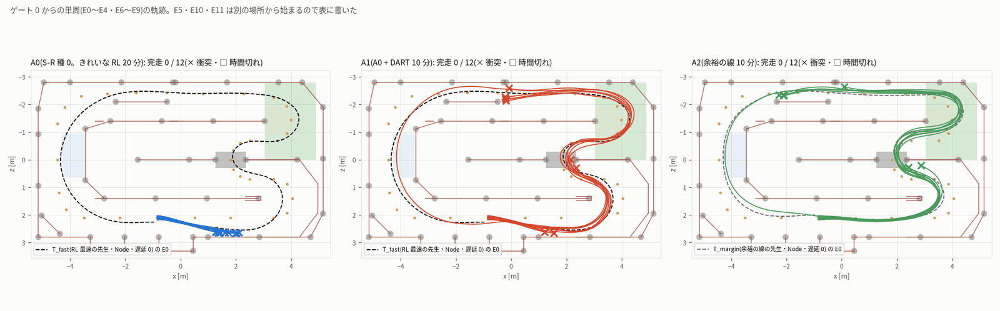
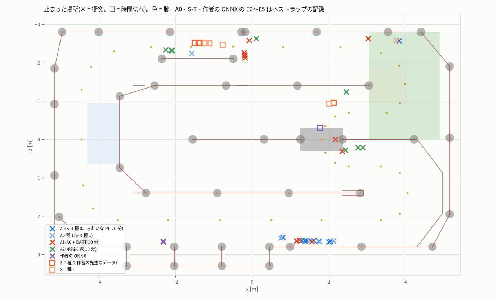

# ずれたときの戻し方(DART)と余裕のある線 — 10 月 14 日の実験(sim_dart_20261014)

- 作成 2026-10-14。すべて **シミュレーターの中** の結果です(実車・PCA9685・I2C には触れていません。実車では確かめていません)。git にはコミットしていません。
- くわしくは `design.md`(設計)・`protocol.json`(結果を見る前に固めた決まり。sha256 `c423c30f…`)・`record.md`(記録)・`train.md`(学習)・
  `evaluation.md`(表と判定)・`review.md`(確認の段の見直し)・`deviations.md`(手順と違えたこと)。

## 目的

昨日(10/13)、強化学習(RL)で作者の先生より **0.84 秒速い周(停止から 1 周 8.092 秒)** を作り、その走り 20 分のデータで JetFormer を学習しました(A0 = S-R)。
ところが学習したモデルは、閉ループ(ブラウザのアプリ・制御遅延 1 フレーム)で **12 回とも約 1 秒で壁にぶつかりました**(ずれは衝突の時点で 10〜18 cm)。
原因は 2 つと考えました。

1. **線に余裕がない**: RL の線は、最初の直線で壁まで約 10 cm しかない。
2. **戻し方を知らない**: きれいな RL の走りだけを見て学んだので、少し線から外れたときにどう戻すかを習っていない
   (RL に途中から代わると、衝突の 0.13〜0.33 秒前までなら立て直せた)。

そこで今日は、ユーザーの依頼「1. 離脱復活のデータで、ずれたときの戻し方を教える(RL を先生にした DART / DAgger)、2. 絶対壁にぶつからないモードや、
余裕を持たせたラインのデータで学習する」を試し、閉ループで完走が増えるかを確かめました。

## やったこと

| 腕 | 学習データ | ねらい |
|---|---|---|
| **A0**(比べる相手。昨日の S-R 種 0) | きれいな RL の走り 20 分(60 シーン) | — |
| **A1 = DART** | A0 の 20 分 + **D1: 最速の RL の先生に、わざと舵のかたよりを入れた走り 10 分**(30 シーン)= 30 分 | ずれた状態と、そこでの先生の正しい操作を見せる |
| **A2 = 余裕のある線** | **D2: 余裕を持たせた線の RL の先生のきれいな走り 10 分**(30 シーン) | 壁から離れた線をまねさせる |
| A3(余裕の線 + DART) | — | **削った**(記録を 15:30 までに始められなかった。protocol の削る順番 3) |
| A4(DAgger) | — | **削った**(16:28 の電源断で約 2 時間遅れたため。削る順番 1)。種 1 も削った |

### DART(D1)

- 走っている最中の最速の RL の先生(昨日のベストラップの方策そのもの)に、ときどき舵のかたより(0.06〜0.15 rad・6〜15 フレーム・左右は半々)を足して車を線から外しました。
  1 シーン 20 秒に約 10 回、30 シーンで 292 回。乱したフレームは 16%。壁に近い所・ゲートの手前で外れすぎる所では乱しを始めない見張りを付けました。
- **正解の付け替え**: 記録した画像はそのまま、正解(未来の 10 フレームの操作)を「その状態から先生だけで走ったときの操作」に付け替えました。
  乱した操作は正解にしません。変わったフレームは 5,447(30.8%)。乱しの間、記録の舵は乱しの向きに 0.05〜0.10 rad、付け替えた正解は逆向きに約 0.05 rad です。
- 乱しで作れたずれは、中央値 4〜6 cm・最大 14 cm(最初の直線では最大 6.8 cm)。S-R がぶつかったときのずれ(10〜18 cm)より小さめです。

### 余裕のある線(D2)

- 候補は「絶対壁にぶつからない」(no_wall)と「経路いろいろ」(line)の RL 方策。結果を見る前に決めた選び方(全部の開始で完走・周全体のすき間 10 cm 以上・
  ゲートの余裕 8 cm 以上の中で、最初の直線のすき間が一番大きいもの)で、**line の方策を左へ 30% 寄せた線**(c0 = +0.3)を選びました。
  no_wall は周全体のすき間は一番大きい(13 cm)が、ゲートの余裕(6.8 cm)で条件を満たさず、0.9 秒遅いので選びませんでした。
- 最初の直線で壁まで **約 40 cm**(最速の線は約 11 cm)。周全体の最小すき間 11.6 cm、10 cm 未満のフレーム 0%。そのかわり 1 周目は 0.8 秒遅い(8.94 秒)。

### 記録・学習・評価

- 記録はブラウザのアプリ(Firefox)の連続試験と収集器で 1 シーン 20 秒 × 30 シーンずつ。D1・D2 とも 30 / 30 シーンが 1 回目で合格(衝突 0・ゲートの外し 0)。
  JetFormer に取り込み済み(ジャンル 8・タグ付き)。
- 学習は A0 と同じ作り方(jetformer_v0・30 エポック・種 0)。最良の検証 L1 は A1 19.0 µs・A2 16.1 µs(腕ごとに val が違うので比べられない)。
- 評価は、ブラウザのアプリで停止から 1 周の単周を 12 の開始(E0〜E11)で 1 本ずつ。制御遅延 1 フレーム・推論はユーザーの bridge.py(CPU の onnxruntime)。

## 結果

| 腕 | 完走(12 本) | 周回時間 | 衝突 | 止まるまでの時間(中央値) | 止まるまでに進んだ道のり(中央値、1 周 26.1 m) | 最初の直線を抜けた(ゲート 0 の開始 9 本) | 点 4 のゲートを外した |
|---|---:|---|---:|---:|---:|---:|---:|
| A0(きれいな RL 20 分) | **0** | — | 12 / 12 | 1.09 秒 | 2.5 m | 0 | 0(届く前に衝突) |
| A1(A0 + DART 10 分) | **0** | — | 12 / 12 | 4.44 秒 | 11.4 m | **8** | 6 |
| A2(余裕のある線 10 分) | **0** | — | 12 / 12 | 6.56 秒 | 17.7 m | **9** | 8 |
| 参考: 作者の先生のデータ(S-T 種 0、E0〜E5) | 2 / 6 | 8.830・8.840 秒 | 0 / 6(4 本は時間切れ) | — | 43.1 m | 5 / 5 | 3 |
| 参考: 作者の ONNX(E0〜E5) | 2 / 6 | 9.022・9.033 秒 | 3 / 6 | 8.64 秒 | 24.7 m | 5 / 5 | 0 |
| 先生: 最速の RL(Node・遅延 0) | 12 / 12 | 7.80〜8.13 秒(E0 8.092) | 0 | — | — | 9 | 0 |
| 先生: 余裕の線の RL(Node・遅延 0) | 12 / 12 | 8.62〜8.99 秒(E0 8.932) | 0 | — | — | 9 | 0 |

- **判定(結果を見る前に固めた決まり)**: Q1(DART)・Q2(余裕の線)とも **「一部効いた」**。完走の差は 0 で、「ゲート 0 からの開始で 8 本以上が最初の直線を抜けた」
  という条件で一部効いたになりました。一番良い腕は決められません(3 つとも完走 0)。Q3(余裕の線 + DART)・Q4(DAgger)は今日は答えません。
- 確かめ: 作者の ONNX(陽性対照)は今日も 9.022 秒で完走し、ユーザーの確認器も PASS。A1 の E0 を 2 回走らせると軌跡は同じ。
  今日の 34 走行は、ユーザーの `replay-report.mjs`(ユーザーの sim-core.js)で再生してすべて一致。完走の数・判定は、確認の段で生の記録から数え直して同じでした(review.md)。

## 分かったこと

1. **最初の直線の衝突は直った**。A0 は 9 本とも最初の直線で約 1 秒でぶつかりましたが、A1 は 9 本中 8 本、A2 は 9 本とも抜けました。
   1 秒の時点の、先生の線からの距離(中央値)は A0 12.5 cm → A1 4.3 cm・A2 1.1 cm。10 cm 離れるまでの時間は 0.93 秒 → 1.45 秒・1.65 秒に延びました。
2. **DART で戻し方を少し習った**。オフラインの比べでは、線から外れた状態のフレームの舵の誤差が A0 71.1 µs → A1 59.5 µs に下がり、予測が先生の戻す操作に近い割合が
   52% → 62% に上がりました。ただし誤差はまだ線の上のフレームの約 2 倍で、習ったのは一部です。A1 は 30 分(A0 は 20 分)なので、データが増えた効果とは分けられません。
3. **次の難所は点 4 のゲート**(最初の直線の終わりのカーブ)。A1 の 6 本・A2 の 8 本が、ゲートの手前でカーブの内側へ曲がり、ゲートを外しました。
   先生の線もこのゲートの内側の端の近くを通ります(端までの余裕は最速の線で 11〜14 cm、余裕の線で 10〜12 cm。確認の段で測り直した値)。
   **余裕の線は「壁からの余裕」を広げた線で、ゲートからの余裕は増えていません**。作者の先生のデータで学んだモデルも、ゲート 0 からの 10 本中 8 本がこのゲートを外しています。
4. ゲートを外したあとも車はコースに沿って走り続け(1 周の 60〜70%)、柱の脚にぶつかって止まりました(A1 は点 21〜22、A2 は点 23〜24 の近く)。
5. **DART の乱しが入っていない場所があった**。乱しを入れたのは 33 区間のうち 18 区間で、点 6〜12・21〜26・29〜30 からの区間には 1 回も入っていません。
   A1 は 12 本中 8 本がその区間で止まりました。点 4 の手前は、ゲートの見張りの決まり(手前 1.2 m ではゲートの中心から 30 cm 以内のときだけ乱しを始める)のため、
   先生がゲートの中心から 51〜56 cm の所を通るので乱しが一度も始まっていません。
6. 先生に途中から代わると、点 4 を外した A1 の走りでも 1.37〜1.63 秒までなら完走できました(DAgger で集めるべき状態がここにあります)。

## 課題

- **点 4 のゲートを通す**: 線の余裕を「壁から」だけでなく「ゲートの端から」も取る。DART の見張りを、先生がゲートの端を通る所でも乱しが入るように変える。
- **DAgger を試す**(今日は時間で削った): A1 が実際に走った状態(点 4 の手前、1.4〜1.6 秒まで)に先生の正解を付けて足す。
- **余裕の線 + DART(A3)を試す**: 今日は記録の時間が足りず削った。
- **比べ方を強くする**: 種が 1 つ・12 本ずつ。DART の効果とデータ量の効果を分けるには、A0 にきれいな 10 分を足した腕と比べる。
- 乱しで作るずれ(中央値 4〜6 cm)が、S-R がぶつかったときのずれ(10〜18 cm)より小さい。もっと大きいずれから戻す例が要る。
- 実車ではまだ確かめていない。

## 再現方法

作業のフォルダー `EXP=/home/jetson/jetformer/experiments/20261014_sim_dart_margin`、報告のフォルダー `R=/home/jetson/jetformer_reports/sim_dart_20261014`。
GPU・Firefox は `jf-heavy --lock big` で 1 つずつ、Node・CPU は `jf-heavy --mem 1500M --lock none -- nice -n 10`。

1. 準備: `python -I $EXP/record/install_dart.py`(この作業のシミュレーターの写しに DART の先生のページ d1・d2.html を置く。ユーザーのファイルは変えない)
2. 記録: `jf-heavy --mem 2500M --lock big -- bash $EXP/browser/run_record.sh D1 $R/recording/D1`(D2 も同じ)
3. 検証・取り込み・正解の付け替え: `bash $EXP/record/post_record.sh D1`(D2 は付け替えずに確かめだけ)。付け替えだけなら
   `python -I $EXP/relabel/relabel_dataset.py --dataset-dir <data/datasets/名前> --teacher fast --noise N_fast`
4. 学習: `jf-heavy --mem 3G --lock big -- python -I $EXP/train/dart_train.py`(A1 → A2。止まっても同じコマンドで続きから)。そのあと `bash $EXP/train/post_train.sh <PID>`
   (一式の ZIP・ブリッジでの読み込みの確認・オフライン L1・図)
5. 評価: `bash $EXP/eval/run_eval.sh`(Firefox でアプリの連続試験。ブリッジは口 8812)→ `bash $EXP/eval/post_eval.sh`(再生の数え直し・先生の目・判定・evaluation.md)
6. 確認: `python3 -I $EXP/review/recount.py`(完走・判定の数え直し)、`bash $EXP/review/replay_all.sh <走行の JSON>…`(ユーザーの replay-report.mjs で再生)、
   `python3 -I $EXP/review/relabel_check.py`(付け替えの確かめ)、`node $EXP/review/teacher_gate4.mjs`(先生の点 4 の余裕)

### データとモデル

- データセット(JetFormer のデータセットのタブ): `jetformer-simulator-rl-dart-fast-10min_20261014-062216_4446c73d`(D1、タグ simulator・rl-dart。シーンのタブには展開していない)、
  `jetformer-simulator-rl-margin-line-10min_20261014-070934_48d04e6b`(D2、タグ simulator・rl-margin。シーンのタブにも展開)
- 学習の結果: `data/runs/simdart_20261014-A1-s0`・`data/runs/simdart_20261014-A2-s0`
- シミュレーター用の一式(アプリの「モデル ZIP を読み込む」で読める): `bundles/simdart_20261014-A1-s0.zip`・`bundles/simdart_20261014-A2-s0.zip`
- 図: `fig/`(記録 5 枚・学習 2 枚・評価 6 枚)、動画の図 `video/fig/`、絵コンテ `video/storyboard.json`
