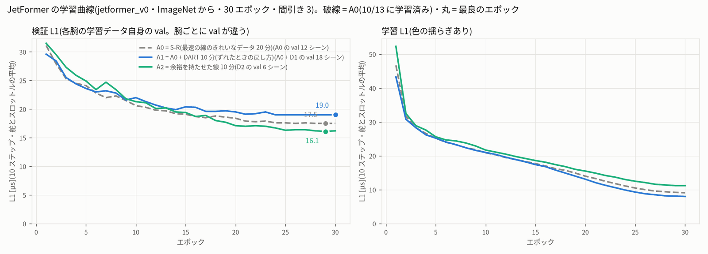
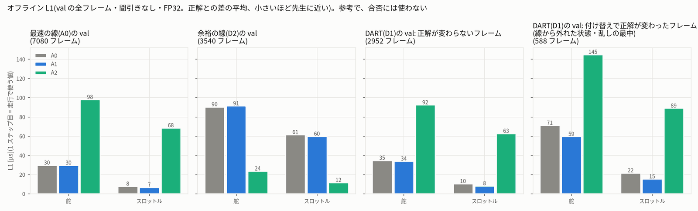

# JetFormer の学習の段 — sim_dart_20261014

2026-10-14 17:50〜19:02。protocol.json の腕のうち A1(A0 + DART)と A2(余裕を持たせた線)を、種 0 で 1 本ずつ学習した。
シミュレーターのブリッジで読み込める一式(ONNX・model_config.json・io_spec.json の ZIP)も作り、ユーザーのブリッジで読み込めることを確かめた。

- A3(余裕の線 + DART)は記録の段で削った(deviations.md 11)。
- A4(DAgger)と種 1 は、電源断(16:28)で時間割を約 2 時間ずらしたときに削った(deviations.md 17)。
- 手順と違えたことは deviations.md の 17〜21 にまとめた。

---

## 1. 結論

- **A1・A2 とも 30 エポックまで学習した。** 最良の検証 L1(各腕の学習データ自身の val、間引き 3)は次のとおり。
  - A1(A0 の 20 分 + DART の 10 分): **19.0 µs**(30 エポック目)
  - A2(余裕を持たせた線の 10 分): **16.1 µs**(29 エポック目)
  - 参照の A0(S-R 種 0、10/13 に学習済み): 17.5 µs
  - 腕ごとに val が違うので、この 3 つの数は比べられない。比べるのは 4 章のオフライン L1(同じ val)。
- **A1 は、ずれたときの戻し方を少しだけ習った。**
  - DART の val で「付け替えで正解が変わったフレーム」(線から外れた状態・乱しの最中、588 フレーム)を見た。
  - 走行で使う 1 フレーム先の舵の誤差は、A0 の 71.1 µs から A1 の **59.5 µs** に下がった(−16%)。
  - 予測が先生の正解のほうに近いフレームの割合は、A0 の 52% から A1 の **62%** に上がった。
  - ただし、正解が変わらないフレームの誤差(33.8 µs)と比べると、まだ約 2 倍ある。戻し方は一部しか習えていない。
- **A1 は、最速の線のまねを悪くしていない。** A0 の val の 1 フレーム先の舵の誤差は、A0 が 29.6 µs、A1 も 29.6 µs で同じ。
- **A2 は、最速の線とは別の線を習った。** これはねらいどおり。
  - 自分の val(余裕の線)での 1 フレーム先の舵の誤差は 23.5 µs。A0 が自分の val で出す 29.6 µs より小さい。
  - 最速の線の val では 98.0 µs になる。A0 が余裕の線の val で出す 90.3 µs も同じくらい大きい。2 つの線の操作が大きく違うためと考えられる。
- **シミュレーター用の一式 2 つは、ユーザーのブリッジで読み込めた。**
  - 2 つの方法で確かめた。ブリッジの関数を直接呼ぶ方法と、HTTP の口を開いてアプリと同じ API で送る方法。
  - ジャンル 8、中心 1442 / 1498 µs、制御の遅れ 1 フレーム、ゲイン 1.0、先読み 1。
  - ONNX と PyTorch の出力の差は最大 0.0003 µs。
- **この段では、まだ「完走できるか」は分からない。** 完走と周回時間は、次の段(閉ループ評価)で測る。

---

## 2. 学習のしかた

- コマンドは protocol.json の arms.common_recipe のとおり。名前は `simdart_20261014-<腕>-s<種>`。
  `tools/train.py --policy jetformer_v0 --data <データ> --epochs 30 --lr 3e-4 --seed 0 --stride 3 --batch 64 --no-command-input --impact-g 2.5`
  - ImageNet から学習を始めた。AdamW(wd 1e-4)と cosine。最良のエポックは、各腕の学習データの val で選んだ(A0 と同じ決まり)。
- データ:
  - **A1**: A0 の 60 シーン(`jetformer-simulator-rl-bestlap-20min_20261013-174515_7f3650b0`)と D1 の 30 シーン(`jetformer-simulator-rl-dart-fast-10min_20261014-062216_4446c73d`、正解は付け替え済み)。
    - data/datasets に新しいデータセットは作っていない。`experiments/20261014_sim_dart_margin/train/data/A1/` に、2 つへのシンボリックリンクと、2 つを合わせた splits.json(学習 72 / 検証 18 シーン)を置いた。
    - 読み込んだサンプル数は、2 つのデータの合計と同じだった(学習 14,184 = 9,456 + 4,728、検証 3,546 = 2,364 + 1,182。`train/count_A1.json`)。
  - **A2**: D2 の 30 シーン(`jetformer-simulator-rl-margin-line-10min_20261014-070934_48d04e6b`)だけ。学習 24 / 検証 6 シーン、学習 4,728 / 検証 1,182 サンプル。
  - どちらもジャンル 8、ジャンル数 9。衝突の前後として外したフレームは 0。
- 順番は A1 → A2。GPU は 1 本ずつ。
- 1 本ごとに次を自動で行った。道具は `experiments/20261014_sim_dart_margin/train/dart_train.py` で、電源断のあとは同じコマンドで続きから動く。
  1. 学習(jf-heavy の上限 3G・lock big)。train.py は毎エポック last.pth を保存する。
  2. run.json(管理画面の一覧用。「シミュレーター専用(ジャンル 8)。実車では使わない」と書いた)
  3. シミュレーター用の一式と、ユーザーのブリッジの関数での確認(`export_bundle.py`・`check_bundle.py`)
- そのあと `post_train.sh` で、次の 3 つを行った。
  - HTTP での読み込みの確認(`http_load_check.py`)
  - オフライン L1(`offline_eval.py`)
  - 図と表(`train_report.py`)
- FP16 のエンジンは作っていない。評価はブリッジの onnxruntime(CPU)で ONNX を動かすので、エンジンは要らない。
- メモリ: A1 は workers 2 で始めたが、98 秒で自分の上限(3G)で止まった。そこで workers 1 で最初から学習し直した。A2 は workers 2 のまま 1 回で終わった。計算の結果は変わらない(deviations.md 19)。

---

## 3. 学習曲線

- 灰色の破線は A0(10/13 に学習済み)。青は A1、緑は A2。
- **A1(青)**: 検証 L1 は 21 エポック目ごろまで下がり、24〜30 エポック目は 19.0 µs でほぼ止まった。
  - 学習 L1 は 8.0 µs まで下がった。検証との差は 11 µs で、A0 の 8 µs より少し大きい。
  - A1 の val の 3 分の 1 は D1(線から外した走り)。4 章で見るとおり、D1 の中の外れたフレームはまねしにくい。そのため、A1 の検証 L1 は A0 より高く出る。
- **A2(緑)**: 検証 L1 は 30 エポックまで下がり続け、29 エポック目で 16.1 µs になった。
  - 学習 L1 は 11.2 µs。データが 10 分と少なく、学習は 4,728 サンプルだけ。それでも、検証との差は 5 µs で 3 つの中で一番小さい。

### 数字

| 腕・種 | 学習結果 | 学習 / 検証のサンプル | 最良の検証 L1 [µs] | 最良のエポック | 30 エポック目の検証 / 学習 L1 [µs] | 1 エポック [秒](中央値) | 30 エポックの計算 [分] | 試行(上限 / 見張り / 終わり不明) | workers |
|---|---|---|---|---|---|---|---|---|---|
| A0 種 0(参照・10/13) | `simrl_bestlap_20261013-SR-s0` | 9456 / 2364 | **17.5** | 29 | 17.5 / 9.1 | 62 | 32 | — | — |
| A1 種 0 | `simdart_20261014-A1-s0` | 14184 / 3546 | **19.0** | 30 | 19.0 / 8.0 | 85 | 44 | 3(1 / 0 / 1) | 1 |
| A2 種 0 | `simdart_20261014-A2-s0` | 4728 / 1182 | **16.1** | 29 | 16.2 / 11.2 | 28 | 14 | 1(0 / 0 / 0) | 2 |

- 「試行」は学習を始めた回数です。内訳は次の 3 つ。
  - 上限: 自分のメモリの上限で止まった回
  - 見張り: 全体の空きが足りず、自分で止めた回
  - 終わり不明: 電源断で終わりが記録されていない回。A1 の 16:27 の 1 回で、1 エポックも終わっていない。
- A1 の学習は 17:52〜18:40(2,871 秒)、A2 は 18:40〜18:58(1,087 秒)。
- エポックごとの数字は、各学習結果の `result.json` の history にある。ログは `train/logs/<学習結果>.train.log` にある。

---

## 4. オフラインの誤差(同じ val で比べる)

参考で、合否には使わない(deviations.md 20)。A0・A1・A2 の best を、3 つのデータの val のすべてのフレームで比べた。

- フレームは間引きなし(3 つの IMU の位相すべて)。精度は FP32。
- 走行で使う 1 フレーム先の値の誤差を出した。

D1 の val(3,540 フレーム)は、付け替えで 1 フレーム先の正解が 1 µs より大きく変わったかどうかで、2 つに分けた。

- **変わったフレーム(588)**: 線から外れた状態や、乱しの最中のフレーム。正解の舵は平均 105 µs 変わった。
- **変わらないフレーム(2,952)**: 先生が線の上を走っているフレーム。

| 腕・種 | A0 の val 舵 1 / 10 | A0 の val スロットル 1 / 10 | D2 の val 舵 1 / 10 | D2 の val スロットル 1 / 10 | D1 の val(変わらない)舵 1 | D1 の val(変わった)舵 1 / スロットル 1 | 変わったフレーム: 付け替える前の正解との舵 1 | 変わったフレーム: 先生の正解に近い割合 |
|---|---|---|---|---|---|---|---|---|
| A0 種 0 | 29.6 / 31.5 | 7.7 / 7.7 | 90.3 / 94.8 | 61.4 / 63.0 | 34.6 | 71.1 / 21.5 | 79.0 | 52% |
| A1 種 0 | 29.6 / 31.6 | 6.7 / 7.3 | 91.3 / 90.5 | 59.6 / 60.0 | 33.8 | **59.5 / 15.2** | 83.1 | **62%** |
| A2 種 0 | 98.0 / 106.4 | 68.5 / 70.8 | **23.5 / 24.7** | **11.6 / 11.6** | 92.4 | 144.8 / 88.9 | 132.1 | 43% |

(単位は µs。「1 / 10」は 1 フレーム先 / 10 フレームの平均)

- **A1 は戻し方の正解に近づいた。ただし一部だけ。**
  - 変わったフレームでは、舵の誤差が 71.1 → 59.5 µs、スロットルの誤差が 21.5 → 15.2 µs に下がった。
  - 付け替える前の正解(記録した、乱し入りの操作)との差は、79.0 → 83.1 µs に上がった。つまり A1 は、乱した操作ではなく、先生の戻す操作のほうへ寄った。
  - それでも、変わったフレームの誤差 59.5 µs は、変わらないフレームの誤差 33.8 µs の約 2 倍ある。
  - 理由の候補は 2 つ。
    - 変わったフレームは、A1 の学習データの約 5% しかない(D1 の約 17% × 全体の 3 分の 1)。
    - 乱しの最中の画像だけからは、乱しの大きさが分からない。
- **A1 は、最速の線のまねを悪くしていない。** A0 の val では、舵が A0 と同じ 29.6 µs、スロットルが A0 の 7.7 µs に対して 6.7 µs。
- **A2 は別の線を走る。**
  - 余裕の線(D2)の val では、舵 23.5 µs・スロットル 11.6 µs。A0 が自分の val で出す 29.6 µs・7.7 µs と比べると、舵は小さく、スロットルは少し大きい。10 分のデータでも、A0 と同じくらいまねできている。
  - 最速の線の val では誤差が 98 µs ある。2 つの線は、同じ場所でも舵とスロットルが大きく違う。
  - A0・A1 も、余裕の線の val では誤差が約 90 µs ある。
- 1 回の測りにかかった時間は 2 分 20 秒(GPU、lock big)。結果は `train/offline_l1.json` にある。

---

## 5. シミュレーター用の一式と、ブリッジでの確認

| 腕・種 | 一式の ZIP | ONNX と PyTorch の差 最大 [µs] | ブリッジの読み込み(関数) | ブリッジの読み込み(HTTP) | ZIP [MB] | ZIP の sha256(頭 16 文字) |
|---|---|---|---|---|---|---|
| A0 種 0(参照) | `/home/jetson/jetformer_reports/sim_rl_bestlap_20261013/bundles/simrl_bestlap_20261013-SR-s0.zip` | 0.00032 | 合格(10/14) | — | 53.9 | `ea5293114957f5c3` |
| A1 種 0 | `/home/jetson/jetformer_reports/sim_dart_20261014/bundles/simdart_20261014-A1-s0.zip` | 0.0003 | 合格 | 合格 | 53.9 | `11ff88ee8ba4b576` |
| A2 種 0 | `/home/jetson/jetformer_reports/sim_dart_20261014/bundles/simdart_20261014-A2-s0.zip` | 0.00033 | 合格 | 合格 | 53.9 | `bda5804a8345662d` |

- **作り方**: ベストラップの export_bundle.py の写しを使った(deviations.md 18)。
  - ONNX は学習結果のものを、そのまま写した(sha256 が同じことを確かめた)。
  - model_config.json には、次を足したり直したりした。
    - 中心 1442 / 1498 µs。学習が出した値は、A1 が 1103.4 / 1188.5、A2 が 1492.4 / 1188.5。
    - 作者の参照モデルと同じ物理・センサーの欄
    - 制御の遅れ 1 フレーム
    - ジャンル 8・ゲイン 1.0・先読み 1
  - io_spec.json は、直した model_config から作った。
  - 直した欄は、ベストラップの S-R の一式と同じ。違うのは、データセットの名前と、一式の出どころの記録(simulator_bundle)だけ。
- **ブリッジの関数での確認**(`check_bundle.py`、シミュレーター用の Python): アプリの「モデル ZIP を読み込む」と同じ順に、ブリッジの関数を呼んだ(save_bundle → activate_model)。
  - 走行モード 8・学習したジャンル [8]・one-hot の長さ 9(学習と同じ)を確かめた。
  - 中心 1442 / 1498、遅れ 1、ゲイン 1.0 / 1.0、先読み 1 も確かめた。
  - ONNX(onnxruntime CPU)と PyTorch の出力を、val の 16 フレームで比べた。
- **HTTP での確認**(`http_load_check.py`): ブリッジの写しを、この作業の口 8815 で立てた。アプリと同じ順に HTTP で送った。
  - 送った順: POST /api/models/bundle → POST /api/models/activate(ジャンル 8)→ GET /api/status
  - 2 つとも読み込めて、設定が上と同じだった(読み込み 0.8〜0.9 秒)。
  - ブリッジの写しは、ユーザーの bridge.py・jetformer_policy.py とバイト単位で同じ。
  - ユーザーのブリッジのプロセス・jetformer-web には触っていない。
- A0 は、ベストラップの一式をそのまま使う(作り直さない)。

---

## 6. 次の段(閉ループ評価)への引き継ぎ

- 対応表: `train/runs.json`(腕・種 → 学習結果・一式の ZIP・sha256)。A0/s0 はベストラップの一式。
- 評価する一式: `bundles/simdart_20261014-A1-s0.zip`・`bundles/simdart_20261014-A2-s0.zip`
- A1 の model_config の dataset 欄は `A1` になっている。合わせたフォルダーの名前なので、これで正しい。
- GPU(lock big)は 19:02 に放した。この段で始めたプロセスはすべて終わっている。

---

## 7. 限界・注意

- **オフライン L1 は閉ループの成績ではない。** A1 が戻し方に少し近づいたことは分かった。けれども、10〜18 cm ずれた状態(S-R がぶつかったときのずれ)から戻れるかは、閉ループで走らせないと分からない。
- D1 の乱しで作ったずれは、中央値 4〜6 cm・最大 14 cm で、S-R がぶつかったときより小さい(record.md)。大きなずれの戻し方は、あまり習っていない可能性がある。
- **データの量が腕ごとに違う。** A1 は 30 分、A0 は 20 分、A2 は 10 分。A1 の結果は「DART のデータを足した効果」で、「同じ量のきれいなデータより良い」とは言えない。
- **種は 0 だけ。** 種のばらつきは、ベストラップの S-R では 0.1 µs と小さかった。
- **IMU の位相の問題**: 間引き 3 の学習は、IMU の 3 つの位相のうち 1 つしか見ていない(ベストラップの train.md 4 章)。全部の腕で同じなので、比べ方は崩れない。

---

## 8. ファイル

- 報告: `train.md`(この文書)、`train/tables.md`・`train/summary.json`・`train/runs.json`・`train/offline_l1.json`・`train/state.json`・`train/count_A1.json`
- 図: `fig/train_curves.png`・`fig/train_offline_l1.png`
- ログ: `train/logs/`(driver.log・<学習結果>.train.log・.bundle.log・.http_load.log・offline_eval.log・post_train.log)
- 一式: `bundles/simdart_20261014-A{1,2}-s0/`(export.json・bundle_check.json・http_load_check.json)と `.zip`、`bundles/_check/`(PyTorch の参照の出力)
- 学習結果: `/home/jetson/jetformer/data/runs/simdart_20261014-A1-s0`・`simdart_20261014-A2-s0`
- 道具: `/home/jetson/jetformer/experiments/20261014_sim_dart_margin/train/`
  - dart_train.py・export_bundle.py・check_bundle.py・http_load_check.py・offline_eval.py・train_report.py・post_train.sh
  - make_combined.py・count_samples.py・nothp.py
- sha256: `train_sha256.txt`
