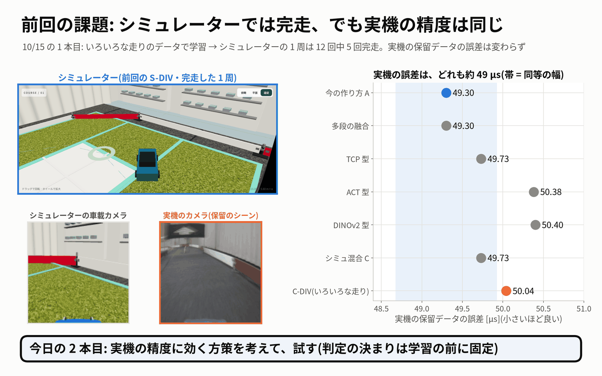
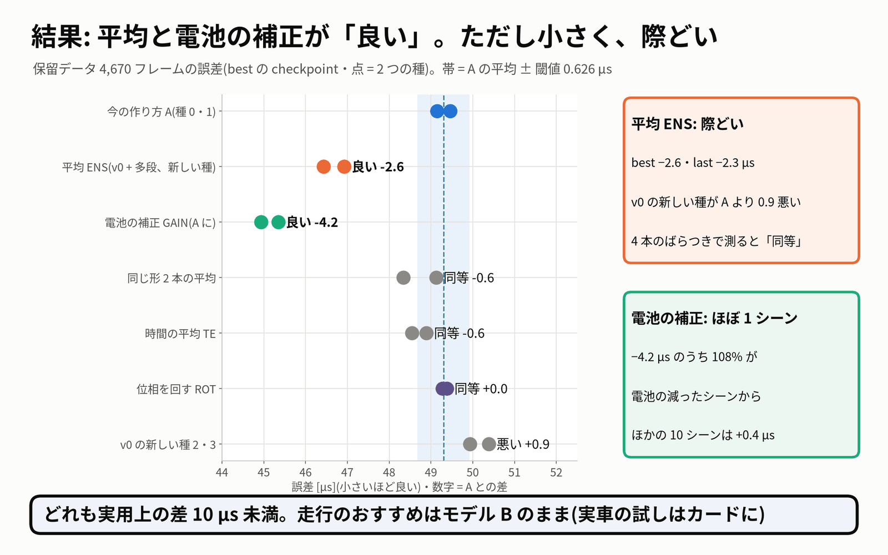
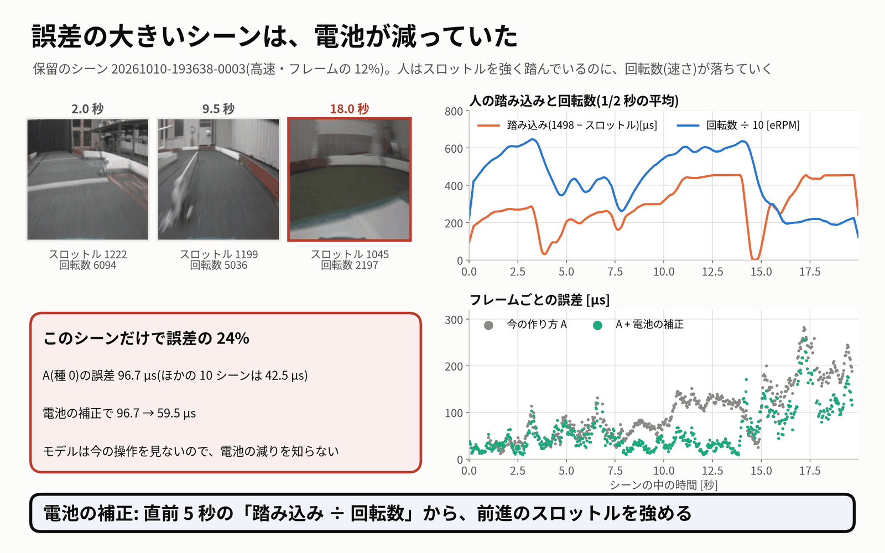
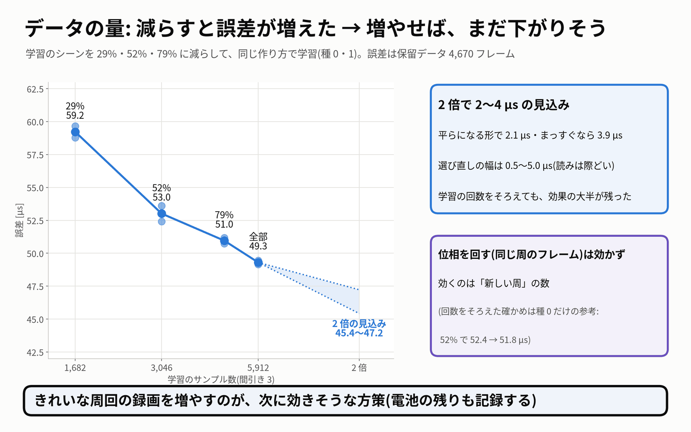
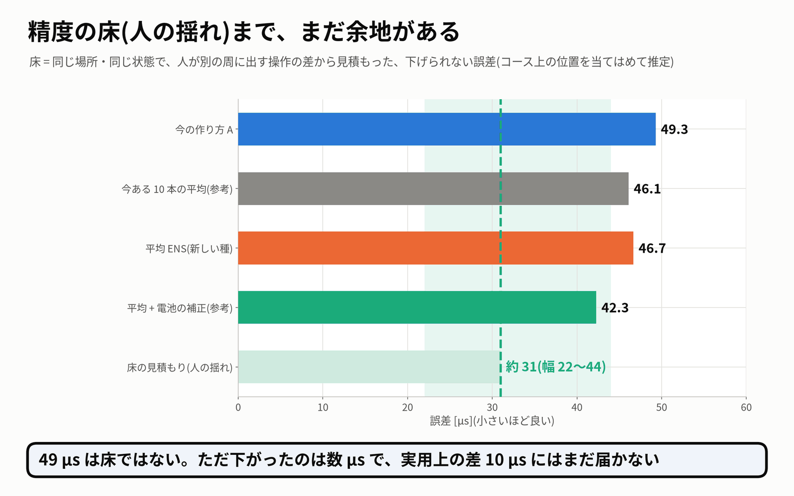

# 実機の精度に効く方策を試した — 10 月 15 日の実験(2 本目の報告)

- 依頼(10/15 17:05ごろ):「また、実機の精度に効く方策を考えて、トライして」
- 調べたのは、**実機で記録した保留データでの誤差**(オフライン)です。
  - 保留データ = 人のきれいな走行の 11 シーン・4,670 フレーム(clean_driving_20261011 の val)。学習には一度も使っていません。
  - 誤差 = 10 フレーム先までのステアとスロットルの L1 [µs]。小さいほど人の運転に近いです。
  - **実車は走らせていません**。実車・PCA9685・I2C には触れていません。git にはコミットしていません。
- 判定の決まりは、学習を始める前の 10/15 17:41 に固めました(`protocol.json`、sha256 `5941a6f6…72d8`。今も同じ)。中身は 10/13 の規則のままです。
  - **「良い」= 2 つの種の両方が基準 A の 2 本より小さく、平均の改善が閾値より大きい**。閾値は best 0.626 µs・last 1.322 µs で、best と last の両方で「良い」が要ります。
  - 実用上の差の目安は 10 µs です。
- 10/15 23:46 ごろに Jetson の電源が落ち、10/16 10:03 まで止まりました。最後の 4 本の学習は削りました(下の「課題」)。判定の数字は電源断の前と同じです。
- **見直し(`review.md`)**: 見出しの数字は全部、保存した予測から別のコードで数え直し、`evaluation.json` と一致しました(判定・副指標・感度・SIZE の値で食い違い 0 件)。
- 約 1 分の動画の絵コンテ: `video/storyboard.json`・`video/storyboard.md`(図は `video/fig/r1〜r6`。描くのはメインのセッション)

## 目的

今のモデル(基準 A = JetFormer v0、TransFuser軽量型)の実機の保留データでの誤差 **49.3 µs** を、学習の作り方・使い方を変えて下げられるかを、先に決めた規則で正直に判定することです。良い方策が見つかれば、実車で試すカード(A/B/A)に載せます。

## 前回までの課題

- 10/12〜10/15 に、形を 5 つ変えても(v0 49.30・多段の融合 49.30・TCP 型 49.73・ACT 型 50.38・DINOv2 型 50.40 µs)、オフラインの強化学習を足しても、シミュレーターのデータを混ぜても(C 49.73・C-DIV 50.04 µs)、実機の誤差は **約 49 µs のまま** でした。
- 直前の 10/15 の 1 本目では、いろいろな走りのシミュレーターのデータで学習し、**シミュレーターでは 12 回中 5 回完走できました**。しかし **実機の保留データの精度は上がりませんでした**(C-DIV − A = +0.74 µs)。
- 「49 µs は人の周ごとの揺れで決まる床に近い」という仮説がありましたが、確かめていませんでした。

## 考えた方策(3 つの観点)

学習の前に、3 つの観点で別々に調べました(どれも CPU だけ・保存済みの予測を読むだけ)。この段の数字は **保留データを見た後の下調べ** で、判定には使っていません。

| 観点 | 分かったこと | 出てきた案 | くわしく |
|---|---|---|---|
| **① 誤差の中身から** | 保留のシーン 20261010-193638-0003 は、**電池が減って**、スロットルを強く踏んでも回転数が上がらない区間で終わる。このシーン(フレームの 12%)が誤差の 24% を占める。モデルは今の操作を見ないので、電池の減りを知らない。モデルどうしの予測の食い違いは大きい(同じ形の種どうし 17.8 µs、形が違うと 27〜29 µs)ので、平均すると下がる | 平均(ENS)・電池の補正(GAIN)・時間の平均(TE)・ばらつきを減らす学習(ROT)・データの量の曲線(SIZE) | `ideas_data.md` |
| **② シミュレーターと実機の差から** | シミュレーターと実機の画像は、モデルの中では 99.8〜100% 見分けられる。色やぼけを合わせても差は 13〜22% しか縮まない(差は床・壁などの中身)。混ぜると損はステアに出る。シミュレーターで学んだモデルが役に立つのは「平均の相手」だけで、効いているのは平均そのもの。形の違う相手(msfusion)の方がよく効く | 今夜はシミュレーターの新しい腕は作らない。平均の相手は msfusion | `ideas_sim2real.md` |
| **③ 精度の床から** | 同じ場所・同じ状態で人が別の周に出す操作の差から見た床は **約 31 µs(幅 22〜44 µs)**。49 µs と床のあいだに余地がある。今ある 10 本の平均でも 46.1 µs まで下がる | 平均を新しい種で確かめる・電池の効きを使う・捨てているフレームを使う・データの量を測る。時間の平均は介入の集合で悪くなるので見込みが低い | `ideas_ceiling.md` |

ここから、次の 5 つ(+ 任意の 1 つ)を選び、組・式・閾値を学習の前に固めました(`design.md`・`protocol.json`)。

## 試した方策と結果

| 方策 | 中身 | 保留データの結果(A との差。負 = 良くなった) | 判定 | どう読むか |
|---|---|---|---|---|
| **ENS** 形の違う 2 本の平均 | v0 と msfusion(TransFuser多段型)を **新しい種 2・3** で学習し、組 P2 = v0-s2 + msf-s2、P3 = v0-s3 + msf-s3 の予測を平均(組は学習の前に固定) | 46.43 / 46.92 µs(A は 49.15 / 49.46)。**best −2.63・last −2.33 µs**。介入の集合でも −10.0 µs | **良い**(ただし感度では同等) | 平均は効いた。ただ小さく、際どい。1 つのエンジンにまとめても速さ・精度のゲートに合格(中央値 4.1 ms・差 最大 0.86 µs) |
| **GAIN** 電池の補正(後処理) | 直前 5 秒の「(中立 − スロットル)÷ 前進の回転数」の中央値から効きの落ちを見積もり、前進のスロットルの予測を強める(0.8〜2.0 倍) | **−4.16 µs**(A に)・**−4.19 µs**(新しい種に)。電池のシーンを除く 10 シーンは +0.38 / +0.42 µs(同等)。介入の集合 −3.14 µs | **良い**(G1〜G3 を満たす) | **改善の 108〜109% が電池の減った 1 シーンから**(96.7 → 59.5 µs)。ほかのシーンでは少し悪い向き |
| SAME(対照) 同じ形 2 本の平均 | [(A_s0 + A_s1)/2、(v0-s2 + v0-s3)/2] | −0.57 / −0.28 µs | 同等 | 同じ形の平均は約 1 µs しか効かない |
| ENS vs SAME | 形の違いの上乗せ | −2.06(閾値 1.56)/ −2.05 µs(閾値 2.56) | 同等(best だけ良い) | 形の違いの上乗せは、規則では言えない |
| TE 時間の平均 | 1・2 フレーム前の予測も一様に混ぜる(走行タブの「予測の重ね合わせ」と同じ計算) | −0.58 / −0.45 µs | 同等 | 走行の既定(オフ)のまま |
| ROT 位相を回す | 間引き 3 の位相をエポックごとに回し、捨てていた 2/3 のフレームも使う | +0.03 µs | 同等 | 同じ周の 1/30 秒ずれたフレームを足しても変わらない |
| FRESH-A(対照) | v0 を新しい種 2・3 で学習し直しただけ | **+0.86 µs** | 悪い(予想は同等) | 今までの A の 2 本は、種のばらつきを小さめに見ていた |
| FRESH-MSF(対照) | msfusion の新しい種 2・3 だけ | −0.45 µs | 同等 | 1 本では v0 と同じくらい |
| **SIZE** データの量(測定) | 学習シーンを 29%・52%・79% に減らして同じ作り方で学習 | 59.23 / 53.01 / 50.96 / 49.30 µs(全部) | 判定はしない(測定) | **2 倍にすると 2〜4 µs 良くなる見込み**。読みは「録画を勧める」だが際どい(下) |
| GAINL(任意) 補正をラベルに入れる | GAIN の補正を、学習のラベルの側に入れる | 種 0 だけ: 後処理どうしで −0.48 / −0.40 µs。介入の集合では last で +5.48 µs(閾値 4.858 を超えた悪い向き) | **判定なし**(2 本目は電源断で削った) | 後処理(GAIN)より上という兆しは無い |

### 読み違えないために

- **ENS は際どいです。** v0 の新しい種(49.94・50.39 µs)が A の 2 本より悪く出ました。v0 の 4 本とモデル B のばらつきで閾値を計算し直すと(結論の規則 3 の感度、閾値 best 2.49・last 3.28 µs)、**ENS は「同等」** になります(last の −2.33 µs が届かない)。**GAIN は「良い」のまま** です。
- **ENS の相手に msfusion を選んだのは、同じ 4,670 フレームを見た後です**(4 つの候補から)。新しい種で確かめたのは「種を変えても効くか」で、「別の日のデータでも効くか」ではありません。まだ開けていない別の保留データはありませんでした。
- **GAIN の改善は、ほぼ 1 シーンからです。** 保留データの g_t は人が出したスロットルから求めました。走行中は AI が出したスロットルから求めることになり、そのループでの動きはまだ確かめていません。
- ENS と GAIN を両方かけると 42.0 / 42.6 µs(−7.0 µs)ですが、組み合わせは固定の外の参考です。

### 電池が減ったシーン

- 2 秒のころは踏み込み約 280 µs で回転数 6,000 ですが、17 秒以降は踏み込みがほぼ全開(約 450 µs)でも回転数は約 2,000 です。
- 補正の比 g_t / g_ref は、このシーンでは平均 1.60、ほかの 10 シーンでは 0.93〜1.05 で、ほとんど補正しません。
- 電圧はログに無いので、原因が電池だというのは推定です。

### データの量(SIZE)

| 学習データ | 学習サンプル | 誤差(best、2 つの種の平均) |
|---|---:|---:|
| Q(29%、11 シーン) | 1,682 | 59.23 µs |
| H(52%、20 シーン) | 3,046 | 53.01 µs |
| T(79%、32 シーン、任意) | 4,682 | 50.96 µs |
| 全部(41 シーン = A) | 5,912 | 49.30 µs |

- 2 倍あたりの下がり方は s2 = 3.88 µs(まっすぐ続く場合)、平らになりつつあると仮定した G2_pow = 2.07 µs です。決まりの読みは「**2 倍で 2 µs 以上の見込み。きれいな周回の録画を勧める(電池の残りも記録)**」です。
- ただし際どいです。シーンを選び直したブートストラップでは G2_pow の 95% 区間が 0.55〜4.96 µs で、読みは「高い」54%・「中」46% に分かれました。
- 小さい部分集合ほど学習のステップ数も少ないので、結果を見た後に **固定の外の参考の腕 SIZE-EQ**(ステップ数をそろえた学習、種 0 だけ)を足しました。52% のデータで 59 エポックにすると 52.41 → 51.83 µs で、差 3.26 µs のうち埋まったのは 18% だけでした(s2 3.41 → s2_eq 2.80 µs / 2 倍)。**ステップ数をそろえても、データの量の効果の大半が残りました**(種 1 本の参考)。

## 精度の床(人の揺れ)

- 床 = 同じ場所・同じ車の状態で、人が別の周に出す操作の差から見積もった、下げられない誤差です(`ideas_ceiling.md`)。
  - 人のきれいな 52 シーンの各フレームをコース図の上に置き(ジャイロとホールセンサーの距離で当てはめ、val の 99.1% に場所が付いた)、別の周の近い状態のフレームと組にして差を測り、状態が同じになる所まで外挿しました(D0 = 44.3 µs、95% 区間 37.5〜56.2)。
  - 床は D0/2〜D0 の **22〜44 µs**、中心の見積もりは **約 31 µs** です。
- 今の位置: A 49.3 µs、ENS 46.7 µs(新しい種)、ENS + 電池の補正 42.3 µs(参考)。今ある 10 本の平均 46.1 µs(参考)。
- **49 µs は床ではありません。** 実際に、先に固めた ENS で 46〜47 µs まで下がりました。ただ、今日の方策で下がったのは数 µs で、実用上の差 10 µs には届いていません。
- 注意: 場所の当てはめはカメラの目印を使っていないので数十 cm ずれることがあり、「状態」の決め方でも値が動きます。31 µs は目安です。

## 分かったこと

1. **平均は効く。** 形の違う 2 本(v0 + msfusion)の平均は、新しい種でも −2.3〜−2.6 µs で、規則では「良い」でした。ただし、A の種のばらつきを広く見ると「同等」になる際どさです。同じ形の平均は約 1 µs だけでした。
2. **誤差の 4 分の 1 は、電池が減った 1 シーン。** モデルは今の操作を見ないので、電池の減りを知りません。後処理の補正でそのシーンは 96.7 → 59.5 µs になりましたが、ほかのシーンでは少し悪くなります。
3. **効くのは「新しい周」の数。** データを減らすと誤差ははっきり増え(52% で +3.7 µs、29% で +9.9 µs)、曲線はまだ平らになっていません。一方、同じ周のフレームを増やす(ROT)は効きませんでした。
4. **時間の平均は効かない。** 2 組とも同等で、介入の集合では悪くなる向きでした。
5. **基準 A の 2 本は当たりの種だったかもしれない。** v0 の新しい種は A より 0.86 µs 悪く出ました。これからは 4 本以上の種でばらつきを測るべきです。
6. **シミュレーターの画像は、実機の精度には効かない。** モデルの中で実機と完全に見分けられ、色合わせでは埋まりません(下調べ)。
7. **走行の推奨はモデル B のままです。** どの「良い」も 10 µs より小さい机上の改善で、開いたループ(記録)での結果です。実車の走りが良くなるかは示していません。

## 実車で確かめる場合のカード(A/B/A、走らせるのはユーザー)

くわしくは `aba_card.md`。**この作業では車を走らせていません。** カードは、ユーザーが試すときのためのものです。

- 並び: **B → 候補 → B**、各 5 周。3 回とも同じ電池の帯(走る前の電圧を記録)。走行の設定はゲイン ステア 1.3・スロットル 1.0、先読み 3、予測の重ね合わせはオフ。
- 記録: 周回時間・衝突の回数・取り上げ・直線の eRPM(HS・DE の中央値)・R1 を通過できたか。
- 読み方: 候補の 5 周が前後の B の 10 周より周回時間で良く、衝突・取り上げが増えていなければ「良さそう」。良さそうなら A/B/A をもう 1 回くり返して決める。
- **候補 1: ENS**(P2 = v0-s2 + msf-s2 を 1 つにまとめた FP16 エンジン `experiments/20261015_real_accuracy/ens/ens_p2_fp16.engine`)
  - 走らせる前に要ること: エンジンと model_config.json を data/runs の学習結果のフォルダーに置き、走行タブの一覧に出す(この作業ではしていない)。
- **候補 2: GAIN**(B の出力に電池の補正。実車では上限を 1.3 倍にする。保留データでは −1.66 µs)
  - 走らせる前に要ること: 補正を走行のプログラム(jetformer/drive.py)に足す(この作業ではしていない)。走行中は衝突の「後 2 秒」だけを外す(見直しで、この因果の形でも結果が同じことを確かめた)。
  - 電池が新しいときと、15 分走って減ったときの 2 回、B → B + 補正 → B を走る。効くのは減ったときだけのはずで、新しいときに悪くならないことも見る。

## 課題

1. **きれいな周回の録画を増やす。** 2 倍で 2〜4 µs の見込みです(読みは際どい)。**電池の電圧も一緒に記録**すると、電池の補正の確かめにも使えます。
2. **実車の A/B/A**(ENS・GAIN。走らせるのはユーザー)。その前に、ENS のエンジンを走行タブに出す作業と、GAIN を走行のプログラムに入れる作業が要ります。
3. **まだ開けていない保留データを作る。** 今回の確かめは、どれも下調べで見た同じ 4,670 フレームでした。次に録画するときは、一部を最初から保留にしておくと、正直な確かめができます。
4. **種を増やして基準 A のばらつきを測り直す**(FRESH-A で、A の 2 本が当たりの種だった可能性が出ました)。
5. 電池の効きや電圧を **入力** として渡す学習(GAINL は後処理より上の兆しが無かったので、ラベルではなく入力で)。
6. 電源断で削った学習(gainl-s1・sizeHeq-s1・sizeQeq-s0・sizeQeq-s1)。必要なら同じコマンドでやり直せます。
7. どの方策も、実用上の差 10 µs には届いていません。

## 動かしたもの・ファイル

- 判定と数字: `evaluation.md`・`evaluation.json`(全部の判定・副指標・シーン別・答え合わせ)
- 見直し: `review.md`、数え直しの結果 `review/recount.json`・`review/gain_causal_check.json`
- 学習の記録: `training.md`(14 本が済み、4 本を電源断で削った)
- 設計と決まり: `design.md`・`protocol.json`(sha256 `protocol.sha256`)
- 手順と違えたこと: `deviations.md`
- 実車で試すときのカード: `aba_card.md`
- 下調べ: `ideas_data.md`・`ideas_sim2real.md`・`ideas_ceiling.md`
- 道具: `/home/jetson/jetformer/experiments/20261015_real_accuracy/`
  - `train/realacc_driver.py`(学習の段)・`eval/realacc_eval.py`・`eval/realacc_lib.py`(判定と式。テストつき)・`ens/ens_gate.py`
  - `train_rot.py`・`train_gainl.py`・`size/make_size_masks.py`
  - 見直し: `review/recount.py`(評価の道具を使わずに数え直す)・`review/gain_causal_check.py`・`review/make_slides_review.py`(動画の図)
  - 道具の sha256 は `eval_sha256.txt`
- 予測: `/home/jetson/jetformer/data/zoo/real_accuracy_20261015/pred/`
- 学習結果: `/home/jetson/jetformer/data/runs/realacc_20261015-*`(last.pth は予測を確かめた後に消した。protocol のとおり)
- 前の版の README: `review/README.before_review.md`
