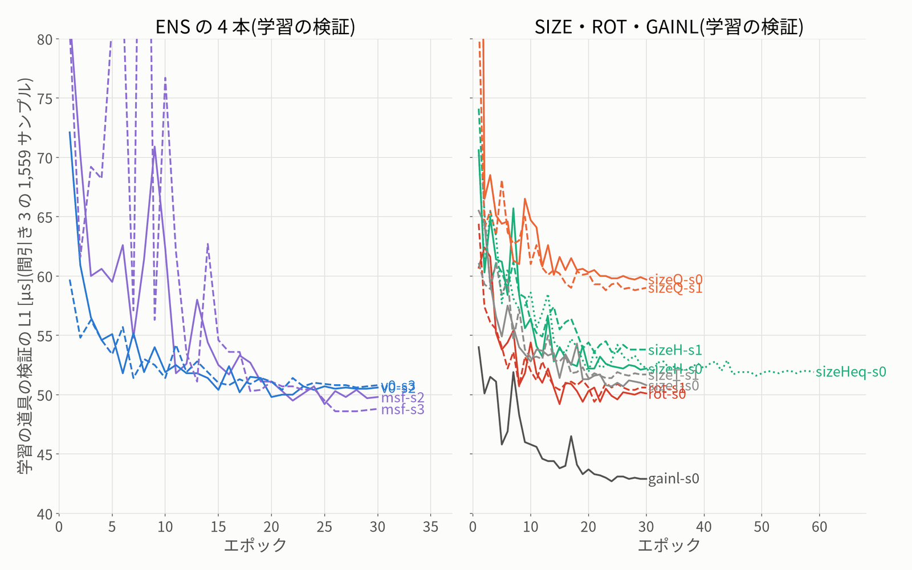

# 学習の段(real_accuracy_20261015)

- 書いた時刻: 2026-10-16 10:24:45(`experiments/20261015_real_accuracy/train/training_report.py`)
- 道具: `experiments/20261015_real_accuracy/train/realacc_driver.py all`(protocol.json の gpu_order の順・GPU は 1 つずつ・電源断のあとは同じコマンドで続きから)。ログ: `logs/driver.log`、各学習の `data/runs/<名前>/train.log`
- 学習のコマンドは protocol.json の arms.*.train の文字列そのまま。足したのはメモリの扱いだけの包み(THP なし・MALLOC_ARENA_MAX 2・expandable_segments・choom 1000・全体の空きメモリの見張り。deviations.md)
- 10/15 23:46 ごろ〜10/16 10:03 に電源が落ちた。gainl-s1(8 エポック目まで)と、まだ始めていなかった SIZE-EQ の 3 本は削った。済んでいた gainl-s0・sizeHeq-s0 は 10/16 に `train/resume_20261016.py` で確かめ・予測した(deviations.md 10/16)

| 学習結果 | 腕 | 学習 / 検証のサンプル | best のエポック | 学習の検証 best / last [µs] | 最後の学習の L1 [µs] | 試行・再開 | メモリの上限 | 時間 | 確かめ | last.pth |
|---|---|---|---|---|---|---|---|---|---|---|
| msf-s2 | ENS(新しい種) | 5912 / 1559 | 25 | 49.2 / 49.8 | 32.1 | 2・0 | 3800M | 32 分 | OK | 消した(予測を確かめた後) |
| v0-s2 | ENS(新しい種) | 5912 / 1559 | 20 | 49.8 / 50.6 | 13.9 | 2・0 | 3872M・3G | 21 分 | OK | 消した(予測を確かめた後) |
| msf-s3 | ENS(新しい種) | 5912 / 1559 | 28 | 48.6 / 48.8 | 33.1 | 1・0 | 3800M | 31 分 | OK | 消した(予測を確かめた後) |
| v0-s3 | ENS(新しい種) | 5912 / 1559 | 21 | 50.4 / 50.8 | 13.9 | 1・0 | 3872M | 21 分 | OK | 消した(予測を確かめた後) |
| sizeH-s0 | SIZE(データの量) | 3046 / 1559 | 29 | 52.1 / 52.2 | 15.4 | 1・0 | 3872M | 14 分 | OK | 消した(予測を確かめた後) |
| sizeH-s1 | SIZE(データの量) | 3046 / 1559 | 25 | 53.6 / 53.8 | 14.9 | 1・0 | 3872M | 15 分 | OK | 消した(予測を確かめた後) |
| sizeQ-s0 | SIZE(データの量) | 1682 / 1559 | 28 | 59.7 / 59.7 | 17.3 | 1・0 | 3872M | 11 分 | OK | 消した(予測を確かめた後) |
| sizeQ-s1 | SIZE(データの量) | 1682 / 1559 | 23 | 58.8 / 59.0 | 16.7 | 1・0 | 3872M | 11 分 | OK | 消した(予測を確かめた後) |
| rot-s0 | ROT(位相を回す) | 5879 / 1559 | 15 | 49.2 / 50.1 | 18.8 | 1・0 | 3872M | 21 分 | OK | 消した(予測を確かめた後) |
| rot-s1 | ROT(位相を回す) | 5912 / 1559 | 21 | 49.4 / 50.6 | 18.8 | 1・0 | 3872M | 21 分 | OK | 消した(予測を確かめた後) |
| sizeT-s0 | SIZE(データの量) | 4682 / 1559 | 24 | 50.7 / 50.8 | 14.3 | 1・0 | 3872M | 19 分 | OK | 消した(予測を確かめた後) |
| sizeT-s1 | SIZE(データの量) | 4682 / 1559 | 23 | 51.4 / 51.7 | 14.1 | 1・0 | 3872M | 19 分 | OK | 消した(予測を確かめた後) |
| gainl-s0 | GAINL(任意) | 5912 / 1559 | 24 | 42.7 / 42.9 | 13.7 | 1・0 | 3872M | 22 分 | OK | 消した(予測を確かめた後) |
| gainl-s1 | GAINL(任意) | — | — | — | — | 1・0 | — | — | 削った(電源断で未完) | — |
| sizeHeq-s0 | SIZE-EQ(固定の外の参考) | 3046 / 1559 | 49 | 51.6 / 51.9 | 10.6 | 1・0 | 3872M | 28 分 | OK | 消した(予測を確かめた後) |
| sizeHeq-s1 | SIZE-EQ(固定の外の参考) | — | — | — | — | 0・0 | — | — | 削った | — |
| sizeQeq-s0 | SIZE-EQ(固定の外の参考) | — | — | — | — | 0・0 | — | — | 削った | — |
| sizeQeq-s1 | SIZE-EQ(固定の外の参考) | — | — | — | — | 0・0 | — | — | 削った | — |

## 段

- crosscheck: `{"exit": 0, "wall_s": 64.5, "at": "2026-10-15 19:46:33"}`
- predict:ENS: `{"exit": 0, "wall_s": 406.1, "at": "2026-10-15 19:53:20", "names": ["realacc_20261015-msf-s2", "realacc_20261015-v0-s2", "realacc_20261015-msf-s3", "realacc_20261015-v0-s3"]}`
- evaluate_last: `{"exit": 0, "wall_s": 16.2, "at": "2026-10-16 10:14:25"}`
- rot_smoke: `{"exit": 0, "wall_s": 55.0, "phases": [0, 1], "state": "done", "ok": true, "at": "2026-10-15 20:55:31"}`
- predict:SIX: `{"exit": 0, "wall_s": 534.1, "at": "2026-10-15 21:51:50", "names": ["realacc_20261015-sizeH-s0", "realacc_20261015-sizeH-s1", "realacc_20261015-sizeQ-s0", "realacc_20261015-sizeQ-s1", "realacc_20261015-rot-s0", "realacc_20261015-rot-s1"]}`
- gate: `{"exit": 0, "wall_s": 327.7, "at": "2026-10-15 21:57:40", "gate_json": true}`
- predict:SIZE_T: `{"exit": 0, "wall_s": 188.3, "at": "2026-10-15 22:42:27", "names": ["realacc_20261015-sizeT-s0", "realacc_20261015-sizeT-s1"]}`
- gainl_smoke: `{"exit": 0, "wall_s": 66.2, "state": "done", "label_check_ok": true, "ok": true, "at": "2026-10-15 23:15:43"}`
- predict:RESUME_20261016: `{"exit": 0, "wall_s": 193.7, "at": "2026-10-16 10:14:08", "names": ["realacc_20261015-gainl-s0", "realacc_20261015-sizeHeq-s0"]}`

## 削った段(protocol の cut_order_if_late・disk)

- train:realacc_20261015-gainl-s1: 電源断(10/15 23:46〜10/16 10:03)の後に削った(23:44 に始まり 8 エポック目で電源断。続きからの学習(約 17 分)はしない・2026-10-16 10:10:54)
- train:realacc_20261015-sizeHeq-s1: 電源断(10/15 23:46〜10/16 10:03)の後に削った(始まっていない・2026-10-16 10:10:54)
- train:realacc_20261015-sizeQeq-s0: 電源断(10/15 23:46〜10/16 10:03)の後に削った(始まっていない・2026-10-16 10:10:54)
- train:realacc_20261015-sizeQeq-s1: 電源断(10/15 23:46〜10/16 10:03)の後に削った(始まっていない・2026-10-16 10:10:54)
- predict:GAINL: 電源断(10/15 23:46〜10/16 10:03)の後に削った(その段の学習結果がそろわない。済んだ gainl-s0・sizeHeq-s0 は predict:RESUME_20261016 で予測・2026-10-16 10:10:54)
- predict:SIZEEQ_H: 電源断(10/15 23:46〜10/16 10:03)の後に削った(その段の学習結果がそろわない。済んだ gainl-s0・sizeHeq-s0 は predict:RESUME_20261016 で予測・2026-10-16 10:10:54)
- predict:SIZEEQ_Q: 電源断(10/15 23:46〜10/16 10:03)の後に削った(その段の学習結果がそろわない。済んだ gainl-s0・sizeHeq-s0 は predict:RESUME_20261016 で予測・2026-10-16 10:10:54)

## ROT の位相(rot_log.jsonl)

- rot-s0: 位相の並び(エポック 1〜)012012012012012012012012012012
- rot-s1: 位相の並び(エポック 1〜)120120120120120120120120120120

## 試行の記録(state.json)

- msf-s2: 2026-10-15 17:44:33 開始・最初から・上限 3800M・終了コード 137・メモリの上限で止まった・1 エポック目の前に cgroup の上限(3800M)で止まった(oom-kill)
- msf-s2: 2026-10-15 17:47:23 開始・最初から・上限 3800M・終了コード (道具の外で終わった)・手で始めた(道具が出来る前)。終わりは道具が待って確かめる
- v0-s2: 2026-10-15 18:20:12 開始・最初から・上限 3G・終了コード -9・メモリの上限で止まった
- v0-s2: 2026-10-15 18:25:43 開始・最初から・上限 3872M・終了コード 0
- msf-s3: 2026-10-15 18:50:09 開始・最初から・上限 3800M・終了コード 0
- v0-s3: 2026-10-15 19:24:13 開始・最初から・上限 3872M・終了コード 0
- sizeH-s0: 2026-10-15 19:53:37 開始・最初から・上限 3872M・終了コード 0
- sizeH-s1: 2026-10-15 20:11:06 開始・最初から・上限 3872M・終了コード 0
- sizeQ-s0: 2026-10-15 20:28:59 開始・最初から・上限 3872M・終了コード 0
- sizeQ-s1: 2026-10-15 20:43:25 開始・最初から・上限 3872M・終了コード 0
- rot-s0: 2026-10-15 20:56:31 開始・最初から・上限 3872M・終了コード 0
- rot-s1: 2026-10-15 21:21:12 開始・最初から・上限 3872M・終了コード 0
- sizeT-s0: 2026-10-15 21:57:40 開始・最初から・上限 3872M・終了コード 0
- sizeT-s1: 2026-10-15 22:19:34 開始・最初から・上限 3872M・終了コード 0
- sizeHeq-s0: 2026-10-15 22:43:33 開始・最初から・上限 3872M・終了コード 0・posthoc の道具が途中で止まり終わりが書かれていなかった。学習は最後まで(result.json の state done・59 エポック・train.log)
- gainl-s0: 2026-10-15 23:18:44 開始・最初から・上限 3872M・終了コード 0
- gainl-s1: 2026-10-15 23:44:03 開始・最初から・上限 3872M・終了コード なし(電源断)・電源断で 8 エポック目まで(続きからの学習はしないで削った)

空き容量: 5.5 GB(書いた時刻)
