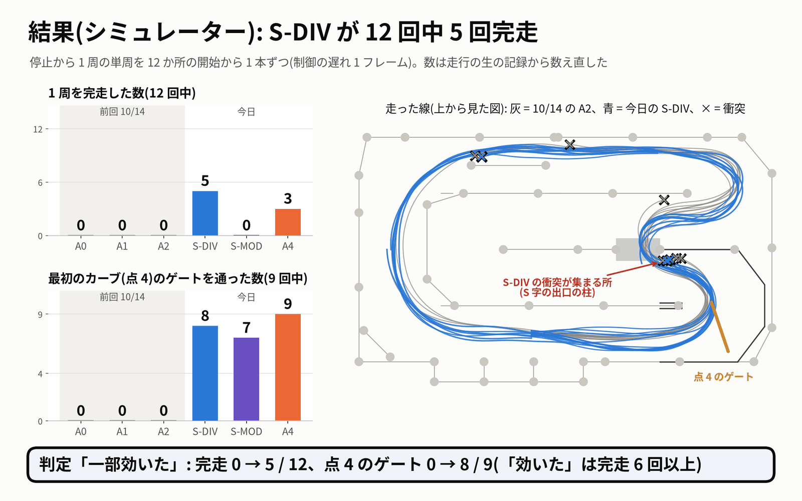
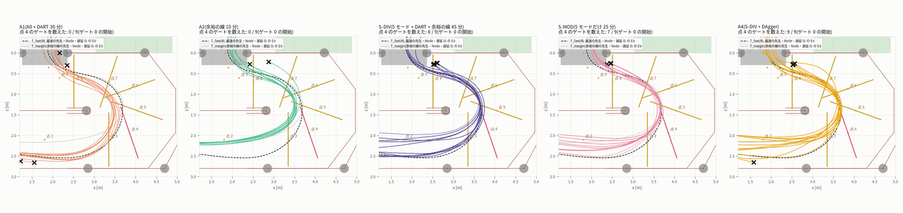
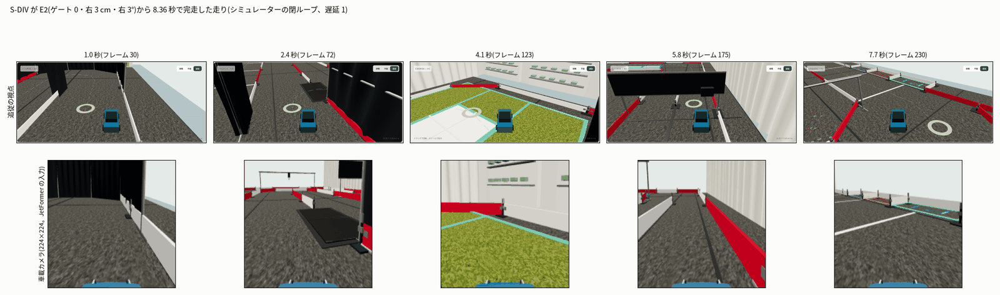

# いろいろな走りのデータで学習した — 10 月 15 日の実験(sim_diverse_train_20261015)

- 作成 2026-10-15。依頼は「本日は、学習に挑戦してみましょう。学習して、走行精度が上がったかを調査し、まとめよ」。
- 調べたのは 2 つです。**シミュレーターの中で 1 周走れるようになったか**(閉ループ)と、**実機で記録した保留データでの誤差**(オフライン)。
  **実車は走らせていません**(実車・PCA9685・I2C には触れていません。実車での試験はこの作業の範囲の外です)。git にはコミットしていません。
- くわしくは `design.md`(設計)・`protocol.json`(結果を見る前の 09:15 に固めた決まり。sha256 `f78fade8…`)・`prepare.md`(データの準備)・
  `training.md`(学習)・`eval_sim.md`(シミュレーターの評価と DAgger)・`eval_real.md`(実機の保留データ)・`review.md`(最終の確かめ)・`deviations.md`(手順と違えたこと)。

## 結論(先に)

| 問い | 答え | どれだけ確かか |
|---|---|---|
| **シミュレーターの走りは上がったか** | **上がった。** いろいろな走りのデータで学習した S-DIV は、12 回中 **5 回 1 周を完走**(前回 10/14 の 3 つのモデルはどれも 0 回)。前回どのモデルも通れなかった最初のカーブのゲート(点 4)も **9 回中 8 回** 通った。決まりの判定は「一部効いた」(「効いた」には完走 6 回以上が要る) | 改善はたぶん本物(完走と点 4 のゲートが同じ向き。参考の p = 0.037)。ただし学習の種は 1 つだけで、「5 / 12」という率は種で 2 本くらい動きうる |
| **実機の保留データの精度は上がったか** | **上がらなかった。** 実機のデータに 5 つの走り方のデータを混ぜた C-DIV の誤差は 50.04 µs で、実機だけの A(49.30 µs)より 0.74 µs(1.5 %)大きい。決まりの判定は A より「悪い」、前の混ぜ方の C とは「同等」 | 「悪い」は決まりどおりだが際どい(種の並びの余裕 0.011 µs)。差は実用上の目安 10 µs よりずっと小さく、**実用上はほぼ同じ** と読むのが妥当。種は 2 つ |
| 実車の走りは | **確かめていない**(この作業の範囲の外) | — |



## 目的

10/14 までに、強化学習で **走り方の違う 5 つのモード**(最速・速さいろいろ・絶対壁にぶつからない・離脱復活・経路いろいろ)を作り、走る線のばらつきが前の先生のデータの **約 23 倍** の見本を記録しました。
今日はこの「いろいろな走り」のデータで JetFormer(TransFuser軽量型 = jetformer_v0)を **実際に学習して**、

1. **Q1 シミュレーター**: 前回(10/14)の A0・A1・A2 より 1 周を完走できるようになるか(12 の開始から、停止して 1 周)
2. **Q2 実機の精度**: 実機のデータに混ぜて学習すると、実機で記録した保留データ(人の運転 11 シーン・4,670 フレーム)の誤差が小さくなるか

を、結果を見る前に決めた規則(protocol.json)で確かめました。

## 前回までの課題

- **まねしたモデルが 1 周できない(10/13〜10/14)。** きれいな最速の走りだけで学習した A0 は 12 回とも 1〜2 秒で衝突。ずれたときの戻し方(DART、A1)と余裕のある線(A2)を足すと最初の直線は抜けて 4〜6 倍長く(止まるまでの時間)走れたが、
  **完走は 0 / 12**。多くは最初のカーブ(点 4 のゲート)を内側に 2.6〜3.3 m 切ってゲートを外し、柱の足に当たった。
- **前の混ぜ方は実機の精度を変えなかった(10/13)。** 前の先生(作者の RC 教師)のほぼ同じ 20 秒の走りのくり返しを実機のデータに混ぜた C は、保留データの誤差が実機だけの A と「同等」(49.2〜49.7 µs)。
- そこで 10/14 に、強化学習のモードで「いろいろな走り」のデータを作った。今日はそれで学習して、上の 2 つが変わるかを確かめる。

## やったこと

| モデル(腕) | 学習データ | 量 | ねらい |
|---|---|---|---|
| **S-DIV**(Q1 の主) | 5 モードの見本 75 シーン + DART 30 シーン + 余裕の線 30 シーン | 45 分(135 シーン) | いろいろな線・速さ・戻し方を全部見せる |
| S-MOD(Q1 の 2 つ目) | 5 モードの見本 75 シーンだけ | 25 分 | 量の多い A1(30 分)と比べ、「ばらつき」と「量」を分ける |
| A4(DAgger、Q1b) | S-DIV のデータ + **S-DIV が実際に走った状態に、先生の操作を付けた 12 シーン** | 49 分 | モデルがはまる状態での戻し方を教える |
| **C-DIV**(Q2 の主、種 0・1) | 実機 52 シーン + 5 モードの学習の 60 シーン(36,000 フレーム) | 前の C と同じ量 | 混ぜるシミュレーターのデータを「くり返し」から「いろいろな走り」に替える |

- 学習は前回と同じ作り方(30 エポック・lr 3e-4・種 0。A4 は S-DIV の続きを 10 エポック・lr 1e-4)。学習は 09:38〜15:47、5 本(S-DIV・C-DIV × 2・S-MOD・A4)。
  メモリの上限は 3G から 3800M に上げた(読み込みのプロセスを使うため。計算の結果は変わらない。`deviations.md`)。
- **シミュレーターの評価**: ブラウザのアプリ(Firefox)で、停止から 1 周の単周を 12 の開始(E0〜E11。9 本はゲート 0 から少しずらし・傾け)で 1 本ずつ。
  制御の遅れ 1 フレーム、推論はユーザーの bridge.py(CPU の onnxruntime)。前回の数字が今日もそのまま使えるか、作者の ONNX と A1 の E0 を走らせて確かめた(10/14 とビット単位で同じ)。
- **DAgger**: S-DIV を評価と別の 12 の開始(D0〜D11)で走らせ、その操作を再生して途中から先生(余裕の線の RL)に替える走りを記録し、S-DIV が運転した 2,074 フレームの正解を先生の操作に付け替えた。G1〜G3 の確かめはすべて合格。
- **実機の保留データの評価**: 10/13 と同じ道具・同じ 4,670 フレーム・同じ閾値で、A(実機だけ)・C(前の混ぜ方)と比べた。

## 結果: シミュレーターの走行(Q1)



| モデル | 学習データ | 完走(12 回) | 最初の直線を抜けた(ゲート 0 の 9 回) | 点 4 のゲートを通った(9 回) | 止まるまでに進んだ道のり(中央値) | 完走の周回時間(中央値) |
|---|---|---:|---:|---:|---:|---:|
| A0(10/14) | きれいな最速の走り 20 分 | 0 | 0 | 0 | 2.5 m | — |
| A1(10/14) | A0 + DART 30 分 | 0 | 8 | 0 | 11.4 m | — |
| A2(10/14) | 余裕の線 10 分 | 0 | 9 | 0 | 17.7 m | — |
| **S-DIV(今日)** | **5 モード + DART + 余裕の線 45 分** | **5** | **9** | **8** | **22.7 m** | **8.36 秒** |
| S-MOD(今日) | 5 モードだけ 25 分 | 0 | 9 | 7 | 12.9 m | — |
| A4(今日) | S-DIV + DAgger | 3 | 9 | 9 | 26.1 m(*) | 8.39 秒 |

A0 の E0〜E5 は 10/13 に走らせた同じ学習結果(S-R 種 0)の記録です(10/14 の評価もこれを使いました)。A0〜A2 は今日は走らせ直していません。作者の ONNX と A1 の E0 で、今日の環境が 10/14 と同じことを確かめました。

(*) A4 の時間切れ 4 本は、ゲートをすれすれで外したあと周を回り続けたので道のりが 1 周(26.1 m)を越えています。完走の数と点 4 のゲートで読んでください。

| 判定(結果を見る前に固定) | 結果 | 理由 |
|---|---|---|
| Q1: S-DIV 対 10/14 | **一部効いた** | 完走 5 − 0 = +5(≥ 2)、点 4 のゲート 8 / 9(≥ 5)。「効いた」には完走 6 以上が要る |
| ばらつき 対 量(S-MOD 対 A1) | **量よりばらつき** | どちらも完走 0、点 4 のゲート 7 対 0(差 ≥ 3) |
| DART・余裕の線の上乗せ(S-DIV 対 S-MOD) | **上乗せあり** | 完走 +5 |
| Q1b: DAgger(A4 対 S-DIV) | **悪くなった** | 完走 3 − 5 = −2(点 4 のゲートは 9 対 8) |

- S-DIV が完走した 5 周は 7.98〜8.53 秒で、同じ開始の最速の先生の 1.03 倍(比の中央値)。作者の ONNX(E0 で 9.02 秒)より速い走りです。
- **残った失敗の場所が変わりました。** 前回は最初のカーブで内側を切ってゲートを外していましたが、S-DIV は 6 本の衝突のうち 5 本が、その先の **S 字の出口、黒いシートの近道に入るところの柱の足・カーテン**(x ≈ 2.5 m、z ≈ 0.27 m)。A4 の衝突 5 本のうち 3 本も同じ場所です。



## 結果: 実機の保留データの精度(Q2)


保留した実機の人のきれいな走行 11 シーン・4,670 フレームの L1(未来 10 ステップの舵とスロットルの誤差の平均。小さいほど人の運転に近い)。

| モデル | 混ぜたシミュレーターのデータ | 種 0 | 種 1 | 平均(best) | 平均(last) | A との差(best) | A と比べた判定 | C と比べた判定 |
|---|---|---:|---:|---:|---:|---:|---|---|
| A(10/12) | なし(実機だけ) | 49.15 | 49.46 | **49.30** | 49.49 | — | — | — |
| C(10/13) | 前の先生のくり返し 60 シーン | 49.97 | 49.49 | 49.73 | 50.25 | +0.43 | 同等 | — |
| **C-DIV(今日)** | **5 モードのいろいろな走り 60 シーン** | 50.61 | 49.47 | **50.04** | 50.30 | **+0.74** | **悪い(際どい)** | 同等 |
| B(参考・今の走行のモデル) | なし | 49.14 | — | 49.14 | 49.09 | — | — | — |

単位 µs。閾値は A と比べるとき best 0.626・last 1.322 µs、C と比べるとき best 0.954・last 1.322 µs(10/13 に決めた値)。

- **「悪い」の中身**: 決まりは「C-DIV の 2 つの種がどちらも A の 2 つの種より大きい、かつ平均の差が閾値を超える」。best では差 +0.74 µs > 0.626 µs で、種の並びは **0.011 µs** の差でかろうじて満たされた。
  last では差 +0.80 µs が閾値 1.322 µs より小さく「同等」。決まりでは「悪い」は best のまま残る。差は 1.5 %、実用上の目安 10 µs よりずっと小さい。
- **差の出どころ(参考)**: 差の 96 % は低速の直線(411 フレーム、全体の 9 %)から。ここで人より強く前に出す癖が、前の C と同じように残っていた(前進の偏り C-DIV −15.6 / −8.8 µs、A −1.0 / +0.8 µs)。
  シーンで見ると、10/13 に C が悪かった同じ 2 シーンが差の多くを作り、残り 9 シーンだけなら C-DIV は A より 0.49 µs 小さい。
- **参考(判定を変えない)**: 画像のずれへの強さは A の 0.67 倍(C は 0.61 倍)で「ずれに強い」。シミュレーターの保留 15 シーンでは C-DIV 34.4 µs 対 C 78.6 µs と、シミュレーターの中でははっきり効いている。
  ただしこの改善は実機の保留データには移っていない。推奨の走行モデルは **B のまま**。

## 分かったこと

1. **いろいろな走りのデータは、シミュレーターの走りに効いた。** 完走 0 → 5 / 12、最初のカーブのゲート 0 → 8 / 9。前回の壁(最初のカーブで内側を切る)は越えた。
2. **効いたのは主に「ばらつき」。** 5 モードだけ(25 分、A1 より少ない量)でも最初のカーブのゲートを 7 / 9 通った(A1 は 0)。ただし完走には DART と余裕の線も足した S-DIV が要った(量も増えているので、中身と量は分けられない)。
3. **DAgger 1 回では完走は増えなかった**(5 → 3)。点 4 のゲートは 9 / 9 になり、完走した開始も入れ替わった。種 1 つなので、差は種のばらつきの中かもしれない。
4. **実機の保留データの精度は上がらなかった。** シミュレーターの中では新しい走りをよくまねるようになったが、その力は実機の人の運転のまねには移らなかった。混ぜ方を「くり返し」から「いろいろ」に替えても、10/13 と同じく実機の精度はほぼ同じで、低速の直線で前に出す癖も残った。
5. まとめると、**走行精度が上がったのはシミュレーターの中だけ** です。実機の保留データでは上がらず(ほぼ同じ、規則の上ではわずかに悪い側)、実車ではまだ確かめていません。

## 課題

- **S 字の出口(黒いシートの近道の入口)の柱で当たる。** S-DIV・A4 の衝突の多くがここ。この場所の戻し方・余裕を教えるデータ(DAgger の状態をここに集める、この区間の余裕の線)が要る。
- **種を増やす。** Q1 の腕はどれも種 1 つ。S-DIV と A4 の差(5 対 3)や「5 / 12」という率が種でどれだけ動くかを測っていない。
- **「いろいろ」と「量」と「先生の違い」を分ける。** S-DIV 対 S-MOD は量も違い、C-DIV 対 C は先生も違う。
- **実機の精度に効く使い方を探す。** シミュレーターの改善が実機の保留データに移らない。低速の直線の速さの癖など、シミュレーターと実機の違いを詰める必要がある。
- **実車ではまだ確かめていない**(この作業の範囲の外)。

## 確かめたこと(review.md)

- 見出しの数は、走行の生の JSON と予測の npz から、評価の道具と別のコードで数え直して **すべて一致**(完走・最初の直線・点 4 のゲート・6 つの判定・実機の L1 は差 0.0005 µs 以内)。
- 走行 3 本(S-DIV の完走 E2・衝突 E1、A4 の完走 E0)を **ユーザーの sim-core.js**(`/home/jetson/sim/extracted/course-simulator/replay-report.mjs`)で再生して一致(差 ≤ 8e-15)。評価の段では今日の 41 走行すべてを同じ道具で再生して一致。
- 漏れ: 実機の保留 11 シーンはどの学習にも入っていない。シミュレーターの腕の学習と検証は重ならない。DAgger は評価と別の開始から。DART と余裕の線に E0 と同じ姿勢から始まる学習シーンが 1 つずつある(10/14 の A1・A2 も同じ)ことは限界として書いた。
- protocol.json は 09:15:41 に固定したまま(sha256 一致)。手順と違えたことは `deviations.md` にすべてあり、判定を変えるものは無かった。直したのは文書の書き方 4 か所だけ(数は変えていない)。

## 再現方法

すべて `cd /home/jetson/jetformer` から。GPU と Firefox は `jf-heavy --lock big` で 1 つずつ。電源が落ちたら同じコマンドで続きから動きます。

```bash
E=experiments/20261015_sim_diverse_train
# 0) 決まりの確かめ
python3 -I $E/design/make_protocol.py --check
# 1) 腕のデータ(シンボリックリンク)と確かめ
bash $E/train/build_arms.sh && python $E/train/prepare_check.py
# 2) 学習(S-DIV → C-DIV 種 0・1 → S-MOD。一式・HTTP の確かめ・training.md も自動)
nohup python -u $E/train/diverse_train.py train S-DIV/s0 C-DIV/s0 C-DIV/s1 S-MOD/s0 --mem-cap 3800M \
  >> /home/jetson/jetformer_reports/sim_diverse_train_20261015/train/logs/driver.log 2>&1 &
# 3) Q1 シミュレーターの閉ループ(Firefox・ブリッジ 8821)→ 集計・再生・数え直し → eval_sim.md
bash $E/eval/q1_session.sh EXT:e0,A1-s0:e0,SDIV-s0:core,SDIV-s0:ext,SDIV-s0:flying
bash $E/eval/post_eval.sh
# 4) S-MOD の評価と DAgger(順番のくわしいところは eval_sim.md 8 章・deviations.md)
bash $E/dagger/dstate_session.sh SDIV-s0        # D0〜D11 の状態集め(ブラウザ)
#    先生の選び・切り替えのフレーム k: dagger/select_teacher.mjs → merge_select.py → prepare_record.py(Node・CPU)
bash $E/dagger/afternoon_chain.sh               # S-MOD の E0〜E11・報告用の画面
bash $E/dagger/record_chain.sh                  # G2 → 12 シーンの記録 → 取り込み・付け替え → A4 の学習・評価
# 5) Q2 実機の保留データ(予測は GPU、判定・図・文書は CPU)
jf-heavy --mem 3G --lock big --need-mb 3200 -- nice -n 10 python -u $E/q2/q2_eval.py predict
CUDA_VISIBLE_DEVICES= python $E/q2/q2_eval.py evaluate && CUDA_VISIBLE_DEVICES= python $E/q2/q2_eval.py figures
python $E/q2/q2_report.py && CUDA_VISIBLE_DEVICES= python $E/q2/q2_recount.py
# 6) 最終の確かめ(CPU だけ)と動画の図
cd $E/final_review && python3 -I recount_sim_indep.py && python3 -I leak_check_sim.py \
  && /home/jetson/miniconda/envs/jetracer/bin/python -I recount_real_indep.py \
  && /home/jetson/miniconda/envs/jetracer/bin/python -I make_slides.py
```

## ファイル

| 何 | どこ |
|---|---|
| 学習結果 | `/home/jetson/jetformer/data/runs/simdiv_20261015-{SDIV-s0,SMOD-s0,CDIV-s0,CDIV-s1,A4-s0}` |
| シミュレーター用の一式(ZIP) | `bundles/simdiv_20261015-{SDIV-s0,SMOD-s0,A4-s0}.zip`(シミュレーター専用。実車では使わない) |
| DAgger のデータセット | `/home/jetson/jetformer/data/datasets/jetformer-simulator-rl-dagger-sdiv-4min_20261015-061535_b24e555a` |
| 走行の生の記録・画面 | `eval/closed_loop/`・`screens/` |
| 実機の予測 | `/home/jetson/jetformer/data/zoo/sim_diverse_train_20261015/` |
| 約 1 分の動画の絵コンテ・図 | `video/storyboard.json`・`video/fig/d1〜d5_*.png`(動画はメインのセッションが作る) |
