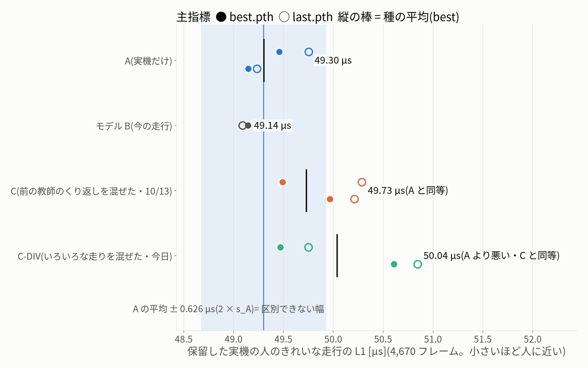
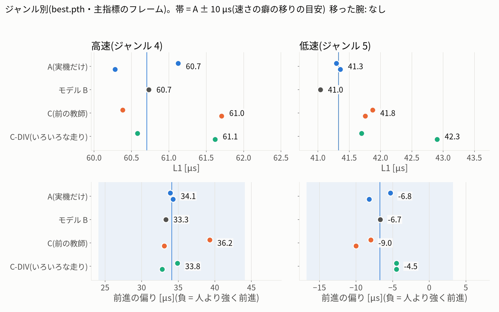
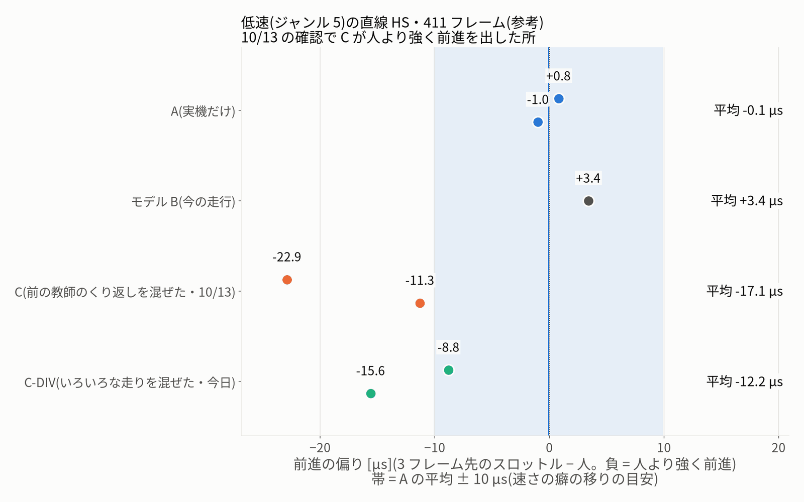
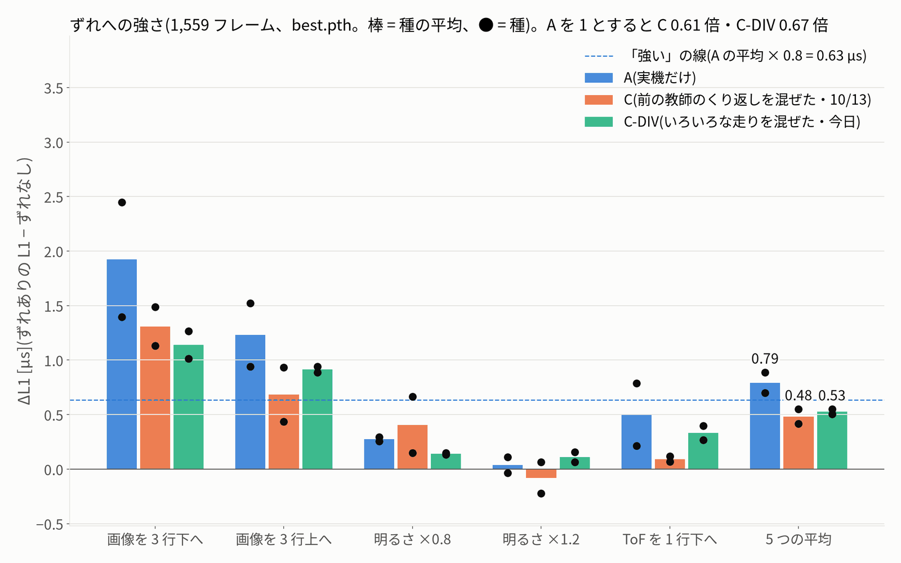
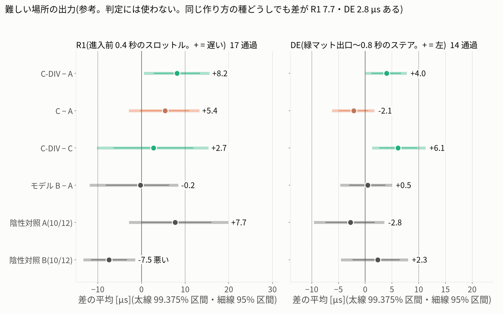
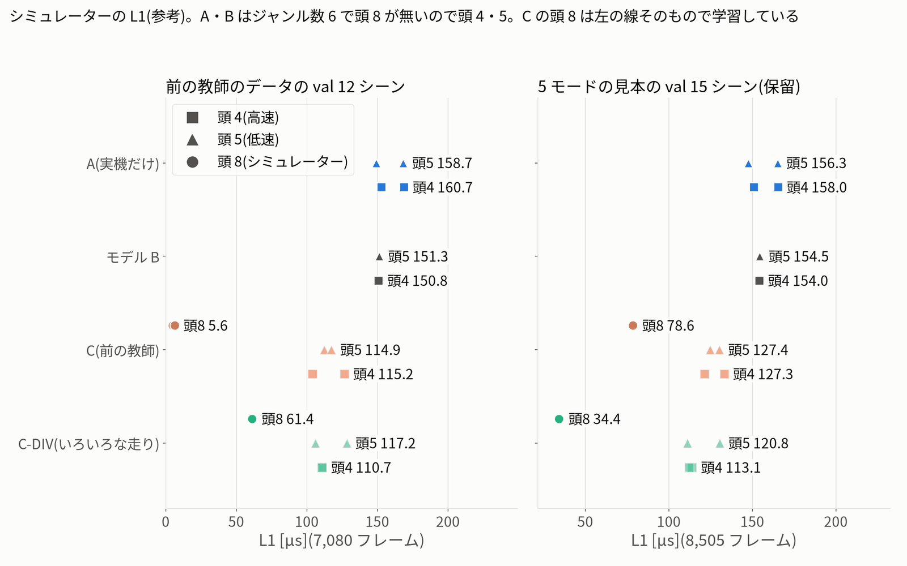

# Q2 — 実機の保留データの精度: いろいろな走りのシミュレーターのデータを混ぜた C-DIV(sim_diverse_train_20261015)

- 作成 2026-10-15T13:35:35。決まりは `protocol.json`(sha256 f78fade8…、固定のまま: はい)の eval_Q2。数字は `eval_real.json`。
- 問い: 実機のデータに、いろいろな走りのシミュレーターのデータ(ジャンル 8、前の C と同じ 36,000 フレーム)を混ぜて学習すると(C-DIV)、実機の保留データの誤差は A(実機だけ)・C(前の教師のくり返しのデータを混ぜた)と比べて変わるか
- 範囲: 実車で記録した保留データのオフラインの誤差だけ。**実車を走らせる試験はこの作業の範囲の外**(実車・PCA9685・I2C には触れていない)。

## 0. 要点

- 1. C-DIV は主指標で A と比べて「悪い」(best の差 +0.74 µs・閾値 0.626 µs、last の差 +0.80 µs・閾値 1.322 µs)。差は 10 µs 未満(実用上の差ではない)
- 2. C-DIV は同じ規則で C(前の教師のくり返しのデータを混ぜた)と比べて「同等」(best の差 +0.31 µs・閾値 0.954 µs、last の差 +0.05 µs・閾値 1.322 µs)。シミュレーターのデータの量は C と同じなので、差があれば中身(いろいろな走り。ただし先生が RC 教師から RL に替わったことも含む)の効果
- 3. A より「悪い」
- 4. 参考(判定を変えない): ずれへの強さ ΔL1 0.527 µs = A の 0.67 倍(「ずれに強い」はい。C は 0.61 倍)
- 5. 推奨はモデル B のまま(「良い」かつ 10 µs 以上かつ崩れなし、の条件を満たさない)
- 6. 結論は jetformer_v0・この学習の条件(調整なし)・このシミュレーターのデータに限る。机上の結論は実車の改善を示さない

| 比べ | best の差 [µs] | 閾値 best | last の差 [µs] | 閾値 last | 判定 |
|---|---:|---:|---:|---:|---|
| C-DIV − A | +0.736 | 0.626 | +0.803 | 1.322 | **悪い** |
| C-DIV − C | +0.308 | 0.954 | +0.048 | 1.322 | **同等** |
| C − A(10/13 の再現) | +0.428 | 0.626 | +0.756 | 1.322 | **同等** |

差 = 腕 − 基準(+ = 腕のほうが誤差が大きい = 悪い)。「良い / 悪い」には、腕の全部の種が基準の全部の種より小さい(大きい)こと、かつ平均の差が閾値を超えることの両方が要る。best だけ「良い」は「同等」に下げる(10/13 の final_verdict)。

## 1. 比べたもの

| 腕 | 学習データ | 学習結果 | 予測 |
|---|---|---|---|
| A_s0 | 実機 clean_driving_20261011 の 52 シーン(学習 41・検証 11) | `clean_driving_20261011-jetformer_v0-s0-nocmd-stride3-e30` | data/zoo/policy_zoo_20261012(10/12) |
| A_s1 | 実機 clean_driving_20261011 の 52 シーン(学習 41・検証 11) | `clean_driving_20261011-jetformer_v0-s1-nocmd-stride3-e30` | data/zoo/policy_zoo_20261012(10/12) |
| B | 実機(今の走行のモデル。参考) | `clean_driving_20261011-nocmd-s3-20261011-024626` | data/zoo/policy_zoo_20261012(10/12) |
| C_s0 | 実機 + 前の教師(作者の RC 教師)の 60 シーン・36,000 フレーム(ほぼ同じ 20 秒の走りのくり返し) | `simreal_mix_20261013-cotrain-s0` | data/zoo/sim_cotrain_20261013(10/13) |
| C_s1 | 実機 + 前の教師(作者の RC 教師)の 60 シーン・36,000 フレーム(ほぼ同じ 20 秒の走りのくり返し) | `simreal_mix_20261013-cotrain-s1` | data/zoo/sim_cotrain_20261013(10/13) |
| CDIV_s0 | 実機 + 5 モード(最速・速さいろいろ・絶対壁にぶつからない・離脱復活・経路いろいろ)の学習の 12 シーンずつ = 60 シーン・36,000 フレーム | `simdiv_20261015-CDIV-s0` | data/zoo/sim_diverse_train_20261015(今日) |
| CDIV_s1 | 実機 + 5 モード(最速・速さいろいろ・絶対壁にぶつからない・離脱復活・経路いろいろ)の学習の 12 シーンずつ = 60 シーン・36,000 フレーム | `simdiv_20261015-CDIV-s1` | data/zoo/sim_diverse_train_20261015(今日) |

作り方は A・C と同じ(jetformer_v0・30 エポック・lr 3e-4・間引き 3・バッチ 64・今の操作値なし・2.5 G の衝突の除外・最良は実機の検証 1,559 サンプル)。C-DIV はシミュレーターの量を C と同じにしたので、C との差は「中身」(いろいろな走り。ただし先生が RC 教師から RL の方策に替わったことも含む)の差。

## 2. 主指標(保留した実機の人のきれいな走行 11 シーン・4,670 フレーム)

| 学習結果 | L best [µs] | L last [µs] | best − last |
|---|---:|---:|---:|
| A_s0 | 49.146 | 49.235 | -0.089 |
| A_s1 | 49.457 | 49.752 | -0.296 |
| B | 49.144 | 49.091 | +0.053 |
| C_s0 | 49.967 | 50.213 | -0.246 |
| C_s1 | 49.491 | 50.286 | -0.795 |
| CDIV_s0 | 50.607 | 50.844 | -0.237 |
| CDIV_s1 | 49.468 | 49.751 | -0.283 |

| 腕 | 平均 best | [最小, 最大] | 平均 last | 種の範囲 best |
|---|---:|---|---:|---:|
| A | 49.301 | [49.146, 49.457] | 49.494 | 0.311 |
| C | 49.729 | [49.491, 49.967] | 50.249 | 0.477 |
| C-DIV | 50.037 | [49.468, 50.607] | 50.297 | 1.139 |

- モデル B − A の平均(best): -0.158 µs(参考)。
- 閾値: A と比べるときは 2 × s_A(best 0.313 → 0.626 µs・last 0.661 → 1.322 µs)、C と比べるときは 2 × max(C の種の範囲 0.477, s_A)(best 0.954 µs・last 1.322 µs)。どれも結果を見る前に protocol で固定した値。
- 実用上の差(≥ 10 µs): A との差 +0.74 µs → なし。
- 種と checkpoint の向きがそろうか(記述): A と比べて そろわない、C と比べて そろわない。

### 2.1 判定の際どさ(記述。判定は変えない)

- best: C-DIV の種 [49.4677, 50.6066]・A の種 [49.1459, 49.4565]。「全部の種が A の全部の種より大きい」の余裕(C-DIV の最小 − A の最大)= +0.0112 µs、平均の差 +0.736 µs(閾値 0.626 µs)→ この checkpoint の分類「悪い」。
- last: C-DIV の種 [49.7505, 50.8437]・A の種 [49.2349, 49.7522]。「全部の種が A の全部の種より大きい」の余裕(C-DIV の最小 − A の最大)= -0.0017 µs、平均の差 +0.803 µs(閾値 1.322 µs)→ この checkpoint の分類「同等」。
- **「悪い」は固定した規則どおりの判定だが、際どい**: 種の並びの条件は 0.011 µs の差でかろうじて満たされ(C-DIV 種 1 と A 種 1 がほぼ同じ)、平均の差の多くは C-DIV 種 0(50.607 µs)から来ている。last.pth では平均の差 +0.803 µs が閾値 1.322 µs より小さいので「同等」(種の並びの条件も −0.002 µs でわずかに満たさない。規則では「悪い」は best.pth のまま)。[最終の確かめで直した: 前の文は「種の並びの条件で同等」と読めたが、last では閾値の側でも同等]差は 1.5%・10 µs よりずっと小さい。読み方は「A より少し悪い側(実用上の差ではない)」。

### 2.2 種 1 があるか・削ったときの判定

- 種 0 だけで判定すると(protocol の single_seed_fallback = 種 0 の 1 本を基準の 2 本と比べる): A と「悪い(暫定)」(best の差 +1.305 µs)、C と「同等(暫定)」(best の差 +0.878 µs)。
- **種 1 は削らずに学習・評価できた**ので、判定は本判定(暫定ではない)。種 1 を削ったときの規則(protocol の single_seed_fallback): 「良い(暫定)」= 種 0 が基準の 2 本の小さいほうより小さく、かつ基準の平均との差が閾値を超える。「悪い(暫定)」はその逆。ほかは「同等(暫定)」。2 本の規則の「全部の種が基準の全部の種の外」という並びの条件が種 0 の 1 本だけで判断され、腕の種どうしのばらつきが判定に入らない(閾値は同じ)。
- 種 0 だけでも分類は同じ(A と「悪い」・C と「同等」)だった。ただし種 0 だけなら A との差は +1.305 µs に見え、種 1(49.468 µs)を足すと平均の差は +0.736 µs に縮み、種の並びの条件も 2.1 のとおり際どくなった。種 1 を削っていれば、同じ「悪い」でも実際より強い差として(暫定で)報告していたことになる。C-DIV の種どうしの差は 1.14 µs で、A(0.31)・C(0.48)より大きく、種 1 つでは見えないこのばらつきが今回の判定の際どさの元になっている。

## 3. ジャンル別・速さの癖(参考)

| 学習結果 | 高速(4)L1 | 高速 前進の偏り | 低速(5)L1 | 低速 前進の偏り | ステアの向きの正解率 |
|---|---:|---:|---:|---:|---:|
| A_s0 | 60.28 | +34.3 | 41.36 | -8.2 | 0.9950 |
| A_s1 | 61.12 | +33.9 | 41.30 | -5.3 | 0.9910 |
| B | 60.73 | +33.3 | 41.04 | -6.7 | 0.9910 |
| C_s0 | 61.71 | +33.1 | 41.76 | -10.0 | 0.9940 |
| C_s1 | 60.38 | +39.3 | 41.87 | -8.0 | 0.9890 |
| CDIV_s0 | 61.62 | +32.8 | 42.90 | -4.5 | 0.9940 |
| CDIV_s1 | 60.58 | +34.9 | 41.70 | -4.5 | 0.9940 |

- C: ジャンル平均の前進の偏りの A からのずれ 高速 +2.1 µs・低速 -2.2 µs → 速さの癖の移り(≥ 10 µs)なし。
- C-DIV: ジャンル平均の前進の偏りの A からのずれ 高速 -0.2 µs・低速 +2.2 µs → 速さの癖の移り(≥ 10 µs)なし。

- **低速の直線 HS(411 フレーム。先に決めた参考の測り)**: 前進の偏り A -1.0 / +0.8、C -11.3 / -22.9、C-DIV -15.6 / -8.8 µs(負 = 人より強く前進)。A の平均からのずれ: C -17.0 µs・C-DIV -12.1 µs(目安 10 µs を超える)。この直線の L1 の A との差: C +5.64 µs・C-DIV +8.07 µs。
- 全体の差(best)のうち、この直線(主指標のフレームの 9%)から来た分: C-DIV +0.71 µs(全体の差 +0.74 µs の 96%)、C +0.50 µs(全体 +0.43 µs の 116%)。
- 場所 × ジャンルの全部のマス(100 フレーム以上)で、前進の偏りの A からのずれの最大: C 17.0 µs・C-DIV 12.1 µs。

## 4. ずれへの強さ(参考)

| 腕 | ΔL1 平均 [µs] | 種 | A の何倍 | 「ずれに強い」 |
|---|---:|---|---:|---|
| A | 0.793 | 0.699 / 0.887 | 1.00 | — |
| C | 0.482 | 0.550 / 0.415 | 0.61 | はい |
| C-DIV | 0.527 | 0.505 / 0.549 | 0.67 | はい |

規則: 「ずれに強い」= ΔL1(種の平均)≤ 0.8 × ΔL1_A かつ両方の種で ΔL1 ≤ ΔL1_A(参考。判定を変えない)。ずれは画像 3 行下・上、明るさ ×0.8・×1.2、ToF 1 行下(1,559 フレーム、best.pth)。

## 5. 難しい場所 R1・DE(参考。判定に使わない)

| 比べ | R1 差の平均 [µs] | R1 99.375% 区間 | R1 良い/悪い | DE 差の平均 [µs] | DE 99.375% 区間 | DE 良い/悪い |
|---|---:|---|---|---:|---|---|
| C-DIV − A | +8.2 | [0.9, 15.2] | — | +4.0 | [0.3, 7.5] | — |
| C − A | +5.4 | [-2.6, 12.9] | — | -2.1 | [-5.9, 1.4] | — |
| C-DIV − C | +2.7 | [-9.9, 15.0] | — | +6.1 | [1.5, 11.0] | — |

- どの比べも「良い」(4 つの条件が全部)にも「悪い」にもならなかった。満たした「良い」の条件の数: R1 C-DIV − A 2・C − A 0・C-DIV − C 0、DE C-DIV − A 2・C − A 0・C-DIV − C 3(4 つのうち)。同じ作り方の種どうしでも R1 7.7・DE 2.8 µs の差がある(10/12 の陰性対照)ので、参考にとどめる。
- C-DIV の中心(steer_center / throttle_neutral): CDIV_s0 [1441.0, 1496.0] / CDIV_s1 [1441.0, 1496.0]。A は [1441.0, 1496.0]。同じなので A の中心での出し直しは不要。

## 6. 崩れ(10/13 と同じ規則)

- C: 崩れなし(直線 542 フレームの前進の強さ 201.3 µs、A 203.9 µs、低下 1.2%、前進の偏り +9.6 µs、向きの正解率 0.9915、A 0.9930)。
- C-DIV: 崩れなし(直線 542 フレームの前進の強さ 204.1 µs、A 203.9 µs、低下 -0.1%、前進の偏り +11.3 µs、向きの正解率 0.9940、A 0.9930)。

## 7. シミュレーターの L1(参考)

**前の教師のデータの val 12 シーン(10/13 と同じ。C は頭 8 が学習のデータと同じ方策・同じ線)**(12 シーン・7,080 フレーム)

| 腕 | 頭 4 | 頭 5 | 頭 8 |
|---|---:|---:|---:|
| A | 160.7 | 158.7 | — |
| B | 150.8 | 151.3 | — |
| C | 115.2 | 114.9 | 5.6 |
| C-DIV | 110.7 | 117.2 | 61.4 |

**5 モードの見本の val 15 シーン(どの腕の学習にも入っていない = 保留)**(15 シーン・8,505 フレーム)

| 腕 | 頭 4 | 頭 5 | 頭 8 |
|---|---:|---:|---:|
| A | 158.0 | 156.3 | — |
| B | 154.0 | 154.5 | — |
| C | 127.3 | 127.4 | 78.6 |
| C-DIV | 113.1 | 120.8 | 34.4 |

モードごと(頭 8。A・B は頭 5)の L1 [µs]:

| 腕 | 最速 | 速さいろいろ | 絶対壁にぶつからない | 離脱復活 | 経路いろいろ |
|---|---:|---:|---:|---:|---:|
| A(頭 5) | 168.7 | 171.9 | 134.7 | 160.7 | 146.6 |
| B(頭 5) | 171.1 | 172.7 | 128.7 | 157.4 | 142.9 |
| C(頭 8) | 97.8 | 90.1 | 42.0 | 99.8 | 67.7 |
| C-DIV(頭 8) | 33.3 | 45.4 | 15.1 | 43.1 | 36.7 |

- 前の教師の val 12 シーンは C の頭 8 の学習と同じ方策・同じ線(保留ではあるが「同じ走りのくり返し」)。5 モードの val 15 シーンは C-DIV の学習に入っていない(保留)。A・B はジャンル数 6 で頭 8 が無いので、頭 4・5 で予測した値(シミュレーターの画像を実機の頭で見たときの誤差)。

## 8. シーンごと(参考)

- C-DIV が A より小さかったシーン: 5 / 11(C は 8 / 11)。
- 10/13 で C が悪かった `20261010-152707-0001`(490 フレーム): C − A +4.67 µs、C-DIV − A +6.15 µs、C-DIV − C +1.48 µs。
- 10/13 で C が悪かった `20261010-193638-0003`(573 フレーム): C − A +4.40 µs、C-DIV − A +3.84 µs、C-DIV − C -0.57 µs。

## 9. ゲート・推論

- protocol の no_engine のとおり、C-DIV の FP16 エンジンは作っていない(推奨を変える条件を満たしたときだけ次の作業で作る)。エンジン・速さの項目は未判定。判定できる項目(予測が有限・学習のピークメモリ ≤ 4096 MB・パラメーター数・出力が PWM の範囲)だけを見た。A・B・C は前の評価の値
- CDIV_s0: 予測が有限 はい・学習のピークメモリ 1262.7 MB(≤ 4096 合格)・出力の範囲 913〜1990 µs・パラメーター 14.09 M(C と同じ大きさ)・ONNX あり・FP16 エンジン 作っていない(protocol)。
  - ONNX(FP32・onnxruntime CPU)と PyTorch FP32 の差: 保留の実機 32 フレームで最大 0.0003 µs(目安 ≤ 2.5 µs → 合格)。これは ONNX の書き出しの確かめで、FP16 エンジンのゲートの代わりにはならない。
- CDIV_s1: 予測が有限 はい・学習のピークメモリ 1262.7 MB(≤ 4096 合格)・出力の範囲 930〜1994 µs・パラメーター 14.09 M(C と同じ大きさ)・ONNX あり・FP16 エンジン 作っていない(protocol)。
  - ONNX(FP32・onnxruntime CPU)と PyTorch FP32 の差: 保留の実機 32 フレームで最大 0.0003 µs(目安 ≤ 2.5 µs → 合格)。これは ONNX の書き出しの確かめで、FP16 エンジンのゲートの代わりにはならない。
- 参考: C の種 0 は 10/13 にエンジンを作ってゲート合格(run_numpy の中央値 2.433 ms)。C-DIV は同じ jetformer_v0・同じ大きさなので、速さは同じくらいと見込むが測っていない。

## 10. 学習(学習の段の値)

- A/s0: train_samples 5912・val_samples 1559・best_val_us 49.3・best_epoch 25・last_val_us 49.4・last_train_us 14.1・epoch_s_median 33.3・attempts 0・peak_mem_mb 1273.8・resumes 0・steer_center_us_trained 1441.0・throttle_neutral_us_trained 1496.0
- A/s1: train_samples 5912・val_samples 1559・best_val_us 49.3・best_epoch 25・last_val_us 49.6・last_train_us 13.9・epoch_s_median 33.3・attempts 0・peak_mem_mb 1273.8・resumes 0・steer_center_us_trained 1441.0・throttle_neutral_us_trained 1496.0
- C/s0: train_samples 17732・val_samples 1559・best_val_us 49.9・best_epoch 25・last_val_us 50.1・last_train_us 5.9・epoch_s_median 91.55・attempts 0・peak_mem_mb 1274.1・resumes 0・steer_center_us_trained 1441.0・throttle_neutral_us_trained 1496.0
- C/s1: train_samples 17732・val_samples 1559・best_val_us 49.6・best_epoch 16・last_val_us 50.4・last_train_us 6.1・epoch_s_median 91.6・attempts 0・peak_mem_mb 1274.1・resumes 0・steer_center_us_trained 1441.0・throttle_neutral_us_trained 1496.0
- C-DIV/s0: train_samples 17303・val_samples 1559・best_val_us 50.5・best_epoch 20・last_val_us 50.8・last_train_us 16.4・epoch_s_median 90.55・attempts 1・wall_s 3018.1・workers 2・peak_mem_mb 1262.7・resumes 0・steer_center_us_trained 1441.0・throttle_neutral_us_trained 1496.0
- C-DIV/s1: train_samples 17303・val_samples 1559・best_val_us 49.4・best_epoch 21・last_val_us 49.8・last_train_us 16.8・epoch_s_median 91.4・attempts 1・wall_s 3112.7・workers 2・peak_mem_mb 1262.7・resumes 0・steer_center_us_trained 1441.0・throttle_neutral_us_trained 1496.0
- result_CDIV_s0: best_val_us 50.5・best_epoch 20・peak_mem_mb 1262.7
- result_CDIV_s1: best_val_us 49.4・best_epoch 21・peak_mem_mb 1262.7

## 11. 確かめたこと

- **crosscheck**: 写した道具で C の種 0 の best を予測し直すと、10/13 の npz との差は最大 0.0 µs(許し 0.01 µs)→ 合格。
- **前と同じ値か**: A・B の L・ジャンル別・R1/DE の窓・直線・ずれ、C の L・ジャンル別・R1/DE の窓・直線・ずれ・シミュレーターの頭 8、C − A の判定が10/12・10/13 の値と同じ → 全部同じ。
- **主指標の数え直し**(q2_recount.py。判定の道具を使わず、正解を ai_mix_20261011 の aligned から作り直し、判定の規則も書き直した): 4,670 フレーム、eval_real.json との違い 0 件 → 同じ。
- protocol.json は固定のまま(sha256 が protocol.sha256 と同じ: はい)。

## 12. 読み取り(後から見た解釈。判定ではない)

- **学習データへの当てはまり**: 最後のエポックの学習 L1 は A 14.1・13.9、C 5.9・6.1、C-DIV 16.4・16.8 µs。C-DIV はシミュレーターの部分の線・速さがいろいろなので、C(同じ走りのくり返し)ほど学習データに当てはまらない。それでも実機の検証 L1(最良)は C-DIV 50.5・49.4、C 49.9・49.6、A 49.3・49.3 µs で、実機の側はよくならなかった。
- **シミュレーターの側では効いている**: 5 モードの保留 15 シーンの頭 8 の L1 は C-DIV 34.4 µs・C 78.6 µs(実機だけの A は頭 5 で 156.3 µs)。前の教師の val では逆に C-DIV 61.4・C 5.6 µs(C はその走りのくり返しで学習)。いろいろな走りはシミュレーターの中の新しい走りのまねには効くが、それが実機の保留データの精度には移っていない。
- **ずれへの強さ**は C-DIV も C と同じくらい A より強い(0.67 倍・0.61 倍)。中身が違っても同じくらいなので、強さは「いろいろな走り」より「シミュレーターの画像を混ぜること」から来ている見込み(後からの見方)。
- **低速の直線の速さの癖**は C-DIV にも C と同じくらい出た(A の平均からのずれ C-DIV -12.1・C -17.0 µs)。5 モードに速さ 50〜100% の走りが入っても、この直線で人より強く前進を出す癖は減らなかった。
  主指標の A との差(best +0.74 µs)のうち +0.71 µs(96%)がこの直線の 411 フレーム(全体の 9%)から来ている。C-DIV の差の多くは、この 1 か所の速さの癖で説明できる。
- **差は C と同じ 2 シーンに集まっている**: C-DIV が A より小さかったのは 5 / 11 シーン(C は 8 / 11)。10/13 で C が悪かった 2 シーン(1063 フレーム)が全体の差 +0.74 µs のうち +1.12 µs を足していて、残り 9 シーンだけなら C-DIV − A は -0.49 µs(C は全体 +0.43・2 シーンの分 +1.03・残り -0.78 µs)。2 シーンのうち 20261010-152707-0001 は低速の直線 HS が多いシーン(10/13 の確認)で、上の速さの癖と同じ所を指している。

## 13. 注意

- 主指標はオフラインの誤差(人の操作との近さ)。走行の結果ではない。実車を走らせる試験は範囲の外で、していない。
- C-DIV と C の差には、ばらつき(5 つの方策・24 か所の開始・速さ 50〜100%・離脱復活)のほかに、先生が作者の RC 教師から RL の方策に替わったこと、PWM の中心の約束の小さな違い(舵 ≤ 1 µs・スロットル ≤ 2 µs)も入っている。
- 学習のメモリの上限を 3G → 3800M にした(data loader の workers を保つため。計算は同じ。deviations.md)。
- 結論は jetformer_v0・この学習の条件(調整なし)・このシミュレーターのデータに限る。
