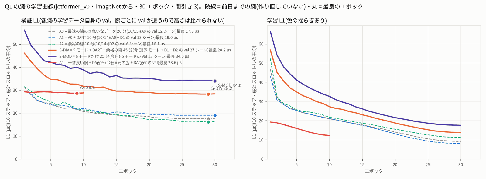
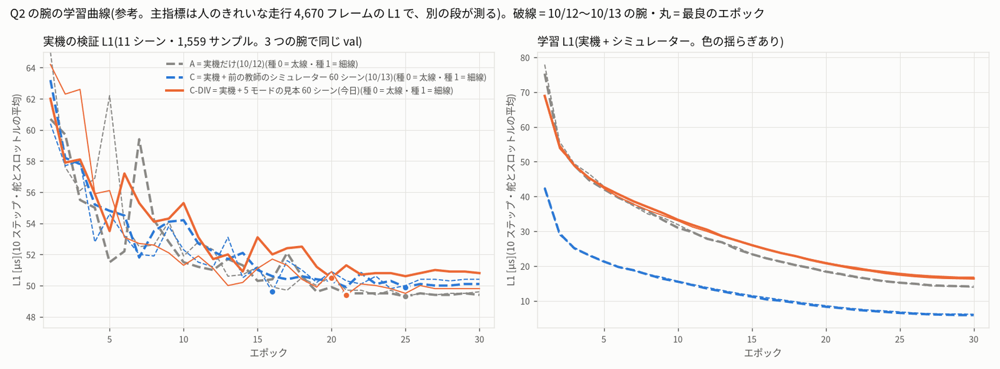
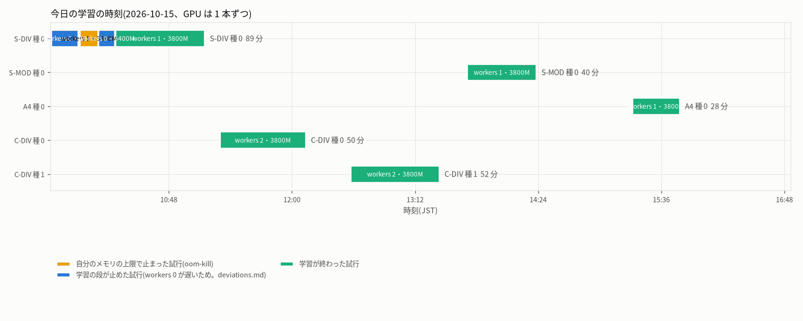

# JetFormer の学習の段 — sim_diverse_train_20261015

- この文書は `training_report.py` が、学習が 1 本終わるたびに作り直します(最後の更新 10/15 15:47)。
- 学習の時刻: 09:38 〜 15:46(JST)。決まりは `protocol.json`(書き換えていない)。手順と違えたことは `deviations.md` の「学習の段」にあります。
- 実車・PCA9685・I2C には触れていません。実車を走らせる試験は、この作業の範囲の外です。
- FP16 のエンジンは作っていません。Q1 はブリッジの onnxruntime(CPU)で ONNX を動かし、Q2 は protocol が「作らない」(no_engine)と決めているためです。

## 0. 進み具合

| 腕・種 | 役割 | 学習結果の名前 | 状態 |
|---|---|---|---|
| S-DIV 種 0 | Q1 の主の腕(削らない) | `simdiv_20261015-SDIV-s0` | 済み |
| C-DIV 種 0 | Q2 の主の腕(削らない) | `simdiv_20261015-CDIV-s0` | 済み |
| C-DIV 種 1 | Q2 の種 1(最後に削る) | `simdiv_20261015-CDIV-s1` | 済み |
| S-MOD 種 0 | Q1 の 2 つ目の腕(2 番目に削る) | `simdiv_20261015-SMOD-s0` | 済み |
| A4 種 0 | DAgger(最初に削る。DAgger の段のデータが要る) | `simdiv_20261015-A4-s0` | 済み |

- 道具: 15:47 に A4 の学習のあと終わった(いま動いていない。最終の確かめで直した)

---

## 1. 結論(今の時点)

- **S-DIV 種 0** は 30 エポックまで学習しました。最良の検証 L1 は **28.2 µs**(29 エポック目)、最後のエポックは 28.3 µs です。
  - val は 5 モード + D1 + D2 の val 27 シーン で、A0〜A2 の val(A0 17.5・A1 19.0・A2 16.1 µs)とは中身が違います。高さで「良い・悪い」は言えません。
  - 最後のエポックの「検証 − 学習」の差は 14.6 µs です(A0 8.4・A1 11.0・A2 5.0 µs)。
  - シミュレーター用の一式: ブリッジの関数での確かめ 合格、HTTP での読み込み 合格、ONNX と PyTorch の差は最大 0.0004 µs。
- **S-MOD 種 0** は 30 エポックまで学習しました。最良の検証 L1 は **34.0 µs**(30 エポック目)、最後のエポックは 34.0 µs です。
  - val は 5 モードの val 15 シーン で、A0〜A2 の val(A0 17.5・A1 19.0・A2 16.1 µs)とは中身が違います。高さで「良い・悪い」は言えません。
  - 最後のエポックの「検証 − 学習」の差は 16.5 µs です(A0 8.4・A1 11.0・A2 5.0 µs)。
  - シミュレーター用の一式: ブリッジの関数での確かめ 合格、HTTP での読み込み 合格、ONNX と PyTorch の差は最大 0.0003 µs。
- **A4 種 0** は 10 エポックまで学習しました。最良の検証 L1 は **28.6 µs**(9 エポック目)、最後のエポックは 28.7 µs です。
  - val は S-DIV と同じ val 27 シーン(DAgger の 12 シーンはすべて学習)で、A0〜A2 の val(A0 17.5・A1 19.0・A2 16.1 µs)とは中身が違います。高さで「良い・悪い」は言えません。
  - 最後のエポックの「検証 − 学習」の差は 16.5 µs です(A0 8.4・A1 11.0・A2 5.0 µs)。
  - シミュレーター用の一式: ブリッジの関数での確かめ 合格、HTTP での読み込み 合格、ONNX と PyTorch の差は最大 0.00033 µs。
- **C-DIV 種 0** は 30 エポックまで学習しました。実機の検証(11 シーン・1,559 サンプル)の最良の L1 は **50.5 µs**(20 エポック目)、最後は 50.8 µs です。
- **C-DIV 種 1** は 30 エポックまで学習しました。実機の検証(11 シーン・1,559 サンプル)の最良の L1 は **49.4 µs**(21 エポック目)、最後は 49.8 µs です。
  - 同じ実機の検証で、A は 49.3・49.3 µs、C は 49.9・49.6 µs でした(学習の val。0.1 µs に丸めた値)。
  - ただしこれは最良のエポックを選んだのと同じ val なので、判定には使いません。判定は次の段が、人のきれいな走行 4,670 フレームの L1 で、10/13 の決まりのまま行います。
- **この段では「走れるか」「実機の精度が上がったか」はまだ分かりません。** 完走は閉ループの評価、実機の精度は保留データの評価(次の段)で測ります。

---

## 2. 学習のしかた

- コマンドは protocol.json の作り方のとおりです(10/14 の A0〜A2、10/13 の C と同じ)。
  `tools/train.py --policy jetformer_v0 --data <腕のフォルダー> --epochs 30 --lr 3e-4 --seed <種> --stride 3 --batch 64 --workers <W> --no-command-input --impact-g 2.5`
  - JetFormer TransFuser軽量型(jetformer_v0)。ImageNet から学習。AdamW(wd 1e-4)と cosine。最良のエポックは各腕の学習データの val で選ぶ。
  - workers は計算の結果を変えません(色の揺らしの乱数の流れだけが変わる)。
- データ(準備の段で、サンプル数・ジャンル・離脱復活の外したフレーム・実機の分けが protocol と同じことを確かめた。`prepare.md`):
  - **S-DIV**: 5 モードの見本 75 シーン + DART(D1)30 + 余裕の線(D2)30 = 135 シーン・45 分(学習 108 / 検証 27 シーン)
  - **C-DIV**: 実機 clean_driving_20261011 の 52 シーン(学習 41 / 検証 11)+ 5 モードの学習の 12 シーンずつ = 60 シーン・36,000 フレーム(すべて学習)
  - **S-MOD**: 5 モードの見本 75 シーンだけ = 25 分(学習 60 / 検証 15 シーン)
  - **A4**: 一番良い Q1 の腕のデータ + DAgger の 12 シーン(10 エポック続き・lr 1e-4)
- 道具は `experiments/20261015_sim_diverse_train/train/diverse_train.py`(10/14 の dart_train.py の写し)。1 本ずつ、次を自動で行います。
  1. 学習(jf-heavy・lock big・毎エポック last.pth。電源断のあとは同じコマンドで続きから)
  2. run.json(管理画面の一覧。Q1 の腕は「シミュレーター専用(ジャンル 8)。実車では使わない」)
  3. Q1 の腕だけ: シミュレーター用の一式(export_bundle.py)と、ユーザーのブリッジの関数での確かめ(check_bundle.py)
  4. Q1 の腕だけ: HTTP での読み込みの確かめ(http_load_check.py、口 8825)
  5. この文書と図と表(training_report.py)
- **メモリと workers**(deviations.md):
  - S-DIV は workers 1・上限 3G で始めると 30 秒で上限に当たり、workers 0 では 1 エポック 254〜311 秒(見込みの約 2.4 倍)でした。
    読み込み(画像の読み込みと色の揺らし)が学習と同じスレッドで動き、GPU が半分ほど空いていたためです。
  - そこで上限を 3400M → 3800M に上げて workers 1 で続けました(1 エポック 140〜160 秒)。読み込みのプロセスがあると、cgroup の kernel のメモリが約 900 MB 増えます。
  - C-DIV・S-MOD も上限 3800M で学習します(workers は protocol のとおり C-DIV 2・S-MOD 1 から始め、上限に当たれば道具が下げる)。
    C-DIV 種 0 の workers 2 は、始めの 3 分で anon 約 1.6 GB + kernel 約 1.26 GB(計 約 2.9 GB)でした。3G でも入った可能性はありますが、
    S-DIV が 3400M でも途中で上限に当たったので、途中で止まって workers を下げることがないよう 3800M のままにしました(結果は変わらない)。
  - 上限はこの学習のプロセスだけのものです。全体の空きメモリが 200 MB 未満で 8 秒続くと道具が自分の学習を止め(見張り)、choom 1000 で OOM のときも学習が先に止まります。

---

## 3. Q1 の腕の学習曲線

- 破線は前日までの A0(灰)・A1(青)・A2(緑)。実線は今日の S-DIV(橙)・S-MOD(紫)。丸は最良のエポック。
- 腕ごとに val の中身が違うので、左の図の高さは腕どうしで比べられません(同じ val での比べは、評価の段のオフラインの誤差で行う)。

### Q1 の腕(各腕の学習データ自身の val)

| 腕・種 | 学習結果 | 学習 / 検証のサンプル | 最良の検証 L1 [µs] | 最良のエポック | 30 エポック目の検証 / 学習 L1 [µs] | 1 エポック [秒](中央値) | 30 エポックの計算 [分] | 学習の壁時計 [分] | 試行(上限 / 見張り / 終わり不明 / 止めた) | workers | GPU のピーク [MB] |
|---|---|---|---|---|---|---|---|---|---|---|---|
| A0 種 0(参照) | `simrl_bestlap_20261013-SR-s0` | 9456 / 2364 | **17.5** | 29 | 17.5 / 9.1 | 62 | 32 | — | — | — | 1262.7 |
| A1 種 0(参照) | `simdart_20261014-A1-s0` | 14184 / 3546 | **19.0** | 30 | 19.0 / 8.0 | 85 | 44 | — | — | — | 1262.7 |
| A2 種 0(参照) | `simdart_20261014-A2-s0` | 4728 / 1182 | **16.1** | 29 | 16.2 / 11.2 | 28 | 14 | — | — | — | 1262.7 |
| S-DIV 種 0 | `simdiv_20261015-SDIV-s0` | 20847 / 5203 | **28.2** | 29 | 28.3 / 13.7 | 142 | 82 | 89 | 5(2 / 0 / 0 / 2) | 1 | 1316.5 |
| S-MOD 種 0 | `simdiv_20261015-SMOD-s0` | 11391 / 2839 | **34.0** | 30 | 34.0 / 17.5 | 69 | 35 | 40 | 1(0 / 0 / 0 / 0) | 1 | 1262.7 |
| A4 種 0 | `simdiv_20261015-A4-s0` | 23196 / 5203 | **28.6** | 9 | 28.7 / 12.2 | 154 | 25 | 28 | 1(0 / 0 / 0 / 0) | 1 | 1262.7 |

- 「試行」は学習を始めた回数です。内訳は、自分のメモリの上限で止まった回 / 全体の空きの見張りで止めた回 / 終わりが記録されていない回(電源断など)/ 学習の段が止めた回(workers を替えるため)。
- エポックごとの数字は、各学習結果の `result.json` の history にあります。ログは `train/logs/<学習結果>.train.log` です。

---

## 4. Q2 の腕の学習曲線

- 灰の破線は A(実機だけ)、青の破線は C(実機 + 前の教師のシミュレーター)。橙の実線が今日の C-DIV。太線 = 種 0、細線 = 種 1。
- 左の図の val は 3 つの腕で同じ(実機の 11 シーン・1,559 サンプル)。右の学習 L1 は、C・C-DIV ではシミュレーターのフレームを含むので低く出ます。

### Q2 の腕(実機の検証 1,559 サンプル。3 つの腕で同じ val)

| 腕・種 | 学習結果 | 学習 / 検証のサンプル | 最良の実機の検証 L1 [µs] | 最良のエポック | 30 エポック目の検証 / 学習 L1 [µs] | 1 エポック [秒](中央値) | 30 エポックの計算 [分] | 学習の壁時計 [分] | 試行(上限 / 見張り / 終わり不明 / 止めた) | workers | 中心(学習が出した値)[µs] |
|---|---|---|---|---|---|---|---|---|---|---|---|
| A 種 0(参照) | `clean_driving_20261011-jetformer_v0-s0-nocmd-stride3-e30` | 5912 / 1559 | **49.3** | 25 | 49.4 / 14.1 | 33 | 17 | — | — | — | 1441.0 / 1496.0 |
| A 種 1(参照) | `clean_driving_20261011-jetformer_v0-s1-nocmd-stride3-e30` | 5912 / 1559 | **49.3** | 25 | 49.6 / 13.9 | 33 | 17 | — | — | — | 1441.0 / 1496.0 |
| C 種 0(参照) | `simreal_mix_20261013-cotrain-s0` | 17732 / 1559 | **49.9** | 25 | 50.1 / 5.9 | 92 | 46 | — | — | — | 1441.0 / 1496.0 |
| C 種 1(参照) | `simreal_mix_20261013-cotrain-s1` | 17732 / 1559 | **49.6** | 16 | 50.4 / 6.1 | 92 | 46 | — | — | — | 1441.0 / 1496.0 |
| C-DIV 種 0 | `simdiv_20261015-CDIV-s0` | 17303 / 1559 | **50.5** | 20 | 50.8 / 16.4 | 91 | 46 | 50 | 1(0 / 0 / 0 / 0) | 2 | 1441.0 / 1496.0 |
| C-DIV 種 1 | `simdiv_20261015-CDIV-s1` | 17303 / 1559 | **49.4** | 21 | 49.8 / 16.8 | 91 | 46 | 52 | 1(0 / 0 / 0 / 0) | 2 | 1441.0 / 1496.0 |

---

## 5. 時刻

| 腕・種 | 試行 | 始め | 終わり | 終わり方 | workers | 上限 | 続きから(エポック) |
|---|---|---|---|---|---|---|---|
| S-DIV 種 0 | 1 | 09:38:52 | 09:39:22 | 上限で止まった(oom-kill) | 1 | 3G | — |
| S-DIV 種 0 | 2 | 09:39:22 | 09:55:05 | 学習の段が止めた | 0 | 3G | — |
| S-DIV 種 0 | 3 | 09:55:54 | 10:06:43 | 上限で止まった(oom-kill) | 1 | 3400M | 3 |
| S-DIV 種 0 | 4 | 10:06:53 | 10:16:31 | 学習の段が止めた | 0 | 3400M | 7 |
| S-DIV 種 0 | 5 | 10:16:55 | 11:09:01 | 済み | 1 | 3800M | 9 |
| S-MOD 種 0 | 1 | 13:42:28 | 14:22:55 | 済み | 1 | 3800M | — |
| A4 種 0 | 1 | 15:18:59 | 15:46:51 | 済み | 1 | 3800M | — |
| C-DIV 種 0 | 1 | 11:17:49 | 12:08:07 | 済み | 2 | 3800M | — |
| C-DIV 種 1 | 1 | 12:34:21 | 13:26:14 | 済み | 2 | 3800M | — |

---

## 6. シミュレーター用の一式と、ブリッジでの確かめ

### シミュレーター用の一式(Q1 の腕)

| 腕・種 | 一式の ZIP | ONNX と PyTorch の差 最大 [µs] | ブリッジの読み込み(関数) | ブリッジの読み込み(HTTP) | 読み込み [秒] | ZIP [MB] | ZIP の sha256(頭 16 文字) |
|---|---|---|---|---|---|---|---|
| A0 種 0(参照) | `/home/jetson/jetformer_reports/sim_rl_bestlap_20261013/bundles/simrl_bestlap_20261013-SR-s0.zip` | 0.00032 | 合格 | — | — | 53.9 | `ea5293114957f5c3` |
| A1 種 0(参照) | `/home/jetson/jetformer_reports/sim_dart_20261014/bundles/simdart_20261014-A1-s0.zip` | 0.0003 | 合格 | 合格 | 0.86 | 53.9 | `11ff88ee8ba4b576` |
| A2 種 0(参照) | `/home/jetson/jetformer_reports/sim_dart_20261014/bundles/simdart_20261014-A2-s0.zip` | 0.00033 | 合格 | 合格 | 0.8 | 53.9 | `bda5804a8345662d` |
| S-DIV 種 0 | `/home/jetson/jetformer_reports/sim_diverse_train_20261015/bundles/simdiv_20261015-SDIV-s0.zip` | 0.0004 | 合格 | 合格 | 0.88 | 53.9 | `842501534eb5418a` |
| S-MOD 種 0 | `/home/jetson/jetformer_reports/sim_diverse_train_20261015/bundles/simdiv_20261015-SMOD-s0.zip` | 0.0003 | 合格 | 合格 | 0.87 | 53.9 | `0244ad7d4d1e29c2` |
| A4 種 0 | `/home/jetson/jetformer_reports/sim_diverse_train_20261015/bundles/simdiv_20261015-A4-s0.zip` | 0.00033 | 合格 | 合格 | 0.9 | 53.9 | `cbe5fc0e8b52a981` |

- 作り方は 10/14 と同じです(export_bundle.py の写し。変えたのはパスと作業名だけ)。
  - ONNX は学習結果のものをそのまま写す(sha256 が同じことを確かめる)。
  - model_config.json: 中心 1442 / 1498 µs、制御の遅れ 1 フレーム、ジャンル 8・ゲイン 1.0・先読み 1、作者の参照モデルと同じ物理・センサーの欄。
    学習が出した中心(シミュレーターでは止まっているフレームが走り出しだけなので、約 1399 / 1188.5 µs)は simulator_bundle に記録だけする。
  - io_spec.json は直した model_config から作る。
- **ブリッジの関数での確かめ**(check_bundle.py、シミュレーターの Python): アプリの「モデル ZIP を読み込む」と同じ順に save_bundle → activate_model を呼び、
  ジャンル 8・学習したジャンル [8]・one-hot の長さ 9・中心・遅れ・ゲイン・先読みと、ONNX(onnxruntime CPU)と PyTorch の出力の差(val の 16 フレーム)を確かめる。
- **HTTP での確かめ**(http_load_check.py): ブリッジの写しをこの作業の口 8825 で立て、POST /api/models/bundle → POST /api/models/activate(ジャンル 8)→ GET /api/status。
  - ブリッジの写し(`sim/bridge.py`・`sim/jetformer_policy.py`)はユーザーのものとバイト単位で同じ。jetformer-web のユーザーのブリッジには触っていません。
- アプリの写し `sim/`: 10/14 の写しから記録(runtime/datasets 2.5 GB)を除いて写しました(75 ファイル・9.6 MB)。
  dist の app.js・sim-core.js・index.html・rc-speed-controller.js と bridge.py・jetformer_policy.py が、ユーザーのシミュレーターと 10/14 の写しの両方と同じ(`train/sim_copy_check.json`)。

---

## 7. 次の段への引き継ぎ

- 対応表: `train/runs.json`(腕・種 → 学習結果・一式の ZIP・sha256)。A0〜A2・A・C は前の作業の学習結果(作り直していない)。
- 評価する一式: `bundles/simdiv_20261015-SDIV-s0.zip`、`bundles/simdiv_20261015-SMOD-s0.zip`、`bundles/simdiv_20261015-A4-s0.zip`
- 学習の途中で lock big(Firefox・GPU の予測)を使いたいときは、`train/PAUSE` を置きます。道具は今の学習を終えてから次を始めずに待ちます。
  使い終わったら `train/PAUSE` を消すと、次の学習が始まります(jf-heavy の lock big を待っているだけでも、今の学習が終われば先に取れます)。
- 電源断のあとは、`cd ~/jetformer && nohup python -u experiments/20261015_sim_diverse_train/train/diverse_train.py train <腕/種 ...> --mem-cap 3800M >> train/logs/driver.log &` で続きから。
  済んだ学習結果は飛ばします。

---

## 8. 限界・注意

- **学習の val の L1 は、閉ループの成績でも実機の主指標でもありません。** S-DIV の val には線・速さの違う 5 モードが入るので、ひとつの頭では「平均」しかまねできない分の誤差が残ります。
- **種は Q1 の腕で 0 だけ**です(protocol のとおり)。
- **IMU の位相**: 間引き 3 の学習は、シミュレーターの IMU の 3 つの位相のうち位相 0 しか見ていません(A0〜A2 と同じ)。位相ごとの誤差は評価の段のオフラインの誤差で測ります。
- 途中で workers を替えた腕は、色の揺らしの乱数の流れと、続きからのエポックの並べ方が、止めずに学習した場合と少し違います(電源断のときと同じ扱い)。

---

## 9. ファイル

- 報告: `training.md`(この文書)、`train/tables.md`・`train/summary.json`・`train/runs.json`・`train/state.json`・`train/sim_copy_check.json`
- 図: `fig/train_curves.png`・`fig/train_curves_q2.png`・`fig/train_timeline.png`
- ログ: `train/logs/`(driver.log・<学習結果>.train.log・.bundle.log・.http_load.log・training_report.log)
- 一式: `bundles/<学習結果>/`(export.json・bundle_check.json・http_load_check.json)と `bundles/<学習結果>.zip`
- 学習結果: `/home/jetson/jetformer/data/runs/simdiv_20261015-SDIV-s0`・`/home/jetson/jetformer/data/runs/simdiv_20261015-SMOD-s0`・`/home/jetson/jetformer/data/runs/simdiv_20261015-A4-s0`・`/home/jetson/jetformer/data/runs/simdiv_20261015-CDIV-s0`・`/home/jetson/jetformer/data/runs/simdiv_20261015-CDIV-s1`
- 道具: `/home/jetson/jetformer/experiments/20261015_sim_diverse_train/train/`(diverse_train.py・training_report.py・export_bundle.py・check_bundle.py・http_load_check.py・nothp.py)
