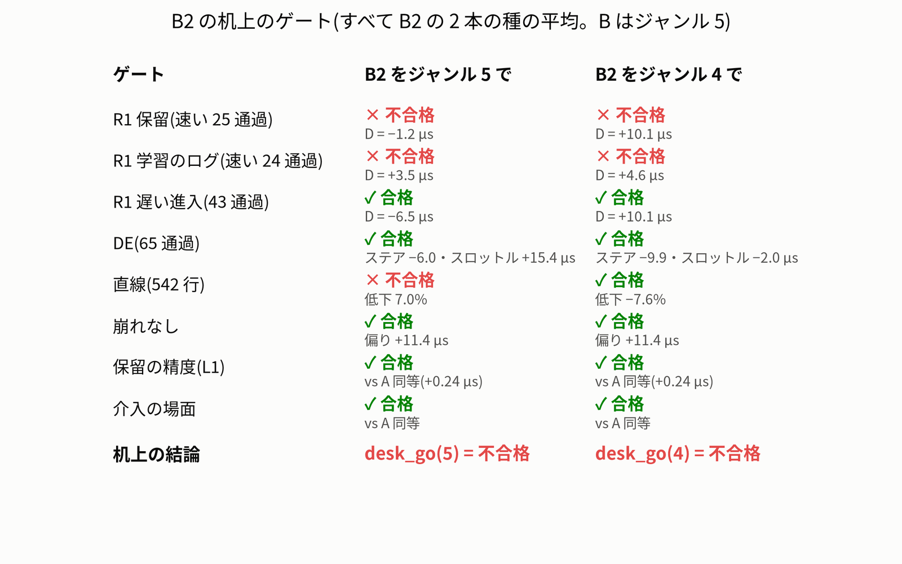

# B2 — データを選び直してモデル B を学習し直した結果(2026-10-16)

- **依頼**(ユーザー、10/16 18:00ごろ):「今週は走行できないので、ほかにできることは？」。選ばれた「4 データを選び直して B2 を学習」の結果です(もう 1 つの「7 シミュレーターを実車に近づける」は別のレポートです)。
- 実車は走らせていません。PCA9685・I2C、`jetformer/drive.py`・走行の既定(推奨のモデル・設定)には触れていません。生データ・既存のデータセットも書き換えていません。git commit はしていません。

## 結論

**B2 は机上の判定で no-go でした。来週の実車には出さず、モデル B のままにします。**

- 狙いは「R1 に速く入る癖を、手本から外して直す」ことでした。R1 の手前 1 秒のスロットルが B より 30 µs 以上弱まれば合格、という基準を学習の前に固定していました。
- 結果は、保留の速く近づいた 25 通過で **−1.2 µs**(ジャンル 5)・**+10.1 µs**(ジャンル 4)でした。どちらも合格線に届きません。
  - ジャンル 4 の +10 µs は、遅く近づいた通過でも同じ +10 µs でした。R1 に限った効きではなく、ジャンルの付け替えで走り全体の速さが動いただけです。
  - 種を替えただけの A のずれ(−17.9〜+7.9 µs)のほうが大きいです。
- 効きは、学習から外した通過そのものの上だけに小さく出ました(+9.5 µs)。新しい状態には広がりませんでした。
- 精度(保留の L1)は A と同等(+0.24 µs)、介入の場面も同等で、崩れもありません。「選び直しで壊れた」わけではありません。
- エンジン(B2 種 0、FP16)は全部のゲートに合格しました(run_numpy 中央値 2.42 ms、B 2.37 ms、FP32 との差 0.82 µs)。走行の一覧には `b2cur_20261016-s0` として出ますが、推奨は B のままです。

## 次の手(protocol の no-go のとき)

1. **(c) 安全層 v1 の速度上限**(R1 2.5・GM 2.2・DE 3.0 m/s)を先に進めます。較正したシミュレーターでの試験は、別の作業(項目 7)で進めています。
2. **(a) 新しい「遅く入って速く出る」データ**を実車で集めて、作り直します(計画の項目 12)。
3. **(b) 重みの調整**は机上だけでできます。ただし種のばらつきが ±20 µs あるので、種を 4 本以上にして測る必要があります。

## 文書

| ファイル | 中身 |
|---|---|
| `evaluation.md`・`evaluation.json` | 机上の評価(全部のゲートの値と合否・読み・参考の値・予想との答え合わせ) |
| `training.md` | 学習の記録(B2 の種 0・1) |
| `aba_card_b2.md` | 来週の実車のカード(机上の結果を埋めた版。no-go なので走らない) |
| `deviations.md` | 固定の後に変えたこと・足したこと(crosscheck の扱い・足した予測・削った参考の腕など) |
| `design.md`・`protocol.json`・`card_aba_b2.md` | 学習の前に固定した設計・規則・カード(書き換えていない) |
| `prepare.md` | 準備の段(表・データセット・CPU の動作確認) |
| `fig/` | 図 |

## レビューの注(2026-10-17、week_20261016/review.md)

- 予測の生のファイルから自分のコードで数え直し、R1 保留の速い 25 通過の D(ジャンル 5 −1.19・ジャンル 4 +10.14 µs)、A の種のずれ、保留の L1(B2 49.79 / 49.30 µs、vs A +0.244 µs)が一致しました。固定したファイルの sha256 も変わっていません。
- 机上で no-go なので、来週の実車の **カード 3(B → B2 → B)は走りません**。走行の一覧に `b2cur_20261016-s0` が出ますが、選ばないでください(消すかどうかはユーザーが決めます)。
