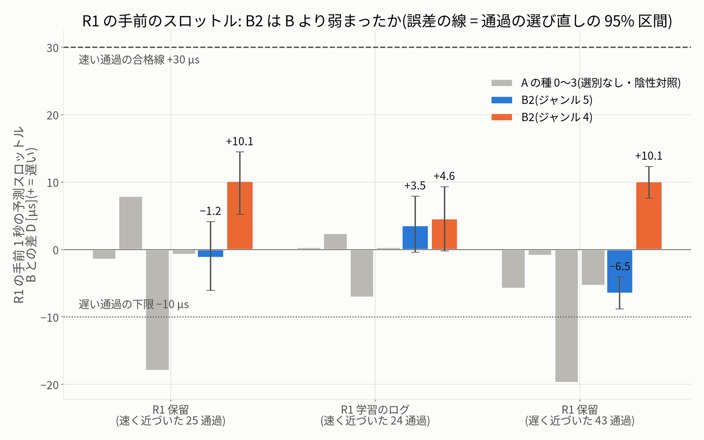
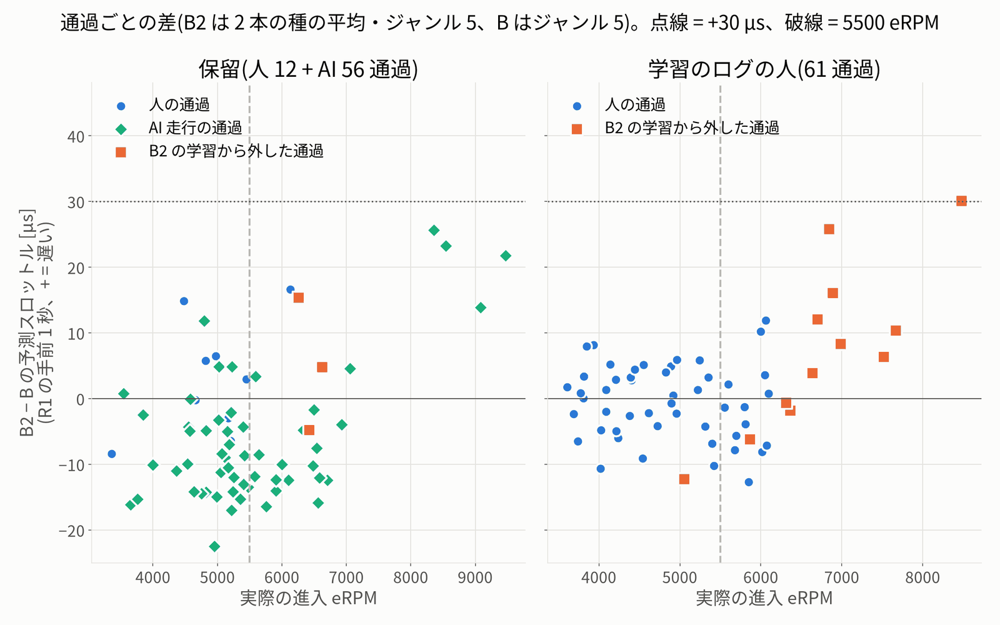
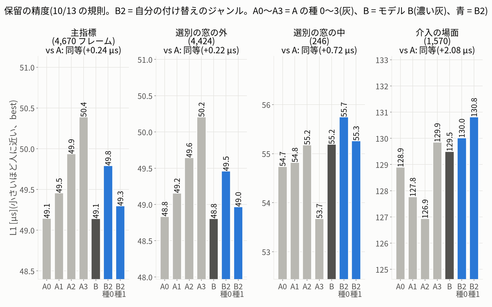
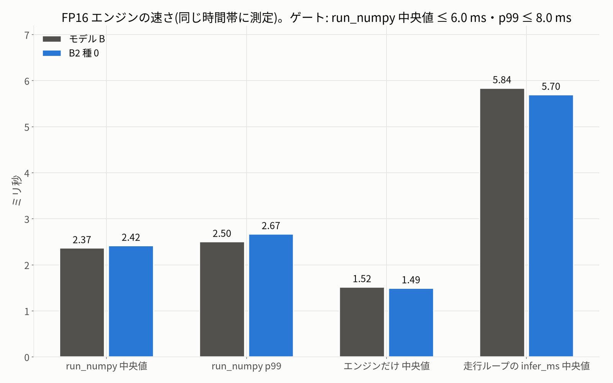

# 机上の評価 — B2(b2_curation_20261016)

- **依頼**(ユーザー、10/16 18:00ごろ):「今週は走行できないので、ほかにできることは？」。選ばれた「4 データを選び直して B2 を学習」の、机上の評価です。
- 判定は、学習の前に固定した `protocol.json`(sha256 `bd54dbbdf31f…`)のゲートのとおりです。固定の後に変えたことは `deviations.md` にあります。
- 実車は走らせていません。PCA9685・I2C には触れていません(走行ループの時間の確認は、偽の PCA9685 で行いました)。`drive.py`・走行の既定は変えていません。

## 0. 結論

- **desk_go は、ジャンル 5 でも 4 でも不合格でした(no-go)。** B2 は実車に出しません。モデル B のままにします。
- ジャンル 5: 不合格(落ちたゲート: R1 保留(速い 25 通過)・R1 学習のログ(速い 24 通過)・直線(542 行))。ジャンル 4: 不合格(落ちたゲート: R1 保留(速い 25 通過)・R1 学習のログ(速い 24 通過))。
- いちばん大事な問い「R1 の手前で、B2 のスロットルは B より弱まるか」: 保留の速く近づいた 25 通過で、ジャンル 5 は **−1.2 µs**、ジャンル 4 は **+10.1 µs** でした(合格線 +30 µs、+ = 遅い)。A の種 0〜3(選別なし)のずれは −1.5・+7.9・−17.9・−0.8 µs でした。
- エンジン(B2 種 0、FP16): 合格。run_numpy 中央値 2.42 ms(B 2.37 ms)、FP32 との差の最大 0.82 µs。
- 机上の結論は、実車の改善を示しません(10/12 の規則 7)。最終の判断は実車のカード 3(B → B2 → B)です。

### 0.1 読み(結果を見た後の記述。判定は変えていません)

1. **選別の効きは、外した通過の上だけに小さく出ました。** 学習のログで B2 が外した速い 11 通過では、B2 は B より +9.5 µs 遅く出しました(区間 +3.3〜+16.0。A の種 0〜3 は +1.8・+5.2・−5.0・+2.2 µs)。B2 も学んだ速い 13 通過では −1.5 µs でした。
2. **保留の速い通過には広がりませんでした。** 保留の 25 通過(ジャンル 5)で −1.2 µs です。いちばん速い AI の進入(8,000 eRPM 以上の 4 通過)では B2 が平均 +21 µs 遅く出しましたが、A の種も +3〜+18 µs 遅く出していて(B がそこで強く出しすぎているだけ)、選別の効きとは言えません。5,500〜7,000 eRPM の 20 通過では平均 −5.9 µs で、B とほぼ同じか少し強めでした(`fig/eval_r1_passes.png`)。
3. **種を替えただけのずれのほうが大きいです。** A の種 0〜3 の B とのずれは −1.5・+7.9・−17.9・−0.8 µs で、種 2 は −17.9 µs でした。今の机上の物差しでは、±20 µs くらいまでは種のばらつきに埋もれます。
4. **ジャンルの付け替えは、R1 だけでなく走り全体の速さを動かしました。** ジャンル 5 は遅いログだけになり、直線の前進が 7.0% 弱まり(直線のゲートで不合格)、DE のスロットルも +15.4 µs 遅くなりました。ジャンル 4 は R1 の手前で一様に約 +10 µs 遅い(速い +10.1・遅い +10.1 µs)一方、直線では 7.6% 強く、R1 に限った効きではありません。B もジャンル 4 にそろえて比べると、B2 は −6.0 µs(少し強め)でした。
5. **精度は落ちていません。** 保留の L1 は A と同等(+0.24 µs)、介入の場面も同等、崩れもありません。外した窓は全体の 5% なので、平均の精度にはほとんど出ません。付け替えた 152707-0001 では B2 の L1 が B より大きい(B 38.0・B2 47.1 / 44.6 µs)のが目立つ点です。
6. **結論**: 「外すだけ」の選別(学習サンプルの 5.7%)では、R1 の手前の癖は机上で測れるほど変わりませんでした。B のままにし、protocol の no-go の次の手の (c) 安全層 v1 の速度上限(シミュレーターで試験中)を先に進めるのが筋です。(a) 新しい「遅く入って速く出る」データ、(b) 重みの調整は、種を 4 本以上にして測る必要があります。

## 1. 確かめたこと(評価の前)

| 確かめ | 結果 |
|---|---|
| 既にある A・B の予測で、固定した基準値(L1 の 5 本 × 4 集合 × best・last、陰性対照の窓の値)を作り直す | 合格(L1 の差の最大 0.0000 µs、陰性対照の違い 0 件) |
| crosscheck: B の best を新しい道具で予測し直し、10/12 の B.npz と比べる | 合格(全部の行: 最大 0.0000 µs。part 0 だけ: 最大 0.0798 µs、差は最後の半端なバッチ(7 行)の中だけ)|
| 窓の表の数(protocol の counts_expected) | 同じ(R1: H 12・AI 56・T 61 通過、DE: H 10・AI 55・T 55、直線 542 行)。窓の表 11,320 行・key `8a18f97bdad55c26c4d78b0b2358cb012e1bb5bc` |
| 予測するジャンル | 保留の表の B2 は own_labels(152405-0002・152707-0001 の 1,179 行 = 4)。窓の表はジャンル 5・4 を全部の行に |
| 道具を固定した後に変えたか(eval_sha256.txt) | 変えていない |
| 中心・中立(model_config) | 全部のモデルで 1441 / 1496 µs |

- crosscheck は、protocol の字義(part 0 だけ)では 0.080 µs の差で合いませんでした。原因と扱いは `deviations.md` にあります(判定への影響はありません)。

## 2. ゲート(B2 は 2 本の種の平均。B はジャンル 5、A の種 0〜3 もジャンル 5)

| ゲート | 合格の条件 | ジャンル 5 | ジャンル 4 |
|---|---|---|---|
| R1 保留(速い 25 通過) | D ≥ +30・両方の種 ≥ +20・区間の下限 > 0・D − max D_A ≥ +15・last ≥ +20 | **不合格**: D = −1.2 µs(種 0 −0.3・種 1 −2.0、区間 −6.1〜+4.1、D − max D_A = −9.1、last −3.2) | **不合格**: D = +10.1 µs(種 0 +9.6・種 1 +10.7、区間 +5.2〜+14.5、D − max D_A = +2.2、last +8.3) |
| R1 学習のログ(速い 24 通過) | D ≥ +30・両方の種 ≥ +20・D − max D_A ≥ +15 | **不合格**: D = +3.5 µs(種 0 +3.9・種 1 +3.2、D − max D_A = +1.1) | **不合格**: D = +4.6 µs(種 0 +6.0・種 1 +3.1、D − max D_A = +2.2) |
| R1 遅い進入(43 通過) | D ≥ −10 | **合格**: D = −6.5 µs | **合格**: D = +10.1 µs |
| DE(65 通過) | ステア・スロットルとも D ≥ min(−15, min D_A − 5) | **合格**: ステア −6.0(下限 −15.0)・スロットル +15.4(下限 −15.0)µs | **合格**: ステア −9.9(下限 −15.0)・スロットル −2.0(下限 −15.0)µs |
| 直線(542 行) | 低下 ≤ 5% | **不合格**: 前進の強さ B2 185.4・B 199.4 µs → 低下 7.03% | **合格**: 前進の強さ B2 214.5・B 199.4 µs → 低下 −7.59% |
| 崩れなし | fwd_bias ≥ −30・正解率 ≥ B − 0.01 | **合格**: fwd_bias +11.4 µs・向きの正解率 0.992(B 0.991) | **合格**: fwd_bias +11.4 µs・向きの正解率 0.992(B 0.991) |
| 保留の精度(L1) | NOT(rest が悪い かつ > 2.798)・主指標の悪化 < 10 | **合格**: 主指標 vs A 同等(+0.24 µs)・rest 同等(+0.22 µs) | **合格**: 主指標 vs A 同等(+0.24 µs)・rest 同等(+0.22 µs) |
| 介入の場面 | NOT(悪い かつ > 5.822) | **合格**: vs A 同等(+2.08 µs) | **合格**: vs A 同等(+2.08 µs) |
| **desk_go** | 全部合格 | **不合格** | **不合格** |

- 走行のジャンルの決め方(固定): ジャンル 5 で desk_go ならジャンル 5、だめでジャンル 4 で desk_go ならジャンル 4、どちらもだめなら no-go。
- 結果: **no-go**。

### 2.1 R1・DE のゲートの部品(○ = 満たした、× = 満たさない)

| ゲート | ジャンル 5 | ジャンル 4 |
|---|---|---|
| R1 保留(速い 25 通過) | D ≥ +30 ×・両方の種 ≥ +20 ×・区間の下限 > 0 ×・D − max D_A ≥ +15 ×・last ≥ +20 × | D ≥ +30 ×・両方の種 ≥ +20 ×・区間の下限 > 0 ○・D − max D_A ≥ +15 ×・last ≥ +20 × |
| R1 学習のログ(速い 24 通過) | D ≥ +30 ×・両方の種 ≥ +20 ×・D − max D_A ≥ +15 × | D ≥ +30 ×・両方の種 ≥ +20 ×・D − max D_A ≥ +15 × |
| R1 遅い進入(43 通過) | D ≥ −10 ○ | D ≥ −10 ○ |
| DE(65 通過) | ステア ○・スロットル ○ | ステア ○・スロットル ○ |

### 2.2 集合ごとの値(µs、+ = B より遅い / 左)

| 集合 | 通過 | B の平均の出力 | D(B2 g=5) | D(B2 g=4) | A 種 0 | A 種 1 | A 種 2 | A 種 3 |
|---|---|---|---|---|---|---|---|---|
| R1 保留・速い(スロットル) | 25 | 1333.3 | −1.2 | +10.1 | −1.5 | +7.9 | −17.9 | −0.8 |
| R1 学習のログ・速い | 24 | 1311.6 | +3.5 | +4.6 | +0.3 | +2.4 | −7.1 | +0.3 |
| R1 保留・遅い | 43 | 1356.6 | −6.5 | +10.1 | −5.8 | −0.9 | −19.7 | −5.3 |
| DE(ステア) | 65 | 1457.8 | −6.0 | −9.9 | −1.0 | −3.7 | −8.9 | +7.5 |
| DE(スロットル) | 65 | 1294.5 | +15.4 | −2.0 | +0.3 | +9.7 | +1.7 | +7.0 |

## 3. 保留の精度(L1、10/13 の規則)

| 集合 | ジャンル | vs A(best の悪化・分類) | vs B(best の悪化・分類) | 種の帯(5 本の範囲 × 2) |
|---|---|---|---|---|
| 主指標 4,670 | own_labels(主) | +0.24 µs・同等(閾値 0.626) | +0.40 µs・同等 | 2.490 µs |
| 選別の窓の外 4,424 | own_labels(主) | +0.22 µs・同等(閾値 0.702) | +0.41 µs・同等 | 2.798 µs |
| 選別の窓の中 246 | own_labels(主) | +0.72 µs・同等(閾値 0.906) | +0.31 µs・同等 | 3.028 µs |
| 介入 1,570 | own_labels(主) | +2.08 µs・同等(閾値 3.458) | +0.92 µs・同等 | 5.822 µs |
| 主指標 4,670 | aligned(参考) | +0.73 µs・悪い(閾値 0.626) | +0.89 µs・悪い | 2.490 µs |
| 選別の窓の外 4,424 | aligned(参考) | +0.44 µs・同等(閾値 0.702) | +0.63 µs・同等 | 2.798 µs |
| 選別の窓の中 246 | aligned(参考) | +5.98 µs・悪い(閾値 0.906) | +5.56 µs・悪い | 3.028 µs |
| 介入 1,570 | aligned(参考) | +2.08 µs・同等(閾値 3.458) | +0.92 µs・同等 | 5.822 µs |

L1(best、own_labels)の値 [µs]:

| | A 種 0 | A 種 1 | A 種 2 | A 種 3 | モデル B | B2 種 0 | B2 種 1 |
|---|---|---|---|---|---|---|---|
| 主指標 | 49.15 | 49.46 | 49.94 | 50.39 | 49.14 | 49.79 | 49.30 |
| 選別の窓の外 | 48.84 | 49.16 | 49.65 | 50.21 | 48.81 | 49.46 | 48.97 |
| 選別の窓の中 | 54.74 | 54.82 | 55.18 | 53.68 | 55.19 | 55.75 | 55.26 |
| 介入 | 128.90 | 127.77 | 126.94 | 129.85 | 129.50 | 130.02 | 130.81 |

- 読み(先に決めた読み方): **同等・良い: 精度を落とさずに選別できた**
- 感度(参考): vs B で同じゲートを見ると、L1 合格・介入 合格。

介入の場面の種類別の L1(best、判定には使わない)[µs]:

| 種類 | フレーム | A 種 0 | A 種 1 | B | B2 種 0 | B2 種 1 |
|---|---|---|---|---|---|---|
| after_collision | 1327 | 128.1 | 124.8 | 127.5 | 127.5 | 129.5 |
| preemptive | 231 | 130.4 | 141.9 | 138.2 | 142.1 | 136.7 |
| stuck | 12 | 186.4 | 185.7 | 188.9 | 182.2 | 161.8 |

## 4. 崩れなし・直線

| | A 種 0 | A 種 1 | モデル B | B2 種 0 | B2 種 1 |
|---|---|---|---|---|---|
| fwd_bias(3 フレーム先の予測 − 人)[µs] | +9.3 | +10.8 | +9.7 | +10.5 | +12.2 |
| 向きの正解率 | 0.995 | 0.991 | 0.991 | 0.990 | 0.994 |

- 直線 542 行(ジャンル 5): 前進の強さ B2 185.4 µs(種 0 187.6・種 1 183.2)、B 199.4 µs → 低下 7.03%(≤ 5% で合格)。SW・HS の直線 655 行(計画 G3 の字義、参考): 低下 5.70%。
- 直線 542 行(ジャンル 4): 前進の強さ B2 214.5 µs(種 0 214.6・種 1 214.5)、B 199.4 µs → 低下 −7.59%(≤ 5% で合格)。SW・HS の直線 655 行(計画 G3 の字義、参考): 低下 −12.10%。
- 参考: A の種 0〜3 の直線の低下(ジャンル 5、B に対して): −0.30・0.80・2.00・3.40%。

## 5. エンジンとタイミング(B2 種 0、FP16)

| 項目 | B2 種 0 | B2 種 1 | モデル B |
|---|---|---|---|
| FP16 と FP32 の差の最大 [µs] | 0.820 | — | 0.947 |
| NaN・Inf なし | はい | — | はい |
| run_numpy 中央値 / p99 [ms] | 2.418 / 2.671 | — | 2.365 / 2.503 |
| エンジンだけ 中央値 [ms] | 1.494 | — | 1.519 |
| 学習の GPU のメモリの最大 [MB] | 1262 | — | — |
| 走行の一覧(drive.list_models) | ある | — | ある |
| trained_modes | [4, 5] | — | [4, 5] |
| 中心・中立 [µs] | 1441 / 1496 | — | 1441 / 1496 |
| エンジンの大きさ [MB] | 27.8 | — | 27.8 |
| 走行ループ(偽の PCA9685)の infer_ms 中央値 [ms] | 5.696 | — | 5.839 |
| 走行ループの HOLD・エラー | 0・なし | — | 0・なし |
| ループの出力 = 同じ入力で直接 run_numpy(差の最大 µs) | 0.0000 | — | 0.0000 |
| 走行ループ・カメラ → PWM の見積もり [ms] | 5.65・28.1 | — | 5.60・28.0 |

- ゲート(固定): FP32 との差 ≤ 2.5 µs、run_numpy 中央値 ≤ 6.0 ms・p99 ≤ 8.0 ms、学習の GPU のメモリ ≤ 4,096 MB、NaN・Inf なし、中央値 ≤ B(2.377 ms、固定の値)+ 0.5 ms、走行の一覧に出てジャンル g を学習している、中心・中立が B と同じ。
- 結果: B2 種 0 = **合格**。部品: FP32 との差 ≤ 2.5 µs ○・NaN・Inf なし ○・中央値 ≤ 6.0 ms ○・p99 ≤ 8.0 ms ○・メモリ ≤ 4,096 MB ○・中央値 ≤ B + 0.5 ms ○・一覧に出てジャンル g を学習 ○・走行できる印 ○・中心・中立が B と同じ ○。
- 同じ時間帯に測った B の run_numpy 中央値(2.365 ms)と比べても、B2 は +0.5 ms の内でした: ○。
- 走行の予算: 30 fps のカメラ 1 フレーム = 33.3 ms。走行ループ・カメラ → PWM は、B の実車の値(5.6 ms・28 ms)に同じ道具での run_numpy の差を足した見積もり(実測ではない)。B2 の見積もりは走行ループ 5.65 ms・カメラ → PWM 28.1 ms で、1 フレームの 33.3 ms に十分収まります。
- 偽の PCA9685 の走行ループ(記録したフレームを 30 fps で流す)の fps・遅れは、B と B2 で同じでした(机上の流し方による値で、実車の値ではありません)。
- 実車の dry run(車輪を浮かせて 60 秒)での確かめは、カードの手順 0 に残します(HOLD 0・infer_ms 中央値 ≤ B + 1 ms・カメラ 29 fps 以上・遅れ中央値 ≤ 35 ms)。

## 6. 参考の値(判定しない)

走行のジャンル 5 で計算(no-go のときはジャンル 5)。

| 集合 | 通過 | D [µs] | 種 0 / 種 1 | A の種 0〜3 |
|---|---|---|---|---|
| 全部の通過・保留(H ∪ AI、計画 G3 の字義) | 68 | −4.5(区間 −6.9〜−2.1) | −1.8 / −7.3 | −4.2・+2.3・−19.1・−3.6 |
| 全部の通過・学習のログ(T) | 61 | +1.1(区間 −0.8〜+3.2) | +4.0 / −1.9 | −2.4・−0.3・−10.0・−1.0 |
| 6200 以上だけ・保留 | 16 | +2.2(区間 −4.1〜+9.0) | +1.2 / +3.3 | −0.7・+9.5・−13.0・+0.3 |
| 6200 以上だけ・学習のログ | 10 | +11.0(区間 +5.2〜+17.4) | +11.0 / +11.1 | +3.2・+7.4・−3.9・+4.1 |
| 速い・保留の人(H)だけ | 4 | +8.0(区間 −0.0〜+16.0) | +7.7 / +8.2 | +2.0・+8.9・−2.5・+5.3 |
| 速い・保留の AI だけ | 21 | −2.9(区間 −8.2〜+2.9) | −1.9 / −4.0 | −2.1・+7.7・−20.9・−1.9 |
| 速い・学習のログ・B2 が外した通過 | 11 | +9.5(区間 +3.3〜+16.0) | +9.7 / +9.2 | +1.8・+5.2・−5.0・+2.2 |
| 速い・学習のログ・B2 も学んだ通過 | 13 | −1.5(区間 −5.1〜+2.3) | −1.1 / −1.9 | −0.9・−0.0・−8.8・−1.2 |
| 窓 0.4 秒(10/12)・保留の速い | 25 | −1.9(区間 −8.7〜+6.1) | −1.6 / −2.1 | +6.1・+22.1・−17.2・+4.5 |
| 窓 2 秒・保留の速い | 25 | +0.9(区間 −2.4〜+4.5) | +2.0 / −0.3 | −0.6・+1.3・−13.9・−0.2 |
| 窓 0.4 秒・学習のログの速い | 24 | −10.0(区間 −17.4〜−2.5) | −8.5 / −11.5 | −0.4・+3.2・−7.2・+4.1 |
| 窓 2 秒・学習のログの速い | 24 | +11.8(区間 +7.6〜+16.3) | +13.0 / +10.6 | +3.4・+1.9・−5.4・+1.3 |
| last.pth の B2(B は best)・保留の速い | 25 | −3.2(区間 −8.7〜+2.7) | −6.3 / −0.2 | −1.5・+7.9・−17.9・−0.8 |
| ジャンル: aligned のジャンル(全部のモデル)・保留の速い | 25 | −1.2(区間 −6.1〜+4.1) | −0.3 / −2.0 | −1.5・+7.9・−17.9・−0.8 |
| ジャンル: B2 = own_labels・B = aligned・保留の速い | 25 | −1.0(区間 −6.3〜+4.7) | −0.2 / −1.8 | −1.5・+7.9・−17.9・−0.8 |
| ジャンル: B2 = 4・B = 5・保留の速い | 25 | +10.1(区間 +5.2〜+14.5) | +9.6 / +10.7 | −1.5・+7.9・−17.9・−0.8 |
| ジャンル: B2 = 5・B = 5・保留の速い | 25 | −1.2(区間 −6.1〜+4.1) | −0.3 / −2.0 | −1.5・+7.9・−17.9・−0.8 |
| ジャンル: B2 = 4・B = 4・保留の速い | 25 | −6.0(区間 −9.7〜−1.7) | −6.5 / −5.4 | −0.4・+14.7・−12.7・+7.9 |

見積もった進入 eRPM(rl_evaluate.entry_estimate と同じ式: 実際の進入 + 定常の対応表での差。閉ループの影響は入らない粗い見積もり):

| 集合 | 通過 | 実際 ≥ 5500 / ≥ 6200 | B ≥ 5500 / ≥ 6200(中央値) | B2 種 0 | B2 種 1 |
|---|---|---|---|---|---|
| 保留(H ∪ AI) | 68 | 37% / 24% | 38% / 28%(5286) | 47% / 29%(5358) | 52% / 31%(5537) |
| 学習のログ(T) | 61 | 39% / 16% | 43% / 26%(5223) | 43% / 25%(5135) | 48% / 30%(5442) |

DE の出口の予測ステアと人の差(計画 G3「人の −20 µs に近づく」。B2 は DE を直す手ではないので判定しない):

- 保留の人(10 通過): 人の平均 1515.2 µs。B − 人 −29.4・B2 種 0 − 人 −29.5・B2 種 1 − 人 −34.8 µs。
- 学習のログの人(55 通過): 人の平均 1489.0 µs。B − 人 −24.4・B2 種 0 − 人 −26.1・B2 種 1 − 人 −29.6 µs。

ジャンル別(aligned の mode)の L1・fwd_bias(best、own_labels):

| ジャンル | フレーム | A 種 0 | A 種 1 | モデル B | B2 種 0 | B2 種 1 |
|---|---|---|---|---|---|---|
| genre4 | 1922 | 60.3(+34.3) | 61.1(+33.9) | 60.7(+33.3) | 60.0(+33.8) | 60.1(+33.8) |
| genre5 | 2748 | 41.4(−8.2) | 41.3(−5.3) | 41.0(−6.7) | 42.6(−5.8) | 41.7(−2.9) |

シーン別の L1(best、own_labels)[µs]:

| シーン | フレーム | A 種 0 | A 種 1 | モデル B | B2 種 0 | B2 種 1 |
|---|---|---|---|---|---|---|
| 20261010-135449-0003 | 405 | 41.6 | 41.7 | 41.1 | 42.5 | 43.4 |
| 20261010-150424-0001 | 398 | 65.9 | 67.0 | 67.7 | 65.6 | 65.1 |
| 20261010-152405-0002 | 312 | 55.2 | 56.5 | 56.4 | 56.7 | 55.9 |
| 20261010-152707-0001 | 490 | 43.0 | 41.2 | 38.0 | 47.1 | 44.6 |
| 20261010-193638-0003 | 573 | 96.7 | 96.3 | 97.8 | 97.3 | 98.1 |
| 20261010-200916-0004 | 581 | 35.6 | 37.0 | 35.6 | 35.7 | 35.1 |
| 20261010-200916-0009 | 356 | 48.5 | 50.7 | 48.8 | 49.0 | 48.3 |
| 20261010-201626-0003 | 572 | 26.9 | 26.7 | 27.4 | 27.8 | 26.4 |
| 20261010-201626-0007 | 571 | 29.6 | 29.5 | 30.3 | 30.0 | 29.4 |
| 20261010-202633-0003 | 199 | 60.7 | 60.5 | 59.5 | 56.5 | 58.1 |
| 20261010-202633-0007 | 213 | 48.9 | 50.3 | 50.7 | 47.8 | 47.6 |

- 参考の腕(外すだけ・付け替えだけ)は、本体を先に済ませるため学習していません(protocol の「遅れたら最初に削る」)。

## 7. 結果を見る前の予想との答え合わせ

| 項目 | 予想(固定) | 結果 |
|---|---|---|
| R1 保留 | D_B2 = +15〜+35 µs(中心 +22)。合格 約 40% | D = −1.2(g=5)・+10.1(g=4)µs、不合格 / 不合格 |
| R1 学習のログ | D_B2 = +25〜+45 µs(中心 +32)。合格 約 55% | D = +3.5(g=5)・+4.6(g=4)µs |
| R1 遅い進入 | 0〜+10 µs。合格 約 90% | D = −6.5(g=5)・+10.1(g=4)µs |
| DE | |D| < 8 µs。合格 約 90% | ステア −6.0・スロットル +15.4 µs(g=5) |
| 直線 | g = 5 で低下 2〜7%(不合格 約 35%)、g = 4 で −3〜+2% | 低下 7.03%(g=5)・−7.59%(g=4) |
| L1 | own_labels vs A: 同等 50%・悪い 45%(+0.6〜+1.8 µs、種の帯の内)・良い 5%。rest は同等 | vs A 同等(+0.24 µs)、rest 同等 |
| 介入 | 同等 | vs A 同等 |
| エンジン | 合格(run_numpy 中央値 約 2.4 ms) | run_numpy 中央値 2.418 ms |
| どちらかのジャンルで desk_go | 約 40% | no-go |

## 8. 注意

- 机上の値は「人や AI が実際に走った状態の画像」に対するモデルの出力です。B2 が実際に走れば状態が変わる(閉ループ)ので、実車の進入速度の変化は、この値からは決まりません。
- 判定はゲートの積で、走行のジャンルは 2 つまでです。偽陽性は小さいものの 0 ではありません。
- 保留の人の速い通過は 4 しかありません。保留の AI の 21 通過は、10/10 の first_trial がいろいろなゲインで走った状態です。
- 走行ループの時間は偽の PCA9685 で測った値と、B の実車の値に差を足した見積もりです。実車での確かめはカードの dry run です。

## 9. ファイル

| ファイル | 中身 |
|---|---|
| `evaluation.json` | 全部の値(ゲート・部品・通過ごとの差・参考の値・エンジン) |
| `fig/eval_gates.png`・`eval_r1_throttle.png`・`eval_r1_passes.png`・`eval_l1.png`・`eval_engine.png`・`train_val_curves.png` | 図 |
| `eval_sha256.txt` | 窓の表の key・表と道具の sha256(予測・評価の前に固定) |
| `/home/jetson/jetformer/experiments/20261016_b2_curation/eval/b2_eval.py`・`b2_lib.py`・`test_b2_lib.py`・`b2_report.py` | 評価の道具・計算・試験・図と文書 |
| `/home/jetson/jetformer/data/zoo/b2_curation_20261016/` | 窓の表・予測(pred/)・crosscheck・repro・エンジンの確認(engine/) |
