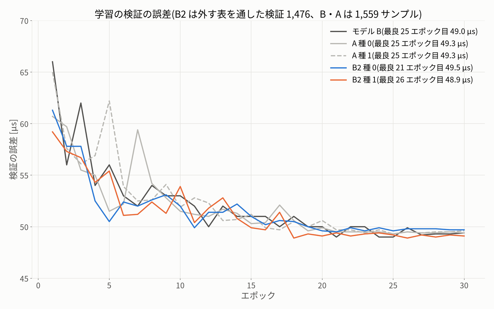

# 学習の記録 — B2(b2_curation_20261016)

- **依頼**(ユーザー、10/16 18:00ごろ):「今週は走行できないので、ほかにできることは？」。選ばれた「4 データを選び直して B2 を学習」の、GPU の学習の段です。
- 固定した `protocol.json` の `model.train_cmd` の文字列のまま、`experiments/20261016_b2_curation/train_b2.py run 0 1` で学習しました(jf-heavy --lock big で 1 つずつ)。
- 実車・PCA9685・I2C、`jetformer/drive.py`・走行の既定には触れていません。生データと既存のデータセットも書き換えていません。git commit はしていません。
- 学習結果の名前は protocol で固定した **`b2cur_20261016-s0`・`b2cur_20261016-s1`** です(この段の指示文の `b2_20261016-s<seed>` ではなく、固定した名前を使いました。中身は同じです)。

## 1. 結果

| | B2 種 0 | B2 種 1 | モデル B(比べる相手) |
|---|---|---|---|
| 状態 | done | done | done |
| エポック | 30 | 30 | 30 |
| 学習サンプル | 5,574 | 5,574 | 5,912 |
| 検証サンプル | 1,476 | 1,476 | 1,559 |
| ジャンル別の学習サンプル(4 / 5) | 3,295 / 2,279 | 3,295 / 2,279 | 2,228 / 3,684 |
| 衝突の前後として外したフレーム(学習 / 検証) | 2,889 / 923 | 2,889 / 923 | 3,522 / 1,083 |
| 最良のエポック | 21 | 26 | 25 |
| 最良の検証の誤差 | 49.5 µs | 48.9 µs | 49.0 µs |
| ジャンル別の検証の誤差(4 / 5) | 57.4 / 39.4 µs | 56.9 / 38.8 µs | 61.0 / 41.0 µs |
| 学習の時間 | 22 分 | 21 分 | —(再開の分だけ記録) |
| GPU のメモリの最大 | 1,262 MB | 1,262 MB | — |

- B2 の検証の誤差は、外す表を通した検証(1,476 サンプル)なので、B の値(1,559 サンプル)と直接は比べられません。精度の比較は、外さない保留の 4,670 フレームで行いました(`evaluation.md` の 5 章)。
- B の学習の時間 200 秒は、電池切れの後の再開の分だけの値です(result.json の note)。

## 2. 学習のログの最初の 4 行(protocol の expected_train_log と比べた)

| 行 | protocol | 種 0 | 種 1 |
|---|---|---|---|
| 衝突の前後として外したフレーム | 2889 / 923 | 2889 / 923 | 2889 / 923 |
| drop で外した | 1639 / 406 | 1639 / 406 | 1639 / 406 |
| 学習 / 検証のサンプル | 5574 / 1476 | 5574 / 1476 | 5574 / 1476 |
| ジャンル別(4 / 5) | 3295 / 2279 | 3295 / 2279 | 3295 / 2279 |

- 両方の種で 4 行とも protocol と同じでした。表の sha1(drop_b2 `2a0ea74ca49e`・remap_b2 `f1ce10a08c00`)も、result.json と今のファイルで同じです。
- 道具の確かめ(`train_b2.py` の check_result): 種 0 = OK、種 1 = OK。

## 3. 途中で起きたこと

- メモリの上限: 種 0 は、1 エポック目の前に上限 3G で止まりました(10/15 の v0-s2 と同じ)。protocol の on_cgroup_kill のとおり、上限を 3872M にして最初から学習し直しました(計算は変わりません)。`deviations.md` に書きました。
- 種 1 は上限 3G のまま最後まで学習できました。
- 電源断はありませんでした。

## 4. 学習の曲線

- 最良のエポック: B2 種 0 = 21、種 1 = 26(B = 25)。B2 は学習サンプルが 5.7% 少なく、ジャンル 4 が多い構成です。
- 学習の誤差(train)は最後まで下がり、検証の誤差は 15〜20 エポック目からほぼ横ばいです(A・B と同じ形)。

## 5. ファイル

| ファイル | 中身 |
|---|---|
| `/home/jetson/jetformer/data/runs/b2cur_20261016-s0/`・`-s1/` | best.pth・last.pth・jetformer.onnx・model_config.json・result.json・run.json・train.log |
| `/home/jetson/jetformer/experiments/20261016_b2_curation/train_b2.py` | 学習の段の道具(待つ・run.json・最初の 4 行の確かめ・再開・メモリの上限の引き上げ) |
| `logs/train_driver.log`・`logs/train_state.json` | 学習の道具のログと状態 |
