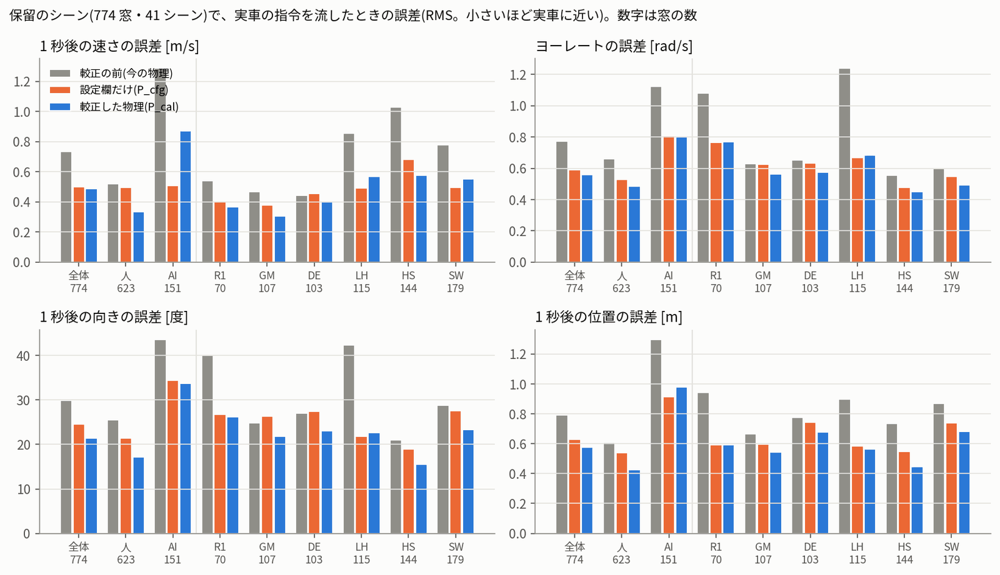
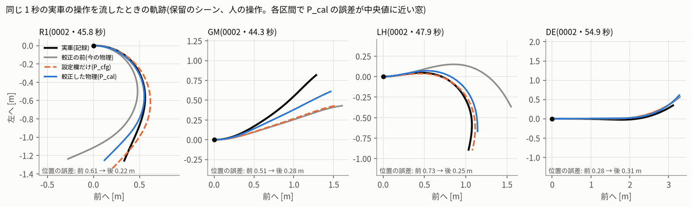

# シミュレーターの忠実度 — 保留のシーンで、較正の前と後を比べた(S3、2026-10-16)

- 依頼(10/16 18:00 ごろ):「今週は走行できないので、ほかにできることは?」のうち **「7 シミュレーターを実車に近づける」** の確かめの段です。
- 実車は走らせていません。PCA9685・I2C には触れていません。drive.py は変えていません。ユーザーのシミュレーターのファイルは読むだけです。
- 数字はすべて `fidelity.json` にあります。作り方は `experiments/20261016_sim_calibration/fidelity.py` と `replay_fidelity.mjs` です。

## 0. 結論

1. **較正した物理 P_cal は、実車にはっきり近づきました。** 保留のシーン(当てはめに使っていない 41 シーン・774 窓)で、実車の 1 秒の操作をそのまま流しました。
   - 誤差の減り方は、速さ −34%、ヨーレート −28%、向き −28%、位置 −27% です。90% 区間の下端は、どれも −17% 以上の改善でした。
   - 人の窓でも AI の窓でも、4 つとも 23% 以上減りました。
   - R1・GM・DE・LH のどの区間も、悪くなっていません。
2. **ただし、手順の判定は「不合格」です。理由は偏り(C3)だけです。**
   - 全体の速さの偏りが −0.116 m/s で、基準の ±0.10 m/s をわずかに超えました。シミュレーターの方が少し遅く走ります。
   - 区間の偏りも基準を超えました。速さは GM +0.13・DE −0.14 m/s、向きは R1 −5.5 度・GM +4.8 度です。
   - C1(全体の改善)と C2(区間で悪くならない)は、余裕をもって合格しています。
3. **電池の係数を合わせない版(P_cal_k1、参考)なら「条件つき」でした。** 全体の速さの偏りは −0.055 m/s です。
   - 窓の前 5 秒の効きで電池の係数を合わせると、かえって偏りが大きくなりました(−0.152 対 −0.062 m/s、係数を合わせた 396 窓)。
4. **設定欄だけの版 P_cfg も「不合格」です。** 向きの改善は 18% で、20% に届きませんでした。GM では向きが 6% 悪くなりました。
   - 画面の設定欄だけでは足りないので、成果は **P_cal(較正版のコア、`sim/dist/calib.html`)** です。
5. **速度上限の試験(S4)は、手順の決まりのとおり P_default と P_cal の両方で走らせ、結果は「仮説」と書きます。**

## 1. やり方(protocol の fidelity 章のとおり)

- **窓**: 各ログのシーンを名前順に並べ、番号 k % 3 == 1 のシーンを保留にしました。プロファイルを固めた(22:30、P_cal sha256 `4b0e9348…`)あとに、初めて開いています。
  - 1 秒の窓・0.5 秒ずらしで 774 窓(人 623・AI 151)。シーンは 41 です。
  - 区間ごとの窓の数は、R1 70・GM 107・DE 103・LH 115・HS 144・SW 179・不明 56 です。
  - 参考に 2 秒の窓も作りました(667 窓)。
- **再生**: 較正版のコア(JS)を Node で動かしました。dt 0.01 秒・障害物の無い広い世界です。
  - 窓の前 0.5 秒は速さを実際の値に固定し、舵の状態だけを流しました。遅れのための過去の指令も入れています。
  - 窓の始まりからは、速さもヨーもシミュレーターが決めます。路面は区間で決めました(R1 → ショートカット、GM → 芝、ほか → カーペット)。
- **Python の参照との一致(試験 T3)**: 当てはめの窓 50 個で、S1 の Python の再生と JS のコアを比べました。速さとヨーレートの差は最大 3e-13 です(基準は 1e-6)。
- **指標**: 1 秒後の速さの誤差 e_v、窓の中のヨーレートの誤差 e_r、1 秒後の向きの誤差 e_ψ、1 秒後の位置の誤差 e_p です。
  - 改善率は I = 1 − M(P)/M(P_default) です。
  - 90% 区間は、シーン単位のブートストラップ 2000 回(種 20261016)で出しました。

## 2. 全体と操作者別(1 秒の窓)

誤差は RMS(e_v・e_ψ は 1 秒後の値)、括弧の中は改善率です。

| 窓 | 物理 | 速さ e_v [m/s] | ヨーレート e_r [rad/s] | 向き e_ψ [度] | 位置 e_p [m] |
|---|---|---|---|---|---|
| 全体 774 | 較正の前 P_default | 0.736 | 0.774 | 29.9 | 0.792 |
| | 設定欄だけ P_cfg | 0.499(−32%) | 0.592(−24%) | 24.5(−18%) | 0.629(−21%) |
| | **較正 P_cal** | **0.488(−34%)** | **0.560(−28%)** | **21.4(−28%)** | **0.578(−27%)** |
| | P_cal の改善の 90% 区間 | −17〜−41% | −22〜−34% | −21〜−39% | −21〜−35% |
| 人 623 | P_default → P_cal | 0.521 → 0.336(−36%) | 0.662 → 0.485(−27%) | 25.5 → 17.2(−33%) | 0.610 → 0.426(−30%) |
| AI 151 | P_default → P_cal | 1.288 → 0.870(−32%) | 1.124 → 0.800(−29%) | 43.6 → 33.7(−23%) | 1.297 → 0.981(−24%) |

## 3. 区間別(1 秒の窓。P_default → P_cal、括弧は改善率)

| 区間(窓) | 速さ e_v | ヨーレート e_r | 向き e_ψ [度] | 位置 e_p [m] |
|---|---|---|---|---|
| R1(70) | 0.541 → 0.365(−33%) | 1.081 → 0.769(−29%) | 40.0 → 26.3(−34%) | 0.943 → 0.592(−37%) |
| GM(107) | 0.470 → 0.306(−35%) | 0.630 → 0.565(−10%) | 24.9 → 21.8(−12%) | 0.664 → 0.542(−18%) |
| DE(103) | 0.443 → 0.402(−9%) | 0.652 → 0.576(−12%) | 27.0 → 23.1(−14%) | 0.776 → 0.676(−13%) |
| LH(115) | 0.856 → 0.570(−33%) | 1.240 → 0.683(−45%) | 42.4 → 22.6(−47%) | 0.897 → 0.564(−37%) |
| HS(144) | 1.027 → 0.579(−44%) | 0.556 → 0.450(−19%) | 21.0 → 15.6(−26%) | 0.733 → 0.445(−39%) |
| SW(179) | 0.779 → 0.551(−29%) | 0.598 → 0.495(−17%) | 28.8 → 23.4(−19%) | 0.870 → 0.683(−21%) |

- S1 の当てはめの窓では DE が悪くなる見込みでしたが、保留のシーンでは DE も 9〜14% 良くなりました。
- 改善がいちばん小さいのは GM のヨー(−10%)と DE の速さ(−9%)です。

## 4. 合格の決まり(結果を見てから変えていない)

| | P_cal | P_cfg | P_cal_k1(参考) |
|---|---|---|---|
| C1 全体: 4 指標とも I ≥ 20%、区間の下端 > 0。人・AI それぞれ ≥ 10% | **合格** | 不合格(向き 18%・人の速さ 5%) | 合格 |
| C2 区間: R1・GM・DE・LH で悪くならない(≤ 1.05 倍)。R1・GM の向き ≥ 10% | **合格**(GM の向き 12%) | 不合格(GM の向き +6%) | 合格 |
| C3 偏り: 速さの中央値 ±0.10 m/s(全体・R1・GM・DE)、向き ±2 度(全体)・±3 度(区間) | **不合格** | 不合格 | 不合格(区間) |
| 判定 | **不合格** | 不合格 | **条件つき** |

偏り(中央値。シミュレーター − 実車)は次のとおりです。

| | 全体 | R1 | GM | DE |
|---|---|---|---|---|
| P_cal の速さ [m/s] | **−0.116** | −0.079 | **+0.130** | **−0.136** |
| P_cal の向き [度] | +1.2 | **−5.5** | **+4.8** | +2.2 |
| P_cal_k1 の速さ [m/s] | −0.055 | −0.019 | **+0.156** | −0.018 |
| P_default の速さ [m/s] | +0.092 | +0.187 | +0.241 | −0.061 |
| P_default の向き [度] | −7.5 | −23.1 | −3.5 | −8.7 |

- 較正の前は、R1 で向きの偏りが −23 度ありました。シミュレーターの方が R1 で大きく右へ回っていた、ということです。較正の後は −5.5 度です。
- 偏りは全体でずっと小さくなりました。それでも基準の幅には収まりませんでした。

## 5. まだ実車と違うところ

1. **AI の指令での速さ**(いちばん大きい)
   - AI の窓では、P_cal が実車より 0.45 m/s 遅く走ります(1 秒後の中央値。2 秒の窓では −0.50)。人の窓は −0.07 です。
   - 速さの対応は人の操作で決めました(deviations D11)。AI の PWM の経路か、30 Hz で揺れる指令への ESC の応答が、人と違うとみられます。
   - P_cfg は AI の窓の速さが合っています(0.509 対 P_cal 0.870)。ただし人の窓の速さはほとんど良くなりません(0.497)。
   - 確かめは、計画項目 8(実車#1 の最後、人の送信機でのブレーキと速さの測定)と、PCA9685 の周期の確認です。
2. **向きの偏りが区間で残る**
   - LH +7.3 度、GM +4.8 度、R1 −5.5 度、AI の DE +13.5 度です。
   - 中心付近の左右差(バックラッシュ)と、こすれの式(直線)が候補です(deviations D12、identify.md)。
3. **直線と発進の速さ**
   - HS では −0.26 m/s、SW では −0.22 m/s で、シミュレーターが遅いです。
   - 0.5〜1.5 m/s から始まる窓(発進・立て直し)では、P_cal の速さの誤差は 0.50 です。P_cfg の 0.34 より大きくなっています。不感帯と τ_up が、発進ではまだ合っていません。
   - 逆に、3.5 m/s 以上の窓は大きく良くなりました(0.945 → 0.437)。頭打ち 5.0 m/s が効いています。
4. **ブレーキ**
   - 窓の中にブレーキの要求(中立 + 60 µs 以上)がある窓は 27 だけで、強いもの(+300 µs 以上)は 7 窓です。この窓では、速さの誤差は P_default 0.79・P_cal 0.86 で、良くなっていません。
   - 中身を見ると、強いブレーキはよく合っていました。181504 の +366 µs(2.74 → 1.19 m/s)は誤差 0.00、200916 の +731 µs は −0.08 m/s で、P_default は +0.44・+0.61 です。
   - 誤差の大部分は、弱いブレーキ(+65〜113 µs)の AI の窓から来ています。これは上の AI の速さの偏りと同じものです。
   - ブレーキの弱め・強めのシナリオでは、誤差は 0.91 / 0.85 m/s でした。
   - I7 の 16 回のうち 5 回は保留のシーンにある(protocol が固定)ので、ここは独立な確かめではありません。
   - **ブレーキの表は仮のままです。** 計画項目 8 で実測します。
5. **電池**
   - 窓の前 5 秒の効き g で電池の係数を合わせると(396 窓、多くは人)、速さの偏りが −0.06 から −0.15 m/s に悪くなりました。
   - 効き g の推定(定常に近いスロットルの時刻だけ)がまだ粗い、とみています。電圧の記録が無いので、これ以上は分けられません。

## 6. 部品の診断と安定性(参考)

- **横だけ**(速さは実際の値)で、ヨーレートの誤差は 0.740 → 0.537 rad/s(−27%)。舵の対応・遅れ・舵の速さの効きです。
- **縦だけ**(ヨーは実際の値)で、1 秒後の速さの誤差は 0.736 → 0.532 m/s(−28%)。偏りは −0.17 m/s で、AI は −0.52 です。
- **2 秒の窓**(667): 速さ 0.809 → 0.520、ヨー 0.777 → 0.564、向き 46.5 → 35.3 度、位置 2.10 → 1.50 m。改善は 24〜36% で、90% 区間の下端は 17% 以上でした。
- **C4 安定性**: 保留のシーンで軽く当て直すと(deviations D16)、どれも当てはめの値から 25% 以内でした。「不安定」の印はありません。

| 量 | 当てはめ | 保留で当て直し | 差 |
|---|---|---|---|
| 舵の遅れ d_s | 0.05 秒 | 0.04 秒 | −20% |
| μ の倍率 | 1.2 | 1.2 | 0 |
| 速さの対応の倍率 | 1.0 | 1.025 | +2.5% |
| 左いっぱいの曲率 | 1.63 /m | 1.58 /m(49 サンプル) | −3% |
| 右いっぱいの曲率 | 1.81 /m | 1.82 /m | +1% |
| 直線の惰性 c0 | 0.58 m/s² | 0.53 m/s² | −8% |

## 7. このあと(S4 の速度上限の試験)への影響

- 手順の決まりでは、**P_cal が不合格なので、P_default と P_cal の両方で走らせ、結果は「仮説」と書きます**。
- P_cal_k1(電池の係数 1)は「条件つき」でした。上限の試験では、電池の係数は 1 で走らせるのが自然です。手順の既定も 1.0 です。
- AI の窓の速さの偏り(−0.45 m/s)は、上限の試験に効きます。AI のような強い指令の運転手では、シミュレーターが実車より遅く入ります。
  - 感度として、k_batt 1.12(AI 相当、deviations D11)の走りも入れることを勧めます。

## 8. ファイル

| ファイル | 中身 |
|---|---|
| `fidelity.json` | 全部の表(w1 = 1 秒、w2 = 2 秒)・90% 区間・判定・ブレーキの窓・部品の診断・C4 |
| `fidelity/heldout_w1.npz`・`heldout_w2.npz`(+ `_meta.json`) | 保留のシーンの窓(指令・実際の値・区間・k_batt) |
| `fidelity/js_w1/`・`js_w2/` | JS の再生の入出力(out_<物理>.f64 = 速さ・向き・位置) |
| `fidelity/window_errors_w1.npz` | 窓ごとの誤差 |
| `tests/t3_python_js.json` | 試験 T3(Python と JS の一致) |
| `fig/fidelity_heldout_sections.png`・`fidelity_heldout_examples.png` | 図 |
