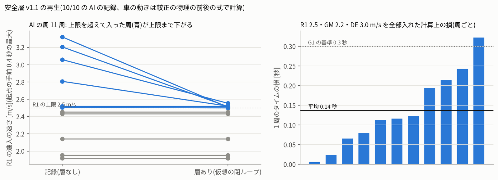

# 安全層 v1(区間の速度上限)— 10/10 の記録で再生して、机上のゲート G1 を判定した(2026-10-16)

- 依頼(10/16 18:00 ごろ):「今週は走行できないので、ほかにできることは?」の作業「7 シミュレーターを実車に近づける」の一部です。安全層 v1 の区間の速度上限(R1 2.5・GM 2.2・DE 3.0 m/s)を、純粋な関数として作りました。それを 10/10 の実車の記録で再生しています(action_plan_20261016/plan.md 項目 9、注 2)。
- **drive.py にはつないでいません。** 走行の既定値も変えていません。入れるのは、G1 の合格とユーザーの了承のあとです(項目 13)。
- 実車は走らせていません。PCA9685・I2C には触れていません。data/raw・data/labels は読むだけです。
- 数字は `g1_replay.json`、図は `fig/g1_r1_entry_lap_loss.png` です。コードは次のとおりです。
  - `jetformer/safety_caps.py`(層)と `tests/test_safety_caps.py`(16 本)
  - `experiments/20261016_sim_calibration/g1_replay.py`(再生)

## 0. 結論

1. **G1 は、文言どおりには合格していません。** 直したあとの版 v1.1 でも、6 つの決まりのうち 2 つが落ちています。
2. **通ったもの(v1.1)**
   - **R1 の合図**: AI の 5 本で、R1 で衝突した通過の 10/11(91%)に、起点の 0.1 秒以上前に合図が出ました(基準 ≥ 90%)。合図の先行は 0.18〜0.57 秒です。
   - **ジャイロの位相の R1 検出**: AI の通過 56 のうち 56 を検出し、誤検出は 0 でした(基準 ≥ 95%・誤検出 0)。
   - **ラップの損**: 計算上の損は、R1・GM・DE の上限を全部入れて **0.15 秒/周** でした(R1 2.75 なら 0.14 秒。基準 ≤ 0.3)。
   - **ブレーキの規則**: 1 m/s 未満でのブレーキ 0 回、R1 の旋回中(起点 → +0.5 秒)のブレーキ 0 回、0.5 秒以内のブレーキ ↔ 中立の往復 0 回。
   - **必要な減速**: 上限を超えて入った通過で、合図の時点から上限まで落とすのに要る減速は、28/31 で 2.8 m/s² 以下でした(R1 2.75 なら 15/17)。
3. **落ちたもの(v1.1)**
   - **007 の R1 の板への衝突の合図が 8/9(89%)**: 基準の 90% に 1 回足りません。落ちた 1 回は、人が取り返して車を置き直し、AI に返した 1.3 秒後に 4.18 m/s で R1 に入った通過です。ジャイロの位相は置き直しを知りようがありません。モデルの予測ステアの合図も、起点の 0.01 秒前にしか出ませんでした。
   - **R1 以外での誤った合図(5 本それぞれ ≤ 1 回/分)**: 006 は 0、007 は 0.27 回/分で合格です。夜の 3 本は、009 が 3.5、010 が 2.5、101 が 5.8 回/分でした。
     - 夜の 3 本は AI の走行が 0.28〜0.81 分しかありません。1〜2 回の合図で基準を超えます。
     - その合図は、衝突のあとの 1〜2 m/s の立て直しや、R1 の手前まで来て衝突・交代で R1 を通らなかったときのものです。
     - 5 本を合わせると 0.79 回/分です。場所が LH・R1 のものを除くと 0.26 回/分で、その 2 回は層の出力を変えていません。
4. **v1 → v1.1 の直しは、G1 の「落ちたら 1 回だけ直す」に当たるものです**(fast_and_safe_plan.md 6 章、deviations D17)。
   - 設計どおりの v1 では、R1 の旋回中のブレーキが 006・007 で各 4 フレームありました。
   - 舵の指令が右へ 30% 以上ならブレーキしない、という直し (A) で 0 になりました。
   - 上限の値は変えていません。
5. **ユーザーに決めてほしいこと**: 次のどちらにするか。
   - 落ちた 2 つ(置き直しの直後の 1 回と、AI の時間が 1 分に満たない夜の 3 本の誤った合図)を、例外として認める。
   - 実車#1 のモデル B の記録で判定し直す(plan.md 注 2「B のログでも同じ基準で判定する」)。B の記録はまだありません。

## 1. 層の中身(jetformer/safety_caps.py)

| 区間 | 決め方(ジャイロの位相。直前の R1 の起点からの向き ψ) | 上限 | ブレーキ |
|---|---|---|---|
| R1_app | ψ ≥ 300 度(LH の後半)、または予測ステアが右いっぱい(ゲイン前 ≤ 1150 µs、前へ ≥ 1 m/s) | 2.5 m/s | 出す |
| R1_turn | R1_app の中で右旋回(5 サンプル平均のヨー < −60 deg/s)が始まってから、ヨーが 0 に戻るまで | 2.5 m/s | 出さない |
| GM | R1 の旋回のあと 〜 ψ ≥ −20 度 | 2.2 m/s | 出さない |
| DE | ψ ≥ −20 度から 1.5 秒 | 3.0 m/s | 出さない |
| unknown | 最初の R1 の前・R1 から 16 秒超・向きが範囲外・1 秒以上止まった | 3.0 m/s | 出さない |
| none | それ以外 | なし | — |

- **R1 の確定**: 次の 5 つがそろったら確定します。
  - 右旋回の最小のヨーが −170 deg/s 以下。
  - 旋回量が −90 度以下(直前 2 秒の左旋回が 90 度超なら −40 度以下)。
  - 直前 2 秒の左旋回が 60 度超。
  - 始まりの速さが 0.75 m/s 以上。
  - 前の R1 から 5 秒超。
- **上限の決まり**
  - v ≤ 上限: 指令を上限で切ります。実車では、較正の速さの対応の逆を使います(R1 2.5 m/s → 約 1342 µs)。
  - v > 上限: 中立にします。
  - v > 上限 + 0.3 m/s かつ v ≥ 1 m/s かつ R1_app のとき: ブレーキ(中立 + 200 µs)。
- **ブレーキの決まり**
  - 始めたら 0.2 秒は保ちます。ただし、区間を出た・1 m/s 未満・右へ切ったときは、すぐやめます。
  - やめたら 0.5 秒は再び始めません。
- **上限を外すとき**: 1.5 m/s² で上げて戻します。
- **出力**: いつも入力以下です(前進を強めない)。舵は変えません。
- **v1.1 の直し**(1 回だけ。v1 は `params_v1()`・`PHASE_V1`・`pred_min_speed=0` で再現できます)
  - (A) 舵の指令が右へ 30% 以上(約 1310 µs 以下)なら、ブレーキを始めない・すぐやめる。舵の指令はヨーより約 0.1 秒先に出ます。
  - (B) 1 秒以上止まったら、位相を不確かにする。R1_app の中で ψ < 240 度になったら(引き返した)、これも不確かにする。
  - (C) 予測ステアの合図は、前へ 1 m/s 以上のときだけ使う。
- **シミュレーター用の写し**: `calib_runtime.mjs` の `governorStep` は、この `cap_step` と同じ動きです。4 つの設定 × 3,000 フレームで出力が一致しました(試験 T6)。

## 2. 再生のしかた

- **対象**: AI の 5 本(006 = 172910、007 = 173445、009 = 203924、010 = 204208、101 = 204605)です。参考として、AI の 3 本(003・004・008)と人の 15 本も再生しました。
  - 「正解」の R1 の起点と、R1 での衝突は、`tools/label_events.py` の course_anchors(後から見た判定)と、data/labels の events を使いました。offline_rl.course_passes と同じ規則です。
- **影の再生(開ループ)**: AI のフレーム(30 Hz)ごとに、そのときの区間・速さ(eRPM)・モデルの出力(ゲインのあと)を層に入れました。合図・誤った合図・ブレーキの規則は、これで数えています。車の動きは記録のままです。
- **仮想の閉ループ(縦だけ)**: AI の周(R1 の起点から次の起点まで、全部 AI、5〜16 秒)を 1 cm ずつ刻みました。
  - 層の出力を、較正の物理 P_cal の前後の式で速さ v' にしました。惰性 0.58 + こすれ 0.40 × 横加速度、ブレーキは +200 µs で 1.42 m/s²、駆動は τ_up 0.32 秒・a_cap 4.1 m/s² です。
  - 道すじ・区間・モデルの指令は、記録のまま(位置の関数)にしました。v' は記録の速さを超えません。
  - ラップの損は Σ ds (1/v' − 1/v_記録) です。AI の周は G1 の 5 本で 9 周、AI の全部で 11 周です(交代の少ない周だけ)。

## 3. 結果(v1 と v1.1、R1 の上限 2.5 m/s)

| G1 の決まり | 基準 | v1(設計どおり) | v1.1(1 回の直し) |
|---|---|---|---|
| R1 で衝突した通過の手前の合図(5 本) | ≥ 90% | 10/11 ✓ | 10/11 ✓ |
| 007 の R1 の板への衝突の合図 | ≥ 90% | 8/9 ✗ | 8/9 ✗ |
| R1 以外での誤った合図(5 本それぞれ) | ≤ 1 回/分 | 006 0・007 0.27・009 14.0・010 5.0・101 5.8 ✗ | 006 0・007 0.27・009 3.5・010 2.5・101 5.8 ✗ |
| 〃 5 本を合わせて(参考) | — | 1.44 回/分 | 0.79 回/分 |
| 〃 LH・R1 の手前の合図を除く(参考) | — | 0.92 回/分 | 0.26 回/分(出力を変えたもの 0) |
| ジャイロの位相の R1 検出・誤検出(AI) | ≥ 95%・0 | 56/56・0 ✓ | 56/56・0 ✓ |
| 計算上のラップの損(9 周の平均) | ≤ 0.3 秒 | 0.15 ✓ | 0.15 ✓ |
| 1 m/s 未満でのブレーキの始まり | 0 | 0 ✓ | 0 ✓ |
| R1 の旋回中(起点 → +0.5 秒)のブレーキ | 0 | 006 4・007 4 フレーム ✗ | 0 ✓ |
| 0.5 秒以内のブレーキ ↔ 中立の往復 | 0 | 0 ✓ | 0 ✓ |

- 合図の内訳(v1.1、5 本の R1 の衝突 11 回): ジャイロの位相だけで 8、予測ステアだけで 10、合わせて 10 でした。
  - 予測ステアの合図は、ジャイロより遅く出ます(007 で先行 0.26〜0.41 秒。ジャイロは 0.43〜0.57 秒)。
  - plan の「R1 が落ちたら、合図を片方にして比べ直す」に当たる比べは、`g1_replay.json` の sig_gyro・sig_pred にあります。
    - ジャイロだけだと 8/11 に落ちます。
    - 予測ステアだけでも 10/11 ですが、先行が短くなり、誤った合図が増えます(007 で 0.82 回/分)。
- ジャイロの位相: 人のログでは 79 のうち 78 を検出し、後から見た判定に無い検出が 8 ありました。人の走行では層を使わないので、判定の外です。

## 4. R1 の上限 2.5 と 2.75 の比べ(v1.1)

| | R1 2.5 m/s | R1 2.75 m/s |
|---|---|---|
| 上限を超えて入った通過(5 本) | 31 | 17 |
| 合図の時点から上限まで落とすのに要る減速 ≤ 2.8 m/s² | 28/31(合図なし 1) | 15/17(合図なし 1) |
| 〃 ≤ 2.0 m/s²(名目のブレーキ + 惰性) | 24/31 | 14/17 |
| 影の再生でのブレーキの始まり(006 / 007 / 009 / 010 / 101) | 5 / 6 / 0 / 1 / 1 | 1 / 5 / 0 / 0 / 1 |
| ブレーキの長さ(中央値) | 0.10〜0.40 秒 | 0.07〜0.10 秒 |
| 仮想の閉ループでの R1 の進入(上限を超えて入った周) | 6 周 → 全部 2.55 m/s 以下 | 4 周 → 全部 2.77 m/s 以下 |
| 計算上のラップの損(G1 の 9 周の平均 / 中央値 / 最大) | 0.15 / 0.12 / 0.32 秒 | 0.14 / 0.12 / 0.29 秒 |

- 仮想の閉ループでは、ブレーキは一度も要りませんでした。R1_app に入ったところ(LH の出口)でスロットルを中立にするだけで、上限まで落ちています。
  - そのため、ブレーキの弱め・名目・強めで結果は同じです。
  - これは、較正のこすれ(曲がりながらの減速)が LH の出口で効くためです。こすれの式は直線で、2〜6 m/s² では大きめに出る(identify.md)ので、楽観寄りかもしれません。
- 影の再生でのブレーキは、記録の速さが落ちない(層の出力が効かない)ので、多めに出ています。
- 層が AI の出力を変えたフレームは、006・007 で約 24% でした(上限で切る 10〜12%、中立 12〜13%、ブレーキ 0.3%)。
  - GM 2.2・DE 3.0・不確か 3.0 と、上限を外すときの 1.5 m/s² の戻しを含みます。
  - 007 はスロットルのゲイン 2.0 の時間が長く、上限で切るフレームが多くなっています。
- 「2.75 も候補」かどうかは、この再生では決められません。シミュレーターの試験(S4)と、実車の A/B/A で決めます。
  - ここで分かるのは、2.75 の方が損が 0.01 秒小さく、ブレーキが少ないことです。
  - ただし、ゲイン 1.0/1.0 に近いときの R1 の強い衝突 2 回は、5398・5645 eRPM(2.70・2.82 m/s)で入っていました。2.75 ではほぼ防げません(fast_and_safe_plan.md の「R1 の上限を 2.75 から 2.5 m/s にした理由」)。

## 5. 落ちた 2 つの中身

- **007 の 106.17 秒の通過**(進入 4.18 m/s、強い衝突 4.0 G)の経緯は次のとおりです。
  - 92.99 秒: R1 で衝突。
  - 97.1 秒: 人が取り返す。
  - 99.0〜101.9 秒: AI。
  - 100.99 秒: GM で衝突。
  - 101.9〜104.8 秒: 人。
  - 104.83 秒: AI に返す。
  - 106.17 秒: R1。
  - v1 のジャイロの位相は、この間ずっと「GM」のままでした。止まっている間は向きを積分しないので、人が車を置き直した分が抜けます。
  - v1.1 では、止まった時点で「不確か」(上限 3.0 m/s、ブレーキなし)になります。それでも R1 の手前で合図は出ません。予測ステアの合図は 0.01 秒前でした。
  - 返した直後に数秒だけ R1 の上限を掛ける案があります(explore_control.md C8「AI へ返したあと 3 秒間は、R1 区間の速度上限を 2.3 m/s に」)。これなら防げます。ただし今回の 1 回の直しには入れていません。
- **夜の 3 本の誤った合図**(v1.1)は 5 回です。
  - 009: 23.99 秒(場所 不明、1.98 m/s)。
  - 010: 14.79 秒(LH、1.03 m/s)と 83.54 秒(LH、1.39 m/s)。
  - 101: 42.07 秒(LH、2.02 m/s)と 52.23 秒(GM、1.06 m/s)。
  - 層の出力を変えたのは 010 の 83.54 秒の 1 回だけです。R1 の手前の LH で、上限 2.5 m/s で切りました。

## 6. 限界

- **記録は 10/10 の first_trial だけです。** 推奨のモデル B は一度も走っていないので、B の記録での判定はできていません。
- 夜の 3 本は、センサーの向きのずれ・速い設定・短い区間が重なっていて、AI の時間が 1 分未満です。
- **仮想の閉ループは縦だけで、目安です。**
  - 道すじとモデルの指令は、記録のまま(位置の関数)にしました。上限を外したあとのモデルの再加速(突き上げ)は、1.5 m/s² の戻しで代えています。
  - 上限で遅くなったときに、モデルが道すじや舵を変えるかは分かりません。
- **ブレーキの表は仮です**(16 回、強いもの 3 回)。計画項目 8 で実測します。
- 区間の判定は、ジャイロの積分と eRPM です。衝撃で ±1000 dps に張り付く・空転で eRPM が大きく出る、という弱点はそのままです。
- G1 の DE 出口の整形と ToF ガード v2 は、この層とは別なので、ここでは判定していません。

## 7. ファイル

| ファイル | 中身 |
|---|---|
| `/home/jetson/jetformer/jetformer/safety_caps.py` | 層(区間の上限・ブレーキの規則・ジャイロの位相・合図の合わせ方・PWM の換算)。純粋な関数 |
| `/home/jetson/jetformer/tests/test_safety_caps.py` | 試験 16 本(換算・決まり・不変条件の乱数試験 3 万フレーム × 3・合成の周での位相・v1.1 の直し) |
| `experiments/20261016_sim_calibration/g1_replay.py` | 再生(影・仮想の閉ループ)と G1 の判定 |
| `g1_replay.json` | v1・v1.1 のログごとの通過・合図・誤った合図・ブレーキ・周ごとの損・判定 |
| `fig/g1_r1_entry_lap_loss.png` | R1 の進入の速さ(記録 → 層あり)と周ごとの損 |
| `tests/t6_vectors.json`・`experiments/.../tests/governor.test.mjs` | 試験 T6(Python と JS の上限の層が同じ) |
