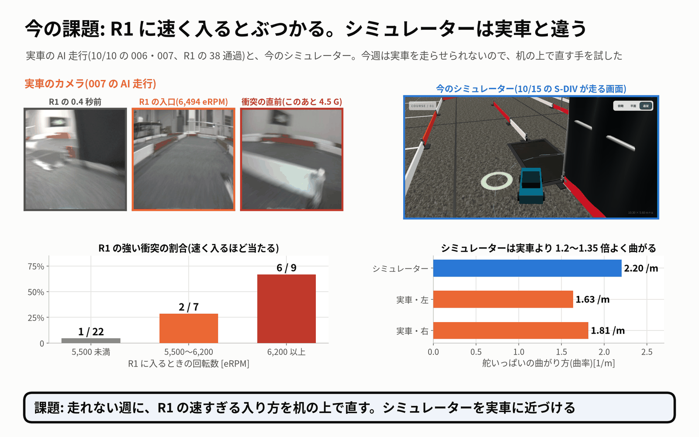
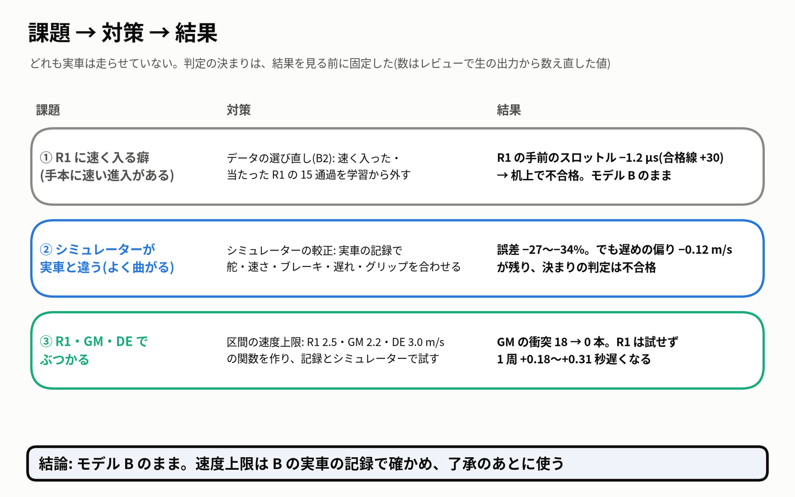
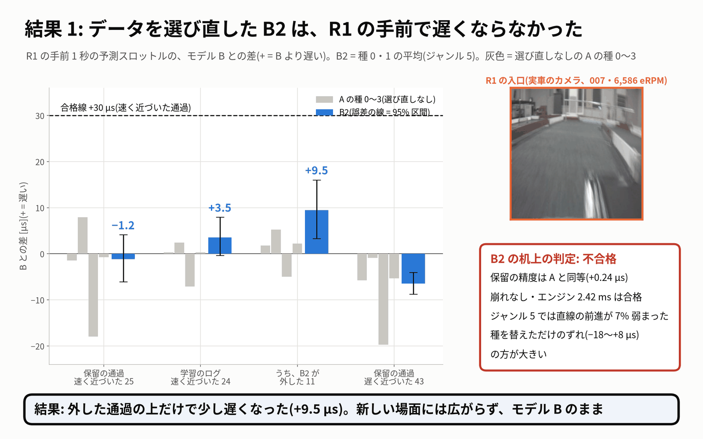
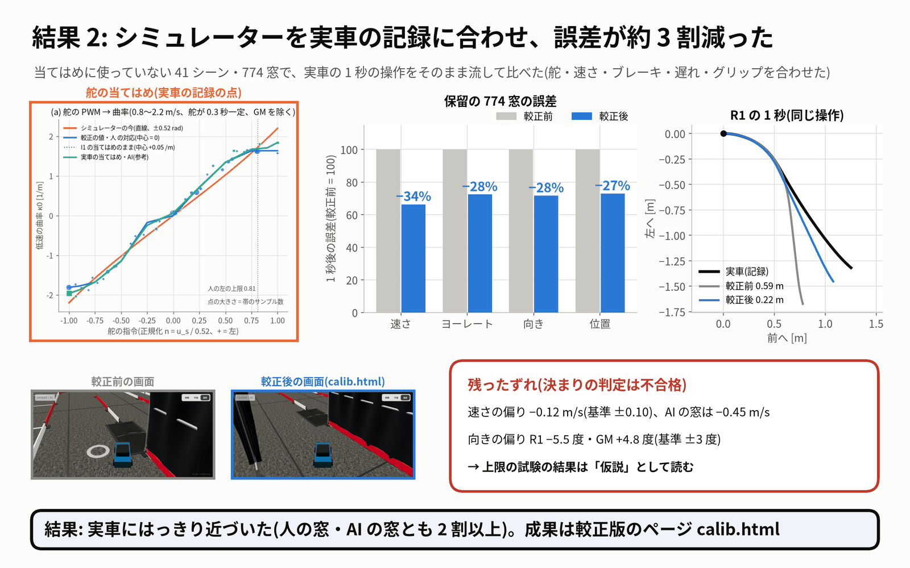
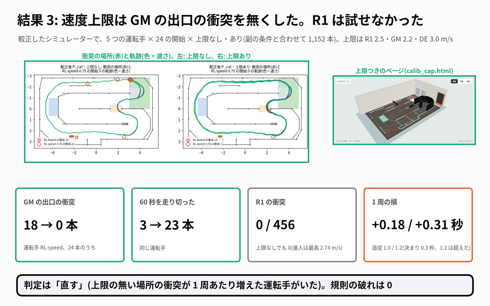

# 10月16日のレポート — 走れない週に、机の上でできること

- **依頼**(10/16 18:00 ごろ):「今週は走行できないので、ほかにできることは？」
  - 選ばれた 2 つを進めました: **「4 データを選び直して B2 を学習」** と **「7 シミュレーターを実車に近づける」**。
  - 7 の中で、計画の項目 9 の「区間の速度上限(安全層 v1)」も関数として作り、記録とシミュレーターで試しました。
- **実車は走らせていません。** PCA9685・I2C、`jetformer/drive.py`・走行の既定(推奨のモデル・設定)には触れていません。
  - 生データ・既存のデータセット・ユーザーのシミュレーターのファイルも書き換えていません。git commit はしていません。
- 判定の決まりは、どれも結果を見る前に固定しました。数はレビューで生の出力から数え直し、全部一致しました(`review.md`)。

## 1. 今の課題

- **実車が R1 に速く入ると、ぶつかります。** 10/10 の AI 走行(006・007)では、R1 の強い衝突は次のとおりでした。
  - 5,500 eRPM 未満で入ったとき: 1/22
  - 5,500〜6,200 で入ったとき: 2/7
  - 6,200 以上で入ったとき: 6/9
- **シミュレーターは、実車と違います。** 舵いっぱいで、シミュレーターは 2.20 /m 曲がります。実車は左 1.63・右 1.81 /m です。
  - 速さ・ブレーキ・遅れも、実車の記録と合っていませんでした。
  - そのため、シミュレーターで良かった方策が、実車で良いとは言えませんでした。
- 前回(10/15)の課題は「実車で確かめる」ことでした。今週は走れないので、机の上でできることを進めました。

## 2. 対策(3 つ)

### ① データを選び直して B2 を学習(計画の項目 10)

- モデル B と同じ作り方(jetformer_v0、今の操作値なし、衝突 2.5 G の除外)で、学習のデータだけ選び直しました。種は 0 と 1 です。
  - **外した**: 人が R1 に 6,200 eRPM 以上で入った通過の手前(−2〜+1 秒)と、R1 で当たった通過。人の 73 通過のうち 15 通過で、学習サンプルの 5.7% です。
  - **付け直した**: 152405・152707 のジャンルを 5 から 4(高速走行)に直しました。生ログの記録は 4 で、走りも速かったためです。
- 元のデータセットは書き換えず、外す表・付け替えの表と、ハードリンクの別のデータセットで作りました。

### ② シミュレーターの較正

- 10/10 の実車の記録から、舵の曲がり方(左右別)、舵の遅れと速さ、速さの対応、惰性とこすれ、ブレーキ、路面のグリップ、電池の効きを当てはめました。
- 当てはめは、各ログのシーンの 2/3 だけで行いました。残りの 1/3(41 シーン・774 窓)で、前と後を比べました。
- ユーザーのシミュレーターのファイルは変えていません。読み込むときに sim-core.js を書き換える方法で、較正版のページを作りました。
  - 較正版: `sim_calibration_20261016/sim/dist/calib.html`
  - 上限つき: `sim_calibration_20261016/sim/dist/calib_cap.html`

### ③ 区間の速度上限(安全層 v1、計画の項目 9)

- 上限は R1 2.5・GM 2.2・DE 3.0 m/s です。ブレーキは R1 の手前だけで出します。これを純粋な関数 `jetformer/safety_caps.py` として作りました(試験 16 本)。
- **drive.py にはつないでいません。**
- 次の 2 つで試しました。
  - 10/10 の実車の記録で再生した(G1 の判定)。
  - 較正したシミュレーターで、5 つの運転手 × 24 の開始 × 上限なし・ありを走らせた。

## 3. 結果

| 対策 | 決まりの判定 | いちばん大事な数 | 読み |
|---|---|---|---|
| ① B2 | **不合格(no-go)** | R1 の手前 1 秒のスロットルの B との差: **−1.2 µs**(合格線 +30 µs)。ジャンル 4 で走らせても +10.1 µs | 種を替えただけの A のずれ(−18〜+8 µs)に埋もれる。**モデル B のまま** |
| ① B2 の精度・エンジン | 合格 | 保留の L1 は A と同等(+0.24 µs)。エンジン run_numpy 2.42 ms(B 2.37 ms) | 選び直しで壊れてはいない |
| ② 較正 | **不合格(偏りだけ)** | 1 秒後の誤差: 速さ **−34%**・ヨーレート −28%・向き −28%・位置 −27% | 実車にはっきり近づいた。でも、速さの偏り −0.12 m/s(基準 ±0.10)が残った。AI の窓は −0.45 m/s |
| ③ 上限: 実車の記録で再生(G1) | **不合格(2 項目)** | R1 で当たった通過の 10/11 に合図。ラップの損 0.15 秒/周。旋回中のブレーキ 0 | 落ちたのは 2 項目。007 の板への合図が 8/9、夜の短い 3 本の誤った合図。**B の記録で判定し直す** |
| ③ 上限: 較正したシミュレーター | **「直す」** | GM の出口の衝突 **18 → 0 本**(24 本のうち)。R1 の衝突は上限なしでも 0/456。周の損 +0.18 / +0.31 秒 | GM に効いた(古い物理で学んだ運転手 1 つ)。**R1 は試せなかった**。仮説として読む |

- **B2**: 効きは、学習から外した通過そのものの上だけに出ました(+9.5 µs)。新しい場面には広がりませんでした。
  - ジャンル 5 は遅いログだけになり、直線の前進が 7% 弱まりました。
- **較正**: 人の窓・AI の窓とも 2 割以上よくなり、R1・GM・DE・LH のどの区間も悪くなっていません。
  - 残ったずれは、AI の操作のときの遅さと、区間ごとの向きの偏り(R1 −5.5 度・GM +4.8 度)です。
  - 較正の物理では、10/15 の S-DIV は最初の左の U ターンを曲がり切れず、完走が 5/12 から 0/12 になりました。今の方策は、較正の物理で学び直しが要ります。
- **上限**: 不変条件(旋回中のブレーキ、1 m/s 未満のブレーキ、指令を大きくする、後退)は、全部の走行で 0 でした。
  - 周が遅くなる主な原因は、DE の 3.0 m/s です。
  - 上限ありの RL-fastest で、R1 の内側の柱に 0.9 m/s で当たった走行が 1 本ありました(上限なしでは 0 本)。上限で遅くなると線が変わることがある、という仮説です。

## 4. 来週の実車でやること(A/B/A のカード)

| カード | 並び | 走る条件 | 今の状態 |
|---|---|---|---|
| **カード 1** | 慣らし 2〜3 周のあと、B を 3 ブロック・合計 60 周以上(設定は固定、上限 0) | 走る前の準備(下)が済んでいる | **実車#1 でやる** |
| **カード 2** | B 22 周 → **B + 速度上限** 43 周 → B 22 周 | B の記録で G1 に合格し、**ユーザーが了承**してから drive.py に入れる | 待ち |
| **カード 3** | B 22 周 → B2 43 周 → B 22 周 | 机上の判定に合格すること | **走らない**(B2 は no-go) |

- **走る前**(ユーザー)
  - コースの配置を確かめる。特に、GM の出口側の芝の斜めの板(X 9.52〜9.65・Z 4.62〜5.56)が今もあるか。シミュレーターの世界からは外されています。
  - Jetson の電源、車輪を浮かせた安全確認 5 つ、カメラと ToF の取り付けの固定。
- **実車#1 の最後**(ユーザーが送信機で): ESC のブレーキ量を測る。2 m/s から 3 m/s で、弱・中・強を各 5 回、床と芝で行います。
  - 今のブレーキ表は 16 回(強いのは 3 回)からの仮の値です。測った表で、較正を v2 にします。
- **実車#1 のあと**(机上・エージェント): B の記録で上限の層を再生し、G1 を判定し直します。
  - 最初に見るのは、B の走りでもジャイロの位相が R1 を確定できるかです。シミュレーターでは、ゆっくり回る運転手で確定しませんでした。
- **カード 2 の確かめ方**(計画の注 4)
  - R1 の強い衝突/通過と、DE の衝突/通過が下がること。
  - 全体の衝突/周の点推定が 1.1 以下、ラップの悪化が 0.3 秒以内であること。
  - 旋回中のブレーキが 0 であること。初めて使う走行で R1 の旋回中にブレーキが出たら、中止します。
- CH3 は人が持ち、いつでも取り返せるようにします(計画 3 章の共通の決まり)。

## 5. ユーザーに決めてほしいこと

1. **G1 の落ちた 2 項目**を例外として認めるか、B の記録で判定し直すか。おすすめは、判定し直すことです。
2. **速度上限を drive.py に入れてよいか**(G1 に合格したあと)。入れるなら、どの区間からにするか。
   - 案 A: 3 区間(R1 2.5・GM 2.2・DE 3.0)を計画どおりに入れる。
   - 案 B: R1 と GM だけ入れ、DE は外すか 3.3 に上げる。DE の 3.0 は、周の損の主な原因でした。
3. **コースの芝の斜めの板**が今もあるか。
4. **走行の一覧の B2(`b2cur_20261016-s0`)**を残すか消すか。推奨は B のままです。間違えて選ばないよう、気をつけてください。

## 6. 課題

- **R1 の速すぎる入り方を直す手は、まだ見つかっていません。** データを外すだけ(B2)では効きませんでした。
  - 次の候補は、計画の項目 12 の「遅く入って速く出る」新しい録画です。
- **R1 の上限が効くかは、実車でしか分かりません。** 較正したシミュレーターでは、R1 でぶつかる場面が出ませんでした。
- **較正の残りのずれ**: AI の操作のときに 0.45 m/s 遅い点と、区間ごとの向きの偏りです。
  - 舵の遊び、こすれの 2 乗の項、AI の PWM の経路の確認を v2 で試します。
- **ブレーキの量**は、実車#1 で測るまで仮の値です。
- **シミュレーターの方策**(S-DIV・RL の先生)は、較正の物理で学び直しが要ります。
- 机上の物差し(予測の差)には、種のばらつきだけで ±20 µs くらいの揺れがあります。小さい効きを見るには、種を 4 本以上にする必要があります。

## 7. ファイル

| 場所 | 中身 |
|---|---|
| `review.md` | レビュー: 数え直し・sha256・触っていないかの確かめ・試験(pytest 747 合格・Node 20 合格)・指摘 |
| `video/storyboard.json`・`video/fig/` | 約 1 分の動画の絵コンテと図 |
| `/home/jetson/jetformer_reports/b2_curation_20261016/` | B2: README・evaluation・protocol・カード |
| `/home/jetson/jetformer_reports/sim_calibration_20261016/` | 較正: identify(当てはめ)・fidelity(前後の比較)・g1_replay(記録での再生)・simtest(シミュレーターでの上限の試験)・profiles(P_cal・P_cfg) |
| `/home/jetson/jetformer/jetformer/safety_caps.py`・`tests/test_safety_caps.py` | 安全層 v1.1(どこにもつないでいない) |
| `/home/jetson/jetformer/experiments/20261016_b2_curation/`・`20261016_sim_calibration/` | 道具と試験 |
