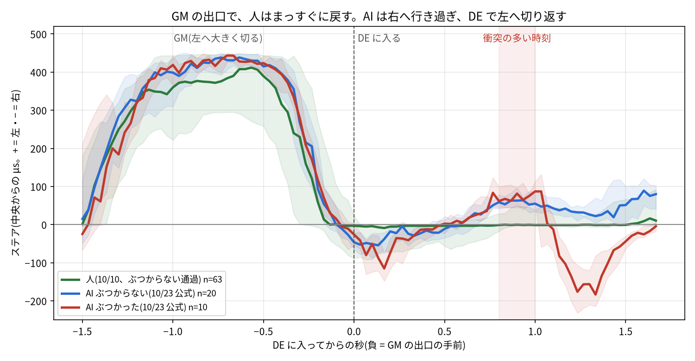

# 10/23 の AI 走行の総合評価と、課題の対策(10/24 早朝の追記)

> このファイルは `~/jetformer_reports/real_bench_20261023/explore/README.md` の写し。`../analysis/*.py` もその写しで、表(runs.json)と同じフォルダ(レポートの explore/)で動かす前提(`runs_table.py` → `de_pass.py` → `de_line.py`・`de_line_wide.py` → `fig_de_line.py` の順)。

- 作成: 2026-10-24 4〜6 時(エージェント)。読むだけの解析。車は動かしていない。
- 上の `README.md` は `tools/bench_report.py` が自動で作るので、追記はこのフォルダに置いた(夜の集計で消えない)。
- 対象: 10/23 の AI 走行 ai_no 1〜26(ai 2 は log.json が 0 バイトで除外)。公式 8 本 = ai_no 8〜15、慣らし = 3〜7、公式のあとの試し = 16〜26。
- 数の出典: `data/labels/20261023-*.json・.npz`(`tools/label_events.py`。10/24 に ai 18〜26 の 9 本を新しく作った)と `../assign_20261023.json`。
- 動画(3 分版): `../JetFormer_10月23日のレポート_実車ベンチマーク1日目_3分版.mp4`(177.8 秒、13 場面。5 時台に「もとは GM の出口の揺れ」の場面を足して作り直した。前の版は `../video/old_3min_v1.mp4`)。Web: https://claude.ai/artifact/LsTTWEmJnkxX6dTTaC7hdh

## 0. 結論

1. **DE の衝突は速さでは分かれない**(R1 と違う)。公式 8 本の AI の DE の通過 30 回のうち 10 回が衝突。DE の中の最大の速さの中央値は、ぶつかった通過 6,372 eRPM、ぶつからない通過 6,668 eRPM(ぶつからない方がむしろ速い)。入口の速さもほぼ同じ(4,704 と 4,744)。衝突は DE に入って **0.8〜1.0 秒**の同じ場所に集まる。→ 区間の速度上限(DE 3.0 m/s)だけでは減らない見込み。
2. **DE の衝突のもとは GM の出口のステアの揺れ**(10/24 5 時に直した。最初の版は人の記録の中央を 1500 µs で引いていて「人は軽い右」と書いたが誤り。人の記録の ref_us は既定の 1500 のままで、本当の中央は同じ日の AI の記録の 1443 µs)。
   - 人(10/10 の 63 通過)は GM の左の切り(最大 +412 µs)を戻して、DE ではまっすぐ(約 0 µs)のまま抜ける。
   - AI(10/23 公式)は GM で少し深く切り(+438〜444)、戻すのが 1〜2 フレーム遅く、**DE に入ると右へ行き過ぎ**(入って 0.5 秒の右の最大、通過ごとの中央値: ぶつからない −73・ぶつかった −141 µs。`tools/de_swing.py`)、**0.6 秒から左へ切り返す**(0.8〜1.0 秒で +60〜+90 µs)。左 → 右 → 左の揺れで、衝突はこの切り返しの時刻に集まる。
   - 右への行き過ぎが −120 µs を超えた通過は、ぶつかった 6/10・ぶつからない 4/20(関係はあるが、これだけでは分けられない)。
   - ゲインを上げた試しほど行き過ぎが大きく、DE の衝突も多い(B の基準 −103 µs・6/14、ステア 1.2 −161・2/6、ステア 1.3・速度 1.25 −307・8/9)。揺れが強まると当たる、という見立てと合う。
   - 机上の確かめ: 保留の人の DE のフレーム(532)では、どのモデルも人の正解との差の平均が ±13 µs 以内(人の状態ではまねできている)。10/10 の AI 走行の DE のフレーム(同じ 3,161 フレーム)では、12 本どれも入って 0.6〜1.0 秒で +36〜+72 µs の左を予測する。→ モデルの癖ではなく、**AI 自身が作った状態(行き過ぎたあと)からの立て直し**。1 本のモデルを替えるだけでは直らない見込み。
3. **遅く入る型(SLOW-SEC1)は DE で 0/6**(公式 3・慣らし 3)。B は 9/22(41%)。同じ率なら 0/6 になる確率は約 7%(弱い証拠)。ずれに強い型(AUG)も 0/3。
4. **ゲインを上げると壊れる**。B のゲイン 1.2〜1.4(ai 16〜19)は 100 m あたり衝突 8.4(公式 B は 1.6)、DE の通過 17 回中 14 回で衝突。
5. **ToF ガード 3 は 77 m で弱い衝突 1 回(2.7 G)**。ただし 2.4 m/s・10.8 秒/周と遅く、1 本だけ。ガード 2 は 2 本で 2.5/100 m。
6. **AI 側にしても走り出さない走行があった**(ai 5・7。止まった絵でモデルのスロットルが中立 1,486〜1,496 µs のまま。「止まったままの交代」はその日全体で 5 回、うち ai 5・7 で 4 回)。→ 発進の補助を足した(下の 3)。

## 1. 1 本ずつの表(AI が操作していたフレームの衝突)

`runs.md`(`runs_table.py` が作る)。主な行:

| 区分 | ai | モデル・設定 | AI の距離 | 速さ | 衝突(強い) | 衝突/100 m | 場所 |
|---|---|---|---|---|---|---|---|
| 公式 B | 8・11・15 | B・基準 | 372 m | 2.76 m/s | 6(5) | 1.6 | DE 6 |
| 公式 全 8 本 | 8〜15 | 計画どおり | 820 m | 2.75 m/s | 15(13) | 1.8 | DE 10・R1 3・HS 1・SW 1 |
| 慣らし | 3〜7 | ステア 1.2〜1.3 | 244 m | 2.06 m/s | 8(5) | 3.3 | |
| 試し | 16〜19 | B・ゲイン 1.2〜1.4 | 394 m | 3.16 m/s | 33(18) | 8.4 | R1 10・DE 8・GM 7 |
| 試し | 20・21 | B・ToF ガード 2 | 121 m | 2.43 m/s | 3(2) | 2.5 | DE 2 |
| 試し | 22 | B・ToF ガード 3 | 77 m | 2.42 m/s | 1(0) | 1.3 | DE 1(2.7 G) |
| 試し | 23 | WGT・1.2・ガード 0 | 88 m | 3.10 m/s | 11(8) | 12.5 | |
| 試し | 24 | tcp-s1・1.2 | 62 m | 3.28 m/s | 7(3) | 11.4 | |
| 試し | 25・26 | dinov2-s0・1.2 | 12 m | 1.80 m/s | 2(2) | 16.8 | ai 25 は AI 側にしていない |

注意: 試しはどれも 1〜4 本・1〜6 周で、ゲインと ToF ガードを同時に変えた行もある。順位の材料ではなく、向きの目安。

## 2. DE の詳しい中身

- `de_pass.py` → `de_pass.json`: AI の DE の通過 1 回 1 行(入口・最大・平均の速さ、ステア、ガードの警告、衝突)。
- `de_line.py`・`de_line.json`: DE に入ってからのステアの中央値(人・AI ぶつからない・AI ぶつかった)。`fig_de_line.py` → `de_line.png` は GM の出口から(`de_line_wide.json`)。

- 図のデータは `de_line_wide.json`(GM の出口の 1.5 秒前から。`de_line_wide.py` が作る。`de_line.py` は DE の中だけの版)。
- ToF ガードの表示は、DE ではどの通過も「衝突まで約 0.1 秒」(ぶつかる通過もぶつからない通過も同じ)。今のガードの合図では見分けられない。
- ステアの符号は `jetformer/tof_guard.py` の約束(+ = 左)。カメラの絵では白い壁に正面から当たっている(動画の k2 の 3 コマ)。
- 限界: 人の通過は 10/10 の記録(B の学習のもとのデータ)。10/23 のコースの置き方・照明が同じかは記録からは分からない。DE の区切りはジャイロの向きで決めるので、人と AI で場所が少しずれうる(同じ「入って 0.9 秒」が同じ場所とは限らない)。

## 3. 実施した対策(10/24 早朝。コードはコミットしていない)

| 課題(10/23) | 対策 | 場所 | 確かめ |
|---|---|---|---|
| モデル・設定を替えても説明欄が block=1 cand=B のまま残り、B に混ざった(16 本) | 走行開始のとき、説明欄のブロックの計画(候補のモデル)と基準の設定(速度・先読み・ToF ガード・重ね合わせ・上限・TCP・ジャンル)を照らし、違えば **cand=EXP・official=0 にして memo に違いを書く**。ステアは「この日のステア」があるので試しにしないが、基準と違えば steer= の欄に残す。画面にも「試しとして記録します」と出す | `jetformer/web/bench.py` の `plan_check`・`server.py` の `/api/drive/start` | `tests/test_bench_after.py`(10/23 の ai 17・23・24 の形を再現) |
| 電池の番号・電圧・止めた理由が全記録で空 | 走行タブに **「走り終わりのメモ」**(ベンチマークの説明欄で収集した走行が止まると出る)。電池の番号・走る前と後の電圧・止めた理由(240秒走った / 安全で中止 / 回れない / B止め / 電池 / その他)・メモ。AI の時間が 240 秒未満なら赤で知らせる。書くと、その記録のシーンの説明に入り、夜の集計(`section_scorecard.effective_description`)が読む | `bench.py` の `after_description`・`POST /api/bench/after`、`index.html`・`app.js` の `#dr-after` | 同上(シーンに書いて夜の道具で読めるか) |
| AI 側にしても走り出さない | **発進の補助**(10/23 夜に作った。基準の設定で ON)。AI 側にした直後、止まっていてモデルが進まないときだけ中立 − 80 µs を最大 2 秒。一度動いたら終わり。前が近い(ToF の衝突まで 1 秒未満)・モデルがブレーキのときは出さない | `jetformer/assist.py` の `StartKick`・`drive.py` | `tests/test_start_kick.py`。**実車ではまだ試していない** |
| AI の走行の番号が無い | その日の 1 から `ai_no=N` を説明欄の先頭に(10/23 夜に作った) | `bench.py`・`server.py` | `tests/test_ai_run_no.py` |
| 2 日目のブロックが未記入 | protocol どおり B 案(T1・T2 = なし → **B・B・B**)を `data/bench_candidates.json` に書いた(前のファイルは `.20261024-042728.bak`) | `tools/bench_day2.py --plan B --write` | 画面の読み込みで 3 ブロック |
| 試験 2 件が落ちていた | 発進の補助の既定(基準 ON)に合わせた・夜の道具の試験を本物の 10/23 の記録に左右されない日付に | `tests/test_bench_ui.py`・`tests/test_bench_tools_fix.py`・`tests/test_drive_caps.py` | 全体の試験 |
| DE の衝突のもと(GM の出口の揺れ)を測る道具が無い | **DE の揺れの表** `tools/de_swing.py`: DE の通過ごとの右への行き過ぎ・左への切り返し・衝突を、設定(モデル・ゲイン・先読み・重ね合わせ・ToF ガード)ごとにまとめる。夜の 1 コマンドの段 4b で `nightly_<日>/de_swing/de_swing.md` に出る | `tools/de_swing.py`・`tools/bench_nightly.sh` | `tests/test_de_swing.py`、10/23 の記録で実行 |

## 4. DE の対策の案(まだ実施していない。決めるのはユーザー)

DE は速さではなく、GM の出口のステアの揺れ(行き過ぎと切り返し)の問題なので、区間の速度上限を ON にするだけでは減らない見込み。案(手間の小さい順):

1. **揺れを抑える走行の設定を試しで**(2 日目の公式 3 ブロックのあと。B のブロックを押してから設定を変えれば、自動で cand=EXP になる):
   - **先読み 4**(基準 3)。AI の戻しは人より 1〜2 フレーム遅い。先の予測を使えば遅れを打ち消せるか。10/13 のシミュレーターでは先読み 2 が「少し効いた」。
   - **予測の重ね合わせ(ensemble_j 2〜3)**。揺れを均す向き。ただし遅れも足しうるので、先読みと組で見る。
   - それぞれ 240 秒。見る数は DE の通過あたりの衝突と、入って 0.5 秒の右への行き過ぎ・0.6〜1.0 秒の切り返し。**夜の 1 コマンド(bench_nightly.sh)が `de_swing/de_swing.md` に設定ごとに出す**(10/24 に足した `tools/de_swing.py`)。
2. **SLOW-SEC1 と AUG を試しで 240 秒ずつ**(DE 0/6・0/3 が偶然かを見る)。
3. **今のコースで人のきれいな周を 10〜20 周**(10/10 の人の線と同じか確かめる。立て直しを学ぶなら、AI が行き過ぎた状態から人が戻す記録=交代の記録も役に立つ)。
4. **学習**(机上の門のあとで): AI 走行の DE の行き過ぎの場面で人が立て直した記録(交代のあとの区間)を学習に足す(DAgger の考え方)。人の状態だけの学習では、行き過ぎたあとの戻し方を学べない。机上の指標は「10/10 の AI 走行の DE のフレームで、入って 0.6〜1.0 秒の左の予測」(今は 12 本とも +36〜+72 µs)。

## 5. 2 日目の運用のお願い

- 1 ブロック 240 秒(画面の AI の時間 4:00)まで走り切る。止めたら「走り終わりのメモ」に理由を書く。
- 最初の 1 本で、発進の補助(AI 側にしたら走り出す)を確かめる。
- 説明欄の電池の番号と走る前の電圧は、走る前に書く(書き忘れても、走り終わりのメモで書ける)。
- 夜の集計: `bash tools/bench_nightly.sh 20261024 --day1 20261023 --assign <10/23 と 10/24 の 2 日分の assign>`(10/23 分は `../assign_20261023.json` をそのまま含める)。
